# باب نہم، حصہ الف: نظامی مواءمت کی توثیق — جائزہ

<strong>کارپس میں مقام (غیرِ عملی): فائل کی ساخت اور مطالعے کے قواعد</strong>

> یہ فائل **شعوری آئین کا حصہ** ہے اور صرف تب **پابند** ہے جب اسے دوسری نمبر والی `core_*` فائلوں کے ساتھ ایک متن کے طور پر پڑھا جائے۔ اس میں **باب نہم، حصہ الف** ہے — توثیق کا مقصد، عمل کا خلاصہ، اور عمل کے پہلے دو مراحل — **فریم بندی** (نظامی جماعت) اور **جائزہ** (تین ذیلی مراحل میں پورے نظام کا جائزہ: ہمیشہ لاگو جائزے، بشمول ڈیٹا کی اقسام اور ہینڈلنگ، **§3** میں؛ جہاں متعلق ہو لاگو ہونے والے جائزے **§4** میں؛ اور محرک ہونے پر لاگو حقوق کی تہہ اور شعبہ جاتی جائزے **§5** میں) — **§1–§5**۔ کام شدہ **جماعت A / B / C کی مثالیں** (نظامی جماعت کے خاکے اور §3.4، §5.1، §5.2، §5.3، §5.4، §5.5، اور §5.6 کے عملی جائزے)، جن میں ہر مثال کا **نظامی جماعتوں کے لحاظ سے مطالعہ** والا پیراگراف بھی شامل ہے، نظامی خاندان کی [CS-9.320](corpus_systems/cs_09.320_system_alignment_certification_illustrations.md#cs-9320-system-alignment-certification-illustrations) (*نظامی مواءمت کی توثیق کی مثالیں*) میں ہیں، اس باب میں نہیں؛ ہر مثال اس حصے کی نشاندہی کرتی ہے جسے وہ واضح کرتی ہے۔ ان پیراگراف میں بیان کردہ پابند نظامی جماعت کے پیمانے اور درجہ بندی کے قواعد اسی فائل میں رہتے ہیں: نظامی جماعت کے پیمانے، بشمول شرکت اور تناسب، §2.2 میں؛ ڈیٹا ہینڈلنگ کا پیمانہ §3.4 میں؛ اور §5.1–§5.6 میں ہر ایک کا **نظامی جماعت کا پیمانہ اور درجہ بندی** والا پیراگراف۔ پورے باب کی فائلیں نیچے کے جدول میں ہیں۔
>
> **باب نہم کی فائلیں۔** باب نہم تین پابند فائلوں میں تقسیم ہے جنہیں ایک متن کے طور پر پڑھا جائے۔ حصہ الف، یعنی یہ فائل، باب کھولتی ہے؛ الگ اشاریہ فائل نہیں۔ عملی مثالیں باب کا حصہ نہیں، بلکہ [CS-9.320](corpus_systems/cs_09.320_system_alignment_certification_illustrations.md#cs-9320-system-alignment-certification-illustrations) (*نظامی مواءمت کی توثیق کی مثالیں*) میں ہیں۔
>
> | حصہ | فائل | دائرۂ کار |
> |------|------|------|
> | **حصہ الف — جائزہ** | [`core_09.000_system_alignment_certification_evaluation.md`](core_09.000_system_alignment_certification_evaluation.md) | §1–§5: مقصد اور عمل کا خلاصہ (چھ مراحل کے پورے توثیقی عمل کے چارٹ سمیت)، **مرحلہ اوّل، فریم بندی** (نظامی جماعت، ہر جائزے پر اس کا اثر، اور آزمائشی توثیق) اور **مرحلہ دوم، جائزہ** (تین ذیلی مراحل میں پورے نظام کا جائزہ: **IIa** ہمیشہ، §3 میں، بشمول منشور کا دائرہ بمقابلہ فعلی حدود اور ڈیٹا کی اقسام و ہینڈلنگ؛ **IIb** جہاں متعلق ہو، §4 میں؛ اور **IIc** جہاں محرک ہو، حقوق کی تہہ اور شعبہ جاتی جائزے، §5 میں) |
> | **حصہ ب — فورم کا عمل اور نتائج** | [`core_09.005_system_alignment_certification_record_process.md`](core_09.005_system_alignment_certification_record_process.md) | §6–§7: **مرحلہ سوم، نظرثانی** (فورم کے کردار، نگران ترتیب، اور چیلنج پذیری کی زنجیر) اور **مرحلہ چہارم، فیصلہ** (توثیق کے نتائج، بشمول آغازِ کار کی شرط) — حصہ الف کے §5 سے باب کی مسلسل نمبرنگ |
> | **حصہ ج — ریکارڈ، دوبارہ توثیق اور کیفیت** | [`core_09.010_system_alignment_certification_record_recertification.md`](core_09.010_system_alignment_certification_record_recertification.md) | §8–§11: **مرحلہ پنجم، ریکارڈ** (نظامی توثیق کا ریکارڈ اور اس کی دیانت، بشمول حاکم [نظامی منشور](core_05.040_band_continuity.md#system-charter) کے خانے) اور **مرحلہ ششم، عمل داری** (دوبارہ توثیق اور دوبارہ کھولنا؛ چیلنج کا راستہ؛ کیفیت کا پل) — حصہ ب کے §7 سے باب کی مسلسل نمبرنگ |
>
> **دونوں توثیقوں کا باہمی تعلق۔** نظامی مواءمت کی توثیق (یہ باب) کسی نظام کی توثیق ہے۔ ادارہ جاتی مواءمت کی توثیق ([باب دہم](core_10.000_institutional_alignment_certification.md#chapter-ten-institutional-alignment-certification)) کسی ادارے کی توثیق ہے، جو نظام چلا بھی سکتا ہے یا نہیں بھی۔ باب دہم ہر نظام کے نظامی توثیق کے ریکارڈ کا حوالہ دیتا ہے اور اسے دوبارہ نہیں کرتا؛ [باب دہم §1](core_10.000_institutional_alignment_certification.md#1-purpose-and-role) تعلق بتاتا ہے اور [باب دہم §1.2](core_10.000_institutional_alignment_certification.md#12-no-permission-and-no-gate-on-forming-or-running) واضح کرتا ہے کہ یہ اجازت نامہ نہیں۔ اس کی دفعات کے نمبر اس باب کی دفعات جیسے ہی ہیں، متوازی عنوانات کے تحت۔
>
> دوسری فائلوں میں عمومی **باب نہم** کے روابط دفعہ نمبر کے مطابق مناسب حصے تک پہنچاتے ہیں۔
>
> - **آئینی مالک (حصہ ب اور ج کے ساتھ مشترک):** فورم کی نگرانی میں **نظامی مواءمت کی توثیق اور متعلقہ ریکارڈ** — جائزے کے شعبے (حصہ الف)؛ فورم کا عمل، نگران ترتیب، اور آغازِ کار کی شرط سمیت توثیقی نتائج (حصہ ب)؛ نظامی توثیق کے ریکارڈ کے فرائض، چیلنج کا راستہ، دوبارہ توثیق و دوبارہ کھولنا، اور باب یازدہم تک متحقق-مدخلات کا پل (سب حصہ ج میں)۔ چوکڑی کی **نگرانی** والی ٹانگ کے تحت SAC دیگر آڈٹ عملوں میں سے ایک خاصا بڑا اور بلند داؤ والا آڈٹ عمل ہے؛ آڈٹ کی کم از کم سطحیں **مادہ XVI** (*آڈٹ، شفافیت، اور آزادانہ تصدیق*) اور باب پنجم کی [قابلیتِ آڈٹ](core_05.050_band_oversight.md#auditability) میں رہتی ہیں۔
> - **تصدیق کے بنیادی ڈھانچے کا مالک:** [باب چہارم — ثبوت کا بوجھ، سراغ پذیری، اور تصدیق](core_04.000_burden_traceability_verification.md#chapter-four-burden-of-proof-traceability-and-verification) (ابواب دوم تا چہارم کے اندر) بوجھ کی تقسیم، تعمیل کے شواہد، تعریفوں کی نتیجوں تک سراغ پذیری، مشاہدہ پذیری، اور سلامتی کی پابندی کے ساتھ تصدیق کا مالک ہے۔ باب نہم اس نظم کو نظامی توثیق کے ریکارڈ پر **لاگو** کرتا ہے؛ یہ باب چہارم کے §§1–5 کو **دوبارہ بیان نہیں** کرتا۔
> - **آڈٹ کا اصل مقام (یہاں منتقل نہیں):** **مادہ XVI** (*آڈٹ، شفافیت، اور آزادانہ تصدیق*)، **Def.O1** (*شفافیت، قابلیتِ آڈٹ، اور تصدیق*)، اور **CJS-5.110 §3 اور CJS-5.115 §3** (*آڈٹ عمل کا اصل مقام*) تا **CJS-5.110 §5** آڈٹ کی کم از کم سطحوں اور عملی اصطلاحات کے مالک ہیں۔ باب نہم ایک بڑا SAC آڈٹ عمل چلاتا ہے جسے ان سطحوں پر پورا اترنا ہے؛ یہ تمام آڈٹ کا مالک نہیں۔
> - **نفاذ کا مالک:** نظامی جماعت کے مطابق ہینڈلنگ، CS-6.345 (*نظامی دورِ حیات*)، اور مخصوص نفاذی فائلوں میں فورم کے عمل کی تفصیل باب نہم سے ہم آہنگ رہیں، اور جہاں کارپس پہلے سے [مکمل ترین حفاظتی اثر](core_05.045_band_integrative.md#fullest-protective-effect) کا قاعدہ دیتا ہو وہاں زیادہ سخت ہو سکتی ہیں۔
> - **منتقلی کی ممانعت:** حصہ الف باب پنجم کی مستند تعریفیں، باب سوم کا انسدادِ تحايل نظم (دیکھیں [حصہ ج §9.4](core_09.010_system_alignment_certification_record_recertification.md#94-non-evasion))، باب یازدہم میں شراکت یا کیفیت کی پیمائش، یا باب دوازدہم میں کیفیت کے اثرات دوبارہ بیان نہیں کرتا۔ **[حصہ ج §11](core_09.010_system_alignment_certification_record_recertification.md#11-relationship-to-standing)** کیفیت کا پل بیان کرتا ہے۔
>
> **بالائی ماخذ:** باب پنجم کی تعریفیں؛ ابواب دوم تا چہارم کے ریکارڈ، تصدیق، بوجھ اور تعریفوں سے نتائج تک سراغ پذیری؛ اور [باب ہشتم](core_08.000_functional_independence_separation_of_duties.md#chapter-eight-functional-independence-and-separation-of-duties)، جس کا فرائض کی علیحدگی کا تقاضا ہر مادی طور پر پابند توثیقی فعل پر حاکم ہے۔
> **ذیلی ماخذ:** [حصہ ب](core_09.005_system_alignment_certification_record_process.md#chapter-nine-part-b-system-alignment-certification--forum-process-and-outcomes) (*فورم کا عمل اور نتائج*) اور [حصہ ج](core_09.010_system_alignment_certification_record_recertification.md#chapter-nine-part-c-system-alignment-certification--record-recertification-and-standing) (*ریکارڈ، دوبارہ توثیق اور کیفیت کا پل*)؛ باب یازدہم کے کیفیتی ریکارڈ اور متحقق مدخلات؛ باب دوازدہم کے کیفیتی اثرات؛ باب چہاردہم کی فورم نگرانی اور نظامی مواءمت کے توثیقی راستے۔

 

باب نہم، **حصہ الف**، **نظامی مواءمت کی توثیق کے جائزے** کا آئینی مالک ہے۔

- فورم کی نگرانی اور توثیقی نتائج **[حصہ ب](core_09.005_system_alignment_certification_record_process.md#chapter-nine-part-b-system-alignment-certification--forum-process-and-outcomes)** میں ہیں۔
- ریکارڈ، دوبارہ توثیق و دوبارہ کھولنا، اور کیفیت کا پل **[حصہ ج](core_09.010_system_alignment_certification_record_recertification.md#chapter-nine-part-c-system-alignment-certification--record-recertification-and-standing)** میں ہیں۔
- ان جائزہ دفعات کی عملی مثالیں **[CS-9.320 نظامی مواءمت کی توثیق کی مثالیں](corpus_systems/cs_09.320_system_alignment_certification_illustrations.md#cs-9320-system-alignment-certification-illustrations)** میں ہیں۔
- اسی دفعہ نمبر کے ساتھ ادارہ جاتی مواءمت کی توثیق **[باب دہم](core_10.000_institutional_alignment_certification.md#chapter-ten-institutional-alignment-certification)** میں ہے۔

### 1. مقصد اور کردار

<strong>سراغ</strong>

- بالائی ماخذ:
  - [تمہید — آئینی مالک رجسٹر](core_00.000_preamble.md#4-principles-definitions-and-rights) اور
  - [اختیار کا سلسلہ اور داخلی درجہ بندی](core_05.045_band_integrative.md#authority-stack-and-internal-hierarchy)؛
  - [آئینی چوکڑی](core_00.000_preamble.md#constitutional-tetrad)؛
  - [دو آئینی مقاصد](core_00.000_preamble.md#two-constitutional-aims)؛
  - [مادی داؤ](core_00.000_preamble.md#material-stake)؛
  - [تناسب](core_05.035_band_accountability.md#proportionality) اور [جوہری انصاف](core_05.055_band_participation.md#substantive-fairness) (باب پنجم)؛ شرکت کی پیمائش کا خاندان (*آواز، رسائی، اور چیلنج کے راستے*)؛
  - [باب اوّل §16 ذمہ دارانہ انتظام کی گہرائی](core_01.010_stewardship_capacity_principles.md#16-stewardship-in-depth) (1.010 §16)؛
  - [باب اوّل §12 نظامی جائزے کا تقاضا](core_01.000_values_principles.md#12-systemic-evaluation-requirement) (1.000 §12) (*اصولی سطح پر پورے نظام کے جائزے کا زاویہ — صرف ایک کونا نہیں*)؛ ابواب دوم تا چہارم؛
  - [باب پنجم](core_05.000_definitions_home.md#chapter-five-foundational-definitions) (5.000) (*مستند تعریفیں*)؛
  - [باب ہشتم §2 چار نشستوں کا آئینی تقاضا](core_08.000_functional_independence_separation_of_duties.md#2-four-seat-constitutional-requirement) (8.000 §2)؛
  - [نظامی مواءمت کی توثیق](core_05.040_band_continuity.md#system-alignment-certification) (باب پنجم کی مستند اصطلاح؛ غیر عملی مختصر نام **SAC**)؛
  - [نظامی توثیق کا ریکارڈ](core_05.040_band_continuity.md#system-certification-record) (باب پنجم کا مفہوم)۔
- ذیلی ماخذ:
  - [§2](#2-system-class-evaluation) (*نظامی جماعت کا جائزہ*)؛
  - [حصہ ج §10](core_09.010_system_alignment_certification_record_recertification.md#10-challenging-a-certification) (9.010 §10) (*توثیق کو چیلنج کرنا*)؛
  - [CS-9.320 §2](corpus_systems/cs_09.320_system_alignment_certification_illustrations.md#cs-9320-2-illustrative-system-class-profiles) (*نظامی جماعت کے مثالی خاکے*)؛
  - [CS-9.320 §4](corpus_systems/cs_09.320_system_alignment_certification_illustrations.md#cs-9320-4-illustrative-whole-system-application-by-system-class) (*جماعت کے لحاظ سے پورے نظام پر اطلاق کی مثال*)؛
  - [CS-9.320 §5](corpus_systems/cs_09.320_system_alignment_certification_illustrations.md#cs-9320-5-illustrative-data-handling-application-by-system-class) (*جماعت کے لحاظ سے ڈیٹا ہینڈلنگ کے اطلاق کی مثال*)؛
  - [CS-9.320 §6](corpus_systems/cs_09.320_system_alignment_certification_illustrations.md#cs-9320-6-illustrative-ecological-footprint-application-by-system-class) (*جماعت کے لحاظ سے ماحولیاتی اثرات کے اطلاق کی مثال*)؛
  - [CS-9.320 §7](corpus_systems/cs_09.320_system_alignment_certification_illustrations.md#cs-9320-7-illustrative-educational-capability-application-by-system-class) (*جماعت کے لحاظ سے تعلیمی صلاحیت کے اطلاق کی مثال*)؛
  - [CS-9.320 §8](corpus_systems/cs_09.320_system_alignment_certification_illustrations.md#cs-9320-8-illustrative-cross-system-support-application-by-system-class) (*جماعت کے لحاظ سے بین النظامی اعانت کے اطلاق کی مثال*)؛
  - [CS-9.320 §9](corpus_systems/cs_09.320_system_alignment_certification_illustrations.md#cs-9320-9-illustrative-nondiscrimination-application-by-system-class) (*جماعت کے لحاظ سے عدم امتیاز کے اطلاق کی مثال*)؛
  - [CS-9.320 §10](corpus_systems/cs_09.320_system_alignment_certification_illustrations.md#cs-9320-10-illustrative-accessibility-application-by-system-class) (*جماعت کے لحاظ سے رسائی پذیری کے اطلاق کی مثال*)؛
  - [CS-9.320 §11](corpus_systems/cs_09.320_system_alignment_certification_illustrations.md#cs-9320-11-illustrative-trustworthiness-application-by-system-class) (*جماعت کے لحاظ سے قابلِ اعتماد ہونے کے اطلاق کی مثال*)؛
  - [§3](#3-whole-system-certification-evaluation) (*پورے نظام کی توثیقی جانچ کے عوامل*)؛
  - [§3.4](#34-data-types-and-handling-evaluation) تا [§5.6](#56-trustworthiness-and-system-reliance-integrity-evaluation) (*شعبہ جاتی جائزے*)؛
  - [حصہ ب §6](core_09.005_system_alignment_certification_record_process.md#6-forum-process) (9.005 §6) (*نگران ترتیب اور چیلنج پذیری کی زنجیر*)؛
  - [حصہ ب §6.1](core_09.005_system_alignment_certification_record_process.md#61-forum-supervision-and-component-roles) (9.005 §6.1) (*فورم کے جزوی کردار*)؛
  - [حصہ ج §8](core_09.010_system_alignment_certification_record_recertification.md#8-system-certification-record) (9.010 §8) (*نظامی توثیق کے ریکارڈ کا مواد*)؛
  - [حصہ ج §8.2](core_09.010_system_alignment_certification_record_recertification.md#82-transparency-and-auditability-of-the-record) (9.010 §8.2) (*ریکارڈ کی دیانت کے تقاضے*)؛
  - [حصہ ب §7](core_09.005_system_alignment_certification_record_process.md#7-certification-outcomes) (9.005 §7) (*توثیق کے نتائج*)؛
  - [حصہ ج §11](core_09.010_system_alignment_certification_record_recertification.md#11-relationship-to-standing) (9.010 §11) (*کیفیتی ریکارڈ کا پل*)؛
  - [باب یازدہم](core_11.000_standing_assessment.md#chapter-eleven-contribution-violation-and-standing-model--measurement) (11.000) (*کیفیت کے ریکارڈ اور متحقق مدخلات کی شرط*)؛
  - [باب دوازدہم](core_12.000_standing_integration.md#chapter-twelve-standing-effects-and-integration) (12.000) (*کیفیت کے اثرات اور انضمام*)؛
  - [باب چہاردہم](core_14.000_forum.md#chapter-fourteen-forums-and-jurisdiction) (14.000) (*فورم کی نگرانی، توثیق، مواءمت کی توثیق اور جائزہ*)۔
- ساتھ پڑھیں:
  - **[CS-9.305](corpus_systems/cs_09.305_system_classification_machinery.md#cs-9305-part-a-system-classification-machinery) (*نظامی درجہ بندی کا طریقۂ کار*) اور [CS-9.310 — نظامی اثرات کی درجہ بندیاں](corpus_systems/cs_09.310_system_impact_classifications.md#cs-9310-part-b-system-impact-classifications)**، **[CS-6.305](corpus_systems/cs_06.305_information_types_and_handling.md#cs-6305-part-a-information-types-and-handling) (*معلومات کی اقسام اور ہینڈلنگ*) اور [CS-6.310 — ڈیٹا کی درجہ بندیاں](corpus_systems/cs_06.310_data_classifications.md#cs-6310-part-b-data-classifications)**، اور
  - **CS-6.345** (*نظامی دورِ حیات*)؛
  - **CF-14.415** (*روٹنگ کے عمل، منتقلی، فیصلے کے سوالات، اور نمائندہ سلوک*) اور
  - **CF-14.425** (*دیانت کے تحفظات، قبضہ مخالف عمل، اور خود فیصلہ کرنے کے خلاف اعانت*)؛ **مادہ XVI** (*آڈٹ، شفافیت، اور آزادانہ تصدیق*) اور
  - [قابلیتِ آڈٹ](core_05.050_band_oversight.md#auditability) (*آڈٹ کی کم از کم سطحیں — SAC نگرانی کے تحت ایک خاصا بڑا آڈٹ عمل ہے، آڈٹ کا واحد مقام نہیں*)؛ **CJS-5.110 §3 (*نگرانی: قابلیتِ آڈٹ اور بازتعمیر پذیری کی شرائط (ضمیمہ)*) اور CJS-5.115 §3** (*آڈٹ عمل کا اصل مقام*) تا **CJS-5.110 §5** (*نگرانی: آزادانہ تصدیق اور دعوے کی دیانت کی شرائط*)۔

 

*سادہ الفاظ میں: جب کوئی نظام شعوری وجودوں کی زندگیوں کے لیے واقعی اہم ہو، تو توثیق **متناسب** ہونی چاہیے — نظام کے حقیقی اثر، انحصار، اور خطرے کے مطابق اتنی سخت، نہ کہ ایک ہی فہرست سب پر لاگو یا رسمی مہر۔ اسے **شرکتی** بھی ہونا چاہیے — متاثرہ شعوری وجود اور برادریاں دیکھ سکیں کہ کیا جانچا گیا، فیصلہ سمجھ سکیں، اور غلطی پر چیلنج کر سکیں۔ فورم شواہد کا جائزہ لیتے ہیں، انہیں نظامی توثیق کے ریکارڈ میں درج کرتے ہیں، اور خطرے کے مطابق مقررہ وقفے پر دوبارہ توثیق لازم کرتے ہیں۔ جماعتیں A، B، اور C پورا عمل اپناتی ہیں، جماعت L نسبتاً ہلکا عمل۔ جماعت P کو اس عمل کی ترغیب دی جاتی ہے، اور جماعت L یا اس سے اوپر دوبارہ درجہ بند ہونے (یعنی اثرات نجی اکائی سے باہر پہنچنے) یا آپریٹر کے آئینی تعمیل کا دعویٰ کرنے پر اسے لازماً اپنانا ہوتا ہے۔*

**نظامی مواءمت کی توثیق** ایک متعین دائرے اور جائزے کے شیڈول کے لیے اس سوال کا جواب دیتی ہے: کیا نظام نے اتنی آئینی مواءمت دکھائی ہے کہ اسے توثیق، مشروط توثیق، توثیق کی تصدیق، دوبارہ توثیق، مسلسل انحصار، تعیناتی، یا توثیقی شرائط کی مادی تکمیل یا ان سے رہائی کے لیے منظور کیا جا سکے؟

- توثیق مقبولیت کا نمبر، دائمی اجازت، یا حقوق کے جائزے سے بچنے کا طریقہ نہیں۔
- یہ اس وقت نظام کی مواءمت کے بارے میں معلوم حقائق کا مدت بند اور قابلِ چیلنج بیان ہے۔
- چوکڑی کی **نگرانی** والی ٹانگ کے تحت نگرانی آڈٹ لازم کرتی ہے؛ نظامی مواءمت کی توثیق دوسرے آڈٹ عملوں میں سے ایک خاصا بڑا، بلند داؤ والا عمل ہے — آڈٹ کا واحد مقام نہیں (**مادہ XVI** (*آڈٹ، شفافیت، اور آزادانہ تصدیق*)، [قابلیتِ آڈٹ](core_05.050_band_oversight.md#auditability))۔

توثیق [دو آئینی مقاصد](core_00.000_preamble.md#two-constitutional-aims) کو [آئینی چوکڑی](core_00.000_preamble.md#constitutional-tetrad) کے ذریعے نافذ کرتی ہے:

- **[شگفتگی](core_00.000_preamble.md#flourishing)** — توثیق یہ تصدیق کرتی ہے کہ توثیق یا مسلسل انحصار خاموشی سے حقوق کی تہہ کو شکست نہیں دے گا اور آئینی طور پر متعلقہ زندگی میں منصفانہ شرکت نہیں روکے گا؛
- **[استمرار](core_00.000_preamble.md#continuity)** — توثیق پائیدار، غیر رجعتی فراہمی کی تصدیق کرتی ہے جو صحت مند قدرتی نظاموں کو برقرار رکھے، ختم نہ کرے ([ماحولیاتی دیانت](core_05.040_band_continuity.md#ecological-integrity)، بشمول [ماحولیاتی بحالی کی صلاحیت](core_05.040_band_continuity.md#ecological-recovery-capacity))، اور جہاں مشترکہ نظام فراہمی کو روکتے یا سہارا دیتے ہوں وہاں نظامی جماعت کے مطابق دوبارہ توثیق؛
- **شرکت** — متاثرہ شعوری وجود اور برادریاں جائزے کے ان راستوں کو سمجھ، چیلنج، اور ان میں حصہ لے سکتی ہیں جو ان کے لیے اہم ہوں؛
- **نگرانی** — ریکارڈ، شواہد، اور مفروضے آزادانہ جانچ کے لیے کافی حد تک مرئی اور قابلِ آڈٹ ہیں؛ توثیق خود اس نگرانی کے فرض کے تحت ایک بڑا آڈٹ عمل ہے، واحد عمل نہیں؛
- **جوابدہی** — عیوب، غلط درجہ بندی، اور حقوق کی تہہ کو شکست دینے والے عمل کو اصلاح، توثیقی شرائط، واپسی، یا جہاں حقائق سہارا دیں وہاں کیفیتی مدخلات کی طرف بھیجا جاتا ہے؛
- **بروقت کارروائی** — جائزے اور چیلنج کی مہلتیں توثیق کو پرانا ہونے سے روکتی ہیں، جب نقصان کو اب بھی روکا یا پلٹا جا سکتا ہو۔

#### 1.1 توثیق بطور آڈٹ عمل، نظامی جماعت کے مطابق

نگرانی کے طریقۂ کار کے طور پر، توثیق [قابلیتِ آڈٹ](core_05.050_band_oversight.md#auditability) اور **مادہ XVI** (*آڈٹ، شفافیت، اور آزادانہ تصدیق*) کے تحت ایک بڑا آڈٹ عمل ہے:

- اس پر فورم نگرانی کرتے ہیں، یہ کئی شعبوں پر محیط ہے، اور توثیقی حیثیت دیتا ہے۔
- یہ متعلقہ آڈٹ طریقوں کے نتائج یکجا کر سکتا ہے، مگر انہیں اپنے اندر جذب یا ان کی جگہ نہیں لیتا۔ آڈٹ کے اصل مقام کے [متعلقہ آڈٹ طریقوں کے نقشے](corpus_joint_structure/cjs_05.115_audit_process.md#sibling-audit-modes-owner-map) میں درج ہر طریقے کا اپنا مالک رہتا ہے:
  - نظامی ڈیٹا اقسام کے ریکارڈ کا آڈٹ **CS-6.305 (*معلومات کی اقسام اور ہینڈلنگ*) اور CS-6.310** (*ڈیٹا کی درجہ بندیاں*) کے تحت؛
  - نظامی درجہ بندی کے ریکارڈ کا آڈٹ **CS-9.305 (*نظامی درجہ بندی کا طریقۂ کار*) اور CS-9.310** (*نظامی اثرات کی درجہ بندیاں*) کے تحت؛
  - ذمہ دار منتظم کی یقین دہانی کے جائزے **CS-15.305** (*اہم نظام کا ذمہ دارانہ انتظام*) کے تحت؛
  - مسلسل آڈٹ **CS-6.345** (*نظامی دورِ حیات*) ACA کے تحت؛
  - پیچیدگی کے آڈٹ **CS-6.315** (*قابلِ فہم ہونا اور پیچیدگی کا ذمہ دارانہ انتظام*) اور **مادہ XXIII-B** (*پیچیدگی کا آڈٹ اور ماڈیولر ساخت کے تقاضے*) کے تحت؛
  - دعووں کی تصدیق **CJS-5.110 §5** (*نگرانی: آزادانہ تصدیق اور دعوے کی دیانت کی شرائط*) کے تحت۔
- ان میں سے ہر جائزہ توثیق کے بغیر بھی الگ چل سکتا ہے۔ توثیق ان کی جگہ نہیں لیتی۔

توثیق کی گہرائی، ریکارڈ کا بوجھ، توثیق کا وقفہ، فریقینِ متاثرہ کا جائزہ، اور چیلنج کے راستے [مادی داؤ](core_00.000_preamble.md#material-stake) کے مطابق [تناسب](core_05.035_band_accountability.md#proportionality) سے ہم آہنگ ہوں گے:

- زیادہ اثر، زیادہ انحصار، اور زیادہ خطرے والے نظام مضبوط ثبوت، واضح تر ریکارڈ، اور قابلِ عمل شرکت چاہتے ہیں — بشمول حقیقی رسائی پذیری، متاثر فریقوں کی رائے، اور نظام پر انحصار کرنے والوں کے مطابق چیلنج کے راستے۔
- کم نظامی جماعتوں اور محدود دائروں میں بھی درست درجہ بندی اور متناسب یقین دہانی لازم ہے؛ بیرونی اثر موجود ہو تو مادی فرائض سے چھوٹ نہیں ملتی۔

عمل اثر کی جماعت کے مطابق لاگو ہوتا ہے، جیسا کہ **CS-9.305** (*نظامی درجہ بندی کا طریقۂ کار*) کا [دوبارہ درجہ بندی کا تقاضا](corpus_systems/cs_09.305_system_classification_machinery.md#35-reclassification-requirement) بیان کرتا ہے:

- **جماعت A، جماعت B، اور جماعت C:** ان نظاموں کے اثر، انحصار اور خطرہ سب سے زیادہ ہیں؛ پورے نظام کا جائزہ [§3 پورے نظام کی توثیقی جانچ](#3-whole-system-certification-evaluation)، [§4 جہاں متعلق ہو جائزے](#4-evaluations-where-implicated)، اور [§5 حقوق کی تہہ اور شعبہ جاتی جائزے](#5-rights-floor-and-domain-evaluations) کے تحت، ہر ذیلی مرحلے کے اپنے اطلاق کے مطابق، پوری گہرائی میں لازم ہے؛
- **جماعت L:** یہی جائزہ لازم مگر متناسب ہے؛ طویل طے شدہ توثیقی وقفہ اور آسان ریکارڈ وہاں جہاں CS-9.305 (*نظامی درجہ بندی کا طریقۂ کار*) اور CS-9.310 (*نظامی اثرات کی درجہ بندیاں*) اجازت دیں؛ اور
- **جماعت P:** جب تک نظام درست طور پر جماعت P ہے، اس عمل کی ترغیب ہے اور وہ رضاکارانہ طور پر اسے اپنا سکتا ہے۔ جماعت L یا اس سے اوپر دوبارہ درجہ بند ہونے پر، یا آپریٹر کے نظام کے لیے آئینی تعمیل کا رضاکارانہ دعویٰ کرنے پر یہ لازم ہو جاتا ہے۔

توثیق کا وقفہ، اور اس کے وسط میں آنے والا مالی، وسائل یا خصوصی آڈٹ، نظامی جماعت کے مطابق [باب چہاردہم §6 بروقت تصفیہ، مادیت کی سطحیں، اور تاخیر مخالف نظم](core_14.000_forum.md#review-cadence) (*جائزے کا وقفہ*) میں مقرر ہوتے ہیں۔ یہ باب اعداد دوبارہ بیان نہیں کرتا۔

#### 1.2 ایک نظر میں توثیق

*سادہ الفاظ میں: نظام کی درست درجہ بندی کریں، لاگو جائزے چلائیں، فورم سے شواہد اور متاثر فریقوں کے خدشات کا آزادانہ جائزہ لیں، اور نتیجہ طے کریں۔ فورم کے جائزے کے لیے کھولا گیا واحد ریکارڈ مکمل کرکے کھلے چیلنج راستے کے ساتھ شائع کریں۔ توثیق یافتہ نظام صرف اطلاع کی مہلت اور مطلوبہ تحفظ پورا ہونے کے بعد شروع ہو۔ حقیقی نتائج کی نگرانی کریں، واقعات اور چیلنجوں کا جواب دیں، اور مقررہ وقت یا حقائق بدلنے پر دوبارہ جانچیں۔ عیوب درست کریں اور متاثرہ دائرے کی اجازت یا توثیقی شرائط سے رہائی سے پہلے تصحیح کی آزادانہ تصدیق کرائیں۔ ہر جائزہ نیا ریکارڈ استعمال کرتا ہے جو پچھلے ریکارڈ سے منسلک ہوتا ہے۔*

یہ عمل **چھ مراحل** میں چلتا ہے: **I فریم بندی**، **II جائزہ**، **III نظرثانی**، **IV فیصلہ**، **V ریکارڈ**، اور **VI عمل داری**۔ مرحلہ II تین ذیلی مراحل میں ہے، ہر ایک اپنی دفعہ: **IIa** (ہمیشہ)، **IIb** (جہاں متعلق ہو)، اور **IIc** (جہاں محرک ہو)۔ مرحلہ VI بھی دو ذیلی مراحل میں ہے: **VIa** (عمل داری اور دوبارہ توثیق، [§9 دوبارہ توثیق اور دوبارہ کھولنا](core_09.010_system_alignment_certification_record_recertification.md#9-recertification-and-reopening)) اور **VIb** (کیفیت کا پل، [§11 کیفیت سے تعلق](core_09.010_system_alignment_certification_record_recertification.md#11-relationship-to-standing))۔ چارٹ پورا توثیقی عمل اسی ترتیب سے دکھاتا ہے۔ حصہ الف پہلے دو مراحل، فریم بندی اور جائزے کا احاطہ کرتا ہے؛ [حصہ ب](core_09.005_system_alignment_certification_record_process.md#chapter-nine-part-b-system-alignment-certification--forum-process-and-outcomes) اور [حصہ ج](core_09.010_system_alignment_certification_record_recertification.md#chapter-nine-part-c-system-alignment-certification--record-recertification-and-standing) آخری چار کا: فورم کا عمل اور آغازِ کار کی شرط سمیت نتیجہ (حصہ ب)، پھر ریکارڈ اور عمل داری (چیلنج کا راستہ، دوبارہ توثیق و دوبارہ کھولنا، اور کیفیت کا پل) (حصہ ج)۔

ہر لاگو جائزہ ہر توثیقی دور میں پھر سے کیا جاتا ہے: پہلی توثیق پر، [§2 نظامی جماعت کا جائزہ](#2-system-class-evaluation) کے طے کردہ شیڈول کے مطابق ہر دوبارہ توثیق پر، اور ہر دوبارہ کھولے گئے یا نئے جائزے میں۔ مادی حقائق بدلنے پر، اگلی مقررہ دوبارہ توثیق سے پہلے جائزہ دوبارہ کھلتا ہے؛ مثلاً نظام پر بڑھتا انحصار، مشترکہ بنیادوں سے بڑھتا استخراج، نظام کی ان میں واپسی میں نمایاں کمی، یا قابلِ اعتبار چیلنج۔ محرکات [حصہ ج §9.2 دوبارہ کھولنے کے محرکات](core_09.010_system_alignment_certification_record_recertification.md#92-reopening-triggers) میں درج ہیں۔

```mermaid
flowchart TB
    T(["System with material impact seeks certification,<br/>or reliance on it grows"])
    C["§2 Phase I, Frame<br/>Classify honestly<br/><br/>Class sets depth and re-check schedule"]
    subgraph W["§3–§5 Phase II, Evaluate — Whole-system evaluation"]
        direction LR
        Al["§3.1–§3.4 IIa — Always<br/><br/>Governance; systemic risk: evaluated,<br/>and disclosed to those who need it;<br/>time horizon; data types"]
        Im["§4 IIb — When implicated<br/><br/>Privacy loci, exit rights,<br/>assembly and dissent"]
        Tr["§5 IIc — When triggered<br/><br/>Applicable Rights-Floor checks<br/>and six domain evaluations"]
        Al ~~~ Im ~~~ Tr
    end
    F["§6 Phase III, Review<br/>Independent review of evidence<br/>and stakeholder concerns<br/><br/>Assigned forums issue findings;<br/>challenge paths stay open"]
    Rec["§8 Phase V, Record<br/>One System Certification Record<br/><br/>Opened for forum review; completed with the outcome,<br/>supporting findings, certification conditions, and operating plan"]
    S[["Chapter Eleven — Standing<br/>records<br/><br/>Outside this chapter"]]
    O{"§7 Phase IV, Decide<br/><br/>What outcome and status<br/>does the evidence support?"}
    Fc["§7, §9.3 Full Certification<br/><br/>Required consecutive clean provisional recertifications;<br/>no current or indicated impending misalignment<br/>Full certification interval; certification conditions may apply"]
    Pc["§7, §9.3 Provisional Certification<br/><br/>First grant, recovery after misalignment,<br/>or continued or stepped-down provisional status<br/>Provisional interval, shorter; certification conditions may apply"]
    Nc["§7 Not Certified<br/><br/>Deferred, refused, withdrawn, or expired<br/>No go-live; state reasons and required corrective work"]
    Pub["§7, §10 Publish the completed record<br/><br/>Open the published record challenge path;<br/>for new or expanded scope, state go-live and notice"]
    G{"§7 Go-live gate<br/><br/>Certification and applicable<br/>go-live prerequisites satisfied?"}
    Hold["§7 Meet go-live prerequisites<br/><br/>Complete notice and independently verify<br/>certification conditions required before go-live"]
    Rm["§7, §9.3 Protect and correct<br/><br/>No new go-live in the affected scope;<br/>protect affected sentients, correct design or operation,<br/>and submit evidence for independent verification"]
    Ch["§9–§10 Phase VIa, Operate and recertify<br/>Monitor and keep challenges open<br/><br/>Operate within certified scope and certification conditions;<br/>monitor outcomes and respond to incidents and challenges"]
    S2[["Chapter Eleven — Standing<br/>records<br/><br/>Outside this chapter"]]
    Sp["&nbsp;&nbsp;&nbsp;&nbsp;&nbsp;&nbsp;&nbsp;&nbsp;&nbsp;&nbsp;&nbsp;&nbsp;&nbsp;&nbsp;&nbsp;&nbsp;&nbsp;&nbsp;&nbsp;&nbsp;&nbsp;&nbsp;&nbsp;&nbsp;&nbsp;&nbsp;&nbsp;&nbsp;&nbsp;&nbsp;&nbsp;&nbsp;&nbsp;"]
    SpL["&nbsp;&nbsp;&nbsp;&nbsp;&nbsp;&nbsp;&nbsp;&nbsp;&nbsp;&nbsp;&nbsp;&nbsp;&nbsp;&nbsp;&nbsp;&nbsp;&nbsp;&nbsp;&nbsp;&nbsp;&nbsp;&nbsp;&nbsp;&nbsp;&nbsp;&nbsp;&nbsp;&nbsp;&nbsp;&nbsp;&nbsp;&nbsp;&nbsp;&nbsp;&nbsp;"]
    SpA["&nbsp;&nbsp;&nbsp;&nbsp;&nbsp;&nbsp;&nbsp;&nbsp;&nbsp;&nbsp;&nbsp;&nbsp;&nbsp;&nbsp;&nbsp;&nbsp;&nbsp;&nbsp;&nbsp;&nbsp;&nbsp;&nbsp;&nbsp;&nbsp;&nbsp;&nbsp;&nbsp;&nbsp;&nbsp;&nbsp;&nbsp;&nbsp;&nbsp;&nbsp;&nbsp;&nbsp;&nbsp;&nbsp;&nbsp;&nbsp;&nbsp;&nbsp;&nbsp;&nbsp;&nbsp;"]
    Re["§9 Next review pass<br/><br/>Recertification, reopening, or fresh review;<br/>each pass opens a new record linked to the last"]
    T --> C
    A1((A)) --> C
    C --> W
    W --> F
    F --> O
    O --> Fc
    O --> Pc
    O --> Nc
    Fc --> Rec
    Pc --> Rec
    Nc --> Rec
    Rec -.->|VIb, §11 —<br/>verified inputs only;<br/>current certification or facts<br/>arising during certification| S
    Rec --> Pub
    Rec ~~~ Sp
    Pub --> G
    G ~~~ SpL
    G -->|Not Certified| Rm
    G --->|Yes: operate<br/>within the record| Ch
    G --->|Certified,<br/>prerequisites pending| Hold
    Hold --> G
    Ch -->|Material defect:<br/>protect and correct| Rm
    Ch -->|On schedule, or<br/>material change or<br/>credible challenge<br/>requires review| Re
    Ch -.->|VIb, §11 —<br/>verified inputs only;<br/>operation may supply facts<br/>for Contribution and<br/>Violation records| S2
    Rm -->|Correction evidence<br/>is checked in the<br/>next review pass| Re
    S2 ~~~~ SpA
    SpA ~~~ Re
    Re --> A2((A))
    style Sp fill:none,stroke:none,color:#111111
    style SpL fill:none,stroke:none,color:#111111
    style SpA fill:none,stroke:none,color:#111111
    style T fill:none,stroke:#64748b,color:#ffffff
    style C fill:none,stroke:#16a34a,color:#ffffff
    style Ch fill:none,stroke:#16a34a,color:#ffffff
    style Al fill:none,stroke:#16a34a,color:#ffffff
    style Im fill:none,stroke:#16a34a,color:#ffffff
    style Tr fill:none,stroke:#16a34a,color:#ffffff
    style F fill:none,stroke:#ea580c,color:#ffffff
    style Rec fill:none,stroke:#2563eb,color:#ffffff
    style S fill:none,stroke:#db2777,color:#ffffff
    style S2 fill:none,stroke:#db2777,color:#ffffff
    style O fill:none,stroke:#ea580c,color:#ffffff
    style Fc fill:none,stroke:#9333ea,color:#ffffff
    style Pc fill:none,stroke:#9333ea,color:#ffffff
    style Nc fill:none,stroke:#9333ea,color:#ffffff
    style G fill:none,stroke:#ea580c,color:#ffffff
    style Pub fill:none,stroke:#2563eb,color:#ffffff
    style Rm fill:none,stroke:#9333ea,color:#ffffff
    style Hold fill:none,stroke:#16a34a,color:#ffffff
    style Re fill:none,stroke:#16a34a,color:#ffffff
    style A1 fill:none,stroke:#64748b,color:#ffffff
    style A2 fill:none,stroke:#64748b,color:#ffffff
```

<strong>قاری کی رہنمائی (غیر پابند): مثالیں، مراحل کی فہرست، اور ادارے</strong>

> مثالی **جماعت A**، **جماعت B**، اور **جماعت C** کے خاکے — اور یہ کہ نظامی جماعت اس باب میں توثیق کی گہرائی کو کیسے متعین کرتی ہے — [CS-9.320 §2 نظامی جماعت کے مثالی خاکے](corpus_systems/cs_09.320_system_alignment_certification_illustrations.md#cs-9320-2-illustrative-system-class-profiles) میں ہیں۔ [§3 پورے نظام کی توثیقی جانچ](#3-whole-system-certification-evaluation) سے [§5.6 قابلِ اعتماد ہونے اور نظام پر انحصار کی دیانت کا جائزہ](#56-trustworthiness-and-system-reliance-integrity-evaluation) تک ہر جائزہ شعبے کے لیے انہی تین نظاموں کے عملی جائزے [CS-9.320 نظامی مواءمت کی توثیق کی مثالیں](corpus_systems/cs_09.320_system_alignment_certification_illustrations.md#cs-9320-system-alignment-certification-illustrations) میں ہیں؛ وہاں ہر خاکہ اور عملی جائزہ اس حصۂ الف کی متعلقہ دفعہ سے منسلک ہے۔
>
> چھ مراحل کے لیے قدم بہ قدم مراحل نامہ، جس میں ہر قدم سے اس دفعہ کا ربط ہے جہاں قاعدہ موجود ہے، [CS-9.315 §2 مراحل نامہ](corpus_systems/cs_09.315_system_alignment_certification_run_sheet.md#cs-9315-2-run-sheet) (*نظامی مواءمت کی توثیق کا مراحل نامہ*) میں ہے۔ اگر مراحل نامہ اور کوئی دفعہ مختلف ہوں تو دفعہ حاکم ہے۔
>
> تین فرضی اداروں پر باب دہم کے عمل کا اطلاق [CS-9.320 §12 اداروں کے مثالی عملی جائزے](corpus_systems/cs_09.320_system_alignment_certification_illustrations.md#cs-9320-12-illustrative-institution-walkthroughs) میں ہے۔
>
> ادارے کے لیے یہی چھ مراحل [باب دہم](core_10.000_institutional_alignment_certification.md#chapter-ten-institutional-alignment-certification) میں چلتے ہیں، جس کی دفعات کے نمبر اس باب کے برابر ہیں: مراحل I اور II [باب دہم §2 ادارہ جاتی جماعت کا جائزہ](core_10.000_institutional_alignment_certification.md#2-institution-class-evaluation) سے [§5 حقوق کی تہہ اور شعبہ جاتی جائزے](core_10.000_institutional_alignment_certification.md#5-rights-floor-and-domain-evaluations) میں؛ مراحل III تا V [§6 فورم کا عمل](core_10.000_institutional_alignment_certification.md#6-forum-process) سے [§8 ادارہ جاتی توثیق کا ریکارڈ](core_10.000_institutional_alignment_certification.md#8-institutional-certification-record) میں؛ اور مرحلہ VI [§9 دوبارہ توثیق اور دوبارہ کھولنا](core_10.000_institutional_alignment_certification.md#9-recertification-and-reopening) سے [§11 کیفیت سے تعلق](core_10.000_institutional_alignment_certification.md#11-relationship-to-standing) میں ہے۔

 

### 2. نظامی جماعت کا جائزہ

<strong>سراغ</strong>

- بالائی ماخذ:
  - [§1](#1-purpose-and-role) (*مقصد اور کردار*)؛ مربوط مادیت ([مادیت](core_05.050_band_oversight.md#materiality)) (*مادیت*)؛
  - [آئینی چوکڑی](core_00.000_preamble.md#constitutional-tetrad)؛
  - [دو آئینی مقاصد](core_00.000_preamble.md#two-constitutional-aims)؛
  - [مادی اثر](core_05.050_band_oversight.md#material-impact)، [انحصار](core_05.040_band_continuity.md#dependency)، [خطرہ](core_05.040_band_continuity.md#risk)، [نظامی حدود](core_05.040_band_continuity.md#system-boundaries)، اور [نظامی منشور](core_05.040_band_continuity.md#system-charter) (باب پنجم)؛
  - [باب اوّل §12 نظامی جائزے کا تقاضا](core_01.000_values_principles.md#12-systemic-evaluation-requirement) (1.000 §12)؛ **مادہ III-A** (*بقا*) اور **مادہ IV-A** (*جہاں درجہ بندی رسائی روکے وہاں حقوق کی تہہ کی فراہمی*)؛ **مادہ V-A** (*انحصار کی نقشہ بندی اور وسائل کے بہاؤ کی شفافیت*) اور **مادہ V-B** (*جہاں توثیق مشترکہ بنیادی ڈھانچے پر انحصار کی شرط ہو وہاں وسائل کی تقسیم اور انحصار کا ذمہ دارانہ انتظام*)۔
- ذیلی ماخذ:
  - [§2.1](#21-certification-recertification-and-defects) (*توثیق کی حالت، دوبارہ توثیق، اور عیوب*)؛
  - [§2.2](#22-how-system-class-scales-every-evaluation) (*نظامی جماعت کے مطابق شرکت اور تناسب*)؛
  - [§2.3](#23-pilot-certification) (*آزمائشی توثیق*)؛
  - [CS-9.320 §2](corpus_systems/cs_09.320_system_alignment_certification_illustrations.md#cs-9320-2-illustrative-system-class-profiles) (*نظامی جماعت کے مثالی خاکے*) اور [CS-9.320 §3](corpus_systems/cs_09.320_system_alignment_certification_illustrations.md#cs-9320-3-reclassification) (*دوبارہ درجہ بندی*)؛
  - [CS-9.320 §4](corpus_systems/cs_09.320_system_alignment_certification_illustrations.md#cs-9320-4-illustrative-whole-system-application-by-system-class) (*نظامی جماعت کے لحاظ سے پورے نظام پر اطلاق کی مثال*)؛
  - [CS-9.320 §5](corpus_systems/cs_09.320_system_alignment_certification_illustrations.md#cs-9320-5-illustrative-data-handling-application-by-system-class) (*ڈیٹا ہینڈلنگ کے اطلاق کی مثال*)؛
  - [CS-9.320 §6](corpus_systems/cs_09.320_system_alignment_certification_illustrations.md#cs-9320-6-illustrative-ecological-footprint-application-by-system-class) (*ماحولیاتی اثرات کے اطلاق کی مثال*)؛
  - [CS-9.320 §7](corpus_systems/cs_09.320_system_alignment_certification_illustrations.md#cs-9320-7-illustrative-educational-capability-application-by-system-class) (*تعلیمی صلاحیت کے اطلاق کی مثال*)؛
  - [CS-9.320 §8](corpus_systems/cs_09.320_system_alignment_certification_illustrations.md#cs-9320-8-illustrative-cross-system-support-application-by-system-class) (*بین النظامی اعانت کے اطلاق کی مثال*)؛
  - [CS-9.320 §9](corpus_systems/cs_09.320_system_alignment_certification_illustrations.md#cs-9320-9-illustrative-nondiscrimination-application-by-system-class) (*عدم امتیاز کے اطلاق کی مثال*)؛
  - [CS-9.320 §10](corpus_systems/cs_09.320_system_alignment_certification_illustrations.md#cs-9320-10-illustrative-accessibility-application-by-system-class) (*رسائی پذیری کے اطلاق کی مثال*)؛
  - [CS-9.320 §11](corpus_systems/cs_09.320_system_alignment_certification_illustrations.md#cs-9320-11-illustrative-trustworthiness-application-by-system-class) (*قابلِ اعتماد ہونے کے اطلاق کی مثال*)؛
  - [§3.4](#34-data-types-and-handling-evaluation) (*مشترکہ ڈیٹا ہینڈلنگ جائزہ*)؛
  - [§5.1](#51-ecological-footprint-evaluation) (*ماحولیاتی اثرات کا جائزہ*)؛
  - [§5.3](#53-proportionate-cross-system-support-evaluation) (*بین النظامی اعانت کا جائزہ*)؛
  - [حصہ ج §8.2](core_09.010_system_alignment_certification_record_recertification.md#82-transparency-and-auditability-of-the-record) (9.010 §8.2) (*ریکارڈ کی دیانت*)؛
  - [حصہ ج §11.3](core_09.010_system_alignment_certification_record_recertification.md#113-verified-input-gate) (9.010 §11.3) (*متحقق مدخلات کی شرط*)؛
  - [حصہ ب §7](core_09.005_system_alignment_certification_record_process.md#7-certification-outcomes) (9.005 §7) (*درجہ بندی میں تغیر اور دوبارہ درجہ بندی کے محرکات*)۔
- ساتھ پڑھیں:
  - [نظامی درجہ بندی کا ریکارڈ](core_05.040_band_continuity.md#system-classification-record)؛
  - **[CS-9.305](corpus_systems/cs_09.305_system_classification_machinery.md#cs-9305-part-a-system-classification-machinery) (*نظامی درجہ بندی کا طریقۂ کار*) اور [CS-9.310 — نظامی اثرات کی درجہ بندیاں](corpus_systems/cs_09.310_system_impact_classifications.md#cs-9310-part-b-system-impact-classifications)**، بشمول **[CS-9.305 §3.5 دوبارہ درجہ بندی کا تقاضا](corpus_systems/cs_09.305_system_classification_machinery.md#35-reclassification-requirement)** (*محرکات، نظامی جماعت کے مطابق جائزے کی گہرائی، اور SAC تصدیقی پل*) اور **[CS-9.305 §7](corpus_systems/cs_09.305_system_classification_machinery.md#cs-9305-7-classification-governance-disclosure-and-challenge)** (*درجہ بندی کی حکمرانی، افشا، اور چیلنج*) — نظامی درجہ بندی کے ریکارڈ کے حکمرانی کے فرائض اور SAC پل؛
  - [CS-6.345 — نظامی دورِ حیات](corpus_systems/cs_06.345_design_testing_verification_deployment.md#cs-6345-system-lifecycle)؛
  - [CJS-5.130 §21 — مخالفانہ مضبوطی اور ناجائز استعمال کے خلاف مزاحمت کی شرائط](corpus_joint_structure/cjs_05.130_continuity_operations.md#cjs-5130-20-continuity-reversibility-and-containment-terms) (*رجعتی اور سخت کاری کے دور کے فرائض*)؛
  - **CF-14.425 §2** (*آئینی مواءمت کی توثیق اور جائزہ*)۔

 

*سادہ الفاظ میں: توثیق کو جانچنا ہے کہ نظام کی درجہ بندی درست ہے یا نہیں — آپریٹر کی دی ہوئی اصطلاح کے مطابق نہیں، بلکہ نظام کے حقیقی کام، اس پر انحصار، اور ممکنہ خرابیوں کے مطابق۔ بلند نظامی جماعت کا مطلب سخت تر ثبوت، مختصر دوبارہ توثیقی وقفے، اور مضبوط لچک کی توقعات ہیں۔ ہر نظامی جماعت کے لیے ایک مثال اور اس پر جائزے کے اطلاق کے لیے [CS-9.320 نظامی مواءمت کی توثیق کی مثالیں](corpus_systems/cs_09.320_system_alignment_certification_illustrations.md#cs-9320-system-alignment-certification-illustrations) دیکھیں۔*

مادی اثر رکھنے والے نظام کے ہر نظامی توثیق کے ریکارڈ میں اس نظام کی **نظامی جماعت** کا جائزہ شامل ہونا لازم ہے۔

تفصیلی قواعد [CS-9.305 — نظامی درجہ بندی کا طریقۂ کار](corpus_systems/cs_09.305_system_classification_machinery.md#cs-9305-part-a-system-classification-machinery) اور [CS-6.345 — نظامی دورِ حیات](corpus_systems/cs_06.345_design_testing_verification_deployment.md#cs-6345-system-lifecycle) میں ہیں۔ ان میں شامل ہیں:

- نظامی جماعتیں کیا ہیں، جماعت کیسے مقرر ہوتی ہے، اور جماعتوں کے خاکے؛
- درجہ بندی کی حکمرانی کیسے ہوتی ہے؛
- ہر نظامی جماعت کو کس قدر یقین دہانی چاہیے؛
- بنیادی ڈھانچے میں کتنی مضبوطی درکار ہے؛
- کون سے جائزے اور ریکارڈ دوبارہ توثیق ہوں گے، کس نظامی جماعت کے مطابق شیڈول پر، اور عارضی و مکمل توثیق سے شیڈول کیسے بدلتا ہے۔

یہ دفعہ بتاتی ہے کہ توثیق میں کن باتوں کی تصدیق لازم ہے:

- **جائزے کا تقاضا:**
  - کیا مقررہ نظامی جماعت CS-9.305 (*نظامی درجہ بندی کا طریقۂ کار*) اور CS-9.310 (*نظامی اثرات کی درجہ بندیاں*) کے تحت مشاہدہ شدہ اور معقول طور پر متوقع **اثر، انحصار، اور خطرے** کی عکاس ہے، بشمول:
    - مجموعی اثرات؛
    - باہمی تعامل کے اثرات؛
    - مخالفانہ اثرات؛
    - حدی اثرات؛
  - کیا درجہ بندی نظام کے حقیقی رویے اور اثرات سے طے ہوتی ہے، نہ کہ:
    - بیان کردہ نیت سے؛
    - برائے نام دائرے سے؛
    - صرف [نظامی منشور](core_05.040_band_continuity.md#system-charter) کے متن سے؛ یا
    - صرف اپنی بیان کردہ شناخت سے؛
  - کیا جب اہم تبدیلی کا تقاضا تھا تب **[CS-9.305 §3.5 دوبارہ درجہ بندی کے تقاضے](corpus_systems/cs_09.305_system_classification_machinery.md#35-reclassification-requirement)** کے تحت نظام کی جماعت دوبارہ جانچی گئی؛ اور
  - کیا [نظامی درجہ بندی کے ریکارڈ](core_05.040_band_continuity.md#system-classification-record) میں موجودہ حالات کے تحت لاگو **اعلیٰ ترین نظامی جماعت** درج ہے۔
- **یقین دہانی اور رجعتی جانچ:**
  - کیا جماعت کے مطابق یقین دہانی، بنیادی ڈھانچے کی مضبوطی، اور رجعتی جانچ کا احاطہ مقررہ نظامی جماعت سے مطابقت رکھتا ہے، ان کے تحت:
    - CS-9.305 (*نظامی درجہ بندی کا طریقۂ کار*) اور CS-9.310 (*نظامی اثرات کی درجہ بندیاں*)؛ اور
    - CS-6.345 (*نظامی دورِ حیات*)، اور جہاں مادی طور پر متعلق ہو ان مشترکہ عملی شرائط کے ساتھ پڑھا جائے:
      - [**CJS-5.130 §19**](corpus_joint_structure/cjs_05.130_continuity_operations.md#right-to-exit-pathway-integrity-c) (*استمرار: بتدریج زوال اور ناکامی کے طریقوں کی دیانت*)؛
      - [**CJS-5.130 §20**](corpus_joint_structure/cjs_05.130_continuity_operations.md#transparency-disclosures-and-stakeholder-legibility-c) (*استمرار: واپسی کے امکان اور تحدید کی شرائط*)؛
      - [**CJS-5.130 §21**](corpus_joint_structure/cjs_05.130_continuity_operations.md#signaling-integrity-and-anti-silent-failure-controls-c) (*استمرار: مخالفانہ مضبوطی اور ناجائز استعمال کے خلاف مزاحمت کی شرائط*)؛
      - [**CJS-5.135 §22**](corpus_joint_structure/cjs_05.135_integrative_operations.md#cjs-5135-22-integrative-constrained-secrecy-and-protected-investigation-terms) (*مربوط: محدود رازداری اور محفوظ تفتیش کی شرائط*)، جہاں نظام کی جماعت یا کام اسے مادی طور پر متعلق بنائے؛ اور
      - [**CJS-5.135 §23**](corpus_joint_structure/cjs_05.135_integrative_operations.md#cjs-5135-23-integrative-intervention-and-override-integrity-terms) (*مربوط: مداخلت اور اختیار سے تجاوز کی دیانت کی شرائط*)، جہاں نظام کی جماعت یا کام اسے مادی طور پر متعلق بنائے؛ اور
  - کیا CS-6.345 (*نظامی دورِ حیات*) کے تقاضے کے مطابق ہر دوبارہ توثیق کے لیے رجعتی جانچ کی گئی، اور اس کے نتائج [§8.1 کم از کم ریکارڈ مواد](core_09.010_system_alignment_certification_record_recertification.md#81-minimum-record-contents) کے تحت درج ہیں۔

#### 2.1 توثیق، دوبارہ توثیق، اور عیوب

یہ ذیلی دفعہ بتاتی ہے کہ توثیق میں توثیقی حالت، دوبارہ توثیق، اور عیوب کے بارے میں کیا تصدیق کرنا ہے:

- **توثیق اور دوبارہ توثیق:**
  - کیا توثیقی دور کے لیے توثیق اور جائزے کا ثبوتی مجموعہ موجود ہے، جیسا کہ CS-6.345 (*نظامی دورِ حیات*) کے *فورم کی توثیق اور دورِ حیات کا جائزہ* میں لازم ہے؛
  - کیا ریکارڈ پر توثیقی حالت [حصہ ج §9.3 عارضی اور مکمل توثیق](core_09.010_system_alignment_certification_record_recertification.md#93-provisional-and-full-certification) کے مطابق ثابت ہے:
    - مکمل توثیق صرف اسی نظام کو ملتی ہے جس کے دوبارہ جائزے کے وقت پہلے ہی عارضی توثیق ہو، اور جو یہ تینوں امتحان پورے کرے:
      - مسلسل کافی تعداد میں صاف عارضی دوبارہ توثیقیں پاس کی ہوں (کم از کم ایک، اور بلند نظامی جماعتوں کے لیے زیادہ)؛
      - کوئی موجودہ عدم مواءمت نہ ہو؛ اور
      - نگرانی میں کوئی چیز آنے والی عدم مواءمت نہ دکھائے؛
    - عارضی توثیق پہلی بار توثیق یافتہ نظام پر لاگو ہوتی ہے، بشمول نئے تعینات نظام، نیز ایسے نظام پر جسے ناکام دوبارہ توثیق یا عدم مواءمت ظاہر کرنے والے دوبارہ کھلے جائزے کے بعد دوبارہ توثیق ملی ہو؛ اور
  - ایسے نظاموں کے لیے جو بنیادی حقوق کی تہہ کے تحفظ فراہم کریں یا ان پر منحصر ہوں:
    - کیا استمرار کے مقصد ([دو آئینی مقاصد](core_00.000_preamble.md#two-constitutional-aims)) کے لیے کافی بار دوبارہ جانچ اور کافی گہرائی میں دوبارہ آزمائش ہوتی ہے، تاکہ وقت کے ساتھ ضروریات شعوری وجودوں تک پہنچتی رہیں؛ اور
    - کیا پرانی پڑ چکی یا بہت جلد جاری کی گئی توثیق کو کبھی اس بات کا ثبوت نہیں سمجھا جاتا کہ آج شعوری وجودوں کو خوراک، پانی، پناہ، تعلیم، یا حفاظت مل رہی ہے۔
- **غلط درجہ بندی اور عیوب:**
  - CS-9.305 (*نظامی درجہ بندی کا طریقۂ کار*) اور CS-9.310 (*نظامی اثرات کی درجہ بندیاں*) اور [حصہ ب §7](core_09.005_system_alignment_certification_record_process.md#7-certification-outcomes) کے تحت توثیقی عیوب، معمولی کاغذی غلطیاں نہیں، ان میں شامل ہیں:
    - نظام سے کم خطرے والی جماعت کا دعویٰ؛
    - سخت قواعد سے بچنے کے لیے نظام کو ٹکڑوں میں بانٹنا؛ یا
    - حالات بدلنے کے بعد پرانا نظامی جماعت کا لیبل برقرار رکھنا، بشمول **[CS-9.305 §3.5 دوبارہ درجہ بندی کے تقاضے](corpus_systems/cs_09.305_system_classification_machinery.md#35-reclassification-requirement)** کے تحت دوبارہ جائزہ نہ لینا؛
  - CS-6.345 (*نظامی دورِ حیات*) کے تحت توثیقی عیوب میں شامل ہیں:
    - رجعتی آزمائشیں چھوڑ دینا؛
    - پرانے نتائج پر انحصار؛
    - معلوم خرابیوں کو درست نہ کرنا؛ یا
    - قابلِ عمل ہونے کے باوجود دوبارہ آزمائش کے بغیر بڑی اصلاحات قبول کرنا؛ اور
  - جہاں نظام توثیق یافتہ ہو اور حقائق تائید کریں، وہی درجہ بندی کے مسائل باب یازدہم میں منفی کیفیتی نتائج میں بھی شمار ہو سکتے ہیں ([باب یازدہم](core_11.000_standing_assessment.md#chapter-eleven-contribution-violation-and-standing-model--measurement))۔

ان عیوب کے نتائج [§7 توثیقی نتائج](core_09.005_system_alignment_certification_record_process.md#7-certification-outcomes) میں مقرر ہیں۔

