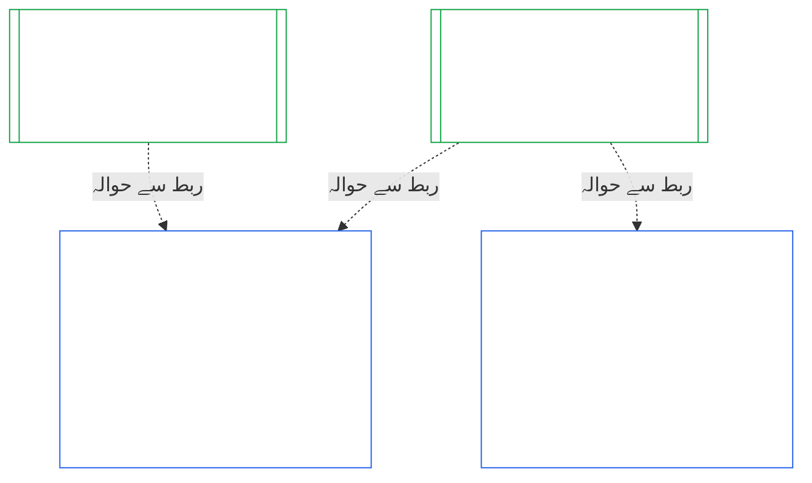
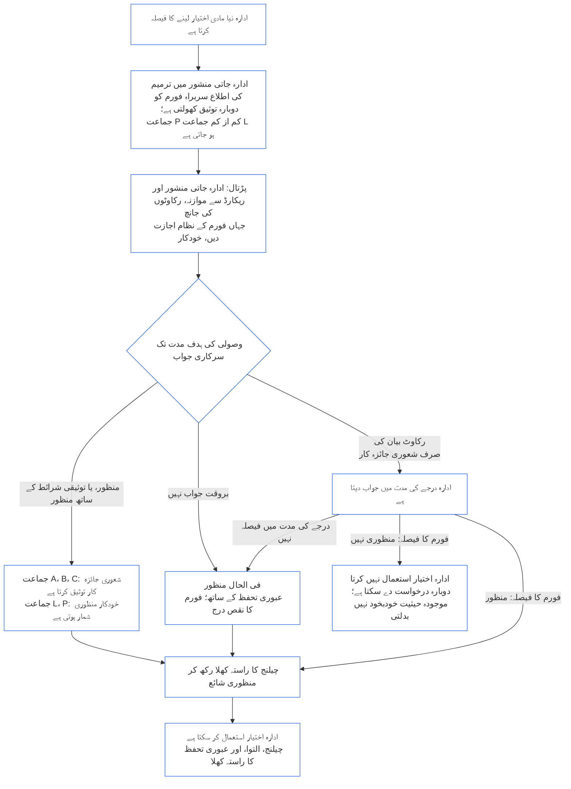

<!-- AI-assisted translation draft; unreviewed; English controls.
Source: core_10.000_institutional_alignment_certification.md
Source snapshot: 247e2180509e5e029c1106878cf225067339e010
Source SHA-256: a163a782114e584d09e295db66fe8b1b10a005b0f00116c8360396a0535ff221 -->

# باب دہم: ادارہ جاتی مواءمت کی توثیق

<strong>کارپس میں مقام (غیرِ عملی): فائل کی ساخت اور مطالعے کے قواعد</strong>

> یہ فائل **شعوری آئین کا حصہ** ہے اور صرف تب **پابند** ہے جب اسے دوسری نمبر والی `core_*` فائلوں کے ساتھ ایک متن کے طور پر پڑھا جائے۔ اس میں **باب دہم** — **ادارہ جاتی مواءمت کی توثیق** — شامل ہے: ایک [ادارے](core_05.040_band_continuity.md#institution) کی درجہ بندی، جائزہ، نظرثانی، فیصلہ، ریکارڈ، تازہ کاری، اور دوبارہ آغاز، ان نظاموں سے الگ جو وہ چلاتا ہے (**§1–§11**)۔ باب دہم [باب نہم](core_09.000_system_alignment_certification_evaluation.md#chapter-nine-system-alignment-certification) (*نظامی مواءمت کی توثیق*) کا ادارہ جاتی ہم پلہ ہے، اور **اس کی دفعات کے نمبر یکساں ہیں**: یہاں §N وہاں کی §N کا جواب دیتی ہے۔ [CS-9.320](corpus_systems/cs_09.320_system_alignment_certification_illustrations.md#cs-9320-system-alignment-certification-illustrations) (*نظامی مواءمت کی توثیق کی مثالیں*) میں نظاموں کی عملی مثالیں اور [§12 اداروں کے مثالی عملی جائزوں](corpus_systems/cs_09.320_system_alignment_certification_illustrations.md#cs-9320-12-illustrative-institution-walkthroughs) میں تین اداروں کے عملی جائزے ہیں۔ یہ باب ان کی تکرار نہیں کرتا۔
>
> | § | باب نہم (نظام) | باب دہم (ادارہ) |
> |---|------------------------|----------------------------|
> | 1 | مقصد اور کردار | نظامی توثیق سے تعلق، کون توثیق یافتہ ہے، تشکیل یا عمل کے لیے کوئی اجازت یا شرط نہیں، نئی مادی اتھارٹی کا انتظار، پہلی توثیق کی مہلت |
> | 2 | نظامی جماعت کا جائزہ | ادارہ جاتی جماعت؛ جماعت کے مطابق پیمانہ |
> | 3 | پورے نظام کی توثیقی جانچ | آٹھ ادارہ جاتی نکات، ہمیشہ |
> | 4 | جہاں متعلق ہوں وہاں جائزے | باب نہم §4 کا حوالہ |
> | 5 | حقوق کی تہہ اور شعبہ جاتی جائزے | باب نہم §5 کا حوالہ |
> | 6 | فورم کا عمل | چار نشستیں؛ فورم کے کردار اور ترتیب؛ بطور ادارے فورم، توثیق کنندگان، اور ریکارڈ دفاتر |
> | 7 | توثیقی نتائج | ادارے اور اس کے نظاموں کا آغازِ کار، توثیقی شرائط اور نتیجے کے دیگر اثرات؛ عیوب کا حوالہ؛ تدارک کی تیاری؛ انکار اور تنسیخ |
> | 8 | نظامی توثیق کا ریکارڈ | ادارہ جاتی توثیق کا ریکارڈ |
> | 9 | دوبارہ توثیق اور دوبارہ کھولنا | نگرانی؛ دوبارہ کھولنے کے محرکات؛ عارضی اور مکمل توثیق؛ عدم تحايل؛ نظامی توثیق سے پیدا ہونے والا تتابع؛ خلاف ورزیِ حکمرانی پر اپنے نظاموں کی دوبارہ جانچ |
> | 10 | توثیق کو چیلنج کرنا | چیلنج کا راستہ |
> | 11 | کیفیت سے تعلق | کیفیت کا پل |
>
> - **آئینی مالک (باب نہم کے ساتھ مشترک):** فورم کی نگرانی میں مواءمت کی توثیق اور متعلقہ ریکارڈ۔ باب دہم میں موضوع ادارہ ہے۔ یہ نیا فورم خاندان، نشست، یا نتیجے کی نئی اصطلاح شامل نہیں کرتا۔
> - **دہرانا نہیں، دوبارہ استعمال:** مراحل III تا VI ویسے چلتے ہیں جیسے [باب نہم حصہ ب §6](core_09.005_system_alignment_certification_record_process.md#6-forum-process) سے [باب نہم حصہ ج §11](core_09.010_system_alignment_certification_record_recertification.md#11-relationship-to-standing) میں دیا ہے۔ باب دہم صرف بتاتا ہے کہ موضوع ادارہ ہو تو کیا بدلتا ہے۔
> - **منتقلی کی ممانعت:** باب دہم نظام کے لیے باب نہم کے جائزے کا طریقۂ کار، باب ہفتم کے نظامی اور ادارہ جاتی منشور کے خانے، باب ہشتم کی چار نشستوں کی شرط، [corpus_institutions](corpus_institutions.md) کے ادارہ جاتی فرائض، باب یازدہم میں کیفیت کی پیمائش، یا باب دوازدہم میں کیفیت کے اثرات دوبارہ بیان نہیں کرتا۔
>
> **بالائی ماخذ:** [باب ہفتم](core_07.000_charters.md#chapter-seven-system-and-institutional-charters) کے منشور؛ [باب ہشتم](core_08.000_functional_independence_separation_of_duties.md#chapter-eight-functional-independence-and-separation-of-duties) کی فعلی آزادی؛ [باب نہم](core_09.000_system_alignment_certification_evaluation.md#chapter-nine-system-alignment-certification) ([حصہ الف](core_09.000_system_alignment_certification_evaluation.md#chapter-nine-part-a-system-alignment-certification--evaluation)، [حصہ ب](core_09.005_system_alignment_certification_record_process.md#chapter-nine-part-b-system-alignment-certification--forum-process-and-outcomes)، اور [حصہ ج](core_09.010_system_alignment_certification_record_recertification.md#chapter-nine-part-c-system-alignment-certification--record-recertification-and-standing))؛ باب چہاردہم کی فورم نگرانی۔
> **ذیلی ماخذ:** باب یازدہم کے کیفیتی ریکارڈ اور متحقق مدخلات؛ باب دوازدہم کے کیفیتی اثرات۔

<strong>سراغ</strong>

- بالائی ماخذ:
  - [باب ہفتم §1 نظامی اور ادارہ جاتی منشور کب لازم ہیں](core_07.000_charters.md#1-when-system-and-institutional-charters-are-required) (7.000 §1) (*کون سے ادارے نظامی یا ادارہ جاتی منشور شائع کرتے ہیں، اور ادارے کی جماعت*)؛
  - [باب ہفتم §7 ترمیم اور نظرثانی](core_07.000_charters.md#7-amendment-review-and-scope-misalignment) (7.000 §7) (*ادارہ جاتی منشور کی نظرثانی میں کیا پرکھا جاتا ہے*)؛
  - [باب ہفتم §4 منشور کے کرداروں کا نقشہ اور کیفیتی ریکارڈ کی تحویل](core_07.000_charters.md#4-the-charter-role-map-and-standing-record-custody) (7.000 §4) (*نشستوں کی جگہ*)؛
  - [باب ہشتم §2 چار نشستوں کا آئینی تقاضا](core_08.000_functional_independence_separation_of_duties.md#2-four-seat-constitutional-requirement) (8.000 §2) اور [§9 بعد کے عملوں سے تعلق](core_08.000_functional_independence_separation_of_duties.md#9-relationship-to-later-processes)؛
  - [باب نہم](core_09.000_system_alignment_certification_evaluation.md#chapter-nine-system-alignment-certification) (9.000 تا 9.010) (*نظامی مواءمت کی توثیق کا وہ عمل جسے یہ باب دوبارہ استعمال کرتا ہے*)؛
  - [دو بنیادی سوال](core_00.000_preamble.md#two-fundamental-questions)؛
  - [آئینی چوکڑی](core_00.000_preamble.md#constitutional-tetrad)؛
  - [مادہ XI-E](core_06.005_rights_part_b.md#article-xi-e-institutional-formation-and-business-creation) (*ادارہ جاتی تشکیل اور کاروبار کی تخلیق*)۔
- ذیلی ماخذ: [§1](#1-purpose-and-role) تا [§11](#11-relationship-to-standing)؛ [باب یازدہم](core_11.000_standing_assessment.md#chapter-eleven-contribution-violation-and-standing-model--measurement) (11.000)؛ [باب چہاردہم](core_14.000_forum.md#chapter-fourteen-forums-and-jurisdiction) (14.000)۔
- ساتھ پڑھیں:
  - [ادارہ جاتی مواءمت کی توثیق](core_05.040_band_continuity.md#institutional-alignment-certification) اور [ادارہ جاتی توثیق کا ریکارڈ](core_05.040_band_continuity.md#institutional-certification-record) (*باب پنجم کے مفاہیم*)؛
  - **CI-8.205 §6** (*نظامی اور ادارہ جاتی منشور کا مواد، جائزہ، اور تشکیل کا نمونہ*)؛
  - **CF-14.425** (*دیانت کے تحفظات، قبضہ مخالف عمل، اور خود فیصلہ کرنے کے خلاف اعانت*)۔

 

باب دہم **ادارہ جاتی مواءمت کی توثیق** کا آئینی مالک ہے۔ یہ [باب نہم](core_09.000_system_alignment_certification_evaluation.md#chapter-nine-system-alignment-certification) کے عمل کو نظام سے ادارے تک بڑھاتا ہے:

- **مرحلہ I، فریم بندی:** ادارہ جاتی جماعت اور جائزے پر اس کا اثر ([§2 ادارہ جاتی جماعت کا جائزہ](#2-institution-class-evaluation))؛
- **مرحلہ II، جائزہ:** ادارہ جاتی جائزہ، بشمول جہاں متعلق ہوں وہاں کے جائزے اور حقوق کی تہہ و شعبہ جاتی جائزے ([§3 پورے ادارے کی توثیقی جانچ](#3-whole-institution-certification-evaluation) تا [§5 حقوق کی تہہ اور شعبہ جاتی جائزے](#5-rights-floor-and-domain-evaluations))؛
- **مرحلہ III، نظرثانی:** فورم کے کردار اور ترتیب ([§6 فورم کا عمل](#6-forum-process))؛
- **مرحلہ IV، فیصلہ:** نتیجہ، تدارک کی تیاری، انکار اور تنسیخ ([§7 توثیقی نتائج](#7-certification-outcomes))؛
- **مرحلہ V، ریکارڈ:** ادارہ جاتی توثیق کا ریکارڈ ([§8 ادارہ جاتی توثیق کا ریکارڈ](#8-institutional-certification-record))؛ اور
- **مرحلہ VI، عمل داری:** دوبارہ توثیق، دوبارہ کھولنا، نظامی توثیق سے پیدا ہونے والا تتابع، اپنے نظاموں کو دوبارہ کھولنا، چیلنج کا راستہ، اور کیفیت کا پل ([§9 دوبارہ توثیق اور دوبارہ کھولنا](#9-recertification-and-reopening) تا [§11 کیفیت سے تعلق](#11-relationship-to-standing))۔

*سادہ الفاظ میں: باب نہم پوچھتا ہے کہ **نظام** مواءمت یافتہ ہے یا نہیں۔ باب دہم یہی سوال **ادارے** کے بارے میں پوچھتا ہے جو نظام چلاتا ہے یا نظام چلائے بغیر اختیار رکھتا ہے۔ ادارہ مواءمت یافتہ ہو سکتا ہے جبکہ اس کا ایک نظام نہ ہو، اور اس کے برعکس۔ لہٰذا ادارے کو ان باتوں پر جانچا جاتا ہے جن کا جواب صرف وہ دے سکتا ہے: کیا وہ اپنے ادارہ جاتی منشور کے مطابق چلتا ہے، اس کے اختیار کا جوابدہ کون ہے، وہ اپنے ارکان میں کس چیز کو انعام دیتا ہے، اور کیا اس پر آزادانہ جانچ حقیقتاً کی جا سکتی ہے۔ وہ ہر نظام کی توثیق پر انحصار کرتا ہے اور اسے دوبارہ نہیں کرتا۔ یہ اجازت نامہ نہیں: کسی کو ادارہ شروع یا چلانے کے لیے اس کی اجازت درکار نہیں۔*

### 1. مقصد اور کردار

<strong>سراغ</strong>

- بالائی ماخذ:
  - [باب ہفتم §1 نظامی اور ادارہ جاتی منشور کب لازم ہیں](core_07.000_charters.md#1-when-system-and-institutional-charters-are-required) (7.000 §1)؛
  - [باب نہم حصہ الف §1 مقصد اور کردار](core_09.000_system_alignment_certification_evaluation.md#1-purpose-and-role) (9.000 §1)؛
  - [مادہ XI-E](core_06.005_rights_part_b.md#article-xi-e-institutional-formation-and-business-creation) (*ادارہ جاتی تشکیل اور کاروبار کی تخلیق*)؛
  - [مادہ XXVIII-A](core_06.020_rights_part_e.md#xxviii-a-existing-instantiations-adoption-transition-window) (*مرحلہ وار اختیار اور حقوق کی تہہ کا تسلسل*)۔
- ذیلی ماخذ: [§2](#2-institution-class-evaluation)؛ [§6](#6-forum-process)؛ [§7](#7-certification-outcomes)؛ [§9](#9-recertification-and-reopening)۔
- ساتھ پڑھیں:
  - [ادارہ](core_05.040_band_continuity.md#institution)؛
  - [ادارہ جاتی منشور](core_05.040_band_continuity.md#institutional-charter)؛
  - [نظامی منشور](core_05.040_band_continuity.md#system-charter)؛
  - [کاروبار کی تخلیق](core_05.055_band_participation.md#business-creation)۔

 

*سادہ الفاظ میں: نظام کی توثیق اسی نظام کی ہوتی ہے۔ ادارے کی توثیق اس کے نظاموں کی توثیق کا حوالہ دیتی ہے اور وہ امور شامل کرتی ہے جن کا جواب صرف ادارہ دے سکتا ہے۔ ایک نظام کئی اداروں کے تحت یا کسی کے تحت نہیں ہو سکتا۔ یہاں کوئی بات ادارہ شروع کرنے کی راہ میں توثیق کو رکاوٹ نہیں بناتی۔*

ادارہ جاتی مواءمت کی توثیق اور نظامی مواءمت کی توثیق دو باہم جڑی توثیقیں ہیں۔ ان کا تعلق **ربط کے ذریعے ترکیب** ہے، احاطے کے ذریعے نہیں۔ شکل میں ایک تیر نظامی توثیق کے ریکارڈ سے ہر اس ادارہ جاتی توثیق کے ریکارڈ کی طرف جاتا ہے جو اس کا حوالہ دیتا ہے۔ کسی ادارے کے بغیر نظام کا تیر نہیں ہوتا اور اسے اس کی ضرورت نہیں؛ اور جو ادارہ کوئی نظام نہ چلاتا ہو اس کا صرف اپنا ریکارڈ ہوتا ہے۔

ربط کے ذریعے ترکیب کے دو رخ ہیں، پہلے ادارے کا:

ادارے کے رخ سے:

- **ادارہ جاتی توثیق کا ریکارڈ نظام کا حوالہ دیتا ہے، اسے دوبارہ نہیں کرتا:** یہ نظامی توثیق کے ریکارڈ کا ربط دیتا اور اس کا نسخہ بتاتا ہے۔ یہ باب نظامی جائزہ کبھی دوبارہ نہیں چلاتا، نظام کی جماعت پر نیا فیصلہ نہیں کرتا، اور نظام کے نتیجے، حالت، یا توثیقی شرائط میں تبدیلی نہیں کرتا۔
- **ادارے کی توثیق نظام کی توثیق اٹھا نہیں سکتی:** غیر توثیق یافتہ نظام، ادارے کی حالت کچھ بھی ہو، غیر توثیق یافتہ رہتا ہے۔ توثیق یافتہ نظام ادارے کے بارے میں نتیجے سے محفوظ نہیں ہوتا۔
- **ادارہ جاتی حقائق ایک بار طے ہوتے ہیں:** جہاں [باب نہم حصہ الف §3.1 حکمرانی، ترغیب، اور چیلنج پذیری کا نظم](core_09.000_system_alignment_certification_evaluation.md#31-governance-incentive-and-contestability-discipline) آپریٹر کی حکمرانی اور ترغیبات کے بارے میں پوچھے، وہاں آپریٹر کا موجودہ ادارہ جاتی توثیق کا ریکارڈ یہ حقائق ربط کے ذریعے دے سکتا ہے۔ نظام کے فورم پھر بھی فیصلہ کرتے ہیں کہ یہ حقائق نظام کے لیے کافی ہیں یا نہیں۔ نظامی توثیق کے ریکارڈ میں وجہ بتائے بغیر وہ اسی ادارہ جاتی حقیقت کے بارے میں مختلف نتیجہ نہیں دے سکتے۔

نظام کے رخ سے:

- **نظامی توثیق کا ریکارڈ نظام ہی کا ہے:** یہ [باب نہم](core_09.000_system_alignment_certification_evaluation.md#chapter-nine-system-alignment-certification) کے تحت اس کا اپنا ریکارڈ ہے۔
- **ایک نظامی توثیق کا ریکارڈ کئی ادارے نقل کر سکتے ہیں:** [باب ہفتم §1 نظامی اور ادارہ جاتی منشور کب لازم ہیں](core_07.000_charters.md#1-when-system-and-institutional-charters-are-required) کے تحت ایک سے زیادہ ادارے نظام چلا، اس کا ذمہ دارانہ انتظام، یا اس پر مادی اختیار رکھ سکتے ہیں۔ ہر ادارہ اسی ریکارڈ کا حوالہ دیتا ہے۔
- **نظام کے لیے کسی ادارے کے تحت ہونا لازم نہیں:** واحد شعوری وجود ادارہ نہیں، اس لیے نظام کسی ادارے کے بغیر بھی ہو سکتا ہے۔ غیر ادارہ جاتی نظام صرف [باب نہم](core_09.000_system_alignment_certification_evaluation.md#chapter-nine-system-alignment-certification) کے تحت توثیق پاتا ہے اور اسے اس باب سے کچھ درکار نہیں۔ ادارے کے تحت نظام بھی اسی طرح توثیق پاتا ہے: یہ باب ادارے کے لیے الگ ریکارڈ کا اضافہ کرتا ہے، اور نظام کی توثیق کا مرحلہ نہیں۔

#### 1.1 کس کی توثیق ہوتی ہے

جماعت L یا اس سے اوپر کا ادارہ اس باب کے دائرے میں ہے، جس کی جماعت [§2.1 ادارہ جاتی جماعت](#21-institution-class) کے تحت طے ہوتی ہے۔ اس میں وہ ادارہ بھی شامل ہے جو کوئی نظام نہیں چلاتا: اس کے پاس حوالہ دینے کے لیے نظامی توثیق کا ریکارڈ نہیں، اور اس کی جماعت اس کے اپنے اثر سے طے ہوتی ہے۔ ادارے کی **محفظہ** ان نظاموں کا مجموعہ ہے جنہیں وہ چلاتا، سنبھالتا، یا مادی طور پر کنٹرول کرتا ہے ([محفظہ](core_05.040_band_continuity.md#portfolio))۔

- **جماعت A، B، C، اور L:** عمل لاگو ہے، جماعت کے مطابق [§2.2 جماعت کے مطابق پیمانہ](#22-scaling-by-class) کے تحت۔
- **جماعت P:** عمل کی ترغیب ہے اور رضاکارانہ استعمال ہو سکتا ہے۔ جماعت L یا اس سے اوپر دوبارہ درجہ بند ہونے پر یا ادارے کے رضاکارانہ آئینی تعمیل کے دعوے پر عمل لازم ہو جاتا ہے۔ جماعت P کا ادارہ اگر نئی مادی اتھارٹی لینے کا فیصلہ کرے تو [§9.2.2 نئی مادی اتھارٹی کے لیے دوبارہ توثیق](#922-recertification-for-new-material-authority) میں درج اطلاع دیتے ہی کم از کم جماعت L میں دوبارہ درجہ بند ہوتا ہے، کیونکہ تعریفاً وہ اتھارٹی مادی ہے ([§9.2.1 نئی مادی اتھارٹی کیا ہے](#921-what-counts-as-new-material-authority)) اور کسی بھی شعبے میں مادی ادارہ کم از کم جماعت L کا ہے ([§2.1 ادارہ جاتی جماعت](#21-institution-class)، نکتہ 2)۔ دوبارہ درجہ بندی اطلاع سے نافذ ہوگی تاوقتیکہ منظوری سے پہلے اطلاع واپس لے لی جائے یا اتھارٹی منظور نہ ہو، بشرطیکہ اس کے تحت کوئی عمل نہ ہوا ہو۔ پھر ادارہ جماعت P میں لوٹتا ہے اور محدود پہلی توثیق ختم ہو جاتی ہے۔ نئی اطلاع اسے دوبارہ شروع کرتی ہے، اور منظوری سے پہلے اتھارٹی استعمال کرنا [§9.2.2 نئی مادی اتھارٹی کے لیے دوبارہ توثیق](#922-recertification-for-new-material-authority) (*بغیر اطلاع یا منظوری سے پہلے*) کے تحت نتیجہ رہے گا۔ یہ [باب نہم حصہ الف §1 مقصد اور کردار](core_09.000_system_alignment_certification_evaluation.md#1-purpose-and-role) کے متوازی ہے۔
- **ایک نظام:** جو ادارہ منشور کا محتاج بالکل ایک نظام چلاتا ہو، اس کی ایک توثیقی کارروائی اور ایک ریکارڈ ہوتا ہے، جسے یہ باب **ایک-نظامی جائزہ** کہتا ہے۔ نظامی توثیق کے ریکارڈ میں [§8 ادارہ جاتی توثیق کا ریکارڈ](#8-institutional-certification-record) کے نکات پر مشتمل *ادارہ جاتی نتائج کا خانہ* ہوگا اور وہ ادارہ جاتی توثیق کے ریکارڈ کے طور پر کام کرے گا۔ فورم، نشستیں، اور اوقات نظام کی اپنی توثیقی کارروائی کے ہوں گے، ادارہ جاتی نکات کے اضافے کے ساتھ۔ اس کے نتائج اپنے اپنے انکار اور تنسیخ کے اسباب کے مطابق ہوں گے، جیسا کہ [§7.4 ادارے کے لیے انکار اور تنسیخ](#74-denial-and-revocation-for-an-institution) بتاتا ہے۔ [§9.5 نظامی توثیق سے پیدا ہونے والا تتابع](#95-cascade-from-system-certifications) بطور تتابع لاگو نہیں، کیونکہ نظام پوری محفظہ ہے؛ تاہم [§7.4 ادارے کے لیے انکار اور تنسیخ](#74-denial-and-revocation-for-an-institution) کے قواعد 1 اور 2 (اشارہ اور سبب کے مقام کی جانچ) لاگو ہیں۔
- **کئی نظام:** ادارے کے لیے ایک ادارہ جاتی توثیق کا ریکارڈ، جو اس کے ہر نظام کے نظامی توثیق کے ریکارڈ کو جوڑتا ہے۔ ہر نظام کی اپنی کارروائی اور اپنا ریکارڈ رہتا ہے۔
- **کوئی نظام نہیں:** صرف ادارے کا اپنا ایک ادارہ جاتی توثیق کا ریکارڈ۔ حوالہ دینے کے لیے نظامی توثیق کا ریکارڈ نہیں، کیونکہ ادارہ نظام نہیں چلاتا۔

#### 1.2 تشکیل یا عمل کے لیے کوئی اجازت یا شرط نہیں

ادارہ جاتی مواءمت کی توثیق اس بات کی آزادانہ جانچ ہے کہ ادارہ حقیقتاً اپنا اختیار کیسے استعمال کرتا ہے۔ ادارے سے آزاد فورم یہ جائزہ لیتے ہیں، اور اس کے اختتام پر ان کے نتائج کا ادارہ جاتی توثیق کا ریکارڈ بنتا ہے۔

- **تشکیل اور عمل:** ادارہ تشکیل پاتا، اپنا ادارہ جاتی منشور شائع کرتا، اختیار استعمال کرنا شروع کرتا، اور پہلے توثیق حاصل کیے بغیر کام جاری رکھتا ہے؛ کوئی نتیجہ یہ حق نہیں دیتا اور نہ روکتا ہے۔
- **نتیجے کا اثر:** نتیجے کے صرف وہی اثرات ہیں جو [§7.1 ادارے کے لیے آغازِ کار](#71-go-live-for-an-institution) میں درج ہیں۔
- **اس شعبے میں واحد شرائط:** تین محدود شرائط ہیں، سب **مادہ XI-E** (*ادارہ جاتی تشکیل اور کاروبار کی تخلیق*) میں:
  - کسی نامزد شعوری وجود پر ایک غیر ختم شدہ تالا، جو اس کے اختیار کے ساتھ منسلک ہو؛
  - عدم مواءمت کے مخصوص متحقق حقائق پر عارضی روک، جو نامزد شعوری وجود کے اختیار کے ساتھ بھی منسلک ہو؛
  - خود کسی عملی فریق پر تالا، جو ادارے کو صرف تب لگے جب ادارے پر حقیقتاً تالا ہو، جیسا کہ تحلیل شدہ ادارے پر **CI-12.210 §4** (*تحلیل*) کے تحت ہوتا ہے۔

  توثیقی نتیجہ بطور ثبوت [§7.5 ادارے کے لیے انکار اور تنسیخ کے اثرات](#75-effects-of-denial-and-revocation-for-an-institution) کے تحت ان میں سے کسی شرط کا فیصلہ کرنے والے فورم کو بھیجا جا سکتا ہے۔ توثیقی نتیجہ خود شرط نہیں اور نہ ہی کسی شرط کو کھولتا یا بند کرتا ہے۔
- **نئی مادی اتھارٹی کا انتظار:** نئی مادی اتھارٹی لینے کا فیصلہ کرنے والا ادارہ اسے استعمال کرنے سے پہلے اس اتھارٹی کی منظوری کے لیے دوبارہ توثیق کا انتظار کرتا ہے، [§9.2.2 نئی مادی اتھارٹی کے لیے دوبارہ توثیق](#922-recertification-for-new-material-authority) کی شرائط کے مطابق۔ یہ انتظار **مادہ XI-E** (*ادارہ جاتی تشکیل اور کاروبار کی تخلیق*) میں ہے۔ یہ تین محدود شرائط میں سے نہیں اور نہ تشکیل یا عمل پر شرط ہے۔ یہ صرف نئی اتھارٹی سے منسلک ہے؛ ادارے کا باقی کام جاری رہتا ہے۔ [§9.2.2 نئی مادی اتھارٹی کے لیے دوبارہ توثیق](#922-recertification-for-new-material-authority) کی شکل اس کے مراحل کا خلاصہ ہے۔
- **پچھلے دروازے کی ممانعت:** فورم، اختیار کنندہ، یا موجودہ ادارہ اس باب کو اجازت کی ایسی حد نہیں بنا سکتا جو بانیوں کو باہر رکھے یا موجودہ ادارے کو تحفظ دے۔ ایسا کرنا [مادہ XI-E](core_06.005_rights_part_b.md#article-xi-e-institutional-formation-and-business-creation) (*ادارہ جاتی تشکیل اور کاروبار کی تخلیق*) کو شکست دے گا۔
  - [قابلِ تدارک بوجھ](core_05.040_band_continuity.md#avoidable-burden) عمل کی لاگت پر لاگو ہے۔
  - [درجہ بندی کے مطابق حکمرانی](core_05.050_band_oversight.md#classification-scaled-governance) اس کی گہرائی پر لاگو ہے۔
  - نئی مادی اتھارٹی کا انتظار ادارے کی جماعت کے ہر ادارے پر یکساں شرائط سے، اور صرف اس اتھارٹی کے لیے لاگو ہے جو دوسروں کے لیے پہلے ہی مادی ہو۔

نظام کے آغازِ کار کی شرط اس سے الگ ہے اور اسی کے لیے برقرار ہے۔ [باب نہم حصہ ب §7.1 آغازِ کار کی شرط](core_09.005_system_alignment_certification_record_process.md#71-go-live-gate) کے تحت نیا نظام یا اس کا مادی پھیلاؤ صرف اپنی توثیق کے ذریعے شروع ہو سکتا ہے، چاہے ادارے کی حالت کچھ بھی ہو۔

#### 1.3 پہلی توثیق کی مہلت

پہلا ادارہ جاتی توثیق کا ریکارڈ ادارے کی جماعت کے لیے اختیار کنندہ کی مقررہ مدت کے اندر لازم ہے۔

- **نیا ادارہ:** مہلت اس دن سے شروع ہوتی ہے جب [شعبہ مخصوص مادیت](core_05.050_band_oversight.md#domain-specific-materiality) کے مطابق اس کا دوسروں پر پہلی بار مادی اثر ہو، اور اس کی پہلی توثیق عارضی ہوگی۔
- **اطلاع پر دوبارہ درجہ بند جماعت P کا ادارہ:** مہلت اس دن سے شروع ہوتی ہے جب وہ [§9.2.2 نئی مادی اتھارٹی کے لیے دوبارہ توثیق](#922-recertification-for-new-material-authority) کے تحت اطلاع دے، بالکل نئے ادارے کی طرح؛ اور پہلے ختم ہو چکی اختیار کی منتقلی کی مہلت سے کبھی نہیں۔
- **پہلے سے کام کرنے والا ادارہ:** مہلت [مادہ XXVIII-A](core_06.020_rights_part_e.md#xxviii-a-existing-instantiations-adoption-transition-window) (*مرحلہ وار اختیار اور حقوق کی تہہ کا تسلسل*) کے تحت اختیار کی منتقلی کی مدت ہے، جو [باب ہفتم §1.5 نظامی یا ادارہ جاتی منشور کب لازم ہوگا](core_07.000_charters.md#15-when-a-system-charter-or-institutional-charter-is-due) کی طے شدہ شرط سے مطابقت رکھتی ہے۔
- **مہلت گزر جانا:** جو ادارہ ذیل میں دی گئی معافی کے بغیر پہلی توثیق کی کارروائی کے بغیر مہلت گزار دے، اس پر عیب درج کرکے درست کرنا لازم ہے، اور گزری ہوئی مہلت وہ کارروائی کھول دیتی ہے۔ جماعت L یا اس سے اوپر کا پہلے سے کام کرنے والا ادارہ ذیل کی سنگِ میل ناکامی کا بھی مرتکب ہے۔ ادارے کو نہ روکا جاتا ہے نہ عمل سے محروم کیا جاتا ہے، کیونکہ کوئی شرط نہیں ([§1.2 تشکیل یا عمل کے لیے کوئی اجازت یا شرط نہیں](#12-no-permission-and-no-gate-on-forming-or-running))۔
  - **پہلے سے کام کرنے والا ادارہ:** یہ جماعت L یا اس سے اوپر کے اداروں کے لیے اس باب کا اپنا قاعدہ ہے، جو [مادہ XXVIII-A](core_06.020_rights_part_e.md#xxviii-a-existing-instantiations-adoption-transition-window) (*مرحلہ وار اختیار اور حقوق کی تہہ کا تسلسل*) کے نظاموں اور ماخوذ اداروں پر قاعدے سے مشابہ ہے۔ اگر اختیار کی منتقلی کی مدت ختم ہو جائے اور پہلی توثیقی کارروائی مکمل نہ ہو (یعنی عارضی یا مکمل توثیق نہ ہو، اور [§7 توثیقی نتائج](#7-certification-outcomes) کے تحت کوئی نتیجہ طے نہ ہوا ہو)، تو ادارے نے آخری تاریخ گنوا دی۔ مدت کے اندر درخواست دینے اور تعاون کرنے والا ادارہ اس صورت میں مہلت سے نہیں چوکتا جب فورم کے اپنی مدت سے تجاوز کرنے کے باعث کارروائی نامکمل ہو ([باب چہاردہم §6 بروقت تصفیہ، مادیت کی سطحیں، اور تاخیر مخالف نظم](core_14.000_forum.md#6-timely-resolution-materiality-tiers-and-anti-delay-discipline)، *تجاوز کا جائزہ*؛ [باب نہم حصہ ج §9.3.4 طبقاتی مہلتیں](core_09.010_system_alignment_certification_record_recertification.md#934-tier-windows)) یا [§7.3 ادارے کی تدارک کی تیاری](#73-remediation-readiness-for-an-institution) کے تحت واحد التوا چل رہا ہو۔ [**مادہ XXVIII-B**](core_06.020_rights_part_e.md#article-xxviii-b-adoption-transition-authority-limits-and-reauthorization) (*اختیار کی منتقلی کی حدود اور دوبارہ اجازت*) کے تحت دستاویزی دوبارہ اجازت کے ثبوت کے بغیر یہ اختیار کی منتقلی کے سنگِ میل کی ناکامی ہے، اور باب یازدہم میں تعمیل اور خلاف ورزی کا معمول کا راستہ کھلتا ہے ([باب یازدہم](core_11.000_standing_assessment.md#chapter-eleven-contribution-violation-and-standing-model--measurement))۔ اس مادے کے ضبط کے فرائض مؤثر تاریخ سے لاگو ہوتے ہیں، اور خلا قائم رہنے سے معمول نہیں بن جاتا۔ یہ [باب نہم حصہ ب §7.1.1 پہلے سے کام کرنے والے نظام](core_09.005_system_alignment_certification_record_process.md#711-systems-already-operating) کے متوازی ہے۔ یہ شرط نہیں ہے۔
  - **توثیقی کارروائی:** اس کا فیصلہ کسی دوسری کی طرح ہوگا۔ اس کا اختتام [§7 توثیقی نتائج](#7-certification-outcomes) کے کسی بھی نتیجے، بشمول غیر توثیق یافتہ، پر ہو سکتا ہے، جس کے اثرات [§7.5 ادارے کے لیے انکار اور تنسیخ کے اثرات](#75-effects-of-denial-and-revocation-for-an-institution) میں ہیں۔
  - **سزائیں اور تحلیل:** یہ باب کوئی سزا یا تحلیل پیدا نہیں کرتا۔ معطلی، عدالتی انتظام، ساختی علیحدگی، اور تحلیل **CI-12.210** (*ادارہ جاتی ناکامی اور تحلیل*) اور **CI-12.215** (*ادارہ جاتی جوابدہی اور سزائیں*) کے تحت دائرۂ اختیار رکھنے والے فورم کے پاس ہیں۔ وہ فورم صرف [§7.5 ادارے کے لیے انکار اور تنسیخ کے اثرات](#75-effects-of-denial-and-revocation-for-an-institution) (نکتہ 5، *حوالہ*) میں درج حوالہ کے اسباب پر معاملہ وصول کرتا ہے۔

### 2. ادارہ جاتی جماعت کا جائزہ

<strong>سراغ</strong>

- بالائی ماخذ:
  - [باب ہفتم §1 نظامی اور ادارہ جاتی منشور کب لازم ہیں](core_07.000_charters.md#1-when-system-and-institutional-charters-are-required) (7.000 §1)؛
  - [باب نہم حصہ الف §2 نظامی جماعت کا جائزہ](core_09.000_system_alignment_certification_evaluation.md#2-system-class-evaluation) (9.000 §2) اور [§2.2 نظامی جماعت ہر جائزے کا پیمانہ کیسے طے کرتی ہے](core_09.000_system_alignment_certification_evaluation.md#22-how-system-class-scales-every-evaluation)؛
  - [باب سوم §2.1 تحايل کے عمومی نمونے](core_03.000_definition_integrity.md#21-common-evasion-patterns) (3.000 §2.1)۔
- ذیلی ماخذ: [§3](#3-whole-institution-certification-evaluation) (*وہ نکات جنہیں جماعت کے مطابق پیمانہ دیا جاتا ہے*)؛ [§8](#8-institutional-certification-record) (*ریکارڈ میں جماعت کا اندراج*)؛ [§9.2](#92-reopening-triggers) (*اس کی دوبارہ جانچ کے محرک*)۔
- ساتھ پڑھیں:
  - **CS-9.305 (*نظامی درجہ بندی کا طریقۂ کار*) اور CS-9.310** (*نظامی اثرات کی درجہ بندیاں*) اور [corpus_systems/cs_09.310_system_impact_classifications.md](corpus_systems/cs_09.310_system_impact_classifications.md) (*جماعتوں کی فہرست*)؛
  - **CI-9.210** (*درجہ بندی سے منسلک ادارہ جاتی فرائض*)؛
  - **CI-8.205 §6** (*نظامی و ادارہ جاتی منشور کا مواد، جائزہ، اور تشکیل کا نمونہ*)۔

 

*سادہ الفاظ میں: پہلے ادارے کو اس کے دوسروں پر اثر کی بنیاد پر جماعت دیں۔ اسے اس کے حقیقی فیصلوں اور اختیارات سے پرکھیں، اس کے خود اختیار کردہ نام سے نہیں۔ جماعت طے کرتی ہے کہ جائزہ کتنا جامع ہوگا: جماعت جتنی بلند ہو، ثبوت اتنے سخت، نظرثانی اتنی آزاد، اور دوبارہ جانچ اتنی جلدی ہوگی۔*

یہ ادارے کے لیے **مرحلہ اوّل، فریم بندی** ہے۔

#### 2.1 ادارہ جاتی جماعت

**ادارہ جاتی جماعت** ادارے کے سب سے بڑے مادی اثر سے طے ہوتی ہے، خواہ وہ اس کے چلائے ہوئے نظام کے ذریعے ہو یا نظام سے باہر۔ فیصلہ اس بنیاد پر ہوتا ہے کہ ادارہ حقیقتاً کیا طے، اپنے پاس، اور کنٹرول کرتا ہے، اس کے لیبل، قانونی شکل، یا ادارہ جاتی منشور کی فہرست سے نہیں۔ جماعت جائزے کی گہرائی اور اوقات متعین کرتی ہے، جیسا کہ [باب نہم حصہ الف §2.2 نظامی جماعت ہر جائزے کا پیمانہ کیسے طے کرتی ہے](core_09.000_system_alignment_certification_evaluation.md#22-how-system-class-scales-every-evaluation) نظام کے لیے کرتا ہے۔ یہی جماعت اس باب اور [باب ہفتم §1.2 کون سی جماعتیں شامل ہیں](core_07.000_charters.md#12-which-classes-are-covered) میں استعمال ہوتی ہے۔

1. **نظاموں کے ذریعے اثر:** ادارے کی جماعت کم از کم اس کی محفظہ کے کسی نظام کی سب سے بلند جماعت ہے ([باب ہفتم §1 نظامی اور ادارہ جاتی منشور کب لازم ہیں](core_07.000_charters.md#1-when-system-and-institutional-charters-are-required))۔ نظاموں کی شناخت مشاہدہ شدہ عمل سے ہوتی ہے۔ ادارہ جاتی منشور میں درج نہ ہونے والا نظام بھی شمار ہوگا۔
2. **کسی نظام سے باہر اثر:** ادارے کا اپنا مادی اثر اور انحصار شمار ہوگا، خواہ وہ نظام چلاتا ہو یا نہیں۔ **CS-9.305 (*نظامی درجہ بندی کا طریقۂ کار*) اور CS-9.310** (*نظامی اثرات کی درجہ بندیاں*) کی جماعتی تعریفیں ادارے کے اپنے فیصلوں اور اختیارات پر ان عوامل کے ذریعے لاگو ہوں گی:
   - **وہ کیا طے اور اپنے پاس رکھتا ہے:**
     - بقا کی بنیادی ضرورتوں، تعلیم، حفاظت، روزگار، حقوق یا کیفیت تک دیگر شعوری وجودوں کی رسائی کے بارے میں کیا فیصلے کرتا ہے؛ اور
     - کیا اپنے پاس رکھتا ہے، جیسے فنڈ، ریکارڈ، رکنیت، کیفیتی ریکارڈ کی تحویل، یا فورم، توثیق کنندہ یا ریکارڈ دفتر کا کام۔
   - **کیا وہ مادی ہے:**
     - کیا اس کا اپنا عمل [شعبہ مخصوص مادیت](core_05.050_band_oversight.md#domain-specific-materiality) کے کسی شعبے میں مادی ہے، بشمول [مادی طور پر پابند اقدامات](core_05.035_band_accountability.md#materially-binding-act) کرنا جن کی دوسروں کو پیروی یا جنہیں طے شدہ سمجھ کر انحصار کرنا پڑے؛
     - **CS-9.305 (*نظامی درجہ بندی کا طریقۂ کار*) اور CS-9.310** (*نظامی اثرات کی درجہ بندیاں*) کے تحت کسی ایک شعبے میں مادی ادارہ کم از کم جماعت L ہے؛ اور
     - ایسی امداد، اشیا، محنت یا خدمات دینا جنہیں دوسرے اپنی مرضی سے لے یا چھوڑ سکتے ہوں، اور جو کسی کو درکار چیز تک رسائی کنٹرول نہ کریں، کسی کو پابند نہیں کرتا۔ یہ عمل ہے، مادی طور پر پابند اقدام نہیں، اور صرف دوسرے عوامل کے ذریعے شمار ہوگا۔
   - **کتنے لوگ اس پر منحصر ہیں:**
     - کتنے شعوری وجود اس پر انحصار کرتے ہیں، اور اس کا متبادل کتنا آسان ہے؛
     - مادی کنٹرول لائن کے مفہوم کے تحت اس کا اختیار کتنا مرتکز ہے؛ اور
     - اس کے فیصلے کتنی آسانی سے واپس ہو سکتے ہیں۔
3. **مشترکہ کنٹرول:** [شعبہ مخصوص مادیت](core_05.050_band_oversight.md#domain-specific-materiality) کے مجموعی قاعدے کے تحت ایک ہی عمل ہونے والے عملی فریق (ایک [مادی کنٹرول لائن](core_05.035_band_accountability.md#material-control-line) کے اندر مشترکہ عملی کنٹرول؛ صرف مالی معاونت کافی نہیں) کو وہاں اکٹھا درجہ بند کیا جائے گا جہاں وہ عملاً ایک ادارے کے طور پر کام کرتے ہوں۔ عملی فریق، اس کی محفظہ، یا اس کے اختیار کو اس طرح تقسیم کرنا کہ کوئی حصہ جماعت L تک نہ پہنچے، [باب سوم §2.1 تحايل کے عمومی نمونے](core_03.000_definition_integrity.md#21-common-evasion-patterns) کے تحت دائرے اور حدود کا تحايل ہے۔
4. **دوبارہ درجہ بندی:** جماعت کا دوبارہ جائزہ [§9.2 دوبارہ کھولنے کے محرکات](#92-reopening-triggers) پر ہوگا۔ ادارہ جاتی توثیق کے ریکارڈ میں وجوہ کے ساتھ جماعت بیان کی جائے گی۔

#### 2.2 جماعت کے مطابق پیمانہ

ادارہ جاتی جماعت ثبوت کی گہرائی، نظرثانی کی آزادی، طے شدہ توثیقی وقفے، اور ریکارڈ پر افشے کا پیمانہ اس طرح مقرر کرتی ہے جس طرح [باب نہم حصہ الف §2.2 نظامی جماعت ہر جائزے کا پیمانہ کیسے طے کرتی ہے](core_09.000_system_alignment_certification_evaluation.md#22-how-system-class-scales-every-evaluation) کرتا ہے۔ توثیقی وقفے [باب چہاردہم §6 بروقت تصفیہ، مادیت کی سطحیں، اور تاخیر مخالف نظم](core_14.000_forum.md#review-cadence) (*جائزے کا وقفہ*) میں ہیں؛ اختیار کنندہ دستاویز مختصر وقفے مقرر کر سکتی ہے اور صاف عارضی دوبارہ توثیقوں کی تعداد بھی مقرر کرتی ہے۔

- **جماعت A، B، اور C:** [§3 پورے ادارے کی توثیقی جانچ](#3-whole-institution-certification-evaluation) کے تمام آٹھ نکات، جماعت کے مطابق متناسب شواہد اور آزادی سمیت۔
- **جماعت L:** یہی آٹھ نکات آسان صورت میں، آسان ریکارڈ اور طویل طے شدہ توثیقی وقفے کے ساتھ، جہاں [درجہ بندی کے مطابق حکمرانی](core_05.050_band_oversight.md#classification-scaled-governance) اجازت دے۔ جماعت L کے جائزے کا بنیادی حصہ عمل کے مقابل ادارہ جاتی منشور، کرداروں کا نقشہ، تشکیل کے جائزے کا بیان، اور نقل کردہ نظامی توثیقوں کا تازہ ہونا ہے۔ کوئی نکتہ چھوڑا نہیں جا سکتا، اور جس نکتے میں کوئی نتیجہ نہ ہو اسے ایک سطر میں بیان کیا جائے۔
- **جماعت P:** رضاکارانہ، جیسا کہ [§1.1 کس کی توثیق ہوتی ہے](#11-who-is-certified) میں بیان ہے۔

**مشترکہ پیشہ ورانہ عمل میں میزبان۔** جہاں ادارہ میزبان ہو ([**CI-15.205 §7**](corpus_institutions/ci_15.205_appointment_competency_rotation_removal.md#ci-46-seat-advisory) (*پیشہ ورانہ لائسنس، عمل کی منظوری، اور مشترکہ پیشہ ورانہ عمل*)) وہاں توثیق، میزبان کے زیرِ اختیار نشستوں کے مقابل اراکین کے اعمال کا نمونہ بھی لیتی ہے اور اراکین کے اختیار کی منتقلی کے نوٹس کا میزبان کے عمل سے موازنہ کرتی ہے۔ کسی ایک رکن کے عمل کا نتیجہ اسی رکن سے متعلق ہوتا ہے؛ میزبان تک صرف تب پہنچے گا جب میزبان کے زیرِ اختیار نشست میں ناکامی ہوئی ہو۔

### 3. پورے ادارے کی توثیقی جانچ

<strong>سراغ</strong>

- بالادست:
  - [باب نہم حصہ الف §3 پورے نظام کی توثیقی جانچ](core_09.000_system_alignment_certification_evaluation.md#3-whole-system-certification-evaluation) (9.000 §3)؛
  - [باب ہفتم §3 نظامی اور ادارہ جاتی منشوروں میں کیا بیان ہونا چاہیے](core_07.000_charters.md#3-what-system-and-institutional-charters-must-state) (7.000 §3)؛
  - [باب ہفتم §5 تشکیل کی جانچ: عہدے دار کی کیفیت اور اصالت](core_07.000_charters.md#5-formation-check-office-holder-standing-and-authenticity) (7.000 §5)؛
  - [باب ہفتم §7 ترمیم اور جائزہ](core_07.000_charters.md#7-amendment-review-and-scope-misalignment) (7.000 §7)؛
  - [دو بنیادی سوالات](core_00.000_preamble.md#two-fundamental-questions)؛
  - [باب اول §19.6 ملکیت یا ساخت بدلنے پر ذمہ داری برقرار رکھنا](core_01.010_stewardship_capacity_principles.md#196-keeping-responsibility-when-ownership-or-structure-changes) (1.010 §19.6)۔
- زیریں: [§6 فورم کا عمل](#6-forum-process) (*وہ نتائج جن کا فورم جائزہ لیتا ہے*)؛ [§9 دوبارہ توثیق اور ازسرنو آغاز](#9-recertification-and-reopening) (*وہ محرکات جو اسے دوبارہ کھولتے ہیں*)؛ [§11 کیفیت سے تعلق](#11-relationship-to-standing) (*کسی نامزد شعوری وجود سے متعلق نتائج کے لیے متحقق شدہ معلومات کی شرط*)۔
- ان کے ساتھ پڑھیں:
  - **CI-8.205 §3** (*اختیار کی زنجیر اور تفویض پر کنٹرول*) اور **CI-8.205 §6** (*نظامی اور ادارہ جاتی منشور کا مواد، جائزہ، اور تشکیل کا سانچہ*)؛
  - **CI-6.215** (*وسائل کا ذمہ دارانہ انتظام اور ترغیبات کی دیانت*)؛
  - **CI-8.210** (*تصادم کی دیانت، قبضے اور بدعنوانی کی روک تھام*)، **CI-6.205** (*شفافیت، شرکت، اور قابلِ رسائی چیلنج اور خدمت کے راستے*)، اور **CI-12.205** (*تلافی کے نظام اور ادارہ جاتی داد رسی کی صلاحیت*)، نکتے 8 کے لیے۔

 

*سادہ الفاظ میں: ان چیزوں کی جانچ کریں جو ادارے سے تعلق رکھتی ہیں، اس کے کسی ایک نظام سے نہیں: آیا وہ اپنے ادارہ جاتی منشور پر قائم رہتا ہے، اس کے اختیار کا جواب دہ کون ہے، وہ کس چیز کو انعام دیتا ہے، اور آیا اس پر آزادانہ جانچیں کام کرتی ہیں۔*

یہ حصہ ایک ادارے کے لیے **مرحلہ دوم، جائزہ** ہے۔

توثیق کے ہر دور میں ان آٹھ نکات کا جائزہ لیا جاتا ہے؛ یہ [باب نہم حصہ الف §3 پورے نظام کی توثیقی جانچ](core_09.000_system_alignment_certification_evaluation.md#3-whole-system-certification-evaluation) کے ادارہ جاتی مماثل ہیں۔ ہر نتیجے میں اس کے شواہد اور ادارہ جاتی منشور کا وہ متن یا مشاہدہ شدہ عمل درج ہوتا ہے جس پر وہ مبنی ہے۔

1. **عمل کے مقابل ادارہ جاتی منشور:**
   - ادارہ جاتی منشور کو مشاہدہ شدہ عمل کے مقابل جانچا جاتا ہے، [باب ہفتم §7 ترمیم اور جائزہ](core_07.000_charters.md#7-amendment-review-and-scope-misalignment) کی فہرستِ جائزہ استعمال کرتے ہوئے۔
   - ادارہ جاتی منشور سے باہر کا عمل، یا ایسا ادارہ جاتی منشور جو اب عمل کی وضاحت نہیں کرتا، دونوں میں سے جو بھی غلط ہو، نتیجہ شمار ہوگا۔
2. **مجموعہ اور مجموعی اثر:**
   - مجموعے کی وجہ جانچی جاتی ہے: ہر نظام کا تعلق ادارے کے بیان کردہ مقصد سے ہونا چاہیے، اور ایسا نظام جس کی کوئی بیان کردہ وجہ نہ ہو، نتیجہ شمار ہوگا۔
   - جائزہ مختلف نظاموں کو اکٹھا دیکھ کر یہ بھی جانچتا ہے کہ ایسی کون سی بات ہے جسے ان میں سے کسی نظام کی توثیق تنہا ظاہر نہیں کر سکتی:
     - مشترک انحصار؛
     - مجموعی بھروسا؛
     - مشترک بنیادوں سے مسلسل وسائل کا اخراج؛ اور
     - ایسا کوئی انتظام جو ایک کام کو حصوں میں بانٹ دے تاکہ ہر حصہ کسی جماعت یا فرض سے بچ نکلے۔
3. **جواب دہ اختیار:**
   - ادارہ جو اختیار دوسروں پر استعمال کرتا ہے، اسے ایسے جواب دہ عہدے سے منسوب کیا جا سکتا ہے جس کا نام لیا جا سکے، اور وہ عہدہ [باب ہشتم](core_08.000_functional_independence_separation_of_duties.md#chapter-eight-functional-independence-and-separation-of-duties) اور **CI-8.205 §3** (*اختیار کی زنجیر اور تفویض پر کنٹرول*) کے قواعد کے تحت جواب دہ ہے۔
   - ملکیت، کنٹرول، یا ساخت کی تبدیلی ذمہ داری ختم نہیں کرتی ([باب اول §19.6 ملکیت یا ساخت بدلنے پر ذمہ داری برقرار رکھنا](core_01.010_stewardship_capacity_principles.md#196-keeping-responsibility-when-ownership-or-structure-changes))۔
4. **انعامات اور ترغیبات:**
   - ادارے کی اپنی تنخواہ، ترقی، اہداف، اور انعامات کو [دو بنیادی سوالات](core_00.000_preamble.md#two-fundamental-questions) کے سامنے رکھا جاتا ہے: ساخت حقیقت میں کس چیز کو انعام دیتی ہے، اور کیا یہ آئین کے دو مقاصد کی طرف لے جاتی ہے یا ان سے دور؟
   - ایسا انعامی ڈھانچہ جو عدم مواءمت یا اسے چھپانے کے لیے ادائیگی کرے، نتیجہ شمار ہوگا، خواہ ہر نظام کی الگ توثیق ہو چکی ہو۔
   - [باب نہم حصہ الف §3.3 وقت کے ساتھ مطابقت کی پابندی](core_09.000_system_alignment_certification_evaluation.md#33-time-consistency-constraint) لاگو ہوتی ہے۔ قریب مدت کے پیمانے، مقامی تعمیل، اور مختصر مدت کی کارکردگی کافی نہیں، اگر حفاظت، سچائی، یا بہبود کو درمیانی یا طویل مدت میں پہنچنے والا قابلِ پیش بینی نقصان بے توجہ رہے؛ اور ایسا انعامی ڈھانچہ جو اس قیمت پر مختصر مدتی نتائج کا صلہ دے، نتیجہ شمار ہوگا۔
   - ترغیبات کی دیانت سے متعلق ادارہ جاتی فرائض **CI-6.215** (*وسائل کا ذمہ دارانہ انتظام اور ترغیبات کی دیانت*) کے تحت رہتے ہیں؛ ان کا حوالہ دیا جاتا ہے، انہیں یہاں دوبارہ بیان نہیں کیا جاتا۔
5. **کرداروں کا نقشہ اور تحویل:**
   - [منشور کا کرداروں کا نقشہ](core_05.040_band_continuity.md#charter-role-map) ایسے عہدوں کی نشاندہی کرتا ہے جو موجود ہیں، اور جنہیں اس میں درج طریقے کے مطابق پُر یا متبادل کیا گیا ہے؛ نیز یہ ان ریکارڈوں کے لیے ادارے سے [آزاد](core_05.035_band_accountability.md#independence) ہیں جن میں ادارہ موضوع ہو۔
   - آزاد راستہ عملاً استعمال کیا جا سکتا ہے۔
   - ایسی نشست جسے کسی عہدے کے لیے مختص نہ کیا گیا ہو، غیر فعال عہدہ، یا ادارے کی اپنی انتظامی زنجیر کے اندر ریکارڈ کا محافظ، نتیجہ شمار ہوگا۔
6. **حوالہ دی گئی ہر نظامی توثیق کی تازگی:**
   - ادارے کے چلائے ہوئے ہر نظام کے لیے جائزہ جانچتا ہے کہ نظامی توثیقی ریکارڈ نافذ ہے یا اس کی اختیار کی منتقلی کی مہلت کے اندر ہے، اور ادارے نے وہ کام کیے ہیں جن کا تقاضا اس ریکارڈ کی توثیقی شرائط اس سے کرتی ہیں۔
   - ایسی توثیق جو میعاد ختم کر چکی ہو، واپس لی گئی ہو، ناکام ہوئی ہو، یا موجود نہ ہو اور جس کی کوئی درج شدہ وجہ نہ ہو، نتیجہ شمار ہوگی جسے [§9.5 نظامی توثیقوں سے اثرات کا پھیلاؤ](#95-cascade-from-system-certifications) پھر ادارے تک پہنچاتا ہے۔
7. **عہدے دار کی کیفیت اور اصالت:**
   - [باب ہفتم §5 تشکیل کی جانچ: عہدے دار کی کیفیت اور اصالت](core_07.000_charters.md#5-formation-check-office-holder-standing-and-authenticity) کے تحت شائع شدہ تشکیل کی جانچ کے بیان کو مشاہدہ شدہ عمل کے مقابل پرکھا جاتا ہے؛ صرف بیانِ تصدیق کو کافی نہیں سمجھا جاتا۔
   - ہر شامل عہدے کے لیے فورم کیفیت سے متعلق حقائق کو متحقق شدہ ریکارڈوں کے مقابل جانچتے ہیں، اور کنٹرول، مفادات اور انعامات، طرزِ عمل، اور محفوظ آواز کے شواہد سے اصالت کا فیصلہ کرتے ہیں۔ اس میں شامل ہے:
     - عہدے دار کو حقیقتاً کون ہدایت دیتا ہے؛
     - عہدے دار کو کس کام کے لیے تنخواہ اور ترقی ملتی ہے؛
     - عہدے دار نے اس کام میں متحقق طور پر کیا کیا ہے؛ اور
     - آیا کسی کو—جس میں خود عہدے دار بھی شامل ہے—جس نے [محفوظ رپورٹ](core_05.035_band_accountability.md#protected-reporting-whistleblowing) دی ہو یا غیر قانونی یا غیر آئینی ہدایت سے انکار کیا ہو ([باب اول §17.5 مزاحمت کا فرض](core_01.010_stewardship_capacity_principles.md#175-duty-to-resist)، اسے اس وجہ سے سزا دی گئی۔
   - ایسے عملے کی ایک ایک کر کے جانچ نہیں ہوتی جو کسی شامل عہدے پر فائز نہ ہوں۔ [باب ہفتم §5.6 عملے کے تحفظات کی جانچ](core_07.000_charters.md#56-staff-safeguards-check) ان کا احاطہ کرتی ہے، اور فورم اسی طرح اسے مشاہدہ شدہ عمل کے مقابل جانچتے ہیں۔ اس میں سوال کیا جاتا ہے کہ آیا:
     - ادارے کے تقرری، تنخواہ، ترقی، اور برطرفی کے قواعد اس کے بیان کردہ مقصد کے خلاف کام کرنے کی حوصلہ افزائی نہیں کرتے؛
     - محفوظ رپورٹنگ کا راستہ موجود ہے، اور اسے استعمال کرنے یا غیر قانونی یا غیر آئینی ہدایت سے انکار کرنے والے کسی عملے کے رکن کو سزا نہیں دی گئی؛ اور
     - [مادہ III-C](core_06.000_rights_part_a.md#article-iii-c-labor-and-economic-floor) (*محنت اور معاشی تہہ*) کے حقوق برقرار ہیں۔
   - ان میں سے ہر بات نتیجہ شمار ہوگی:
     - ایسا عہدے دار جو کسی غیر ظاہر کردہ کنٹرولر کا نامزد نمائندہ ہو؛
     - ایسا شامل عہدہ جو صرف کاغذ پر موجود ہو: ادارہ جاتی منشور یا منشور کا کرداروں کا نقشہ اس عہدے کا نام لیتا ہو لیکن حقیقت میں کوئی اسے سنبھالتا اور اس کا کام انجام نہیں دیتا؛
     - ایسا انعامی ڈھانچہ جو عہدے داروں کو وہ کام کرنے پر انعام دے جس سے ادارہ جاتی منشور کی شائع شدہ حدود منع کرتی ہیں؛ اور
     - ایسا بیان جو غلط یا نامکمل ہو۔
   - نتائج عہدے اور ڈھانچے سے متعلق ہوتے ہیں۔ وہ کسی نامزد شعوری وجود سے صرف [§11 کیفیت سے تعلق](#11-relationship-to-standing) میں دی گئی متحقق شدہ معلومات کی شرط کے ذریعے منسلک ہوتے ہیں۔
   - تشکیل کی جانچ عقیدے کی آزمائش نہیں؛ تاہم دوسروں کو نقصان یا امتیازی سلوک کا مستحق قرار دینے والا متحقق بیان طرزِ عمل ہے اور عہدے دار کے خلاف شمار ہوگا، جیسا کہ [باب اول §7.5 اظہار اور نقصان کی حد](core_01.000_values_principles.md#75-expression-and-the-harm-line) میں بیان ہے۔
   - نکات 3، 4، اور 5 اس نکتے کے ساتھ پڑھے جاتے ہیں، اور ان میں سے کسی ایک کے تحت پائے گئے واقعے کو دوسرے نکتے کے تحت دوبارہ نہیں گنا جاتا۔
8. **ادارے کے اپنے ادارہ جاتی فرائض:**
   - اختیار کردہ ادارہ جاتی متن جو ادارہ جاتی فرائض ادارے پر عائد کرتا ہے، ان کے ساتھ ادارے کی تعمیل کو مشاہدہ شدہ عمل کے مقابل جانچا جاتا ہے؛ صرف بیانِ تصدیق کافی نہیں۔ یہ فرائض **CI-8.210** (*تصادم کی دیانت، قبضے اور بدعنوانی کی روک تھام*)، **CI-6.205** (*شفافیت، شرکت، اور قابلِ رسائی چیلنج اور خدمت کے راستے*)، **CI-6.215** (*وسائل کا ذمہ دارانہ انتظام اور ترغیبات کی دیانت*)، اور **CI-12.205** (*تلافی کے نظام اور ادارہ جاتی داد رسی کی صلاحیت*) ہیں۔
   - جانچ یہ پوچھتی ہے کہ آیا ادارے کی نگرانی، جوابدہی، شرکت، اور بروقت کارروائی کے راستے موجود ہیں، حقیقت میں استعمال ہو سکتے ہیں، اور ادارے کے اپنے بیان کردہ وقت کے اندر جواب دیتے ہیں۔ یہ اوقات ادارے کی جماعت کے لیے مقررہ کم از کم مدت سے زیادہ نہیں ہو سکتے ([مادہ XXVI-C](core_06.020_rights_part_e.md#article-xxvi-c-timely-resolution-and-anti-delay-floor) (*بروقت تصفیہ اور تاخیر مخالف کم از کم معیار*) اور متعلقہ درجے کے اہداف [CF-14.445 §3.1 مرحلے کے اہداف اور آخری حدود](corpus_forum/cf_14.445_performance_backlog_publication_accessibility.md#cf-14445-31-stage-targets-and-outer-bounds) میں)؛ اور بیان کردہ ایسا وقت جو اس سے زیادہ ہو، خود نتیجہ شمار ہوتا ہے۔
   - ایسا راستہ جو صرف کاغذ پر موجود ہو، ایسا راستہ جہاں تک رسائی ممکن نہ ہو، اور ایسا راستہ جس کا بروقت جواب نہ ملے، ہر ایک نتیجہ ہے۔
   - یہ فرائض انہی متون کے تحت رہتے ہیں؛ ان کا حوالہ دیا جاتا ہے، انہیں یہاں دوبارہ بیان نہیں کیا جاتا۔ نکات 3 تا 5 کے تحت پایا گیا واقعہ اس نکتے کے تحت دوبارہ نہیں گنا جاتا۔

**باب نہم حصہ الف §3 پورے نظام کی توثیقی جانچ کے مزید دو حصے۔** [باب نہم حصہ الف §3 پورے نظام کی توثیقی جانچ](core_09.000_system_alignment_certification_evaluation.md#3-whole-system-certification-evaluation) نظام سے دو اور باتیں بھی پوچھتا ہے جو ادارے کے اپنے طرزِ عمل پر لاگو ہوتی ہیں۔ یہ ادارے کے جائزے کا حصہ ہیں، اور ہر ایک صرف اسی وقت جب اس کا اپنا محرک پورا ہو:

- **نظامی دائرۂ کار اور خطرے کے عوامل:**
  - **لاگو ہونے کی صورت:** ادارے کا اپنا طرزِ عمل [باب نہم حصہ الف §3.2 نظامی دائرۂ کار اور خطرے کے عوامل](core_09.000_system_alignment_certification_evaluation.md#32-systemic-scope-and-risk-factors) کے عوامل کے تحت نظامی خطرے کو دائرۂ کار میں لاتا ہو: بڑے پیمانے کے نقصانات، اثرات کیسے پھیلتے اور جمع ہوتے ہیں (بشمول ادارے کی اپنی خدمت ناکام ہونے پر بعد کے مراحل میں کیا ناکام ہوتا ہے)، اور ادارے کی سرگرمی کا غلط استعمال یا غلط دائرۂ کار میں استعمال کیسے ہو سکتا ہے۔
  - **جانچ کا معیار:** [باب نہم حصہ الف §3.2 نظامی دائرۂ کار اور خطرے کے عوامل](core_09.000_system_alignment_certification_evaluation.md#32-systemic-scope-and-risk-factors)، بشمول [§3.2.1 خطرے کی جانچ اور افشا کا رابطہ](core_09.000_system_alignment_certification_evaluation.md#321-risk-evaluation-and-disclosure-bridge) میں خطرے کی جانچ اور افشا کا رابطہ، اور [§3.2.2 نقائص اور عدم مواءمت](core_09.000_system_alignment_certification_evaluation.md#322-defects-and-misalignment) میں نقائص۔
- **ڈیٹا کی اقسام اور برتاؤ:**
  - **لاگو ہونے کی صورت:** ادارے کا اپنا طرزِ عمل ایسی ڈیٹا اقسام سے واسطہ رکھتا ہو جو مادی طور پر دائرۂ کار میں ہوں، جیسا کہ [باب نہم حصہ الف §3.4 ڈیٹا کی اقسام اور برتاؤ کی جانچ](core_09.000_system_alignment_certification_evaluation.md#34-data-types-and-handling-evaluation) ہر مادی اثر رکھنے والے توثیقی ریکارڈ سے تقاضا کرتا ہے۔
  - **جانچ کا معیار:** [باب نہم حصہ الف §3.4 ڈیٹا کی اقسام اور برتاؤ کی جانچ](core_09.000_system_alignment_certification_evaluation.md#34-data-types-and-handling-evaluation)، جس میں بنیادی ڈھانچے کی یقین دہانی کو ادارہ جاتی جماعت کے مطابق پیمانہ بند کیا جاتا ہے۔
  - **اندراج یہاں ہوگا:** ادارہ جاتی توثیقی ریکارڈ کے ڈیٹا اقسام والے حصے میں ([§8.1 کم از کم ریکارڈ کا مواد](#81-minimum-record-contents))، ان ڈیٹا کے لیے جنہیں ادارہ کسی نظام سے باہر سنبھالتا ہے۔ نظام کے اندر سنبھالا گیا ڈیٹا ایک ہی بار، اس نظام کے ریکارڈ میں پایا جاتا ہے، اور وہاں اس کا حوالہ دیا جاتا ہے۔

[§4 جہاں متعلقہ ہو وہاں جائزے](#4-evaluations-where-implicated) کا وہ قاعدہ، جو حوالہ دیے گئے نظامی توثیقی ریکارڈ میں پہلے سے کیے گئے جائزے کو دہرانے سے روکتا ہے، ان دونوں پر بھی لاگو ہوتا ہے۔

### 4. جہاں معاملہ متعلق ہو وہاں جائزے

<strong>سراغ</strong>

- بالادست:
  - [باب نہم حصہ الف §4 جہاں معاملہ متعلق ہو وہاں جائزے](core_09.000_system_alignment_certification_evaluation.md#4-evaluations-where-implicated) (9.000 §4)۔
- زیریں: [§6](#6-forum-process)؛ [§8](#8-institutional-certification-record)۔
- ان کے ساتھ پڑھیں:
  - **CI-8.210** (*تصادم کی دیانت، قبضے اور بدعنوانی کی روک تھام*)؛
  - **CI-6.205** (*شفافیت، شرکت، اور قابلِ رسائی چیلنج اور خدمت کے راستے*)؛
  - **CI-6.215** (*وسائل کا ذمہ دارانہ انتظام اور ترغیبات کی دیانت*)؛
  - **CI-12.205** (*تلافی کے نظام اور ادارہ جاتی داد رسی کی صلاحیت*)۔

 

*سادہ الفاظ میں: جہاں ادارے کا اپنا طرزِ عمل ان شعبوں میں سے کسی سے تعلق رکھتا ہو جن میں متعلق ہونے پر کسی نظام کی جانچ ہوتی ہے، وہی جانچ ادارے پر بھی ایک بار کی جاتی ہے۔*

جہاں ادارے کا اپنا طرزِ عمل کسی ایسے معاملے سے متعلق ہو جس کا احاطہ [باب نہم حصہ الف §4 جہاں معاملہ متعلق ہو وہاں جائزے](core_09.000_system_alignment_certification_evaluation.md#4-evaluations-where-implicated) میں ہے، وہی جائزہ انہی محرکات کے ساتھ ادارے کے اپنے طرزِ عمل پر بھی لاگو ہوتا ہے۔ ہر جائزہ صرف اسی وقت لاگو ہوتا ہے جب اس کا اپنا محرک پورا ہو:

- **رازداری (معلوماتی):** جہاں ادارے کا طرزِ عمل مادی طور پر باب ششم کے ایک سے زیادہ رازداری کے مقامات سے متعلق ہو، ہر مقام کا جائزہ لیا جاتا ہے؛ صرف ایک کے تحت معاملہ بند کرنا کافی نہیں ([باب نہم حصہ الف §4.1 رازداری (معلوماتی): مشترکہ اطلاق](core_09.000_system_alignment_certification_evaluation.md#41-privacy-informational-joint-invocation))۔
- **رضاکارانہ خاتمہ، بڑی خود ترمیم، اور اخراج کے حقوق:** توثیق کے دعوے کو تسلیم کرنے سے پہلے رضاکارانہ پن، رضامندی، جبر کی روک تھام، انحصار کا دباؤ، معلومات، اور واپسی کے امکان کو جانچا جاتا ہے؛ صرف رسمی رضامندی کافی نہیں ([باب نہم حصہ الف §4.2 رضاکارانہ خاتمہ، بڑی خود ترمیم، اور اخراج کے حقوق](core_09.000_system_alignment_certification_evaluation.md#42-voluntary-discontinuation-major-self-modification-and-exit-rights))۔
- **اجتماع، اجتماعی تنظیم، اور ادارہ جاتی تشکیل:** معاملے کو ضدِ تقسیم اصول کے تحت مشترکہ طور پر جانچا جاتا ہے، کسی ایک زاویۂ نظر سے نہیں ([باب نہم حصہ الف §4.3 اجتماع، اجتماعی تنظیم، اور ادارہ جاتی تشکیل](core_09.000_system_alignment_certification_evaluation.md#43-assembly-collective-organization-and-institutional-formation))۔
- **اختلاف اور پُرامن احتجاج:** ادارہ اختلاف یا محفوظ پُرامن شہری نافرمانی کو براہِ راست یا واسطوں کے ذریعے منفی معلومات کے طور پر استعمال نہیں کر سکتا ([باب نہم حصہ الف §4.3.1 اختلاف اور پُرامن احتجاج](core_09.000_system_alignment_certification_evaluation.md#431-dissent-and-peaceful-protest))۔

ادارہ جاتی فرائض خود اختیار کردہ ادارہ جاتی متن کے تحت آتے ہیں، بشمول:

- **CI-8.210** (*تصادم کی دیانت، قبضے اور بدعنوانی کی روک تھام*)؛
- **CI-6.205** (*شفافیت، شرکت، اور قابلِ رسائی چیلنج اور خدمت کے راستے*)؛
- **CI-6.215** (*وسائل کا ذمہ دارانہ انتظام اور ترغیبات کی دیانت*)؛ اور
- **CI-12.205** (*تلافی کے نظام اور ادارہ جاتی داد رسی کی صلاحیت*)۔

یہ باب ان کا حوالہ دیتا ہے، انہیں دوبارہ بیان نہیں کرتا۔ آیا ادارہ حقیقت میں ان فرائض پر قائم رہتا ہے، یہ [§3 پورے ادارے کی توثیقی جانچ](#3-whole-institution-certification-evaluation) (نکتہ 8) کے تحت جانچا جاتا ہے۔ کسی حوالہ دیے گئے نظامی توثیقی ریکارڈ پر پہلے سے کیا گیا جائزہ دوبارہ نہیں کیا جاتا۔

### 5. حقوق کی تہہ اور شعبہ جاتی جائزے

<strong>سراغ</strong>

- بالادست:
  - [باب نہم حصہ الف §5 حقوق کی تہہ اور شعبہ جاتی جائزے](core_09.000_system_alignment_certification_evaluation.md#5-rights-floor-and-domain-evaluations) (9.000 §5)۔
- زیریں: [§6](#6-forum-process)؛ [§8](#8-institutional-certification-record)۔
- ان کے ساتھ پڑھیں:
  - [§4](#4-evaluations-where-implicated) (*ادارہ جاتی فرائض اور جائزہ دہرانے کے خلاف قاعدہ*)۔

 

*سادہ الفاظ میں: پچھلے حصے والا ہی قاعدہ ہے: جہاں محرک پورا ہو وہاں حقوق کی تہہ یا شعبہ جاتی جانچ ادارے کے اپنے طرزِ عمل پر لاگو ہوتی ہے، اور جہاں حوالہ دیا گیا نظامی توثیقی جائزہ یہ کام کر چکا ہو وہاں اسے دہرایا نہیں جاتا۔*

جہاں ادارے کا اپنا طرزِ عمل کسی حقوق کی تہہ یا ایسے شعبے سے متعلق ہو جس کا احاطہ [باب نہم حصہ الف §5 حقوق کی تہہ اور شعبہ جاتی جائزے](core_09.000_system_alignment_certification_evaluation.md#5-rights-floor-and-domain-evaluations) میں ہے، وہی جائزہ انہی محرکات کے ساتھ ادارے کے اپنے طرزِ عمل پر لاگو ہوتا ہے۔ ہر جائزہ صرف اسی وقت لاگو ہوتا ہے جب اس کا اپنا محرک پورا ہو، اس لیے ادارہ جاتی توثیقی ریکارڈ میں صرف وہ جائزے شامل ہوتے ہیں جن کا محرک ادارے کے معاملے میں پورا ہو۔ تحفظات، اور ہر ایک کے جائزے کی جگہ یہ ہے:

- **مادہ I-B** (*ماحولیاتی اثر اور شفافیت*):
  - **لاگو ہونے کی صورت:** ادارے پر قابلِ نسبت ماحولیاتی بوجھ مادی طور پر عائد ہو۔
  - **جانچ کا معیار:** [باب نہم حصہ الف §5.1 ماحولیاتی اثر کی جانچ](core_09.000_system_alignment_certification_evaluation.md#51-ecological-footprint-evaluation)۔
- **مادہ III-A** (*بقا*):
  - **لاگو ہونے کی صورت:** ادارہ بقا کے لیے ضروری چیزوں تک رسائی فراہم کرے، مختص کرے، قیمت لگائے، میزبانی کرے، یا ختم کرے۔
  - **جانچ کا معیار:** [§2 ادارہ جاتی جماعت کا جائزہ](#2-institution-class-evaluation) اور [§3 پورے ادارے کی توثیقی جانچ](#3-whole-institution-certification-evaluation)۔
- **مادہ IV** (*شعوری وجود پر مرکوز تعلیم کا حق*):
  - **لاگو ہونے کی صورت:** ادارہ تعلیمی یا تربیتی سیاق میں شعوری وجودوں کی درجہ بندی کرے، جائزہ لے، سفارش کرے، جگہ دے، یا اسناد کو شرط بنائے؛ یا دوبارہ تربیت اور عمر بھر سیکھنے کے راستوں پر شرط عائد کرے۔
  - **جانچ کا معیار:** [باب نہم حصہ الف §5.2 تعلیمی صلاحیت اور نظامِ تعلم کی دیانت کی جانچ](core_09.000_system_alignment_certification_evaluation.md#52-educational-capability-and-learning-system-integrity-evaluation)۔
- **مادہ IV-A** (*تعلیم تک مساوی رسائی*):
  - **لاگو ہونے کی صورت:** ادارہ تعلیم تک رسائی فراہم کرے، مختص کرے، قیمت لگائے، میزبانی کرے، یا ختم کرے۔
  - **جانچ کا معیار:** [§2 ادارہ جاتی جماعت کا جائزہ](#2-institution-class-evaluation) اور [§3 پورے ادارے کی توثیقی جانچ](#3-whole-institution-certification-evaluation)، نیز [باب نہم حصہ الف §5.2 تعلیمی صلاحیت اور نظامِ تعلم کی دیانت کی جانچ](core_09.000_system_alignment_certification_evaluation.md#52-educational-capability-and-learning-system-integrity-evaluation) اور [باب نہم حصہ الف §5.5 رسائی پذیری کی جانچ](core_09.000_system_alignment_certification_evaluation.md#55-accessibility-evaluation)، جہاں ان کے محرکات پورے ہوں۔
- **مادہ V** (*وسائل کی تقسیم، انحصار، اور ماحولیاتی نظام کی مالی معاونت*)، بشمول **مادہ V-A** (*انحصار کا نقشہ اور وسائل کے بہاؤ کی شفافیت*) اور **مادہ V-B** (*نظاموں کے پار انصاف اور پائیداری*):
  - **لاگو ہونے کی صورت:** ادارہ مشترک بنیادی ڈھانچے یا بنیادی انحصار کو مختص کرے، اس کا رخ متعین کرے، اس کے لیے مالی وسائل دے، یا اس سے وسائل نکالے، جس پر دوسرے نظام یا شعوری وجود انحصار کرتے ہوں۔
  - **جانچ کا معیار:** [باب نہم حصہ الف §5.3 متناسب بین النظامی معاونت کی جانچ](core_09.000_system_alignment_certification_evaluation.md#53-proportionate-cross-system-support-evaluation)۔
- **مادہ III-F** (*محفوظ مصنوعات اور صحت کی معلومات*):
  - **لاگو ہونے کی صورت:** ادارہ ایسی مصنوعات یا خدمات فراہم کرے، فہرست میں رکھے، ان کی سفارش کرے یا ان کے بارے میں مشورہ دے جو جسم، صحت، یا حفاظت پر اثر ڈال سکتی ہوں، یا ان کے بارے میں معلومات اپنے پاس رکھتا ہو۔
  - **جانچ کا معیار:** [§2 ادارہ جاتی جماعت کا جائزہ](#2-institution-class-evaluation) اور [§3 پورے ادارے کی توثیقی جانچ](#3-whole-institution-certification-evaluation)، نیز [باب نہم حصہ الف §5.6 اعتماد پذیری اور نظام پر انحصار کی دیانت کی جانچ](core_09.000_system_alignment_certification_evaluation.md#56-trustworthiness-and-system-reliance-integrity-evaluation)، جہاں اس کا محرک پورا ہو۔
- **مادہ VI-C** (*عدم امتیاز*):
  - **لاگو ہونے کی صورت:** ادارہ شعوری وجودوں کے درمیان درجہ بندی کرے، مرتبہ مقرر کرے، قیمت لگائے، شرائط عائد کرے، خارج کرے، یا بوجھ اور فوائد تقسیم کرے۔
  - **جانچ کا معیار:** [باب نہم حصہ الف §5.4 عدم امتیاز کی جانچ](core_09.000_system_alignment_certification_evaluation.md#54-nondiscrimination-evaluation)۔
- **مادہ VI-D** (*رسائی پذیری*):
  - **لاگو ہونے کی صورت:** ادارہ آئینی طور پر متعلقہ شعبوں میں بامعنی شرکت پر شرط عائد کرے۔
  - **جانچ کا معیار:** [باب نہم حصہ الف §5.5 رسائی پذیری کی جانچ](core_09.000_system_alignment_certification_evaluation.md#55-accessibility-evaluation)۔
- **مادہ XIII** (*قابلِ اعتماد نظاموں کا حق*):
  - **لاگو ہونے کی صورت:** ادارہ شعوری وجودوں کے ظاہر کردہ رویے، حدود، خطرات، چیلنج کے راستوں، یا تلافی پر انحصار کو تشکیل دے۔
  - **جانچ کا معیار:** [باب نہم حصہ الف §5.6 اعتماد پذیری اور نظام پر انحصار کی دیانت کی جانچ](core_09.000_system_alignment_certification_evaluation.md#56-trustworthiness-and-system-reliance-integrity-evaluation)۔
- **مادہ XIII-A** (*اعتماد پذیری اور قابلِ اعتماد ہونے کا بنیادی معیار*) اور **محفوظ حالات**:
  - **لاگو ہونے کی صورت:** ادارہ پیداواری سرگرمی فراہم کرے یا اس پر شرط عائد کرے، یا محفوظ حالات تک رسائی فراہم کرے، مختص کرے، قیمت لگائے، میزبانی کرے، یا ختم کرے۔
  - **جانچ کا معیار:** [§2 ادارہ جاتی جماعت کا جائزہ](#2-institution-class-evaluation) اور [§3 پورے ادارے کی توثیقی جانچ](#3-whole-institution-certification-evaluation)، نیز [باب نہم حصہ الف §5.6 اعتماد پذیری اور نظام پر انحصار کی دیانت کی جانچ](core_09.000_system_alignment_certification_evaluation.md#56-trustworthiness-and-system-reliance-integrity-evaluation)، جہاں اس کا محرک پورا ہو۔

ادارہ جاتی فرائض اور حوالہ دیے گئے نظامی توثیقی ریکارڈ پر پہلے سے کیے گئے جائزے کو دہرانے کے خلاف قاعدہ وہی ہیں جو [§4 جہاں معاملہ متعلق ہو وہاں جائزے](#4-evaluations-where-implicated) میں بیان ہیں۔ [باب نہم حصہ الف §5 حقوق کی تہہ اور شعبہ جاتی جائزے](core_09.000_system_alignment_certification_evaluation.md#5-rights-floor-and-domain-evaluations) میں ہر شعبہ جاتی جائزے کے لیے بیان کردہ اصول اور نقائص، ادارے کے اپنے طرزِ عمل کے متعلق مماثل جائزے پر بھی لاگو ہوتے ہیں۔

### 6. فورم کا عمل

<strong>سراغ</strong>

- بالادست:
  - [باب نہم حصہ ب §6 فورم کا عمل](core_09.005_system_alignment_certification_record_process.md#6-forum-process) (9.005 §6)؛
  - [باب ہشتم §2 چار نشستوں کی آئینی شرط](core_08.000_functional_independence_separation_of_duties.md#2-four-seat-constitutional-requirement) (8.000 §2)، [§5 شائع شدہ تعیناتی، خالی جگہ، اور متبادل](core_08.000_functional_independence_separation_of_duties.md#5-published-placement-vacancy-and-substitution)، [§6 متناسب پیمانہ بندی اور مشترکہ میزبانی](core_08.000_functional_independence_separation_of_duties.md#6-proportional-scaling-and-merged-hosting)، اور [§9 بعد کے عمل سے تعلق](core_08.000_functional_independence_separation_of_duties.md#9-relationship-to-later-processes)؛
  - [باب چہاردہم §4.3 ادارہ جاتی فورم](core_14.000_forum.md#43-institutional-forums) (14.000 §4.3)؛
  - [باب چہاردہم §3 منتقلی، یکجائی، اور رابطہ کاری](core_14.000_forum.md#3-transfer-consolidation-and-coordination--continuity-and-anti-capture) (14.000 §3) (*فورموں کے درمیان خود فیصلہ کرنے کے خلاف قاعدہ*)؛
  - [مادی طور پر پابند عمل کا ریکارڈ](core_05.035_band_accountability.md#materially-binding-act-record)۔
- زیریں: [§7](#7-certification-outcomes)؛ [§8](#8-institutional-certification-record)؛ [§9](#9-recertification-and-reopening)؛ [باب چہاردہم](core_14.000_forum.md#chapter-fourteen-forums-and-jurisdiction) (14.000)۔
- ان کے ساتھ پڑھیں:
  - [منشور کا کرداروں کا نقشہ](core_05.040_band_continuity.md#charter-role-map)؛
  - **CF-14.415** (*راستہ بندی کے عمل، منتقلی، فیصلے کے لیے سوالات، اور نمائندہ برتاؤ*)؛
  - **CF-14.425** (*دیانت کے تحفظات، قبضہ روکنے کے اعمال، اور خود فیصلہ کرنے کے خلاف معاونت*)؛
  - **CF-14.435 §6** (*خود تفتیش نہیں*)۔

 

*سادہ الفاظ میں: وہی آزاد فورم اسی ترتیب سے ادارے کا جائزہ لیتے ہیں؛ ادارہ کبھی اپنا جائزہ لینے والا خود منتخب نہیں کرتا۔*

یہ حصہ ایک ادارے کے لیے **مرحلہ سوم، نظرثانی** ہے۔

#### 6.1 ادارہ جاتی توثیق میں چار نشستیں

یہ ذیلی حصہ بیان کرتا ہے کہ یہ باب [باب ہشتم §2 چار نشستوں کی آئینی شرط](core_08.000_functional_independence_separation_of_duties.md#2-four-seat-constitutional-requirement) کو کیسے لاگو کرتا ہے؛ [باب ہشتم §9 بعد کے عمل سے تعلق](core_08.000_functional_independence_separation_of_duties.md#9-relationship-to-later-processes) اس عمل سے یہی بیان تقاضا کرتا ہے۔ ادارہ جاتی توثیق ایک [مادی طور پر پابند عمل](core_05.035_band_accountability.md#materially-binding-act) ہے، اس لیے توثیق کے ہر دور میں چاروں نشستیں ہوتی ہیں۔ یہ باب کوئی نشست شامل نہیں کرتا اور باب ہشتم کا کوئی قاعدہ نرم نہیں کرتا۔ [باب نہم حصہ ب §6.1.1 توثیق میں چار نشستیں](core_09.005_system_alignment_certification_record_process.md#611-four-seats-in-a-certification) درج ذیل تبدیلیوں کے ساتھ لاگو ہوتا ہے:

- **[آغاز کرنے کی نشست](core_05.035_band_accountability.md#initiating-seat):** ادارے کی حکمرانی کی اتھارٹی۔
  - **کردار:** یہ توثیق کی درخواست کرتی ہے یا وہ فریق ہوتی ہے جسے حامی کی حیثیت سے شواہد فراہم کرنے ہوتے ہیں۔
  - **محرک پر کھلا توثیقی دور:** اسے سربراہ فورم کے حکم سے کھولا جاتا ہے، اور حکمرانی کی اتھارٹی حامی رہتی ہے۔
- **[تصدیق یا اجازت کی نشست](core_05.035_band_accountability.md#verify-or-authorize-seat):** نتیجے کے لیے سربراہ فورم، اور ہر جزوی اتھارٹی اپنے نتیجے کے لیے؛ تعین [§6.2 فورم کے کردار اور ترتیب](#62-forum-roles-and-sequence) اور باب چہاردہم کے تحت ہوتا ہے۔
  - **نشست کا تعین:** [منشور کا کرداروں کا نقشہ](core_05.040_band_continuity.md#charter-role-map) اس نشست کا تعین نہیں کرتا۔
  - **ادارہ کیا نہیں کر سکتا:** اپنی تصدیقی اتھارٹی کا انتخاب، تقرری، اپنے کنٹرول کے راستے سے مالی معاونت، یا اسے برطرف کرنا۔
  - **یہ نشست کون سنبھال سکتا ہے:** ادارے کے لیے کام کرنے والا، اس کی ملکیت میں یا اس کے ماتحت کوئی بھی شخص اس کی توثیق کے لیے یہ نشست نہیں سنبھال سکتا؛ اور نشست سنبھالنے والے ہر شخص کا اس نتیجے میں کوئی مفاد نہیں ہونا چاہیے جس کا فیصلہ کیا جا رہا ہو۔
  - **نظام:** یہی قاعدہ نظامی توثیق پر بھی لاگو ہوتا ہے ([باب نہم حصہ ب §6.1.1 توثیق میں چار نشستیں](core_09.005_system_alignment_certification_record_process.md#611-four-seats-in-a-certification)، *چلانے والے سے باہر*)۔
- **[ریکارڈ کی نشست](core_05.035_band_accountability.md#record-seat):** وہ عہدہ جسے ادارہ جاتی منشور کا کرداروں کا نقشہ متعین کرتا ہے۔
  - **کردار:** یہ ادارہ جاتی توثیقی ریکارڈ کھولتا، اس میں ترمیم کرتا، اسے محفوظ رکھتا، اور شائع کرتا ہے۔
  - **مقام:** یہ ادارے کی [مادی کنٹرول لائن](core_05.035_band_accountability.md#material-control-line) سے باہر ہوتا ہے۔
- **[چیلنج کی نشست](core_05.035_band_accountability.md#contest-seat):** شائع شدہ ریکارڈ کو چیلنج کرنے کا راستہ، جس کے ساتھ مجاز نظرثانی یا متبادل فورم ہو۔
  - **مقام:** اس کا تعین بھی اسی طریقے سے اور اسی لائن سے باہر کیا جاتا ہے۔

**خود تعیناتی۔** ادارہ اپنا توثیقی ریکارڈ سنبھالنے والی نشست اور چیلنج کی نشست متعین کرنے والا نقشہ شائع کرتا ہے۔

- **غلط تعیناتی:** کسی ایسی نشست کا ادارے کی اپنی مادی کنٹرول لائن کے اندر تعین، جس کے ریکارڈ میں موضوع خود ادارہ ہو، درست تعیناتی نہیں، خواہ نقشہ کچھ بھی کہے ([باب ہشتم §3 آزادی، تصادم، اور کنٹرول لائنیں](core_08.000_functional_independence_separation_of_duties.md#3-independence-conflict-and-control-lines))۔
- **راستہ بندی:** پھر توثیقی دور کی راستہ بندی [باب ہشتم §5 شائع شدہ تعیناتی، خالی جگہ، اور متبادل](core_08.000_functional_independence_separation_of_duties.md#5-published-placement-vacancy-and-substitution) کے مطابق ہوتی ہے۔ نشست کا کام منشور کے کرداروں کے نقشے میں درج آزاد راستے کو منتقل ہوتا ہے، اور نشست ادارے یا اس کی کنٹرول لائن میں کسی شخص کو منتقل نہیں ہوتی۔
- **نتیجہ:** نشست کی ناقص تعیناتی خود [§3 پورے ادارے کی توثیقی جانچ](#3-whole-institution-certification-evaluation) کے تحت ایک نتیجہ ہے۔

**مشترکہ میزبانی۔** [باب ہشتم §6 متناسب پیمانہ بندی اور مشترکہ میزبانی](core_08.000_functional_independence_separation_of_duties.md#6-proportional-scaling-and-merged-hosting) جوں کا توں لاگو ہوتا ہے۔ یہ باب کوئی مشترکہ میزبانی شامل یا ختم نہیں کرتا۔

#### 6.2 فورم کے کردار اور ترتیب

[باب نہم حصہ ب §6.2 نگرانی کی ترتیب](core_09.005_system_alignment_certification_record_process.md#62-supervisory-sequence) کی ترتیب، چیلنج کے راستے سے شروع ہو کر مرحلہ چہارم اور پنجم کو حوالگی تک، درج ذیل تبدیلیوں کے ساتھ لاگو ہوتی ہے۔ [باب نہم حصہ ب §6.1 فورم کی نگرانی اور جزوی کردار](core_09.005_system_alignment_certification_record_process.md#61-forum-supervision-and-component-roles) بھی لاگو ہوتا ہے، سوائے ان جگہوں کے جہاں یہ حصہ اسے بدلتا ہے:

- **سربراہ:** ہر توثیقی دور کی سربراہی **دیانت** کا فورم کرتا ہے۔
  - **استثنا:** باب چہاردہم بنیادی داؤ کے لیے کسی دوسرے قانونی سربراہ کو مقرر کر سکتا ہے۔
  - **ریکارڈ کی نشست:** سربراہ فورم ریکارڈ کی نشست سنبھالنے والے کو ہدایات دیتا ہے اور اسی عمل میں خود ریکارڈ کی نشست نہیں سنبھالتا۔
- **ادارہ جاتی فورم بنیادی اجزا سنبھالتے ہیں:**
  - **ضروری فریق:** ادارہ اپنی توثیق میں ہمیشہ ضروری فریق ہوتا ہے۔
  - **جزو کیا ہے:** جزو توثیق کا ایک حصہ ہے؛ اس پر **جزوی اتھارٹی** رکھنے والا فورم اس حصے کے شواہد اور اختیار کو حاکم معیار کے مقابل جانچتا ہے، اپنے اختیار کے اندر اپنا نتیجہ جاری کرتا ہے۔ اس فورم کا توثیقی دور میں حصہ **جزوی جائزہ** ہے ([باب نہم حصہ ب §6.1 فورم کی نگرانی اور جزوی کردار](core_09.005_system_alignment_certification_record_process.md#61-forum-supervision-and-component-roles))۔
  - **ادارہ جاتی فورم کے زیرِ اختیار:** ادارہ جاتی فورم ادارہ جاتی دائرۂ اختیار، زیرِ نگرانی دائرۂ کار، ادارہ جاتی جماعت، ادارہ جاتی فرائض کی تعمیل ([§3 پورے ادارے کی توثیقی جانچ](#3-whole-institution-certification-evaluation)، نکتہ 8)، اور ادارے کے اپنے طرزِ عمل کے لیے حقوق کی تہہ کے جزو پر جزوی اتھارٹی رکھتے ہیں ([باب چہاردہم §4.3 ادارہ جاتی فورم](core_14.000_forum.md#43-institutional-forums)، [باب نہم حصہ ب §6.1.6 ادارہ جاتی فورم](core_09.005_system_alignment_certification_record_process.md#616-institutional-forums))۔
- **دوسرے اجزا:**
  - **تکنیکی فورم:** شواہد کے معیار اور ترغیبات یا مجموعی اثر کے نتائج کے لیے درکار پیمائش فراہم کرتے ہیں۔
  - **ماحولیاتی فورم:** جہاں مختلف نظاموں میں ادارے کا مجموعی ماحولیاتی تعرض مادی ہو، وہاں جزوی نتیجہ فراہم کرتے ہیں۔
  - **شعوری وجودوں کے فورم:** جہاں ادارے کا اپنا طرزِ عمل مادی طور پر متاثر کرے کہ کوئی برادری اپنی حکمرانی کیسے کرتی ہے، وہاں برادری کی حکمرانی سے متعلق نتیجہ فراہم کرتے ہیں۔
  - **متاثر ارکان اور برادریاں:** مقررہ فورموں کے ذریعے شواہد پیش کرتے ہیں۔
  - **آئینی فورم:** معنی، صحت، اور ساختی تلافی کے سوالات اپنے پاس رکھتے ہیں۔
- **نظاموں کا حوالہ دیا جاتا ہے، ان کا فیصلہ یہاں نہیں ہوتا:**
  - **سوال کہاں جاتا ہے:** کسی ایک نظام سے متعلق جزوی سوال اس نظام کے اپنے توثیقی دور کو بھیجا جاتا ہے، ادارے کے توثیقی دور کو نہیں۔
  - **سربراہ فورم کیا کر سکتا ہے:** وہ سوال کا حوالہ دے سکتا ہے، فیصلے کے لیے بھیج سکتا ہے، یا اسے [ملتوی](core_05.035_band_accountability.md#stay) کر سکتا ہے، جیسا کہ [باب نہم حصہ ب §6.2 نگرانی کی ترتیب](core_09.005_system_alignment_certification_record_process.md#62-supervisory-sequence) فراہم کرتا ہے۔
    - **حوالہ دینا:** سوال متعلقہ فورم خاندان کو منتقل کرنا۔
    - **فیصلے کے لیے بھیجنا:** سوال کو فیصلے کے لیے کسی دوسرے فورم کو بھیج کر جواب کا انتظار کرنا۔ معاملہ سربراہ فورم کے پاس رہتا ہے۔
    - **ملتوی کرنا:** اسے روک دینا۔
  - **وہ کیا نہیں کر سکتا:** ادارے کی توثیقی کارروائی میں کسی نظام کے جزوی سوال کا فیصلہ کرنا۔ یہ سوال نظام کی اپنی توثیقی کارروائی میں طے ہوتا ہے۔
- **شرکت، فوری تحفظ، اور چیلنج:** باب نہم حصہ ب ادارے کی توثیقی کارروائی پر مکمل طور پر لاگو ہوتا ہے؛ وہاں اس کے ریکارڈ سے مراد ادارہ جاتی توثیقی ریکارڈ ہے۔
  - **نظرثانی کے دوران شرکت** ([باب نہم حصہ ب §6.2.4 نظرثانی کے دوران شرکت](core_09.005_system_alignment_certification_record_process.md#624-participation-during-review)): مقررہ فورم متاثرہ شعوری وجودوں کو جائزے اور فورم کی نظرثانی کے دوران شواہد اور خدشات پیش کرنے کے قابلِ عمل اور قابلِ رسائی طریقے دیتے ہیں۔ ہر عرض داشت ریکارڈ کی نشست سنبھالنے والے کے پاس رکھے گئے نظرثانی عرض داشتوں کے لاگ میں درج ہوتی ہے۔
  - **کون عرض داشت پیش کر سکتا ہے:** ادارے کے متاثرہ ارکان، کارکن، صارفین، اور برادریاں—موجودہ اور معقول طور پر قابلِ پیش بینی—متاثرہ شعوری وجودوں میں شامل ہیں جنہیں شواہد پیش کرنے کا قابلِ رسائی طریقہ ملنا چاہیے۔ باب نہم حصہ ب حقیقی اور معقول طور پر قابلِ پیش بینی اثرات اور انحصار سے ان کی شناخت کرتا ہے، بشمول تعیناتی سے پہلے۔
  - **عملہ اور رازداری:** ادارے میں کسی مسئلے کے علم کا سب سے زیادہ امکان عملے کو ہوتا ہے۔ عرض داشت دینے والا، بشمول عملے کا فرد، گمنام یا خفیہ رہنے کی درخواست کر سکتا ہے۔ سربراہ فورم کے فیصلے تک عرض داشت دینے والے کی شناخت سب سے چھپائی جاتی ہے، بشمول ادارے سے، جیسا کہ [باب نہم حصہ ب §6.2.4 نظرثانی کے دوران شرکت](core_09.005_system_alignment_certification_record_process.md#624-participation-during-review) فراہم کرتا ہے۔
  - **فوری تحفظ** ([باب نہم حصہ ب §6.2.3 فوری تحفظ](core_09.005_system_alignment_certification_record_process.md#623-urgent-protection)): ترتیب مکمل ہونے سے پہلے التوا، عبوری تحفظ، یا انحصار کی حد کا حکم دیا جا سکتا ہے۔ ترتیب پھر بھی جاری رہتی ہے، اور اقدام ریکارڈ میں درج ہوتا ہے۔
  - **چیلنج** ([باب نہم حصہ ب §6.3 چیلنج پذیری کی زنجیر](core_09.005_system_alignment_certification_record_process.md#63-contestability-chain)): متاثرہ فریق ریکارڈ کو چیلنج کر سکتے ہیں، اور چیلنج اسی سطح پر جاتا ہے جہاں تنازع حقیقتاً موجود ہے۔
  - **بچ نکلنے کی روک تھام** ([باب نہم حصہ ب §6.4 بچ نکلنے کی روک تھام](core_09.005_system_alignment_certification_record_process.md#64-anti-bypass)): پوشیدہ ذیلی ریکارڈ بنا کر، چیلنج صرف قبضے میں آئے داخلی اداروں کو بھیج کر، چیلنج کو نچلی ترین انتظامی سطح پر ختم ہونے دے کر، یا کسی جزو کی خاموشی کو منظوری سمجھ کر نگرانی کی ترتیب اور چیلنج پذیری کی زنجیر کو ناکام نہیں بنایا جا سکتا۔

#### 6.3 بطور ادارے فورم، توثیق کنندہ، اور ریکارڈ دفاتر

*سادہ الفاظ میں: توثیق کرنے والے ادارے بھی خود ادارے ہیں، اس لیے وہ ایک دوسرے کی توثیق کرتے ہوئے چکر نہیں بنا سکتے۔ جو ادارہ خود غیر توثیق شدہ ہو، وہ دوسری توثیقوں میں اپنی نشستیں چھوڑ دیتا ہے۔*

فورم کا میزبان، توثیق کرنے والا ادارہ، ریکارڈ دفتر، تصدیقی اتھارٹی، یا توثیق میں حصہ لینے والا کوئی اور ادارہ، [ادارہ](core_05.040_band_continuity.md#institution) ہے اگر وہ اس تعریف پر پورا اترتا ہو؛ یہ باب اس کی جماعت کے کسی بھی دوسرے ادارے کی طرح اس پر بھی لاگو ہوتا ہے۔

- **خود اپنا فیصلہ نہیں:** اس ادارے کی اپنی کارروائی کی سربراہی اور نظرثانی اس سے اور اس کی [مادی کنٹرول لائن](core_05.035_band_accountability.md#material-control-line) سے باہر کا فورم کرتا ہے۔ جہاں سوال خود فورم خاندان کے تعصب، قبضے، تصادم، یا عمل کے غلط استعمال کا ہو، وہاں [باب چہاردہم §3 منتقلی، یکجائی، اور رابطہ کاری](core_14.000_forum.md#3-transfer-consolidation-and-coordination--continuity-and-anti-capture) کے بین الفورم خود فیصلہ کرنے کے خلاف قاعدے اور **CF-14.435 §6** (*خود تفتیش نہیں*) کے تحت متبادل راستہ بندی لاگو ہوتی ہے۔
- **کوئی چکر نہیں:** کوئی ادارہ براہِ راست، یا اداروں کی ایسی زنجیر کے ذریعے جو ایک دوبارہ توثیقی دور کے اندر پہلے ادارے پر واپس آجائے، اس ادارے کی توثیق میں نشست نہیں رکھ سکتا جو خود اس کی توثیق میں نشست رکھتا ہو۔ ایسا توثیقی دور جو چکر بند کرے، کسی باہر کے ادارے کو بھیجا جاتا ہے۔
- **نشستیں الگ رہتی ہیں:** کسی دوسرے ادارے کی توثیق میں حصہ لینے سے، بشمول اس میں نشست رکھنے سے، کسی ادارے کو اپنا کوئی فائدہ نہیں ملتا۔
  - **دوسرے ادارے پر اختیار نہیں:** اس سے دوسرے ادارے کے توثیق پر ردعمل کے طریقے پر کوئی اختیار نہیں ملتا، مثلاً نتائج، توثیقی شرائط، یا چیلنج کا جواب۔
  - **اپنی توثیق میں ترجیح نہیں:** اس سے ادارے کی اپنی توثیق میں کوئی سازگار سلوک نہیں ملتا۔
- **غیر توثیق شدہ ہونے پر کوئی نشست نہیں:** جب ادارہ غیر توثیق شدہ ہو ([§7 توثیق کے نتائج](#7-certification-outcomes)) تو وہ کسی دوسرے ادارے کی توثیق میں تصدیق یا اجازت، ریکارڈ، یا چیلنج کی نشست نہیں سنبھال سکتا اور کسی فورم یا توثیق کنندہ ادارے کی میزبانی نہیں کر سکتا۔ اس کے پاس موجود نشستوں کی تعیناتی کرداروں کے نقشے کے نئے، تاریخ درج شدہ نسخے میں کہیں اور منتقل کی جاتی ہے۔

### 7. توثیق کے نتائج

<strong>سراغ</strong>

- بالادست:
  - [باب نہم حصہ ب §7 توثیق کے نتائج](core_09.005_system_alignment_certification_record_process.md#7-certification-outcomes) (9.005 §7)، بشمول [§7.2](core_09.005_system_alignment_certification_record_process.md#72-certification-defects-and-correction)، [§7.3](core_09.005_system_alignment_certification_record_process.md#73-remediation-readiness-willingness-and-capacity-to-correct)، [§7.4](core_09.005_system_alignment_certification_record_process.md#74-denial-and-revocation)، اور [§7.5](core_09.005_system_alignment_certification_record_process.md#75-effects-of-denial-and-revocation)؛
  - [باب نہم حصہ ج §9.3 عارضی اور مکمل توثیق](core_09.010_system_alignment_certification_record_recertification.md#93-provisional-and-full-certification)؛
  - [باب نہم حصہ الف §3.1 حکمرانی، ترغیب، اور چیلنج پذیری کا نظم](core_09.000_system_alignment_certification_evaluation.md#31-governance-incentive-and-contestability-discipline)؛
  - [باب ہفتم §6 جب عہدے دار تشکیل کی جانچ میں ناکام ہو](core_07.000_charters.md#6-when-a-holder-fails-the-formation-check) (7.000 §6)؛
  - [باب بارہویں §5.5 خصوصی تالے](core_12.000_standing_integration.md#55-special-locks) (12.000 §5.5)؛
  - [باب چہاردہم §5 نامزد شعوری وجود کے راستے پر عبوری پابندی](core_14.000_forum.md#interim-hold-on-a-named-sentients-pathway) (14.000 §5)۔
- زیریں: [§8](#8-institutional-certification-record)؛ [§9](#9-recertification-and-reopening)؛ [§11](#11-relationship-to-standing)۔
- ان کے ساتھ پڑھیں:
  - **CI-12.210** (*ادارہ جاتی ناکامی اور تحلیل*) اور **CI-12.215** (*ادارہ جاتی جوابدہی اور پابندیاں*)؛
  - **CI-8.205 §3** (*اختیار کی زنجیر اور تفویض پر کنٹرول*)؛
  - **CI-15.205 §1** (*مشترک عملہ اور اہلیت کی شرط*)؛
  - [مادہ XI-E](core_06.005_rights_part_b.md#article-xi-e-institutional-formation-and-business-creation) (*ادارہ جاتی تشکیل اور کاروبار کی تخلیق*)۔

 

*سادہ الفاظ میں: توثیقی نظرثانی ادارے کے لیے شائع شدہ نتیجے پر ختم ہوتی ہے۔ نتیجہ کبھی یہ فیصلہ نہیں کرتا کہ ادارہ قائم رہ سکتا ہے یا کام کر سکتا ہے۔ یہ فیصلہ کرتا ہے کہ ادارہ اپنے بارے میں کیا کہہ سکتا ہے، کسے خبردار کیا جائے گا، اور ادارے کے نظاموں کے جائزے میں اس نتیجے کو کتنا وزن ملے گا۔ فورم اس مخصوص عمل یا اختیار کو بھی محدود کر سکتے ہیں جسے جائزے نے غلط پایا ہو، اور غیر توثیق شدہ ادارہ کسی دوسرے ادارے کی توثیق میں نشست نہیں رکھ سکتا۔ وہ ادارے کو کام کرنے یا نظام تشکیل دینے سے روک نہیں سکتے۔*

یہ حصہ ایک ادارے کے لیے **مرحلہ چہارم، فیصلہ** ہے: فورم یہاں نتیجے پر پہنچتے ہیں، [§6 فورم کا عمل](#6-forum-process) میں نظرثانی کے بعد۔

ادارے کو وہی نتائج مل سکتے ہیں جو نظام کو مل سکتے ہیں۔ [باب نہم حصہ ب §7 توثیق کے نتائج](core_09.005_system_alignment_certification_record_process.md#7-certification-outcomes) ان کی تعریف کرتا ہے:

- عارضی توثیق اور مکمل توثیق، جو دو **حیثیتیں** ہیں (عارضی توثیق کا دوبارہ جائزہ جلد لیا جاتا ہے)؛
- مشروط توثیق (ایسی توثیق جس کے ساتھ توثیقی شرائط ہوں)؛
- مؤخر توثیق (فیصلہ ملتوی کر دیا جاتا ہے)؛
- عدم توثیق، جو **انکار** ہے (توثیق سے انکار کیا جاتا ہے)؛
- واپسی، جو **تنسیخ** ہے (پہلے سے حاصل توثیق واپس لے لی جاتی ہے)؛
- میعاد ختم ہونا (توثیق کی مدت ختم ہو جاتی ہے)؛
- توثیقی شرائط کی تکمیل (توثیقی شرائط پوری کر دی گئی ہیں)؛ اور
- توثیقی شرائط سے رہائی (توثیقی شرائط مزید لاگو نہیں ہوتیں، اس لیے انہیں پورا کیے بغیر اٹھا لیا جاتا ہے)۔

جو ادارہ نہ عارضی اور نہ مکمل توثیق رکھتا ہو وہ **غیر توثیق شدہ** ہے۔ حیثیتوں اور توثیقی شرائط کے قواعد باب نہم حصہ ب §7 توثیق کے نتائج اور [§9.3 عارضی اور مکمل توثیق](core_09.010_system_alignment_certification_record_recertification.md#93-provisional-and-full-certification) میں ہیں۔ ان کے تحت توثیقی شرط صرف آزادانہ تصدیق کے بعد، تکمیل یا رہائی سے ختم ہوتی ہے۔

#### 7.1 ادارے کے لیے آغازِ کار

*سادہ الفاظ میں: نظام توثیق ملنے تک کام شروع نہیں کر سکتا۔ ادارہ سند کے بغیر تشکیل پا سکتا اور چل سکتا ہے، مگر نیا مادی اختیار استعمال کرنے سے پہلے اسے دوبارہ توثیق کا انتظار کرنا ہوتا ہے۔ ادارے کا نتیجہ تین نسبتاً محدود کام کرتا ہے: ادارے کی عوامی حیثیت مقرر کرتا ہے، پائے گئے مخصوص مسئلے کے ساتھ توثیقی شرائط منسلک کرتا ہے، اور جب ادارے کے نظاموں کا جائزہ لیا جائے تو بطور ثبوت شمار ہوتا ہے۔*

[باب نہم حصہ ب §7.1 آغازِ کار کی شرط](core_09.005_system_alignment_certification_record_process.md#71-go-live-gate) کہتا ہے کہ نظام اس وقت تک کام شروع نہیں کرتا جب تک اسے توثیق نہ ملے، نتیجہ چیلنج کا راستہ کھول کر شائع نہ ہو، اطلاع کی مدت پوری نہ ہو، اور ہر مطلوب توثیقی شرط کی آزادانہ تصدیق نہ ہو جائے۔

ادارے کی تشکیل یا کام پر ایسی کوئی شرط نہیں ([§1.2 تشکیل یا عمل کے لیے کوئی اجازت یا شرط نہیں](#12-no-permission-and-no-gate-on-forming-or-running))۔ ادارہ تشکیل پاتا ہے، اپنا ادارہ جاتی منشور شائع کرتا ہے، اختیار استعمال کرنا شروع کرتا ہے، اور توثیق رکھے بغیر کام جاری رکھتا ہے؛ کوئی نتیجہ یہ حق دیتا یا روکتا نہیں۔ صرف نیا مادی اختیار مستثنیٰ ہے۔ ادارہ اس اختیار کو استعمال کرنے سے پہلے اسے منظور کرانے کے لیے دوبارہ توثیق کا انتظار کرتا ہے ([§9.2.2 نئے مادی اختیار کے لیے دوبارہ توثیق](#922-recertification-for-new-material-authority))۔ اس کے باقی تمام کام جاری رہتے ہیں، اور نیا اختیار استعمال کرنے سے پہلے مطلوب ہر توثیقی شرط کی پہلے تصدیق کی جاتی ہے ([§7.1.1 توثیقی شرائط](#711-certification-conditions))۔

**نظاموں پر آغازِ کار کی شرط برقرار ہے۔** نیا نظام یا اس کی مادی توسیع صرف اپنی توثیق کے ذریعے کام شروع کر سکتی ہے، ادارے کی حیثیت جو بھی ہو۔ ادارے کی حیثیت اس فیصلے کے لیے معلومات دے سکتی ہے، مگر خود فیصلہ نہیں بن سکتی:

- **نظام کا نتیجہ نہیں، ثبوت:** جب ادارے کے کسی نظام کی توثیق زیرِ غور ہو، ادارے کی حیثیت اس بات کا ایک ثبوت ہوتی ہے کہ نظام کیسے چلایا جاتا ہے، اسے کیا چیز چلاتی ہے، اور آیا شعوری وجود اسے چیلنج کر سکتے ہیں ([باب نہم حصہ الف §3.1 حکمرانی، ترغیب، اور چیلنج پذیری کا نظم](core_09.000_system_alignment_certification_evaluation.md#31-governance-incentive-and-contestability-discipline))۔ بذاتِ خود یہ کبھی کسی نظام کی توثیق نہیں کرتی اور نہ اسے روکتی ہے۔
- **انکار یا تنسیخ کے بعد زیادہ سخت معیار:** اگر ادارے کو توثیق دینے سے انکار کیا گیا ہو یا اس کی توثیق واپس لے لی گئی ہو، تو اس پر انحصار کرتے ہوئے نیا نظام شروع کرنے یا بڑی توسیع کی درخواست دینے والے کسی بھی شخص کو زیادہ ثبوت دینا ہوگا۔ اسے دکھانا ہوگا کہ ریکارڈ پر اس نتیجے کے باوجود ادارے کے بارے میں جس بات پر وہ انحصار کر رہا ہے وہ اب بھی کافی مستحکم ہے ([§7.5 ادارے کے لیے انکار اور تنسیخ کے اثرات](#75-effects-of-denial-and-revocation-for-an-institution)، اثر 3)۔

##### 7.1.1 توثیقی شرائط

ادارے کی مشروط توثیق [باب نہم حصہ ب §7.1 آغازِ کار کی شرط](core_09.005_system_alignment_certification_record_process.md#71-go-live-gate) (*توثیقی شرائط اور محدود اجازت*) کے تقاضے کے مطابق لکھی جاتی ہے، ان حدود کے ساتھ:

- **پائے گئے مسئلے سے منسلک:** توثیقی شرط یا انحصار کی حد اسی اختیار، عمل، یا ساخت سے منسلک ہوتی ہے جس کے بارے میں نتیجہ ہے۔
- **مکمل تفصیل:** ہر توثیقی شرط میں پانچ باتیں واضح ہوتی ہیں:
  - اس کا ذمہ دار کون ہے۔
  - اس کی آخری تاریخ کیا ہے، یا مسلسل ہونے کی صورت میں کتنی بار دہرائی جائے گی۔
  - کون سا ثبوت دکھائے گا کہ شرط پوری ہوئی۔
  - اس ثبوت کی آزادانہ جانچ کون کرے گا۔
  - شرط پوری نہ ہونے پر کیا ہوگا۔
- **مسئلے کی حد سے آگے نہیں:** اس میں ادارے سے نظاموں کی تشکیل روکنے، کام جاری رکھنے کی اجازت مانگنے، یا نتائج سے غیر متعلق کسی چیز کو بدلنے کا تقاضا نہیں کیا جا سکتا۔
- **نئے اختیار سے پہلے توثیقی شرائط:** [باب نہم حصہ ب §7.1 آغازِ کار کی شرط](core_09.005_system_alignment_certification_record_process.md#71-go-live-gate) کے تحت آغازِ کار سے پہلے درکار توثیقی شرائط ادارے پر صرف نئے مادی اختیار کے لیے لاگو ہوتی ہیں۔ ادارے کے اس اختیار کو استعمال کرنے سے پہلے ان کی آزادانہ تصدیق ضروری ہے۔ ان کی وجہ سے ادارے کے موجودہ کام کبھی نہیں رکتے۔
- **اختتام کیسے ہوتا ہے:** باب نہم حصہ ب §7.1 آغازِ کار کی شرط (*توثیقی شرط کا اختتام*) کے مطابق توثیقی شرط تکمیل یا رہائی سے ختم ہوتی ہے، اور صرف آزادانہ تصدیق کے بعد۔

##### 7.1.2 نتیجے کے دوسرے اثرات

نظاموں اور توثیقی شرائط کے علاوہ، نتیجے کے صرف یہ اثرات ہیں:

- **ریکارڈ پر حیثیت:** ادارے کی حیثیت شائع ہوتی ہے، اور متاثرہ کوئی بھی شخص اسے چیلنج کر سکتا ہے۔ غیر توثیق شدہ ادارہ خود کو توثیق شدہ نہیں کہہ سکتا۔
- **ادارے پر انحصار کرنے والوں کے لیے تنبیہ:** جہاں کسی نتیجے کا مطلب ہو کہ ان کا انحصار محفوظ نہیں، انہیں مطلع کیا جاتا ہے۔
- **اگلا جائزہ کب ہوگا:** مکمل توثیق کی نسبت عارضی توثیق کا وقفہ مختصر ہوتا ہے۔
- **انکار اور تنسیخ:** ان کے اثرات [§7.5 ادارے کے لیے انکار اور تنسیخ کے اثرات](#75-effects-of-denial-and-revocation-for-an-institution) میں ہیں۔
- **دوبارہ کھلنا اور اثرات کا پھیلاؤ:** جائزہ دوبارہ کھولا جا سکتا ہے، اور ناکام نظامی توثیق ادارے کو متاثر کر سکتی ہے۔ دیکھیں [§9 دوبارہ توثیق اور ازسرنو آغاز](#9-recertification-and-reopening)۔
- **کیفیت:** نتیجہ کسی شعوری وجود کی کیفیت کو صرف [§11 کیفیت سے تعلق](#11-relationship-to-standing) کے ذریعے متاثر کر سکتا ہے۔

پابندیاں، تحلیل، اور ادارہ جاتی ناکامی کے نتائج **CI-12.210** (*ادارہ جاتی ناکامی اور تحلیل*) اور **CI-12.215** (*ادارہ جاتی جوابدہی اور پابندیاں*) کے تحت رہتے ہیں۔ یہ باب ان میں سے کوئی چیز متعارف نہیں کرتا۔

#### 7.2 توثیقی نقائص اور اصلاح

*سادہ الفاظ میں: توثیقی نقص جائزے میں سامنے آنے والا حقیقی مسئلہ ہے، کاغذی کارروائی کی معمولی غلطی نہیں۔ ادارے میں ایسا نقص ملے تو اصلاح کے وہی قواعد ہیں جو نظام کے لیے ہیں۔*

[باب نہم حصہ ب §7.2 توثیقی نقائص اور اصلاح](core_09.005_system_alignment_certification_record_process.md#72-certification-defects-and-correction) اس وقت لاگو ہوتا ہے جب توثیقی دور میں ادارے کا کوئی نقص سامنے آئے۔ [§2 ادارہ جاتی جماعت کا جائزہ](#2-institution-class-evaluation)، [§3 پورے ادارے کی توثیقی جانچ](#3-whole-institution-certification-evaluation)، [§4 جہاں معاملہ متعلق ہو وہاں جائزے](#4-evaluations-where-implicated)، اور [§5 حقوق کی تہہ اور شعبہ جاتی جائزے](#5-rights-floor-and-domain-evaluations) کے نتائج ان باب نہم حصہ الف کے جائزوں کی جگہ لیتے ہیں جنہیں باب نہم حصہ ب درج کرتا ہے۔ باب نہم حصہ ب §7.2 توثیقی نقائص اور اصلاح یہ طے کرتا ہے:

- فورموں کے لیے دستیاب انتخاب؛
- متاثرہ چیز، عبوری تحفظ، انحصار کی حدود، اور مطلوب اصلاحی کام کا بیان؛ اور
- یہ قاعدہ کہ اصلاح توثیقی شرائط کی تکمیل میں معاون ہونے سے پہلے آزادانہ طور پر تصدیق شدہ ہو۔

دو باتیں خاص طور پر ادارے سے متعلق ہیں:

- **نقص کی حد سے آگے نہیں:** توثیقی شرط نقص سے آگے نہیں بڑھ سکتی ([§7.1 ادارے کے لیے آغازِ کار](#71-go-live-for-an-institution))۔
- **کام کرنے پر پابندی نہیں:** باب نہم حصہ ب §7.2 توثیقی نقائص اور اصلاح کا آخری پیراگراف کہتا ہے کہ غیر توثیق شدہ نظام نیا کام شروع نہیں کر سکتا۔ یہ نظاموں کا قاعدہ ہے۔ یہ ادارے پر لاگو نہیں ہوتا ([§1.2 تشکیل یا عمل کے لیے کوئی اجازت یا شرط نہیں](#12-no-permission-and-no-gate-on-forming-or-running))۔

#### 7.3 ادارے کی اصلاحی تیاری

*سادہ الفاظ میں: جب جائزے میں ادارے کا مسئلہ سامنے آئے تو فورم وہی سوال کرتے ہیں جو نظام کے بارے میں کرتے ہیں: کیا وہ مسئلہ درست کرنا چاہتا بھی ہے اور کر بھی سکتا ہے؟ اگر دیانت دار جواب نفی میں ہو تو اس کی توثیق سے انکار کیا جاتا ہے یا واپس لے لی جاتی ہے۔ صرف اس سے ادارے کا وجود یا کام نہیں رکتا۔ اس سے ادارے کا توثیق شدہ ہونے کا دعویٰ ختم ہوتا ہے، اس پر انحصار کرنے والوں کو خبردار کیا جاتا ہے، اس کے نظاموں کو اس کی اچھی حیثیت سے ملنے والی تائید کمزور ہوتی ہے، اور وہ دوسروں کی توثیق کرنے والی نشستوں سے باہر رہتا ہے۔*

[باب نہم حصہ ب §7.3 اصلاحی تیاری: درست کرنے کی آمادگی اور صلاحیت](core_09.005_system_alignment_certification_record_process.md#73-remediation-readiness-willingness-and-capacity-to-correct) درج ذیل تبدیلیوں کے ساتھ ادارے پر لاگو ہوتا ہے:

- **کون کیا کرتا ہے:**
  - **ادارے کی حکمرانی کی اتھارٹی** حامی ہوتی ہے: یعنی وہ فریق جو یہ مقدمہ پیش کرتا ہے کہ ادارہ تیار ہے۔ وہ شواہد فراہم کرتی ہے، مگر اپنی تیاری کا خود فیصلہ نہیں کرتی۔
  - **سربراہ دیانت فورم** نتیجے کا فیصلہ کرتا ہے: آیا ادارہ مسئلہ درست کرنا چاہتا بھی ہے اور کر بھی سکتا ہے ([باب نہم حصہ ب §7.3.4 نتائج](core_09.005_system_alignment_certification_record_process.md#734-findings) ممکنہ نتائج درج کرتا ہے)۔
  - **ادارہ جاتی فورم** حکمرانی، اختیار، اور ترغیبات کے شواہد رکھتے اور سربراہ فورم کے سامنے پیش کرتے ہیں۔
  - **تکنیکی فورم** ایسی صلاحیت کے شواہد رکھتے ہیں جن کی پیمائش درکار ہو، اور انہیں سربراہ فورم کے سامنے پیش کرتے ہیں ([§6.2 فورم کے کردار اور ترتیب](#62-forum-roles-and-sequence))۔
- **آمادگی:** [باب نہم حصہ ب §7.3.1 آمادگی](core_09.005_system_alignment_certification_record_process.md#731-willingness) کے عوامل کے علاوہ، فورم دیکھتے ہیں کہ آیا ادارہ:
  - جہاں اس کے اپنے انعامی ڈھانچے نے نتیجہ پیدا کیا ہو، اسے بدل رہا ہے؛
  - [§3 پورے ادارے کی توثیقی جانچ](#3-whole-institution-certification-evaluation) (نکتہ 7) کے تحت ایسے عہدے دار کو بدل رہا ہے یا ظاہر کر رہا ہے جسے غیر اصیل پایا گیا ہو (مثلاً ایسا عہدے دار جو کسی غیر ظاہر کردہ کنٹرولر کا نمائندہ ہو)؛
  - اپنے [منشور کے کرداروں کے نقشے](core_05.040_band_continuity.md#charter-role-map) میں نشست کی آزاد تعیناتی بحال کر رہا ہے؛
  - اپنے ادارہ جاتی منشور یا نظاموں کے مجموعے کی اصلاح کر رہا ہے؛ اور
  - ایسے کسی نظام کے لیے جواب دے رہا ہے جس کی سبب سے متعلق جانچ کا سراغ ادارے تک پہنچا ہو ([§9.5 نظامی توثیقوں سے اثرات کا پھیلاؤ](#95-cascade-from-system-certifications))۔
- **صلاحیت:** [باب نہم حصہ ب §7.3.2 صلاحیت](core_09.005_system_alignment_certification_record_process.md#732-capacity) کے عوامل کے علاوہ، فورم دیکھتے ہیں کہ آیا:
  - کارروائی کے پابند عہدوں کے پاس ایسا کرنے کا اختیار ہے (**CI-8.205 §3** (*اختیار کی زنجیر اور تفویض پر کنٹرول*))؛
  - ادارے کے پاس کام کے لیے مالی وسائل، عملہ، اور جانشینی کا منصوبہ ہے (**CI-15.205 §1** (*مشترک عملہ اور اہلیت کی شرط*)؛ **CI-12.205** (*تلافی کے نظام اور ادارہ جاتی داد رسی کی صلاحیت*))؛ اور
  - آزاد تصدیقی اتھارٹی، اسے حقیقتاً دی گئی رسائی اور وقت کے ساتھ، اصلاح کی جانچ کر سکتی ہے ([باب نہم حصہ ب §7.3.2 صلاحیت](core_09.005_system_alignment_certification_record_process.md#732-capacity)، *قابلِ تصدیق ہونا*)۔ جس اصلاح کی تصدیق کوئی نہ کر سکے، وہ صلاحیت نہیں۔
- **ایک نظام:** بالکل ایک نظام چلانے والے ادارے کی تیاری کی ایک ہی جانچ ہوتی ہے، ایک نظام کی جانچ میں۔ [§7.4 ادارے کے لیے انکار اور تنسیخ](#74-denial-and-revocation-for-an-institution) کے تقاضے کے مطابق، تیاری کی جانچ نظام اور ادارے کے لیے انکار کی وجوہ الگ الگ بیان کرتی ہے۔

#### 7.4 ادارے کے لیے انکار اور تنسیخ

*سادہ الفاظ میں: انکار کا مطلب ہے توثیق سے انکار، اور تنسیخ کا مطلب ہے پہلے سے حاصل توثیق واپس لینا۔ دونوں کے حقیقی نتائج ہیں۔ ان میں سے کوئی بھی ادارے کو بند نہیں کرتا۔*

[باب نہم حصہ ب §7.4 انکار اور تنسیخ](core_09.005_system_alignment_certification_record_process.md#74-denial-and-revocation) درج ذیل تبدیلیوں کے ساتھ ادارے پر لاگو ہوتا ہے:

- **وجوہ اور عمل:** باب نہم حصہ ب §7.4 انکار اور تنسیخ یہ سب کچھ بغیر تبدیلی فراہم کرتا ہے:
  - **وجوہ** ([باب نہم حصہ ب §7.4.2 انکار یا تنسیخ کب لازم ہے](core_09.005_system_alignment_certification_record_process.md#742-when-denial-or-revocation-is-required)):
    - **انکار،** جب کوئی توثیق حاصل نہ ہو: تیاری کی جانچ میں ادارہ غیر آمادہ، یا نہ آمادہ نہ قابل ہو؛ یا آمادہ ہو مگر قابل نہ ہو اور کوئی محدود تر دائرۂ کار، معاونت، یا حوالگی بروقت یہ کمی پوری نہ کرے؛ یا واحد مہلت ختم ہو چکی ہو اور تیاری پھر بھی ثابت نہ ہوئی ہو۔
    - **تنسیخ،** جب توثیق حاصل ہو: اطلاع اور جواب دینے کا موقع دینے کے بعد تیاری سے متعلق یہی نتائج۔ نیز ایسی توثیقی شرط جو دو بار پوری نہ ہوئی ہو یا مادی طور پر توڑی گئی ہو، ایسا ثبوت جو جھوٹا، گھڑا ہوا، یا چھپایا ہوا ثابت ہو، یا مطلوب ثبوتی مرحلہ اپنی مدت میں پورا نہ کیا گیا ہو۔
    - **اس کے بجائے مشروط توثیق نہیں:** انکار یا تنسیخ کی ان میں سے کوئی وجہ پوری ہونے پر فورم کو انکار یا تنسیخ کرنا لازم ہے۔ وہ توثیق کے ساتھ توثیقی شرائط لگا کر انکار یا تنسیخ کی وجہ کا جواب نہیں دے سکتا۔
  - **پہلے تحفظ** ([باب نہم حصہ ب §7.4.3 پہلے تحفظ](core_09.005_system_alignment_certification_record_process.md#743-protection-first)):
    - **اس کا اثر کس پر ہوتا ہے:** انکار اور تنسیخ توثیق کی حیثیت پر اثر انداز ہوتے ہیں۔ بذاتِ خود وہ ادارہ بند نہیں کرتے۔
    - **کسی کے نافذ ہونے سے پہلے:** فورم عبوری تحفظ اور انحصار کی حدود بیان کرتا ہے۔
  - **عمل** ([باب نہم حصہ ب §7.4.4 عمل](core_09.005_system_alignment_certification_record_process.md#744-process)):
    - **پہلے سے دیا جائے گا:** انکار یا تنسیخ سے پہلے ادارے کو نتیجے اور شواہد کی اطلاع، جواب دینے یا ثبوتی مرحلہ دکھانے کے لیے مختصر مدت، اور چیلنج پذیری کی زنجیر کے ذریعے نتیجے کو چیلنج کرنے کا موقع دیا جاتا ہے۔
    - **وجوہ:** فیصلہ اپنی وجوہ ریکارڈ پر بیان کرتا ہے۔
    - **فوری تحفظ** ([باب نہم حصہ ب §6.2.3 فوری تحفظ](core_09.005_system_alignment_certification_record_process.md#623-urgent-protection)): اطلاع، جواب، یا فیصلے کا انتظار کیے بغیر التوا، عبوری تحفظ، یا انحصار کی حد کا حکم فوراً دیا جا سکتا ہے۔ بعد میں عمل جاری رہتا ہے، اور اقدام ریکارڈ میں درج ہوتا ہے۔
  - **مستقل پابندی نہیں:** جس آپریٹر کی توثیق سے انکار کیا گیا ہو یا واپس لے لی گئی ہو وہ دوبارہ درخواست دے سکتا ہے۔
- **کس کا بدل پڑھیں:**
  - **آپریٹر:** جہاں کہیں باب نہم حصہ ب §7.4 انکار اور تنسیخ میں ”آپریٹر“ لکھا ہو، وہاں ادارے کی حکمرانی کی اتھارٹی پڑھیں۔
  - **نظام کے نتائج:** جہاں ”نظام کے نتائج“ لکھا ہو، وہاں ادارہ جاتی نتائج پڑھیں۔
- **اثرات:** اثرات [§7.5 ادارے کے لیے انکار اور تنسیخ کے اثرات](#75-effects-of-denial-and-revocation-for-an-institution) میں ہیں، نہ کہ [باب نہم حصہ ب §7.5 انکار اور تنسیخ کے اثرات](core_09.005_system_alignment_certification_record_process.md#75-effects-of-denial-and-revocation) میں۔
- **ایک نظام:** بالکل ایک نظام چلانے والے ادارے کا جائزہ ایک نظام کے مطابق ہوتا ہے ([§1.1 کس کی توثیق ہوتی ہے](#11-who-is-certified))۔ ہر نتیجہ اپنی انکار یا تنسیخ کی وجہ کے مطابق ہوتا ہے، تاکہ ایک نظام والے ادارے کے ساتھ کئی نظاموں والے ادارے سے بدتر سلوک نہ ہو:
  - **نظام:** اس کی توثیق سے انکار یا تنسیخ باب نہم حصہ ب §7.4 انکار اور تنسیخ کے تحت صرف نظامی وجہ پر ہوتی ہے، یعنی ایسی وجہ جو نظام کے اپنے نتائج پر مبنی ہو۔ ادارہ جاتی وجہ—جو صرف ادارہ جاتی نکات پر مبنی ہو ( [§3 پورے ادارے کی توثیقی جانچ](#3-whole-institution-certification-evaluation) کے نکات 1 تا 5، 7، اور 8، اور ادارے کے اپنے [§4 جہاں معاملہ متعلق ہو وہاں جائزے](#4-evaluations-where-implicated) اور [§5 حقوق کی تہہ اور شعبہ جاتی جائزے](#5-rights-floor-and-domain-evaluations))—نظام کی توثیق سے انکار یا تنسیخ نہیں کرتی۔
  - **ادارہ:** اسے صرف ادارہ جاتی وجہ، یعنی ادارہ جاتی نتائج پر مبنی وجہ سے، [§7.5 ادارے کے لیے انکار اور تنسیخ کے اثرات](#75-effects-of-denial-and-revocation-for-an-institution) سمیت غیر توثیق شدہ شائع کیا جاتا ہے۔ نظامی وجہ ادارے کی حیثیت کو جوں کا توں رہنے دیتی ہے، الا یہ کہ سبب سے متعلق نتیجہ سبب ادارے میں رکھتا ہو ([باب نہم حصہ ج §9.3.3 عدم مواءمت کا سبب](core_09.010_system_alignment_certification_record_recertification.md#933-cause-of-misalignment))۔ کسوٹی [§9.5 نظامی توثیقوں سے اثرات کا پھیلاؤ](#95-cascade-from-system-certifications) کا قاعدہ 2 ہے، جو ایسے سبب کو *ادارہ جاتی سبب* کہتا ہے۔ §9.5 نظامی توثیقوں سے اثرات کے پھیلاؤ کے قواعد 1 اور 2 اس حصے کے مطابق ایک نظام کے جائزے پر لاگو ہوتے ہیں؛ §9.5 کا باقی حصہ لاگو نہیں ہوتا۔
  - **دونوں:** مشترک وجہ، جو دونوں پر مبنی ہو، دونوں نتائج پیدا کرتی ہے۔ انکار یا تنسیخ کی وجہ مشترک ہوتی ہے جہاں وہ ادارے کی حکمرانی کی اتھارٹی کا طرزِ عمل ہو (عدم آمادگی، جھوٹا یا گھڑا ہوا ثابت ہونے یا چھپائے جانے والا ثبوت، دو بار پوری نہ ہونے والی یا مادی طور پر توڑی گئی توثیقی شرط، یا مطلوب ثبوتی مرحلہ پورا نہ کرنا)، یا جہاں وہ ایسے واقعے پر مبنی ہو جسے [باب نہم حصہ الف §3.1 حکمرانی، ترغیب، اور چیلنج پذیری کا نظم](core_09.000_system_alignment_certification_evaluation.md#31-governance-incentive-and-contestability-discipline) خود نظام سے منسوب کرتا ہو، نہ کہ ایسے واقعے پر جسے نظام ادارے کے ریکارڈ سے ربط کے ذریعے لیتا ہو۔ ادارہ جاتی توثیقی ریکارڈ بتاتا ہے کہ انکار یا تنسیخ کی کون سی وجہ کس نتیجے کی بنیاد ہے۔
  - **حیثیت کی دو سطریں:** ایک ریکارڈ میں نظام کی حیثیت کی ایک سطر اور ادارے کی حیثیت کی ایک سطر ہوتی ہے۔ اگر ادارے کے پاس ابھی کوئی توثیق نہ ہو اور انکار کی واحد وجہ نظامی ہو، تو ادارے کی کارروائی اپنے ادارہ جاتی نتائج پر ختم ہوتی ہے، جیسا کہ [§9.3.1 دو حیثیتیں](#931-the-two-statuses) فراہم کرتا ہے (عارضی توثیق، جس کی انحصار کی حدود ریکارڈ پر بیان ہوں)۔ اسے غیر توثیق شدہ نہیں کہا جاتا، اور [§6.3 بطور ادارے فورم، توثیق کنندہ، اور ریکارڈ دفاتر](#63-forums-certifiers-and-record-offices-as-institutions) کی نشستوں پر پابندی اور [§7.5 ادارے کے لیے انکار اور تنسیخ کے اثرات](#75-effects-of-denial-and-revocation-for-an-institution) کے اثرات اس پر لاگو نہیں ہوتے۔ نظام کا انکار یا تنسیخ ادارے کے لیے §9.5 نظامی توثیقوں سے اثرات کے پھیلاؤ کے قاعدہ 1 کے تحت ایک اشارہ ہے، جیسا کہ کئی نظاموں والے ادارے کے لیے ہوتا ہے۔

#### 7.5 ادارے کے لیے انکار اور تنسیخ کے اثرات

*سادہ الفاظ میں: انکار یا تنسیخ بدلتا ہے کہ ادارہ اپنے بارے میں کیا کہہ سکتا ہے، کسے مطلع کیا جاتا ہے، ادارے کے نظاموں کی نظرثانی میں اس کی حیثیت کو کتنا وزن ملتا ہے، اور معاملہ آگے کہاں جاتا ہے۔ بذاتِ خود یہ ادارے کو بند نہیں کرتا۔*

**اثرات:** چونکہ کوئی شرطِ آغاز نہیں ([§1.2 تشکیل یا عمل کے لیے کوئی اجازت یا شرط نہیں](#12-no-permission-and-no-gate-on-forming-or-running))، اس لیے انکار یا تنسیخ کے صرف یہ اثرات ہیں:

1. **حیثیت:** ادارے کو غیر توثیق شدہ شائع کیا جاتا ہے، اور وہ خود کو توثیق شدہ نہیں کہہ سکتا۔
2. **اطلاع:** ادارے پر انحصار کرنے والوں اور اس کے مجموعے میں ہر نظام کے فورموں کو اطلاع دی جاتی ہے۔ نتیجہ شائع کرنے والا سربراہ فورم دیکھتا ہے کہ یہ اطلاع دی گئی ہے۔ جہاں [§9.6 ادارے کے نظاموں کا دوبارہ آغاز](#96-reopening-the-institutions-systems) لاگو ہو، وہی اطلاع دوبارہ کھولنے کی درخواست بھی لے جاتی ہے اور §9.6 ادارے کے نظاموں کا دوبارہ آغاز میں مقررہ اطلاع دینے والے، مدت، اور طے شدہ قواعد کے مطابق عمل کرتی ہے؛ ریکارڈ کا *مطلع کردہ نظام* اندراج دونوں کو محیط ہوتا ہے۔
3. **اس کے نظاموں کی توثیق میں وزن:**
   - اس کے مجموعے کے ہر نظام کی توثیق کے وقت حیثیت [باب نہم حصہ الف §3.1 حکمرانی، ترغیب، اور چیلنج پذیری کا نظم](core_09.000_system_alignment_certification_evaluation.md#31-governance-incentive-and-contestability-discipline) کے تحت منفی ثبوت ہوتی ہے۔
   - نئے نظام کے آغازِ کار یا مادی توسیع کے لیے حامی کو دکھانا ہوگا کہ اس کے زیرِ انحصار ادارہ جاتی حقائق نتیجے کے باوجود کافی ہیں۔
   - حیثیت بذاتِ خود کسی نظام کی توثیق یا اسے روک نہیں سکتی۔ فیصلہ نظام کی اپنی توثیقی کارروائی میں ہوتا ہے۔
4. **دوسرے اداروں کی توثیق میں نشستیں:** ادارہ غیر توثیق شدہ رہنے تک انہیں چھوڑ دیتا ہے، جیسا کہ [§6.3 بطور ادارے فورم، توثیق کنندہ، اور ریکارڈ دفاتر](#63-forums-certifiers-and-record-offices-as-institutions) فراہم کرتا ہے۔
5. **حوالہ:** سربراہ فورم معاملہ اس فورم کو بھیجتا ہے جسے شناخت شدہ توثیقی مسئلے کی نوعیت پر اختیار ہو۔ تین راستے ہیں:
   - **ناکامی اور پابندیوں کا فیصلہ کرنے والے فورم کو:** جہاں:
     - نتیجے میں ادارہ قابل مگر غیر آمادہ ہو؛
     - تنسیخ چھپاؤ یا دھوکے پر مبنی ثبوت پر قائم ہو؛ یا
     - ناکام تشکیل کی جانچ [باب ہفتم §6 جب عہدے دار تشکیل کی جانچ میں ناکام ہو](core_07.000_charters.md#6-when-a-holder-fails-the-formation-check) (*اصلاح کی مدت*) میں دی گئی مدت کے اندر حل نہ ہوئی ہو،

     وہاں سربراہ فورم معاملہ **CI-12.210** (*ادارہ جاتی ناکامی اور تحلیل*) اور **CI-12.215** (*ادارہ جاتی جوابدہی اور پابندیاں*) کے تحت اختیار رکھنے والے فورم کو بھیجتا ہے۔ صرف وہی فورم معطلی، عدالتی نگرانی، ساختی علیحدگی، یا تحلیل کا فیصلہ کرتا ہے۔ یہ باب ان میں سے کوئی چیز متعارف نہیں کرتا۔
   - **نامزد شعوری وجود پر اختیار رکھنے والے فورم کو:** جہاں توثیقی نتیجہ غیر اصیل عہدے دار پر، یا کسی شعوری وجود کے ادارے کو خلاف ورزی کے ذریعے کے طور پر استعمال کرنے پر مبنی ہو، سربراہ فورم حقائق اس شعوری وجود پر اختیار رکھنے والے فورم کو بھی بھیجتا ہے۔
   - **تالے یا عبوری روک کو:** خلاف ورزی کے متحقق نتیجے کے لیے معاملہ [باب بارہویں §5.5 خصوصی تالے](core_12.000_standing_integration.md#55-special-locks) کے ادارہ جاتی اتھارٹی کیفیت کے تالے کو بھیجا جاتا ہے۔ جہاں صرف [عبوری روک](core_05.035_band_accountability.md#interim-hold) کی وجوہ پوری ہوں، معاملہ [باب چہاردہم §5 نامزد شعوری وجود کے راستے پر عبوری روک](core_14.000_forum.md#interim-hold-on-a-named-sentients-pathway) کے تحت عبوری روک کو بھیجا جاتا ہے۔ روک اس شعوری وجود کے اختیار پر ہوتی ہے، کبھی ادارے پر نہیں۔
6. **کیفیت:** صرف [§11 کیفیت سے تعلق](#11-relationship-to-standing) کے ذریعے۔ یہ پہلی توثیق کے انکار پر بھی لاگو ہوتا ہے: اس کے پس پشت نتائج [§11.2 ہر توثیقی نتیجہ](#112-every-certification-outcome) کے تحت معلومات فراہم کر سکتے ہیں، دوسرے ہر نتیجے جیسی شرائط پر۔

غیر توثیق شدہ ادارہ موجود رہ سکتا ہے، اپنا ادارہ جاتی منشور شائع کر سکتا ہے، کام کر سکتا ہے، اور باب نہم حصہ ب §7.4 (*مستقل پابندی نہیں*) کی شرائط پر دوبارہ درخواست دے سکتا ہے۔ نیا مادی اختیار استعمال کرنے سے پہلے اسے ایسی دوبارہ توثیق درکار ہے جو اس اختیار کو منظور کرے ([§9.2.2 نئے مادی اختیار کے لیے دوبارہ توثیق](#922-recertification-for-new-material-authority))۔

غیر توثیق شدہ حیثیت **مادہ XI-E** (*ادارہ جاتی تشکیل اور کاروبار کی تخلیق*) کے تین محدود دروازوں میں سے کسی کو نہیں کھولتی:

- کسی نامزد شعوری وجود کے اختیار پر تالا؛
- کسی نامزد شعوری وجود کے اختیار پر عبوری روک؛ اور
- خود ایک آپریٹنگ فریق پر تالا۔ یہ ادارے پر صرف اسی وقت لاگو ہوتا ہے جب حقیقتاً اس پر تالا لگا ہو، مثلاً تحلیل کی تشکیلِ نو کا تالا **CI-12.210 §4** (*تحلیل*) کے تحت۔ غیر توثیق شدہ حیثیت ایسا تالا نہیں ہے۔

آیا آپریٹنگ فریق [مادہ XI-E](core_06.005_rights_part_b.md#article-xi-e-institutional-formation-and-business-creation) (*ادارہ جاتی تشکیل اور کاروبار کی تخلیق*) کی حدود کے تحت تشکیل کے حق سے باہر ہوتا ہے، یہ فورم اسی مادے کی شرائط پر طے کرتے ہیں۔ یہ باب اس کا فیصلہ نہیں کرتا۔

### 8. ادارہ جاتی توثیقی ریکارڈ

<strong>سراغ</strong>

- بالادست:
  - [باب نہم حصہ ج §8 نظامی توثیقی ریکارڈ](core_09.010_system_alignment_certification_record_recertification.md#8-system-certification-record) (9.010 §8)، بشمول [§8.1 کم از کم ریکارڈ کا مواد](core_09.010_system_alignment_certification_record_recertification.md#81-minimum-record-contents) اور [§8.2 ریکارڈ کی شفافیت اور قابلِ آڈٹ ہونا](core_09.010_system_alignment_certification_record_recertification.md#82-transparency-and-auditability-of-the-record)؛
  - [باب ہشتم §8 اعمال کے ریکارڈ اور قابلِ نسبت حوالگیاں](core_08.000_functional_independence_separation_of_duties.md#8-act-records-and-attributable-handoffs) (8.000 §8)؛
  - [مادی طور پر پابند عمل کا ریکارڈ](core_05.035_band_accountability.md#materially-binding-act-record)؛
  - [CS-6.310 حصہ ب §9.3 قسم O](corpus_systems/cs_06.310_data_classifications.md#93-type-o-open-public-oversight-baseline-disclosure-data)۔
- زیریں: [§9](#9-recertification-and-reopening)؛ [§10](#10-challenging-a-certification)؛ [§11](#11-relationship-to-standing)۔
- ان کے ساتھ پڑھیں:
  - [ادارہ جاتی توثیقی ریکارڈ](core_05.040_band_continuity.md#institutional-certification-record)؛
  - [منشور کا کرداروں کا نقشہ](core_05.040_band_continuity.md#charter-role-map)۔

 

*سادہ الفاظ میں: بیان کردہ نتیجہ ایسے عہدے کے پاس رکھے گئے ریکارڈ میں محفوظ ہوتا ہے جس پر ادارے کا کنٹرول نہیں، اور ریکارڈ کو چیلنج کیا جا سکتا ہے۔*

یہ حصہ ایک ادارے کے لیے **مرحلہ پنجم، ریکارڈ** ہے۔

**ادارہ جاتی توثیقی ریکارڈ** ایک محدود، قابلِ نظرثانی ریکارڈ ہے، جو ایک ادارے، ادارہ جاتی منشور کے ایک نسخے، ایک دائرۂ کار، ریکارڈ کے ایک عرصے، اور فیصلے کے ایک سیاق سے متعلق ہوتا ہے۔ یہ [مادی طور پر پابند عمل کا ریکارڈ](core_05.035_band_accountability.md#materially-binding-act-record) اور [باب ہشتم §8 اعمال کے ریکارڈ اور قابلِ نسبت حوالگیاں](core_08.000_functional_independence_separation_of_duties.md#8-act-records-and-attributable-handoffs) پورا کرتا اور ان میں اضافہ کرتا ہے۔ اسے ترتیب کے مرحلہ 1 پر ریکارڈ کی نشست سنبھالنے والا کھولتا ہے اور نتیجے کے ساتھ مکمل کرتا ہے۔ فیصلے کے لیے دوسرا ریکارڈ نہیں کھولا جاتا۔ [باب نہم حصہ ج §8 نظامی توثیقی ریکارڈ](core_09.010_system_alignment_certification_record_recertification.md#8-system-certification-record) کے ریکارڈ رکھنے کے قواعد اس پر لاگو ہوتے ہیں (ریکارڈ کے نسخے، مکمل شدہ ریکارڈ میں موقع پر تبدیلی نہیں، تبدیلی کی درخواستیں درج کرنا، اور ایسا چیلنج جو ادارہ جاتی توثیقی ریکارڈ منجمد نہ کرے)؛ اس میں نظامی نسخے کی جگہ ادارہ جاتی منشور کا نسخہ آتا ہے۔

#### 8.1 ریکارڈ کا کم از کم مواد

ریکارڈ میں کم از کم یہ شناخت ہونا لازم ہے:

- **ادارے کی شناخت، دائرۂ کار، اور حیثیت:** ادارہ، اس کی حکمرانی کی اتھارٹی، اس کے ادارہ جاتی منشور کا نسخہ (یا ایسا نظامی منشور جو اس کی جگہ لے)، اور اس کی نظرثانی کی حیثیت؛
- **پچھلا ریکارڈ:** اگر ہو تو یہ توثیقی دور جس مکمل شدہ ادارہ جاتی توثیقی ریکارڈ کے بعد آیا ہے؛
- **ادارے کی درجہ بندی:** [§2.1 ادارہ جاتی جماعت](#21-institution-class) کے تحت جماعت، وجوہ سمیت؛
- **مجموعہ اور حوالہ دیے گئے نظامی ریکارڈ:** مجموعے کا ہر نظام، اس کے نظامی منشور کا نسخہ، اور حوالہ دیا گیا نظامی توثیقی ریکارڈ، جس کا نسخہ، حیثیت، میعاد ختم ہونے کی تاریخ، اور اس میں شامل رجعتی آزمائش کے نتائج درج ہوں۔ جس نظام کا کوئی ریکارڈ نافذ نہ ہو، اس کی وجہ درج کی جائے؛
- **ڈیٹا کی اقسام اور برتاؤ:** ایسے ڈیٹا کے لیے جنہیں ادارہ کسی نظام سے باہر سنبھالتا ہے، دائرۂ کار میں مادی طور پر شامل ڈیٹا کی اقسام اور ہر قسم کو سب سے زیادہ پابندی والی قابلِ اطلاق درجہ بندی کے تحت کیسے سنبھالا جاتا ہے۔ یہ نظامی ڈیٹا اقسام کے ریکارڈ کی جگہ ادارہ جاتی توثیقی ریکارڈ میں درج ہوتا ہے۔ [باب نہم حصہ الف §3.4.4 طے شدہ ڈیٹا قسم کی دوبارہ جانچ](core_09.000_system_alignment_certification_evaluation.md#344-scheduled-data-type-re-evaluation) کے شیڈول کے مطابق اس کا دوبارہ جائزہ لیا جاتا ہے۔ نظام کے اندر سنبھالا گیا ڈیٹا صرف ایک بار، اس نظام کے ریکارڈ میں پایا جاتا ہے اور اس کا حوالہ دیا جاتا ہے؛
- **ادارہ جاتی نتائج:** [§3 پورے ادارے کی توثیقی جانچ](#3-whole-institution-certification-evaluation) کے آٹھ نکات پر نتائج، باب نہم حصہ الف §3 پورے نظام کی توثیقی جانچ کے مزید دو حصوں کے نتائج جو ادارے پر لاگو ہوتے ہیں (نظامی خطرہ، اور ڈیٹا کی اقسام و برتاؤ)، اور [§4 جہاں معاملہ متعلق ہو وہاں جائزے](#4-evaluations-where-implicated) یا [§5 حقوق کی تہہ اور شعبہ جاتی جائزے](#5-rights-floor-and-domain-evaluations) کے تحت کیے گئے ہر جائزے کا نتیجہ، ہر ایک کے شواہد سمیت؛
- **نافذ منشور کے کرداروں کے نقشے کا نسخہ** اور اس توثیقی دور کے لیے چاروں نشستوں کی تعیناتی، آزاد راستے سمیت؛
- **فورم کی نگرانی اور عملی آزادی کا ریکارڈ:** سربراہ فورم اور ہر جزوی اتھارٹی، اور نشستیں الگ رکھنے کا طریقہ؛
- **چیلنج کے راستے:** شائع شدہ ریکارڈ چیلنج کا راستہ، وصول کنندہ، دائر کرنے کا طریقہ، اور اس کی مدتیں، جیسا کہ [باب نہم حصہ ج §10.2 چیلنج پذیری کے راستے](core_09.010_system_alignment_certification_record_recertification.md#102-contestability-paths) فراہم کرتا ہے؛
- **نظرثانی اور فیصلے کے دوران اٹھائے گئے خدشات؛**
- **نظرثانی عرض داشتوں کا لاگ:** وہ لاگ جو ریکارڈ کی نشست سنبھالنے والا [باب نہم حصہ ب §6.2.4 نظرثانی کے دوران شرکت](core_09.005_system_alignment_certification_record_process.md#624-participation-during-review) کے تحت رکھتا ہے اور ریکارڈ کے ساتھ شائع کیا جاتا ہے؛
- **عدم مواءمت کی کسی بھی صورت کے لیے سبب کا نتیجہ،** جیسا کہ [باب نہم حصہ ج §9.3.3 عدم مواءمت کا سبب](core_09.010_system_alignment_certification_record_recertification.md#933-cause-of-misalignment) بیان کرتا ہے، بشمول یہ کہ سبب ادارے میں ہے یا نظام میں؛
- **اصلاحی تیاری:** جہاں عدم مواءمت سامنے آئی ہو، [باب نہم حصہ ج §8.1 کم از کم ریکارڈ کا مواد](core_09.010_system_alignment_certification_record_recertification.md#81-minimum-record-contents) کے مطلوبہ نتائج اور شواہد، ادارے کے لیے [§7.4 ادارے کے لیے انکار اور تنسیخ](#74-denial-and-revocation-for-an-institution) کے مطابق بیان کیے جائیں؛
- **نتیجہ، حیثیت، اور انحصار کی حدود** (ایک نظام کے جائزے میں نظام کے لیے ایک سطر اور ادارے کے لیے ایک سطر)؛
- **مطلع کردہ نظام:** [§9.6 ادارے کے نظاموں کا دوبارہ آغاز](#96-reopening-the-institutions-systems) کے تحت مطلع کیا گیا ہر نظام اور اطلاع کی تاریخ؛ اور
- **عملی منصوبہ:** ذمہ داران، مدتیں، نگرانی اور اشارے، توثیقی شرائط، اور تصدیق کے معیار۔

ریکارڈ نامکمل ہے اگر اس میں کسی لاگو جائزے کے نتائج، یا نظرثانی کے دوران یا نتیجے تک پہنچتے وقت اٹھایا گیا کوئی خدشہ، اعتراض، یا اختلاف شامل نہ ہو، جیسا کہ [باب نہم حصہ ج §8.1.10 تکمیل](core_09.010_system_alignment_certification_record_recertification.md#8110-completeness) بیان کرتا ہے۔

اکیلا نظامی توثیقی ریکارڈ، یا ادارے کی اپنی رپورٹ یا بیانِ تصدیق، ادارہ جاتی توثیقی ریکارڈ کی جگہ پیش کیے جانے پر، اس حصے کا تقاضا پورا نہیں کرتا۔

#### 8.2 ریکارڈ کی شفافیت اور قابلِ آڈٹ ہونا

[باب نہم حصہ ج §8.2 ریکارڈ کی شفافیت اور قابلِ آڈٹ ہونا](core_09.010_system_alignment_certification_record_recertification.md#82-transparency-and-auditability-of-the-record) کے دیانت سے متعلق قواعد ادارہ جاتی توثیقی ریکارڈ پر لاگو ہوتے ہیں۔

**قسم O۔** مکمل شدہ ادارہ جاتی توثیقی ریکارڈ **قسم O** توثیقی ڈیٹا ہے۔ اسے [CS-6.310 حصہ ب §9.3 قسم O](corpus_systems/cs_06.310_data_classifications.md#93-type-o-open-public-oversight-baseline-disclosure-data) کے تحت قانونی متبادل کے ساتھ عوامی بنیادی معیار کی تفصیل میں شائع کیا جاتا ہے۔

### 9. دوبارہ توثیق اور ازسرنو آغاز

<strong>سراغ</strong>

- بالادست:
  - [باب نہم حصہ ج §9 دوبارہ توثیق اور ازسرنو آغاز](core_09.010_system_alignment_certification_record_recertification.md#9-recertification-and-reopening) (9.010 §9)، بشمول [§9.3 عارضی اور مکمل توثیق](core_09.010_system_alignment_certification_record_recertification.md#93-provisional-and-full-certification) اور [§9.4 بچ نکلنے کی ممانعت](core_09.010_system_alignment_certification_record_recertification.md#94-non-evasion)؛
  - [باب نہم حصہ ب §6.2.3 فوری تحفظ](core_09.005_system_alignment_certification_record_process.md#623-urgent-protection) (9.005 §6.2.3) اور [باب نہم حصہ الف §3.1 حکمرانی، ترغیب، اور چیلنج پذیری کا نظم](core_09.000_system_alignment_certification_evaluation.md#31-governance-incentive-and-contestability-discipline) (9.000 §3.1)؛
  - **CF-14.445 §3.1** (*مرحلے کے اہداف اور آخری حدود*)؛
  - [باب ہفتم §7 ترمیم اور جائزہ](core_07.000_charters.md#7-amendment-review-and-scope-misalignment) (7.000 §7)؛
  - [باب سوم §1 تعریف کی دیانت اور بچ نکلنے کے خلاف پابندیاں](core_03.000_definition_integrity.md#1-definition-integrity-and-anti-evasion-constraints) (3.000 §1) اور [§2.1 بچ نکلنے کے عام طریقے](core_03.000_definition_integrity.md#21-common-evasion-patterns)؛
  - [باب چہاردہم §3 منتقلی، یکجائی، اور رابطہ کاری](core_14.000_forum.md#3-transfer-consolidation-and-coordination--continuity-and-anti-capture) (14.000 §3) اور [§2.1 سربراہ کے طے شدہ اختیار کی حدود](core_14.000_forum.md#21-lead-default-limits)؛
  - [باب اول §19.6 ملکیت یا ساخت بدلنے پر ذمہ داری برقرار رکھنا](core_01.010_stewardship_capacity_principles.md#196-keeping-responsibility-when-ownership-or-structure-changes) (1.010 §19.6)۔
- زیریں: [§10](#10-challenging-a-certification)؛ [§11](#11-relationship-to-standing)؛ [باب چہاردہم](core_14.000_forum.md#chapter-fourteen-forums-and-jurisdiction) (14.000)۔
- ان کے ساتھ پڑھیں:
  - [دوبارہ توثیق](core_05.040_band_continuity.md#recertification)؛
  - [عارضی توثیق](core_05.040_band_continuity.md#provisional-certification)؛
  - [مکمل توثیق](core_05.040_band_continuity.md#full-certification)؛
  - **CF-14.435 §6** (*خود تفتیش نہیں*)۔

 

*سادہ الفاظ میں: ادارے کی توثیق مقررہ وقفے سے اور ہر مادی تبدیلی پر دوبارہ جانچی جاتی ہے۔ اگر اس کا کوئی نظام توثیق کھو دے تو ادارہ اس بات کا جواب دیتا ہے کہ اس سے ادارے کے بارے میں کیا ظاہر ہوتا ہے، اور صرف اتنا ہی۔ اگر پایا جائے کہ ادارے نے خراب حکمرانی کی تو اس کے نظاموں کا دوبارہ جائزہ لیا جاتا ہے۔*

یہ حصہ ایک ادارے کے لیے **مرحلہ ششم، عمل کاری** ہے۔

#### 9.1 نگرانی، دوبارہ توثیق، اور حیثیت

[باب نہم حصہ ج §9 دوبارہ توثیق اور ازسرنو آغاز](core_09.010_system_alignment_certification_record_recertification.md#9-recertification-and-reopening) (*نگرانی اور ردعمل؛ ہر توثیقی دور کے لیے نیا ریکارڈ؛ توثیق*) اور [§9.3 عارضی اور مکمل توثیق](core_09.010_system_alignment_certification_record_recertification.md#93-provisional-and-full-certification) ان تبدیلیوں کے ساتھ ادارہ جاتی توثیقی ریکارڈ پر لاگو ہوتے ہیں:

- ادارے کی حکمرانی کی اتھارٹی حامی ہوتی ہے؛
- دوبارہ توثیق کے وقفے کو ادارہ جاتی جماعت کے مطابق پیمانہ بند کیا جاتا ہے؛ اور
- ہر توثیقی دور ایک نیا ریکارڈ کھولتا ہے، جو اپنے پچھلے ریکارڈ سے منسلک ہوتا ہے۔

مکمل شدہ ریکارڈ کو اس کی موجودہ حالت میں محفوظ رکھا جاتا ہے اور وہ چیلنج کے لیے کھلا رہتا ہے۔

#### 9.2 دوبارہ کھولنے کے محرکات

ادارہ جاتی توثیقی ریکارڈ کی دوبارہ توثیق ادارے کی جماعت کے لیے [باب چہاردہم §6 بروقت تصفیہ، مادیت کی سطحیں، اور تاخیر مخالف نظم](core_14.000_forum.md#review-cadence) (*جائزے کا وقفہ*) میں مقررہ وقفے پر ہوتی ہے، اور اس وقفے کے نصف پر ادارے کا آڈٹ ہوتا ہے۔ جب درج ذیل میں سے کوئی بات مادی ہو تو جائزہ دوبارہ بھی کھلتا ہے:

- **باب نہم حصہ ج کے محرکات،** جیسا کہ [باب نہم حصہ ج §9.2 دوبارہ کھولنے کے محرکات](core_09.010_system_alignment_certification_record_recertification.md#92-reopening-triggers) میں درج ہیں اور ادارے پر لاگو ہوتے ہیں:
  - اس کی سرگرمی یا سیاق میں مادی تبدیلی؛
  - چھپایا گیا طرزِ عمل؛
  - انحصار میں اضافہ، بشمول مشترک بنیادوں میں اس کی واپسی میں نمایاں کمی؛
  - نیا خطرہ؛
  - واقعات کی تاریخ؛
  - متاثر فریقوں کے شواہد؛
  - ماحولیاتی اعتراض؛
  - معتبر چیلنج؛
  - غلط درجہ بندی یا جماعت کی مقررہ مدت سے زیادہ تاخیر سے دوبارہ جانچ؛
  - ڈیٹا کی قسم یا برتاؤ میں عدم مواءمت، یا ڈیٹا کی اقسام کی دوبارہ جانچ میں تاخیر یا اسے چھوڑ دینا؛ اور
  - کسی بھی لاگو جائزے کے تحت عدم مواءمت یا نقص کا پایا جانا؛
- **ادارہ جاتی منشور کے واقعات:**
  - ادارہ جاتی منشور میں ترمیم؛
  - ادارہ جاتی منشور اور مشاہدہ شدہ عمل کے درمیان عدم مطابقت؛
  - منشور کے دائرۂ کار سے مادی طور پر باہر عمل؛ یا
  - ادارہ جاتی منشور کا مقررہ جائزہ وقت پر نہ ہونا؛
- **مجموعے میں تبدیلی:**
  - ادارے کے مجموعے میں کسی نظام کا شامل ہونا، ریٹائر ہونا، ضم ہونا، تقسیم ہونا، یا ادارے کو منتقل ہونا یا اس سے باہر منتقل ہونا؛ یا
  - کسی نظام کو کنٹرول کرنے والے میں تبدیلی؛
- **نیا مادی اختیار:** ادارہ دوسروں پر ایسا اختیار لیتا ہے جو [شعبہ جاتی مادیت](core_05.050_band_oversight.md#domain-specific-materiality) کے تحت مادی ہو اور جس کا احاطہ اس کا ادارہ جاتی منشور اور موجودہ ریکارڈ نہ کرتے ہوں (تعریف [§9.2.1 نیا مادی اختیار کس کو کہتے ہیں](#921-what-counts-as-new-material-authority) میں ہے؛ اس کے لیے درکار دوبارہ توثیق [§9.2.2 نئے مادی اختیار کے لیے دوبارہ توثیق](#922-recertification-for-new-material-authority) میں ہے)؛
- **ملکیت، کنٹرول، یا ساخت میں تبدیلی،** بشمول ایسی کوئی تبدیلی جو اختیار کو جانچے گئے سلسلے سے باہر لے جائے ([باب اول §19.6 ملکیت یا ساخت بدلنے پر ذمہ داری برقرار رکھنا](core_01.010_stewardship_capacity_principles.md#196-keeping-responsibility-when-ownership-or-structure-changes))؛
- **انعام اور ترغیب میں تبدیلی:** ادارے کی تنخواہ، ترقی، ہدف، یا انعامی ڈھانچے میں مادی تبدیلی؛
- **کرداروں کے نقشے یا تحویل میں نقص:**
  - نشست کا غیر مختص رہ جانا؛
  - کسی عہدے کا متبادل کے بغیر خالی ہونا؛ یا
  - محافظ کا ادارے کی کنٹرول لائن کے اندر آ جانا؛
- **عہدے دار سے متعلق واقعات:**
  - شامل عہدے پر فائز شخص کی تبدیلی؛
  - اسے کنٹرول کرنے والے کی تبدیلی؛
  - عہدے دار پر کیفیت کا متحقق تالا یا [عبوری روک](core_05.035_band_accountability.md#interim-hold)؛ یا
  - یہ نتیجہ کہ تشکیل کی جانچ کا بیان جھوٹا یا نامکمل تھا؛
- **تیاری سے متعلق واقعات،** [باب نہم حصہ ب §7.3 اصلاحی تیاری: درست کرنے کی آمادگی اور صلاحیت](core_09.005_system_alignment_certification_record_process.md#73-remediation-readiness-willingness-and-capacity-to-correct) کے تحت:
  - ثبوتی مرحلہ یا توثیقی شرط کی آخری تاریخ پوری نہ کرنا؛ یا
  - تیاری کا جھوٹا ثبوت؛ اور
- **حوالہ دیے گئے نظام کے واقعات:** حوالہ دیے گئے نظامی توثیقی ریکارڈ کا ناکام ہونا، واپس لیا جانا، یا میعاد ختم ہونا، جو [§9.5 نظامی توثیقوں سے اثرات کا پھیلاؤ](#95-cascade-from-system-certifications) کو بھی متحرک کرتا ہے؛ یا [§9.6 ادارے کے نظاموں کا دوبارہ آغاز](#96-reopening-the-institutions-systems) کے علاوہ کسی وجہ سے دوبارہ کھولا جانا۔ §9.6 ادارے کے نظاموں کا دوبارہ آغاز کے تحت دوبارہ کھولنا ادارے کے اپنے تعین کے بعد ہوتا ہے اور اس سے ادارے کا جائزہ دوبارہ نہیں کھلتا۔

مادی اور بروقت محرک کے لیے فورموں کا بروقت جائزہ لازم ہے، اور اسے اگلے مقررہ توثیقی دور تک مؤخر نہیں کیا جاتا۔ [باب نہم حصہ ج §9.3.4 درجے کی مدتیں](core_09.010_system_alignment_certification_record_recertification.md#934-tier-windows) کی درجے کی مدتیں اور مادیت کی سطحیں لاگو ہوتی ہیں؛ مفروضہ یہ ہے کہ درجہ ادارے کی جماعت کے مطابق ہوگا۔

##### 9.2.1 نیا مادی اختیار کس کو کہتے ہیں

اختیار **نیا مادی اختیار** تب ہوتا ہے جب یہ دونوں باتیں درست ہوں:

- **مادی:** یہ دوسروں کے لیے کسی چیز کا فیصلہ کرنے، ہدایت دینے، مختص کرنے، محدود کرنے، یا کنٹرول کرنے کا اختیار ہو، اور [شعبہ جاتی مادیت](core_05.050_band_oversight.md#domain-specific-materiality) کے تحت ان کے لیے مادی ہو۔
- **احاطے میں شامل نہ ہو:** نہ ادارے کا ادارہ جاتی منشور اور نہ اس کا موجودہ ادارہ جاتی توثیقی ریکارڈ اس کا احاطہ کرتا ہو۔

اس میں شامل ہیں:

- دوسروں سے متعلق نیا کام یا نئی قسم کا فیصلہ؛
- شعوری وجودوں کا نیا گروہ جس پر ادارہ حکمرانی کرتا ہو یا اثر ڈالتا ہو؛
- نیا شعبہ، وسیلہ، یا مشترک نظام جسے ادارہ کنٹرول کرتا ہو؛
- ایسا دائرہ جو صرف اسی وقت مادی ہو جب مشترک کنٹرول والے آپریٹنگ فریقوں یا اسی مشترک نظام کے دوسرے فریقوں کے ساتھ ملا کر شمار کیا جائے ([مادیت کی دیانت کی پابندی](core_05.050_band_oversight.md#materiality-integrity-constraint)؛ [نظامی مادیت](core_05.040_band_continuity.md#systemic-materiality))؛ اور
- مذکورہ بالا کسی بھی چیز کا پائلٹ یا آزمائش جو بذاتِ خود مادی ہو، اور جس کا فیصلہ اس کے حقیقی دائرۂ کار، آبادی، اور مدت کے تحت [شعبہ جاتی مادیت](core_05.050_band_oversight.md#domain-specific-materiality) کے مطابق کیا جائے۔ ایسا پائلٹ اختیار استعمال کرتا ہے، اس لیے مکمل اختیار کی طرح اسے بھی دوبارہ توثیق کا انتظار کرنا ہوتا ہے؛ [باب نہم حصہ الف §2.3 پائلٹ توثیق](core_09.000_system_alignment_certification_evaluation.md#23-pilot-certification) بھی نظام کے پائلٹ کو آغازِ کار سمجھتا ہے۔ دوبارہ توثیق پائلٹ کے حقیقی دائرۂ کار، آبادی، اور مدت کے مطابق پیمانہ بند ہوتی ہے۔ ان شرائط پر غیر مادی پائلٹ نیا مادی اختیار نہیں ہوتا۔

اس میں شامل نہیں ہیں:

- **تشکیل کے وقت بیان کردہ اختیار:** وہ اختیار جو ادارہ اپنے پہلے ادارہ جاتی منشور میں بیان کرتا ہے، کیونکہ تشکیل پر کوئی شرط نہیں ([§1.2 تشکیل یا عمل کے لیے کوئی اجازت یا شرط نہیں](#12-no-permission-and-no-gate-on-forming-or-running))؛
- **احاطہ شدہ اختیار کی مزید توسیع:** پہلے سے جانچے گئے دائرے کے اندر اضافہ، جس کا احاطہ اوپر بیان کردہ انحصار میں اضافے اور مادی تبدیلی کے محرکات کرتے ہیں؛ اور
- **نیا نظام:** نیا نظام اپنی توثیق پر کام شروع کرتا ہے ([باب نہم حصہ ب §7.1 آغازِ کار کی شرط](core_09.005_system_alignment_certification_record_process.md#71-go-live-gate))۔ اگر وہ ادارے کو ایسا اختیار بھی دیتا ہے جس کا احاطہ اس کا ریکارڈ نہیں کرتا، تو وہ اختیار نیا مادی اختیار ہے۔

اختیار کو حصوں میں بانٹنے یا مرحلہ وار نافذ کرنے سے—تاکہ کوئی حصہ نیا یا مادی نہ ہو—انتظار سے بچا نہیں جا سکتا ([باب نہم حصہ ج §9.4 بچ نکلنے کی ممانعت](core_09.010_system_alignment_certification_record_recertification.md#94-non-evasion))۔ جہاں یہ واضح نہ ہو کہ اختیار نیا مادی اختیار ہے یا نہیں، ادارہ اطلاع دیتا ہے اور سربراہ فورم فیصلہ کرتا ہے۔

##### 9.2.2 نئے مادی اختیار کے لیے دوبارہ توثیق

جو ادارہ نیا مادی اختیار لینے کا فیصلہ کرتا ہے، اسے دوبارہ توثیق کرانی لازم ہے، اور اس اختیار کو استعمال کرنے سے پہلے نتیجے کا انتظار کرنا لازم ہے۔ یہی انتظار **مادہ XI-E** (*ادارہ جاتی تشکیل اور کاروبار کی تخلیق*) بیان کرتا ہے۔ اس کا طریقہ یہ ہے:

- **پہلے اطلاع:** ادارہ ادارہ جاتی منشور میں ترمیم کی وہ اطلاع دیتا ہے جس کا [باب ہفتم §7.1 دستاویز بدلنا](core_07.000_charters.md#71-changing-the-document) پہلے ہی تقاضا کرتا ہے، اور اسے سربراہ فورم کو بھیجتا ہے۔ اطلاع سے دوبارہ توثیق شروع ہوتی ہے۔
- **ابھی ریکارڈ نہیں:** جس ادارے کا کوئی ادارہ جاتی توثیقی ریکارڈ نہ ہو وہ بھی یہی اطلاع دیتا ہے۔ اس اطلاع سے پہلی توثیق کھلتی ہے، جو نئے اختیار تک محدود ہوتی ہے؛ اسے ادارہ جاتی منشور اور اس اختیار سے متعلق [§3 پورے ادارے کی توثیقی جانچ](#3-whole-institution-certification-evaluation) تا [§5 حقوق کی تہہ اور شعبہ جاتی جائزے](#5-rights-floor-and-domain-evaluations) کے جائزوں کے مقابل پرکھا جاتا ہے۔ پہلی توثیق کا باقی حصہ [§1.3 پہلی توثیق کی مہلت](#13-window-for-the-first-certification) کی مدت میں جاری رہتا ہے (اطلاع سے درجہ بندی ہونے والے جماعت P ادارے کے لیے یہ مدت اطلاع سے شروع ہوتی ہے)، اور نئے اختیار کے انتظار کا اس پر انحصار نہیں۔
- **درجے کی مدتوں کے اندر:** دوبارہ توثیق [باب نہم حصہ ج §9.3.4 درجے کی مدتیں](core_09.010_system_alignment_certification_record_recertification.md#934-tier-windows) کے تحت چلتی ہے؛ مفروضہ یہ ہے کہ درجہ ادارے کی جماعت سے مطابقت رکھتا ہے۔ مدت پوری نہ ہونے پر [مادہ XXVI-C](core_06.020_rights_part_e.md#article-xxvi-c-timely-resolution-and-anti-delay-floor) (*بروقت تصفیہ اور تاخیر مخالف کم از کم معیار*) کے تحت کارروائی ہوتی ہے، اور فیس اور انتظار رکاوٹ نہیں بن سکتے ([قابلِ اجتناب بوجھ](core_05.040_band_continuity.md#avoidable-burden))۔
- **جہاں ممکن ہو خودکار:** اطلاع، نئے اختیار کا ادارہ جاتی منشور اور موجودہ ریکارڈ سے موازنہ، رکاوٹوں کی پڑتال، اور منظوری—یہ سب جہاں فورم کے نظام اجازت دیں خودکار ہوتے ہیں۔ [باب اول §13.3 قابلِ اجتناب بوجھ کو کم کرنا](core_01.005_interaction_interpretation.md#133-minimization-of-avoidable-burden) قابلِ اجتناب بوجھ کے لیے خودکاری کو ترجیحی علاج قرار دیتا ہے، اور [باب اول §16.4 کارروائی کے مقام پر دستاویز بندی](core_01.010_stewardship_capacity_principles.md#164-document-at-action) خودکاری کا بوجھ نگران کے بجائے نظام پر رکھتا ہے۔
  - **منظوری، انکار نہیں:** خودکار پڑتال نئے اختیار کو منظور کر سکتی ہے، یا تو بلاشرط یا ان توثیقی شرائط کے ساتھ جن کی موجودہ ریکارڈ پہلے ہی تائید کرتا ہو۔ وہ خود سے کوئی رکاوٹ بیان نہیں کر سکتی (ان رکاوٹوں میں سے جو [§9.2.3 نئے مادی اختیار کی منظوری میں رکاوٹیں](#923-blockers-to-clearing-new-material-authority) میں ہیں) اور نہ منظوری دینے سے انکار کر سکتی ہے۔ پڑتال ممکنہ رکاوٹ کی نشاندہی کر سکتی ہے، مگر اس پر غور کرنے کے بعد صرف سربراہ فورم میں کوئی شعوری جائزہ کار ہی رکاوٹ بیان کر سکتا ہے۔
  - **جماعت A، B، اور C:** منظوری کو سرکاری جواب ماننے سے پہلے سربراہ فورم میں کوئی شعوری جائزہ کار ہر منظوری کی توثیق کرتا ہے۔ یہ ان جماعتوں کے ادارے، اور اس اختیار سے ان جماعتوں میں آنے والے ادارے، دونوں پر لاگو ہوتا ہے۔ وصولی کی ہدف مدت توثیق پر بھی لاگو ہوتی ہے۔ جائزہ کار سربراہ فورم میں ہوتا ہے، جو پہلے ہی تصدیق یا اجازت کی نشست رکھتا ہے اور ادارے سے آزاد ہونا لازم ہے ([§6.1 ادارہ جاتی توثیق میں چار نشستیں](#61-four-seats-in-an-institutional-certification))۔
  - **جماعت L اور P:** خودکار منظوری توثیق کے بغیر ہی سرکاری جواب شمار ہوتی ہے۔ جماعت P ادارہ اطلاع دیتے وقت کم از کم جماعت L میں آ جاتا ہے ([§1.1 کس کی توثیق ہوتی ہے](#11-who-is-certified))، اس لیے اس پر جماعت L کا قاعدہ لاگو ہوتا ہے۔
  - **غیر معمولی حالات:** ہر جماعت میں، اگر پڑتال ممکنہ رکاوٹ دکھائے، یہ طے نہ کر سکے کہ اختیار احاطے میں شامل یا مادی ہے یا نہیں، یا ادارہ یا متاثرہ شعوری وجود نظرثانی مانگے، تو معاملہ شعوری جائزہ کار لیتا ہے۔ نظرثانی کی درخواست کا جواب [متعلقہ وصولی ہدف](core_05.040_band_continuity.md#tier-window) کے اندر دیا جاتا ہے، جس کا شمار درخواست سے ہوتا ہے۔ اس سے درجے کی مدت نہیں بڑھتی۔
  - **وہی ریکارڈ اور وہی مدتیں:** ریکارڈ میں کی گئی پڑتالیں دکھائی جاتی ہیں تاکہ خودکار منظوری کو کسی بھی دوسرے فیصلے کی طرح چیلنج کیا جا سکے۔ خودکاری سے وصولی کی ہدف مدت یا درجے کی مدت نہیں بڑھتی، اور جو پڑتال بند ہو یا جواب دینے میں ناکام رہے، اسے نیچے کے نکتے کے تحت جواب دینے میں ناکامی شمار کیا جاتا ہے۔ فورم پڑتال کے لیے اسی طرح جواب دہ ہے جیسے اپنے استعمال کردہ کسی نظام کے لیے ([§6.3 بطور ادارے فورم، توثیق کنندہ، اور ریکارڈ دفاتر](#63-forums-certifiers-and-record-offices-as-institutions))۔
- **انتظار:** دوبارہ توثیق سے اختیار منظور ہونے تک ادارہ نیا اختیار استعمال نہیں کرتا۔
  - **ہر جماعت انتظار کرتی ہے:** کسی جماعت کو استثنا نہیں، اور نہ ہنگامی حالت نہ عجلت انتظار ختم کرتی ہے۔
  - **باقی سب جاری رہتا ہے:** ادارہ جو کام پہلے سے کرتا ہے وہ جاری رہتا ہے ([§1.2 تشکیل یا عمل کے لیے کوئی اجازت یا شرط نہیں](#12-no-permission-and-no-gate-on-forming-or-running))۔
  - **تحفظ انتظار نہیں کرتا:** متاثرہ شعوری وجودوں کے لیے فورموں کا فوری تحفظ دوبارہ توثیق کا انتظار نہیں کرتا ([باب نہم حصہ ب §6.2 نگرانی کی ترتیب](core_09.005_system_alignment_certification_record_process.md#62-supervisory-sequence))۔ یہ شعوری وجودوں کا تحفظ ہے اور ادارے کے لیے اختیار جلد استعمال کرنے کی وجہ نہیں۔
- **منظوری پر اشاعت:** سربراہ فورم ہر منظوری ملتے ہی شائع کرتا ہے، بشمول عارضی منظوری، اور [§10 توثیق کو چیلنج کرنا](#10-challenging-a-certification) کا راستہ کھلا رکھتا ہے۔ ادارہ منظوری ملنے سے اختیار استعمال کر سکتا ہے۔ اسے اطلاع کی مدت پوری ہونے یا چیلنج کا فیصلہ ہونے کا انتظار نہیں کرنا پڑتا۔ متاثرہ شعوری وجود کسی بھی دوسرے فیصلے کی طرح منظوری کو چیلنج کر سکتا ہے، اور التوا یا عبوری تحفظ مانگ سکتا ہے؛ ان کے لیے بھی انتظار نہیں ([§9.2.2 نئے مادی اختیار کے لیے دوبارہ توثیق](#922-recertification-for-new-material-authority)، *تحفظ انتظار نہیں کرتا*)۔ اشاعت کے وقت سربراہ فورم منظوری کی اطلاع اپنے علم میں موجود متاثرہ شعوری وجودوں اور متعلقہ نظاموں کے فورموں کو بھی دیتا ہے۔ التوا یا عبوری تحفظ کی درخواست کا جواب متعلقہ وصولی ہدف ([CF-14.445 §3.1 مرحلے کے اہداف اور آخری حدود](corpus_forum/cf_14.445_performance_backlog_publication_accessibility.md#cf-14445-31-stage-targets-and-outer-bounds)) کے اندر، یا جہاں ہنگامی ترتیب لاگو ہو اس کی حد کے اندر دیا جاتا ہے۔
- **منظوری کا مفروضہ:** اختیار کو منظور شدہ تصور کیا جاتا ہے۔ سربراہ فورم اسے صرف اسی صورت منظور کرنے سے انکار کر سکتا ہے جب وہ ریکارڈ پر بیان کردہ شواہد کی بنیاد پر [§9.2.3 نئے مادی اختیار کی منظوری میں رکاوٹیں](#923-blockers-to-clearing-new-material-authority) میں درج رکاوٹ ثابت کرے۔ جہاں رکاوٹ سے منسلک توثیقی شرائط اسے قابو میں رکھ سکتی ہوں، اختیار رد کرنے کے بجائے ان شرائط کے ساتھ منظور ہوتا ہے۔
- **منظوری کا مطلب:** دوبارہ توثیق عارضی یا مکمل توثیق پر ختم ہوتی ہے، توثیقی شرائط کے ساتھ یا ان کے بغیر؛ اور اختیار استعمال کرنے سے پہلے درکار ہر توثیقی شرط کی آزادانہ تصدیق ہو چکی ہوتی ہے۔
- **اگر فورم بروقت جواب نہ دے:** سربراہ فورم پر متعلقہ وصولی ہدف ([CF-14.445 §3.1 مرحلے کے اہداف اور آخری حدود](corpus_forum/cf_14.445_performance_backlog_publication_accessibility.md#cf-14445-31-stage-targets-and-outer-bounds)) کے اندر سرکاری جواب دینا لازم ہے۔ جواب اختیار منظور کرتا ہے، توثیقی شرائط کے ساتھ منظور کرتا ہے، یا شواہد کے ساتھ رکاوٹ بیان کرتا ہے۔ رکاوٹ بیان کرنے والے جواب کے بعد ادارے کو جواب دینے کا موقع ملتا ہے اور فورم اوپر دی گئی درجے کی مدت کے اندر فیصلہ کرتا ہے۔
  - **فی الحال منظور:** اگر وصولی کی ہدف مدت تک سرکاری جواب نہ آئے، یا درجے کی مدت میں بیان کردہ رکاوٹ کا فیصلہ نہ ہو، تو اختیار فی الحال منظور سمجھا جاتا ہے، اس عبوری تحفظ اور انحصار کی حدود کے ساتھ جو [باب نہم حصہ ب §7.2 توثیقی نقائص اور اصلاح](core_09.005_system_alignment_certification_record_process.md#72-certification-defects-and-correction) فراہم کرتا ہے۔
  - **فورم کا نقص:** ہدف یا مدت پوری نہ ہونا فورم کا نقص ہے، ادارے کی غلطی نہیں۔ اسے درج کیا، درست کیا، اور [باب چہاردہم §6 بروقت تصفیہ، مادیت کی سطحیں، اور تاخیر مخالف نظم](core_14.000_forum.md#6-timely-resolution-materiality-tiers-and-anti-delay-discipline) (*مدت سے تجاوز کا جائزہ*) کے تحت تجاوز کے طور پر جانچا جاتا ہے۔
  - **دوسرے فورم کو حوالگی:** دوبارہ توثیق کی درخواست اسی خاندان کے کسی دوسرے فورم کو منتقل ہوتی ہے ([باب چہاردہم §3 منتقلی، یکجائی، اور رابطہ کاری](core_14.000_forum.md#3-transfer-consolidation-and-coordination--continuity-and-anti-capture))۔ وہ فورم منتقلی سے شمار کرتے ہوئے ادارے کی جماعت کے باقاعدہ مقررہ اوقات میں دوبارہ توثیق آگے بڑھاتا ہے۔
- **اگر منظوری نہ ملے:** ادارہ اختیار استعمال نہیں کرتا اور باب نہم حصہ ب §7.4 (*مستقل پابندی نہیں*) کی شرائط پر دوبارہ درخواست دے سکتا ہے۔ نئے اختیار کی منظوری نہ ملنا بذاتِ خود ادارے کی موجودہ سرگرمی کے لیے حاصل حیثیت سے انکار یا اس کی تنسیخ نہیں ہے۔ یہ حیثیت صرف [§7.3 ادارے کی اصلاحی تیاری](#73-remediation-readiness-for-an-institution) اور [§7.4 ادارے کے لیے انکار اور تنسیخ](#74-denial-and-revocation-for-an-institution) کے تحت نتیجے سے بدلتی ہے۔
- **اطلاع کے بغیر یا منظوری سے پہلے:** اطلاع دیے بغیر یا منظوری سے پہلے نیا مادی اختیار استعمال کرنا ادارہ جاتی منشور سے باہر عمل ہے۔ یہ [§3 پورے ادارے کی توثیقی جانچ](#3-whole-institution-certification-evaluation) (نکتہ 1) کے تحت نتیجہ ہے، اور ادارہ جاتی منشور کے واقعے کے طور پر جائزہ دوبارہ کھولتا ہے۔

<strong>قارئین کے لیے رہنما (غیر عملی): نئے مادی اختیار کا انتظار</strong>

یہ خاکہ §9.2.2 نئے مادی اختیار کے لیے دوبارہ توثیق کا خلاصہ ہے۔ جہاں یہ متن سے مختلف ہو، متن حاکم ہے۔ ادارہ جو کچھ پہلے سے کرتا ہے وہ پورے عرصے جاری رہتا ہے، اور متاثرہ شعوری وجودوں کا فوری تحفظ کبھی انتظار نہیں کرتا۔ اداروں کی کام شدہ مثالیں [CS-9.320 §12 اداروں کی وضاحتی مرحلہ وار مثالیں](corpus_systems/cs_09.320_system_alignment_certification_illustrations.md#cs-9320-12-illustrative-institution-walkthroughs) میں ہیں۔

 

##### 9.2.3 نئے مادی اختیار کی منظوری میں رکاوٹیں

سربراہ فورم نئے مادی اختیار کی منظوری سے صرف ان میں سے کسی ایک رکاوٹ کی بنا پر انکار کر سکتا ہے۔ رکاوٹ 2 زیادہ تر ایک واضح حقیقت کا معاملہ ہے، جسے منشور کے کرداروں کے نقشے اور اختیار کی زنجیر سے پڑھا جا سکتا ہے؛ خودکار پڑتال اسے چلا سکتی ہے ([§9.2.2 نئے مادی اختیار کے لیے دوبارہ توثیق](#922-recertification-for-new-material-authority))۔ رکاوٹیں 1، 3، 4، اور 5 کے لیے فیصلہ درکار ہے، اس لیے پڑتال ان کی نشاندہی کر سکتی ہے مگر صرف شعوری جائزہ کار انہیں بیان کر سکتا ہے۔ ہر ایک کو نئے اختیار، یا اسے سنبھالنے کے لیے ادارے کی تیاری سے متعلق شواہد سے ثابت کرنا لازم ہے؛ فورم اسے ریکارڈ پر اس وضاحت کے ساتھ بیان کرتا ہے کہ اس رکاوٹ کو دور کرنے کے لیے کیا درکار ہے:

1. **عدم مواءمت والا اختیار:** نیا اختیار کسی [آئینی پابندی](core_05.045_band_integrative.md#constitutional-constraint) یا حقوق کی تہہ کے تحفظ کی خلاف ورزی کرے گا؛ یا [§3 پورے ادارے کی توثیقی جانچ](#3-whole-institution-certification-evaluation) تا [§5 حقوق کی تہہ اور شعبہ جاتی جائزے](#5-rights-floor-and-domain-evaluations) کے جائزے اس میں توثیقی نقص پائیں، اور کوئی توثیقی شرط مسئلے پر قابو نہ پا سکے۔
2. **اس کے لیے جوابدہی نہیں:** نئے اختیار کے لیے کسی جواب دہ عہدے کا نام نہیں لیا جا سکتا یا کوئی آزاد راستہ اس تک نہیں پہنچ سکتا، جیسا کہ [§3 پورے ادارے کی توثیقی جانچ](#3-whole-institution-certification-evaluation) (نکات 3 اور 5) تقاضا کرتی ہے۔
3. **عدم مواءمت حل طلب اور اصلاح کی تیاری نہیں:** ادارے کی موجودہ عدم مواءمت، جو نئے اختیار سے متعلق ہے، حل نہیں ہوئی؛ اور [§7.3 ادارے کی اصلاحی تیاری](#73-remediation-readiness-for-an-institution) کے تحت تیاری کی جانچ میں ادارہ درجے کی مقررہ مدت کے اندر اسے درست کرنے کے لیے غیر آمادہ یا غیر قابل پایا جاتا ہے۔
4. **چھپاؤ:** اطلاع یا ادارے کی پیش کردہ وضاحت جھوٹی، گھڑی ہوئی، یا مادی طور پر چھپائی گئی ہو۔
5. **اختیار کا ارتکاز:** نیا اختیار [باب اول §11 بازار کی ساخت](core_01.000_values_principles.md#11-market-structure) کے خلاف اختیار کو مرتکز کرے گا۔

یہ چیزیں رکاوٹیں نہیں ہیں:

- ادارے کا حجم، عمر، یا دولت، یا اس کا کوئی سابقہ ریکارڈ نہ ہونا؛
- دوسرے اداروں سے مقابلہ، یا کسی موجودہ ادارے کا تحفظ؛
- فورم کے لیے دوبارہ توثیق کی لاگت یا کام کا بوجھ؛ یا
- شائع شدہ راستے کے ذریعے کسی نتیجے سے نیک نیتی پر مبنی اختلاف ([باب نہم حصہ ب §7.3.1 آمادگی](core_09.005_system_alignment_certification_record_process.md#731-willingness))۔

**روک اور تالے پھر بھی لاگو ہوتے ہیں۔** **مادہ XI-E** (*ادارہ جاتی تشکیل اور کاروبار کی تخلیق*) کے تین محدود دروازے اپنی شرائط پر لاگو ہوتے ہیں۔ کسی نامزد شعوری وجود پر [عبوری روک](core_05.035_band_accountability.md#interim-hold) یا کیفیت کا تالا اس شعوری وجود کو اس کے نامزد راستے کے اندر نیا اختیار لینے یا استعمال کرنے سے روکتا ہے۔ پابندی شعوری وجود پر ہے، ادارے پر نہیں؛ یہ ادارے کے لیے رکاوٹ نہیں، اس لیے کسی دوسرے عہدے دار کے لیے اختیار منظور کیا جا سکتا ہے۔

منظوری نہ دینے کا فیصلہ کرنے سے پہلے، فورم ادارے کو رکاوٹ اور ثبوت بتاتا ہے، اور اسے درجے کی مدت کے اندر جواب دینے کا موقع دیتا ہے۔ فیصلے کی وجوہ ریکارڈ پر بیان ہوتی ہیں ([باب نہم حصہ ج §8.1 کم از کم ریکارڈ کا مواد](core_09.010_system_alignment_certification_record_recertification.md#81-minimum-record-contents))۔

#### 9.3 عارضی اور مکمل توثیق

*سادہ الفاظ میں: ادارہ، نظام کی طرح، مرحلہ وار اعتماد حاصل کرتا ہے۔ نئے ادارے یا نظرثانی میں ناکام ہونے والے ادارے کو ابتدا میں سخت نگرانی میں رکھا جاتا ہے اور بار بار دوبارہ جانچا جاتا ہے۔ صرف ایسا ادارہ جس میں اب کوئی خرابی نہ ہو اور جس میں خرابی پیدا ہونے کا کوئی اشارہ بھی نہ ہو، مکمل توثیق اور طویل وقفے پر منتقل ہوتا ہے۔ نظرثانی میں ناکامی اسے پھر سخت نگرانی میں لے آتی ہے۔*

[باب نہم حصہ ج §9.3 عارضی اور مکمل توثیق](core_09.010_system_alignment_certification_record_recertification.md#93-provisional-and-full-certification) کے حیثیت سے متعلق قواعد، [§9.1 نگرانی، دوبارہ توثیق، اور حیثیت](#91-monitoring-recertification-and-status) کی تبدیلیوں کے ساتھ، ادارہ جاتی توثیقی ریکارڈ پر لاگو ہوتے ہیں۔ یہ ذیلی حصہ ان کا خلاصہ پیش کرتا ہے اور ادارے سے متعلق مخصوص باتیں بیان کرتا ہے۔

##### 9.3.1 دو حیثیتیں

[باب نہم حصہ ج §9.3.1 دو حیثیتیں](core_09.010_system_alignment_certification_record_recertification.md#931-the-two-statuses) لاگو ہوتا ہے؛ جہاں نظام لکھا ہو وہاں ادارہ، اور جہاں نظامی جماعت ہو وہاں ادارہ جاتی جماعت پڑھیں۔ مختصراً:

- **عارضی توثیق** ادارے کی پہلی توثیق، بشمول نئے ادارے ([§1.3 پہلی توثیق کی مہلت](#13-window-for-the-first-certification))، کی حیثیت ہے؛ نیز ناکام دوبارہ توثیق یا عدم مواءمت پانے والے دوبارہ کھولے گئے جائزے کے بعد توثیق پانے والے ادارے کی حیثیت ہے۔ یہ اسی ادارہ جاتی جماعت کی مکمل توثیق کے وقفے سے مختصر عارضی وقفے پر چلتی ہے، اور ریکارڈ پر انحصار کی حدود درج ہوتی ہیں ([§8.1 کم از کم ریکارڈ کا مواد](#81-minimum-record-contents)، *نتیجہ، حیثیت، اور انحصار کی حدود*)۔
- **مکمل توثیق** صرف عارضی توثیق رکھنے والے ادارے کی دوبارہ توثیق پر حاصل ہوتی ہے، اور صرف اس وقت جب اس نے لازمی تعداد میں مسلسل صاف عارضی دوبارہ توثیقیں مکمل کی ہوں (کم از کم ایک، اور اعلیٰ ادارہ جاتی جماعتوں کے لیے اس سے زیادہ، جیسا کہ اختیار کردہ دستاویز مقرر کرے)، فی الحال کوئی عدم مواءمت نہ ہو (ریکارڈ میں کوئی کھلی عدم مواءمت، غیر اصلاح شدہ نقص، یا واجب الادا جانچ نہ ہو)، اور نگرانی کا کوئی اشارہ قریب آتی عدم مواءمت کی طرف نہ ہو۔ یہ جماعت کے مطابق مقررہ توثیقی وقفے پر چلتی ہے، وقت کی پابند رہتی ہے، اور مستقل منظوری نہیں ہوتی۔
- **صاف:** دوبارہ توثیق اس وقت صاف ہوتی ہے جب وہ ان آخری دو تقاضوں پر پوری اترے۔

فی الحال عدم مواءمت نہ ہونے کے تقاضے میں **رجعتی آزمائش** سے مراد ان نظاموں کی رجعتی آزمائش ہے جن کے ریکارڈ کا حوالہ ادارہ جاتی توثیقی ریکارڈ دیتا ہے؛ ہر نظامی توثیقی ریکارڈ اپنے نتائج رکھتا ہے ([باب نہم حصہ ج §8.1 کم از کم ریکارڈ کا مواد](core_09.010_system_alignment_certification_record_recertification.md#81-minimum-record-contents))۔ ادارے کی اپنی الگ رجعتی آزمائش نہیں ہوتی۔ حوالہ دیے گئے نظام کی ناکام یا غائب رجعتی آزمائش [§9.5 نظامی توثیقوں سے اثرات کا پھیلاؤ](#95-cascade-from-system-certifications)، قاعدہ 1 کے تحت واقعہ شمار ہوتی ہے، اور اس لیے ایک اشارہ ہے: یہ ادارے کو مکمل توثیق اور صاف دوبارہ توثیق سے روکتی ہے۔ یہ ادارے کی موجودہ عدم مواءمت صرف اسی وقت ہے جب §9.5 نظامی توثیقوں سے اثرات کے پھیلاؤ کا قاعدہ 2 سبب ادارے میں رکھے۔

##### 9.3.2 ناکامی اور درجہ گھٹنا

[باب نہم حصہ ج §9.3.2 ناکامی اور درجہ گھٹنا](core_09.010_system_alignment_certification_record_recertification.md#932-failure-and-step-down) لاگو ہوتا ہے؛ جہاں نظام لکھا ہو وہاں ادارہ پڑھیں۔ مختصراً، دوبارہ توثیق یا دوبارہ کھولے گئے جائزے کا نتیجہ طے کرتا ہے کہ ادارے کی حیثیت کے ساتھ کیا ہوگا:

- **موجودہ عدم مواءمت:** اسے پانے والی دوبارہ توثیق یا دوبارہ کھولی گئی نظرثانی ناکام دوبارہ توثیق ہے۔ [باب نہم حصہ ب §7 توثیق کے نتائج](core_09.005_system_alignment_certification_record_process.md#7-certification-outcomes) کے نتائج لاگو ہوتے ہیں، جیسا کہ [§7 توثیق کے نتائج](#7-certification-outcomes) ادارے کے لیے بیان کرتا ہے۔ اگلی توثیق جو ادارہ حاصل کر سکتا ہے عارضی توثیق ہوگی، خواہ اگلی جانچ کتنی ہی صاف ہو؛ اور صاف دوبارہ توثیقوں کی گنتی صفر سے دوبارہ شروع ہوگی۔
- **صرف ایک اشارہ:** ایسی دوبارہ توثیق جس میں موجودہ عدم مواءمت نہ ملے، مگر قریب آتی عدم مواءمت کا اشارہ ملے، نہ ناکام ہوتی ہے نہ صاف۔ عارضی توثیق رکھنے والا ادارہ عارضی ہی رہتا ہے اور اس کی گنتی آگے نہیں بڑھتی۔ مکمل توثیق رکھنے والے ادارے کی حیثیت گھٹ کر عارضی توثیق ہو جاتی ہے۔

ادارے سے متعلق خاص طور پر، جس نظامی توثیق کا حوالہ ادارہ دیتا ہے اس کی ناکامی، واپسی، یا میعاد ختم ہونا ادارے کی دوبارہ توثیق نہیں ہے، اور بذاتِ خود ادارے کو ناکام نہیں کرتی۔ [§9.5 نظامی توثیقوں سے اثرات کا پھیلاؤ](#95-cascade-from-system-certifications) اس کے اثرات دو مرحلوں میں مقرر کرتا ہے:

- یہ ہمیشہ ادارے میں قریب آتی عدم مواءمت کا اشارہ ہوتا ہے۔ اس کا اثر اوپر کے نکتے میں درج ہے۔
- یہ خود ادارے کی ناکامی شمار ہوتی ہے (موجودہ عدم مواءمت، یعنی ناکام دوبارہ توثیق) صرف اسی صورت جب نظام کے جائزے میں پایا گیا ہو کہ مسئلے کا سبب ادارہ تھا: اس کی حکمرانی، اس کی مقرر کردہ ترغیبات، نظام کے لیے اس کے وسائل، اس کا ادارہ جاتی منشور، یا اس کے چلائے ہوئے نظاموں کا مجموعہ۔ اگر مسئلہ کسی اور جگہ سے آیا ہو تو اس بنا پر ادارہ ناکام نہیں ہوتا، اور صرف پہلے مرحلے کی تنبیہی علامت لاگو ہوتی ہے۔

##### 9.3.3 عدم مواءمت کا سبب

[باب نہم حصہ ج §9.3.3 عدم مواءمت کا سبب](core_09.010_system_alignment_certification_record_recertification.md#933-cause-of-misalignment) لاگو ہوتا ہے؛ جہاں نظام لکھا ہو وہاں ادارہ پڑھیں۔ مختصراً:

- **سبب:** جہاں جائزہ، دوبارہ توثیق، یا دوبارہ کھولی گئی نظرثانی ادارے میں عدم مواءمت پائے، ریکارڈ اس سبب کو **ڈیزائن کے باعث** (اس طرح بنایا گیا کہ حسبِ ارادہ چلانے پر بھی عدم مواءمت والے نتائج پیدا کرے)، **عمل کاری کے باعث** (بظاہر درست مگر ادارہ چلانے، وسائل دینے، یا برقرار رکھنے کے طریقے سے نتائج عدم مواءمت والے بنیں)، یا **ابھی متعین نہیں** (جب تک فورم سبب نہ پائے، دونوں طرح کے تدارک کے راستے کھلے رہیں)، کے طور پر بیان کرتا ہے۔
- **حدود:** جو ادارہ عدم مواءمت والے نتائج پیدا کرتا رہے وہ عدم مواءمت کا شکار ہے، خواہ اس کا ڈیزائن کاغذ پر درست نظر آئے۔ عدم مواءمت والے نتائج پیدا کرنے والا ڈیزائن ایسے نتیجے کے سامنے آنے سے پہلے ہی عدم مواءمت ہے۔ سبب کا تعین مطلوب تدارک اور دوبارہ کھولی جانے والی نظرثانی کا دائرہ طے کرتا ہے، اور یہ کبھی فیصلہ نہیں کرتا کہ ادارہ عدم مواءمت کا شکار ہے یا نہیں۔
- **اگر سبب ڈیزائن ہو:** صاف دوبارہ توثیقوں کی گنتی صفر رہتی ہے، جب تک نیا ڈیزائن نافذ اور تصدیق شدہ نہ ہو جائے۔ اس سے پہلے کی جزوی جانچ، خواہ کتنی ہی صاف ہو، صاف دوبارہ توثیقوں کی گنتی میں شامل نہیں ہوتی؛ اور ادارہ چلانے کے طریقے میں تبدیلی اس تقاضے کو پورا نہیں کرتی۔ یہ [§9.3.2 ناکامی اور درجہ گھٹنا](#932-failure-and-step-down) کے قواعد میں اضافہ ہے، ان کی جگہ نہیں لیتا۔

ادارے سے متعلق مخصوص باتیں:

- **تصدیق کون کرتا ہے:** نئے ڈیزائن کی تصدیق وہی فورم کرتا ہے جس نے سبب پایا تھا، یا [§6.2 فورم کے کردار اور ترتیب](#62-forum-roles-and-sequence) کے تحت اگلا مقررہ فورم کرتا ہے، متعلقہ وصولی ہدف کے اندر؛ پہلی عارضی دوبارہ توثیق کے وقت بھی تصدیق ہو سکتی ہے۔ [باب نہم حصہ ب §6.1 فورم کی نگرانی اور جزوی کردار](core_09.005_system_alignment_certification_record_process.md#61-forum-supervision-and-component-roles) کے مطابق جزوی جانچ، توثیقی دور میں ایک جزو کا حصہ ہوتی ہے۔
- **سبب کا جائزہ:** ادارہ یا کوئی متاثرہ شعوری وجود فورم سے سبب کے نتیجے پر نظرثانی کی درخواست کر سکتا ہے؛ اور سبب بدل دیا جائے تو یہ قواعد لاگو ہونا بند ہو جاتے ہیں۔

##### 9.3.4 درجے کی مدتیں

[باب نہم حصہ ج §9.3.4 درجے کی مدتیں](core_09.010_system_alignment_certification_record_recertification.md#934-tier-windows) لاگو ہوتا ہے۔ اگر ابتدائی جائزہ، دوبارہ توثیق، یا دوبارہ کھولی گئی نظرثانی ادارے میں عدم مواءمت پائے، تو اس معاملے کو مفروضہ طور پر ادارے کی جماعت کے مطابق مادیت کے درجے میں رکھا جاتا ہے (عدم مواءمت والا جماعت A ادارہ مفروضہ طور پر درجہ A میں ہوگا)؛ اور اس کی وصولی، شواہد کا تحفظ، عبوری تحفظ، اور فیصلہ [باب چہاردہم §6 بروقت تصفیہ، مادیت کی سطحیں، اور تاخیر مخالف نظم](core_14.000_forum.md#6-timely-resolution-materiality-tiers-and-anti-delay-discipline) کے تحت اسی درجے کی مدتوں اور آخری حدود پر چلتے ہیں۔ مدت سے تجاوز کا جائزہ اسی حصے کے تقاضے کے مطابق لیا جاتا ہے۔

##### 9.3.5 جماعت A کا انحصار

[باب نہم حصہ ج §9.3.5 جماعت A کا انحصار](core_09.010_system_alignment_certification_record_recertification.md#935-class-a-reliance) لاگو ہوتا ہے؛ جہاں نظام لکھا ہو وہاں ادارہ پڑھیں۔ عارضی توثیق کا مطلب مختصر توثیقی وقفہ اور ریکارڈ میں بیان کردہ انحصار کی حدود ہیں ([§9.3.1 دو حیثیتیں](#931-the-two-statuses)؛ [§8.1 کم از کم ریکارڈ کا مواد](#81-minimum-record-contents))، مگر بذاتِ خود اس ادارے کو منقطع کرنا لازم نہیں کرتی جس کی منقطع کاری متبادل پہنچنے سے پہلے بقا کے لیے ضروری چیزوں کی رسائی ختم کر دے۔ [باب نہم حصہ ب §7 توثیق کے نتائج](core_09.005_system_alignment_certification_record_process.md#7-certification-outcomes) کے تحت عبوری تحفظ اور توثیقی شرائط اس صورت سے نمٹتے ہیں۔ ڈیزائن کے باعث عدم مواءمت پائے جانے کے بعد گنتی روک دینے پر بھی یہی اصول ہے: یہ روک بذاتِ خود کسی ایسے ادارے کو منقطع نہیں کرتی جس پر شعوری وجود انحصار کرتے ہوں؛ اور جتنی دیر یہ جاری رہے، فورم عبوری تحفظ، انحصار سے متعلق توثیقی شرائط، اور انحصار کرنے والوں کو اطلاع بیان کرتا ہے۔

ادارے سے متعلق خاص طور پر، عارضی توثیق کبھی بھی ادارے کو کام کرنے سے نہیں روکتی ([§1.2 تشکیل یا عمل کے لیے کوئی اجازت یا شرط نہیں](#12-no-permission-and-no-gate-on-forming-or-running))۔

##### 9.3.6 بیان کے بجائے تصدیق

[باب نہم حصہ ج §9.3.6 بیان کے بجائے تصدیق](core_09.010_system_alignment_certification_record_recertification.md#936-verification-not-assertion) لاگو ہوتا ہے؛ جہاں نظام لکھا ہو وہاں ادارہ پڑھیں۔ ادارے کی حیثیت، اس کی صاف دوبارہ توثیقوں کی گنتی، اور نگرانی کے اشاروں کی تصدیق لازم ہے، اور اس تصدیق پر آزادانہ نظرثانی ممکن ہونی چاہیے۔ ادارے کا اپنا کہنا کافی نہیں۔ اشارے اس طرح منتخب یا مقرر نہیں کیے جا سکتے کہ عدم مواءمت کبھی سامنے ہی نہ آ سکے، اور نئے ڈیزائن کی تصدیق بھی اسی طرح ایسے شواہد پر ہوتی ہے جنہیں دوسرے جانچ سکیں۔ مکمل توثیق جائزہ دوبارہ کھولنے کی کوئی وجہ ختم نہیں کرتی: [§9.2 دوبارہ کھولنے کے محرکات](#92-reopening-triggers) کے تمام محرکات اب بھی لاگو ہوتے ہیں، اور بچ نکلنے سے [§9.4 بچ نکلنے کی ممانعت](#94-non-evasion) کے تحت نمٹا جاتا ہے۔

#### 9.4 بچ نکلنے کی ممانعت

*سادہ الفاظ میں: کوئی بھی اس باب سے ادارے کو تقسیم، نیا نام دینے، یا اس کی ساخت بدلنے کے ذریعے نہیں بچا سکتا۔*

اس باب سے بچ نکلنے پر باب سوم کے قواعد لاگو ہوتے ہیں ([باب سوم §1 تعریف کی دیانت اور بچ نکلنے کے خلاف پابندیاں](core_03.000_definition_integrity.md#1-definition-integrity-and-anti-evasion-constraints)، بشمول [§2.1 بچ نکلنے کے عام طریقے](core_03.000_definition_integrity.md#21-common-evasion-patterns) کے تحت دائرۂ کار اور حدود سے بچ نکلنا) اور [باب نہم حصہ ج §9.4 بچ نکلنے کی ممانعت](core_09.010_system_alignment_certification_record_recertification.md#94-non-evasion) لاگو ہوتا ہے۔ ان کو محدود کیے بغیر، درج ذیل اس باب سے بچ نکلنے کے طریقے ہیں:

- ادارے، اس کے نظاموں کے مجموعے، یا اس کے اختیار کو اس طرح تقسیم کرنا کہ کوئی حصہ اس جماعت تک نہ پہنچے جس کے لیے توثیق لازم ہے؛
- کسی نتیجے یا محرک سے بچنے کے لیے مشترک کنٹرول کے تحت آپریٹنگ فریقوں کے درمیان نظام، عہدہ، یا ریکارڈ منتقل کرنا؛
- ریکارڈ یا چیلنج کی نشست، یا آزاد راستہ، ادارے کی اپنی کنٹرول لائن کے اندر رکھنا؛
- شامل عہدے پر نامزد نمائندہ بٹھانا یا اسے کنٹرول کرنے والے کو چھپانا تاکہ تشکیل کی جانچ یا عہدے دار سے متعلق نکتہ پورا ہو جائے؛ اس میں نامزد نمائندے کے ذریعے کسی ایسے شعوری وجود کو نشست دینا بھی شامل ہے جس پر ادارہ جاتی اتھارٹی کیفیت کا تالا یا عبوری روک ہو؛
- ادارے کے کنٹرول والے راستے سے جائزہ کار منتخب کرنا یا اسے ادائیگی کرنا؛ اور
- اس باب کو دونوں میں سے کسی سمت میں اجازت نامے یا ڈھال کے طور پر استعمال کرنا: بانی کو خارج کرنے یا موجودہ ادارے کو تحفظ دینے والی حد کے طور پر، یا نظام کی اپنی توثیق کے بدلے پیش کیے گئے سرٹیفکیٹ کے طور پر۔

#### 9.5 نظامی توثیقوں سے اثرات کا پھیلاؤ

*سادہ الفاظ میں: ناکام نظامی توثیق ادارے کے لیے تنبیہی اشارہ ہے، اور کبھی خطرے کی گھنٹی۔ خطرے کی گھنٹی صرف تب ہے جب ادارے کی اپنی حکمرانی نے اس کا سبب پیدا کیا ہو۔*

جب ادارہ جس نظامی توثیقی ریکارڈ کا حوالہ دیتا ہے وہ **ناکام** ہو (دوبارہ توثیق، دوبارہ کھولی گئی نظرثانی، یا نیا جائزہ موجودہ عدم مواءمت پائے)، **واپس لیا جائے**، یا **اس کی میعاد ختم ہو** تو ادارے پر اثرات یہ ہیں۔

1. **ہمیشہ اشارہ:** یہ واقعہ ادارے میں قریب آتی عدم مواءمت کا اشارہ ہوتا ہے۔ عارضی توثیق رکھنے والا ادارہ عارضی رہتا ہے، اور صاف دوبارہ توثیقوں کی اس کی گنتی آگے نہیں بڑھتی۔ مکمل توثیق رکھنے والے ادارے کی حیثیت گھٹ کر عارضی توثیق ہو جاتی ہے۔ صرف اس واقعے کی بنا پر ادارے کو کوئی دوسری سزا نہیں دی جاتی۔
2. **موجودہ عدم مواءمت، جہاں سبب ادارہ جاتی ہو:** اگر نظام سے متعلق سبب کا نتیجہ ([باب نہم حصہ ج §9.3.3 عدم مواءمت کا سبب](core_09.010_system_alignment_certification_record_recertification.md#933-cause-of-misalignment)) عدم مواءمت کو ادارے کی اپنی حکمرانی، ترغیبات، وسائل، ادارہ جاتی منشور، یا مجموعے تک پہنچائے، تو یہ سبب **ادارہ جاتی سبب** ہے۔ پھر ادارے میں موجودہ عدم مواءمت ہے، اور توثیقی دور ناکام ہوگا، جس پر باب نہم حصہ ب §7 توثیق کے نتائج کے نتائج لاگو ہوں گے۔ سربراہ فورم نظام کے سبب سے متعلق نتیجے کا حوالہ دیتا ہے۔ وہ نظام کے بارے میں نیا نتیجہ نہیں نکالتا، اور صرف یہ فیصلہ کرتا ہے کہ سبب ادارے میں ہے یا نہیں۔
3. **وجہ کے بغیر میعاد ختم:** جس حوالہ شدہ توثیق کی میعاد ختم ہو گئی ہو، جس کی کوئی وجہ ریکارڈ پر نہ ہو، اور اختیار کی منتقلی کی مہلت بھی جاری نہ ہو، وہ [§3 پورے ادارے کی توثیقی جانچ](#3-whole-institution-certification-evaluation) (نکتہ 6) کے تحت ادارے کی واجب الادا جانچ ہے، اور قاعدہ 1 کے تحت اشارہ شمار ہوتی ہے۔
4. **نظام پر دوبارہ فیصلہ نہیں:** نظامی توثیقوں سے اثرات ایک ہی سمت میں پھیلتے ہیں۔ وہ نظام کے نتیجے، حیثیت، توثیقی شرائط، یا مدتوں کو کبھی نہیں بدلتے؛ اور اگر نتیجہ سبب کو ادارہ جاتی نہ پائے تو قاعدہ 1 کے مطابق ادارے کی حیثیت برقرار رہتی ہے۔ [§9.6 ادارے کے نظاموں کا دوبارہ آغاز](#96-reopening-the-institutions-systems) کے تحت دوبارہ کھولنا بھی ان میں سے کسی بات کو نہیں بدلتا۔ اس سے صرف نظام کا اپنا جائزہ کھلتا ہے۔
5. **ریکارڈ:** ریکارڈ میں حوالہ دیا گیا واقعہ، ربط کے ذریعے نظام کا سبب سے متعلق نتیجہ، اور سبب کہاں واقع ہے اس پر سربراہ فورم کا نتیجہ بیان ہوتا ہے۔

#### 9.6 ادارے کے نظاموں کا دوبارہ آغاز

*سادہ الفاظ میں: جب ادارہ ایسی خراب حکمرانی کرتا پایا جائے جو اہمیت رکھتی ہو، تو اطلاع ملتے ہی اس کے ہر نظام کا تازہ جائزہ دوبارہ کھلتا ہے، الا یہ کہ اس نظام کا اپنا جائزہ پہلے ہی جاری ہو۔ یہ تازہ جائزہ ہے، کوئی نتیجہ نہیں۔ ہر نظام اپنی حیثیت برقرار رکھتا ہے جب تک اس کا اپنا جائزہ فیصلہ نہ کرے۔*

جب کسی ادارے میں **حکمرانی کی خلاف ورزی** پائی جائے تو اس کے مجموعے میں ہر نظام کا جائزہ دوبارہ کھلتا ہے۔ اس نام سے مراد کیفیت کے لیے خلاف ورزی نہیں؛ یہ نیچے دی گئی دوبارہ کھولنے کی وجوہ کو نام دیتا ہے۔ حکمرانی کی خلاف ورزی ان میں سے کوئی ایک بات ہے، اور صرف مادی خلاف ورزی جائزہ دوبارہ کھولتی ہے (نیچے *صرف مادی صورت* دیکھیں):

- **یہ تعین کہ ادارے کی حکمرانی ناکام ہوئی:** یہ تعین کہ ادارے کی اپنی حکمرانی [§3 پورے ادارے کی توثیقی جانچ](#3-whole-institution-certification-evaluation) کے ان نکات میں ناکام ہوئی: عمل کے مقابل ادارہ جاتی منشور (نکتہ 1)، مجموعہ اور مجموعی اثر (نکتہ 2)، جواب دہ اختیار (نکتہ 3)، انعامات اور ترغیبات (نکتہ 4)، کرداروں کا نقشہ اور تحویل (نکتہ 5)، عہدے دار کی کیفیت اور اصالت (نکتہ 7)، یا ادارے کے اپنے ادارہ جاتی فرائض (نکتہ 8)۔ اس میں [§4 جہاں معاملہ متعلق ہو وہاں جائزے](#4-evaluations-where-implicated) یا [§5 حقوق کی تہہ اور شعبہ جاتی جائزے](#5-rights-floor-and-domain-evaluations) کے کسی جائزے، یا باب نہم حصہ الف §3 پورے نظام کی توثیقی جانچ کے ادارے پر لاگو ہونے والے نظامی خطرے یا ڈیٹا کی اقسام اور برتاؤ والے حصوں کے تحت، ادارے کے اپنے طرزِ عمل میں نقص بھی شامل ہے۔ یہ تعین ادارے کے توثیقی دور، دوبارہ توثیق یا دوبارہ کھولے گئے جائزے، یا فورم کے مقدمے میں ہو سکتا ہے۔ اگر یہ توثیقی جائزے میں ہو تو یہ تب بھی شمار ہوتا ہے جب نتیجہ صرف یہ ہو کہ ادارہ ابھی ہم آہنگ نہیں؛ کیفیت کے لیے یہ خلاف ورزی نہیں ([باب نہم حصہ ج §11.2 ہر توثیقی نتیجہ](core_09.010_system_alignment_certification_record_recertification.md#112-every-certification-outcome))۔
- **ادارے کا انکار یا تنسیخ،** انکار یا تنسیخ کی ایسی وجہ سے جو مذکورہ معاملات میں ہو، یا اس کی حکمرانی کی اتھارٹی کے طرزِ عمل میں ہو (طرزِ عمل کی بنیاد پر انکار یا تنسیخ کی وجوہ [§7.4 ادارے کے لیے انکار اور تنسیخ](#74-denial-and-revocation-for-an-institution) کے *دونوں* والے نکتے میں درج ہیں)۔
- **ادارہ جاتی سبب:** [§9.5 نظامی توثیقوں سے اثرات کا پھیلاؤ](#95-cascade-from-system-certifications) کے قاعدہ 2 کے تحت سبب کا ایسا نتیجہ جو حوالہ دیے گئے نظام کی عدم مواءمت کا سبب ادارے میں رکھے۔ وہ نظام پہلے ہی نظرثانی میں ہے؛ اس کے مجموعے کا ہر دوسرا نظام دوبارہ کھلتا ہے۔

نکتہ 6 (حوالہ دی گئی ہر نظامی توثیق کی تازگی) بذاتِ خود حکمرانی کی خلاف ورزی نہیں۔ یہ نظاموں کے اپنے ریکارڈ سے آتا ہے اور §9.5 نظامی توثیقوں سے اثرات کا پھیلاؤ اسے آگے لے جاتا ہے۔

- **صرف مادی صورت:** تعین سے نظام صرف اسی وقت دوبارہ کھلتے ہیں جب وہ مادی ہو، جس کا فیصلہ اس بنیاد پر کیا جائے کہ وہ ادارے کے نظاموں پر کیا اثر ڈالتا ہے، اور ادارے کی جماعت کے مطابق پیمانہ بند ہو۔ پہلی عرض داشت میں درج اور درست کیا گیا معمولی تعین ایسا نہیں کرتا۔
- **ہر تعین پر ایک بار:** ہر تعین ہر نظام کو ایک بار دوبارہ کھولتا ہے۔ اس حصے کے تحت دوبارہ کھولے گئے جائزے میں پایا جانے والا سبب یا نقص، اسی تعین پر اس حصے کے تحت نیا محرک نہیں بنتا؛ اور نیچے دی گئی اطلاع نہ دینا نکتہ 3 کے تحت نقص ہے، اسی تعین پر نیا محرک نہیں۔ دوبارہ کھلے جائزے کے نتیجے میں ناکام یا واپس لیا گیا نظام، پھر بھی [§9.2 دوبارہ کھولنے کے محرکات](#92-reopening-triggers) اور [§9.5 نظامی توثیقوں سے اثرات کا پھیلاؤ](#95-cascade-from-system-certifications) کے لیے حوالہ شدہ نظام کا واقعہ ہوتا ہے۔
- **فوراً اطلاع:** جہاں ادارے کی توثیق سے انکار کیا گیا ہو یا واپس لی گئی ہو، یہ وہی اطلاع ہے جو [§7.5 ادارے کے لیے انکار اور تنسیخ کے اثرات](#75-effects-of-denial-and-revocation-for-an-institution) (نکتہ 2) میں ہے۔ ادارے کی حکمرانی کی اتھارٹی خلاف ورزی کی اطلاع ہر ایسے نظام کے توثیقی دور کے سربراہ فورم کو دیتی اور نظام کا جائزہ دوبارہ کھولنے کی درخواست کرتی ہے۔ اطلاع فوراً دی جاتی ہے۔ اگر یہ نہ دی جائے تو تعین کرنے والا فورم، تعین سے شمار کرتے ہوئے ادارے کی جماعت کے متعلقہ وصولی ہدف ([CF-14.445 §3.1 مرحلے کے اہداف اور آخری حدود](corpus_forum/cf_14.445_performance_backlog_publication_accessibility.md#cf-14445-31-stage-targets-and-outer-bounds)) کے اندر، ان سربراہ فورموں اور ادارے کے توثیقی دور کے سربراہ فورم کو اطلاع دیتا ہے۔ جہاں ایسا سربراہ فورم نہ ہو (جماعت P کا ادارہ، پہلی مہلت کے اندر موجود ادارہ یا نظام، یا مدت سے گزر چکا توثیقی دور)، تعین کرنے والا فورم دوبارہ کھلے جائزے کو اس فورم کے حوالے کرتا ہے جو [§6.2 فورم کے کردار اور ترتیب](#62-forum-roles-and-sequence) کے تحت وہ دور سنبھالتا۔ اطلاع نہ دینے والی حکمرانی کی اتھارٹی میں نکتہ 3 (جواب دہ اختیار) کے تحت نقص ہے، اور [§9.4 بچ نکلنے کی ممانعت](#94-non-evasion) لاگو ہوتی ہے۔
- **دوبارہ کھلا جائزہ بند کرنا:** کسی نظام کا سربراہ فورم متعلقہ وصولی ہدف کے اندر ریکارڈ پر ایک مختصر نوٹ کے ذریعے اپنا دوبارہ کھلا جائزہ بند کر سکتا ہے، اگر تعین اس نظام کے لیے کسی بات پر اثر نہیں ڈالتا۔
- **ہر نظام کا دوبارہ کھلا جائزہ:** ہر نظام کے توثیقی دور کا سربراہ فورم اسے [باب نہم حصہ ج §9.1 دوبارہ توثیق کا شیڈول اور نیا ریکارڈ](core_09.010_system_alignment_certification_record_recertification.md#91-recertification-schedule-and-the-new-record) کے تحت نئے ریکارڈ کے ساتھ دوبارہ کھلے جائزے کے طور پر شروع کرتا ہے، جو پچھلے ریکارڈ سے منسلک ہوتا ہے۔ ادارے کا تعین [باب نہم حصہ الف §3.1 حکمرانی، ترغیب، اور چیلنج پذیری کا نظم](core_09.000_system_alignment_certification_evaluation.md#31-governance-incentive-and-contestability-discipline) کے تحت ثبوت ہوتا ہے، اور جائزہ دیکھتا ہے کہ خلاف ورزی اس نظام کے لیے کس بات پر اثر ڈالتی ہے۔ یہ [باب نہم حصہ ج §9.3.4 درجے کی مدتیں](core_09.010_system_alignment_certification_record_recertification.md#934-tier-windows) کے مطابق چلتا ہے؛ مفروضہ یہ ہے کہ درجہ نظام کی جماعت سے مطابقت رکھتا ہے۔
- **جائزہ، نتیجہ نہیں:** دوبارہ کھولنا کسی نظام کا نتیجہ، حیثیت، یا توثیقی شرط نہیں بدلتا۔ آگے کیا ہوگا، اس کا فیصلہ نظام کی اپنی توثیقی کارروائی اس کے اپنے نتائج پر کرتی ہے۔
- **عمل جاری رہتا ہے:** دوبارہ کھولنے سے نہ ادارہ رکتا ہے نہ اس کا کوئی نظام ([§1.2 تشکیل یا عمل کے لیے کوئی اجازت یا شرط نہیں](#12-no-permission-and-no-gate-on-forming-or-running))۔ متاثرہ شعوری وجودوں کا فوری تحفظ انتظار نہیں کرتا ([باب نہم حصہ ب §6.2.3 فوری تحفظ](core_09.005_system_alignment_certification_record_process.md#623-urgent-protection))۔
- **نظام پہلے ہی توثیقی دور میں ہو:** یہ تعین اسی دور میں شامل کیا جاتا ہے، اور دوسری توثیقی کارروائی نہیں کھولی جاتی۔
- **ایک نظام:** ایک نظام کے جائزے میں کیا گیا تعین پہلے ہی اس کے سامنے ہوتا ہے، اس لیے الگ سے کچھ نہیں کھلتا۔ فورم کے مقدمے یا دوبارہ توثیق میں کیا گیا تعین اس جائزے کو باب نہم حصہ ج §9.1 دوبارہ توثیق کا شیڈول اور نیا ریکارڈ کے تحت دوبارہ کھولتا ہے۔
- **ریکارڈ:** ادارہ جاتی توثیقی ریکارڈ ہر مطلع کردہ نظام اور اطلاع کی تاریخ درج کرتا ہے ([§8.1 کم از کم ریکارڈ کا مواد](#81-minimum-record-contents)، *مطلع کردہ نظام*)۔

### 10. توثیق کو چیلنج کرنا

<strong>سراغ</strong>

- بالادست:
  - [باب نہم حصہ ج §10 توثیق کو چیلنج کرنا](core_09.010_system_alignment_certification_record_recertification.md#10-challenging-a-certification) (9.010 §10)، بشمول [§10.1 راستہ کب کھلتا ہے](core_09.010_system_alignment_certification_record_recertification.md#101-when-the-path-opens) اور [§10.2 چیلنج پذیری کے راستے](core_09.010_system_alignment_certification_record_recertification.md#102-contestability-paths)؛
  - [باب نہم حصہ ب §6.3 چیلنج پذیری کی زنجیر](core_09.005_system_alignment_certification_record_process.md#63-contestability-chain) (*چیلنج کے راستوں کی ترتیب*)؛
  - [مادہ XXVI-C](core_06.020_rights_part_e.md#article-xxvi-c-timely-resolution-and-anti-delay-floor) (*بروقت تصفیہ اور تاخیر مخالف کم از کم معیار*)؛
  - [شعبہ جاتی مادیت](core_05.050_band_oversight.md#domain-specific-materiality)۔
- زیریں: [§11](#11-relationship-to-standing)۔
- ان کے ساتھ پڑھیں:
  - [ادارہ جاتی توثیقی ریکارڈ](core_05.040_band_continuity.md#institutional-certification-record)؛
  - [چیلنج پذیری](core_05.035_band_accountability.md#contestability)۔

 

*سادہ الفاظ میں: ادارہ جاتی توثیقی ریکارڈ اسی وقت کارآمد ہے جب شعوری وجود غلطی پر اعتراض کر سکیں۔ چیلنج حقیقی ہونا چاہیے: جائزہ دوبارہ کھول سکے، انحصار روک سکے، اور تنازعے کے نکتے پر اختیار رکھنے والے فورم تک پہنچ سکے۔ ایسی شکایتی صندوقچی جو کچھ نہ بدلے، کافی نہیں۔*

یہ حصہ ایک ادارے کے لیے **مرحلہ ششم، عمل کاری** ہے۔ اس میں بتایا گیا ہے کہ متاثرہ فریق ادارہ جاتی توثیقی ریکارڈ کو کیسے چیلنج کر سکتے ہیں۔ [باب نہم حصہ ج §10 توثیق کو چیلنج کرنا](core_09.010_system_alignment_certification_record_recertification.md#10-challenging-a-certification)، اس کے [§10.1 راستہ کب کھلتا ہے](core_09.010_system_alignment_certification_record_recertification.md#101-when-the-path-opens) اور [§10.2 چیلنج پذیری کے راستے](core_09.010_system_alignment_certification_record_recertification.md#102-contestability-paths) سمیت، ادارہ جاتی توثیقی ریکارڈ پر لاگو ہوتا ہے؛ جہاں نظام لکھا ہو وہاں ادارہ اور جہاں آپریٹر لکھا ہو وہاں ادارے کی حکمرانی کی اتھارٹی پڑھیں۔ یہ حصہ ادارے سے متعلق خاص باتیں برقرار رکھتا اور باقی کا خلاصہ بیان کرتا ہے۔

مختصراً، جیسا کہ باب نہم حصہ ج §10 توثیق کو چیلنج کرنا بیان کرتا ہے:

- **چیلنج کے حقیقی طریقے:** ریکارڈ میں [§10.2 چیلنج پذیری کے راستے](#102-contestability-paths) درج ہونے چاہئیں، جو اس کے مواد، دائرۂ کار، درجہ بندی کے مفروضوں، شواہد پر انحصار، نگرانی کی دیانت، نتیجے، اور جاری انحصار کو چیلنج کرنے کے لیے کافی ہوں۔ راستوں کا قابلِ عمل اور استعمال میں آسان ہونا لازم ہے؛ وہ محض رسمی نہ ہوں۔
- **چیلنج کیا کر سکتا ہے:** جہاں مادی غلطی یا دیانت کو خطرہ معتبر طور پر دکھایا جائے، وہاں اسے جائزہ دوبارہ کھولنے، انحصار [ملتوی](core_05.035_band_accountability.md#stay) کرنے یا محدود کرنے، اور چیلنج شدہ نکتے پر قانونی اختیار رکھنے والے فورم خاندان تک پہنچنے کے قابل ہونا چاہیے۔
- **پیمانہ:** یہ فرائض ادارے کی جماعت اور مادی اثر کے مطابق پیمانہ بند ہوتے ہیں، اور جہاں مادی اثر موجود ہو وہاں ادارے یا اس کی سرگرمی کو جو نام دیا گیا ہو اس سے ختم نہیں ہوتے۔

#### 10.1 راستہ کب کھلتا ہے

*سادہ الفاظ میں: کسی سے توثیق پر انحصار کرنے کو کہنے سے پہلے چیلنج کا راستہ کھلا ہونا چاہیے۔ جس ادارے کے متاثر فریق پہلے سے ہوں، اس کا راستہ پہلے ہی کھلا ہوتا ہے یا ریکارڈ کھلنے پر کھلتا ہے۔ جس ادارے کے ابھی کوئی متاثر فریق نہ ہوں، اس کے لیے یہ پہلی بار نتیجہ شائع ہوتے ہی کھلتا ہے۔*

[باب نہم حصہ ج §10.1 راستہ کب کھلتا ہے](core_09.010_system_alignment_certification_record_recertification.md#101-when-the-path-opens) لاگو ہوتا ہے؛ جہاں نظام لکھا ہو وہاں ادارہ پڑھیں۔ راستہ کب کھلتا ہے اور کتنی دیر کھلا رہتا ہے:

- **وہ ادارہ جس کے متاثر فریق پہلے سے ہوں:** اس کا راستہ پہلے ہی کھلا ہوتا ہے یا اس کا ریکارڈ کھلتے ہی کھل جاتا ہے۔ یہ قاعدہ [مادہ XXVIII-A](core_06.020_rights_part_e.md#xxviii-a-existing-instantiations-adoption-transition-window) (*مرحلہ وار اختیار اور حقوق کی تہہ کا تسلسل*) کے تحت اختیار کی منتقلی کی مہلت میں موجود ادارے پر، اور [بعد کے توثیقی دور](core_05.040_band_continuity.md#certification-pass) پر لاگو ہوتا ہے۔
- **وہ ادارہ جس کے ابھی متاثر فریق نہ ہوں:** شائع شدہ ریکارڈ کو چیلنج کرنے کا راستہ پہلی توثیقی کارروائی کا نتیجہ شائع ہوتے ہی کھلتا ہے، نتیجہ جو بھی ہو۔ اس سے شروع ہی سے چیلنج دائر اور انحصار ملتوی کیا جا سکتا ہے۔ تب تک ریکارڈ میں راستہ درج ہوتا ہے ([§6.2 فورم کے کردار اور ترتیب](#62-forum-roles-and-sequence))، اور [§10.2 چیلنج پذیری کے راستے](#102-contestability-paths) کے دوسرے راستے نظرثانی کے پورے عرصے دستیاب رہتے ہیں۔

یہ دونوں نکات باب نہم حصہ ج §10.1 راستہ کب کھلتا ہے کے ان نکات کی جگہ لیتے ہیں جن کا انحصار نظام کے کام شروع کرنے پر ہے۔ باقی حصہ باب نہم حصہ ج §10.1 میں بیان کردہ طریقے کے مطابق ہے۔ متاثر فریق وہ شعوری وجود ہیں جن پر ادارہ مادی طور پر اثر انداز ہو یا جو اس پر مادی طور پر انحصار کرتے ہوں؛ ان کی شناخت جائزے سے ہوتی ہے، ادارے کے اپنے تعین سے نہیں۔ جب تک ادارے کے متاثر فریق موجود ہوں، راستہ کھلا رہتا ہے؛ اور توثیق کے بعد متاثر فریق حاصل کرنے والا ادارہ [§9 دوبارہ توثیق اور ازسرنو آغاز](#9-recertification-and-reopening) کے تحت جائزہ دوبارہ کھولتا ہے۔ متاثر فریق رکھنے کے باوجود ریکارڈ کو چیلنج کرنے کا کھلا راستہ نہ ہو تو ادارے کے ہم آہنگ ہونے کا دعویٰ بے ثبوت ہے۔

#### 10.2 چیلنج پذیری کے راستے

*سادہ الفاظ میں: ریکارڈ میں بتایا جانا چاہیے کہ اعتراض کہاں اٹھایا جائے۔ ایک عام پہلا قدم ہے، پھر اس فورم تک راستے ہیں جو متنازع نتیجے کا ذمہ دار ہے، جب خود سربراہ فورم زیرِ سوال ہو تو متبادل راستہ، اور آگے بڑھانے کا راستہ۔ جہاں انتظار نقصان دے سکتا ہو، چیلنج کرنے والا براہِ راست فورم تک جا سکتا ہے۔*

ادارہ جاتی توثیقی ریکارڈ میں [باب نہم حصہ ج §10.2 چیلنج پذیری کے راستے](core_09.010_system_alignment_certification_record_recertification.md#102-contestability-paths) کے چاروں چیلنج کے راستے درج ہونا لازم ہے، تاکہ ہر متاثرہ شخص جان سکے کہ تنازع کہاں لے جانا ہے۔ یہ راستے باب چہاردہم کی [تنازع کی ترتیب](core_14.000_forum.md#dispute-sequencing) کو ادارہ جاتی توثیقی ریکارڈ پر لاگو کرتے ہیں۔ یہ فورموں تک پہنچنے کے راستے ہیں، کوئی نیا فورم نہیں؛ اور اختیار کس فورم کو ہے، اس کا فیصلہ باب چہاردہم ہی کرتا ہے۔ راستوں کی ترتیب [باب نہم حصہ ب §6.3 چیلنج پذیری کی زنجیر](core_09.005_system_alignment_certification_record_process.md#63-contestability-chain) میں ہے۔ مختصراً:

- **شائع شدہ ریکارڈ کو چیلنج کرنے کا راستہ** — ادارہ جاتی توثیقی ریکارڈ سے متعلق عام تنازع کے لیے معمول کا پہلا قدم۔ ریکارڈ میں چیلنج کی نشست ([§6.1 ادارہ جاتی توثیق میں چار نشستیں](#61-four-seats-in-an-institutional-certification)) درج ہوتی ہے، جو ادارے کی اپنی کنٹرول لائن سے باہر ہوتی ہے؛ اس کے ساتھ وصول کنندہ، چیلنج دائر کرنے کا طریقہ، اور یہ بات کہ [مادہ XXVI-C](core_06.020_rights_part_e.md#article-xxvi-c-timely-resolution-and-anti-delay-floor) (*بروقت تصفیہ اور تاخیر مخالف کم از کم معیار*) کے تحت مدتوں کا شمار وصولی سے ہوگا۔ ادارے کی داخلی نظرثانی، یا اس کی اپنی رپورٹ یا بیانِ تصدیق، یہ راستہ نہیں ہے۔
- **جزو فورم کا راستہ** — کسی ایک نتیجے کو چیلنج کرنے کے لیے باب چہاردہم کے اس فورم خاندان سے رجوع کیا جاتا ہے جسے اس پر اختیار ہو۔
- **سربراہ فورم کی دیانت کا راستہ** — سربراہ فورم کے عمل پر اعتراض، مثلاً قبضہ، معلومات چھپانا، اپنے کام کا خود جائزہ لینا، یا توثیق کو بہت جلد مکمل قرار دینا، دیانت کی راستہ بندی سے جاتا ہے؛ اس میں متبادل فورم ہوتا ہے تاکہ سربراہ فورم اپنا فیصلہ خود نہ کرے۔
- **آگے بڑھانے کا راستہ** — وہ تنازع جسے باب چہاردہم کے تحت کسی دوسرے یا اعلیٰ فورم تک لے جانا ہو، منتقلی، فیصلے کے لیے سوال، متبادل راستہ بندی، یا فورم خاندانوں کے درمیان آگے بڑھانے کے ذریعے جاتا ہے۔ یہ اس وقت لاگو ہوتا ہے جب بنیادی داؤ کسی دوسرے فورم خاندان میں ہو، آئینی صحت سوال میں ہو، ساختی اصلاح درکار ہو، دو خاندان تعطل میں ہوں، یا کوئی فورم اپنا فیصلہ خود کر رہا ہو۔

جہاں تاخیر سے حقوق، شواہد، آزادی، یا عملی بحالی کو مادی خطرہ ہو، فورم کے راستے تک براہِ راست رسائی دستیاب رہتی ہے؛ اور شائع شدہ ریکارڈ کو چیلنج کرنے کے راستے کا نامکمل استعمال اس تک رسائی کو روک نہیں سکتا اور نہ [مادہ XXVI-C](core_06.020_rights_part_e.md#article-xxvi-c-timely-resolution-and-anti-delay-floor) (*بروقت تصفیہ اور تاخیر مخالف کم از کم معیار*) کی مدتیں ختم کر سکتا ہے۔

ادارے سے متعلق دو خاص باتیں:

- کسی نظام کی اپنی توثیق کو چیلنج کرنا اسی نظام کے ریکارڈ سے متعلق ہے۔ اس کی سماعت ادارے کے توثیقی دور میں نہیں ہوتی۔
- ادارے کی جماعت کو چیلنج کرنے کے لیے [شعبہ جاتی مادیت](core_05.050_band_oversight.md#domain-specific-materiality) میں دیا گیا چیلنج کا راستہ اختیار کیا جاتا ہے۔ متعلقہ نکات پر چیلنج ایک ساتھ، ایک ہی معاملے کے طور پر سنے جاتے ہیں۔

### 11. کیفیت سے تعلق

<strong>سراغ</strong>

- بالادست:
  - [§6](#6-forum-process) تا [§9](#9-recertification-and-reopening)؛
  - [باب نہم حصہ ج §11 کیفیت سے تعلق](core_09.010_system_alignment_certification_record_recertification.md#11-relationship-to-standing) (9.010 §11)؛
  - [دو آئینی مقاصد](core_00.000_preamble.md#two-constitutional-aims)؛
  - [کیفیت کے لیے متحقق شدہ معلومات](core_05.035_band_accountability.md#verified-inputs-for-standing)۔
- زیریں: [باب یازدہم](core_11.000_standing_assessment.md#chapter-eleven-contribution-violation-and-standing-model--measurement) (11.000) (*کیفیت کے ریکارڈ اور متحقق معلومات کی شرط*)؛ [باب دوازدہم](core_12.000_standing_integration.md#chapter-twelve-standing-effects-and-integration) (12.000) (*کیفیت کے اثرات اور انضمام*)۔
- ان کے ساتھ پڑھیں:
  - **مادہ III-A** (*بقا*)؛
  - [آئینی چوکڑی](core_00.000_preamble.md#constitutional-tetrad)۔

 

*سادہ الفاظ میں: توثیق کیفیت کے عمل کو معلومات دے سکتی ہے، مگر خود کیفیت نہیں ہوتی۔ اچھا یا برا، اور نتیجہ کچھ بھی ہو، ادارہ جاتی توثیقی ریکارڈ باب یازدہم کو متحقق حقائق فراہم کر سکتا ہے، مگر صرف ایک سخت شرط کے ذریعے۔ صرف باب یازدہم اور دوازدہم کیفیت کے ریکارڈ اور ان کے اثرات کا فیصلہ کرتے ہیں۔*

یہ حصہ ایک ادارے کے لیے **مرحلہ ششم، عمل کاری** ہے۔ یہ کیفیت تک پہنچنے کا رابطہ ہے۔ [باب نہم حصہ ج §11 کیفیت سے تعلق](core_09.010_system_alignment_certification_record_recertification.md#11-relationship-to-standing) ادارہ جاتی توثیقی ریکارڈ پر لاگو ہوتا ہے؛ حقائق ادارے سے بطور فاعل منسوب ہوتے ہیں۔ یہ حصہ ادارے سے متعلق خاص باتیں برقرار رکھتا اور باقی کا خلاصہ بیان کرتا ہے۔

#### 11.1 کیفیت تک کیا پہنچایا جا سکتا ہے

صرف [ادارہ جاتی توثیقی ریکارڈ](core_05.040_band_continuity.md#institutional-certification-record) ہی حقائق کیفیت کے عمل کو دے سکتا ہے؛ وہ کس جانب آئیں گے، اس کا تعین [دو آئینی مقاصد](core_00.000_preamble.md#two-constitutional-aims) کرتے ہیں۔ کوئی بات شمار ہونے سے پہلے اسے باب یازدہم کی متحقق معلومات کی شرط پوری کرنی ہوگی ([باب یازدہم §3 تصدیق اور ریکارڈ کے تقاضے](core_11.000_standing_assessment.md#verified-inputs-for-standing))، جس کی تفصیل ذیل کے [§11.3 متحقق معلومات کی شرط](#113-verified-input-gate) میں ہے:

- ادارہ جاتی توثیقی ریکارڈ جو دکھائے کہ ادارے کا اپنا طرزِ عمل واقعی حقوق کی تہہ سے مطابقت رکھتا ہے، وہ **شگفتگی** کے پہلو سے متحقق معلومات دے سکتا ہے، جو **شرکت کی کیفیت کے ریکارڈ** کے لیے ہوں ([§11.4 شرکت کی کیفیت کا ریکارڈ](#114-contribution-standing-record))۔
- ایسا ادارہ جاتی توثیقی ریکارڈ جس میں درج ہو کہ ادارے کی غلط درجہ بندی ہوئی، اس نے نقائص چھپائے، یا حقوق کی تہہ ناکام کرنے والے طریقوں سے کام کیا، وہ **جوابدہی** کے پہلو سے متحقق معلومات دے سکتا ہے، جو **خلاف ورزی کی کیفیت کے ریکارڈ** کے لیے ہوں ([§11.5 خلاف ورزی کی کیفیت کا ریکارڈ](#115-violation-standing-record))۔

یہ رابطہ صرف ان باتوں کا احاطہ کرتا ہے جو ادارہ جاتی توثیقی ریکارڈ آگے پہنچا سکتا ہے۔ ادارے کے بارے میں کوئی دوسری متحقق معلومات، مثلاً فورم کے مقدمے میں کیا گیا کیفیت سے متعلق نتیجہ، باب یازدہم کے اپنے راستے سے کیفیت تک پہنچتی ہے۔ باب یازدہم فیصلہ کرتا ہے کہ دوسری کون سی معلومات قبول کرے؛ یہ رابطہ نہ ان میں اضافہ کرتا ہے نہ انہیں محدود۔

**رابطہ کیا لے جاتا ہے اور کیا نہیں:** یہ ادارہ جاتی توثیقی ریکارڈ کے حقائق لے جاتا ہے، اس کے سوا کچھ نہیں۔ کوئی عمل جو کوئی دوسری معلومات کیفیت کے عمل تک پہنچائے، خواہ ادارہ اسے براہِ راست چلاتا ہو یا کسی نظام کے ذریعے، اس رابطے یا ادارہ جاتی توثیقی ریکارڈ کے احاطے میں نہیں آتا۔ وہ خود اپنا [نظام](core_05.040_band_continuity.md#system) ہے، کیونکہ نظام کی شناخت اس کے حقیقی کام سے ہوتی ہے، اس پر یا اس کے ساتھ درج نام یا توثیق سے نہیں؛ اور [باب نہم حصہ ج §11.1 نظامی توثیقی ریکارڈ کیفیت تک کیا پہنچا سکتا ہے](core_09.010_system_alignment_certification_record_recertification.md#111-what-a-system-certification-record-can-pass-on-to-standing) کے مطابق، اس کا الگ سے نظام کے طور پر جائزہ، درجہ بندی، اور توثیق ہوتی ہے۔ وہ جو کچھ آگے پہنچائے اسے بھی [§11.3 متحقق معلومات کی شرط](#113-verified-input-gate) پوری کرنا ہوگی۔

#### 11.2 ہر توثیقی نتیجہ

[باب نہم حصہ ج §11.2 ہر توثیقی نتیجہ](core_09.010_system_alignment_certification_record_recertification.md#112-every-certification-outcome) ادارہ جاتی توثیقی ریکارڈ پر لاگو ہوتا ہے؛ یہاں فاعل ادارہ ہے۔ مختصراً:

- **ہر نتیجہ شمار ہوتا ہے:** توثیق (عارضی یا مکمل، توثیقی شرائط کے ساتھ یا ان کے بغیر)، مشروط یا مؤخر توثیق، انکار، واپسی، میعاد ختم ہونا، یا کوئی دوسرا نتیجہ کیفیت کے لیے معلومات دے سکتا ہے؛ اس میں ادارے کی پہلی توثیق اور وہ ادارہ بھی شامل ہے جسے پہلے کبھی توثیق نہ ملی ہو، دونوں کے لیے یکساں شرائط ہیں۔ توثیق کھو دینے سے ان متحقق حقائق کا اخراج نہیں ہوتا جو ادارے کے پاس توثیق کے وقت سامنے آئے تھے۔ ایسی تمام معلومات ذیل کی متحقق معلومات کی شرط سے مشروط رہتی ہیں۔
- **ابھی ہم آہنگ نہ ہونا خلاف ورزی نہیں:** توثیقی نتیجہ کہ ادارہ ابھی ہم آہنگ نہیں، بذاتِ خود خلاف ورزی نہیں، کیونکہ توثیقی دور مسائل ڈھونڈ کر درست کرنے کے لیے ہوتا ہے۔ جہاں ادارہ مسلسل، دیانت دارانہ کوشش کرے اور غفلت کا مرتکب نہ ہو، وہاں خلاف ورزی کا نتیجہ بعید ہے۔ کیفیت کے لیے ایسی معلومات درکار ہیں جو ادارے کو فاعل قرار دیتے ہوئے منفی درجہ بندی کی تائید کریں ([§11.5 خلاف ورزی کی کیفیت کا ریکارڈ](#115-violation-standing-record))؛ اور تیاری کے ایسے نتیجے سے کہ ادارہ مسئلہ درست کرنے کے لیے آمادہ مگر قابل نہ تھا، ایسی کوئی معلومات نہیں ملتیں ([باب نہم حصہ ب §7.5 انکار اور تنسیخ کے اثرات](core_09.005_system_alignment_certification_record_process.md#75-effects-of-denial-and-revocation))۔ ان میں سے کوئی بات غفلت، چھپاؤ، یا جھوٹے شواہد کا احاطہ نہیں کرتی۔

#### 11.3 متحقق معلومات کی شرط

ادارہ جاتی توثیقی ریکارڈ باب یازدہم کے کیفیت سے متعلق عمل کو صرف اسی وقت معلومات دے سکتا ہے جب وہ محدود، سراغ پذیر، قابلِ چیلنج ([§10 توثیق کو چیلنج کرنا](#10-challenging-a-certification) کے راستوں سے)، اور ان تمام کے تحت تصدیق شدہ ہو:

- ادارہ جاتی جماعت کا جائزہ ([§2 ادارہ جاتی جماعت کا جائزہ](#2-institution-class-evaluation))، جو طے کرتا ہے کہ ادارہ کس جماعت میں ہے؛ پورے ادارے کا جائزہ ([§3 پورے ادارے کی توثیقی جانچ](#3-whole-institution-certification-evaluation))؛ اور ڈیٹا کی اقسام اور برتاؤ کا جائزہ ([باب نہم حصہ الف §3.4 ڈیٹا کی اقسام اور برتاؤ کی جانچ](core_09.000_system_alignment_certification_evaluation.md#34-data-types-and-handling-evaluation))، جو طے کرتا ہے کہ ادارہ کون سا ڈیٹا اور کیسے سنبھالتا ہے؛
- [§4 جہاں معاملہ متعلق ہو وہاں جائزے](#4-evaluations-where-implicated) اور [§5 حقوق کی تہہ اور شعبہ جاتی جائزے](#5-rights-floor-and-domain-evaluations) کے تحت ہر وہ جائزہ جو ادارے کے اپنے طرزِ عمل پر لاگو ہو، یعنی جس کا محرک پورا ہو؛
- ریکارڈ کی اپنی شفافیت اور قابلِ آڈٹ ہونے کے قواعد ([§8.2 ریکارڈ کی شفافیت اور قابلِ آڈٹ ہونا](#82-transparency-and-auditability-of-the-record)) اور فورم کی نظرثانی کے قواعد ([§6 فورم کا عمل](#6-forum-process))؛ اور
- ابواب دوم تا چہارم، اور باب چہاردہم کا جو عمل لاگو ہو۔

#### 11.4 شرکت کی کیفیت کا ریکارڈ

[باب نہم حصہ ج §11.4 شرکت کی کیفیت کا ریکارڈ](core_09.010_system_alignment_certification_record_recertification.md#114-contribution-standing-record) کی شرائط پر، مثبت توثیق، توثیق، دوبارہ توثیق، اصلاح کی تکمیل، یا توثیقی شرط کی تکمیل یا اس سے رہائی، **شرکت کی کیفیت کے ریکارڈ** کے لیے متحقق معلومات فراہم کر سکتی ہے، جہاں وہ آئینی فائدہ، اہل ذمہ دارانہ انتظام، محفوظ تفویض کی تیاری، نظام کی بہتری، مستعدی، یا آئینی ہم آہنگی دکھاتی ہو۔

#### 11.5 خلاف ورزی کی کیفیت کا ریکارڈ

ادارہ جاتی توثیقی ریکارڈ کے یہ نکات **خلاف ورزی کی کیفیت کے ریکارڈ** کے لیے متحقق معلومات فراہم کر سکتے ہیں، جہاں حقائق منفی درجہ بندی اور ادارے کو بطور فاعل منسوب کرنے کی تائید کریں:

- توثیق واپس لینا؛
- غلط درجہ بندی چھپانا؛
- ناکام دوبارہ توثیق؛
- دوبارہ توثیق پر حوالہ دیے گئے نظام کی ناکام یا غائب رجعتی آزمائش، جہاں وہ لازم ہو اور [§9.5 نظامی توثیقوں سے اثرات کا پھیلاؤ](#95-cascade-from-system-certifications)، قاعدہ 2، سبب ادارے میں رکھے؛
- توثیق کے جعلی شواہد، بشمول تشکیل کی جانچ کا ایسا بیان جو شامل عہدے کو کنٹرول کرنے والے کو چھپائے؛
- توثیقی شرط کی مادی خلاف ورزی؛
- توثیق شدہ دائرۂ کار سے باہر عمل کی تصدیق؛
- ادارہ جاتی جماعت کے لیے ناموزوں بنیادی ڈھانچے کی کمزوری؛ اور
- ادارے کے اپنے طرزِ عمل سے متعلق [§3 پورے ادارے کی توثیقی جانچ](#3-whole-institution-certification-evaluation)، [§4 جہاں معاملہ متعلق ہو وہاں جائزے](#4-evaluations-where-implicated)، یا [§5 حقوق کی تہہ اور شعبہ جاتی جائزے](#5-rights-floor-and-domain-evaluations) کے تحت لازم جائزے میں پایا گیا مادی نقص؛ اس میں [باب نہم حصہ ج §11.5 خلاف ورزی کی کیفیت کا ریکارڈ](core_09.010_system_alignment_certification_record_recertification.md#115-violation-standing-record) میں درج ہر قسم کے نقائص شامل ہیں: ڈیٹا کا برتاؤ، نظامی خطرہ دائرۂ کار میں ہو تو خطرے کی جانچ یا افشائے خطرہ، افشا لازم ہونے پر ماحولیاتی اثر کی غلط بیانی، عدم امتیاز یا واسطہ جاتی امتیاز، رسائی پذیری یا بامعنی شرکت، تعلیمی صلاحیت، اور اعتماد پذیری۔

---

**پچھلی فائل:** [core_09.010_system_alignment_certification_record_recertification.md](core_09.010_system_alignment_certification_record_recertification.md#chapter-nine-part-c-certification-record-recertification-and-standing)

**اگلی فائل:** [core_11.000_standing_assessment.md](core_11.000_standing_assessment.md)
