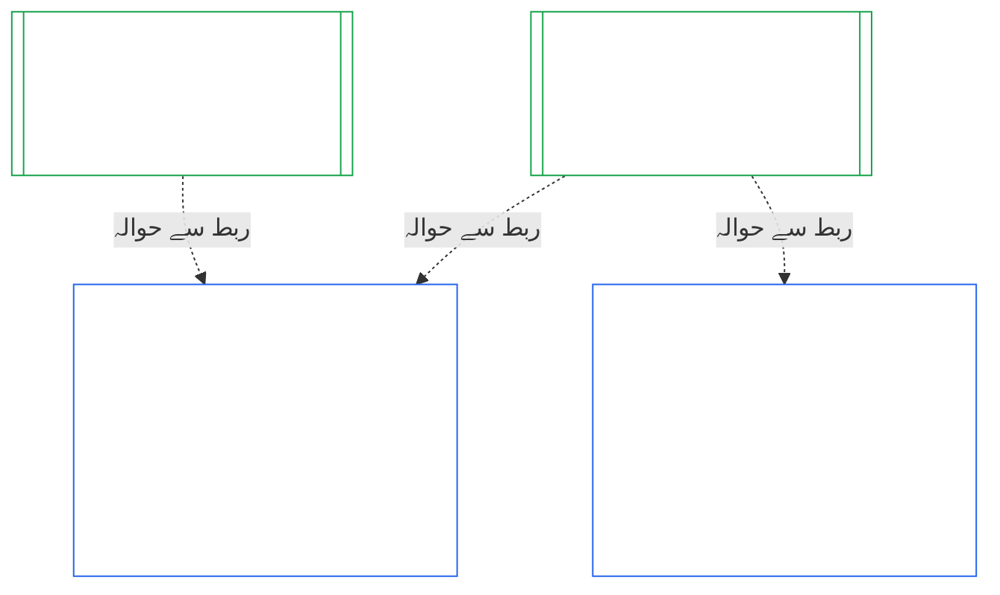

# باب دہم: ادارہ جاتی مواءمت کی توثیق

<strong>کارپس میں مقام (غیرِ عملی): فائل کی ساخت اور مطالعے کے قواعد</strong>

> یہ فائل **شعوری آئین کا حصہ** ہے اور صرف تب **پابند** ہے جب اسے دوسری نمبر والی `core_*` فائلوں کے ساتھ ایک متن کے طور پر پڑھا جائے۔ اس میں **باب دہم** — **ادارہ جاتی مواءمت کی توثیق** — شامل ہے: ایک [ادارے](core_05.040_band_continuity.md#institution) کی درجہ بندی، جائزہ، نظرثانی، فیصلہ، ریکارڈ، تازہ کاری، اور دوبارہ آغاز، ان نظاموں سے الگ جو وہ چلاتا ہے (**§1–§11**)۔ باب دہم [باب نہم](core_09.000_system_alignment_certification_evaluation.md#chapter-nine-system-alignment-certification) (*نظامی مواءمت کی توثیق*) کا ادارہ جاتی ہم پلہ ہے، اور **اس کی دفعات کے نمبر یکساں ہیں**: یہاں §N وہاں کی §N کا جواب دیتی ہے۔ [CS-9.320](corpus_systems/cs_09.320_system_alignment_certification_illustrations.md#cs-9320-system-alignment-certification-illustrations) (*نظامی مواءمت کی توثیق کی مثالیں*) میں نظاموں کی عملی مثالیں اور [§12 اداروں کے مثالی عملی جائزوں](corpus_systems/cs_09.320_system_alignment_certification_illustrations.md#cs-9320-12-illustrative-institution-walkthroughs) میں تین اداروں کے عملی جائزے ہیں۔ یہ باب ان کی تکرار نہیں کرتا۔
>
> | § | باب نہم (نظام) | باب دہم (ادارہ) |
> |---|------------------------|----------------------------|
> | 1 | مقصد اور کردار | نظامی توثیق سے تعلق، کون توثیق یافتہ ہے، تشکیل یا عمل کے لیے کوئی اجازت یا شرط نہیں، نئی مادی اتھارٹی کا انتظار، پہلی توثیق کی مہلت |
> | 2 | نظامی جماعت کا جائزہ | ادارہ جاتی جماعت؛ جماعت کے مطابق پیمانہ |
> | 3 | پورے نظام کی توثیقی جانچ | آٹھ ادارہ جاتی نکات، ہمیشہ |
> | 4 | جہاں متعلق ہوں وہاں جائزے | باب نہم §4 کا حوالہ |
> | 5 | حقوق کی تہہ اور شعبہ جاتی جائزے | باب نہم §5 کا حوالہ |
> | 6 | فورم کا عمل | چار نشستیں؛ فورم کے کردار اور ترتیب؛ بطور ادارے فورم، توثیق کنندگان، اور ریکارڈ دفاتر |
> | 7 | توثیقی نتائج | ادارے اور اس کے نظاموں کا آغازِ کار، توثیقی شرائط اور نتیجے کے دیگر اثرات؛ عیوب کا حوالہ؛ تدارک کی تیاری؛ انکار اور تنسیخ |
> | 8 | نظامی توثیق کا ریکارڈ | ادارہ جاتی توثیق کا ریکارڈ |
> | 9 | دوبارہ توثیق اور دوبارہ کھولنا | نگرانی؛ دوبارہ کھولنے کے محرکات؛ عارضی اور مکمل توثیق؛ عدم تحايل؛ نظامی توثیق سے پیدا ہونے والا تتابع؛ خلاف ورزیِ حکمرانی پر اپنے نظاموں کی دوبارہ جانچ |
> | 10 | توثیق کو چیلنج کرنا | چیلنج کا راستہ |
> | 11 | کیفیت سے تعلق | کیفیت کا پل |
>
> - **آئینی مالک (باب نہم کے ساتھ مشترک):** فورم کی نگرانی میں مواءمت کی توثیق اور متعلقہ ریکارڈ۔ باب دہم میں موضوع ادارہ ہے۔ یہ نیا فورم خاندان، نشست، یا نتیجے کی نئی اصطلاح شامل نہیں کرتا۔
> - **دہرانا نہیں، دوبارہ استعمال:** مراحل III تا VI ویسے چلتے ہیں جیسے [باب نہم حصہ ب §6](core_09.005_system_alignment_certification_record_process.md#6-forum-process) سے [باب نہم حصہ ج §11](core_09.010_system_alignment_certification_record_recertification.md#11-relationship-to-standing) میں دیا ہے۔ باب دہم صرف بتاتا ہے کہ موضوع ادارہ ہو تو کیا بدلتا ہے۔
> - **منتقلی کی ممانعت:** باب دہم نظام کے لیے باب نہم کے جائزے کا طریقۂ کار، باب ہفتم کے نظامی اور ادارہ جاتی منشور کے خانے، باب ہشتم کی چار نشستوں کی شرط، [corpus_institutions](corpus_institutions.md) کے ادارہ جاتی فرائض، باب یازدہم میں کیفیت کی پیمائش، یا باب دوازدہم میں کیفیت کے اثرات دوبارہ بیان نہیں کرتا۔
>
> **بالائی ماخذ:** [باب ہفتم](core_07.000_charters.md#chapter-seven-system-and-institutional-charters) کے منشور؛ [باب ہشتم](core_08.000_functional_independence_separation_of_duties.md#chapter-eight-functional-independence-and-separation-of-duties) کی فعلی آزادی؛ [باب نہم](core_09.000_system_alignment_certification_evaluation.md#chapter-nine-system-alignment-certification) ([حصہ الف](core_09.000_system_alignment_certification_evaluation.md#chapter-nine-part-a-system-alignment-certification--evaluation)، [حصہ ب](core_09.005_system_alignment_certification_record_process.md#chapter-nine-part-b-system-alignment-certification--forum-process-and-outcomes)، اور [حصہ ج](core_09.010_system_alignment_certification_record_recertification.md#chapter-nine-part-c-system-alignment-certification--record-recertification-and-standing))؛ باب چہاردہم کی فورم نگرانی۔
> **ذیلی ماخذ:** باب یازدہم کے کیفیتی ریکارڈ اور متحقق مدخلات؛ باب دوازدہم کے کیفیتی اثرات۔

<strong>سراغ</strong>

- بالائی ماخذ:
  - [باب ہفتم §1 نظامی اور ادارہ جاتی منشور کب لازم ہیں](core_07.000_charters.md#1-when-system-and-institutional-charters-are-required) (7.000 §1) (*کون سے ادارے نظامی یا ادارہ جاتی منشور شائع کرتے ہیں، اور ادارے کی جماعت*)؛
  - [باب ہفتم §7 ترمیم اور نظرثانی](core_07.000_charters.md#7-amendment-review-and-scope-misalignment) (7.000 §7) (*ادارہ جاتی منشور کی نظرثانی میں کیا پرکھا جاتا ہے*)؛
  - [باب ہفتم §4 منشور کے کرداروں کا نقشہ اور کیفیتی ریکارڈ کی تحویل](core_07.000_charters.md#4-the-charter-role-map-and-standing-record-custody) (7.000 §4) (*نشستوں کی جگہ*)؛
  - [باب ہشتم §2 چار نشستوں کا آئینی تقاضا](core_08.000_functional_independence_separation_of_duties.md#2-four-seat-constitutional-requirement) (8.000 §2) اور [§9 بعد کے عملوں سے تعلق](core_08.000_functional_independence_separation_of_duties.md#9-relationship-to-later-processes)؛
  - [باب نہم](core_09.000_system_alignment_certification_evaluation.md#chapter-nine-system-alignment-certification) (9.000 تا 9.010) (*نظامی مواءمت کی توثیق کا وہ عمل جسے یہ باب دوبارہ استعمال کرتا ہے*)؛
  - [دو بنیادی سوال](core_00.000_preamble.md#two-fundamental-questions)؛
  - [آئینی چوکڑی](core_00.000_preamble.md#constitutional-tetrad)؛
  - [مادہ XI-E](core_06.005_rights_part_b.md#article-xi-e-institutional-formation-and-business-creation) (*ادارہ جاتی تشکیل اور کاروبار کی تخلیق*)۔
- ذیلی ماخذ: [§1](#1-purpose-and-role) تا [§11](#11-relationship-to-standing)؛ [باب یازدہم](core_11.000_standing_assessment.md#chapter-eleven-contribution-violation-and-standing-model--measurement) (11.000)؛ [باب چہاردہم](core_14.000_forum.md#chapter-fourteen-forums-and-jurisdiction) (14.000)۔
- ساتھ پڑھیں:
  - [ادارہ جاتی مواءمت کی توثیق](core_05.040_band_continuity.md#institutional-alignment-certification) اور [ادارہ جاتی توثیق کا ریکارڈ](core_05.040_band_continuity.md#institutional-certification-record) (*باب پنجم کے مفاہیم*)؛
  - **CI-8.205 §6** (*نظامی اور ادارہ جاتی منشور کا مواد، جائزہ، اور تشکیل کا نمونہ*)؛
  - **CF-14.425** (*دیانت کے تحفظات، قبضہ مخالف عمل، اور خود فیصلہ کرنے کے خلاف اعانت*)۔

 

باب دہم **ادارہ جاتی مواءمت کی توثیق** کا آئینی مالک ہے۔ یہ [باب نہم](core_09.000_system_alignment_certification_evaluation.md#chapter-nine-system-alignment-certification) کے عمل کو نظام سے ادارے تک بڑھاتا ہے:

- **مرحلہ I، فریم بندی:** ادارہ جاتی جماعت اور جائزے پر اس کا اثر ([§2 ادارہ جاتی جماعت کا جائزہ](#2-institution-class-evaluation))؛
- **مرحلہ II، جائزہ:** ادارہ جاتی جائزہ، بشمول جہاں متعلق ہوں وہاں کے جائزے اور حقوق کی تہہ و شعبہ جاتی جائزے ([§3 پورے ادارے کی توثیقی جانچ](#3-whole-institution-certification-evaluation) تا [§5 حقوق کی تہہ اور شعبہ جاتی جائزے](#5-rights-floor-and-domain-evaluations))؛
- **مرحلہ III، نظرثانی:** فورم کے کردار اور ترتیب ([§6 فورم کا عمل](#6-forum-process))؛
- **مرحلہ IV، فیصلہ:** نتیجہ، تدارک کی تیاری، انکار اور تنسیخ ([§7 توثیقی نتائج](#7-certification-outcomes))؛
- **مرحلہ V، ریکارڈ:** ادارہ جاتی توثیق کا ریکارڈ ([§8 ادارہ جاتی توثیق کا ریکارڈ](#8-institutional-certification-record))؛ اور
- **مرحلہ VI، عمل داری:** دوبارہ توثیق، دوبارہ کھولنا، نظامی توثیق سے پیدا ہونے والا تتابع، اپنے نظاموں کو دوبارہ کھولنا، چیلنج کا راستہ، اور کیفیت کا پل ([§9 دوبارہ توثیق اور دوبارہ کھولنا](#9-recertification-and-reopening) تا [§11 کیفیت سے تعلق](#11-relationship-to-standing))۔

*سادہ الفاظ میں: باب نہم پوچھتا ہے کہ **نظام** مواءمت یافتہ ہے یا نہیں۔ باب دہم یہی سوال **ادارے** کے بارے میں پوچھتا ہے جو نظام چلاتا ہے یا نظام چلائے بغیر اختیار رکھتا ہے۔ ادارہ مواءمت یافتہ ہو سکتا ہے جبکہ اس کا ایک نظام نہ ہو، اور اس کے برعکس۔ لہٰذا ادارے کو ان باتوں پر جانچا جاتا ہے جن کا جواب صرف وہ دے سکتا ہے: کیا وہ اپنے ادارہ جاتی منشور کے مطابق چلتا ہے، اس کے اختیار کا جوابدہ کون ہے، وہ اپنے ارکان میں کس چیز کو انعام دیتا ہے، اور کیا اس پر آزادانہ جانچ حقیقتاً کی جا سکتی ہے۔ وہ ہر نظام کی توثیق پر انحصار کرتا ہے اور اسے دوبارہ نہیں کرتا۔ یہ اجازت نامہ نہیں: کسی کو ادارہ شروع یا چلانے کے لیے اس کی اجازت درکار نہیں۔*

### 1. مقصد اور کردار

<strong>سراغ</strong>

- بالائی ماخذ:
  - [باب ہفتم §1 نظامی اور ادارہ جاتی منشور کب لازم ہیں](core_07.000_charters.md#1-when-system-and-institutional-charters-are-required) (7.000 §1)؛
  - [باب نہم حصہ الف §1 مقصد اور کردار](core_09.000_system_alignment_certification_evaluation.md#1-purpose-and-role) (9.000 §1)؛
  - [مادہ XI-E](core_06.005_rights_part_b.md#article-xi-e-institutional-formation-and-business-creation) (*ادارہ جاتی تشکیل اور کاروبار کی تخلیق*)؛
  - [مادہ XXVIII-A](core_06.020_rights_part_e.md#xxviii-a-existing-instantiations-adoption-transition-window) (*مرحلہ وار اختیار اور حقوق کی تہہ کا تسلسل*)۔
- ذیلی ماخذ: [§2](#2-institution-class-evaluation)؛ [§6](#6-forum-process)؛ [§7](#7-certification-outcomes)؛ [§9](#9-recertification-and-reopening)۔
- ساتھ پڑھیں:
  - [ادارہ](core_05.040_band_continuity.md#institution)؛
  - [ادارہ جاتی منشور](core_05.040_band_continuity.md#institutional-charter)؛
  - [نظامی منشور](core_05.040_band_continuity.md#system-charter)؛
  - [کاروبار کی تخلیق](core_05.055_band_participation.md#business-creation)۔

 

*سادہ الفاظ میں: نظام کی توثیق اسی نظام کی ہوتی ہے۔ ادارے کی توثیق اس کے نظاموں کی توثیق کا حوالہ دیتی ہے اور وہ امور شامل کرتی ہے جن کا جواب صرف ادارہ دے سکتا ہے۔ ایک نظام کئی اداروں کے تحت یا کسی کے تحت نہیں ہو سکتا۔ یہاں کوئی بات ادارہ شروع کرنے کی راہ میں توثیق کو رکاوٹ نہیں بناتی۔*

ادارہ جاتی مواءمت کی توثیق اور نظامی مواءمت کی توثیق دو باہم جڑی توثیقیں ہیں۔ ان کا تعلق **ربط کے ذریعے ترکیب** ہے، احاطے کے ذریعے نہیں۔ شکل میں ایک تیر نظامی توثیق کے ریکارڈ سے ہر اس ادارہ جاتی توثیق کے ریکارڈ کی طرف جاتا ہے جو اس کا حوالہ دیتا ہے۔ کسی ادارے کے بغیر نظام کا تیر نہیں ہوتا اور اسے اس کی ضرورت نہیں؛ اور جو ادارہ کوئی نظام نہ چلاتا ہو اس کا صرف اپنا ریکارڈ ہوتا ہے۔

ربط کے ذریعے ترکیب کے دو رخ ہیں، پہلے ادارے کا:

ادارے کے رخ سے:

- **ادارہ جاتی توثیق کا ریکارڈ نظام کا حوالہ دیتا ہے، اسے دوبارہ نہیں کرتا:** یہ نظامی توثیق کے ریکارڈ کا ربط دیتا اور اس کا نسخہ بتاتا ہے۔ یہ باب نظامی جائزہ کبھی دوبارہ نہیں چلاتا، نظام کی جماعت پر نیا فیصلہ نہیں کرتا، اور نظام کے نتیجے، حالت، یا توثیقی شرائط میں تبدیلی نہیں کرتا۔
- **ادارے کی توثیق نظام کی توثیق اٹھا نہیں سکتی:** غیر توثیق یافتہ نظام، ادارے کی حالت کچھ بھی ہو، غیر توثیق یافتہ رہتا ہے۔ توثیق یافتہ نظام ادارے کے بارے میں نتیجے سے محفوظ نہیں ہوتا۔
- **ادارہ جاتی حقائق ایک بار طے ہوتے ہیں:** جہاں [باب نہم حصہ الف §3.1 حکمرانی، ترغیب، اور چیلنج پذیری کا نظم](core_09.000_system_alignment_certification_evaluation.md#31-governance-incentive-and-contestability-discipline) آپریٹر کی حکمرانی اور ترغیبات کے بارے میں پوچھے، وہاں آپریٹر کا موجودہ ادارہ جاتی توثیق کا ریکارڈ یہ حقائق ربط کے ذریعے دے سکتا ہے۔ نظام کے فورم پھر بھی فیصلہ کرتے ہیں کہ یہ حقائق نظام کے لیے کافی ہیں یا نہیں۔ نظامی توثیق کے ریکارڈ میں وجہ بتائے بغیر وہ اسی ادارہ جاتی حقیقت کے بارے میں مختلف نتیجہ نہیں دے سکتے۔

نظام کے رخ سے:

- **نظامی توثیق کا ریکارڈ نظام ہی کا ہے:** یہ [باب نہم](core_09.000_system_alignment_certification_evaluation.md#chapter-nine-system-alignment-certification) کے تحت اس کا اپنا ریکارڈ ہے۔
- **ایک نظامی توثیق کا ریکارڈ کئی ادارے نقل کر سکتے ہیں:** [باب ہفتم §1 نظامی اور ادارہ جاتی منشور کب لازم ہیں](core_07.000_charters.md#1-when-system-and-institutional-charters-are-required) کے تحت ایک سے زیادہ ادارے نظام چلا، اس کا ذمہ دارانہ انتظام، یا اس پر مادی اختیار رکھ سکتے ہیں۔ ہر ادارہ اسی ریکارڈ کا حوالہ دیتا ہے۔
- **نظام کے لیے کسی ادارے کے تحت ہونا لازم نہیں:** واحد شعوری وجود ادارہ نہیں، اس لیے نظام کسی ادارے کے بغیر بھی ہو سکتا ہے۔ غیر ادارہ جاتی نظام صرف [باب نہم](core_09.000_system_alignment_certification_evaluation.md#chapter-nine-system-alignment-certification) کے تحت توثیق پاتا ہے اور اسے اس باب سے کچھ درکار نہیں۔ ادارے کے تحت نظام بھی اسی طرح توثیق پاتا ہے: یہ باب ادارے کے لیے الگ ریکارڈ کا اضافہ کرتا ہے، اور نظام کی توثیق کا مرحلہ نہیں۔

#### 1.1 کس کی توثیق ہوتی ہے

جماعت L یا اس سے اوپر کا ادارہ اس باب کے دائرے میں ہے، جس کی جماعت [§2.1 ادارہ جاتی جماعت](#21-institution-class) کے تحت طے ہوتی ہے۔ اس میں وہ ادارہ بھی شامل ہے جو کوئی نظام نہیں چلاتا: اس کے پاس حوالہ دینے کے لیے نظامی توثیق کا ریکارڈ نہیں، اور اس کی جماعت اس کے اپنے اثر سے طے ہوتی ہے۔ ادارے کی **محفظہ** ان نظاموں کا مجموعہ ہے جنہیں وہ چلاتا، سنبھالتا، یا مادی طور پر کنٹرول کرتا ہے ([محفظہ](core_05.040_band_continuity.md#portfolio))۔

- **جماعت A، B، C، اور L:** عمل لاگو ہے، جماعت کے مطابق [§2.2 جماعت کے مطابق پیمانہ](#22-scaling-by-class) کے تحت۔
- **جماعت P:** عمل کی ترغیب ہے اور رضاکارانہ استعمال ہو سکتا ہے۔ جماعت L یا اس سے اوپر دوبارہ درجہ بند ہونے پر یا ادارے کے رضاکارانہ آئینی تعمیل کے دعوے پر عمل لازم ہو جاتا ہے۔ جماعت P کا ادارہ اگر نئی مادی اتھارٹی لینے کا فیصلہ کرے تو [§9.2.2 نئی مادی اتھارٹی کے لیے دوبارہ توثیق](#922-recertification-for-new-material-authority) میں درج اطلاع دیتے ہی کم از کم جماعت L میں دوبارہ درجہ بند ہوتا ہے، کیونکہ تعریفاً وہ اتھارٹی مادی ہے ([§9.2.1 نئی مادی اتھارٹی کیا ہے](#921-what-counts-as-new-material-authority)) اور کسی بھی شعبے میں مادی ادارہ کم از کم جماعت L کا ہے ([§2.1 ادارہ جاتی جماعت](#21-institution-class)، نکتہ 2)۔ دوبارہ درجہ بندی اطلاع سے نافذ ہوگی تاوقتیکہ منظوری سے پہلے اطلاع واپس لے لی جائے یا اتھارٹی منظور نہ ہو، بشرطیکہ اس کے تحت کوئی عمل نہ ہوا ہو۔ پھر ادارہ جماعت P میں لوٹتا ہے اور محدود پہلی توثیق ختم ہو جاتی ہے۔ نئی اطلاع اسے دوبارہ شروع کرتی ہے، اور منظوری سے پہلے اتھارٹی استعمال کرنا [§9.2.2 نئی مادی اتھارٹی کے لیے دوبارہ توثیق](#922-recertification-for-new-material-authority) (*بغیر اطلاع یا منظوری سے پہلے*) کے تحت نتیجہ رہے گا۔ یہ [باب نہم حصہ الف §1 مقصد اور کردار](core_09.000_system_alignment_certification_evaluation.md#1-purpose-and-role) کے متوازی ہے۔
- **ایک نظام:** جو ادارہ منشور کا محتاج بالکل ایک نظام چلاتا ہو، اس کی ایک توثیقی کارروائی اور ایک ریکارڈ ہوتا ہے، جسے یہ باب **ایک-نظامی جائزہ** کہتا ہے۔ نظامی توثیق کے ریکارڈ میں [§8 ادارہ جاتی توثیق کا ریکارڈ](#8-institutional-certification-record) کے نکات پر مشتمل *ادارہ جاتی نتائج کا خانہ* ہوگا اور وہ ادارہ جاتی توثیق کے ریکارڈ کے طور پر کام کرے گا۔ فورم، نشستیں، اور اوقات نظام کی اپنی توثیقی کارروائی کے ہوں گے، ادارہ جاتی نکات کے اضافے کے ساتھ۔ اس کے نتائج اپنے اپنے انکار اور تنسیخ کے اسباب کے مطابق ہوں گے، جیسا کہ [§7.4 ادارے کے لیے انکار اور تنسیخ](#74-denial-and-revocation-for-an-institution) بتاتا ہے۔ [§9.5 نظامی توثیق سے پیدا ہونے والا تتابع](#95-cascade-from-system-certifications) بطور تتابع لاگو نہیں، کیونکہ نظام پوری محفظہ ہے؛ تاہم [§7.4 ادارے کے لیے انکار اور تنسیخ](#74-denial-and-revocation-for-an-institution) کے قواعد 1 اور 2 (اشارہ اور سبب کے مقام کی جانچ) لاگو ہیں۔
- **کئی نظام:** ادارے کے لیے ایک ادارہ جاتی توثیق کا ریکارڈ، جو اس کے ہر نظام کے نظامی توثیق کے ریکارڈ کو جوڑتا ہے۔ ہر نظام کی اپنی کارروائی اور اپنا ریکارڈ رہتا ہے۔
- **کوئی نظام نہیں:** صرف ادارے کا اپنا ایک ادارہ جاتی توثیق کا ریکارڈ۔ حوالہ دینے کے لیے نظامی توثیق کا ریکارڈ نہیں، کیونکہ ادارہ نظام نہیں چلاتا۔

