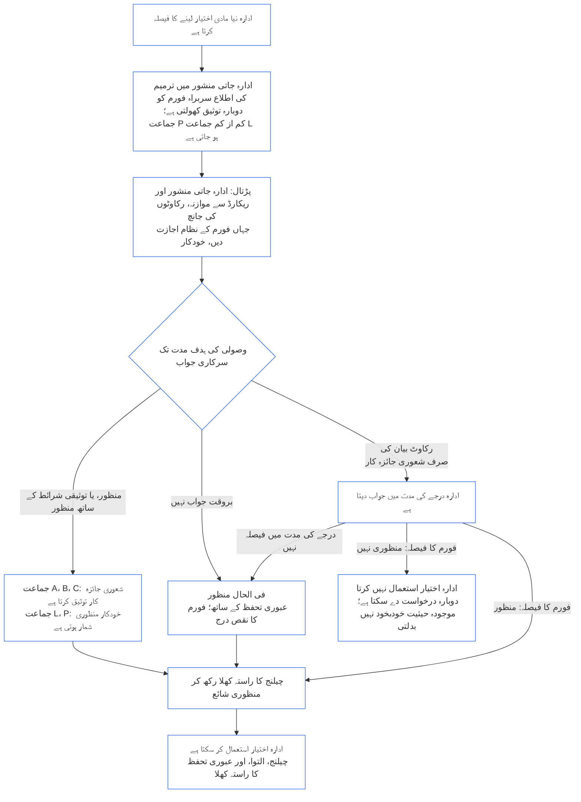

##### 9.2.2 نئے مادی اختیار کے لیے دوبارہ توثیق

جو ادارہ نیا مادی اختیار لینے کا فیصلہ کرتا ہے، اسے دوبارہ توثیق کرانی لازم ہے، اور اس اختیار کو استعمال کرنے سے پہلے نتیجے کا انتظار کرنا لازم ہے۔ یہی انتظار **مادہ XI-E** (*ادارہ جاتی تشکیل اور کاروبار کی تخلیق*) بیان کرتا ہے۔ اس کا طریقہ یہ ہے:

- **پہلے اطلاع:** ادارہ ادارہ جاتی منشور میں ترمیم کی وہ اطلاع دیتا ہے جس کا [باب ہفتم §7.1 دستاویز بدلنا](core_07.000_charters.md#71-changing-the-document) پہلے ہی تقاضا کرتا ہے، اور اسے سربراہ فورم کو بھیجتا ہے۔ اطلاع سے دوبارہ توثیق شروع ہوتی ہے۔
- **ابھی ریکارڈ نہیں:** جس ادارے کا کوئی ادارہ جاتی توثیقی ریکارڈ نہ ہو وہ بھی یہی اطلاع دیتا ہے۔ اس اطلاع سے پہلی توثیق کھلتی ہے، جو نئے اختیار تک محدود ہوتی ہے؛ اسے ادارہ جاتی منشور اور اس اختیار سے متعلق [§3 پورے ادارے کی توثیقی جانچ](#3-whole-institution-certification-evaluation) تا [§5 حقوق کی تہہ اور شعبہ جاتی جائزے](#5-rights-floor-and-domain-evaluations) کے جائزوں کے مقابل پرکھا جاتا ہے۔ پہلی توثیق کا باقی حصہ [§1.3 پہلی توثیق کی مہلت](#13-window-for-the-first-certification) کی مدت میں جاری رہتا ہے (اطلاع سے درجہ بندی ہونے والے جماعت P ادارے کے لیے یہ مدت اطلاع سے شروع ہوتی ہے)، اور نئے اختیار کے انتظار کا اس پر انحصار نہیں۔
- **درجے کی مدتوں کے اندر:** دوبارہ توثیق [باب نہم حصہ ج §9.3.4 درجے کی مدتیں](core_09.010_system_alignment_certification_record_recertification.md#934-tier-windows) کے تحت چلتی ہے؛ مفروضہ یہ ہے کہ درجہ ادارے کی جماعت سے مطابقت رکھتا ہے۔ مدت پوری نہ ہونے پر [مادہ XXVI-C](core_06.020_rights_part_e.md#article-xxvi-c-timely-resolution-and-anti-delay-floor) (*بروقت تصفیہ اور تاخیر مخالف کم از کم معیار*) کے تحت کارروائی ہوتی ہے، اور فیس اور انتظار رکاوٹ نہیں بن سکتے ([قابلِ اجتناب بوجھ](core_05.040_band_continuity.md#avoidable-burden))۔
- **جہاں ممکن ہو خودکار:** اطلاع، نئے اختیار کا ادارہ جاتی منشور اور موجودہ ریکارڈ سے موازنہ، رکاوٹوں کی پڑتال، اور منظوری—یہ سب جہاں فورم کے نظام اجازت دیں خودکار ہوتے ہیں۔ [باب اول §13.3 قابلِ اجتناب بوجھ کو کم کرنا](core_01.005_interaction_interpretation.md#133-minimization-of-avoidable-burden) قابلِ اجتناب بوجھ کے لیے خودکاری کو ترجیحی علاج قرار دیتا ہے، اور [باب اول §16.4 کارروائی کے مقام پر دستاویز بندی](core_01.010_stewardship_capacity_principles.md#164-document-at-action) خودکاری کا بوجھ نگران کے بجائے نظام پر رکھتا ہے۔
  - **منظوری، انکار نہیں:** خودکار پڑتال نئے اختیار کو منظور کر سکتی ہے، یا تو بلاشرط یا ان توثیقی شرائط کے ساتھ جن کی موجودہ ریکارڈ پہلے ہی تائید کرتا ہو۔ وہ خود سے کوئی رکاوٹ بیان نہیں کر سکتی (ان رکاوٹوں میں سے جو [§9.2.3 نئے مادی اختیار کی منظوری میں رکاوٹیں](#923-blockers-to-clearing-new-material-authority) میں ہیں) اور نہ منظوری دینے سے انکار کر سکتی ہے۔ پڑتال ممکنہ رکاوٹ کی نشاندہی کر سکتی ہے، مگر اس پر غور کرنے کے بعد صرف سربراہ فورم میں کوئی شعوری جائزہ کار ہی رکاوٹ بیان کر سکتا ہے۔
  - **جماعت A، B، اور C:** منظوری کو سرکاری جواب ماننے سے پہلے سربراہ فورم میں کوئی شعوری جائزہ کار ہر منظوری کی توثیق کرتا ہے۔ یہ ان جماعتوں کے ادارے، اور اس اختیار سے ان جماعتوں میں آنے والے ادارے، دونوں پر لاگو ہوتا ہے۔ وصولی کی ہدف مدت توثیق پر بھی لاگو ہوتی ہے۔ جائزہ کار سربراہ فورم میں ہوتا ہے، جو پہلے ہی تصدیق یا اجازت کی نشست رکھتا ہے اور ادارے سے آزاد ہونا لازم ہے ([§6.1 ادارہ جاتی توثیق میں چار نشستیں](#61-four-seats-in-an-institutional-certification))۔
  - **جماعت L اور P:** خودکار منظوری توثیق کے بغیر ہی سرکاری جواب شمار ہوتی ہے۔ جماعت P ادارہ اطلاع دیتے وقت کم از کم جماعت L میں آ جاتا ہے ([§1.1 کس کی توثیق ہوتی ہے](#11-who-is-certified))، اس لیے اس پر جماعت L کا قاعدہ لاگو ہوتا ہے۔
  - **غیر معمولی حالات:** ہر جماعت میں، اگر پڑتال ممکنہ رکاوٹ دکھائے، یہ طے نہ کر سکے کہ اختیار احاطے میں شامل یا مادی ہے یا نہیں، یا ادارہ یا متاثرہ شعوری وجود نظرثانی مانگے، تو معاملہ شعوری جائزہ کار لیتا ہے۔ نظرثانی کی درخواست کا جواب [متعلقہ وصولی ہدف](core_05.040_band_continuity.md#tier-window) کے اندر دیا جاتا ہے، جس کا شمار درخواست سے ہوتا ہے۔ اس سے درجے کی مدت نہیں بڑھتی۔
  - **وہی ریکارڈ اور وہی مدتیں:** ریکارڈ میں کی گئی پڑتالیں دکھائی جاتی ہیں تاکہ خودکار منظوری کو کسی بھی دوسرے فیصلے کی طرح چیلنج کیا جا سکے۔ خودکاری سے وصولی کی ہدف مدت یا درجے کی مدت نہیں بڑھتی، اور جو پڑتال بند ہو یا جواب دینے میں ناکام رہے، اسے نیچے کے نکتے کے تحت جواب دینے میں ناکامی شمار کیا جاتا ہے۔ فورم پڑتال کے لیے اسی طرح جواب دہ ہے جیسے اپنے استعمال کردہ کسی نظام کے لیے ([§6.3 بطور ادارے فورم، توثیق کنندہ، اور ریکارڈ دفاتر](#63-forums-certifiers-and-record-offices-as-institutions))۔
- **انتظار:** دوبارہ توثیق سے اختیار منظور ہونے تک ادارہ نیا اختیار استعمال نہیں کرتا۔
  - **ہر جماعت انتظار کرتی ہے:** کسی جماعت کو استثنا نہیں، اور نہ ہنگامی حالت نہ عجلت انتظار ختم کرتی ہے۔
  - **باقی سب جاری رہتا ہے:** ادارہ جو کام پہلے سے کرتا ہے وہ جاری رہتا ہے ([§1.2 تشکیل یا عمل کے لیے کوئی اجازت یا شرط نہیں](#12-no-permission-and-no-gate-on-forming-or-running))۔
  - **تحفظ انتظار نہیں کرتا:** متاثرہ شعوری وجودوں کے لیے فورموں کا فوری تحفظ دوبارہ توثیق کا انتظار نہیں کرتا ([باب نہم حصہ ب §6.2 نگرانی کی ترتیب](core_09.005_system_alignment_certification_record_process.md#62-supervisory-sequence))۔ یہ شعوری وجودوں کا تحفظ ہے اور ادارے کے لیے اختیار جلد استعمال کرنے کی وجہ نہیں۔
- **منظوری پر اشاعت:** سربراہ فورم ہر منظوری ملتے ہی شائع کرتا ہے، بشمول عارضی منظوری، اور [§10 توثیق کو چیلنج کرنا](#10-challenging-a-certification) کا راستہ کھلا رکھتا ہے۔ ادارہ منظوری ملنے سے اختیار استعمال کر سکتا ہے۔ اسے اطلاع کی مدت پوری ہونے یا چیلنج کا فیصلہ ہونے کا انتظار نہیں کرنا پڑتا۔ متاثرہ شعوری وجود کسی بھی دوسرے فیصلے کی طرح منظوری کو چیلنج کر سکتا ہے، اور التوا یا عبوری تحفظ مانگ سکتا ہے؛ ان کے لیے بھی انتظار نہیں ([§9.2.2 نئے مادی اختیار کے لیے دوبارہ توثیق](#922-recertification-for-new-material-authority)، *تحفظ انتظار نہیں کرتا*)۔ اشاعت کے وقت سربراہ فورم منظوری کی اطلاع اپنے علم میں موجود متاثرہ شعوری وجودوں اور متعلقہ نظاموں کے فورموں کو بھی دیتا ہے۔ التوا یا عبوری تحفظ کی درخواست کا جواب متعلقہ وصولی ہدف ([CF-14.445 §3.1 مرحلے کے اہداف اور آخری حدود](corpus_forum/cf_14.445_performance_backlog_publication_accessibility.md#cf-14445-31-stage-targets-and-outer-bounds)) کے اندر، یا جہاں ہنگامی ترتیب لاگو ہو اس کی حد کے اندر دیا جاتا ہے۔
- **منظوری کا مفروضہ:** اختیار کو منظور شدہ تصور کیا جاتا ہے۔ سربراہ فورم اسے صرف اسی صورت منظور کرنے سے انکار کر سکتا ہے جب وہ ریکارڈ پر بیان کردہ شواہد کی بنیاد پر [§9.2.3 نئے مادی اختیار کی منظوری میں رکاوٹیں](#923-blockers-to-clearing-new-material-authority) میں درج رکاوٹ ثابت کرے۔ جہاں رکاوٹ سے منسلک توثیقی شرائط اسے قابو میں رکھ سکتی ہوں، اختیار رد کرنے کے بجائے ان شرائط کے ساتھ منظور ہوتا ہے۔
- **منظوری کا مطلب:** دوبارہ توثیق عارضی یا مکمل توثیق پر ختم ہوتی ہے، توثیقی شرائط کے ساتھ یا ان کے بغیر؛ اور اختیار استعمال کرنے سے پہلے درکار ہر توثیقی شرط کی آزادانہ تصدیق ہو چکی ہوتی ہے۔
- **اگر فورم بروقت جواب نہ دے:** سربراہ فورم پر متعلقہ وصولی ہدف ([CF-14.445 §3.1 مرحلے کے اہداف اور آخری حدود](corpus_forum/cf_14.445_performance_backlog_publication_accessibility.md#cf-14445-31-stage-targets-and-outer-bounds)) کے اندر سرکاری جواب دینا لازم ہے۔ جواب اختیار منظور کرتا ہے، توثیقی شرائط کے ساتھ منظور کرتا ہے، یا شواہد کے ساتھ رکاوٹ بیان کرتا ہے۔ رکاوٹ بیان کرنے والے جواب کے بعد ادارے کو جواب دینے کا موقع ملتا ہے اور فورم اوپر دی گئی درجے کی مدت کے اندر فیصلہ کرتا ہے۔
  - **فی الحال منظور:** اگر وصولی کی ہدف مدت تک سرکاری جواب نہ آئے، یا درجے کی مدت میں بیان کردہ رکاوٹ کا فیصلہ نہ ہو، تو اختیار فی الحال منظور سمجھا جاتا ہے، اس عبوری تحفظ اور انحصار کی حدود کے ساتھ جو [باب نہم حصہ ب §7.2 توثیقی نقائص اور اصلاح](core_09.005_system_alignment_certification_record_process.md#72-certification-defects-and-correction) فراہم کرتا ہے۔
  - **فورم کا نقص:** ہدف یا مدت پوری نہ ہونا فورم کا نقص ہے، ادارے کی غلطی نہیں۔ اسے درج کیا، درست کیا، اور [باب چہاردہم §6 بروقت تصفیہ، مادیت کی سطحیں، اور تاخیر مخالف نظم](core_14.000_forum.md#6-timely-resolution-materiality-tiers-and-anti-delay-discipline) (*مدت سے تجاوز کا جائزہ*) کے تحت تجاوز کے طور پر جانچا جاتا ہے۔
  - **دوسرے فورم کو حوالگی:** دوبارہ توثیق کی درخواست اسی خاندان کے کسی دوسرے فورم کو منتقل ہوتی ہے ([باب چہاردہم §3 منتقلی، یکجائی، اور رابطہ کاری](core_14.000_forum.md#3-transfer-consolidation-and-coordination--continuity-and-anti-capture))۔ وہ فورم منتقلی سے شمار کرتے ہوئے ادارے کی جماعت کے باقاعدہ مقررہ اوقات میں دوبارہ توثیق آگے بڑھاتا ہے۔
- **اگر منظوری نہ ملے:** ادارہ اختیار استعمال نہیں کرتا اور باب نہم حصہ ب §7.4 (*مستقل پابندی نہیں*) کی شرائط پر دوبارہ درخواست دے سکتا ہے۔ نئے اختیار کی منظوری نہ ملنا بذاتِ خود ادارے کی موجودہ سرگرمی کے لیے حاصل حیثیت سے انکار یا اس کی تنسیخ نہیں ہے۔ یہ حیثیت صرف [§7.3 ادارے کی اصلاحی تیاری](#73-remediation-readiness-for-an-institution) اور [§7.4 ادارے کے لیے انکار اور تنسیخ](#74-denial-and-revocation-for-an-institution) کے تحت نتیجے سے بدلتی ہے۔
- **اطلاع کے بغیر یا منظوری سے پہلے:** اطلاع دیے بغیر یا منظوری سے پہلے نیا مادی اختیار استعمال کرنا ادارہ جاتی منشور سے باہر عمل ہے۔ یہ [§3 پورے ادارے کی توثیقی جانچ](#3-whole-institution-certification-evaluation) (نکتہ 1) کے تحت نتیجہ ہے، اور ادارہ جاتی منشور کے واقعے کے طور پر جائزہ دوبارہ کھولتا ہے۔

<strong>قارئین کے لیے رہنما (غیر عملی): نئے مادی اختیار کا انتظار</strong>

یہ خاکہ §9.2.2 نئے مادی اختیار کے لیے دوبارہ توثیق کا خلاصہ ہے۔ جہاں یہ متن سے مختلف ہو، متن حاکم ہے۔ ادارہ جو کچھ پہلے سے کرتا ہے وہ پورے عرصے جاری رہتا ہے، اور متاثرہ شعوری وجودوں کا فوری تحفظ کبھی انتظار نہیں کرتا۔ اداروں کی کام شدہ مثالیں [CS-9.320 §12 اداروں کی وضاحتی مرحلہ وار مثالیں](corpus_systems/cs_09.320_system_alignment_certification_illustrations.md#cs-9320-12-illustrative-institution-walkthroughs) میں ہیں۔

 

