<!-- AI-assisted translation draft; unreviewed; English controls.
Source: core_09.000_system_alignment_certification_evaluation.md
Source snapshot: 247e2180509e5e029c1106878cf225067339e010
Source SHA-256: 3ff6a518d3c9d6779925a1daab6ad6c53abdbdabeeaad786ffafcdd1e6ac8b80 -->

# CHƯƠNG CHÍN, PHẦN A: CHỨNG NHẬN MỨC ĐỘ PHÙ HỢP CỦA HỆ THỐNG — ĐÁNH GIÁ

<strong>Vị trí trong kho văn bản (không vận hành): cấu trúc tệp và quy tắc đọc</strong>

> Tệp này **là một phần của Hiến pháp Hữu tri** và chỉ **có tính ràng buộc khi được đọc cùng** các tệp `core_*` được đánh số khác như một văn bản thống nhất. Tệp này gồm **Chương Chín, Phần A** — mục đích chứng nhận, tổng quan quy trình và hai giai đoạn đầu của quy trình — **Định khung** (lớp hệ thống) và **Đánh giá** (đánh giá toàn hệ thống qua ba tiểu giai đoạn: các đánh giá luôn áp dụng, bao gồm loại dữ liệu và cách xử lý, tại **§3**; các đánh giá áp dụng khi có liên quan tại **§4**; và các đánh giá Sàn Quyền và lĩnh vực áp dụng khi được kích hoạt tại **§5**) — **§1–§5**. Các **minh họa Lớp A / B / C** (hồ sơ lớp hệ thống và hướng dẫn từng bước cho §3.4, §5.1, §5.2, §5.3, §5.4, §5.5 và §5.6), kể cả đoạn **Đối chiếu giữa các lớp hệ thống** của từng minh họa, nằm trong [CS-9.320](corpus_systems/cs_09.320_system_alignment_certification_illustrations.md#cs-9320-system-alignment-certification-illustrations) (*Minh họa chứng nhận mức độ phù hợp của hệ thống*) thuộc nhóm hệ thống, không nằm trong chương này; mỗi minh họa nêu rõ mục của Phần A mà nó minh họa. Các quy tắc ràng buộc về điều chỉnh theo lớp hệ thống và nâng cấp xử lý được minh họa trong những đoạn đó vẫn nằm trong tệp này: điều chỉnh theo lớp hệ thống, bao gồm sự tham gia và tính tương xứng, tại §2.2; điều chỉnh việc xử lý dữ liệu tại §3.4; và đoạn **Điều chỉnh và nâng cấp xử lý theo lớp hệ thống** trong từng mục §5.1–§5.6. Các tệp của toàn chương được liệt kê trong bảng dưới đây.
>
> **Các tệp Chương Chín.** Chương Chín được chia thành ba tệp ràng buộc, đọc như một văn bản thống nhất. Phần A, tệp này, mở đầu chương; không có tệp chỉ mục riêng. Các minh họa thực hành không thuộc chương; chúng nằm trong [CS-9.320](corpus_systems/cs_09.320_system_alignment_certification_illustrations.md#cs-9320-system-alignment-certification-illustrations) (*Minh họa chứng nhận mức độ phù hợp của hệ thống*).
>
> | Phần | Tệp | Quy định |
> |------|------|------|
> | **Phần A — Đánh giá** | [`core_09.000_system_alignment_certification_evaluation.md`](core_09.000_system_alignment_certification_evaluation.md) | §1–§5: mục đích và tổng quan quy trình (có sơ đồ toàn bộ quy trình chứng nhận gồm sáu giai đoạn), **Giai đoạn I Định khung** (lớp hệ thống, cách lớp hệ thống điều chỉnh mọi đánh giá và chứng nhận thí điểm) và **Giai đoạn II Đánh giá** (đánh giá toàn hệ thống qua ba tiểu giai đoạn: **IIa** luôn áp dụng tại §3, bao gồm phạm vi theo điều lệ so với ranh giới chức năng, cùng loại dữ liệu và cách xử lý; **IIb** khi có liên quan tại §4; và **IIc** khi được kích hoạt, các đánh giá Sàn Quyền và lĩnh vực tại §5) |
> | **Phần B — Quy trình diễn đàn và kết quả** | [`core_09.005_system_alignment_certification_record_process.md`](core_09.005_system_alignment_certification_record_process.md) | §6–§7: **Giai đoạn III Rà soát** (vai trò diễn đàn, trình tự giám sát và chuỗi khả năng tranh biện) và **Giai đoạn IV Quyết định** (kết quả chứng nhận, gồm điều kiện cho phép đưa vào vận hành) — đánh số chương liên tục từ §5 Phần A |
> | **Phần C — Hồ sơ, tái chứng nhận và vị thế** | [`core_09.010_system_alignment_certification_record_recertification.md`](core_09.010_system_alignment_certification_record_recertification.md) | §8–§11: **Giai đoạn V Lập hồ sơ** (Hồ sơ Chứng nhận Hệ thống và tính toàn vẹn của hồ sơ, gồm các trường [Điều lệ Hệ thống](core_05.040_band_continuity.md#system-charter) có thẩm quyền) và **Giai đoạn VI Vận hành** (tái chứng nhận và mở lại; đường dẫn tranh biện; cầu nối tới vị thế) — đánh số chương liên tục từ §7 Phần B |
>
> **Quan hệ giữa hai chứng nhận.** Chứng nhận Mức độ Phù hợp của Hệ thống (chương này) là chứng nhận một Hệ thống. Chứng nhận mức độ phù hợp của tổ chức ([Chương Mười](core_10.000_institutional_alignment_certification.md#chapter-ten-institutional-alignment-certification)) là chứng nhận một Tổ chức, có thể vận hành một hoặc nhiều Hệ thống, hoặc không vận hành Hệ thống nào. Chương Mười dẫn liên kết tới Hồ sơ Chứng nhận Hệ thống của từng Hệ thống, không đánh giá lại hồ sơ đó; [Chương Mười §1](core_10.000_institutional_alignment_certification.md#1-purpose-and-role) nêu quan hệ này và [Chương Mười §1.2](core_10.000_institutional_alignment_certification.md#12-no-permission-and-no-gate-on-forming-or-running) nêu rằng đây không phải giấy phép. Các mục của chương đó mang cùng số với các mục của chương này, theo các tiêu đề song song.
>
> Các liên kết chung tới **Chương Chín** trong những tệp khác được chuyển tới phần phù hợp theo số mục.
>
> - **Chủ thể hiến pháp (đồng sở hữu với Phần B và C):** **chứng nhận mức độ phù hợp của hệ thống và các hồ sơ liên quan** do diễn đàn giám sát — các lĩnh vực đánh giá (Phần A); quy trình diễn đàn, trình tự giám sát và kết quả chứng nhận cùng điều kiện cho phép đưa vào vận hành (Phần B); nghĩa vụ đối với Hồ sơ Chứng nhận Hệ thống, đường dẫn tranh biện, tái chứng nhận và mở lại, cùng cầu nối dữ liệu đã xác minh tới Chương Mười Một (tất cả ở Phần C). Theo trụ cột **giám sát** của Tứ diện, SAC là một trong nhiều quy trình kiểm toán đặc biệt lớn và có mức độ rủi ro cao; các chuẩn sàn kiểm toán vẫn thuộc **Điều XVI** (*Kiểm toán, Minh bạch và Xác minh Độc lập*) và [Khả năng kiểm toán](core_05.050_band_oversight.md#auditability) của Chương Năm.
> - **Chủ thể phụ trách nền tảng xác minh:** [Chương Bốn — Gánh nặng chứng minh, Truy xuất nguồn gốc và Xác minh](core_04.000_burden_traceability_verification.md#chapter-four-burden-of-proof-traceability-and-verification) (trong các Chương Hai đến Bốn) quy định việc phân bổ gánh nặng, bằng chứng tuân thủ, truy xuất nguồn gốc định nghĩa, khả năng quan sát và xác minh có ràng buộc bảo mật. Chương Chín **áp dụng** kỷ luật đó cho Hồ sơ Chứng nhận Hệ thống; chương này **không** nhắc lại các mục **1** đến **5** của Chương Bốn.
> - **Nơi quy định kiểm toán (không chuyển sang đây):** **Điều XVI** (*Kiểm toán, Minh bạch và Xác minh Độc lập*), **Def.O1** (*Minh bạch, Khả năng kiểm toán và Xác minh*), và **CJS-5.110 §3 cùng CJS-5.115 §3** (*Nơi quy định quy trình kiểm toán*)–**CJS-5.110 §5** quy định các chuẩn sàn kiểm toán và điều khoản vận hành. Chương Chín vận hành một quy trình kiểm toán SAC đặc biệt lớn phải đáp ứng các chuẩn sàn đó; chương này không quản lý toàn bộ hoạt động kiểm toán.
> - **Chủ thể triển khai:** cách xử lý theo lớp hệ thống, CS-6.345 (*Vòng đời hệ thống*) và chi tiết quy trình diễn đàn trong các tệp triển khai được chỉ định phải nhất quán với Chương Chín và có thể nghiêm ngặt hơn khi kho văn bản đã có quy tắc [Hiệu lực Bảo vệ Cao nhất](core_05.045_band_integrative.md#fullest-protective-effect).
> - **Quy tắc chống chuyển chỗ:** Phần A không nhắc lại các định nghĩa chuẩn tắc của Chương Năm, kỷ luật chống né tránh của Chương Ba (xem [Phần C §9.4](core_09.010_system_alignment_certification_record_recertification.md#94-non-evasion)), việc đo lường đóng góp hoặc vị thế của Chương Mười Một, hay hiệu ứng vị thế của Chương Mười Hai. **[Phần C §11](core_09.010_system_alignment_certification_record_recertification.md#11-relationship-to-standing)** quy định cầu nối tới vị thế.
>
> **Thượng nguồn:** các định nghĩa của Chương Năm; hồ sơ, xác minh, gánh nặng và truy xuất nguồn gốc từ định nghĩa đến kết quả của các Chương Hai đến Bốn; và [Chương Tám](core_08.000_functional_independence_separation_of_duties.md#chapter-eight-functional-independence-and-separation-of-duties), nơi yêu cầu phân tách nhiệm vụ chi phối mọi hành vi chứng nhận ràng buộc về mặt vật chất.
> **Hạ nguồn:** [Phần B](core_09.005_system_alignment_certification_record_process.md#chapter-nine-part-b-system-alignment-certification--forum-process-and-outcomes) (*quy trình diễn đàn và kết quả*) và [Phần C](core_09.010_system_alignment_certification_record_recertification.md#chapter-nine-part-c-system-alignment-certification--record-recertification-and-standing) (*hồ sơ, tái chứng nhận và cầu nối vị thế*); hồ sơ vị thế và dữ liệu đã xác minh của Chương Mười Một; hiệu ứng vị thế của Chương Mười Hai; giám sát diễn đàn và các đường dẫn chứng nhận mức độ phù hợp của hệ thống thuộc Chương Mười Bốn.

 

Chương Chín, **Phần A**, là chủ thể hiến pháp quy định **đánh giá chứng nhận mức độ phù hợp của hệ thống**.

- Việc giám sát của diễn đàn và kết quả chứng nhận nằm trong **[Phần B](core_09.005_system_alignment_certification_record_process.md#chapter-nine-part-b-system-alignment-certification--forum-process-and-outcomes)**.
- Hồ sơ, tái chứng nhận và mở lại, cùng cầu nối tới vị thế nằm trong **[Phần C](core_09.010_system_alignment_certification_record_recertification.md#chapter-nine-part-c-system-alignment-certification--record-recertification-and-standing)**.
- Các minh họa thực hành cho những mục đánh giá này nằm trong **[CS-9.320 Minh họa chứng nhận mức độ phù hợp của hệ thống](corpus_systems/cs_09.320_system_alignment_certification_illustrations.md#cs-9320-system-alignment-certification-illustrations)**.
- Chứng nhận mức độ phù hợp của tổ chức, với cùng số mục, nằm trong **[Chương Mười](core_10.000_institutional_alignment_certification.md#chapter-ten-institutional-alignment-certification)**.

### 1. Mục đích và Vai trò

<strong>Truy xuất nguồn gốc</strong>

- Thượng nguồn:
  - [Lời nói đầu — sổ đăng ký chủ thể hiến pháp](core_00.000_preamble.md#4-principles-definitions-and-rights) và
  - [Thứ bậc Thẩm quyền và Hệ thống Phân cấp Nội bộ](core_05.045_band_integrative.md#authority-stack-and-internal-hierarchy);
  - [Tứ diện Hiến pháp](core_00.000_preamble.md#constitutional-tetrad);
  - [Hai Mục tiêu Hiến pháp](core_00.000_preamble.md#two-constitutional-aims);
  - [lợi hại vật chất](core_00.000_preamble.md#material-stake);
  - [Tính tương xứng](core_05.035_band_accountability.md#proportionality) và
  - [Công bằng Thực chất](core_05.055_band_participation.md#substantive-fairness) (Chương Năm); nhóm đo lường sự tham gia (*tiếng nói, quyền tiếp cận và đường dẫn tranh biện*);
  - [Chương Một §16 Quản trị có trách nhiệm chuyên sâu](core_01.010_stewardship_capacity_principles.md#16-stewardship-in-depth) (1.010 §16);
  - [Chương Một §12 Yêu cầu Đánh giá Hệ thống](core_01.000_values_principles.md#12-systemic-evaluation-requirement) (1.000 §12) (*lăng kính đánh giá toàn hệ thống ở tầng nguyên tắc — không chỉ một khía cạnh riêng lẻ*); các Chương Hai đến Bốn;
  - [Chương Năm](core_05.000_definitions_home.md#chapter-five-foundational-definitions) (5.000) (*các định nghĩa chuẩn tắc*);
  - [Chương Tám §2 Yêu cầu Hiến pháp về Bốn Ghế](core_08.000_functional_independence_separation_of_duties.md#2-four-seat-constitutional-requirement) (8.000 §2);
  - [Chứng nhận Mức độ Phù hợp của Hệ thống](core_05.040_band_continuity.md#system-alignment-certification) (thuật ngữ chuẩn tắc của Chương Năm; cách viết tắt **SAC** không có tính vận hành);
  - [Hồ sơ Chứng nhận Hệ thống](core_05.040_band_continuity.md#system-certification-record) (ý nghĩa theo Chương Năm).
- Hạ nguồn:
  - [§2](#2-system-class-evaluation) (*đánh giá lớp hệ thống*);
  - [Phần C §10](core_09.010_system_alignment_certification_record_recertification.md#10-challenging-a-certification) (9.010 §10) (*tranh biện về chứng nhận*); và
  - [CS-9.320 §2](corpus_systems/cs_09.320_system_alignment_certification_illustrations.md#cs-9320-2-illustrative-system-class-profiles) (*Hồ sơ lớp hệ thống minh họa*);
  - [CS-9.320 §4](corpus_systems/cs_09.320_system_alignment_certification_illustrations.md#cs-9320-4-illustrative-whole-system-application-by-system-class) (*Áp dụng toàn hệ thống minh họa theo lớp hệ thống*);
  - [CS-9.320 §5](corpus_systems/cs_09.320_system_alignment_certification_illustrations.md#cs-9320-5-illustrative-data-handling-application-by-system-class) (*Áp dụng xử lý dữ liệu minh họa theo lớp hệ thống*);
  - [CS-9.320 §6](corpus_systems/cs_09.320_system_alignment_certification_illustrations.md#cs-9320-6-illustrative-ecological-footprint-application-by-system-class) (*Áp dụng dấu chân sinh thái minh họa theo lớp hệ thống*);
  - [CS-9.320 §7](corpus_systems/cs_09.320_system_alignment_certification_illustrations.md#cs-9320-7-illustrative-educational-capability-application-by-system-class) (*Áp dụng năng lực giáo dục minh họa theo lớp hệ thống*);
  - [CS-9.320 §8](corpus_systems/cs_09.320_system_alignment_certification_illustrations.md#cs-9320-8-illustrative-cross-system-support-application-by-system-class) (*Áp dụng hỗ trợ liên hệ thống minh họa theo lớp hệ thống*);
  - [CS-9.320 §9](corpus_systems/cs_09.320_system_alignment_certification_illustrations.md#cs-9320-9-illustrative-nondiscrimination-application-by-system-class) (*Áp dụng không phân biệt đối xử minh họa theo lớp hệ thống*);
  - [CS-9.320 §10](corpus_systems/cs_09.320_system_alignment_certification_illustrations.md#cs-9320-10-illustrative-accessibility-application-by-system-class) (*Áp dụng khả năng tiếp cận minh họa theo lớp hệ thống*);
  - [CS-9.320 §11](corpus_systems/cs_09.320_system_alignment_certification_illustrations.md#cs-9320-11-illustrative-trustworthiness-application-by-system-class) (*Áp dụng độ đáng tin minh họa theo lớp hệ thống*);
  - [§3](#3-whole-system-certification-evaluation) (*các yếu tố đánh giá chứng nhận toàn hệ thống*);
  - [§3.4](#34-data-types-and-handling-evaluation) đến
  - [§5.6](#56-trustworthiness-and-system-reliance-integrity-evaluation) (*các đánh giá lĩnh vực*);
  - [Phần B §6](core_09.005_system_alignment_certification_record_process.md#6-forum-process) (9.005 §6) (*trình tự giám sát và chuỗi khả năng tranh biện*);
  - [Phần B §6.1](core_09.005_system_alignment_certification_record_process.md#61-forum-supervision-and-component-roles) (9.005 §6.1) (*vai trò của các thành phần diễn đàn*);
  - [Phần C §8](core_09.010_system_alignment_certification_record_recertification.md#8-system-certification-record) (9.010 §8) (*nội dung Hồ sơ Chứng nhận Hệ thống*);
  - [Phần C §8.2](core_09.010_system_alignment_certification_record_recertification.md#82-transparency-and-auditability-of-the-record) (9.010 §8.2) (*yêu cầu về tính toàn vẹn của hồ sơ*);
  - [Phần B §7](core_09.005_system_alignment_certification_record_process.md#7-certification-outcomes) (9.005 §7) (*kết quả chứng nhận*);
  - [Phần C §11](core_09.010_system_alignment_certification_record_recertification.md#11-relationship-to-standing) (9.010 §11) (*cầu nối tới hồ sơ vị thế*);
  - [Chương Mười Một](core_11.000_standing_assessment.md#chapter-eleven-contribution-violation-and-standing-model--measurement) (11.000) (*hồ sơ vị thế và yêu cầu dữ liệu đã xác minh*);
  - [Chương Mười Hai](core_12.000_standing_integration.md#chapter-twelve-standing-effects-and-integration) (12.000) (*hiệu ứng và tích hợp vị thế*);
  - [Chương Mười Bốn](core_14.000_forum.md#chapter-fourteen-forums-and-jurisdiction) (14.000) (*giám sát diễn đàn, chứng nhận, chứng nhận mức độ phù hợp và rà soát*).
- Đọc cùng với:
  - **[CS-9.305](corpus_systems/cs_09.305_system_classification_machinery.md#cs-9305-part-a-system-classification-machinery) (*Cơ chế phân loại hệ thống*) và [CS-9.310 — Phân loại tác động hệ thống](corpus_systems/cs_09.310_system_impact_classifications.md#cs-9310-part-b-system-impact-classifications)**, **[CS-6.305](corpus_systems/cs_06.305_information_types_and_handling.md#cs-6305-part-a-information-types-and-handling) (*Loại thông tin và cách xử lý*) và [CS-6.310 — Phân loại dữ liệu](corpus_systems/cs_06.310_data_classifications.md#cs-6310-part-b-data-classifications)**, và
  - **CS-6.345** (*Vòng đời hệ thống*);
  - **CF-14.415** (*Hoạt động định tuyến, chuyển giao, câu hỏi yêu cầu phán quyết và cách xử lý người đại diện*) và
  - **CF-14.425** (*Biện pháp bảo vệ tính toàn vẹn, hoạt động chống chi phối và hỗ trợ chống tự xét xử*); **Điều XVI** (*Kiểm toán, Minh bạch và Xác minh Độc lập*) và
  - [Khả năng kiểm toán](core_05.050_band_oversight.md#auditability) (*các chuẩn sàn kiểm toán — SAC là một quy trình kiểm toán đặc biệt lớn thuộc hoạt động giám sát, không phải nơi duy nhất quy định về kiểm toán*); **CJS-5.110 §3 (*Giám sát: điều khoản về khả năng kiểm toán và tái dựng (phụ lục)*) và CJS-5.115 §3** (*Nơi quy định quy trình kiểm toán*)–
  - **CJS-5.110 §5** (*Giám sát: điều khoản về xác minh độc lập và tính toàn vẹn của khẳng định*).

 

*Nói thẳng: Khi một hệ thống thực sự có ý nghĩa đối với đời sống của các hữu tri, việc chứng nhận phải **tương xứng** — đòi hỏi nghiêm ngặt ở mức tác động, sự phụ thuộc và rủi ro thực tế của hệ thống, chứ không phải danh sách kiểm tra áp dụng đồng loạt hay dấu đóng qua loa. Quy trình cũng phải **có sự tham gia** — các hữu tri và cộng đồng bị ảnh hưởng phải có thể biết nội dung đã được rà soát, hiểu quyết định và tranh biện khi có điều sai. Các diễn đàn rà soát bằng chứng, ghi lại trong Hồ sơ Chứng nhận Hệ thống và yêu cầu tái chứng nhận theo lịch phù hợp với mức rủi ro của hệ thống. Các Lớp A, B và C áp dụng quy trình đầy đủ; Lớp L áp dụng quy trình nhẹ hơn. Lớp P được khuyến khích sử dụng quy trình và phải áp dụng khi được phân loại lại thành Lớp L trở lên (tức là khi ảnh hưởng vượt ra ngoài một đơn vị tư nhân) hoặc khi đơn vị vận hành tuyên bố tuân thủ hiến pháp.*

**Chứng nhận mức độ phù hợp của hệ thống** nhằm trả lời một câu hỏi cho phạm vi và lịch rà soát đã nêu: Hệ thống đã chứng minh mức độ phù hợp với hiến pháp đủ để được chứng nhận, chứng nhận có điều kiện, xác nhận, tái chứng nhận, tiếp tục được tin cậy, triển khai, thực hiện đáng kể các điều kiện chứng nhận, hay được miễn các điều kiện đó chưa?

- Chứng nhận không phải điểm phổ biến, giấy thông hành vĩnh viễn hay cách bỏ qua việc rà soát quyền.
- Đây là tuyên bố có thời hạn và có thể bị tranh biện về những gì hiện biết về mức độ phù hợp của hệ thống.
- Theo trụ cột **giám sát** của Tứ diện, giám sát đòi hỏi kiểm toán; chứng nhận mức độ phù hợp của hệ thống là một quy trình kiểm toán đặc biệt lớn và có mức độ rủi ro cao trong số nhiều quy trình — không phải nơi duy nhất quy định về kiểm toán (**Điều XVI** (*Kiểm toán, Minh bạch và Xác minh Độc lập*), [Khả năng kiểm toán](core_05.050_band_oversight.md#auditability)).

Chứng nhận thực hiện [Hai Mục tiêu Hiến pháp](core_00.000_preamble.md#two-constitutional-aims) thông qua [Tứ diện Hiến pháp](core_00.000_preamble.md#constitutional-tetrad):

- **[Hưng thịnh](core_00.000_preamble.md#flourishing)** — chứng nhận xác minh rằng việc chứng nhận hoặc tiếp tục tin cậy không âm thầm phá hoại các Sàn Quyền hay cản trở sự tham gia công bằng vào đời sống có ý nghĩa hiến pháp;
- **[Liên tục](core_00.000_preamble.md#continuity)** — chứng nhận xác minh nguồn cung bền vững, không suy thoái, duy trì thay vì làm cạn kiệt các hệ thống tự nhiên lành mạnh ([Tính toàn vẹn Sinh thái](core_05.040_band_continuity.md#ecological-integrity), bao gồm [Năng lực Phục hồi Sinh thái](core_05.040_band_continuity.md#ecological-recovery-capacity)), và việc tái chứng nhận được điều chỉnh theo lớp hệ thống khi các hệ thống dùng chung kiểm soát hoặc duy trì hoạt động cung ứng;
- **Sự tham gia** — các hữu tri và cộng đồng bị ảnh hưởng có thể hiểu, tranh biện và tham gia vào những đường dẫn rà soát quan trọng đối với họ;
- **Giám sát** — hồ sơ, bằng chứng và giả định phải đủ minh bạch và có thể kiểm toán để kiểm tra độc lập; bản thân việc chứng nhận là một quy trình kiểm toán đặc biệt lớn theo nghĩa vụ giám sát đó, không phải quy trình duy nhất;
- **Trách nhiệm giải trình** — sai sót, phân loại sai và hoạt động phá hoại các chuẩn sàn được chuyển tới biện pháp khắc phục, điều kiện chứng nhận, thu hồi chứng nhận hoặc dữ liệu về vị thế khi sự kiện làm căn cứ cho việc đó;
- **Kịp thời** — thời hạn rà soát và tranh biện ngăn chứng nhận trở nên lỗi thời trong khi vẫn có thể ngăn chặn hoặc đảo ngược tổn hại.

#### 1.1 Chứng nhận như một Quy trình Kiểm toán, được Điều chỉnh theo Lớp Hệ thống

Là một cơ chế giám sát, chứng nhận là một quy trình kiểm toán đặc biệt lớn theo [Khả năng kiểm toán](core_05.050_band_oversight.md#auditability) và **Điều XVI** (*Kiểm toán, Minh bạch và Xác minh Độc lập*):

- Quy trình do diễn đàn giám sát, bao gồm nhiều lĩnh vực và cấp trạng thái.
- Quy trình có thể tích hợp kết quả của các hình thức kiểm toán liên quan, nhưng không hấp thụ hoặc thay thế chúng. Mỗi hình thức vẫn có chủ thể phụ trách riêng, được nêu trong [bản đồ các hình thức kiểm toán liên quan](corpus_joint_structure/cjs_05.115_audit_process.md#sibling-audit-modes-owner-map) tại nơi quy định quy trình kiểm toán:
  - kiểm toán Hồ sơ Loại Dữ liệu Hệ thống theo **CS-6.305 (*Loại thông tin và cách xử lý*) và CS-6.310** (*Phân loại dữ liệu*);
  - kiểm toán Hồ sơ Phân loại Hệ thống theo **CS-9.305 (*Cơ chế phân loại hệ thống*) và CS-9.310** (*Phân loại tác động hệ thống*);
  - rà soát bảo đảm của người quản trị theo **CS-15.305** (*Quản trị có trách nhiệm đối với hệ thống trọng yếu*);
  - kiểm toán liên tục theo **CS-6.345** (*Vòng đời hệ thống*) ACA;
  - kiểm toán độ phức tạp theo **CS-6.315** (*Khả năng hiểu được và quản trị có trách nhiệm đối với độ phức tạp*) và **Điều XXIII-B** (*Yêu cầu Kiểm toán Độ phức tạp và Mô-đun hóa*);
  - xác minh khẳng định theo **CJS-5.110 §5** (*Giám sát: điều khoản về xác minh độc lập và tính toàn vẹn của khẳng định*).
- Vẫn có thể thực hiện riêng từng đánh giá này mà không qua chứng nhận. Chứng nhận không thay thế chúng.

Mức độ sâu của chứng nhận, gánh nặng hồ sơ, chu kỳ chứng nhận, việc rà soát của các bên liên quan và đường dẫn tranh biện phải tương xứng với [lợi hại vật chất](core_00.000_preamble.md#material-stake) theo [Tính tương xứng](core_05.035_band_accountability.md#proportionality):

- Hệ thống có tác động, mức độ phụ thuộc và rủi ro cao hơn cần bằng chứng chặt chẽ hơn, hồ sơ rõ ràng hơn và sự tham gia khả thi hơn — bao gồm khả năng tiếp cận thực chất, ý kiến của các bên liên quan và các đường dẫn tranh biện được điều chỉnh theo những người phụ thuộc vào hệ thống.
- Các lớp hệ thống thấp hơn và phạm vi giới hạn vẫn cần được phân loại trung thực và bảo đảm tương xứng; khi có tác động bên ngoài, chúng không được miễn các nghĩa vụ trọng yếu.

Quy trình áp dụng theo lớp tác động, như [yêu cầu phân loại lại](corpus_systems/cs_09.305_system_classification_machinery.md#35-reclassification-requirement) của **CS-9.305** (*Cơ chế phân loại hệ thống*) quy định:

- **Lớp A, Lớp B và Lớp C:** các hệ thống này có tác động, mức độ phụ thuộc và rủi ro cao nhất; việc đánh giá toàn hệ thống theo [§3 Đánh giá Chứng nhận Toàn Hệ thống](#3-whole-system-certification-evaluation), [§4 Các Đánh giá khi Có Liên quan](#4-evaluations-where-implicated) và [§5 Đánh giá Sàn Quyền và Lĩnh vực](#5-rights-floor-and-domain-evaluations), mỗi phần được áp dụng như một tiểu giai đoạn riêng, bắt buộc ở mức độ đầy đủ;
- **Lớp L:** cùng các đánh giá đó vẫn bắt buộc nhưng ở mức tương xứng, với chu kỳ chứng nhận mặc định dài hơn và hồ sơ đơn giản hơn khi CS-9.305 (*Cơ chế phân loại hệ thống*) và CS-9.310 (*Phân loại tác động hệ thống*) cho phép; và
- **Lớp P:** khuyến khích áp dụng quy trình khi hệ thống vẫn được xếp hợp lệ vào Lớp P; hệ thống Lớp P có thể tự nguyện sử dụng. Quy trình trở thành bắt buộc khi hệ thống được phân loại lại thành Lớp L trở lên, hoặc khi đơn vị vận hành tự nguyện khẳng định hệ thống tuân thủ hiến pháp.

Chu kỳ chứng nhận và cuộc kiểm toán tài chính, nguồn lực hoặc chuyên biệt được thực hiện vào giữa chu kỳ do lớp hệ thống quyết định theo [Chương Mười Bốn §6 Giải quyết kịp thời, cấp độ trọng yếu và kỷ luật chống trì hoãn](core_14.000_forum.md#review-cadence) (*Chu kỳ rà soát*). Chương này không nhắc lại các con số.

#### 1.2 Tổng quan về Chứng nhận

*Nói thẳng: hãy phân loại hệ thống trung thực, thực hiện các đánh giá áp dụng, để các diễn đàn rà soát độc lập bằng chứng và mối quan ngại của các bên liên quan, rồi quyết định kết quả. Hoàn tất hồ sơ duy nhất đã mở để diễn đàn rà soát và công bố hồ sơ cùng đường dẫn tranh biện đang mở. Hệ thống được chứng nhận chỉ được đưa vào vận hành sau khi hoàn tất khoảng thời gian thông báo và các biện pháp bảo vệ bắt buộc. Theo dõi kết quả thực tế, phản hồi sự cố và tranh biện, rồi kiểm tra lại theo lịch hoặc khi sự kiện thay đổi. Khắc phục sai sót và xác minh độc lập việc khắc phục trước khi cho phép phạm vi bị ảnh hưởng hoạt động hoặc miễn các điều kiện chứng nhận. Mỗi lượt rà soát sử dụng hồ sơ mới có liên kết tới hồ sơ trước đó.*

Quy trình có **sáu giai đoạn**: **I Định khung**, **II Đánh giá**, **III Rà soát**, **IV Quyết định**, **V Lập hồ sơ** và **VI Vận hành**. Giai đoạn II có ba tiểu giai đoạn, mỗi tiểu giai đoạn là một mục riêng: **IIa** (luôn áp dụng), **IIb** (khi có liên quan) và **IIc** (khi được kích hoạt). Giai đoạn VI có hai tiểu giai đoạn, mỗi tiểu giai đoạn là một mục riêng: **VIa** (vận hành và tái chứng nhận, [§9 Tái Chứng nhận và Mở lại](core_09.010_system_alignment_certification_record_recertification.md#9-recertification-and-reopening)) và **VIb** (cầu nối tới vị thế, [§11 Quan hệ với Vị thế](core_09.010_system_alignment_certification_record_recertification.md#11-relationship-to-standing)). Sơ đồ trình bày toàn bộ quy trình chứng nhận theo đúng thứ tự đó. Phần A gồm hai giai đoạn đầu — định khung và đánh giá; [Phần B](core_09.005_system_alignment_certification_record_process.md#chapter-nine-part-b-system-alignment-certification--forum-process-and-outcomes) và [Phần C](core_09.010_system_alignment_certification_record_recertification.md#chapter-nine-part-c-system-alignment-certification--record-recertification-and-standing) gồm bốn giai đoạn còn lại: quy trình diễn đàn và kết quả cùng điều kiện đưa vào vận hành (Phần B), tiếp đó là hồ sơ và vận hành (đường dẫn tranh biện, tái chứng nhận và mở lại, cùng cầu nối tới vị thế) (Phần C).

Mỗi đánh giá áp dụng được thực hiện lại trong từng lượt chứng nhận: ở lần chứng nhận đầu tiên, mỗi lần tái chứng nhận theo lịch tại [§2 Đánh giá Lớp Hệ thống](#2-system-class-evaluation), và mỗi lần rà soát được mở lại hoặc tiến hành mới. Việc rà soát được mở lại trước kỳ tái chứng nhận theo lịch tiếp theo khi sự kiện trọng yếu thay đổi, chẳng hạn mức độ phụ thuộc vào hệ thống tăng, việc khai thác các nền tảng dùng chung tăng, phần đóng góp trở lại các nền tảng đó của hệ thống giảm đáng kể, hoặc có tranh biện đáng tin cậy. [Phần C §9.2 Các tác nhân kích hoạt việc mở lại](core_09.010_system_alignment_certification_record_recertification.md#92-reopening-triggers) liệt kê các tác nhân kích hoạt.

```mermaid
flowchart TB
    T(["Hệ thống có tác động trọng yếu xin chứng nhận,<br/>hoặc mức độ phụ thuộc vào hệ thống tăng"])
    C["§2 Giai đoạn I, Định khung<br/>Phân loại trung thực<br/><br/>Lớp quyết định mức độ sâu và lịch kiểm tra lại"]
    subgraph W["§3–§5 Giai đoạn II, Đánh giá — Đánh giá toàn hệ thống"]
        direction LR
        Al["§3.1–§3.4 IIa — Luôn áp dụng<br/><br/>Quản trị; rủi ro hệ thống: được đánh giá,<br/>và thông báo cho những người cần biết;<br/>khung thời gian; loại dữ liệu"]
        Im["§4 IIb — Khi có liên quan<br/><br/>Điểm phát sinh quyền riêng tư, quyền rút lui,<br/>hội họp và bất đồng"]
        Tr["§5 IIc — Khi được kích hoạt<br/><br/>Các kiểm tra Sàn Quyền áp dụng<br/>và sáu đánh giá lĩnh vực"]
        Al ~~~ Im ~~~ Tr
    end
    F["§6 Giai đoạn III, Rà soát<br/>Rà soát độc lập bằng chứng<br/>và mối quan ngại của các bên liên quan<br/><br/>Các diễn đàn được chỉ định đưa ra kết luận;<br/>đường dẫn tranh biện luôn mở"]
    Rec["§8 Giai đoạn V, Lập hồ sơ<br/>Một Hồ sơ Chứng nhận Hệ thống<br/><br/>Mở để diễn đàn rà soát; hoàn tất cùng kết quả,<br/>các kết luận hỗ trợ, điều kiện chứng nhận và kế hoạch vận hành"]
    S[["Chương Mười Một — Hồ sơ<br/>vị thế<br/><br/>Ngoài chương này"]]
    O{"§7 Giai đoạn IV, Quyết định<br/><br/>Bằng chứng ủng hộ kết quả<br/>và trạng thái nào?"}
    Fc["§7, §9.3 Chứng nhận Đầy đủ<br/><br/>Số lượt tái chứng nhận tạm thời sạch liên tiếp bắt buộc;<br/>không có sai lệch hiện tại hay dấu hiệu sai lệch sắp xảy ra<br/>Chu kỳ chứng nhận đầy đủ; có thể áp dụng điều kiện chứng nhận"]
    Pc["§7, §9.3 Chứng nhận Tạm thời<br/><br/>Cấp lần đầu, phục hồi sau sai lệch,<br/>hoặc tiếp tục hay hạ xuống trạng thái tạm thời<br/>Chu kỳ tạm thời ngắn hơn; có thể áp dụng điều kiện chứng nhận"]
    Nc["§7 Chưa được Chứng nhận<br/><br/>Hoãn, từ chối, thu hồi hoặc hết hạn<br/>Không được đưa vào vận hành; nêu lý do và công việc khắc phục bắt buộc"]
    Pub["§7, §10 Công bố hồ sơ đã hoàn tất<br/><br/>Mở đường dẫn tranh biện hồ sơ đã công bố;<br/>với phạm vi mới hoặc mở rộng, nêu việc đưa vào vận hành và thông báo"]
    G{"§7 Điều kiện đưa vào vận hành<br/><br/>Đã đáp ứng chứng nhận và các<br/>điều kiện tiên quyết áp dụng chưa?"}
    Hold["§7 Đáp ứng các điều kiện tiên quyết để vận hành<br/><br/>Hoàn tất thông báo và xác minh độc lập<br/>các điều kiện chứng nhận phải đáp ứng trước khi vận hành"]
    Rm["§7, §9.3 Bảo vệ và khắc phục<br/><br/>Không đưa phạm vi bị ảnh hưởng vào vận hành;<br/>bảo vệ các hữu tri bị ảnh hưởng, sửa thiết kế hoặc hoạt động,<br/>và nộp bằng chứng để xác minh độc lập"]
    Ch["§9–§10 Giai đoạn VIa, Vận hành và tái chứng nhận<br/>Giám sát và duy trì tranh biện luôn mở<br/><br/>Vận hành trong phạm vi được chứng nhận và theo điều kiện chứng nhận;<br/>theo dõi kết quả, phản hồi sự cố và tranh biện"]
    S2[["Chương Mười Một — Hồ sơ<br/>vị thế<br/><br/>Ngoài chương này"]]
    Sp["&nbsp;&nbsp;&nbsp;&nbsp;&nbsp;&nbsp;&nbsp;&nbsp;&nbsp;&nbsp;&nbsp;&nbsp;&nbsp;&nbsp;&nbsp;&nbsp;&nbsp;&nbsp;&nbsp;&nbsp;&nbsp;&nbsp;&nbsp;&nbsp;&nbsp;&nbsp;&nbsp;&nbsp;&nbsp;&nbsp;&nbsp;&nbsp;&nbsp;"]
    SpL["&nbsp;&nbsp;&nbsp;&nbsp;&nbsp;&nbsp;&nbsp;&nbsp;&nbsp;&nbsp;&nbsp;&nbsp;&nbsp;&nbsp;&nbsp;&nbsp;&nbsp;&nbsp;&nbsp;&nbsp;&nbsp;&nbsp;&nbsp;&nbsp;&nbsp;&nbsp;&nbsp;&nbsp;&nbsp;&nbsp;&nbsp;&nbsp;&nbsp;&nbsp;&nbsp;"]
    SpA["&nbsp;&nbsp;&nbsp;&nbsp;&nbsp;&nbsp;&nbsp;&nbsp;&nbsp;&nbsp;&nbsp;&nbsp;&nbsp;&nbsp;&nbsp;&nbsp;&nbsp;&nbsp;&nbsp;&nbsp;&nbsp;&nbsp;&nbsp;&nbsp;&nbsp;&nbsp;&nbsp;&nbsp;&nbsp;&nbsp;&nbsp;&nbsp;&nbsp;&nbsp;&nbsp;&nbsp;&nbsp;&nbsp;&nbsp;&nbsp;&nbsp;&nbsp;&nbsp;&nbsp;&nbsp;"]
    Re["§9 Lượt rà soát tiếp theo<br/><br/>Tái chứng nhận, mở lại hoặc rà soát mới;<br/>mỗi lượt mở một hồ sơ mới liên kết với hồ sơ trước đó"]
    T --> C
    A1((A)) --> C
    C --> W
    W --> F
    F --> O
    O --> Fc
    O --> Pc
    O --> Nc
    Fc --> Rec
    Pc --> Rec
    Nc --> Rec
    Rec -.->|VIb, §11 —<br/>chỉ dữ liệu đã xác minh;<br/>chứng nhận hiện tại hoặc sự kiện<br/>phát sinh trong thời gian chứng nhận| S
    Rec --> Pub
    Rec ~~~ Sp
    Pub --> G
    G ~~~ SpL
    G -->|Chưa được Chứng nhận| Rm
    G --->|Có: vận hành<br/>trong phạm vi hồ sơ| Ch
    G --->|Đã chứng nhận,<br/>còn điều kiện tiên quyết| Hold
    Hold --> G
    Ch -->|Sai sót trọng yếu:<br/>bảo vệ và khắc phục| Rm
    Ch -->|Đến hạn, hoặc<br/>thay đổi trọng yếu hay<br/>tranh biện đáng tin cậy<br/>đòi hỏi rà soát| Re
    Ch -.->|VIb, §11 —<br/>chỉ dữ liệu đã xác minh;<br/>hoạt động có thể cung cấp sự kiện<br/>cho hồ sơ Đóng góp và<br/>Vi phạm| S2
    Rm -->|Bằng chứng khắc phục<br/>được kiểm tra trong lượt<br/>rà soát tiếp theo| Re
    S2 ~~~~ SpA
    SpA ~~~ Re
    Re --> A2((A))
    style Sp fill:none,stroke:none,color:#111111
    style SpL fill:none,stroke:none,color:#111111
    style SpA fill:none,stroke:none,color:#111111
    style T fill:none,stroke:#64748b,color:#ffffff
    style C fill:none,stroke:#16a34a,color:#ffffff
    style Ch fill:none,stroke:#16a34a,color:#ffffff
    style Al fill:none,stroke:#16a34a,color:#ffffff
    style Im fill:none,stroke:#16a34a,color:#ffffff
    style Tr fill:none,stroke:#16a34a,color:#ffffff
    style F fill:none,stroke:#ea580c,color:#ffffff
    style Rec fill:none,stroke:#2563eb,color:#ffffff
    style S fill:none,stroke:#db2777,color:#ffffff
    style S2 fill:none,stroke:#db2777,color:#ffffff
    style O fill:none,stroke:#ea580c,color:#ffffff
    style Fc fill:none,stroke:#9333ea,color:#ffffff
    style Pc fill:none,stroke:#9333ea,color:#ffffff
    style Nc fill:none,stroke:#9333ea,color:#ffffff
    style G fill:none,stroke:#ea580c,color:#ffffff
    style Pub fill:none,stroke:#2563eb,color:#ffffff
    style Rm fill:none,stroke:#9333ea,color:#ffffff
    style Hold fill:none,stroke:#16a34a,color:#ffffff
    style Re fill:none,stroke:#16a34a,color:#ffffff
    style A1 fill:none,stroke:#64748b,color:#ffffff
    style A2 fill:none,stroke:#64748b,color:#ffffff
```

<strong>Hướng dẫn đọc (không vận hành): minh họa, bảng tiến trình và Tổ chức</strong>

> Các hồ sơ minh họa **Lớp A**, **Lớp B** và **Lớp C** — cùng cách lớp hệ thống điều chỉnh mức độ sâu của chứng nhận trong chương này — nằm trong [CS-9.320 §2 Hồ sơ lớp hệ thống minh họa](corpus_systems/cs_09.320_system_alignment_certification_illustrations.md#cs-9320-2-illustrative-system-class-profiles). Các hướng dẫn từng bước cho cùng ba hệ thống ở từng lĩnh vực đánh giá từ [§3 Đánh giá Chứng nhận Toàn Hệ thống](#3-whole-system-certification-evaluation) đến [§5.6 Đánh giá Độ đáng tin và Tính toàn vẹn của Sự phụ thuộc vào Hệ thống](#56-trustworthiness-and-system-reliance-integrity-evaluation) nằm tiếp trong [CS-9.320 Minh họa chứng nhận mức độ phù hợp của hệ thống](corpus_systems/cs_09.320_system_alignment_certification_illustrations.md#cs-9320-system-alignment-certification-illustrations), nơi liên kết từng hồ sơ và hướng dẫn trở lại mục Phần A được minh họa.
>
> Bảng tiến trình từng bước cho sáu giai đoạn, có liên kết từ mỗi bước tới mục quy định quy tắc tương ứng, nằm trong [CS-9.315 §2 Bảng tiến trình](corpus_systems/cs_09.315_system_alignment_certification_run_sheet.md#cs-9315-2-run-sheet) (*Bảng tiến trình chứng nhận mức độ phù hợp của hệ thống*). Nếu bảng tiến trình khác với một mục thì mục đó được ưu tiên.
>
> Ba Tổ chức giả định được hướng dẫn qua quy trình của Chương Mười trong [CS-9.320 §12 Hướng dẫn minh họa về Tổ chức](corpus_systems/cs_09.320_system_alignment_certification_illustrations.md#cs-9320-12-illustrative-institution-walkthroughs).
>
> Đối với một Tổ chức, cùng sáu giai đoạn được thực hiện theo [Chương Mười](core_10.000_institutional_alignment_certification.md#chapter-ten-institutional-alignment-certification), với các mục mang cùng số như chương này: Giai đoạn I và II tại [Chương Mười §2 Đánh giá Lớp Tổ chức](core_10.000_institutional_alignment_certification.md#2-institution-class-evaluation) đến [§5 Đánh giá Sàn Quyền và Lĩnh vực](core_10.000_institutional_alignment_certification.md#5-rights-floor-and-domain-evaluations), Giai đoạn III đến V tại [§6 Quy trình Diễn đàn](core_10.000_institutional_alignment_certification.md#6-forum-process) đến [§8 Hồ sơ Chứng nhận Tổ chức](core_10.000_institutional_alignment_certification.md#8-institutional-certification-record), và Giai đoạn VI tại [§9 Tái Chứng nhận và Mở lại](core_10.000_institutional_alignment_certification.md#9-recertification-and-reopening) đến [§11 Quan hệ với Vị thế](core_10.000_institutional_alignment_certification.md#11-relationship-to-standing).

 

### 2. Đánh giá Lớp Hệ thống

<strong>Truy xuất nguồn gốc</strong>

- Thượng nguồn:
  - [§1](#1-purpose-and-role) (*mục đích và vai trò*); Tính trọng yếu Tích hợp (
  - [Tính trọng yếu](core_05.050_band_oversight.md#materiality)) (*Tính trọng yếu*);
  - [Tứ diện Hiến pháp](core_00.000_preamble.md#constitutional-tetrad);
  - [Hai Mục tiêu Hiến pháp](core_00.000_preamble.md#two-constitutional-aims);
  - [Tác động Trọng yếu](core_05.050_band_oversight.md#material-impact),
  - [Sự phụ thuộc](core_05.040_band_continuity.md#dependency),
  - [Rủi ro](core_05.040_band_continuity.md#risk),
  - [Ranh giới Hệ thống](core_05.040_band_continuity.md#system-boundaries), và
  - [Điều lệ Hệ thống](core_05.040_band_continuity.md#system-charter) (Chương Năm);
  - [Chương Một §12 Yêu cầu Đánh giá Hệ thống](core_01.000_values_principles.md#12-systemic-evaluation-requirement) (1.000 §12); **Điều III-A** (*Sinh tồn*) và **Điều IV-A** (*Cung cấp Sàn Quyền khi phân loại làm điều kiện tiếp cận*); **Điều V-A** (*Lập bản đồ Sự phụ thuộc và Minh bạch Luồng Tài nguyên*) và **Điều V-B** (*phân bổ tài nguyên và quản trị có trách nhiệm đối với sự phụ thuộc khi chứng nhận làm điều kiện cho việc dựa vào cơ sở hạ tầng dùng chung*).
- Hạ nguồn:
  - [§2.1](#21-certification-recertification-and-defects) (*trạng thái chứng nhận, tái chứng nhận và sai sót*);
  - [§2.2](#22-how-system-class-scales-every-evaluation) (*sự tham gia và tính tương xứng được điều chỉnh theo lớp hệ thống*);
  - [§2.3](#23-pilot-certification) (*chứng nhận thí điểm*);
  - [CS-9.320 §2](corpus_systems/cs_09.320_system_alignment_certification_illustrations.md#cs-9320-2-illustrative-system-class-profiles) (*Hồ sơ lớp hệ thống minh họa*) và [CS-9.320 §3](corpus_systems/cs_09.320_system_alignment_certification_illustrations.md#cs-9320-3-reclassification) (*Phân loại lại*);
  - [CS-9.320 §4](corpus_systems/cs_09.320_system_alignment_certification_illustrations.md#cs-9320-4-illustrative-whole-system-application-by-system-class) (*Áp dụng toàn hệ thống minh họa theo lớp hệ thống*);
  - [CS-9.320 §5](corpus_systems/cs_09.320_system_alignment_certification_illustrations.md#cs-9320-5-illustrative-data-handling-application-by-system-class) (*Áp dụng xử lý dữ liệu minh họa theo lớp hệ thống*);
  - [CS-9.320 §6](corpus_systems/cs_09.320_system_alignment_certification_illustrations.md#cs-9320-6-illustrative-ecological-footprint-application-by-system-class) (*Áp dụng dấu chân sinh thái minh họa theo lớp hệ thống*);
  - [CS-9.320 §7](corpus_systems/cs_09.320_system_alignment_certification_illustrations.md#cs-9320-7-illustrative-educational-capability-application-by-system-class) (*Áp dụng năng lực giáo dục minh họa theo lớp hệ thống*);
  - [CS-9.320 §8](corpus_systems/cs_09.320_system_alignment_certification_illustrations.md#cs-9320-8-illustrative-cross-system-support-application-by-system-class) (*Áp dụng hỗ trợ liên hệ thống minh họa theo lớp hệ thống*);
  - [CS-9.320 §9](corpus_systems/cs_09.320_system_alignment_certification_illustrations.md#cs-9320-9-illustrative-nondiscrimination-application-by-system-class) (*Áp dụng không phân biệt đối xử minh họa theo lớp hệ thống*);
  - [CS-9.320 §10](corpus_systems/cs_09.320_system_alignment_certification_illustrations.md#cs-9320-10-illustrative-accessibility-application-by-system-class) (*Áp dụng khả năng tiếp cận minh họa theo lớp hệ thống*);
  - [CS-9.320 §11](corpus_systems/cs_09.320_system_alignment_certification_illustrations.md#cs-9320-11-illustrative-trustworthiness-application-by-system-class) (*Áp dụng độ đáng tin minh họa theo lớp hệ thống*);
  - [§3.4](#34-data-types-and-handling-evaluation) (*đánh giá chung về xử lý dữ liệu*);
  - [§5.1](#51-ecological-footprint-evaluation) (*đánh giá dấu chân sinh thái*);
  - [§5.3](#53-proportionate-cross-system-support-evaluation) (*đánh giá hỗ trợ liên hệ thống*);
  - [Phần C §8.2](core_09.010_system_alignment_certification_record_recertification.md#82-transparency-and-auditability-of-the-record) (9.010 §8.2) (*tính toàn vẹn của hồ sơ*);
  - [Phần C §11.3](core_09.010_system_alignment_certification_record_recertification.md#113-verified-input-gate) (9.010 §11.3) (*yêu cầu dữ liệu đã xác minh*);
  - [Phần B §7](core_09.005_system_alignment_certification_record_process.md#7-certification-outcomes) (9.005 §7) (*sự lệch khỏi phân loại và các gatilho phân loại lại*).
- Đọc cùng với:
  - [Hồ sơ Phân loại Hệ thống](core_05.040_band_continuity.md#system-classification-record);
  - **[CS-9.305](corpus_systems/cs_09.305_system_classification_machinery.md#cs-9305-part-a-system-classification-machinery) (*Cơ chế phân loại hệ thống*) và [CS-9.310 — Phân loại tác động hệ thống](corpus_systems/cs_09.310_system_impact_classifications.md#cs-9310-part-b-system-impact-classifications)**, bao gồm **
  - [yêu cầu phân loại lại tại CS-9.305 §3.5](corpus_systems/cs_09.305_system_classification_machinery.md#35-reclassification-requirement)** (*Yêu cầu phân loại lại* — gatilho, mức độ sâu đánh giá theo lớp hệ thống và cầu nối xác minh SAC) và **
  - [CS-9.305 §7](corpus_systems/cs_09.305_system_classification_machinery.md#cs-9305-7-classification-governance-disclosure-and-challenge)** (*Quản trị phân loại, công bố và tranh biện*) — nghĩa vụ quản trị Hồ sơ Phân loại Hệ thống và cầu nối SAC;
  - [CS-6.345 — Vòng đời hệ thống](corpus_systems/cs_06.345_design_testing_verification_deployment.md#cs-6345-system-lifecycle);
  - [CJS-5.130 §21 — Điều khoản về khả năng chống đối kháng và chống lạm dụng](corpus_joint_structure/cjs_05.130_continuity_operations.md#cjs-5130-20-continuity-reversibility-and-containment-terms) (*nghĩa vụ về chu trình hồi quy và gia cố*);
  - **CF-14.425 §2** (*Chứng nhận mức độ phù hợp của hiến pháp và rà soát*).

 

*Nói thẳng: chứng nhận phải kiểm tra xem hệ thống có được phân loại trung thực hay không — không dựa vào cách đơn vị vận hành gọi tên mà dựa vào việc hệ thống thực sự làm gì, những gì phụ thuộc vào nó và điều gì có thể xảy ra sai sót. Lớp hệ thống càng cao thì yêu cầu bằng chứng càng nghiêm ngặt, chu kỳ tái chứng nhận càng ngắn và kỳ vọng về khả năng chống chịu càng mạnh. Xem [CS-9.320 Minh họa chứng nhận mức độ phù hợp của hệ thống](corpus_systems/cs_09.320_system_alignment_certification_illustrations.md#cs-9320-system-alignment-certification-illustrations) để xem ví dụ về một hệ thống cho mỗi lớp hệ thống và cách áp dụng đánh giá cho từng hệ thống.*

Mỗi Hồ sơ Chứng nhận Hệ thống của một hệ thống có tác động trọng yếu phải bao gồm đánh giá **lớp hệ thống** của hệ thống đó.

Các quy tắc chi tiết nằm trong [CS-9.305 — Cơ chế phân loại hệ thống](corpus_systems/cs_09.305_system_classification_machinery.md#cs-9305-part-a-system-classification-machinery) và [CS-6.345 — Vòng đời hệ thống](corpus_systems/cs_06.345_design_testing_verification_deployment.md#cs-6345-system-lifecycle). Chúng quy định:

- các lớp hệ thống là gì, cách xác định lớp hệ thống và hồ sơ các lớp hệ thống;
- cách quản trị việc phân loại;
- mỗi lớp hệ thống cần mức bảo đảm ra sao;
- cơ sở hạ tầng phải vững chắc đến mức nào;
- những kiểm tra và hồ sơ nào được tái chứng nhận, theo lịch điều chỉnh theo lớp hệ thống nào, và chứng nhận tạm thời và đầy đủ thay đổi lịch đó ra sao.

Mục này nêu những nội dung chứng nhận phải xác minh:

- **Yêu cầu đánh giá:**
  - liệu lớp hệ thống được chỉ định có phản ánh **tác động**, **sự phụ thuộc** và **rủi ro** đã quan sát được và có thể dự đoán hợp lý theo CS-9.305 (*Cơ chế phân loại hệ thống*) và CS-9.310 (*Phân loại tác động hệ thống*), bao gồm:
    - hiệu ứng tổng hợp;
    - hiệu ứng tương tác;
    - hiệu ứng đối kháng;
    - hiệu ứng ngưỡng;
  - việc phân loại được xác định dựa trên hành vi và tác động thực tế của hệ thống, không dựa trên:
    - ý định được tuyên bố;
    - phạm vi danh nghĩa;
    - chỉ riêng nội dung [Điều lệ Hệ thống](core_05.040_band_continuity.md#system-charter); hoặc
    - chỉ riêng mô tả của chính đơn vị vận hành;
  - lớp của hệ thống đã được kiểm tra lại theo **[yêu cầu phân loại lại tại CS-9.305 §3.5](corpus_systems/cs_09.305_system_classification_machinery.md#35-reclassification-requirement)** mỗi khi có thay đổi đáng kể đòi hỏi việc đó; và
  - [Hồ sơ Phân loại Hệ thống](core_05.040_band_continuity.md#system-classification-record) thể hiện **lớp hệ thống cao nhất đang áp dụng** trong điều kiện hiện tại.
- **Bảo đảm và kiểm thử hồi quy:**
  - việc bảo đảm, độ vững chắc của cơ sở hạ tầng và phạm vi kiểm thử hồi quy được điều chỉnh theo lớp hệ thống được chỉ định, phù hợp với:
    - CS-9.305 (*Cơ chế phân loại hệ thống*) và CS-9.310 (*Phân loại tác động hệ thống*); và
    - CS-6.345 (*Vòng đời hệ thống*), đọc cùng các điều khoản vận hành dùng chung sau đây khi có liên quan trọng yếu:
      - [**CJS-5.130 §19**](corpus_joint_structure/cjs_05.130_continuity_operations.md#right-to-exit-pathway-integrity-c) (*Liên tục: điều khoản về suy giảm có kiểm soát và tính toàn vẹn của chế độ lỗi*);
      - [**CJS-5.130 §20**](corpus_joint_structure/cjs_05.130_continuity_operations.md#transparency-disclosures-and-stakeholder-legibility-c) (*Liên tục: điều khoản về khả năng đảo ngược và ngăn chặn*);
      - [**CJS-5.130 §21**](corpus_joint_structure/cjs_05.130_continuity_operations.md#signaling-integrity-and-anti-silent-failure-controls-c) (*Liên tục: điều khoản về khả năng chống đối kháng và chống lạm dụng*);
      - [**CJS-5.135 §22**](corpus_joint_structure/cjs_05.135_integrative_operations.md#cjs-5135-22-integrative-constrained-secrecy-and-protected-investigation-terms) (*Tích hợp: điều khoản về bảo mật có giới hạn và điều tra được bảo vệ*), khi lớp hoặc chức năng hệ thống khiến điều khoản này có liên quan trọng yếu; và
      - [**CJS-5.135 §23**](corpus_joint_structure/cjs_05.135_integrative_operations.md#cjs-5135-23-integrative-intervention-and-override-integrity-terms) (*Tích hợp: điều khoản về can thiệp và tính toàn vẹn của quyền ghi đè*), khi lớp hoặc chức năng hệ thống khiến điều khoản này có liên quan trọng yếu; và
  - việc kiểm thử hồi quy đã được tiến hành trong mỗi lần tái chứng nhận theo yêu cầu của CS-6.345 (*Vòng đời hệ thống*), với kết quả được ghi vào hồ sơ theo [§8.1 Nội dung tối thiểu của hồ sơ](core_09.010_system_alignment_certification_record_recertification.md#81-minimum-record-contents).

#### 2.1 Chứng nhận, tái chứng nhận và sai sót

Tiểu mục này nêu những nội dung chứng nhận phải xác minh về trạng thái chứng nhận, tái chứng nhận và sai sót:

- **Chứng nhận và tái chứng nhận:**
  - có gói bằng chứng chứng nhận và rà soát cho chu kỳ chứng nhận theo yêu cầu *Chứng nhận của diễn đàn và rà soát vòng đời* thuộc CS-6.345 (*Vòng đời hệ thống*);
  - trạng thái chứng nhận trong hồ sơ được chứng minh theo [Phần C §9.3 Chứng nhận tạm thời và đầy đủ](core_09.010_system_alignment_certification_record_recertification.md#93-provisional-and-full-certification):
    - chỉ có thể cấp chứng nhận đầy đủ cho hệ thống đã có chứng nhận tạm thời tại thời điểm được kiểm tra lại và đáp ứng cả ba tiêu chí sau:
      - đã vượt qua đủ số lượt tái chứng nhận tạm thời sạch liên tiếp (ít nhất một lượt, và nhiều hơn đối với các lớp hệ thống cao hơn);
      - không có sai lệch hiện tại; và
      - không có chỉ dấu đang được theo dõi nào cho thấy sai lệch sắp xảy ra;
    - chứng nhận tạm thời áp dụng cho hệ thống được chứng nhận lần đầu, bao gồm hệ thống mới triển khai, và cho hệ thống được chứng nhận lại sau khi tái chứng nhận không đạt hoặc sau khi rà soát được mở lại phát hiện sai lệch; và
  - đối với hệ thống cung cấp hoặc phụ thuộc vào các bảo vệ Sàn Quyền cơ bản:
    - hệ thống được kiểm tra lại đủ thường xuyên và kiểm thử lại đủ sâu để phục vụ mục tiêu **Liên tục** trong [Hai Mục tiêu Hiến pháp](core_00.000_preamble.md#two-constitutional-aims), nhằm bảo đảm các nhu cầu thiết yếu tiếp tục được cung cấp cho các hữu tri theo thời gian; và
    - chứng nhận đã lỗi thời hoặc được cấp quá sớm không bao giờ được coi là bằng chứng cho thấy các hữu tri hôm nay đang nhận được thức ăn, nước uống, chỗ ở, giáo dục hoặc sự an toàn.
- **Phân loại sai và sai sót:**
  - các sai sót chứng nhận theo CS-9.305 (*Cơ chế phân loại hệ thống*), CS-9.310 (*Phân loại tác động hệ thống*) và [Phần B §7](core_09.005_system_alignment_certification_record_process.md#7-certification-outcomes), chứ không phải lỗi giấy tờ nhỏ, bao gồm:
    - khai hệ thống thuộc lớp rủi ro thấp hơn mức phù hợp;
    - chia hệ thống thành nhiều phần để né các quy tắc nghiêm ngặt hơn; hoặc
    - giữ nhãn lớp hệ thống cũ sau khi điều kiện thay đổi, kể cả không đánh giá lại theo **[yêu cầu phân loại lại tại CS-9.305 §3.5](corpus_systems/cs_09.305_system_classification_machinery.md#35-reclassification-requirement)**;
  - các sai sót chứng nhận theo CS-6.345 (*Vòng đời hệ thống*) bao gồm:
    - bỏ qua kiểm thử hồi quy;
    - dựa vào kết quả lỗi thời;
    - không sửa các sự cố đã biết; hoặc
    - chấp nhận các sửa chữa lớn mà không kiểm thử lại trong khi việc kiểm thử lại khả thi; và
  - khi hệ thống được chứng nhận và các sự kiện làm căn cứ hỗ trợ, cùng những vấn đề phân loại đó cũng có thể được tính vào các kết luận vị thế bất lợi trong [Chương Mười Một](core_11.000_standing_assessment.md#chapter-eleven-contribution-violation-and-standing-model--measurement).

Hậu quả của các sai sót này được quy định tại [§7 Kết quả Chứng nhận](core_09.005_system_alignment_certification_record_process.md#7-certification-outcomes).

#### 2.2 Cách Lớp Hệ thống Điều chỉnh Mọi Đánh giá

Lớp hệ thống quyết định mức độ sâu khi thực hiện từng đánh giá trong chương này — các yếu tố toàn hệ thống tại [§3 Đánh giá Chứng nhận Toàn Hệ thống](#3-whole-system-certification-evaluation), xử lý dữ liệu tại [§3.4 Đánh giá Loại Dữ liệu và Cách xử lý](#34-data-types-and-handling-evaluation), và từng đánh giá Sàn Quyền và lĩnh vực tại [§5 Đánh giá Sàn Quyền và Lĩnh vực](#5-rights-floor-and-domain-evaluations) — cũng như tần suất lặp lại:

- Hệ thống thuộc lớp cao hơn cần bằng chứng mạnh hơn tương xứng để chứng minh từng đánh giá áp dụng đã thực sự được tiến hành chứ không chỉ được tuyên bố. Không lớp hệ thống nào được chỉ dựa vào chứng chỉ, nhãn hay sự hỗ trợ chỉ tồn tại trên giấy, hoặc vào đánh giá và quyết định mà không ai có thể xem xét.
- Các lớp hệ thống thấp hơn vẫn cần đánh giá trung thực và tương xứng ở mọi nơi có gatilho áp dụng.
- Lớp hệ thống không bao giờ cho phép bỏ qua một đánh giá bắt buộc. Hệ thống có vai trò thực tế vượt quá lớp của mình phải được phân loại lại và đánh giá lại ở mức độ sâu hơn. Tăng quy mô, phạm vi tiếp cận hoặc mức độ áp dụng, và sự phụ thuộc trở nên mạnh hơn, rộng hơn hoặc khó thay thế hơn, là các gatilho đánh giá lại theo **[CS-9.305 §3](corpus_systems/cs_09.305_system_classification_machinery.md#35-reclassification-requirement)** (*Yêu cầu phân loại lại*), đồng thời làm mở lại việc rà soát theo [§9.2 Các Gatilho Mở lại](core_09.010_system_alignment_certification_record_recertification.md#92-reopening-triggers). Mức độ tập trung vượt ngưỡng mà bên tiếp nhận đặt ra theo [Chương Một §11.4 Tập trung Tài nguyên và Sự phụ thuộc](core_01.000_values_principles.md#114-resource-and-dependency-concentration-adopter-tunable) là bằng chứng bổ sung về sự tăng trưởng đó. Việc đánh giá lại không cần đợi vượt ngưỡng; ngưỡng chưa đặt hoặc đặt quá cao cũng không được trì hoãn việc này.

Yêu cầu về sự tham gia và tính tương xứng cũng được điều chỉnh theo cùng cách:

- Hệ thống **Lớp A** đòi hỏi các đường dẫn tham gia khả thi mạnh nhất vì sai sót có thể khiến các nhu cầu thiết yếu cho sự sinh tồn không thể được đáp ứng trước khi có biện pháp khắc phục. Các đường dẫn gồm:
  - khả năng tranh biện dễ tiếp cận;
  - rà soát của các bên liên quan; và
  - kết luận từ họ diễn đàn được giao phụ trách lợi ích bị ảnh hưởng theo [Phần B §6.1 Giám sát diễn đàn và vai trò thành phần](core_09.005_system_alignment_certification_record_process.md#61-forum-supervision-and-component-roles), bao gồm Diễn đàn Tổ chức hoặc Diễn đàn Hữu tri theo yêu cầu của mục đó.
- Hệ thống **Lớp B** cần sự tham gia mạnh mẽ khi hệ thống kiểm soát việc tiếp cận:
  - dịch vụ y tế;
  - giáo dục;
  - trợ cấp;
  - việc làm; hoặc
  - đời sống hằng ngày tương đương.
- Hệ thống **Lớp C** vẫn cần hồ sơ có thể tranh biện và công bố thông tin tương xứng, đặc biệt khi hiệu ứng phối hợp:
  - đặt gánh nặng nặng hơn lên các nhóm được bảo vệ;
  - khiến nhiều hữu tri phụ thuộc vào cùng một hệ thống; hoặc
  - cho thấy hệ thống có thể sớm được nâng lên Lớp B hoặc Lớp A.

#### 2.3 Chứng nhận thí điểm

**[Thí điểm](core_05.040_band_continuity.md#pilot)** là một lần [đưa vào vận hành](core_05.040_band_continuity.md#go-live), nên cần được chứng nhận riêng trước khi bắt đầu, theo quy tắc đưa vào vận hành tại [Phần B §7.1 Điều kiện Đưa vào Vận hành](core_09.005_system_alignment_certification_record_process.md#71-go-live-gate).

- Hệ thống thuộc bất kỳ lớp nào được kỳ vọng sẽ chạy thí điểm trước khi triển khai đầy đủ; hệ thống không làm vậy phải ghi rõ lý do.
- Thí điểm vẫn cần được phân loại trung thực và phải thực hiện mọi đánh giá có gatilho áp dụng; phạm vi, nhóm dân số và thời lượng của thí điểm được nêu trong hồ sơ.
- Thí điểm được đánh giá bằng hồ sơ riêng, ở mức độ sâu được điều chỉnh theo lớp hệ thống và khả năng thay thế hệ thống: có phương án khả thi nào cho các hữu tri mà hệ thống sẽ ảnh hưởng hoặc những người sẽ phụ thuộc vào nó hay không, và với chi phí, độ trễ và mức suy giảm chức năng nào (xem [Sự phụ thuộc](core_05.040_band_continuity.md#dependency)).
  - Hệ thống càng dễ thay thế và lớp hệ thống càng thấp thì việc đánh giá thí điểm càng có thể nhẹ hơn.
  - Thí điểm của hệ thống khó thay thế được đánh giá ở mức độ sâu mà lớp hệ thống của nó đòi hỏi khi triển khai đầy đủ.

### 3. Đánh giá Chứng nhận Toàn Hệ thống

<strong>Truy xuất nguồn gốc</strong>

- Thượng nguồn:
  - [Chương Một §12 Yêu cầu Đánh giá Hệ thống](core_01.000_values_principles.md#12-systemic-evaluation-requirement) (1.000 §12); nhóm đo lường Hưng thịnh (*Sức khỏe, an toàn, tổn hại và tiếp cận chuẩn sàn sinh tồn*); nhóm đo lường Hiệu quả Hiến pháp (*Hiệu suất Hiến pháp, Gánh nặng Tránh được và Năng lực Sản xuất*);
  - [Tứ diện Hiến pháp](core_00.000_preamble.md#constitutional-tetrad);
  - [Hai Mục tiêu Hiến pháp](core_00.000_preamble.md#two-constitutional-aims);
  - [lợi hại vật chất](core_00.000_preamble.md#material-stake);
  - [§1 Mục đích và Vai trò](#1-purpose-and-role).
- Hạ nguồn:
  - [CS-9.320 §4](corpus_systems/cs_09.320_system_alignment_certification_illustrations.md#cs-9320-4-illustrative-whole-system-application-by-system-class) (*Áp dụng toàn hệ thống minh họa theo lớp hệ thống*);
  - [§3.4](#34-data-types-and-handling-evaluation) đến
  - [§5.6](#56-trustworthiness-and-system-reliance-integrity-evaluation) (*các đánh giá lĩnh vực*);
  - [CS-9.320 §2](corpus_systems/cs_09.320_system_alignment_certification_illustrations.md#cs-9320-2-illustrative-system-class-profiles) (*Hồ sơ lớp hệ thống minh họa*);
  - [Phần C §8](core_09.010_system_alignment_certification_record_recertification.md#8-system-certification-record) (9.010 §8) (*nội dung hồ sơ*);
  - [Phần C §8.2](core_09.010_system_alignment_certification_record_recertification.md#82-transparency-and-auditability-of-the-record) (9.010 §8.2) (*tính toàn vẹn của hồ sơ*);
  - [Phần B §6](core_09.005_system_alignment_certification_record_process.md#6-forum-process) (9.005 §6) (*chuỗi khả năng tranh biện*);
  - [Phần B §7](core_09.005_system_alignment_certification_record_process.md#7-certification-outcomes) (9.005 §7) (*kết quả chứng nhận*).
- Đọc cùng với:
  - [Chương Một §16](core_01.010_stewardship_capacity_principles.md#16-stewardship-in-depth) (1.010 §16),
  - [§18](core_01.010_stewardship_capacity_principles.md#18-governance-under-stewardship-discipline), và
  - [§19](core_01.010_stewardship_capacity_principles.md#19-incentive-alignment-and-system-capture);
  - [Chương Một §7.4 Tự nguyện Ngừng hoạt động, Tự sửa đổi Lớn và Quyền Rút lui](core_01.000_values_principles.md#74-voluntary-discontinuation-and-exit-rights) (1.000 §7.4);
  - [Chương Một §7.2 Hội họp, Tổ chức Tập thể và Thành lập Tổ chức](core_01.000_values_principles.md#72-assembly-collective-organization-and-institutional-formation) (1.000 §7.2); **Điều XVI** (*Kiểm toán, Minh bạch và Xác minh Độc lập*) khi các Sàn Quyền về kiểm toán, minh bạch hoặc xác minh độc lập có lợi ích trọng yếu; nhóm đo lường Liên tục (
  - [§3.2](#32-systemic-scope-and-risk-factors) — khả năng chống chịu, khả năng đảo ngược và rủi ro hệ thống);
  - [Đánh giá Rủi ro](core_05.040_band_continuity.md#risk-evaluation);
  - [Công bố Rủi ro](core_05.050_band_oversight.md#risk-disclosure);
  - [Công bố Thông tin Chuẩn Sàn Giám sát Công khai](core_05.050_band_oversight.md#public-oversight-baseline-disclosure); nhóm đo lường Sự tham gia (
  - [§4.1](#41-privacy-informational-joint-invocation) — quyền riêng tư và quản trị dữ liệu); nhóm đo lường Trách nhiệm giải trình (
  - [§3.1](#31-governance-incentive-and-contestability-discipline) — điều chỉnh ưu đãi và khả năng tranh biện của thị trường);
  - [Ranh giới Hệ thống](core_05.040_band_continuity.md#system-boundaries);
  - [Điều lệ Hệ thống](core_05.040_band_continuity.md#system-charter).
- Các tiểu mục:
  - [§3.1](#31-governance-incentive-and-contestability-discipline) đến
  - [§3.4](#34-data-types-and-handling-evaluation) (*luôn áp dụng: quản trị, yếu tố hệ thống, khung thời gian, loại dữ liệu và cách xử lý*). Giai đoạn II tiếp tục tại
  - [§4 Các Đánh giá khi Có Liên quan](#4-evaluations-where-implicated) (*khi có liên quan: điểm phát sinh quyền riêng tư, quyền rút lui, hội họp và bất đồng*) và
  - [§5 Đánh giá Sàn Quyền và Lĩnh vực](#5-rights-floor-and-domain-evaluations) (*khi được kích hoạt*).

 

*Nói thẳng: không thể bật đèn xanh cho một phần của hệ thống rồi bỏ qua phần còn lại. Người rà soát cần có bức tranh đầy đủ — hệ thống phụ thuộc vào điều gì; điều gì hỏng khi một phần thượng nguồn gặp sự cố; tác hại xuất hiện muộn hơn hoặc tích lũy theo thời gian; các hữu tri có thực sự sử dụng được hay không (chứ không chỉ trên giấy); thông tin riêng tư có được bảo vệ đúng cách hay không; các hữu tri có thể rời đi mà không bị mắc kẹt hay không; các nhóm có thể tiếp tục tổ chức mà không bị hệ thống chia rẽ hay không; thành công ngắn hạn có che giấu tổn hại dài hạn hay không; và hoạt động giám sát cùng trách nhiệm giải trình thực chất có còn hiệu quả khi lợi ích bị đe dọa lớn hay không.*

*Ví dụ thực hành: [CS-9.320 §4 Áp dụng toàn hệ thống minh họa theo lớp hệ thống](corpus_systems/cs_09.320_system_alignment_certification_illustrations.md#cs-9320-4-illustrative-whole-system-application-by-system-class) cho thấy cách mục này được áp dụng. Tài liệu chọn ba hệ thống mẫu, mỗi lớp một hệ thống, và hướng dẫn đánh giá từng hệ thống theo các nội dung trên.*

Đánh giá chứng nhận phải xác nhận rằng [Tứ diện Hiến pháp](core_00.000_preamble.md#constitutional-tetrad) (Sự tham gia, Giám sát, Trách nhiệm giải trình và Tính kịp thời) đủ mạnh để đáp ứng [lợi hại vật chất](core_00.000_preamble.md#material-stake) của hệ thống đang được rà soát.

Hồ sơ Chứng nhận Hệ thống phải thể hiện rằng việc đánh giá đã xem xét từng yếu tố trong mục này, trong [§4 Các Đánh giá khi Có Liên quan](#4-evaluations-where-implicated) và trong [§5 Đánh giá Sàn Quyền và Lĩnh vực](#5-rights-floor-and-domain-evaluations), ở mọi nơi yếu tố đó có ý nghĩa trọng yếu đối với bất kỳ nội dung nào sau đây:

- chứng nhận;
- xác nhận;
- tái chứng nhận;
- tiếp tục tin cậy;
- triển khai; hoặc
- miễn một điều kiện chứng nhận.

Chỉ đánh giá các hiệu ứng tức thời hoặc cục bộ của hệ thống là chưa đủ. Giai đoạn II, phần đánh giá toàn hệ thống, lấp khoảng trống đó qua ba phần được liệt kê trong bảng dưới đây. Mục này bao quát phần **IIa**. [§4 Các Đánh giá khi Có Liên quan](#4-evaluations-where-implicated) bao quát **IIb**, còn [§5 Đánh giá Sàn Quyền và Lĩnh vực](#5-rights-floor-and-domain-evaluations) bao quát **IIc**. Bảng chỉ là hướng dẫn; bảng không làm thay đổi yêu cầu của bất kỳ mục nào.

| Khi nào | Tiểu giai đoạn | Các mục | Phạm vi áp dụng |
|------|-----------|----------|---------|
| **Luôn áp dụng** | IIa | [§3.1 Kỷ luật Quản trị, Ưu đãi và Khả năng Tranh biện](#31-governance-incentive-and-contestability-discipline); [§3.2 Phạm vi Hệ thống và Yếu tố Rủi ro](#32-systemic-scope-and-risk-factors); [§3.3 Ràng buộc Tính nhất quán theo Thời gian](#33-time-consistency-constraint); [§3.4 Đánh giá Loại Dữ liệu và Cách xử lý](#34-data-types-and-handling-evaluation) | mọi Hồ sơ Chứng nhận Hệ thống có tác động trọng yếu |
| **Khi có liên quan** | IIb | [§4.1 Quyền riêng tư (thông tin) — Kích hoạt chung](#41-privacy-informational-joint-invocation); [§4.2 Tự nguyện Ngừng hoạt động, Tự sửa đổi Lớn và Quyền Rút lui](#42-voluntary-discontinuation-major-self-modification-and-exit-rights); [§4.3 Hội họp, Tổ chức Tập thể và Thành lập Tổ chức](#43-assembly-collective-organization-and-institutional-formation), gồm cả [§4.3.1](#431-dissent-and-peaceful-protest) | khi vấn đề chứng nhận tác động trọng yếu đến địa điểm hoặc nguyên tắc mà tiểu mục nêu tên |
| **Khi được kích hoạt** | IIc | [§5 Đánh giá Sàn Quyền và Lĩnh vực](#5-rights-floor-and-domain-evaluations) | khi đáp ứng một gatilho trong bảng §5 |

#### 3.1 Kỷ luật Quản trị, Ưu đãi và Khả năng Tranh biện

*Nói thẳng: việc rà soát chưa hoàn tất nếu người rà soát chưa đặt câu hỏi liệu bốn trụ cột của [Tứ diện](core_00.000_preamble.md#constitutional-tetrad) có còn vững trước mức độ rủi ro liên quan hay không — sự tham gia (các hữu tri có thực sự tham gia được không), giám sát (công việc có thể được theo dõi và kiểm tra không), trách nhiệm giải trình (có thể buộc người làm sai chịu trách nhiệm không) và tính kịp thời (quyết định có được đưa ra đủ nhanh khi cần không). Người rà soát cũng cần biết ai thực sự nắm quyền hạn trọng yếu và ai chịu trách nhiệm về việc gì — không thể chỉ nói mơ hồ là “cả nhóm” hay dùng một vỏ bọc để đùn đẩy trách nhiệm. Muốn chứng nhận hợp lệ thì phải trả lời các câu hỏi đó.*

Đánh giá chứng nhận chưa đầy đủ nếu chưa đánh giá liệu từng nội dung sau có đáp ứng yêu cầu tương xứng với [lợi hại vật chất](core_00.000_preamble.md#material-stake) của hệ thống đang được rà soát hay không:

- **giám sát**;
- **trách nhiệm giải trình**;
- **sự tham gia**; và
- **tính kịp thời**.

Việc đánh giá cũng phải kiểm tra rằng từng loại vai trò trọng yếu sau đây đã được **chính thức phân công, ghi lại và truy xuất nguồn gốc** đủ rõ để các hữu tri biết ai phải trả lời và thực sự tranh biện được các quyết định:

- vai trò quản trị có trách nhiệm;
- vai trò quản trị; và
- vai trò trách nhiệm giải trình.

Các yêu cầu này được điều chỉnh theo lớp hệ thống và tác động trọng yếu theo **[CS-9.305](corpus_systems/cs_09.305_system_classification_machinery.md#cs-9305-part-a-system-classification-machinery) (*Cơ chế phân loại hệ thống*) và [CS-9.310 — Phân loại tác động hệ thống](corpus_systems/cs_09.310_system_impact_classifications.md#cs-9310-part-b-system-impact-classifications)**. Lớp hệ thống cũng quyết định lịch kiểm tra lại ([§2 Đánh giá Lớp Hệ thống](#2-system-class-evaluation)).

Để đánh giá quản trị, ưu đãi và khả năng tranh biện, việc chứng nhận phải áp dụng:

- **[Chương Một §16 Quản trị có trách nhiệm chuyên sâu](core_01.010_stewardship_capacity_principles.md#16-stewardship-in-depth)** — hiểu biết được phân phối, minh bạch, khả năng kiểm toán và khả năng quan sát có thể tranh biện;
- **[Chương Một §18 Quản trị theo Kỷ luật Quản trị có Trách nhiệm](core_01.010_stewardship_capacity_principles.md#18-governance-under-stewardship-discipline)** — quản trị được ủy quyền và nghĩa vụ giải trình;
- **[Chương Một §19 Điều chỉnh Ưu đãi và Chiếm dụng Hệ thống](core_01.010_stewardship_capacity_principles.md#19-incentive-alignment-and-system-capture)** — tính toàn vẹn của chỉ số đại diện, khắc phục sai sót trong thời hạn ngắn và ứng phó với sự chiếm dụng, bao gồm:
  - **[Chương Một §19.1.4 Đường dẫn Độ sâu Vai trò và Trách nhiệm Vật chất](core_01.010_stewardship_capacity_principles.md#1914-role-depth-and-material-responsibility-pathways)** — vai trò tạo ra hệ quả thực chất và biện pháp bảo vệ chống lại sự tham gia mang tính hình thức;
- **[Chương Mười Lăm §5 Vai trò được Ủy quyền, Phát triển Năng lực và Đóng góp](core_15.000_governance.md#5-authorized-roles-competency-development-and-contribution)** và **[CS-15.305 — Quản trị có trách nhiệm đối với hệ thống trọng yếu](corpus_systems/cs_15.305_critical_system_stewardship.md#cs-15305-critical-system-stewardship)** — các yêu cầu vận hành về định nghĩa vai trò, năng lực và truy xuất nguồn gốc khi có liên quan trọng yếu;
- **[Điều XVI: Kiểm toán, Minh bạch và Xác minh Độc lập](core_06.010_rights_part_c.md#article-xvi-audit-transparency-and-independent-verification)** khi các Sàn Quyền về kiểm toán, minh bạch hoặc xác minh độc lập có lợi ích trọng yếu.

**Sự kiện về Tổ chức.** Mục này xem xét quản trị và ưu đãi của đơn vị vận hành hoặc người quản trị hệ thống. Khi đơn vị vận hành hoặc người quản trị đó là một [Tổ chức](core_05.040_band_continuity.md#institution), các sự kiện đó được xác định một lần trong Hồ sơ Chứng nhận Tổ chức của Tổ chức, thay vì lặp lại cho từng hệ thống mà Tổ chức vận hành. Có thể lấy qua liên kết các sự kiện sau đây về Tổ chức từ hồ sơ hiện hành của Tổ chức theo [Chương Mười §3 Đánh giá Chứng nhận Toàn Tổ chức](core_10.000_institutional_alignment_certification.md#3-whole-institution-certification-evaluation):

- hoạt động quản trị của chính Tổ chức;
- các chức vụ chịu trách nhiệm giải trình; và
- cơ cấu khen thưởng.

Chương Mười không chấp nhận các sự kiện này chỉ dựa trên lời khai của Tổ chức. Chương này kiểm tra chúng dựa trên bằng chứng và hoạt động quan sát được; mỗi kết luận đều nêu rõ căn cứ. Khi không có Hồ sơ Chứng nhận Tổ chức hiện hành, các sự kiện này được đánh giá trực tiếp theo mục này.

Đối với các sự kiện này, các diễn đàn phụ trách hệ thống:

- vẫn quyết định liệu các sự kiện đó có đủ đối với hệ thống hay không; và
- không được đưa ra kết luận khác về cùng một sự kiện của Tổ chức nếu không nêu lý do trong Hồ sơ Chứng nhận Hệ thống.

Quản trị, ưu đãi và khả năng tranh biện của chính hệ thống vẫn được đánh giá tại đây. Xem [Chương Mười §1 Mục đích và Vai trò](core_10.000_institutional_alignment_certification.md#1-purpose-and-role).

**Công bố dưới dạng Loại O.** Nội dung được thiết lập trong mục này là dữ liệu chứng nhận; theo [CS-6.310 Phần B §9.3 Loại O](corpus_systems/cs_06.310_data_classifications.md#93-type-o-open-public-oversight-baseline-disclosure-data), dữ liệu chứng nhận là **Loại O** đối với mọi lớp hệ thống. Đây không phải kết luận riêng tư. Nội dung này bao gồm:

- đánh giá về giám sát, trách nhiệm giải trình, sự tham gia và tính kịp thời;
- các vai trò quản trị có trách nhiệm, quản trị và trách nhiệm giải trình được phân công, cùng người nắm quyền hạn trọng yếu và người chịu trách nhiệm về việc gì; và
- các sự kiện về Tổ chức được sử dụng làm căn cứ, gồm hoạt động quản trị, các chức vụ chịu trách nhiệm giải trình và cơ cấu khen thưởng của Tổ chức.

Nội dung được công bố thông qua [Hồ sơ Chứng nhận Hệ thống](core_05.040_band_continuity.md#system-certification-record) với độ trung thực theo chuẩn sàn công khai, theo các quy tắc thay thế và giữ lại thông tin của **[chuẩn sàn Loại O tại CS-6.305 §7](corpus_systems/cs_06.305_information_types_and_handling.md#cs-6305-7-type-o-baseline-for-class-abc-systems)**. Với hệ thống **Lớp A**, **Lớp B** và **Lớp C**, nội dung này cũng là một phần của [Công bố Thông tin Chuẩn Sàn Giám sát Công khai](core_05.050_band_oversight.md#public-oversight-baseline-disclosure), và [§3.4.1 Công bố Thông tin Chuẩn Sàn Loại O](#341-type-o-baseline-disclosure) xác minh rằng thông tin thực sự được công bố.

Đối với hệ thống **Lớp L** và **Lớp P**, Công bố Thông tin Chuẩn Sàn Giám sát Công khai đầy đủ không áp dụng, nhưng dữ liệu chứng nhận này vẫn là **Loại O**. Mức độ chi tiết tùy theo nghĩa vụ minh bạch của lớp hệ thống tại [CS-9.310 §8.6 Cường độ Nghĩa vụ Theo Cấp độ](corpus_systems/cs_09.310_system_impact_classifications.md#86-scaled-duties-intensity). Nếu hệ thống Lớp L hoặc Lớp P được phân loại lại thành Lớp C trở lên, chuẩn sàn đầy đủ áp dụng từ thời điểm phân loại lại.

#### 3.2 Phạm vi Hệ thống và Yếu tố Rủi ro

Đánh giá chứng nhận phải xem xét:

- **Tổn hại ở quy mô lớn nhất:**
  - **năng lực phục hồi sinh thái** — liệu hệ thống có thể gây tổn hại cho [Năng lực Phục hồi Sinh thái](core_05.040_band_continuity.md#ecological-recovery-capacity) của bất kỳ hệ sinh thái tự nhiên nào, ở bất kỳ quy mô nào, đến mức hệ sinh thái đó không còn có thể phục hồi sau tổn hại hay không;
  - **rủi ro hiện hữu** — những kết quả có thể đe dọa sự sinh tồn của hữu tri ở quy mô văn minh;
- **Cách hiệu ứng lan truyền và tích tụ:**
  - **quan hệ phụ thuộc và hiệu ứng dây chuyền** — điều gì ở hạ nguồn ngừng hoạt động khi có sự cố ở thượng nguồn;
  - **hiệu ứng tổng hợp và quy mô** — điều gì thay đổi khi nhiều hành động nhỏ kết hợp lại;
  - **tác động chậm, tích lũy và xác suất** — tổn hại xuất hiện sau đó, tích tụ theo thời gian hoặc phụ thuộc vào yếu tố ngẫu nhiên;
- **Cách hệ thống có thể bị lạm dụng hoặc định phạm vi sai:**
  - **điều kiện đối kháng và khả năng bị lạm dụng** — tác nhân xấu hoặc hành vi lạm dụng có thể dự đoán được có thể khai thác hệ thống như thế nào;
  - **phạm vi theo điều lệ so với ranh giới chức năng** — [Điều lệ Hệ thống](core_05.040_band_continuity.md#system-charter) đang quản lý, nếu đã có hoặc được yêu cầu, có khớp với [Ranh giới Hệ thống](core_05.040_band_continuity.md#system-boundaries) quan sát được hay không; phạm vi đã nêu có đánh giá thấp tác động trọng yếu hoặc sự phụ thuộc hay không.

##### 3.2.1 Cầu nối giữa Đánh giá và Công bố Rủi ro

Khi [Rủi ro](core_05.040_band_continuity.md#risk) hệ thống thuộc phạm vi xem xét theo các yếu tố trên, việc chứng nhận phải xác minh cả hai phần của cặp yêu cầu tại Chương Năm — không tự đặt ra một loại hồ sơ công bố rủi ro riêng có tên gọi khác:

- **[Đánh giá Rủi ro](core_05.040_band_continuity.md#risk-evaluation)** — liệu rủi ro hệ thống đã thực sự được đánh giá hay chưa:
  - trong các điều kiện quan trọng (sự phụ thuộc, khung thời gian và [Điều kiện Đối kháng, Mở rộng quy mô và Bị Khai thác](core_05.050_band_oversight.md#adversarial-scaled-and-exploited-conditions)); và
  - ở mức độ tương xứng với lớp hệ thống và [lợi hại vật chất](core_00.000_preamble.md#material-stake).
- **[Công bố Rủi ro](core_05.050_band_oversight.md#risk-disclosure)** — liệu rủi ro đã đánh giá có:
  - đến được các hữu tri cần biết; và
  - đến kịp thời để họ hiểu, tranh biện và hành động hay không.

##### 3.2.2 Sai sót và Sai lệch

Chỉ thực hiện một trong hai phần trên là không đạt:

- rủi ro đã đánh giá nhưng không bao giờ được chia sẻ là không đạt; và
- rủi ro đã chia sẻ nhưng chưa được đánh giá đúng cách là không đạt.

Ghi chú nội bộ, phụ lục bị chôn vùi, danh sách kiểm tra hay tuyên bố sau sự việc không được tính là đánh giá hoặc công bố rủi ro.

Mỗi trường hợp sau đây phải được xử lý như một sai sót chứng nhận:

- không công bố rủi ro hệ thống đã đánh giá cho những người cần biết khi [Tính minh bạch](core_05.050_band_oversight.md#transparency) hoặc [An toàn (Ràng buộc Hiến pháp)](core_05.040_band_continuity.md#safety-constitutional-constraint) yêu cầu; hoặc
- chấp thuận tiếp tục dựa vào hệ thống trong khi các rủi ro đã biết không được ghi lại, công bố và xử lý.

Hậu quả của các sai sót này được quy định tại [§7 Kết quả Chứng nhận](core_09.005_system_alignment_certification_record_process.md#7-certification-outcomes).

#### 3.3 Ràng buộc Tính nhất quán theo Thời gian

Khi những vi phạm có thể dự đoán trong trung hoặc dài hạn chưa được xử lý, chứng nhận không được coi bất kỳ điều nào sau đây là đủ:

- chỉ số ngắn hạn;
- tuân thủ cục bộ; hoặc
- hiệu quả trong thời hạn ngắn.

Không thể chấp nhận việc chạy theo kết quả ngắn hạn nếu có thể dự đoán hợp lý rằng điều đó sẽ phá hoại một trong các nội dung sau về lâu dài, kể cả khi tổn hại tích tụ chậm, xuất hiện muộn hoặc lan qua nhiều hệ thống:

- **An toàn**;
- **Sự thật**; hoặc
- **sức khỏe và hạnh phúc**.

#### 3.4 Đánh giá Loại Dữ liệu và Cách xử lý

<strong>Truy xuất nguồn gốc</strong>

- Thượng nguồn:
  - [§3](#3-whole-system-certification-evaluation) (*các yếu tố đánh giá toàn hệ thống*);
  - [CS-9.320 §4](corpus_systems/cs_09.320_system_alignment_certification_illustrations.md#cs-9320-4-illustrative-whole-system-application-by-system-class) (*Áp dụng toàn hệ thống minh họa theo lớp hệ thống*);
  - [Phần C §8](core_09.010_system_alignment_certification_record_recertification.md#8-system-certification-record) (9.010 §8) (*nội dung hồ sơ*);
  - [§2](#2-system-class-evaluation) (*đánh giá lớp hệ thống*); nhóm đo lường Giám sát (*Sự thật và tính toàn vẹn nhận thức như một thước đo hiến pháp*);
  - [Điều XV: Tính toàn vẹn của Không gian Thông tin](core_06.010_rights_part_c.md#article-xv-info-sphere-integrity);
  - [Điều XVI: Kiểm toán, Minh bạch và Xác minh Độc lập](core_06.010_rights_part_c.md#article-xvi-audit-transparency-and-independent-verification);
  - [Điều VII: Quyền Tự sở hữu](core_06.005_rights_part_b.md#article-vii-self-ownership).
- Hạ nguồn:
  - [CS-9.320 §5](corpus_systems/cs_09.320_system_alignment_certification_illustrations.md#cs-9320-5-illustrative-data-handling-application-by-system-class) (*Áp dụng xử lý dữ liệu minh họa theo lớp hệ thống*);
  - [§5.1](#51-ecological-footprint-evaluation) và
  - [CS-9.320 §6](corpus_systems/cs_09.320_system_alignment_certification_illustrations.md#cs-9320-6-illustrative-ecological-footprint-application-by-system-class) (*Áp dụng dấu chân sinh thái minh họa theo lớp hệ thống*);
  - [Phần C §8.2](core_09.010_system_alignment_certification_record_recertification.md#82-transparency-and-auditability-of-the-record) (9.010 §8.2) (*tính toàn vẹn của hồ sơ*);
  - [Phần C §11.3](core_09.010_system_alignment_certification_record_recertification.md#113-verified-input-gate) (9.010 §11.3) (*yêu cầu dữ liệu đã xác minh*);
  - [Phần B §7](core_09.005_system_alignment_certification_record_process.md#7-certification-outcomes) (9.005 §7) (*phân loại lại và sai lệch trong xử lý*).
- Đọc cùng với:
  - **[CS-6.305](corpus_systems/cs_06.305_information_types_and_handling.md#cs-6305-part-a-information-types-and-handling) (*Loại thông tin và cách xử lý*) và [CS-6.310 — Phân loại dữ liệu](corpus_systems/cs_06.310_data_classifications.md#cs-6310-part-b-data-classifications)** (bao gồm **
  - [CS-6.305 §5.2](corpus_systems/cs_06.305_information_types_and_handling.md#52-reclassification-and-lifecycle-governance)** (*Quản trị phân loại lại và vòng đời*) và **
  - [CS-6.305 §8](corpus_systems/cs_06.305_information_types_and_handling.md#cs-6305-8-system-data-types-record-governance)** (*Quản trị Hồ sơ Loại Dữ liệu Hệ thống*));
  - [Hồ sơ Loại Dữ liệu Hệ thống](core_05.040_band_continuity.md#system-data-types-record);
  - [Công bố Thông tin Chuẩn Sàn Giám sát Công khai](core_05.050_band_oversight.md#public-oversight-baseline-disclosure);
  - **CJS-5.130 §18** (*các điều khoản về lưu giữ dữ liệu và tính toàn vẹn vòng đời*),
  - **CJS-5.130 §21** (*các điều khoản về khả năng chống đối kháng và chống lạm dụng*), và
  - **CJS-5.130 §17** (*các điều khoản về khả năng tương tác, tính di động và tính toàn vẹn của quyền rút lui*) khi có liên quan trọng yếu;
  - [§4.1 Quyền riêng tư (thông tin) — Kích hoạt chung](#41-privacy-informational-joint-invocation) khi có điểm phát sinh quyền riêng tư liên quan.
- Các tiểu mục:
  - [§3.4.1](#341-type-o-baseline-disclosure) (*công bố thông tin chuẩn sàn Loại O*);
  - [§3.4.2](#342-privacy-discipline) (*kỷ luật về quyền riêng tư*);
  - [§3.4.3](#343-protective-storage-and-key-custody) (*lưu trữ bảo vệ và lưu giữ khóa*);
  - [§3.4.4](#344-scheduled-data-type-re-evaluation) (*đánh giá lại loại dữ liệu theo lịch*);
  - [§3.4.5](#345-system-class-scaled-infrastructure-assurance) (*bảo đảm cơ sở hạ tầng điều chỉnh theo lớp hệ thống*);
  - [§3.4.6](#346-infrastructure-robustness-for-data) (*độ vững chắc của cơ sở hạ tầng dữ liệu*);
  - [§3.4.7](#347-defects-and-misalignment) (*sai sót và sai lệch*);
  - [CS-9.320 §5](corpus_systems/cs_09.320_system_alignment_certification_illustrations.md#cs-9320-5-illustrative-data-handling-application-by-system-class) (*Áp dụng xử lý dữ liệu minh họa theo lớp hệ thống*).

 

*Nói thẳng: chứng nhận cũng phải xem xét hệ thống tiếp xúc với những loại dữ liệu nào và hệ thống xử lý chúng có phù hợp hay không — kể cả loại dữ liệu còn chính xác theo chu kỳ rà soát hiện tại không và cơ sở hạ tầng nền có đủ vững chắc để xử lý dữ liệu đó ở lớp hệ thống tương ứng hay không. Quy tắc về loại dữ liệu và Hồ sơ Loại Dữ liệu Hệ thống nằm trong kho văn bản về hệ thống; chứng nhận kiểm tra xem các quy tắc đó có thực sự được áp dụng và hồ sơ có trung thực hay không.*

Chứng nhận mức độ phù hợp của hệ thống phải đánh giá **loại dữ liệu và cách xử lý** trong mọi Hồ sơ Chứng nhận Hệ thống có tác động trọng yếu. Mục này nêu những nội dung chứng nhận phải xác minh. Hệ thống phân loại loại dữ liệu và cơ chế xử lý nằm trong **[CS-6.305](corpus_systems/cs_06.305_information_types_and_handling.md#cs-6305-part-a-information-types-and-handling) (*Loại thông tin và cách xử lý*) và [CS-6.310 — Phân loại dữ liệu](corpus_systems/cs_06.310_data_classifications.md#cs-6310-part-b-data-classifications)**, cùng với:

- các định nghĩa chuẩn tắc về loại thông tin;
- quy tắc xử lý và yêu cầu phân tách;
- chi tiết về vòng đời; và
- [Hồ sơ Loại Dữ liệu Hệ thống](core_05.040_band_continuity.md#system-data-types-record) có tính lâu bền.

**Yêu cầu đánh giá.** Quy trình chứng nhận phải xác định liệu hệ thống có:

- nhận diện được các loại dữ liệu nằm trong phạm vi trọng yếu hay không; và
- xử lý chúng theo phân loại **nghiêm ngặt nhất áp dụng**, bao gồm trong các khâu chuyển đổi, tổng hợp, ủy quyền, lưu trữ, lưu giữ và liên kết giữa các lĩnh vực.

Việc đánh giá phải phản ánh hiệu ứng chức năng, không chỉ dựa vào nhãn, định dạng hay riêng giai đoạn của quy trình.

##### 3.4.1 Công bố Thông tin Chuẩn Sàn Loại O

Khi **[chuẩn sàn Loại O tại CS-6.305 §7](corpus_systems/cs_06.305_information_types_and_handling.md#cs-6305-7-type-o-baseline-for-class-abc-systems)** áp dụng, chứng nhận cũng phải xác minh rằng [Công bố Thông tin Chuẩn Sàn Giám sát Công khai](core_05.050_band_oversight.md#public-oversight-baseline-disclosure) (**Loại O**) đã công bố bao quát **phạm vi được chứng nhận**, được xác định dựa trên:

- [Điều lệ Hệ thống](core_05.040_band_continuity.md#system-charter) đang quản lý;
- lớp hệ thống được chỉ định; và
- [Ranh giới Hệ thống](core_05.040_band_continuity.md#system-boundaries) đã quan sát được.

Phần bao quát đó phải gồm các kết luận về quản trị, ưu đãi và khả năng tranh biện, cùng các vai trò được phân công theo [§3.1 Kỷ luật Quản trị, Ưu đãi và Khả năng Tranh biện](#31-governance-incentive-and-contestability-discipline).

Đối với mọi lớp hệ thống, kể cả Lớp L và Lớp P, chứng nhận cũng phải xác minh rằng Hồ sơ Chứng nhận Hệ thống được công bố dưới dạng dữ liệu chứng nhận **Loại O** theo [CS-6.310 Phần B §9.3 Loại O](corpus_systems/cs_06.310_data_classifications.md#93-type-o-open-public-oversight-baseline-disclosure-data). Việc công bố hồ sơ không đòi hỏi phải có đầy đủ Công bố Thông tin Chuẩn Sàn Giám sát Công khai đối với hệ thống ngoài Lớp A, B và C.

Việc chia sẻ rủi ro đã đánh giá cũng có thể được tính vào chuẩn sàn này khi có rủi ro hệ thống. Quyền chuẩn sàn của công chúng rộng hơn phạm vi chứng nhận và không đòi hỏi lập hồ sơ riêng bên cạnh [Hồ sơ Phân loại Hệ thống](core_05.040_band_continuity.md#system-classification-record) hoặc [Hồ sơ Loại Dữ liệu Hệ thống](core_05.040_band_continuity.md#system-data-types-record).

Mỗi trường hợp giữ lại thông tin có căn cứ phải đi kèm phương án thay thế công khai mạnh nhất có thể một cách hợp lý ([§3.4.5 Bảo đảm Cơ sở Hạ tầng Điều chỉnh theo Lớp Hệ thống](#345-system-class-scaled-infrastructure-assurance) đưa ra ví dụ). Chương Năm quy định thuật ngữ; CS-6.305 (*Loại thông tin và cách xử lý*) và CS-6.310 (*Phân loại dữ liệu*) quy định nội dung chuẩn sàn và cơ chế công bố.

##### 3.4.2 Kỷ luật về Quyền riêng tư

Việc chứng nhận phải yêu cầu xử lý dữ liệu tuân theo kỷ luật về quyền riêng tư sau:

- *Các Loại H, I, N, S và Y.* Đối với dữ liệu **Loại H**, **Loại I**, **Loại N**, **Loại S** và **Loại Y**, chứng nhận phải xác minh cách xử lý đáp ứng các [cơ sở về quyền riêng tư](corpus_systems/cs_06.310_data_classifications.md#privacy-link) mà từng loại dữ liệu nêu trong **CS-6.305 (*Loại thông tin và cách xử lý*) và CS-6.310** (*Phân loại dữ liệu*), bao gồm [Tính cần thiết](core_05.035_band_accountability.md#necessity), [Tính tương xứng](core_05.035_band_accountability.md#proportionality), giảm thiểu dữ liệu và sự đồng ý hoặc thẩm quyền phù hợp khác.
- *Kích hoạt chung.* Khi có nhiều hơn một điểm phát sinh quyền riêng tư liên quan, [§4.1 Quyền riêng tư (thông tin) — Kích hoạt chung](#41-privacy-informational-joint-invocation) cũng áp dụng.
- *Chỉ có nhãn là chưa đủ.* Nhãn loại dữ liệu chính xác tự nó không chứng minh được việc tuân thủ quyền riêng tư.
- *Các Tác phẩm Loại W, U và T.* Đối với tác phẩm **Loại W**, **Loại U** và **Loại T**, chứng nhận phải xác minh quyền kiểm soát của người sáng tạo được tôn trọng, bao gồm:
  - rút lại một ấn phẩm công khai theo [CS-6.310 Phần B §9.9](corpus_systems/cs_06.310_data_classifications.md#99-type-w-works-published) (*Loại W: Tác phẩm đã công bố*);
  - giới hạn của từng giấy phép được ghi lại theo [CS-6.310 Phần B §9.13](corpus_systems/cs_06.310_data_classifications.md#913-commercial-grants) (*Giấy phép thương mại*); và
  - [các quyền được bảo lưu](corpus_systems/cs_06.310_data_classifications.md#9133-reserved-rights) của người sáng tạo.
- *Không suy ra sự đồng ý.* Giấy phép chỉ bao gồm những cách sử dụng được nêu, trong phạm vi, thời hạn, lãnh thổ và phương tiện được ghi rõ. Bất cứ điều gì không được nêu vẫn thuộc về người sáng tạo. Chứng nhận không được coi cài đặt mặc định, điều khoản gộp, im lặng hoặc giấy phép rộng hơn là sự đồng ý cho cách sử dụng không được ghi trong giấy phép. Ví dụ, giấy phép chung cho phép công bố hoặc bán một tác phẩm không đồng nghĩa với sự đồng ý dùng tác phẩm đó làm dữ liệu huấn luyện; việc này cần sự đồng ý riêng của chính người sáng tạo (xem [các quyền được bảo lưu](corpus_systems/cs_06.310_data_classifications.md#9133-reserved-rights)).

##### 3.4.3 Lưu trữ Bảo vệ và Lưu giữ Khóa

Đối với dữ liệu thuộc các nhóm mặc định hạn chế và không thể truy cập, chứng nhận phải xác minh hệ thống đáp ứng mức tối thiểu về lưu trữ bảo vệ và lưu giữ khóa tại [CS-6.305 Phần A §5.0 Các nhóm trạng thái truy cập](corpus_systems/cs_06.305_information_types_and_handling.md#50-access-posture-bands). Hồ sơ phải thể hiện:
- nơi dữ liệu hạn chế và khóa của dữ liệu thực sự được lưu, bao gồm bản sao lưu, bộ nhớ đệm, nhật ký và vùng hoán đổi;
- văn bản thuần chỉ nằm trong các quy trình cần dùng đến nó; và
- các đường dẫn kiểm toán, xuất dữ liệu và ghi đè hợp pháp vẫn hoạt động.

Tuyên bố mã hóa mà không có bằng chứng đó không đáp ứng yêu cầu này.

##### 3.4.4 Đánh giá lại Loại Dữ liệu theo Lịch

Mỗi lần chứng nhận hoặc tái chứng nhận một hệ thống có tác động trọng yếu, việc rà soát phải kiểm tra xem các tập dữ liệu quan trọng của hệ thống đã được:

- **đánh giá lại** để phân loại phù hợp theo **[CS-6.305 §5.2](corpus_systems/cs_06.305_information_types_and_handling.md#52-reclassification-and-lifecycle-governance)** (*Quản trị phân loại lại và vòng đời*) và **CJS-5.130 §18** (*các điều khoản về lưu giữ dữ liệu và tính toàn vẹn vòng đời*); và
- **phân loại lại** khi việc rà soát yêu cầu.

Việc phân loại lại loại dữ liệu khi có sự kiện theo CS-6.305 (*Loại thông tin và cách xử lý*) và CS-6.310 (*Phân loại dữ liệu*) không thay thế lần kiểm tra chứng nhận theo lịch này.

##### 3.4.5 Bảo đảm Cơ sở Hạ tầng Điều chỉnh theo Lớp Hệ thống

Theo [§2.2 Cách lớp hệ thống điều chỉnh mọi đánh giá](#22-how-system-class-scales-every-evaluation), CS-9.305 (*Cơ chế phân loại hệ thống*) và CS-9.310 (*Phân loại tác động hệ thống*), hệ thống thuộc lớp cao hơn cần bằng chứng mạnh hơn tương xứng để chứng minh cơ sở hạ tầng xử lý, lưu trữ, thao tác, truyền tải, sao lưu, phục hồi và giám sát có thể duy trì các nội dung sau khi chịu áp lực:

- tính toàn vẹn của việc phân loại;
- khả năng quy thuộc; và
- khả năng tranh biện.

Khi các mặc định về khả năng quan sát vì lợi ích công cộng của CS-6.305 (*Loại thông tin và cách xử lý*) và CS-6.310 (*Phân loại dữ liệu*) áp dụng, chứng nhận phải xác minh rằng các hạn chế:

- được giới hạn chặt chẽ về phạm vi;
- được ghi lại và có thể kiểm toán; và
- đi kèm phương án thay thế công khai mạnh nhất có thể một cách hợp lý (ví dụ bản tóm tắt, dữ liệu tổng hợp, phiên bản đã khử định danh, công bố có độ trễ hoặc quyền tiếp cận kiểm toán có điều kiện), để giải thích nội dung bị giữ lại thay vì chỉ che giấu.

##### 3.4.6 Độ Vững chắc của Cơ sở Hạ tầng Dữ liệu

Chứng nhận phải đánh giá cơ sở hạ tầng xử lý dữ liệu có phù hợp với loại dữ liệu và lớp hệ thống liên quan hay không. Cơ sở hạ tầng đó bao gồm:

- các lớp lưu trữ bền vững và quy trình đường ống;
- các biện pháp kiểm soát truy cập;
- ranh giới mã hóa hoặc cô lập;
- đường dẫn sao lưu và khôi phục; và
- chuỗi ủy quyền cho đơn vị vận hành hoặc nhà cung cấp.

Các thiếu sót trọng yếu về tính toàn vẹn vòng đời, khả năng chống đối kháng, tính di động hoặc khả năng khôi phục phải được ghi vào hồ sơ và phản ánh trong kết quả chứng nhận, điều kiện chứng nhận hoặc giới hạn tin cậy.

##### 3.4.7 Sai sót và Sai lệch

Mỗi trường hợp sau đây phải được xử lý như một sai sót chứng nhận:

- phân loại sai dữ liệu;
- tái cấu trúc để né tránh;
- liên kết dữ liệu không an toàn giữa các lĩnh vực;
- cách xử lý giữ nguyên nhãn loại dữ liệu đúng nhưng vẫn phá vỡ các biện pháp bảo vệ quyền riêng tư mà loại dữ liệu đó yêu cầu;
- không có hồ sơ về người đã truy cập, xử lý hoặc thay đổi dữ liệu, khiến không thể điều tra một tổn hại đáng kể;
- **đánh giá lại loại dữ liệu theo lịch bị quá hạn hoặc bị bỏ qua**;
- dữ liệu hạn chế được lưu dưới dạng văn bản thuần hoặc vượt ra ngoài ranh giới xử lý được phép, hoặc khóa có thể bị quy trình không cần dùng tới truy cập; và
- cơ sở hạ tầng mong manh đến mức có thể dự đoán sẽ làm mất hiệu lực các biện pháp bảo vệ của CS-6.305 (*Loại thông tin và cách xử lý*) và CS-6.310 (*Phân loại dữ liệu*).

Hậu quả của các sai sót này được quy định tại [§7 Kết quả Chứng nhận](core_09.005_system_alignment_certification_record_process.md#7-certification-outcomes).

### 4. Các Đánh giá khi Có Liên quan

<strong>Truy xuất nguồn gốc</strong>

- Thượng nguồn: [§3](#3-whole-system-certification-evaluation) (*đánh giá toàn hệ thống, gồm tiểu giai đoạn luôn áp dụng*); [§2](#2-system-class-evaluation) (*đánh giá lớp hệ thống*); [Chương Một §12 Yêu cầu Đánh giá Hệ thống](core_01.000_values_principles.md#12-systemic-evaluation-requirement) (1.000 §12).
- Hạ nguồn:
  - [§4.1](#41-privacy-informational-joint-invocation) (*các điểm phát sinh quyền riêng tư*);
  - [§4.2](#42-voluntary-discontinuation-major-self-modification-and-exit-rights) (*quyền rút lui*);
  - [§4.3](#43-assembly-collective-organization-and-institutional-formation) (*hội họp và bất đồng*);
  - [Phần C §8](core_09.010_system_alignment_certification_record_recertification.md#8-system-certification-record) (9.010 §8) (*nội dung hồ sơ*).
- Đọc cùng với: [§5 Đánh giá Sàn Quyền và Lĩnh vực](#5-rights-floor-and-domain-evaluations) (*tiểu giai đoạn áp dụng khi được kích hoạt*).

 

*Nói thẳng: ba nội dung chỉ được kiểm tra khi hệ thống thực sự liên quan — thông tin riêng tư có được bảo vệ đúng cách hay không, các hữu tri có thể rời đi mà không bị mắc kẹt hay không, và các nhóm có thể tiếp tục tổ chức cũng như bày tỏ bất đồng hay không. Nếu hệ thống liên quan đến nội dung nào thì chứng nhận phải xem xét nội dung đó.*

Mục này là tiểu giai đoạn **IIb** của Giai đoạn II (Đánh giá). Mục này nhóm các đánh giá toàn hệ thống chỉ áp dụng khi gatilho riêng của tiểu mục được đáp ứng.

#### 4.1 Quyền riêng tư (thông tin) — Kích hoạt chung

<strong>Truy xuất nguồn gốc</strong>

- Đọc cùng với: Chương Năm [**Def.C3** (*Quyền riêng tư (thông tin)* — đầu cụm cấp ngang hàng)](core_05.040_band_continuity.md#defc3-privacy-informational--peer-level-cluster-head) và [Quyền riêng tư (thông tin)](core_05.040_band_continuity.md#privacy-informational), nơi quy định đầu cụm và ý nghĩa chuẩn tắc.

 

*Nói thẳng: Chương Sáu phân bố các biện pháp bảo vệ quyền riêng tư qua nhiều điều khoản — không gói gọn trong một mục. Nếu rà soát chứng nhận liên quan đến nhiều hơn một biện pháp bảo vệ thì người rà soát phải kiểm tra từng biện pháp thực sự áp dụng. Chỉ đánh dấu mục dễ nhất rồi coi như xong là không đủ.*

Khi một vấn đề chứng nhận có liên quan trọng yếu đến nhiều hơn một điểm phát sinh quyền riêng tư thuộc Chương Sáu, việc chứng nhận phải xử lý từng điểm đó. Chỉ giải quyết vấn đề theo một điểm phát sinh là chưa đủ.

**Các nguyên tắc áp dụng.** Các nguyên tắc này chi phối cách đọc kết hợp các điểm phát sinh:

- *Đánh giá chung.* Không được chuyển vấn đề qua một điểm phát sinh theo cách cho phép né tránh điểm phát sinh khác ([§15.1.1 Nguyên tắc Chống Chia tách](core_01.005_interaction_interpretation.md#1511-anti-segmentation-principle)).
- *Không nới lỏng bằng cách đối chiếu.* Chuẩn mực được nêu tại địa phương của từng thành viên cụm chi phối trong phạm vi riêng, không được nới lỏng bằng cách nhập một chuẩn mực dễ dãi hơn từ thành viên khác ([§15.1.1 Nguyên tắc Chống Chia tách](core_01.005_interaction_interpretation.md#1511-anti-segmentation-principle)).
- *Duy trì yêu cầu tối thiểu theo loại dữ liệu.* Yếu tố này không thu hẹp cách xử lý của bất kỳ loại dữ liệu **[CS-6.305](corpus_systems/cs_06.305_information_types_and_handling.md#cs-6305-part-a-information-types-and-handling) (*Loại thông tin và cách xử lý*) và [CS-6.310](corpus_systems/cs_06.310_data_classifications.md#cs-6310-part-b-data-classifications)** (*Phân loại dữ liệu*) nào áp dụng cho dữ liệu trong phạm vi. Tư thế truy cập và nghĩa vụ xử lý theo [CS-6.310 Phần B §9](corpus_systems/cs_06.310_data_classifications.md#cs-6310-9-data-classifications) (*Phân loại dữ liệu*) của từng loại áp dụng đầy đủ, cùng với [các cơ sở về quyền riêng tư](corpus_systems/cs_06.310_data_classifications.md#privacy-link) mà loại đó nêu.
- *Áp dụng loại dữ liệu bảo vệ cao nhất.* Khi có nhiều loại dữ liệu phù hợp với cùng một dữ liệu, áp dụng cách xử lý bảo vệ cao nhất theo [CS-6.305 Phần A §2](corpus_systems/cs_06.305_information_types_and_handling.md#cs-6305-2-determination-of-classification) (*Xác định phân loại*); tuân thủ cách xử lý của một loại không miễn nghĩa vụ theo loại khác.

**Các điểm phát sinh trong cụm.** Các biện pháp bảo vệ quyền riêng tư phân tán được quy định trong những mục sau, mỗi mục áp dụng cho các loại dữ liệu tương ứng:

- **Điều VII-A** (*Tự sở hữu Thân thể*) — [**Loại I**](corpus_systems/cs_06.310_data_classifications.md#95-type-i-identity-and-attribution-data) đối với hồ sơ sức khỏe, sinh trắc học và gắn với cơ chất;
- **Điều VII-B** (*Tự sở hữu Tâm trí*) — [**Loại N**](corpus_systems/cs_06.310_data_classifications.md#96-type-n-neurocognitive-and-internal-data) đối với trạng thái nội tâm, kể cả việc tái dựng hoặc suy luận các trạng thái đó;
- **Điều IX** (*Quyền về Hình ảnh, Dữ liệu Trải nghiệm và Công bố*):
  - **Loại I** đối với hình ảnh và giọng nói theo [Điều IX-A](core_06.005_rights_part_b.md#article-ix-a-self-ownership-of-likeness-and-reputation) (*Tự sở hữu Hình ảnh và Danh tiếng*);
  - [**Loại H**](corpus_systems/cs_06.310_data_classifications.md#94-type-h-historical-relational-transactional-and-participation-data) đối với dữ liệu trải nghiệm và dữ liệu suy ra từ tương tác theo [Điều IX-B](core_06.005_rights_part_b.md#article-ix-b-experiential-and-derived-data-rights) (*Quyền đối với Dữ liệu Trải nghiệm và Dữ liệu Suy ra*); và
  - [**Loại Y**](corpus_systems/cs_06.310_data_classifications.md#98-type-y-yours) đối với tác phẩm của người sáng tạo theo [Điều IX-D](core_06.005_rights_part_b.md#article-ix-d-creative-work-training-data-use-and-anti-displacement) (*Tác phẩm Sáng tạo, Sử dụng làm Dữ liệu Huấn luyện và Chống Thay thế*); các biện pháp bảo vệ của điều khoản này tiếp tục áp dụng với [**Loại W**](corpus_systems/cs_06.310_data_classifications.md#99-type-w-works-published), [**Loại U**](corpus_systems/cs_06.310_data_classifications.md#911-type-u-use-licensed) và [**Loại T**](corpus_systems/cs_06.310_data_classifications.md#912-type-t-transferred), cùng với [các quyền được bảo lưu](corpus_systems/cs_06.310_data_classifications.md#9133-reserved-rights) của người sáng tạo;
- **Điều X-A** (*Quyền Tự chủ và Tự do khỏi Thao túng*) — [**Loại N**](corpus_systems/cs_06.310_data_classifications.md#96-type-n-neurocognitive-and-internal-data) đối với trạng thái nội tâm, kể cả việc tái dựng hoặc suy luận các trạng thái đó; và
- **Điều XIV-A** (*Giới hạn về An ninh, Tình báo và Quyền lực Bí mật*) — [**Loại S**](corpus_systems/cs_06.310_data_classifications.md#97-type-s-safety-security-and-restricted-investigation-data) đối với tài liệu an ninh và điều tra bị hạn chế; các thành phần **H**, **I** hoặc **N** của tài liệu vẫn giữ biện pháp bảo vệ của loại đó sau khi hạn chế kết thúc.

**Chứng nhận phải thể hiện những gì:**

- *Tạo điều kiện cho sự tham gia.* [Quyền riêng tư (thông tin)](core_05.040_band_continuity.md#privacy-informational) tạo điều kiện cho [Sự tham gia](core_05.025_apex_participation_leg.md#participation-constitutional) thực chất. Chứng nhận phải xác nhận các biện pháp bảo vệ quyền riêng tư hỗ trợ tiếng nói, thảo luận, liên kết và tranh biện không bị vô hiệu hóa do chia tách, đối chiếu hoặc áp lực phơi lộ thông tin.
- *Loại dữ liệu công khai và có thể kiểm toán.* Các chuẩn sàn áp dụng theo cả hai chiều:
  - nội dung cá nhân, quan hệ hoặc trạng thái nội tâm trong tài liệu **Loại E**, **Loại G** hoặc **Loại O** vẫn phải được xử lý theo **Loại H**, **Loại I** hoặc **Loại N** tương ứng;
  - bản thân một điểm phát sinh quyền riêng tư không đủ căn cứ để giữ lại dữ liệu **Loại O** hoặc **Loại E** ngoài phạm vi giữ lại hẹp mà quy tắc riêng của các loại đó cho phép; và
  - khi bảo vệ quyền riêng tư của một người thực sự xung đột với việc công bố thông tin công chúng có quyền được biết, không bên nào tự động thắng: xung đột phải được quyết định công khai và ghi vào hồ sơ theo [CS-6.305 §7](corpus_systems/cs_06.305_information_types_and_handling.md#cs-6305-7-type-o-baseline-for-class-abc-systems) (*Chuẩn sàn Loại O cho hệ thống Lớp A/B/C*).
- *Bằng chứng về loại dữ liệu.* Chứng nhận phải dùng [Hồ sơ Loại Dữ liệu Hệ thống](core_05.040_band_continuity.md#system-data-types-record) đã được xác minh theo [§3.4 Đánh giá Loại Dữ liệu và Cách xử lý](#34-data-types-and-handling-evaluation) làm bằng chứng cho từng điểm phát sinh quyền riêng tư mà hồ sơ đó bao quát: các loại dữ liệu trong phạm vi và mục đích, người nhận, căn cứ và dữ liệu suy ra của chúng. Không được kết thúc rà soát một điểm phát sinh quyền riêng tư dựa trên cách xử lý mà hồ sơ không thể hiện.

#### 4.2 Tự nguyện Ngừng hoạt động, Tự sửa đổi Lớn và Quyền Rút lui

Khi [Chương Một §7.4 Tự nguyện Ngừng hoạt động, Tự sửa đổi Lớn và Quyền Rút lui](core_01.000_values_principles.md#74-voluntary-discontinuation-and-exit-rights) áp dụng cho vấn đề chứng nhận, việc chứng nhận phải kiểm tra tính tự nguyện, sự đồng ý, biện pháp chống cưỡng ép, áp lực từ sự phụ thuộc, thông tin và khả năng đảo ngược trước khi chấp nhận khẳng định chứng nhận. Chỉ có sự đồng thuận chính thức là chưa đủ.

#### 4.3 Hội họp, Tổ chức Tập thể và Thành lập Tổ chức

Khi [Chương Một §7.2 Hội họp, Tổ chức Tập thể và Thành lập Tổ chức](core_01.000_values_principles.md#72-assembly-collective-organization-and-institutional-formation) áp dụng cho vấn đề chứng nhận, việc chứng nhận phải kiểm tra vấn đề một cách kết hợp theo [Nguyên tắc Chống Chia tách](core_01.005_interaction_interpretation.md#1511-anti-segmentation-principle). Đánh giá chưa đầy đủ nếu chỉ xem xét vấn đề qua một cách định khung khiến các biện pháp bảo vệ quyền hội họp hoặc tổ chức tập thể bị vô hiệu hóa.

##### 4.3.1 Bất đồng và Biểu tình Ôn hòa

*Nói thẳng: không thể chứng nhận một hệ thống là phù hợp nếu hệ thống âm thầm trừng phạt các hữu tri bất đồng với nó. Người rà soát phải kiểm tra liệu các hữu tri có thực sự phản đối và biểu tình được hay không, và liệu bất đồng có bị tính bất lợi cho họ ở bất kỳ khâu nào trong logic của hệ thống hay không — kể cả khi chính hệ thống là bên bất đồng.*

Khi [Chương Một §7.3 Bất đồng và Biểu tình Ôn hòa](core_01.000_values_principles.md#73-dissent-and-peaceful-protest) áp dụng cho vấn đề chứng nhận, việc chứng nhận phải kiểm tra:
- các hữu tri bị ảnh hưởng có thực sự bất đồng, biểu tình và tổ chức chống lại hệ thống và đơn vị vận hành qua các kênh do hệ thống kiểm soát mà không bị lọc theo quan điểm hay không;
- hồ sơ, điểm số, xếp hạng, kiểm duyệt, kiểm soát truy cập, logic xét điều kiện hoặc cơ chế tương tự có dùng bất đồng, biểu tình ôn hòa hay [bất tuân dân sự bất bạo động được bảo vệ](core_06.005_rights_part_b.md#xi-d-nonviolent-civil-disobedience) làm dữ liệu bất lợi, trực tiếp hoặc thông qua biến đại diện hay không;
- các hành động bất lợi sau khi có bất đồng có căn cứ độc lập đã xác minh được ghi vào hồ sơ hay không, theo yêu cầu của [gánh nặng theo **Điều XI-D** (*Hội họp, Bất đồng và Biểu tình Ôn hòa*)](core_06.005_rights_part_b.md#xi-d-dissent-burden-and-pretext); và
- khi hệ thống là, hoặc lưu trữ, một hữu tri tổng hợp, hữu tri đó có kênh hoạt động để phản đối hay không, và sự phản đối có bị coi là sai sót hoặc bị đáp trả bằng cách sửa đổi giá trị, ký ức hay trạng thái nội tâm của hữu tri đó để trả đũa hay không.

Việc hệ thống bất đồng với đơn vị vận hành, khi nêu ra qua các kênh sẵn có, không phải bằng chứng về sai lệch cho mục đích chứng nhận. Hệ thống trừng phạt bất đồng được bảo vệ có sai sót chứng nhận. Không thể giải quyết vấn đề chỉ bằng cách coi bất đồng là tín hiệu rủi ro hoặc bằng cách xóa câu hỏi dựa trên tuyên bố hình thức về tính trung lập trong khi hiệu ứng bất lợi vẫn tồn tại.

### 5. Đánh giá Sàn Quyền và Lĩnh vực

<strong>Truy xuất nguồn gốc</strong>

- Thượng nguồn: [§1](#1-purpose-and-role) (*mục đích và vai trò*); [§2.2](#22-how-system-class-scales-every-evaluation) (*điều chỉnh theo lớp hệ thống*); các Sàn Quyền của Chương Sáu — **Điều I-B** (*Dấu chân Sinh thái và Minh bạch*), **Điều III-A** (*Sinh tồn*), **Điều IV** (*Quyền được Giáo dục Lấy Hữu tri làm trung tâm*), **Điều IV-A** (*Tiếp cận Giáo dục Bình đẳng*), **Điều V** (*Phân bổ Tài nguyên, Sự phụ thuộc và Tài trợ Hệ sinh thái*), **Điều VI-C** (*Không phân biệt đối xử*), **Điều VI-D** (*Khả năng tiếp cận*), **Điều XIII** (*Quyền có Hệ thống Đáng tin cậy và Đáng tin*) và **Điều XIII-A** (*Chuẩn Sàn về Độ tin cậy và Đáng tin*).
- Hạ nguồn:
  - [Phần C §8.1](core_09.010_system_alignment_certification_record_recertification.md#81-minimum-record-contents) (9.010 §8.1) (*nội dung hồ sơ*);
  - [Phần B §6.1](core_09.005_system_alignment_certification_record_process.md#61-forum-supervision-and-component-roles) (9.005 §6.1) (*vai trò của các thành phần diễn đàn*);
  - [Phần B §7](core_09.005_system_alignment_certification_record_process.md#7-certification-outcomes) (9.005 §7) (*kết quả chứng nhận*);
  - [Phần C §11.3](core_09.010_system_alignment_certification_record_recertification.md#113-verified-input-gate) (9.010 §11.3) (*yêu cầu dữ liệu đã xác minh*).
- Các tiểu mục:
  - [§5.1](#51-ecological-footprint-evaluation) (*dấu chân sinh thái*);
  - [§5.2](#52-educational-capability-and-learning-system-integrity-evaluation) (*năng lực giáo dục*);
  - [§5.3](#53-proportionate-cross-system-support-evaluation) (*hỗ trợ liên hệ thống*);
  - [§5.4](#54-nondiscrimination-evaluation) (*không phân biệt đối xử*);
  - [§5.5](#55-accessibility-evaluation) (*khả năng tiếp cận*);
  - [§5.6](#56-trustworthiness-and-system-reliance-integrity-evaluation) (*độ đáng tin*).

 

*Nói thẳng: một số hệ thống có ảnh hưởng lớn tới việc các hữu tri có nhận được những biện pháp bảo vệ cơ bản hay không — tính toán trung thực gánh nặng môi trường, thực phẩm và nước uống, giáo dục, đối xử công bằng, khả năng tiếp cận thực chất, hệ thống đáng tin và phần đóng góp công bằng cho chi phí cơ sở hạ tầng dùng chung. Khi hệ thống có ảnh hưởng như vậy, chứng nhận phải kiểm tra việc phê duyệt hệ thống có âm thầm làm suy yếu các biện pháp bảo vệ đó hay không; việc đánh giá phải thực chất, không chỉ là ô được đơn vị vận hành đánh dấu. Bảng cho biết mỗi đánh giá bao quát biện pháp bảo vệ nào, khi nào áp dụng và đánh giá ở đâu.*

Mục này là tiểu giai đoạn **IIc** của Giai đoạn II (Đánh giá), sau [§3 Đánh giá Chứng nhận Toàn Hệ thống](#3-whole-system-certification-evaluation) (**IIa**) và [§4 Các Đánh giá khi Có Liên quan](#4-evaluations-where-implicated) (**IIb**).

Khi một hệ thống có tác động trọng yếu đáp ứng gatilho trong bảng dưới đây, việc chứng nhận phải đánh giá biện pháp bảo vệ tương ứng, đọc cùng các điều khoản liên quan của Chương Sáu. Việc đánh giá phải xem chứng nhận hoặc tiếp tục tin cậy có làm mất hoặc suy giảm trọng yếu biện pháp bảo vệ đó hay không. Lời khẳng định của đơn vị vận hành, tự xác nhận hoặc tuân thủ trên giấy không thay thế được đánh giá này.

| Biện pháp bảo vệ | Áp dụng khi hệ thống… | Được đánh giá theo |
|------------|--------------------------|-----------------|
| **Điều I-B** (*Dấu chân Sinh thái và Minh bạch*) | gánh chịu tác động môi trường trọng yếu có thể quy thuộc | [§5.1](#51-ecological-footprint-evaluation) |
| **Điều III-A** (*Sinh tồn*) — thực phẩm, nước uống, chỗ ở, môi trường vận hành và đầu vào tương đương không phụ thuộc cơ chất | cung cấp, phân bổ, định giá, lưu trữ hoặc chấm dứt quyền tiếp cận các nhu cầu thiết yếu để sinh tồn | [§2](#2-system-class-evaluation) và [§3](#3-whole-system-certification-evaluation) |
| **Điều IV** (*Quyền được Giáo dục Lấy Hữu tri làm trung tâm*) | xếp hạng, đánh giá, đề xuất, bố trí hoặc kiểm soát điều kiện cấp chứng chỉ cho hữu tri trong môi trường giáo dục hoặc đào tạo, hoặc kiểm soát lối đi tới đào tạo lại và học tập suốt đời | [§5.2](#52-educational-capability-and-learning-system-integrity-evaluation) |
| **Điều IV-A** (*Tiếp cận Giáo dục Bình đẳng*) | cung cấp, phân bổ, định giá, lưu trữ hoặc chấm dứt quyền tiếp cận giáo dục | [§2](#2-system-class-evaluation) và [§3](#3-whole-system-certification-evaluation); [§5.2](#52-educational-capability-and-learning-system-integrity-evaluation) và [§5.5](#55-accessibility-evaluation) khi có gatilho tương ứng |
| **Điều V** (*Phân bổ Tài nguyên, Sự phụ thuộc và Tài trợ Hệ sinh thái*), bao gồm [Hỗ trợ Liên Hệ thống Tương xứng](core_05.040_band_continuity.md#proportionate-cross-system-support) theo **Điều V-A** (*Lập bản đồ Sự phụ thuộc và Minh bạch Luồng Tài nguyên*) và **Điều V-B** (*Công bằng và Tính bền vững Liên Hệ thống*) | phân bổ, định tuyến, tài trợ hoặc khai thác cơ sở hạ tầng dùng chung hay sự phụ thuộc nền tảng mà các hệ thống hoặc hữu tri khác dựa vào | [§5.3](#53-proportionate-cross-system-support-evaluation) |
| **Điều III-F** (*Sản phẩm An toàn và Thông tin Sức khỏe*) | cung cấp, liệt kê, đề xuất hoặc tư vấn về sản phẩm hay dịch vụ có thể ảnh hưởng đến cơ thể, sức khỏe hoặc an toàn, hoặc truyền tải thông tin về chúng | [§2](#2-system-class-evaluation) và [§3](#3-whole-system-certification-evaluation); [§5.6](#56-trustworthiness-and-system-reliance-integrity-evaluation) khi có gatilho áp dụng |
| **Điều VI-C** (*Không phân biệt đối xử*) | phân loại, xếp hạng, định giá, kiểm soát điều kiện, loại trừ hoặc phân bổ gánh nặng và lợi ích giữa các hữu tri | [§5.4](#54-nondiscrimination-evaluation) |
| **Điều VI-D** (*Khả năng tiếp cận*) | kiểm soát sự tham gia thực chất trong các lĩnh vực có ý nghĩa hiến pháp | [§5.5](#55-accessibility-evaluation) |
| **Điều XIII** (*Quyền có Hệ thống Đáng tin cậy và Đáng tin*) | định hình việc các hữu tri dựa vào hành vi, giới hạn, rủi ro, đường dẫn tranh biện hoặc biện pháp khắc phục được thể hiện | [§5.6](#56-trustworthiness-and-system-reliance-integrity-evaluation) |
| **Điều XIII-A** (*Chuẩn Sàn về Độ tin cậy và Đáng tin*) và [**Điều kiện An toàn**](core_05.040_band_continuity.md#safe-conditions) | cung cấp hoặc kiểm soát hoạt động sản xuất, hoặc cung cấp, phân bổ, định giá, lưu trữ hay chấm dứt quyền tiếp cận Điều kiện An toàn | [§2](#2-system-class-evaluation) và [§3](#3-whole-system-certification-evaluation); [§5.6](#56-trustworthiness-and-system-reliance-integrity-evaluation) khi có gatilho áp dụng |

Mỗi đánh giá lĩnh vực trong các mục [§5.1 Đánh giá Dấu chân Sinh thái](#51-ecological-footprint-evaluation) đến [§5.6 Đánh giá Độ đáng tin và Tính toàn vẹn của Sự phụ thuộc vào Hệ thống](#56-trustworthiness-and-system-reliance-integrity-evaluation):

- chỉ áp dụng khi gatilho trọng yếu riêng của mục đó được đáp ứng; vì vậy, Hồ sơ Chứng nhận Hệ thống chỉ bao gồm các đánh giá lĩnh vực do hệ thống kích hoạt, không kiểm toán cả sáu lĩnh vực trong mọi hồ sơ;
- được điều chỉnh theo lớp hệ thống theo [§2.2 Cách Lớp Hệ thống Điều chỉnh Mọi Đánh giá](#22-how-system-class-scales-every-evaluation);
- ghi các kết luận vào Hồ sơ Chứng nhận Hệ thống theo [Phần C §8.1](core_09.010_system_alignment_certification_record_recertification.md#81-minimum-record-contents); và
- xử lý các sai sót được nêu là sai sót chứng nhận, với hậu quả theo [Phần B §7](core_09.005_system_alignment_certification_record_process.md#7-certification-outcomes).

Mỗi đánh giá lĩnh vực:

- nêu những nội dung chứng nhận phải xác minh, không hơn;
- lấy ý nghĩa chuẩn tắc, yếu tố đánh giá và kỷ luật không tuân thủ từ Chương Năm và Điều khoản được nêu tên; và
- để phương pháp kế toán, danh mục, chỉ số, định dạng công bố, mục tiêu số và cơ chế vận hành khác cho các tài liệu được dẫn chiếu, nếu áp dụng.

**Các nguyên tắc áp dụng.** Trong mọi đánh giá lĩnh vực, người rà soát phải kiểm tra các nội dung sau, để bảo đảm gánh nặng và sai sót đáng kể không bị che giấu:

- [Chương Một §15.1 Nguyên tắc Hiến pháp Không Thể Né tránh](core_01.005_interaction_interpretation.md#151-constitutional-no-bypass-principle) và [§15.1.1 Nguyên tắc Chống Chia tách](core_01.005_interaction_interpretation.md#1511-anti-segmentation-principle) — yêu cầu áp dụng theo hành vi chứ không theo nhãn, chủ thể sở hữu hoặc cách định khung, và phải được đánh giá dựa trên bằng chứng có thể kiểm tra;
- [Tính toàn vẹn của Ranh giới Hệ thống](core_05.040_band_continuity.md#system-boundary-integrity) — không vạch ranh giới để loại bỏ các tác động trọng yếu;
- [Chương Một §5 Sự thật](core_01.000_values_principles.md#5-truth-epistemic-integrity-constraint) — bao gồm cấm báo cáo có chọn lọc; và
- [Chương Một §6 Niềm tin và Độ đáng tin](core_01.000_values_principles.md#6-trust-and-trustworthiness-coordination-integrity) — không chấp thuận hoặc tiếp tục dựa vào hệ thống khi các vấn đề đã ghi nhận đe dọa sự phù hợp hoặc gây ra sai lệch.

**Sai sót áp dụng chung.** Trong mọi đánh giá lĩnh vực, các trường hợp sau đây đều được tính là sai sót chứng nhận:

- vi phạm bất kỳ nguyên tắc nào ở trên; và
- che giấu, trình bày sai, chia nhỏ hoặc chuyển giao thông tin mà Điều khoản được nêu tên trong đánh giá lĩnh vực yêu cầu hệ thống phải công bố.

#### 5.1 Đánh giá Dấu chân Sinh thái

<strong>Truy xuất nguồn gốc</strong>

- Thượng nguồn:
  - [Phần C §8](core_09.010_system_alignment_certification_record_recertification.md#8-system-certification-record) (9.010 §8) (*nội dung hồ sơ*);
  - [§2](#2-system-class-evaluation) (*đánh giá lớp hệ thống*); nhóm đo lường Liên tục (*Dấu chân Sinh thái như một thước đo hiến pháp*); **Điều I-B** (*Dấu chân Sinh thái và Minh bạch*);
  - [Dấu chân Sinh thái](core_05.040_band_continuity.md#ecological-footprint),
  - [Tác động Trọng yếu](core_05.050_band_oversight.md#material-impact),
  - [Sự phụ thuộc](core_05.040_band_continuity.md#dependency),
  - [Tính minh bạch](core_05.050_band_oversight.md#transparency), và
  - [Tính toàn vẹn Nhận thức](core_05.050_band_oversight.md#epistemic-integrity) (Chương Năm);
  - [Điều kiện Tiên quyết về Môi trường](core_05.040_band_continuity.md#environmental-preconditions) và
  - [Tính toàn vẹn Sinh thái](core_05.040_band_continuity.md#ecological-integrity) khi có liên quan trọng yếu.
- Thượng nguồn: Nguyên tắc: Chương Một
  - [§5 Sự thật](core_01.000_values_principles.md#5-truth-epistemic-integrity-constraint) (*số liệu không đầy đủ là báo cáo có chọn lọc*),
  - [§9.1.1 Bảo tồn, Mở rộng và Những gì không được tính](core_01.000_values_principles.md#911-preserve-expand-and-what-does-not-count), và
  - [§11.4 Tập trung Tài nguyên và Sự phụ thuộc](core_01.000_values_principles.md#114-resource-and-dependency-concentration-adopter-tunable) (*điểm nghẽn; việc nâng cấp xử lý tại §5.1.3*).
- Hạ nguồn:
  - [CS-9.320 §6](corpus_systems/cs_09.320_system_alignment_certification_illustrations.md#cs-9320-6-illustrative-ecological-footprint-application-by-system-class) (*Áp dụng dấu chân sinh thái minh họa theo lớp hệ thống*);
  - [§5.3](#53-proportionate-cross-system-support-evaluation) và
  - [CS-9.320 §8](corpus_systems/cs_09.320_system_alignment_certification_illustrations.md#cs-9320-8-illustrative-cross-system-support-application-by-system-class) (*Áp dụng hỗ trợ liên hệ thống minh họa theo lớp hệ thống*);
  - [Phần C §8.2](core_09.010_system_alignment_certification_record_recertification.md#82-transparency-and-auditability-of-the-record) (9.010 §8.2) (*tính toàn vẹn của hồ sơ*);
  - [Phần C §11.3](core_09.010_system_alignment_certification_record_recertification.md#113-verified-input-gate) (9.010 §11.3) (*yêu cầu dữ liệu đã xác minh*);
  - [Phần B §7](core_09.005_system_alignment_certification_record_process.md#7-certification-outcomes) (9.005 §7) (*trình bày sai dấu chân và sai lệch*).
- Đọc cùng với: [CS-6.325 — Tính bền vững Thích ứng và Khả năng Chống chịu của Hệ sinh thái](corpus_systems/cs_06.325_adaptive_sustainability_ecosystem_resilience.md#cs-6325-adaptive-sustainability-and-ecosystem-resilience) khi việc phân bổ thích ứng hoặc sự phụ thuộc lẫn nhau của hệ sinh thái thuộc phạm vi trọng yếu.
- Các tiểu mục:
  - [§5.1.1](#511-scope-and-governing-rules) (*phạm vi và quy tắc quản lý*);
  - [§5.1.2](#512-evaluation-requirement) (*yêu cầu đánh giá*);
  - [§5.1.3](#513-system-class-scaling-and-escalation) (*điều chỉnh và nâng cấp xử lý theo lớp hệ thống*);
  - [§5.1.4](#514-defects-and-misalignment) (*sai sót và sai lệch*);
  - [CS-9.320 §6](corpus_systems/cs_09.320_system_alignment_certification_illustrations.md#cs-9320-6-illustrative-ecological-footprint-application-by-system-class) (*Áp dụng dấu chân sinh thái minh họa theo lớp hệ thống*).

 

*Nói thẳng: nếu một hệ thống gây tổn hại thực sự cho môi trường, chứng nhận phải xem xét trung thực tổn hại đó — kể cả tổn hại phát sinh qua nhà cung cấp và sau khi các hữu tri sử dụng hệ thống. Người rà soát không thể chỉ tin lời đơn vị vận hành rằng hệ thống “xanh”. Mục này không giải thích cách đo dấu chân hoặc mức độ phải giảm; các tài liệu khác quy định việc đó. Mục này chỉ yêu cầu rằng khi tổn hại đáng kể thì phải có người thực sự xác định phần tổn hại nào thuộc về hệ thống, công bố phần đó và so sánh với phương án thay thế. Ví dụ thực hành: [CS-9.320 §6 Áp dụng dấu chân sinh thái minh họa theo lớp hệ thống](corpus_systems/cs_09.320_system_alignment_certification_illustrations.md#cs-9320-6-illustrative-ecological-footprint-application-by-system-class).* 

##### 5.1.1 Phạm vi và Quy tắc Quản lý

Chứng nhận mức độ phù hợp của hệ thống phải đánh giá **dấu chân sinh thái** trong mọi Hồ sơ Chứng nhận Hệ thống có tác động trọng yếu, khi gánh nặng môi trường có thể quy thuộc là trọng yếu theo [Dấu chân Sinh thái](core_05.040_band_continuity.md#ecological-footprint) và **Điều I-B** (*Dấu chân Sinh thái và Minh bạch*).

##### 5.1.2 Yêu cầu Đánh giá

Quy trình chứng nhận phải xác định liệu các luồng môi trường có thể quy thuộc — năng lượng, vật liệu, khí thải, chất lượng không khí, chất lượng nước, việc sử dụng nước, sử dụng đất và các gánh nặng liên quan — có được:

- nhận diện trong toàn bộ vòng đời có liên quan trọng yếu của hệ thống và các quan hệ [Sự phụ thuộc](core_05.040_band_continuity.md#dependency);
- đánh giá theo [Tác động Trọng yếu](core_05.050_band_oversight.md#material-impact); và
- công bố, hoặc chỉ giữ lại trong phạm vi được [Tính minh bạch](core_05.050_band_oversight.md#transparency), [Tính toàn vẹn Nhận thức](core_05.050_band_oversight.md#epistemic-integrity) và các nghĩa vụ minh bạch áp dụng cho phép hay không.

Các nguyên tắc tại [§5 Đánh giá Sàn Quyền và Lĩnh vực](#5-rights-floor-and-domain-evaluations) áp dụng cho đánh giá này, như đối với mọi đánh giá lĩnh vực: đánh giá phải phản ánh hiệu ứng chức năng và ranh giới hệ thống, không chỉ phạm vi danh nghĩa, nhãn tiếp thị hoặc cách định khung một phần vòng đời. Khi khả thi, người rà soát cũng phải so sánh các tổn hại môi trường đáng kể của hệ thống với các phương án thay thế thực tế.

##### 5.1.3 Điều chỉnh và Nâng cấp Xử lý theo Lớp Hệ thống

Lớp của hệ thống quyết định phải truy dấu tổn hại môi trường sâu đến đâu và cần so sánh ở mức độ nào. Lớp hệ thống không bao giờ là cách để tránh xem xét tổn hại đáng kể: [Chương Một §9.1.1 Bảo tồn, Mở rộng và Những gì không được tính](core_01.000_values_principles.md#911-preserve-expand-and-what-does-not-count) không ghi nhận lợi ích đạt được bằng cách chuyển tổn hại sang người khác hoặc hành tinh.

- Không được hạ lớp hệ thống khi lượng nước khai thác, lượng chất ô nhiễm thải ra, mức sử dụng năng lượng hay gánh nặng tương tự vẫn chỉ được tính một phần — đặc biệt khi các gánh nặng đó ảnh hưởng đến việc cung cấp thứ mà hữu tri cần để sinh tồn, chẳng hạn nước an toàn. Chỉ tính một phần gánh nặng là báo cáo có chọn lọc bị [Chương Một §5 Sự thật](core_01.000_values_principles.md#5-truth-epistemic-integrity-constraint) nghiêm cấm.
- Nếu hệ thống phát triển (tải tăng hoặc hoạt động lưu trữ tập trung hơn tại một nơi) và tổn hại môi trường tăng đáng kể, việc rà soát phải tăng theo; mức tăng trưởng là gatilho đánh giá lại theo [§2.2 Cách Lớp Hệ thống Điều chỉnh Mọi Đánh giá](#22-how-system-class-scales-every-evaluation). Việc này có thể đòi hỏi nâng lên toàn bộ mức độ sâu của **Lớp A** khi cả việc cung cấp nhu cầu thiết yếu cho sinh tồn qua hệ thống lẫn gánh nặng từ các nguồn cung của hệ thống đều liên quan.
- Nếu hệ thống trở thành điểm nghẽn mà hữu tri phụ thuộc vào để phối hợp các hoạt động thiết yếu cho sinh tồn, hệ thống không thể chỉ nộp một hồ sơ dấu chân qua loa với lý do đơn vị vận hành gọi nó là “không trọng yếu”. Đó là sự phụ thuộc mà [Chương Một §11.4 Tập trung Tài nguyên và Sự phụ thuộc](core_01.000_values_principles.md#114-resource-and-dependency-concentration-adopter-tunable) xem xét; [§2.2 Cách Lớp Hệ thống Điều chỉnh Mọi Đánh giá](#22-how-system-class-scales-every-evaluation) quy định mức nâng cấp.

##### 5.1.4 Sai sót và Sai lệch

Các nguyên tắc và sai sót trong [§5](#5-rights-floor-and-domain-evaluations) (*Đánh giá Sàn Quyền và Lĩnh vực*) áp dụng cho đánh giá này, bao gồm cả thông tin dấu chân mà hệ thống phải công bố theo **Điều I-B** (*Dấu chân Sinh thái và Minh bạch*). Đánh giá này không bổ sung sai sót nào khác.

#### 5.2 Đánh giá Năng lực Giáo dục và Tính toàn vẹn của Hệ thống Học tập

<strong>Truy xuất nguồn gốc</strong>

- Thượng nguồn:
  - [Phần C §8](core_09.010_system_alignment_certification_record_recertification.md#8-system-certification-record) (9.010 §8) (*nội dung hồ sơ*);
  - [§2](#2-system-class-evaluation) (*đánh giá lớp hệ thống*); nhóm đo lường Sự tham gia (*Quyền chủ động Giáo dục như một thước đo hiến pháp*); **Điều IV** (*Quyền được Giáo dục Lấy Hữu tri làm trung tâm*);
  - [Quyền chủ động Giáo dục](core_05.055_band_participation.md#educational-agency),
  - [Quyền chủ động Thực chất](core_05.055_band_participation.md#meaningful-agency),
  - [Mắc kẹt Hệ thống](core_05.040_band_continuity.md#systemic-lock-in),
  - [Khả năng tranh biện](core_05.035_band_accountability.md#contestability),
  - [Tính minh bạch](core_05.050_band_oversight.md#transparency),
  - [Khả năng kiểm toán](core_05.050_band_oversight.md#auditability),
  - [Cưỡng ép và Thao túng](core_05.055_band_participation.md#coercion-and-manipulation),
  - [Tính trọng yếu](core_05.050_band_oversight.md#materiality), và
  - [Sự phụ thuộc](core_05.040_band_continuity.md#dependency) (Chương Năm).
- Thượng nguồn: Nguyên tắc: Chương Một
  - [§3.1 Công bằng](core_01.000_values_principles.md#31-fairness) (đặc biệt là [§3.1.1 Tiếp cận và Cơ hội](core_01.000_values_principles.md#311-access-and-opportunity)),
  - [§7 Tự do](core_01.000_values_principles.md#7-freedom-bounded-agency),
  - [§11.2 Thúc đẩy Cạnh tranh và Chống Thống trị](core_01.000_values_principles.md#112-pro-competition-and-anti-domination), và
  - [§11.4 Tập trung Tài nguyên và Sự phụ thuộc](core_01.000_values_principles.md#114-resource-and-dependency-concentration-adopter-tunable) (*kiểm soát điều kiện cấp chứng chỉ; việc nâng cấp xử lý tại §5.2.2*).
- Hạ nguồn:
  - [CS-9.320 §7](corpus_systems/cs_09.320_system_alignment_certification_illustrations.md#cs-9320-7-illustrative-educational-capability-application-by-system-class) (*Áp dụng năng lực giáo dục minh họa theo lớp hệ thống*);
  - [Phần C §8.2](core_09.010_system_alignment_certification_record_recertification.md#82-transparency-and-auditability-of-the-record) (9.010 §8.2) (*tính toàn vẹn của hồ sơ*);
  - [Phần C §11.3](core_09.010_system_alignment_certification_record_recertification.md#113-verified-input-gate) (9.010 §11.3) (*yêu cầu dữ liệu đã xác minh*);
  - [Phần B §7](core_09.005_system_alignment_certification_record_process.md#7-certification-outcomes) (9.005 §7) (*sai lệch do thiếu minh bạch đánh giá, kiểm soát điều kiện cấp chứng chỉ và buộc phải lỗi thời*).
- Đọc cùng với: **Điều IV-A** (*Tiếp cận Giáo dục Bình đẳng*) khi có vấn đề về tiếp cận bình đẳng hoặc khả năng tiếp cận giáo dục — tiếp cận bình đẳng và khả năng tiếp cận giáo dục vẫn thuộc Điều khoản đó; **Điều VI-C** (*Không phân biệt đối xử*) và [§5.4](#54-nondiscrimination-evaluation) khi mô hình xếp hạng hoặc bố trí tạo gánh nặng liên quan đến đặc điểm được bảo vệ; **Điều X-A** (*Quyền Tự chủ và Tự do khỏi Thao túng*) khi thiết kế học tập có tính cưỡng ép hoặc thao túng liên quan trọng yếu; [Chương Một §16 Quản trị có trách nhiệm chuyên sâu](core_01.010_stewardship_capacity_principles.md#16-stewardship-in-depth) (1.010 §16) (*đọc cùng với hiểu biết được phân phối và phát triển năng lực*).
- Các tiểu mục:
  - [§5.2.1](#521-evaluation-requirement) (*yêu cầu đánh giá*);
  - [§5.2.2](#522-system-class-scaling-and-escalation) (*điều chỉnh và nâng cấp xử lý theo lớp hệ thống*);
  - [§5.2.3](#523-defects-and-misalignment) (*sai sót và sai lệch*);
  - [CS-9.320 §7](corpus_systems/cs_09.320_system_alignment_certification_illustrations.md#cs-9320-7-illustrative-educational-capability-application-by-system-class) (*Áp dụng năng lực giáo dục minh họa theo lớp hệ thống*).

 

*Nói thẳng: một số trường học, nền tảng và hệ thống đào tạo có thể định hình tương lai của một hữu tri thông qua điểm số, xếp hạng, đề xuất, việc bố trí hoặc chứng chỉ mở ra hay khép lại cánh cửa. Khi có tình trạng đó, chứng nhận phải kiểm tra ba điều: các hữu tri có thực sự xây dựng được kỹ năng thực chất ở đó hay không; họ có thể đào tạo lại khi kỹ năng cần thiết trong xã hội thay đổi hay không; và họ có thể biết các quyết định về mình được đưa ra như thế nào, kiểm tra và phản đối các quyết định đó hay không. Mục này không quy định phải dạy gì, chấm điểm ra sao hay chi trả thế nào; các tài liệu khác quy định việc đó. Mục này chỉ kiểm tra xem việc xây dựng kỹ năng và tính công bằng của hệ thống học tập có thực sự được xem xét khi mục này áp dụng hay không. Ví dụ thực hành: [CS-9.320 §7 Áp dụng năng lực giáo dục minh họa theo lớp hệ thống](corpus_systems/cs_09.320_system_alignment_certification_illustrations.md#cs-9320-7-illustrative-educational-capability-application-by-system-class).* 

Mục này áp dụng khi một hệ thống có ảnh hưởng lớn đến đời sống của hữu tri thực hiện một trong những việc sau trong giáo dục hoặc đào tạo:

- xếp hạng, đánh giá, đề xuất, bố trí hoặc làm bên kiểm soát điều kiện cấp chứng chỉ cho hữu tri ở mức đáng kể — ví dụ qua chấm điểm, bố trí, tuyển sinh, cấp phép, đề xuất khóa học, định tuyến học tập thích ứng hoặc quyết định tương tự; hoặc
- kiểm soát đáng kể quyền tiếp tục học tập, đào tạo lại hoặc hỗ trợ chuyển tiếp trong trường hợp thay đổi hệ thống đã làm thay đổi đáng kể các kỹ năng hữu tri cần có.

Tiếp cận giáo dục bình đẳng và khả năng tiếp cận thuộc **Điều IV-A** (*Tiếp cận Giáo dục Bình đẳng*); không điều gì ở đây thu hẹp các quyền đó.

Khi gatilho trọng yếu được đáp ứng, chứng nhận phải đánh giá **năng lực giáo dục và tính toàn vẹn của hệ thống học tập** — tức hệ thống có thực sự xây dựng năng lực và đối xử công bằng với hữu tri hay không — theo:

- **Điều IV** (*Quyền được Giáo dục Lấy Hữu tri làm trung tâm*);
- **Điều IV-C** (*Học tập Suốt đời và Thích ứng, cùng Khả năng Tranh biện*); và
- [Quyền chủ động Giáo dục](core_05.055_band_participation.md#educational-agency).

Mục này không đặt ra quy tắc về cách tổ chức giáo dục. Quyết định dạy gì, có những loại chứng chỉ nào, chấm điểm công việc ra sao và tài trợ trường học thế nào thuộc các tài liệu khác có thể được dẫn chiếu; chứng nhận không lựa chọn chương trình học, hình thức chứng chỉ hay phương pháp chấm điểm.

##### 5.2.1 Yêu cầu Đánh giá

Chứng nhận phải kiểm tra xem các lộ trình học tập và cấp chứng chỉ mà hữu tri thực sự dựa vào có đem lại cách thức thực chất để xây dựng kỹ năng hay không — chứ không chỉ cấp chứng chỉ trông đẹp trên giấy — và liệu hữu tri có còn cách khả thi để đào tạo lại, tiếp tục học tập và vượt qua giai đoạn chuyển tiếp khi các kỹ năng họ cần thay đổi đáng kể hay không.

Người rà soát cũng phải kiểm tra liệu các quyết định xếp hạng, chấm điểm, đề xuất và bố trí của hệ thống có thể được xem xét, kiểm toán và tranh biện theo yêu cầu của **Điều IV-C** (*Học tập Suốt đời và Thích ứng, cùng Khả năng Tranh biện*) hay không. Mức độ nghiêm ngặt của kiểm tra phụ thuộc vào lợi ích bị đặt cược ([Tính trọng yếu](core_05.050_band_oversight.md#materiality)) và mức độ hữu tri phụ thuộc vào hệ thống ([Sự phụ thuộc](core_05.040_band_continuity.md#dependency)).

Người rà soát phải chú ý đến:

- điểm số hoặc xếp hạng dựa trên biến đại diện ẩn mà không ai có thể xem xét;
- việc kiểm soát điều kiện cấp chứng chỉ cản trở hữu tri xây dựng kỹ năng thực chất;
- tình trạng buộc kỹ năng lỗi thời hoặc mắc kẹt làm mất lựa chọn thực chất của hữu tri đối với lộ trình học tập của chính họ — ví dụ khiến kỹ năng của họ lỗi thời mà không có cách đào tạo lại khả thi, hoặc nhốt họ trong lộ trình hay đơn vị cung cấp mà họ không thể rời đi;
- thiết kế học tập mang tính cưỡng ép hoặc thao túng; và
- phân luồng hữu tri theo cách làm mất khả năng tranh biện quyết định hoặc tiếp tục thích nghi, khi **Điều IV** (*Quyền được Giáo dục Lấy Hữu tri làm trung tâm*) cũng áp dụng.

Người rà soát đánh giá dựa trên những gì hệ thống thực sự làm, không theo nhãn, ý định được tuyên bố hay giấy tờ, theo yêu cầu của [Chương Một §15.1 Nguyên tắc Hiến pháp Không Thể Né tránh](core_01.005_interaction_interpretation.md#151-constitutional-no-bypass-principle) và [Chương Ba §2 Không tuân thủ xét theo Hành vi Hệ thống Có thể Quan sát](core_03.000_definition_integrity.md#2-non-compliance-from-observable-system-behavior).

##### 5.2.2 Điều chỉnh và Nâng cấp Xử lý theo Lớp Hệ thống

Mức độ sâu của việc rà soát phụ thuộc vào lớp của hệ thống. Mỗi khi gatilho trọng yếu được đáp ứng:

- Nếu hệ thống kiểm tra hoặc cấp phép cho đơn vị vận hành cơ sở hạ tầng mà hữu tri cần để sinh tồn, và các quyết định của hệ thống có thể khiến cơ sở hạ tầng đó không hoạt động an toàn, hồ sơ phải có bằng chứng mạnh nhất cho thấy hệ thống xây dựng kỹ năng thực chất, cung cấp đào tạo lại và có thể bị tranh biện. Chính sách đào tạo chung là chưa đủ. Đào tạo lại là một phần của quyền tiếp cận và cơ hội được bảo vệ theo [Chương Một §3.1.1 Tiếp cận và Cơ hội](core_01.000_values_principles.md#311-access-and-opportunity), còn đường dẫn tranh biện là điều [Chương Một §7 Tự do](core_01.000_values_principles.md#7-freedom-bounded-agency) bảo đảm được duy trì.
- Nếu các đặc quyền, bố trí hoặc quy tắc giáo dục thường xuyên của hệ thống quyết định ai được làm việc trong các vai trò mà sai sót có thể gây tổn hại đáng kể cho người khác (ví dụ các vai trò lâm sàng), hồ sơ phải nêu cách kiểm tra các đánh giá và cách hữu tri có thể đào tạo lại. Công việc càng trọng yếu thì càng cần chi tiết.
- Nếu logic phân bổ suất đào tạo, đề xuất hoặc định tuyến chứng chỉ của hệ thống xếp hạng hay loại người tham gia ở mức đáng kể, hồ sơ phải nêu cách logic đó vận hành và cách hữu tri có thể tranh biện. Mô tả ngắn gọn, chung chung về chương trình giáo dục được cung cấp là chưa đủ. Xếp hạng dựa trên logic không ai thấy hoặc tranh biện được là quy tắc không được giải thích mà [Chương Một §3.1 Công bằng](core_01.000_values_principles.md#31-fairness) nghiêm cấm.
- Nếu hệ thống trở thành thứ mà hữu tri bắt buộc phải thông qua để làm việc hoặc được cấp phép, chứng nhận phải rà soát kỹ hơn và xem xét lại lớp hệ thống theo [§2.2 Cách Lớp Hệ thống Điều chỉnh Mọi Đánh giá](#22-how-system-class-scales-every-evaluation). Việc này bao gồm nâng cấp lên gần mức **Lớp A** khi hệ thống kiểm soát chứng chỉ cho nhân lực thiết yếu đối với sinh tồn. Chứng chỉ mà hữu tri không thể thiếu chính là tình trạng mắc kẹt được đề cập trong [Chương Một §11.2 Thúc đẩy Cạnh tranh và Chống Thống trị](core_01.000_values_principles.md#112-pro-competition-and-anti-domination) và [Chương Một §11.4 Tập trung Tài nguyên và Sự phụ thuộc](core_01.000_values_principles.md#114-resource-and-dependency-concentration-adopter-tunable).

##### 5.2.3 Sai sót và Sai lệch

Các sai sót tại [§5](#5-rights-floor-and-domain-evaluations) (*Đánh giá Sàn Quyền và Lĩnh vực*) áp dụng cho đánh giá này, bao gồm khi thông tin liên quan là logic đằng sau những quyết định xếp hạng, đánh giá, đề xuất hoặc bố trí đáng kể mà **Điều IV-C** (*Học tập Suốt đời và Thích ứng, cùng Khả năng Tranh biện*) yêu cầu phải mở ra để xem xét. Ngoài ra, mỗi trường hợp sau đây đều được tính là sai sót chứng nhận:

- chấp nhận chứng chỉ, tỷ lệ hoàn thành tổng thể hoặc lời khai của đơn vị vận hành làm bằng chứng rằng hữu tri đang học tập mà không kiểm tra họ có thực sự xây dựng kỹ năng hay không; và
- viện dẫn hiệu quả, cá nhân hóa hoặc quy mô để biện minh cho việc từ chối đào tạo lại hoặc khả năng tranh biện quyết định, khi hệ thống chưa đáp ứng yêu cầu xây dựng kỹ năng của **Điều IV** (*Quyền được Giáo dục Lấy Hữu tri làm trung tâm*) và yêu cầu minh bạch của **Điều IV-C** (*Học tập Suốt đời và Thích ứng, cùng Khả năng Tranh biện*).

Các vấn đề đã ghi nhận được tính theo [Chương Một §6 Niềm tin và Độ đáng tin](core_01.000_values_principles.md#6-trust-and-trustworthiness-coordination-integrity) bao gồm đánh giá thiếu minh bạch, kiểm soát điều kiện cấp chứng chỉ, buộc kỹ năng lỗi thời và thiết kế học tập thao túng.

#### 5.3 Đánh giá Hỗ trợ Liên Hệ thống Tương xứng

<strong>Truy xuất nguồn gốc</strong>

- Thượng nguồn:
  - [Phần C §8](core_09.010_system_alignment_certification_record_recertification.md#8-system-certification-record) (9.010 §8) (*nội dung hồ sơ*);
  - [§2](#2-system-class-evaluation) (*đánh giá lớp hệ thống*); nhóm đo lường Liên tục (*Hỗ trợ Liên Hệ thống Tương xứng như một thước đo hiến pháp*); **Điều V-A** (*Lập bản đồ Sự phụ thuộc và Minh bạch Luồng Tài nguyên*) và **Điều V-B** (*Công bằng và Tính bền vững Liên Hệ thống*);
  - [Khai thác Liên Hệ thống](core_05.040_band_continuity.md#cross-system-extraction),
  - [Hỗ trợ Liên Hệ thống Tương xứng](core_05.040_band_continuity.md#proportionate-cross-system-support),
  - [Sự phụ thuộc](core_05.040_band_continuity.md#dependency),
  - [Công bằng Thực chất](core_05.055_band_participation.md#substantive-fairness),
  - [Tính tương xứng](core_05.035_band_accountability.md#proportionality),
  - [Dấu chân Sinh thái](core_05.040_band_continuity.md#ecological-footprint), và
  - [Tính bền vững](core_05.040_band_continuity.md#sustainability) (Chương Năm).
- Thượng nguồn: Nguyên tắc: Chương Một
  - [§9 Năng lực Hệ thống Dùng chung](core_01.000_values_principles.md#9-shared-system-capacity),
  - [§11.4 Tập trung Tài nguyên và Sự phụ thuộc](core_01.000_values_principles.md#114-resource-and-dependency-concentration-adopter-tunable) (*mức độ tập trung do bên tiếp nhận đặt ra và việc nâng cấp xử lý tại §5.3.5*),
  - [§15.1.1 Nguyên tắc Chống Chia tách](core_01.005_interaction_interpretation.md#1511-anti-segmentation-principle), và
  - [§18.5 Kiến trúc Mô-đun và Kỷ luật Sự phụ thuộc](core_01.010_stewardship_capacity_principles.md#185-modular-architecture-and-dependency-discipline).
- Hạ nguồn:
  - [CS-9.320 §8](corpus_systems/cs_09.320_system_alignment_certification_illustrations.md#cs-9320-8-illustrative-cross-system-support-application-by-system-class) (*Áp dụng hỗ trợ liên hệ thống minh họa theo lớp hệ thống*);
  - [Phần C §8.2](core_09.010_system_alignment_certification_record_recertification.md#82-transparency-and-auditability-of-the-record) (9.010 §8.2) (*tính toàn vẹn của hồ sơ*);
  - [Phần C §11.3](core_09.010_system_alignment_certification_record_recertification.md#113-verified-input-gate) (9.010 §11.3) (*yêu cầu dữ liệu đã xác minh*);
  - [Phần B §7](core_09.005_system_alignment_certification_record_process.md#7-certification-outcomes) (9.005 §7) (*trình bày sai luồng tài nguyên, sai lệch do khai thác và hỗ trợ không đầy đủ*).
- Đọc cùng với:
  - **[CS-6.335](corpus_systems/cs_06.335_resource_allocation_funding_stewardship.md#cs-6335-resource-allocation-and-funding-stewardship)** (*Phân bổ Tài nguyên và Quản trị Tài trợ*), và
  - **[CS-6.325](corpus_systems/cs_06.325_adaptive_sustainability_ecosystem_resilience.md#cs-6325-adaptive-sustainability-and-ecosystem-resilience)** (*Tính bền vững Thích ứng và Khả năng Chống chịu của Hệ sinh thái*);
  - [*Kiến trúc Quản trị, Giám sát, Sự phụ thuộc, Phi tập trung, Tập trung, Cấu trúc Thị trường và Tính toàn vẹn của Lộ trình Rút lui*](core_05.035_band_accountability.md#governance-architecture-decentralization-and-concentration) khi sự tập trung, phụ thuộc hoặc định tuyến ưu đãi giao thoa với **Điều V-B** (*Công bằng và Tính bền vững Liên Hệ thống*).
- Các tiểu mục:
  - [§5.3.1](#531-meaning-of-extraction) (*ý nghĩa của việc khai thác*);
  - [§5.3.2](#532-governing-rules) (*quy tắc quản lý*);
  - [§5.3.3](#533-evaluation-requirement) (*yêu cầu đánh giá*);
  - [§5.3.4](#534-map-and-record-integrity) (*tính toàn vẹn của bản đồ và hồ sơ*);
  - [§5.3.5](#535-system-class-scaling-and-escalation) (*điều chỉnh và nâng cấp xử lý theo lớp hệ thống*);
  - [§5.3.6](#536-defects-and-misalignment) (*sai sót và sai lệch*);
  - [CS-9.320 §8](corpus_systems/cs_09.320_system_alignment_certification_illustrations.md#cs-9320-8-illustrative-cross-system-support-application-by-system-class) (*Áp dụng hỗ trợ liên hệ thống minh họa theo lớp hệ thống*).

 

*Nói thẳng: một số hệ thống phụ thuộc vào các nền tảng dùng chung — cơ sở hạ tầng, dịch vụ và tài nguyên mà nhiều hệ thống và hữu tri khác dựa vào. Khi một hệ thống khai thác đáng kể các nền tảng đó, chứng nhận phải kiểm tra hệ thống lấy đi những gì — tài nguyên, hàng hóa, dịch vụ, lao động, thông tin hay tiền — và có đóng góp trở lại đủ để duy trì chúng hay không, đồng thời hồ sơ có thể hiện rõ ràng để bất kỳ ai truy xuất hay không. Lời khẳng định của đơn vị vận hành rằng “sổ sách cân bằng” là chưa đủ. Mục này không đặt ra công thức phân bổ hoặc mục tiêu số; tài liệu khác quy định việc đó. Mục này kiểm tra xem sự phụ thuộc của hệ thống, những gì hệ thống lấy đi, những gì hệ thống hoàn trả và tính công bằng của thỏa thuận đối với những bên khác có thực sự được đánh giá khi mục này áp dụng hay không. Ví dụ thực hành: [CS-9.320 §8 Áp dụng hỗ trợ liên hệ thống minh họa theo lớp hệ thống](corpus_systems/cs_09.320_system_alignment_certification_illustrations.md#cs-9320-8-illustrative-cross-system-support-application-by-system-class).* 

Mục này áp dụng khi một hệ thống có ảnh hưởng trọng yếu đến đời sống hữu tri thực hiện bất kỳ việc nào sau đây với cơ sở hạ tầng hoặc nền tảng dùng chung — những thứ mà các hệ thống và hữu tri khác phụ thuộc — và với **tài nguyên, hàng hóa, dịch vụ, lao động, thông tin hoặc tiền** luân chuyển vào, ra hoặc qua các nền tảng đó:

- quyết định ai nhận được chúng (phân bổ);
- chỉ đạo chúng lưu chuyển tới đâu (định tuyến);
- chi trả cho chúng (tài trợ); hoặc
- lấy chúng đi (khai thác).

Các luồng điển hình gồm phí và tài trợ công, nguồn cung và dịch vụ dùng chung, lao động bảo trì và duy tu, năng lực tính toán và kết nối, năng lực dùng chung, và các hồ sơ dùng chung mà hệ thống khác duy trì và dựa vào.

##### 5.3.1 Ý nghĩa của việc Khai thác

Trong mục này, **khai thác** có ý nghĩa theo định nghĩa [Khai thác Liên Hệ thống](core_05.040_band_continuity.md#cross-system-extraction) thuộc [Điều V-B](core_06.000_rights_part_a.md#article-v-b-cross-system-fairness-and-sustainability) (*Công bằng và Tính bền vững Liên Hệ thống*).

- Câu hỏi là **ai hưởng lợi từ các hệ thống hậu cần dùng chung và ai trả chi phí duy trì chúng** — không phải hệ thống làm gì với dữ liệu của hữu tri.
- **Thông tin** chỉ được tính là một luồng ở đây khi bản thân thông tin là nền tảng dùng chung mà bên khác dựa vào — ví dụ sổ đăng ký, danh bạ hoặc tập dữ liệu tham chiếu dùng chung — và câu hỏi là ai duy trì nó, ai chi trả.
- Cách hệ thống xử lý dữ liệu, bao gồm bán dữ liệu, quảng cáo và lập hồ sơ cá nhân, được kiểm tra theo:
  - [§3.4 Đánh giá Loại Dữ liệu và Cách xử lý](#34-data-types-and-handling-evaluation) (đặc biệt là [§3.4.2 Kỷ luật về Quyền riêng tư](#342-privacy-discipline)); và
  - [§4.1 Quyền riêng tư (thông tin) — Kích hoạt chung](#41-privacy-informational-joint-invocation).
- Không đánh giá nào thay thế được đánh giá kia.

##### 5.3.2 Quy tắc Quản lý

Khi gatilho trọng yếu áp dụng, việc chứng nhận phải đánh giá **hỗ trợ liên hệ thống tương xứng**. Nói đơn giản: nếu hệ thống khai thác các nền tảng dùng chung thì có hoàn trả đủ để duy trì chúng hay không? Các quy tắc điều chỉnh nội dung này gồm:

- [Hỗ trợ Liên Hệ thống Tương xứng](core_05.040_band_continuity.md#proportionate-cross-system-support);
- **Điều V-A** (*Lập bản đồ Sự phụ thuộc và Minh bạch Luồng Tài nguyên*); và
- **Điều V-B** (*Công bằng và Tính bền vững Liên Hệ thống*).

Chi tiết được quy định ở nơi khác:

- *Chương Năm* định nghĩa các thuật ngữ, loại hỗ trợ được tính và phép thử xác định hỗ trợ có đầy đủ hay không:
  - **Các thuật ngữ:**
    - [Khai thác Liên Hệ thống](core_05.040_band_continuity.md#cross-system-extraction) — nội dung nào được tính là khai thác các nền tảng dùng chung;
    - [Sự phụ thuộc](core_05.040_band_continuity.md#dependency) — mức độ phụ thuộc một chiều; và
    - [Hỗ trợ Liên Hệ thống Tương xứng](core_05.040_band_continuity.md#proportionate-cross-system-support) — những gì phải được hoàn trả.
  - **Các loại hỗ trợ được tính**, tất cả đều thuộc [Hỗ trợ Liên Hệ thống Tương xứng](core_05.040_band_continuity.md#proportionate-cross-system-support):
    - duy trì hoạt động liên tục;
    - năng lực khắc phục và chống chịu;
    - tái đầu tư vào hệ sinh thái; và
    - bù đắp hoặc phục hồi gánh nặng sinh thái.
  - **Phép thử mức độ đầy đủ:** [Hỗ trợ Liên Hệ thống Tương xứng](core_05.040_band_continuity.md#proportionate-cross-system-support) yêu cầu sự đầy đủ thực chất, không chấp nhận nhãn gọi hay chuyển giao một lần. Đánh giá dựa trên:
    - [Công bằng Thực chất](core_05.055_band_participation.md#substantive-fairness) và
    - [Tính tương xứng](core_05.035_band_accountability.md#proportionality),
    đồng thời được điều chỉnh theo:
    - [Dấu chân Sinh thái](core_05.040_band_continuity.md#ecological-footprint) và
    - [Tính bền vững](core_05.040_band_continuity.md#sustainability).
- **Điều V-B** (*Công bằng và Tính bền vững Liên Hệ thống*) quy định các yếu tố phân bổ công bằng và chính chuẩn sàn đó.
- Văn bản triển khai về hệ thống quy định các chi tiết đó, khi áp dụng:
  - [CS-6.335](corpus_systems/cs_06.335_resource_allocation_funding_stewardship.md#cs-6335-resource-allocation-and-funding-stewardship) (*Phân bổ Tài nguyên và Quản trị Tài trợ*) quy định:
    - các hạng mục phân bổ bắt buộc ([§7 Các Hạng mục Phân bổ Bắt buộc](corpus_systems/cs_06.335_resource_allocation_funding_stewardship.md#cs-6335-7-required-allocation-categories));
    - cách gia hạn mô hình tài trợ ([§10 Quá trình Phát triển Mô hình Tài trợ](corpus_systems/cs_06.335_resource_allocation_funding_stewardship.md#cs-6335-10-evolution-of-funding-models)); và
    - các phạm vi phân bổ tham khảo, không ràng buộc ai ([§12 Hướng dẫn Tham khảo về Phân bổ](corpus_systems/cs_06.335_resource_allocation_funding_stewardship.md#cs-6335-12-reference-allocation-guidance)).
  - [CS-6.325](corpus_systems/cs_06.325_adaptive_sustainability_ecosystem_resilience.md#cs-6325-adaptive-sustainability-and-ecosystem-resilience) (*Tính bền vững Thích ứng và Khả năng Chống chịu của Hệ sinh thái*) quy định cách điều chỉnh phân bổ theo mức độ căng thẳng đã đo lường:
    - [§3 Yêu cầu Phân bổ Thích ứng](corpus_systems/cs_06.325_adaptive_sustainability_ecosystem_resilience.md#cs-6325-3-adaptive-allocation-requirement); và
    - [§5 Ứng phó Rủi ro Hệ sinh thái](corpus_systems/cs_06.325_adaptive_sustainability_ecosystem_resilience.md#cs-6325-5-ecosystem-risk-response).

Quy định này không yêu cầu chia đều, tỷ lệ cố định hay bất kỳ mô hình tài trợ cụ thể nào.

##### 5.3.3 Yêu cầu Đánh giá

Chứng nhận phải trả lời hai câu hỏi:

- **Hệ thống lấy đi những gì?** Bản đồ các hệ thống phụ thuộc đã ghi lại và hồ sơ luồng tài nguyên có thể kiểm toán theo yêu cầu của **Điều V-A** (*Lập bản đồ Sự phụ thuộc và Minh bạch Luồng Tài nguyên*) có cho thấy hệ thống lấy tài nguyên, hàng hóa, dịch vụ, lao động, thông tin hoặc tiền nào từ cơ sở hạ tầng hoặc nền tảng dùng chung mà nó phụ thuộc hay không?
- **Hệ thống hoàn trả những gì?** Các luồng hoàn trả — gồm tài nguyên, hàng hóa, dịch vụ, lao động, thông tin hoặc tiền — có thực sự tạo thành hỗ trợ đầy đủ theo [Hỗ trợ Liên Hệ thống Tương xứng](core_05.040_band_continuity.md#proportionate-cross-system-support) hay không?

Chứng nhận phải đánh giá cả hai câu hỏi về tính công bằng và tương xứng theo [Công bằng Thực chất](core_05.055_band_participation.md#substantive-fairness) và [Tính tương xứng](core_05.035_band_accountability.md#proportionality), có tính đến:

- mức độ trọng yếu của cơ sở hạ tầng dùng chung (lớp hệ thống theo [§2 Đánh giá Lớp Hệ thống](#2-system-class-evaluation), nếu đã được chỉ định);
- mức độ một chiều của sự phụ thuộc;
- mức độ dễ thay thế hệ thống và liệu có phương án thay thế hay không;
- [Dấu chân Sinh thái](core_05.040_band_continuity.md#ecological-footprint) của hệ thống, khi có ý nghĩa trọng yếu; và
- [Tính bền vững](core_05.040_band_continuity.md#sustainability) dài hạn.

Người rà soát phải dựa vào những gì thực sự diễn ra và được ghi lại — không dựa vào nhãn, chuyển giao một lần hoặc tuyên bố không có trong bản đồ. Họ so sánh bản đồ và hồ sơ hiện hữu tại thời điểm đánh giá. Việc chưa có công thức phân bổ hay mục tiêu số không phải lý do trì hoãn đánh giá.

Đánh giá phải bao gồm:

- **Hoàn trả đầy đủ:** liệu các luồng hoàn trả được ghi lại có bao quát, tại nơi cần thiết, các hạng mục hỗ trợ trong [Hỗ trợ Liên Hệ thống Tương xứng](core_05.040_band_continuity.md#proportionate-cross-system-support) hay không:
  - duy trì hoạt động;
  - năng lực sửa chữa vấn đề và phục hồi;
  - tái đầu tư vào hệ sinh thái xung quanh; và
  - bù đắp hoặc phục hồi tổn hại sinh thái.
- **Phân bổ công bằng:** các quyết định tài trợ và phân bổ có cân nhắc các yếu tố phân bổ công bằng tại **Điều V-B** (*Công bằng và Tính bền vững Liên Hệ thống*) hay không, bao gồm việc người tham gia nhỏ hơn hoặc phụ thuộc nhiều hơn có phải gánh chi phí không bình đẳng hay không.
- **Tính toàn vẹn của hỗ trợ:** hỗ trợ có chủ yếu củng cố sự chiếm dụng hoặc tập trung (quyền kiểm soát dồn vào một số ít chủ thể), hay được thiết kế để vô hiệu hóa tính minh bạch mà **Điều V-A** (*Lập bản đồ Sự phụ thuộc và Minh bạch Luồng Tài nguyên*) yêu cầu hay không.

##### 5.3.4 Tính toàn vẹn của Bản đồ và Hồ sơ

Trước khi dựa vào bản đồ sự phụ thuộc và hồ sơ luồng tài nguyên, chứng nhận phải kiểm tra xem chúng có đáp ứng **Điều V-A** (*Lập bản đồ Sự phụ thuộc và Minh bạch Luồng Tài nguyên*) hay không. Chúng phải:

- **Đầy đủ:** bao quát các sự phụ thuộc đáng kể ở thượng nguồn và hạ nguồn, các luồng tài nguyên và mọi quan hệ bị che khuất hoặc mất cân bằng khi những nội dung đó có ý nghĩa.
- **Cập nhật:** được cập nhật đủ thường xuyên xét theo tốc độ thay đổi và mức độ trọng yếu của hệ thống, kể cả lớp hệ thống theo [§2 Đánh giá Lớp Hệ thống](#2-system-class-evaluation). Bản đồ thể hiện hệ thống đang vận hành hiện nay, không phải cách hệ thống vận hành vào lần chứng nhận trước.
- **Có thể kiểm toán:** cho phép kiểm toán theo **Điều XVI-A** (*Khả năng Kiểm toán và Bằng chứng Có thể Quan sát*).

Bản đồ hoặc hồ sơ không vượt qua bất kỳ phép thử nào trong số này không thể làm căn cứ cho kết luận rằng hệ thống hoàn trả đủ. Phải ghi lại thiếu sót và xử lý theo phần *Sai sót và sai lệch* bên dưới.

##### 5.3.5 Điều chỉnh và Nâng cấp Xử lý theo Lớp Hệ thống

Lớp của hệ thống quyết định mức độ sâu của việc rà soát và mức độ chặt chẽ khi đánh giá tính đầy đủ. Lớp hệ thống không bao giờ khiến việc khai thác tài nguyên dùng chung không còn đáng kể; việc khai thác được chia giữa nhiều đơn vị, hồ sơ hoặc giai đoạn được đánh giá như một hoạt động thống nhất theo [Chương Một §15.1.1 Nguyên tắc Chống Chia tách](core_01.005_interaction_interpretation.md#1511-anti-segmentation-principle). Mỗi khi gatilho trọng yếu được đáp ứng:

- Hệ thống dựa vào nền tảng dùng chung mà hữu tri cần để sinh tồn — chẳng hạn lưu vực nước dùng chung hoặc trục xương sống của lưới điện khu vực — phải ghi vào hồ sơ bằng chứng mạnh nhất về bản đồ sự phụ thuộc và luồng hoàn trả. Đây là các hệ thống dùng chung có năng lực lâu dài được [Chương Một §9 Năng lực Hệ thống Dùng chung](core_01.000_values_principles.md#9-shared-system-capacity) bảo vệ, và **Điều III-A** (*Sinh tồn*) là lý do cần bằng chứng mạnh nhất ở đây.
- Hệ thống dựa vào cơ sở hạ tầng xác thực dùng chung, CNTT y tế hoặc cơ sở hạ tầng tương tự phải ghi lại những gì mình khai thác và mức hỗ trợ có đầy đủ hay không, với độ sâu tương xứng với mức độ trọng yếu của hoạt động. Khẩu hiệu mơ hồ về “khả năng tương tác” không được tính: sự phụ thuộc phải thể hiện rõ trong bản đồ và hồ sơ, theo yêu cầu của [Chương Một §18.5 Kiến trúc Mô-đun và Kỷ luật Sự phụ thuộc](core_01.010_stewardship_capacity_principles.md#185-modular-architecture-and-dependency-discipline).
- Hệ thống không được né tránh rà soát liên hệ thống trong khi âm thầm trở thành điểm nghẽn về thanh toán, danh tính hoặc nhân sự của các tổ chức không thể chuyển đổi nhà cung cấp một cách thực tế.
  - **Ai không thể chuyển đổi:** đánh giá theo các yếu tố về khả năng thay thế tại [§5.3.3 Yêu cầu Đánh giá](#533-evaluation-requirement).
  - **Vì sao điều đó quan trọng:** đây là dạng tập trung được mô tả trong [Chương Một §11.4 Tập trung Tài nguyên và Sự phụ thuộc](core_01.000_values_principles.md#114-resource-and-dependency-concentration-adopter-tunable). Mục đó yêu cầu bên tiếp nhận đặt ngưỡng cho tình trạng này, chẳng hạn số hữu tri hoặc hệ thống phải phụ thuộc vào một nhà cung cấp duy nhất mà không có phương án thay thế thực chất, hoặc chủ thể nào kiểm soát giao diện và điểm truy cập vào cơ sở hạ tầng dùng chung. Chứng nhận không đợi vượt ngưỡng do bên tiếp nhận đặt ra mới tăng mức độ rà soát (xem bên dưới).
  - **Chứng nhận phải làm gì:** tăng mức độ rà soát và xem xét lại lớp hệ thống theo [§2.2 Cách Lớp Hệ thống Điều chỉnh Mọi Đánh giá](#22-how-system-class-scales-every-evaluation), tối đa lên **Lớp A** khi hệ thống kiểm soát quyền tiếp cận hoạt động phối hợp thiết yếu cho sinh tồn.

Việc nâng cấp xử lý không chờ vượt ngưỡng tập trung theo [Chương Một §11.4 Tập trung Tài nguyên và Sự phụ thuộc](core_01.000_values_principles.md#114-resource-and-dependency-concentration-adopter-tunable). Ngưỡng do bên tiếp nhận đặt ra mà hệ thống đã vượt qua là bằng chứng bổ sung. Ngưỡng chưa được đặt hoặc đặt quá cao không trì hoãn việc nâng cấp; việc vượt ngưỡng tự nó không đồng nghĩa với kết luận có hành vi sai trái.

##### 5.3.6 Sai sót và Sai lệch

Các sai sót tại [§5](#5-rights-floor-and-domain-evaluations) (*Đánh giá Sàn Quyền và Lĩnh vực*) áp dụng cho đánh giá này, kể cả đối với thông tin về sự phụ thuộc hoặc luồng tài nguyên mà **Điều V-A** (*Lập bản đồ Sự phụ thuộc và Minh bạch Luồng Tài nguyên*) yêu cầu hệ thống công bố. Ngoài ra, mỗi trường hợp sau đây đều được tính là sai sót chứng nhận:

- coi bất kỳ điều nào sau đây là đủ để đáp ứng [Hỗ trợ Liên Hệ thống Tương xứng](core_05.040_band_continuity.md#proportionate-cross-system-support):
  - chuyển giao mang tính hình thức, không minh bạch, không có trong bản đồ hoặc chỉ diễn ra một lần;
  - hệ thống đáp ứng chuẩn sàn sinh tồn theo **Điều III-A** (*Sinh tồn*); hoặc
  - hệ thống nằm trong giới hạn tập trung thị trường tại [Chương Một §11 Cấu trúc Thị trường](core_01.000_values_principles.md#11-market-structure);
- liên tục khai thác nền tảng dùng chung mà không hoàn trả tương xứng khi gatilho trọng yếu được đáp ứng;
- hỗ trợ chủ yếu củng cố sự chiếm dụng hoặc tập trung quyền lực; và
- hỗ trợ kèm điều kiện nhằm vô hiệu hóa tính minh bạch theo yêu cầu của **Điều V-A** (*Lập bản đồ Sự phụ thuộc và Minh bạch Luồng Tài nguyên*).

Thiếu sót hỗ trợ được ghi lại sẽ được tính theo [Chương Một §6 Niềm tin và Độ đáng tin](core_01.000_values_principles.md#6-trust-and-trustworthiness-coordination-integrity).

#### 5.4 Đánh giá Không phân biệt đối xử

<strong>Truy xuất nguồn gốc</strong>

- Thượng nguồn:
  - [Phần C §8](core_09.010_system_alignment_certification_record_recertification.md#8-system-certification-record) (9.010 §8) (*nội dung hồ sơ*);
  - [§2](#2-system-class-evaluation) (*đánh giá lớp hệ thống*); nhóm đo lường Sự tham gia (*Công bằng Thực chất và việc Dùng Đặc điểm được Bảo vệ làm Biến Đại diện cùng Tác động Khác biệt như một thước đo hiến pháp*); **Điều VI-C** (*Không phân biệt đối xử*);
  - [Công bằng Thực chất](core_05.055_band_participation.md#substantive-fairness),
  - [Đặc điểm được Bảo vệ](core_05.055_band_participation.md#protected-characteristics),
  - [Dùng Đặc điểm được Bảo vệ làm Biến Đại diện và Tác động Khác biệt](core_05.055_band_participation.md#protected-characteristic-proxying-and-disparate-impact),
  - [Ngôn ngữ, Văn hóa và Di sản](core_05.040_band_continuity.md#language-culture-and-heritage),
  - [Tính cần thiết](core_05.035_band_accountability.md#necessity), và
  - [Tính tương xứng](core_05.035_band_accountability.md#proportionality) (Chương Năm).
- Thượng nguồn: Nguyên tắc: Chương Một
  - [§3.1 Công bằng](core_01.000_values_principles.md#31-fairness) (đặc biệt là [§3.1.2 Lợi ích và Gánh nặng](core_01.000_values_principles.md#312-benefits-and-burdens)) và
  - [§11.4 Tập trung Tài nguyên và Sự phụ thuộc](core_01.000_values_principles.md#114-resource-and-dependency-concentration-adopter-tunable) (*kiểm soát điều kiện; việc nâng cấp xử lý tại §5.4.2*).
- Hạ nguồn:
  - [CS-9.320 §9](corpus_systems/cs_09.320_system_alignment_certification_illustrations.md#cs-9320-9-illustrative-nondiscrimination-application-by-system-class) (*Áp dụng không phân biệt đối xử minh họa theo lớp hệ thống*);
  - [Phần C §8.2](core_09.010_system_alignment_certification_record_recertification.md#82-transparency-and-auditability-of-the-record) (9.010 §8.2) (*tính toàn vẹn của hồ sơ*);
  - [Phần C §11.3](core_09.010_system_alignment_certification_record_recertification.md#113-verified-input-gate) (9.010 §11.3) (*yêu cầu dữ liệu đã xác minh*);
  - [Phần B §7](core_09.005_system_alignment_certification_record_process.md#7-certification-outcomes) (9.005 §7) (*sai lệch theo mô hình phân biệt đối xử và né tránh qua biến đại diện*).
- Đọc cùng với: nghĩa vụ phân xử và vận hành theo **Điều VI-C** (*Không phân biệt đối xử*) khi chứng nhận là điều kiện tiếp cận diễn đàn, hành chính hoặc thực thi; [*Không phân biệt đối xử, Đặc điểm được Bảo vệ, Phẩm giá, Kiểm soát Điều kiện theo Tín hiệu Thân mật và Trạng thái theo **Điều VII-E** (*Dịch vụ tình dục thương mại có sự đồng thuận giữa người trưởng thành và bóc lột tình dục*)*](core_05.055_band_participation.md#fairness-protected-characteristics-and-nondiscrimination).
- Các tiểu mục:
  - [§5.4.1](#541-evaluation-requirement) (*yêu cầu đánh giá*);
  - [§5.4.2](#542-system-class-scaling-and-escalation) (*điều chỉnh và nâng cấp xử lý theo lớp hệ thống*);
  - [§5.4.3](#543-defects-and-misalignment) (*sai sót và sai lệch*);
  - [CS-9.320 §9](corpus_systems/cs_09.320_system_alignment_certification_illustrations.md#cs-9320-9-illustrative-nondiscrimination-application-by-system-class) (*Áp dụng không phân biệt đối xử minh họa theo lớp hệ thống*).

 

*Nói thẳng: một số hệ thống quyết định ai được tiếp cận. Một số quyết định ai phải trả nhiều hơn. Một số quyết định ai bị xếp hạng thấp hơn hoặc phải gánh nặng hơn. Khi hệ thống đưa ra các quyết định như vậy theo cách có ý nghĩa trọng yếu, chứng nhận đặt ra một câu hỏi: tổn hại chủ yếu rơi vào các hữu tri có đặc điểm được bảo vệ, hay vào các đặc điểm thay thế cho những đặc điểm đó? Lời khẳng định của đơn vị vận hành rằng quy tắc của mình trung lập không trả lời được câu hỏi này. Ví dụ thực hành: [CS-9.320 §9 Áp dụng không phân biệt đối xử minh họa theo lớp hệ thống](corpus_systems/cs_09.320_system_alignment_certification_illustrations.md#cs-9320-9-illustrative-nondiscrimination-application-by-system-class).* 

Mục này áp dụng khi một hệ thống có tác động trọng yếu phân loại, xếp hạng, định giá, kiểm soát điều kiện, loại trừ hoặc phân bổ gánh nặng và lợi ích giữa các hữu tri theo cách có ý nghĩa trọng yếu — bao gồm thông qua quy tắc về điều kiện, đặc tính mô hình, logic xếp hạng, chính sách nền tảng hoặc lộ trình quyết định tương tự.

Khi gatilho trọng yếu được đáp ứng, chứng nhận mức độ phù hợp của hệ thống phải đánh giá **việc không phân biệt đối xử** theo **Điều VI-C** (*Không phân biệt đối xử*), [Công bằng Thực chất](core_05.055_band_participation.md#substantive-fairness) và [Dùng Đặc điểm được Bảo vệ làm Biến Đại diện và Tác động Khác biệt](core_05.055_band_participation.md#protected-characteristic-proxying-and-disparate-impact).

##### 5.4.1 Yêu cầu Đánh giá

*Nói thẳng: chương này không đặt hạn ngạch hòa nhập. Chương này không chọn công thức công bằng. Tài liệu khác có thể quy định những điều đó, cũng như các nội dung bổ sung sau này của kho văn bản hoặc tài liệu do bên tiếp nhận soạn thảo. Chứng nhận chỉ kiểm tra xem có ai thực sự xem xét ai nhận được lợi ích, ai gánh chịu gánh nặng và liệu có dùng đặc điểm thay thế cho đặc điểm được bảo vệ hay không. Đánh giá này áp dụng ở mọi nơi đáp ứng gatilho.*

Quy trình chứng nhận phải xác định liệu các lộ trình quyết định mà hệ thống dựa vào ở mức trọng yếu có áp đặt gánh nặng, loại trừ hoặc tổn hại trọng yếu lên hữu tri dựa trên bất kỳ căn cứ nào sau đây hay không:

- [Đặc điểm được Bảo vệ](core_05.055_band_participation.md#protected-characteristics);
- các biến đại diện của chúng; hoặc
- các nhóm tùy tiện được sử dụng làm vật thay thế về chức năng, bao gồm chuyên biệt hóa ngôn ngữ, văn hóa và di sản theo [Ngôn ngữ, Văn hóa và Di sản](core_05.040_band_continuity.md#language-culture-and-heritage).

Đánh giá phải tương xứng với [lợi hại vật chất](core_00.000_preamble.md#material-stake), và phải:

- kiểm tra mô hình gánh nặng và lợi ích theo [Công bằng Thực chất](core_05.055_band_participation.md#substantive-fairness); và
- kiểm tra rủi ro dùng đặc điểm làm biến đại diện hoặc tác động khác biệt theo [Dùng Đặc điểm được Bảo vệ làm Biến Đại diện và Tác động Khác biệt](core_05.055_band_participation.md#protected-characteristic-proxying-and-disparate-impact).

Chỉ chấp nhận cách đối xử khác biệt khi được chứng minh bằng [Tính cần thiết](core_05.035_band_accountability.md#necessity), [Tính tương xứng](core_05.035_band_accountability.md#proportionality) và công bằng thực chất đã ghi lại. Đánh giá phải phản ánh hiệu ứng chức năng, không chỉ sự trung lập danh nghĩa, ý định được tuyên bố hoặc nhãn gọi.

##### 5.4.2 Điều chỉnh và Nâng cấp Xử lý theo Lớp Hệ thống

Lớp hệ thống quyết định mức độ sâu của việc đánh giá. Lớp hệ thống không cho phép coi việc xếp hạng hoặc chuyển gánh nặng là không trọng yếu. Khi gatilho trọng yếu được đáp ứng, áp dụng các nội dung sau:

- **Hệ thống có quy tắc ngắt, thông báo hoặc quy tắc tương tự có thể làm mất quyền tiếp cận nhu cầu thiết yếu cho sinh tồn:**
  - hồ sơ phải có phân tích mạnh nhất về gánh nặng, lợi ích và biến đại diện, không chỉ là tuyên bố chung chung về thông lệ tốt; và
  - chuyển chi phí ẩn không đáp ứng [Chương Một §3.1.2 Lợi ích và Gánh nặng](core_01.000_values_principles.md#312-benefits-and-burdens).
- **Hệ thống có logic ghép nối hoặc định tuyến ảnh hưởng tới chăm sóc khẩn cấp, trợ cấp hoặc quyền tiếp cận chứng chỉ:**
  - hồ sơ phải ghi lại kết luận về tác động khác biệt và công bằng thực chất ở mức độ trọng yếu về vận hành; và
  - lý do là công bằng theo [Chương Một §3.1 Công bằng](core_01.000_values_principles.md#31-fairness) có nghĩa hữu tri không bị đối xử theo quy tắc không được giải thích hoặc bị buộc gánh chi phí mà người khác tránh được.
- **Hệ thống có logic phân ca, nhà cung cấp hoặc đặt lịch xếp hạng hay loại người tham gia ở mức trọng yếu:**
  - hệ thống không được dùng một đoạn văn hình thức về công bằng thay cho phân tích thực chất;
  - khi phối hợp trở thành yếu tố thiết yếu cho sinh tồn, chứng nhận phải tăng cường rà soát và phân loại lại theo [§2.2 Cách Lớp Hệ thống Điều chỉnh Mọi Đánh giá](#22-how-system-class-scales-every-evaluation), bao gồm phân loại lại thành **Lớp A** khi hệ thống kiểm soát nhân sự hoặc định tuyến khẩn cấp; và
  - việc kiểm soát điều kiện kiểu này là chỉ dấu tập trung theo [Chương Một §11.4 Tập trung Tài nguyên và Sự phụ thuộc](core_01.000_values_principles.md#114-resource-and-dependency-concentration-adopter-tunable), vì nhiều hữu tri hoặc hệ thống phụ thuộc vào một nhà cung cấp duy nhất mà không có phương án thay thế thực chất; đó là lý do chứng nhận tăng mức độ rà soát ở đây.

##### 5.4.3 Sai sót và Sai lệch

Hai nhóm sai sót áp dụng cho đánh giá này:

- **Sai sót áp dụng cho toàn mục:**
  - các sai sót tại [§5](#5-rights-floor-and-domain-evaluations) (*Đánh giá Sàn Quyền và Lĩnh vực*) áp dụng cho đánh giá này; và
  - chúng áp dụng cho logic phân loại, xếp hạng hoặc phân bổ gánh nặng có ý nghĩa trọng yếu khi **Điều VI-C** (*Không phân biệt đối xử*) yêu cầu rà soát.
- **Sai sót về không phân biệt đối xử:** mỗi trường hợp sau đây cũng phải được xử lý như một sai sót chứng nhận:
  - coi vẻ ngoài trung lập, chỉ số tiện lợi tổng hợp hoặc báo cáo của chính đơn vị vận hành là đủ mà không có phân tích đánh giá được về gánh nặng và lợi ích; và
  - viện dẫn sự đồng nhất hóa, khả năng tương tác hoặc hiệu quả để vô hiệu hóa biện pháp bảo vệ ngôn ngữ, văn hóa hoặc di sản mà không đáp ứng các phép thử về **Tính cần thiết** và **Tính tương xứng** của **Điều VI-C** (*Không phân biệt đối xử*).

Phân biệt đối xử qua biến đại diện hoặc bất công thực chất được ghi lại sẽ được tính theo [Chương Một §6 Niềm tin và Độ đáng tin](core_01.000_values_principles.md#6-trust-and-trustworthiness-coordination-integrity).

#### 5.5 Đánh giá Khả năng Tiếp cận

<strong>Truy xuất nguồn gốc</strong>

- Thượng nguồn:
  - [Phần C §8](core_09.010_system_alignment_certification_record_recertification.md#8-system-certification-record) (9.010 §8) (*nội dung hồ sơ*);
  - [§2](#2-system-class-evaluation) (*đánh giá lớp hệ thống*); nhóm đo lường Sự tham gia (*Khả năng Tiếp cận như một thước đo hiến pháp*); **Điều VI-D** (*Khả năng tiếp cận*);
  - [Khả năng tiếp cận](core_05.055_band_participation.md#accessibility),
  - [Tính trọng yếu](core_05.050_band_oversight.md#materiality),
  - [Sự phụ thuộc](core_05.040_band_continuity.md#dependency),
  - [Quyền chủ động Thực chất](core_05.055_band_participation.md#meaningful-agency),
  - [Đặc điểm được Bảo vệ](core_05.055_band_participation.md#protected-characteristics),
  - [Dùng Đặc điểm được Bảo vệ làm Biến Đại diện và Tác động Khác biệt](core_05.055_band_participation.md#protected-characteristic-proxying-and-disparate-impact),
  - [Công bằng Thực chất](core_05.055_band_participation.md#substantive-fairness),
  - [Tính cần thiết](core_05.035_band_accountability.md#necessity), và
  - [Tính tương xứng](core_05.035_band_accountability.md#proportionality) (Chương Năm).
- Thượng nguồn: Nguyên tắc: Chương Một
  - [§3.1.5 Năng lực Hiện tại và Hỗ trợ Chủ động](core_01.000_values_principles.md#315-present-capability-and-proactive-help) (*nhu cầu thay đổi tại §5.5.2; biện pháp bảo vệ khi không hồi đáp tại §5.5.3*),
  - [§7.1 Kỷ luật về Giới hạn](core_01.000_values_principles.md#71-limitation-discipline),
  - [§5.2 Khả năng Tiếp cận Bằng Ngôn ngữ Dễ hiểu](core_01.000_values_principles.md#52-plain-language-accessibility-participation-and-stewardship-duty), và
  - [§11.4 Tập trung Tài nguyên và Sự phụ thuộc](core_01.000_values_principles.md#114-resource-and-dependency-concentration-adopter-tunable) (*kiểm soát điều kiện; việc nâng cấp xử lý tại §5.5.3*).
- Hạ nguồn:
  - [CS-9.320 §10](corpus_systems/cs_09.320_system_alignment_certification_illustrations.md#cs-9320-10-illustrative-accessibility-application-by-system-class) (*Áp dụng khả năng tiếp cận minh họa theo lớp hệ thống*);
  - [Phần C §8.2](core_09.010_system_alignment_certification_record_recertification.md#82-transparency-and-auditability-of-the-record) (9.010 §8.2) (*tính toàn vẹn của hồ sơ*);
  - [Phần C §11.3](core_09.010_system_alignment_certification_record_recertification.md#113-verified-input-gate) (9.010 §11.3) (*yêu cầu dữ liệu đã xác minh*);
  - [Phần B §7](core_09.005_system_alignment_certification_record_process.md#7-certification-outcomes) (9.005 §7) (*sai lệch về khả năng tiếp cận và hỗ trợ chỉ có trên giấy*).
- Đọc cùng với: **Điều IV-A** (*Tiếp cận Giáo dục Bình đẳng*) khi có vấn đề về khả năng tiếp cận giáo dục — khả năng tiếp cận đặc thù trong giáo dục vẫn thuộc điều khoản đó; **Điều III-A** (*Sinh tồn*) khi quy trình tính phí, thu tiền hoặc cắt dịch vụ có thể chấm dứt quyền tiếp cận nhu cầu thiết yếu để sinh tồn — yêu cầu thông báo có ý nghĩa đằng sau các biện pháp bảo vệ khi không hồi đáp tại [§5.5.3](#553-system-class-scaling-and-escalation); **Điều VI-C** (*Không phân biệt đối xử*) (phân xử và vận hành) và **Điều XII** (*Sự tham gia Hệ thống của Bên liên quan, Đại diện và Thủ tục Đúng đắn*) khi chứng nhận là điều kiện cho sự tham gia vào diễn đàn, hành chính, của bên liên quan hoặc thực thi; [Chương Chín §5.5](#55-accessibility-evaluation) (*điểm dẫn chiếu chéo về yếu tố đánh giá khả năng tiếp cận*).
- Các tiểu mục:
  - [§5.5.1](#551-evaluation-requirement) (*yêu cầu đánh giá*);
  - [§5.5.2](#552-profiles-in-scope) (*các hồ sơ năng lực thuộc phạm vi*);
  - [§5.5.3](#553-system-class-scaling-and-escalation) (*điều chỉnh và nâng cấp xử lý theo lớp hệ thống*);
  - [§5.5.4](#554-defects-and-misalignment) (*sai sót và sai lệch*);
  - [CS-9.320 §10](corpus_systems/cs_09.320_system_alignment_certification_illustrations.md#cs-9320-10-illustrative-accessibility-application-by-system-class) (*Áp dụng khả năng tiếp cận minh họa theo lớp hệ thống*).

 

*Nói thẳng: khi một hệ thống kiểm soát một cách trọng yếu việc hữu tri có thể thực sự tham gia hay không — chứ không chỉ việc một cánh cửa có dán nhãn “mở” hay không — chứng nhận phải kiểm tra xem sự tham gia có thực sự tiếp cận được với các nhu cầu về giác quan, nhận thức, vận động, giao tiếp, giao diện cơ chất và nhu cầu tương tự hay không. Danh mục hỗ trợ và tiêu chuẩn giao diện có thể nằm trong tài liệu khác, phần bổ sung sau này của kho văn bản hoặc tài liệu tiếp nhận; chứng nhận kiểm tra xem sự tham gia thực chất có được đánh giá khi gatilho áp dụng hay không. Ví dụ thực hành: [CS-9.320 §10 Áp dụng khả năng tiếp cận minh họa theo lớp hệ thống](corpus_systems/cs_09.320_system_alignment_certification_illustrations.md#cs-9320-10-illustrative-accessibility-application-by-system-class).* 

Mục này áp dụng khi một hệ thống có ảnh hưởng lớn đến đời sống của hữu tri kiểm soát liệu họ có thể thực sự tham gia vào nội dung được Hiến pháp bảo vệ hay không, chẳng hạn:

- quản trị, sự tham gia của các bên liên quan, phân xử và vận hành;
- nhu cầu thiết yếu để sinh tồn và chăm sóc sức khỏe;
- biểu đạt, hội họp và báo chí; hoặc
- các lĩnh vực tương đương.

Việc kiểm soát có thể thực hiện thông qua:

- giao diện, địa điểm hoặc lịch trình;
- chứng chỉ hoặc quyền truy cập năng lực tính toán;
- cách thiết kế hỗ trợ; hoặc
- lộ trình tương tự.

Khả năng tiếp cận trong giáo dục thuộc **Điều IV-A** (*Tiếp cận Giáo dục Bình đẳng*); không điều gì ở đây thu hẹp nội dung đó.

Khi mục này áp dụng, chứng nhận phải đánh giá **khả năng tiếp cận** theo **Điều VI-D** (*Khả năng tiếp cận*) và [Khả năng tiếp cận](core_05.055_band_participation.md#accessibility). Mục này không quy định:

- danh sách hỗ trợ;
- tiêu chuẩn giao diện;
- thông số kỹ thuật về thiết kế phổ quát; hoặc
- quy trình hỗ trợ hằng ngày.

Các nội dung đó nằm trong tài liệu khác có thể được dẫn chiếu.

##### 5.5.1 Yêu cầu Đánh giá

Chứng nhận phải kiểm tra xem hữu tri có thể thực sự tham gia vào các lĩnh vực do hệ thống kiểm soát hay không, chứ không chỉ xem có tính năng chính thức, giao diện mặc định hoặc hỗ trợ trên giấy hay không. Chứng nhận phải kiểm tra hiệu ứng thực tế đối với sự tham gia theo [Khả năng tiếp cận](core_05.055_band_participation.md#accessibility), tương xứng với [Tính trọng yếu](core_05.050_band_oversight.md#materiality) và [Sự phụ thuộc](core_05.040_band_continuity.md#dependency).

Người rà soát phải chú ý đến:

- hỗ trợ chỉ tồn tại trên giấy;
- tuyên bố “tiếp cận chung” dựa vào tính năng mặc định nhưng không đem lại năng lực tham gia thực sự cho bất kỳ ai;
- lập luận rằng hệ thống chỉ có tính trọng yếu một phần để thu hẹp các hỗ trợ mà hệ thống phải cung cấp;
- việc loại trừ trái với [Nguyên tắc Không Loại trừ Hữu tri](core_05.055_band_participation.md#sentience-non-exclusion); và
- thiết kế gián tiếp loại hữu tri khỏi hệ thống thông qua lịch trình, lựa chọn địa điểm, cấp chứng chỉ, quyền truy cập năng lực tính toán hoặc cơ chế tương tự (từ chối thông qua biến đại diện).

Chứng nhận cũng phải áp dụng [Đặc điểm được Bảo vệ](core_05.055_band_participation.md#protected-characteristics) và [Dùng Đặc điểm được Bảo vệ làm Biến Đại diện và Tác động Khác biệt](core_05.055_band_participation.md#protected-characteristic-proxying-and-disparate-impact) để đánh giá cách thiết kế hỗ trợ. Mọi giới hạn đối với hỗ trợ phải được ghi lại và đáp ứng [Tính cần thiết](core_05.035_band_accountability.md#necessity), [Tính tương xứng](core_05.035_band_accountability.md#proportionality) và [Công bằng Thực chất](core_05.055_band_participation.md#substantive-fairness).

##### 5.5.2 Các Hồ sơ Năng lực thuộc Phạm vi

Việc đánh giá phải kiểm tra sự tham gia thực tế, không phải tuân thủ trên giấy, đối với mọi hình thức hữu tri và hồ sơ năng lực thuộc phạm vi theo [Khả năng tiếp cận](core_05.055_band_participation.md#accessibility):

- **Các hồ sơ được tính:** hồ sơ giác quan, nhận thức, vận động và giao tiếp; hồ sơ về cách hữu tri kết nối qua cơ chất của mình (**giao diện cơ chất**) hoặc qua tính toán (**giao diện tính toán**); và các hồ sơ tương đương.
- **Nhu cầu thay đổi theo thời gian ra sao:** hồ sơ có thể **ổn định** (không đổi), **theo đợt** (xuất hiện rồi biến mất) hoặc **phát triển** (thay đổi khi hữu tri phát triển). Cả ba đều được xem xét theo cùng một cách; đánh giá từng hồ sơ dựa trên khả năng hiện tại của hữu tri, không dựa trên khả năng trước đây hoặc nhãn gọi, theo [Chương Một §3.1.5 Năng lực Hiện tại và Hỗ trợ Chủ động](core_01.000_values_principles.md#315-present-capability-and-proactive-help).
- **Những gì không đáp ứng mục này:**
  - tuyên bố **tiếp cận chung**, khi tổng thể có vẻ dễ tiếp cận nhưng một nhóm hữu tri bị ảnh hưởng cụ thể lại không có quyền tiếp cận thực chất; và
  - **điều chỉnh tính trọng yếu có chọn lọc**, khi lập luận hệ thống chỉ có tính trọng yếu một phần nhằm thu hẹp các hỗ trợ phải cung cấp, khiến hữu tri không đạt được mức tham gia được bảo vệ theo **Điều VI-D** (*Khả năng tiếp cận*).

##### 5.5.3 Điều chỉnh và Nâng cấp Xử lý theo Lớp Hệ thống

Lớp hệ thống làm thay đổi mức độ sâu của đánh giá. Lớp hệ thống không bao giờ cho phép coi hỗ trợ trên giấy hoặc giao diện mặc định là đủ. Khi gatilho trọng yếu được đáp ứng:

- Nếu quy trình tính phí hoặc ngừng dịch vụ của hệ thống có thể khiến hữu tri mất quyền tiếp cận nhu cầu thiết yếu để sinh tồn, hồ sơ phải có bằng chứng mạnh nhất chứng minh hữu tri có thể thực sự tham gia. Tuyên bố chung chung về khả năng tiếp cận là chưa đủ. Rào cản khiến hữu tri bị loại trừ cần được biện minh theo [Chương Một §7.1 Kỷ luật về Giới hạn](core_01.000_values_principles.md#71-limitation-discipline); thông báo tính phí và ngừng dịch vụ phải được viết để hữu tri có thể đọc và hành động theo [Chương Một §5.2 Khả năng Tiếp cận Bằng Ngôn ngữ Dễ hiểu](core_01.000_values_principles.md#52-plain-language-accessibility-participation-and-stewardship-duty).
- Nếu quy trình tính phí, thu tiền hoặc ngắt dịch vụ có thể khiến hữu tri mất quyền tiếp cận nhu cầu thiết yếu để sinh tồn khi họ ngừng thanh toán hoặc không hồi đáp, hồ sơ phải nêu cách hệ thống bảo vệ hữu tri không thể trả lời, bất kể lý do gì, kể cả tình trạng sức khỏe nhận thức hoặc tâm thần như trầm cảm nghiêm trọng. Hệ thống không cần biết lý do hữu tri im lặng. Điều này áp dụng [Chương Một §3.1.5 Năng lực Hiện tại và Hỗ trợ Chủ động](core_01.000_values_principles.md#315-present-capability-and-proactive-help) cho việc tính phí, thu tiền và ngắt dịch vụ. Im lặng không phải là đồng ý, cũng không phải lựa chọn từ bỏ dịch vụ. Thông báo mà hữu tri không thể hành động theo không phải là thông báo có ý nghĩa mà [**Điều III-A** (*Sinh tồn*)](core_06.000_rights_part_a.md#article-iii-a-survival) yêu cầu trước khi chấm dứt một quan hệ thiết yếu. Hồ sơ phải thể hiện:
  - có nhiều cách liên hệ hữu tri và việc theo dõi tiếp không phụ thuộc vào kênh đã không nhận được hồi đáp;
  - hữu tri có thể chọn trước một hữu tri đáng tin cậy hoặc người đại diện để liên hệ trước khi cắt dịch vụ, chỉ chia sẻ lượng thông tin cần thiết để nhận được hồi đáp;
  - chủ động tiếp cận trước khi ngắt dịch vụ, trong đó hệ thống cố gắng kết nối hữu tri với sự trợ giúp (ví dụ dịch vụ hỗ trợ hoặc chăm sóc, hay người liên hệ do họ chọn), thay vì chờ họ tự tìm đến;
  - trước khi cắt nhu cầu thiết yếu để sinh tồn vì không hồi đáp, phải có người đánh giá hữu tri xem xét chứ không chỉ dựa vào quy trình tự động; việc đánh giá dựa trên những gì hệ thống có thể quan sát (các lần liên hệ không được hồi đáp và lợi ích bị đặt cược), không dựa trên phỏng đoán về sức khỏe hoặc trạng thái tinh thần của hữu tri; và
  - cách khôi phục nhanh, ít rào cản (khôi phục dịch vụ và thu xếp thanh toán), để một giai đoạn im lặng không trở thành mất dịch vụ vĩnh viễn.
- Nếu cổng truy cập của hệ thống kiểm soát quyền tiếp cận dịch vụ chăm sóc sức khỏe, hệ thống phải ghi lại kết luận về hỗ trợ và việc từ chối thông qua biến đại diện. Hoạt động càng trọng yếu thì càng cần chi tiết.
- Hệ thống không thể chỉ nộp một đoạn văn hình thức về khả năng tiếp cận trong khi giao diện phân ca, đặt lịch hoặc nhà cung cấp loại người tham gia khỏi hệ thống ở mức trọng yếu. Khi hoạt động phối hợp của hệ thống trở thành thiết yếu cho sinh tồn, chứng nhận phải rà soát kỹ hơn và xem xét lại lớp hệ thống theo [§2.2 Cách Lớp Hệ thống Điều chỉnh Mọi Đánh giá](#22-how-system-class-scales-every-evaluation). Việc này bao gồm nâng cấp lên gần mức **Lớp A** khi hệ thống kiểm soát nhân sự hoặc định tuyến khẩn cấp. Giao diện mà hữu tri không thể tránh một cách thực tế là hình thức kiểm soát điều kiện được nêu trong [Chương Một §11.4 Tập trung Tài nguyên và Sự phụ thuộc](core_01.000_values_principles.md#114-resource-and-dependency-concentration-adopter-tunable).

##### 5.5.4 Sai sót và Sai lệch

Các sai sót tại [§5](#5-rights-floor-and-domain-evaluations) (*Đánh giá Sàn Quyền và Lĩnh vực*) áp dụng cho đánh giá này. Ngoài ra, mỗi trường hợp sau đây phải được xử lý như một sai sót chứng nhận:

- coi tính năng chính thức, giao diện mặc định hoặc hỗ trợ trên giấy là đủ mà không có phân tích đánh giá được về sự tham gia thực chất;
- viện dẫn chi phí, lựa chọn thiết kế, lớp cơ chất hoặc quy mô vận hành để vô hiệu hóa chuẩn sàn về sự tham gia mà không đáp ứng các phép thử **Tính cần thiết** và **Tính tương xứng** của **Điều VI-D** (*Khả năng tiếp cận*);
- thiết kế vận hành có hiệu ứng vô hiệu hóa khả năng tiếp cận trong khi vẫn có phương án ít gây gánh nặng hơn; và
- coi sự im lặng hoặc không thanh toán của hữu tri là đồng ý, từ chối hoặc lựa chọn từ bỏ dịch vụ rồi cắt nhu cầu thiết yếu để sinh tồn mà không có các biện pháp bảo vệ phải thể hiện trong hồ sơ theo [§5.5.3 Điều chỉnh và Nâng cấp Xử lý theo Lớp Hệ thống](#553-system-class-scaling-and-escalation).

Rào cản tham gia được ghi lại sẽ được tính theo [Chương Một §6 Niềm tin và Độ đáng tin](core_01.000_values_principles.md#6-trust-and-trustworthiness-coordination-integrity).

#### 5.6 Đánh giá Độ đáng tin và Tính toàn vẹn của Sự phụ thuộc vào Hệ thống

<strong>Truy xuất nguồn gốc</strong>

- Thượng nguồn:
  - [Phần C §8](core_09.010_system_alignment_certification_record_recertification.md#8-system-certification-record) (9.010 §8) (*nội dung hồ sơ*);
  - [§2](#2-system-class-evaluation) (*đánh giá lớp hệ thống*); nhóm đo lường Giám sát (*Sự thật và tính toàn vẹn nhận thức; Độ đáng tin và Sự suy giảm Niềm tin cùng Sự phụ thuộc Gây hiểu lầm như một thước đo hiến pháp*); **Điều XIII** (*Quyền có Hệ thống Đáng tin cậy và Đáng tin*);
  - [Độ đáng tin](core_05.040_band_continuity.md#trustworthiness),
  - [Niềm tin](core_05.040_band_continuity.md#trust),
  - [Sự suy giảm Niềm tin và Sự phụ thuộc Gây hiểu lầm](core_05.040_band_continuity.md#trust-degradation-and-misleading-reliance),
  - [Khả năng tranh biện](core_05.035_band_accountability.md#contestability),
  - [Bồi hoàn và Khắc phục](core_05.035_band_accountability.md#redress-and-remediation),
  - [Điều chỉnh Ưu đãi](core_05.045_band_integrative.md#incentive-alignment),
  - [Khả năng đảo ngược](core_05.040_band_continuity.md#reversibility),
  - [Tính trọng yếu](core_05.050_band_oversight.md#materiality),
  - [Sự phụ thuộc](core_05.040_band_continuity.md#dependency), và
  - [Rủi ro](core_05.040_band_continuity.md#risk) (Chương Năm).
- Thượng nguồn: Nguyên tắc: Chương Một
  - [§3.1.5 Năng lực Hiện tại và Hỗ trợ Chủ động](core_01.000_values_principles.md#315-present-capability-and-proactive-help) (*đường dẫn tranh biện và rà soát thực sự hoạt động với hữu tri trong tình trạng hiện tại; đánh giá sự phụ thuộc gây hiểu lầm theo các hữu tri phụ thuộc vào hệ thống; cảnh báo trọng yếu cho sinh tồn phải đến được với những người không hồi đáp*),
  - [§4 An toàn](core_01.000_values_principles.md#4-safety-harm-constraint),
  - [§6 Niềm tin](core_01.000_values_principles.md#6-trust-and-trustworthiness-coordination-integrity),
  - [§10 Thiết kế Chống chịu và Tự phục hồi](core_01.000_values_principles.md#10-resilience-and-self-healing-design), và
  - [§11.4 Tập trung Tài nguyên và Sự phụ thuộc](core_01.000_values_principles.md#114-resource-and-dependency-concentration-adopter-tunable) (*sự phụ thuộc không thể tránh được; nâng cấp xử lý tại §5.6.2*).
- Hạ nguồn:
  - [CS-9.320 §11](corpus_systems/cs_09.320_system_alignment_certification_illustrations.md#cs-9320-11-illustrative-trustworthiness-application-by-system-class) (*Áp dụng độ đáng tin minh họa theo lớp hệ thống*);
  - [Phần C §8.2](core_09.010_system_alignment_certification_record_recertification.md#82-transparency-and-auditability-of-the-record) (9.010 §8.2) (*tính toàn vẹn của hồ sơ*);
  - [Phần C §11.3](core_09.010_system_alignment_certification_record_recertification.md#113-verified-input-gate) (9.010 §11.3) (*yêu cầu dữ liệu đã xác minh*);
  - [Phần B §7](core_09.005_system_alignment_certification_record_process.md#7-certification-outcomes) (9.005 §7) (*sai lệch do niềm tin sai, ưu đãi sai lệch và tính toàn vẹn của việc phục hồi*).
- Đọc cùng với: **Điều XIII-A** (*Chuẩn Sàn về Độ tin cậy và Đáng tin*), **Điều XIII-B** (*Quyền Bồi hoàn và Biện pháp Khắc phục*) và **Điều XVI** (*Kiểm toán, Minh bạch và Xác minh Độc lập*) — quyền tranh biện và kiểm toán vẫn thuộc các điều khoản đó; **Điều XIII-E** (*Hệ thống Tự chủ Cao và Tính toàn vẹn của Quy trình qua Công cụ*) khi hệ thống tự chủ cao điều phối một cách trọng yếu các lộ trình quản trị hoặc xác minh; **Điều III-A** (*Sinh tồn*) khi việc tiếp tục dựa vào hệ thống ảnh hưởng đến quyền tiếp cận nhu cầu thiết yếu cho sinh tồn; **Điều III-F** (*Sản phẩm An toàn và Thông tin Sức khỏe*) khi hệ thống cung cấp, liệt kê, đề xuất hoặc tư vấn về sản phẩm hay dịch vụ có thể ảnh hưởng đến cơ thể, sức khỏe hoặc an toàn; **Điều VI-D** (*Khả năng tiếp cận*) khi thông tin sức khỏe và an toàn phải sử dụng được với mọi hữu tri phụ thuộc vào thông tin đó; [Chương Một §6 Niềm tin](core_01.000_values_principles.md#6-trust-and-trustworthiness-coordination-integrity) (1.000 §6) và [Chương Một §5 Sự thật](core_01.000_values_principles.md#5-truth-epistemic-integrity-constraint) (1.000 §5).
- Điều khoản vận hành: [CJS-5.120 §10](corpus_joint_structure/cjs_05.120_participation_operations.md#product-and-service-health-and-safety-information) (*Sự tham gia: điều khoản về tính đầy đủ của công bố và khả năng quan sát*) đối với thông tin sức khỏe và an toàn về sản phẩm, dịch vụ, cũng như xếp hạng, thứ bậc và quảng bá có trả tiền; [CJS-5.125 §15](corpus_joint_structure/cjs_05.125_accountability_operations.md#harm-reports-and-corrective-notices) (*Trách nhiệm giải trình: điều khoản về rà soát cấu trúc, tính khẩn cấp của việc sửa chữa và công bố*) đối với báo cáo tổn hại và thông báo sửa chữa.
- Các tiểu mục:
  - [§5.6.1](#561-evaluation-requirement) (*yêu cầu đánh giá*);
  - [§5.6.2](#562-system-class-scaling-and-escalation) (*điều chỉnh và nâng cấp xử lý theo lớp hệ thống*);
  - [§5.6.3](#563-defects-and-misalignment) (*sai sót và sai lệch*);
  - [CS-9.320 §11](corpus_systems/cs_09.320_system_alignment_certification_illustrations.md#cs-9320-11-illustrative-trustworthiness-application-by-system-class) (*Áp dụng độ đáng tin minh họa theo lớp hệ thống*).

 

*Nói thẳng: khi một hệ thống ảnh hưởng trọng yếu đến việc hữu tri có thể tin vào lời nói và hành động của hệ thống — và có thể phản đối khi niềm tin đó bị phá vỡ — chứng nhận phải kiểm tra liệu sự phụ thuộc có thực sự chính đáng, được công bố trung thực và có thể khắc phục hay không. Chỉ số độ tin cậy và thiết kế bộ kiểm thử nằm trong tài liệu khác; chứng nhận kiểm tra xem độ đáng tin, rủi ro tạo niềm tin sai và các đường dẫn tranh biện có thực sự được đánh giá khi gatilho áp dụng hay không. Ví dụ thực hành: [CS-9.320 §11 Áp dụng độ đáng tin minh họa theo lớp hệ thống](corpus_systems/cs_09.320_system_alignment_certification_illustrations.md#cs-9320-11-illustrative-trustworthiness-application-by-system-class).* 

Mục này áp dụng khi một hệ thống lớn định hình những gì hữu tri trông cậy vào hệ thống: hệ thống làm gì, giới hạn ở đâu, điều gì có thể xảy ra sai sót, cách tranh biện và cách khắc phục vấn đề. Điều đó có thể diễn ra thông qua:

- các khẳng định về độ tin cậy của hệ thống;
- những gì hệ thống công bố hoặc không công bố;
- cách hệ thống thực sự vận hành;
- các ưu đãi được tích hợp vào hệ thống;
- cách hệ thống phục hồi sau sự cố; hoặc
- bất kỳ cách thức tương tự nào khiến hữu tri phụ thuộc vào hệ thống.

Khi gatilho trọng yếu áp dụng, chứng nhận mức độ phù hợp của hệ thống phải đánh giá **độ đáng tin và tính toàn vẹn của sự phụ thuộc vào hệ thống** theo:

- **Điều XIII** (*Quyền có Hệ thống Đáng tin cậy và Đáng tin*);
- [Độ đáng tin](core_05.040_band_continuity.md#trustworthiness); và
- [Sự suy giảm Niềm tin và Sự phụ thuộc Gây hiểu lầm](core_05.040_band_continuity.md#trust-degradation-and-misleading-reliance).

##### 5.6.1 Yêu cầu Đánh giá

Quy trình chứng nhận phải kiểm tra xem hữu tri có lý do chính đáng để [tin](core_05.040_band_continuity.md#trust) vào hệ thống và có thể dựa vào hệ thống một cách chính xác theo **Điều XIII-A** (*Chuẩn Sàn về Độ tin cậy và Đáng tin*) hay không.

Việc đánh giá cũng phải kiểm tra liệu:

- hữu tri có thể thực sự tranh biện hệ thống, yêu cầu rà soát quyết định và khắc phục vấn đề hay không — không chỉ trên giấy. Quy trình phải hoạt động với hữu tri trong tình trạng hiện tại, kể cả những người khó trả lời hoặc khó vượt qua một quy trình dài ([Chương Một §3.1.5 Năng lực Hiện tại và Hỗ trợ Chủ động](core_01.000_values_principles.md#315-present-capability-and-proactive-help); **Điều XIII-A** (*Chuẩn Sàn về Độ tin cậy và Đáng tin*) và **Điều XIII-B** (*Quyền Bồi hoàn và Biện pháp Khắc phục*));
- hữu tri có thể bị đánh lừa để tin hoặc dựa vào hệ thống nhiều hơn mức hệ thống xứng đáng, do hệ thống chưa gây dựng được niềm tin hoặc không công bố giới hạn. Đánh giá dựa trên các hữu tri thực sự sử dụng hệ thống, không phải một hữu tri trung bình (**Điều XIII-C** (*Cấm Tạo Niềm tin Sai và Sự phụ thuộc Gây Hiểu lầm*));
- thông tin hệ thống cung cấp về sản phẩm và dịch vụ có thể ảnh hưởng tới sức khỏe hoặc an toàn có chính xác, đủ đầy để hành động và dễ tìm, dễ hiểu với hữu tri cần thông tin hay không. Nội dung đó bao gồm cảnh báo an toàn, khẳng định sức khỏe, thông tin dinh dưỡng, thành phần và chất gây dị ứng. Nội dung cũng phải nói rõ khi có điều chưa biết hoặc chưa được kiểm nghiệm, thay vì để khoảng trống khiến người đọc hiểu là “an toàn” (**Điều III-F** (*Sản phẩm An toàn và Thông tin Sức khỏe*), cùng với **Điều XIII-A** (*Chuẩn Sàn về Độ tin cậy và Đáng tin*) và **Điều XIII-C** (*Cấm Tạo Niềm tin Sai và Sự phụ thuộc Gây Hiểu lầm*) làm căn cứ ở tầng hệ thống);
- các hữu tri có nhu cầu khác nhau về giác quan, nhận thức và ngôn ngữ có thể sử dụng thông tin sức khỏe và an toàn, và nhận được thông tin lúc cần đưa ra quyết định, chứ không phải bị chôn trong chữ nhỏ hoặc chỉ cung cấp theo một định dạng (**Điều III-F** (*Sản phẩm An toàn và Thông tin Sức khỏe*); **Điều VI-D** (*Khả năng tiếp cận*); [Chương Một §3.1.5 Năng lực Hiện tại và Hỗ trợ Chủ động](core_01.000_values_principles.md#315-present-capability-and-proactive-help));
- khi thông tin đó hóa ra sai hoặc sản phẩm hóa ra không an toàn, mọi người đã dựa vào thông tin đều được thông báo trong thời hạn thông báo phù hợp với mức khẩn cấp của tổn hại (NU-1 đến NU-3) và được tiếp cận tại nơi họ đang ở; sản phẩm không an toàn hoặc thông tin sai được ngăn chặn và sửa chữa ở mọi nơi xuất hiện, trong thời hạn ngăn chặn và sửa chữa tương ứng với mức khẩn cấp (CU-1 đến CU-4) ([Chương Một §3.1.5 Năng lực Hiện tại và Hỗ trợ Chủ động](core_01.000_values_principles.md#315-present-capability-and-proactive-help); **Điều XIII-B** (*Quyền Bồi hoàn và Biện pháp Khắc phục*));
- phần thưởng được tích hợp vào hệ thống có khuyến khích lừa dối hoặc làm tắt hay không (**Điều XIII-D** (*Ràng buộc Điều chỉnh Ưu đãi*)); và
- hệ thống có thể phục hồi sau sự cố một cách trung thực, không che giấu hoặc âm thầm tước quyền của ai, khi điều đó có ý nghĩa (**Điều XIII-F** (*Chuẩn Sàn về Chống chịu và Tự phục hồi*)).

Mức độ kiểm tra được điều chỉnh theo [Tính trọng yếu](core_05.050_band_oversight.md#materiality), [Sự phụ thuộc](core_05.040_band_continuity.md#dependency) và [Rủi ro](core_05.040_band_continuity.md#risk).

Việc đánh giá phải phản ánh hiệu ứng chức năng theo thời gian, quy mô và sự phụ thuộc, không dựa trên:

- danh tiếng, quy mô hoặc tiếp thị;
- nhãn bảo đảm danh nghĩa;
- đoạn văn hình thức về độ đáng tin trong khi huy hiệu tin cậy hoặc điểm số nhà cung cấp thực sự quyết định ai được bố trí nhân sự hoặc mua sắm gì;
- ý định được tuyên bố; hoặc
- chỉ riêng kết quả hoạt động trước đây.

##### 5.6.2 Điều chỉnh và Nâng cấp Xử lý theo Lớp Hệ thống

Mức độ sâu của việc rà soát phụ thuộc vào lớp hệ thống. Khi gatilho trọng yếu được đáp ứng:

- Nếu số liệu đo, cảnh báo hoặc khẳng định về khả năng phục hồi của hệ thống có thể khiến hộ gia đình hoặc đơn vị vận hành hiểu sai về nhu cầu thiết yếu cho sinh tồn (những gì hữu tri cần để sống), hồ sơ phải có bằng chứng mạnh, không chỉ có khẳng định hệ thống đáng tin, vì sự phụ thuộc phải được gây dựng bằng hành vi thực tế của hệ thống ([Chương Một §6 Niềm tin](core_01.000_values_principles.md#6-trust-and-trustworthiness-coordination-integrity)). Bằng chứng phải thể hiện rằng:
  - hữu tri có thể tin vào hệ thống;
  - hữu tri không bị trấn an sai;
  - cảnh báo và khuyến cáo trọng yếu cho sinh tồn đến được với hữu tri không xác nhận đã nhận, kèm việc tiếp tục liên hệ khi không được hồi đáp, theo yêu cầu của [Chương Một §3.1.5 Năng lực Hiện tại và Hỗ trợ Chủ động](core_01.000_values_principles.md#315-present-capability-and-proactive-help); và
  - hệ thống phục hồi sau sự cố một cách trung thực, theo yêu cầu của [Chương Một §10 Thiết kế Chống chịu và Tự phục hồi](core_01.000_values_principles.md#10-resilience-and-self-healing-design).
- Nếu các khẳng định về thời gian hoạt động, ghép nối hoặc quyền ghi đè khẩn cấp (“truy cập khẩn cấp”) của hệ thống quyết định hữu tri có được chăm sóc lâm sàng hoặc dịch vụ khẩn cấp hay không (rủi ro được đề cập trong [Chương Một §4 An toàn](core_01.000_values_principles.md#4-safety-harm-constraint)), hồ sơ phải trình bày những điều sau với mức độ chi tiết tương ứng với tính trọng yếu của hệ thống:
  - cách hữu tri có thể tranh biện các khẳng định đó; và
  - liệu hữu tri có thể bị đánh lừa để dựa vào chúng hay không.
- Khi việc phối hợp trở thành thiết yếu cho sinh tồn, chứng nhận phải tăng mức rà soát và xem xét lại lớp hệ thống theo [§2.2 Cách Lớp Hệ thống Điều chỉnh Mọi Đánh giá](#22-how-system-class-scales-every-evaluation). Việc này có thể yêu cầu nâng hệ thống lên gần **Lớp A** khi sự phụ thuộc gây hiểu lầm có thể cắt đứt hoạt động phối hợp mà hữu tri cần để sinh tồn. Sự phụ thuộc mà hữu tri không thể tránh một cách thực tế là dạng phụ thuộc được nêu trong [Chương Một §11.4 Tập trung Tài nguyên và Sự phụ thuộc](core_01.000_values_principles.md#114-resource-and-dependency-concentration-adopter-tunable).

##### 5.6.3 Sai sót và Sai lệch

Các sai sót tại [§5](#5-rights-floor-and-domain-evaluations) (*Đánh giá Sàn Quyền và Lĩnh vực*) áp dụng cho đánh giá này, bao gồm giới hạn, rủi ro hoặc lịch sử sự cố trọng yếu mà **Điều XIII** (*Quyền có Hệ thống Đáng tin cậy và Đáng tin*) yêu cầu rà soát. Ngoài ra, mỗi trường hợp sau đây phải được xử lý như một sai sót chứng nhận:

- coi danh tiếng, sự chứng thực, quy mô hoặc báo cáo của chính đơn vị vận hành là đủ mà không có đánh giá [Độ đáng tin](core_05.040_band_continuity.md#trustworthiness) có thể kiểm tra;
- coi không có cảnh báo hoặc trường thông tin để trống là bằng chứng sản phẩm hay dịch vụ an toàn, thay vì nói rõ rằng chưa biết hoặc chưa kiểm nghiệm, theo **Điều III-F** (*Sản phẩm An toàn và Thông tin Sức khỏe*); và
- viện dẫn hiệu quả, đổi mới hoặc bảo mật để vô hiệu hóa việc công bố, khả năng tranh biện hoặc bồi hoàn mà không đáp ứng các kỷ luật tranh biện về độ tin cậy của **Điều XIII** (*Quyền có Hệ thống Đáng tin cậy và Đáng tin*) và **Điều XIII-A** (*Chuẩn Sàn về Độ tin cậy và Đáng tin*).

Niềm tin sai, ưu đãi sai lệch, đường dẫn tranh biện không tiếp cận được và cách thức phục hồi che giấu sự cố được ghi nhận sẽ được tính theo [Chương Một §6 Niềm tin và Độ đáng tin](core_01.000_values_principles.md#6-trust-and-trustworthiness-coordination-integrity).

 

*Tiếp tục tới quy trình diễn đàn và kết quả:* [Chương Chín, Phần B — Quy trình Diễn đàn và Kết quả](core_09.005_system_alignment_certification_record_process.md#chapter-nine-part-b-system-alignment-certification--forum-process-and-outcomes) ([§6 Quy trình Diễn đàn](core_09.005_system_alignment_certification_record_process.md#6-forum-process) và [§7 Kết quả Chứng nhận](core_09.005_system_alignment_certification_record_process.md#7-certification-outcomes)). *Tiếp theo là cầu nối tới hồ sơ, tái chứng nhận và vị thế:* [Chương Chín, Phần C — Hồ sơ, Tái chứng nhận và Vị thế](core_09.010_system_alignment_certification_record_recertification.md#chapter-nine-part-c-system-alignment-certification--record-recertification-and-standing) ([§8 Hồ sơ Chứng nhận Hệ thống](core_09.010_system_alignment_certification_record_recertification.md#8-system-certification-record) đến [§11 Quan hệ với Vị thế](core_09.010_system_alignment_certification_record_recertification.md#11-relationship-to-standing)).

*Ví dụ thực hành cho từng lĩnh vực đánh giá:* [CS-9.320 Minh họa chứng nhận mức độ phù hợp của hệ thống](corpus_systems/cs_09.320_system_alignment_certification_illustrations.md#cs-9320-system-alignment-certification-illustrations).
