#### 1.1 Chứng nhận như một Quy trình Kiểm toán, được Điều chỉnh theo Lớp Hệ thống

Là một cơ chế giám sát, chứng nhận là một quy trình kiểm toán đặc biệt lớn theo [Khả năng kiểm toán](core_05.050_band_oversight.md#auditability) và **Điều XVI** (*Kiểm toán, Minh bạch và Xác minh Độc lập*):

- Quy trình do diễn đàn giám sát, bao gồm nhiều lĩnh vực và cấp trạng thái.
- Quy trình có thể tích hợp kết quả của các hình thức kiểm toán liên quan, nhưng không hấp thụ hoặc thay thế chúng. Mỗi hình thức vẫn có chủ thể phụ trách riêng, được nêu trong [bản đồ các hình thức kiểm toán liên quan](corpus_joint_structure/cjs_05.115_audit_process.md#sibling-audit-modes-owner-map) tại nơi quy định quy trình kiểm toán:
  - kiểm toán Hồ sơ Loại Dữ liệu Hệ thống theo **CS-6.305 (*Loại thông tin và cách xử lý*) và CS-6.310** (*Phân loại dữ liệu*);
  - kiểm toán Hồ sơ Phân loại Hệ thống theo **CS-9.305 (*Cơ chế phân loại hệ thống*) và CS-9.310** (*Phân loại tác động hệ thống*);
  - rà soát bảo đảm của người quản trị theo **CS-15.305** (*Quản trị có trách nhiệm đối với hệ thống trọng yếu*);
  - kiểm toán liên tục theo **CS-6.345** (*Vòng đời hệ thống*) ACA;
  - kiểm toán độ phức tạp theo **CS-6.315** (*Khả năng hiểu được và quản trị có trách nhiệm đối với độ phức tạp*) và **Điều XXIII-B** (*Yêu cầu Kiểm toán Độ phức tạp và Mô-đun hóa*);
  - xác minh khẳng định theo **CJS-5.110 §5** (*Giám sát: điều khoản về xác minh độc lập và tính toàn vẹn của khẳng định*).
- Vẫn có thể thực hiện riêng từng đánh giá này mà không qua chứng nhận. Chứng nhận không thay thế chúng.

Mức độ sâu của chứng nhận, gánh nặng hồ sơ, chu kỳ chứng nhận, việc rà soát của các bên liên quan và đường dẫn tranh biện phải tương xứng với [lợi hại vật chất](core_00.000_preamble.md#material-stake) theo [Tính tương xứng](core_05.035_band_accountability.md#proportionality):

- Hệ thống có tác động, mức độ phụ thuộc và rủi ro cao hơn cần bằng chứng chặt chẽ hơn, hồ sơ rõ ràng hơn và sự tham gia khả thi hơn — bao gồm khả năng tiếp cận thực chất, ý kiến của các bên liên quan và các đường dẫn tranh biện được điều chỉnh theo những người phụ thuộc vào hệ thống.
- Các lớp hệ thống thấp hơn và phạm vi giới hạn vẫn cần được phân loại trung thực và bảo đảm tương xứng; khi có tác động bên ngoài, chúng không được miễn các nghĩa vụ trọng yếu.

Quy trình áp dụng theo lớp tác động, như [yêu cầu phân loại lại](corpus_systems/cs_09.305_system_classification_machinery.md#35-reclassification-requirement) của **CS-9.305** (*Cơ chế phân loại hệ thống*) quy định:

- **Lớp A, Lớp B và Lớp C:** các hệ thống này có tác động, mức độ phụ thuộc và rủi ro cao nhất; việc đánh giá toàn hệ thống theo [§3 Đánh giá Chứng nhận Toàn Hệ thống](#3-whole-system-certification-evaluation), [§4 Các Đánh giá khi Có Liên quan](#4-evaluations-where-implicated) và [§5 Đánh giá Sàn Quyền và Lĩnh vực](#5-rights-floor-and-domain-evaluations), mỗi phần được áp dụng như một tiểu giai đoạn riêng, bắt buộc ở mức độ đầy đủ;
- **Lớp L:** cùng các đánh giá đó vẫn bắt buộc nhưng ở mức tương xứng, với chu kỳ chứng nhận mặc định dài hơn và hồ sơ đơn giản hơn khi CS-9.305 (*Cơ chế phân loại hệ thống*) và CS-9.310 (*Phân loại tác động hệ thống*) cho phép; và
- **Lớp P:** khuyến khích áp dụng quy trình khi hệ thống vẫn được xếp hợp lệ vào Lớp P; hệ thống Lớp P có thể tự nguyện sử dụng. Quy trình trở thành bắt buộc khi hệ thống được phân loại lại thành Lớp L trở lên, hoặc khi đơn vị vận hành tự nguyện khẳng định hệ thống tuân thủ hiến pháp.

Chu kỳ chứng nhận và cuộc kiểm toán tài chính, nguồn lực hoặc chuyên biệt được thực hiện vào giữa chu kỳ do lớp hệ thống quyết định theo [Chương Mười Bốn §6 Giải quyết kịp thời, cấp độ trọng yếu và kỷ luật chống trì hoãn](core_14.000_forum.md#review-cadence) (*Chu kỳ rà soát*). Chương này không nhắc lại các con số.

#### 1.2 Tổng quan về Chứng nhận

*Nói thẳng: hãy phân loại hệ thống trung thực, thực hiện các đánh giá áp dụng, để các diễn đàn rà soát độc lập bằng chứng và mối quan ngại của các bên liên quan, rồi quyết định kết quả. Hoàn tất hồ sơ duy nhất đã mở để diễn đàn rà soát và công bố hồ sơ cùng đường dẫn tranh biện đang mở. Hệ thống được chứng nhận chỉ được đưa vào vận hành sau khi hoàn tất khoảng thời gian thông báo và các biện pháp bảo vệ bắt buộc. Theo dõi kết quả thực tế, phản hồi sự cố và tranh biện, rồi kiểm tra lại theo lịch hoặc khi sự kiện thay đổi. Khắc phục sai sót và xác minh độc lập việc khắc phục trước khi cho phép phạm vi bị ảnh hưởng hoạt động hoặc miễn các điều kiện chứng nhận. Mỗi lượt rà soát sử dụng hồ sơ mới có liên kết tới hồ sơ trước đó.*

Quy trình có **sáu giai đoạn**: **I Định khung**, **II Đánh giá**, **III Rà soát**, **IV Quyết định**, **V Lập hồ sơ** và **VI Vận hành**. Giai đoạn II có ba tiểu giai đoạn, mỗi tiểu giai đoạn là một mục riêng: **IIa** (luôn áp dụng), **IIb** (khi có liên quan) và **IIc** (khi được kích hoạt). Giai đoạn VI có hai tiểu giai đoạn, mỗi tiểu giai đoạn là một mục riêng: **VIa** (vận hành và tái chứng nhận, [§9 Tái Chứng nhận và Mở lại](core_09.010_system_alignment_certification_record_recertification.md#9-recertification-and-reopening)) và **VIb** (cầu nối tới vị thế, [§11 Quan hệ với Vị thế](core_09.010_system_alignment_certification_record_recertification.md#11-relationship-to-standing)). Sơ đồ trình bày toàn bộ quy trình chứng nhận theo đúng thứ tự đó. Phần A gồm hai giai đoạn đầu — định khung và đánh giá; [Phần B](core_09.005_system_alignment_certification_record_process.md#chapter-nine-part-b-system-alignment-certification--forum-process-and-outcomes) và [Phần C](core_09.010_system_alignment_certification_record_recertification.md#chapter-nine-part-c-system-alignment-certification--record-recertification-and-standing) gồm bốn giai đoạn còn lại: quy trình diễn đàn và kết quả cùng điều kiện đưa vào vận hành (Phần B), tiếp đó là hồ sơ và vận hành (đường dẫn tranh biện, tái chứng nhận và mở lại, cùng cầu nối tới vị thế) (Phần C).

Mỗi đánh giá áp dụng được thực hiện lại trong từng lượt chứng nhận: ở lần chứng nhận đầu tiên, mỗi lần tái chứng nhận theo lịch tại [§2 Đánh giá Lớp Hệ thống](#2-system-class-evaluation), và mỗi lần rà soát được mở lại hoặc tiến hành mới. Việc rà soát được mở lại trước kỳ tái chứng nhận theo lịch tiếp theo khi sự kiện trọng yếu thay đổi, chẳng hạn mức độ phụ thuộc vào hệ thống tăng, việc khai thác các nền tảng dùng chung tăng, phần đóng góp trở lại các nền tảng đó của hệ thống giảm đáng kể, hoặc có tranh biện đáng tin cậy. [Phần C §9.2 Các tác nhân kích hoạt việc mở lại](core_09.010_system_alignment_certification_record_recertification.md#92-reopening-triggers) liệt kê các tác nhân kích hoạt.

```mermaid
flowchart TB
    T(["Hệ thống có tác động trọng yếu xin chứng nhận,<br/>hoặc mức độ phụ thuộc vào hệ thống tăng"])
    C["§2 Giai đoạn I, Định khung<br/>Phân loại trung thực<br/><br/>Lớp quyết định mức độ sâu và lịch kiểm tra lại"]
    subgraph W["§3–§5 Giai đoạn II, Đánh giá — Đánh giá toàn hệ thống"]
        direction LR
        Al["§3.1–§3.4 IIa — Luôn áp dụng<br/><br/>Quản trị; rủi ro hệ thống: được đánh giá,<br/>và thông báo cho những người cần biết;<br/>khung thời gian; loại dữ liệu"]
        Im["§4 IIb — Khi có liên quan<br/><br/>Điểm phát sinh quyền riêng tư, quyền rút lui,<br/>hội họp và bất đồng"]
        Tr["§5 IIc — Khi được kích hoạt<br/><br/>Các kiểm tra Sàn Quyền áp dụng<br/>và sáu đánh giá lĩnh vực"]
        Al ~~~ Im ~~~ Tr
    end
    F["§6 Giai đoạn III, Rà soát<br/>Rà soát độc lập bằng chứng<br/>và mối quan ngại của các bên liên quan<br/><br/>Các diễn đàn được chỉ định đưa ra kết luận;<br/>đường dẫn tranh biện luôn mở"]
    Rec["§8 Giai đoạn V, Lập hồ sơ<br/>Một Hồ sơ Chứng nhận Hệ thống<br/><br/>Mở để diễn đàn rà soát; hoàn tất cùng kết quả,<br/>các kết luận hỗ trợ, điều kiện chứng nhận và kế hoạch vận hành"]
    S[["Chương Mười Một — Hồ sơ<br/>vị thế<br/><br/>Ngoài chương này"]]
    O{"§7 Giai đoạn IV, Quyết định<br/><br/>Bằng chứng ủng hộ kết quả<br/>và trạng thái nào?"}
    Fc["§7, §9.3 Chứng nhận Đầy đủ<br/><br/>Số lượt tái chứng nhận tạm thời sạch liên tiếp bắt buộc;<br/>không có sai lệch hiện tại hay dấu hiệu sai lệch sắp xảy ra<br/>Chu kỳ chứng nhận đầy đủ; có thể áp dụng điều kiện chứng nhận"]
    Pc["§7, §9.3 Chứng nhận Tạm thời<br/><br/>Cấp lần đầu, phục hồi sau sai lệch,<br/>hoặc tiếp tục hay hạ xuống trạng thái tạm thời<br/>Chu kỳ tạm thời ngắn hơn; có thể áp dụng điều kiện chứng nhận"]
    Nc["§7 Chưa được Chứng nhận<br/><br/>Hoãn, từ chối, thu hồi hoặc hết hạn<br/>Không được đưa vào vận hành; nêu lý do và công việc khắc phục bắt buộc"]
    Pub["§7, §10 Công bố hồ sơ đã hoàn tất<br/><br/>Mở đường dẫn tranh biện hồ sơ đã công bố;<br/>với phạm vi mới hoặc mở rộng, nêu việc đưa vào vận hành và thông báo"]
    G{"§7 Điều kiện đưa vào vận hành<br/><br/>Đã đáp ứng chứng nhận và các<br/>điều kiện tiên quyết áp dụng chưa?"}
    Hold["§7 Đáp ứng các điều kiện tiên quyết để vận hành<br/><br/>Hoàn tất thông báo và xác minh độc lập<br/>các điều kiện chứng nhận phải đáp ứng trước khi vận hành"]
    Rm["§7, §9.3 Bảo vệ và khắc phục<br/><br/>Không đưa phạm vi bị ảnh hưởng vào vận hành;<br/>bảo vệ các hữu tri bị ảnh hưởng, sửa thiết kế hoặc hoạt động,<br/>và nộp bằng chứng để xác minh độc lập"]
    Ch["§9–§10 Giai đoạn VIa, Vận hành và tái chứng nhận<br/>Giám sát và duy trì tranh biện luôn mở<br/><br/>Vận hành trong phạm vi được chứng nhận và theo điều kiện chứng nhận;<br/>theo dõi kết quả, phản hồi sự cố và tranh biện"]
    S2[["Chương Mười Một — Hồ sơ<br/>vị thế<br/><br/>Ngoài chương này"]]
    Sp["&nbsp;&nbsp;&nbsp;&nbsp;&nbsp;&nbsp;&nbsp;&nbsp;&nbsp;&nbsp;&nbsp;&nbsp;&nbsp;&nbsp;&nbsp;&nbsp;&nbsp;&nbsp;&nbsp;&nbsp;&nbsp;&nbsp;&nbsp;&nbsp;&nbsp;&nbsp;&nbsp;&nbsp;&nbsp;&nbsp;&nbsp;&nbsp;&nbsp;"]
    SpL["&nbsp;&nbsp;&nbsp;&nbsp;&nbsp;&nbsp;&nbsp;&nbsp;&nbsp;&nbsp;&nbsp;&nbsp;&nbsp;&nbsp;&nbsp;&nbsp;&nbsp;&nbsp;&nbsp;&nbsp;&nbsp;&nbsp;&nbsp;&nbsp;&nbsp;&nbsp;&nbsp;&nbsp;&nbsp;&nbsp;&nbsp;&nbsp;&nbsp;&nbsp;&nbsp;"]
    SpA["&nbsp;&nbsp;&nbsp;&nbsp;&nbsp;&nbsp;&nbsp;&nbsp;&nbsp;&nbsp;&nbsp;&nbsp;&nbsp;&nbsp;&nbsp;&nbsp;&nbsp;&nbsp;&nbsp;&nbsp;&nbsp;&nbsp;&nbsp;&nbsp;&nbsp;&nbsp;&nbsp;&nbsp;&nbsp;&nbsp;&nbsp;&nbsp;&nbsp;&nbsp;&nbsp;&nbsp;&nbsp;&nbsp;&nbsp;&nbsp;&nbsp;&nbsp;&nbsp;&nbsp;&nbsp;"]
    Re["§9 Lượt rà soát tiếp theo<br/><br/>Tái chứng nhận, mở lại hoặc rà soát mới;<br/>mỗi lượt mở một hồ sơ mới liên kết với hồ sơ trước đó"]
    T --> C
    A1((A)) --> C
    C --> W
    W --> F
    F --> O
    O --> Fc
    O --> Pc
    O --> Nc
    Fc --> Rec
    Pc --> Rec
    Nc --> Rec
    Rec -.->|VIb, §11 —<br/>chỉ dữ liệu đã xác minh;<br/>chứng nhận hiện tại hoặc sự kiện<br/>phát sinh trong thời gian chứng nhận| S
    Rec --> Pub
    Rec ~~~ Sp
    Pub --> G
    G ~~~ SpL
    G -->|Chưa được Chứng nhận| Rm
    G --->|Có: vận hành<br/>trong phạm vi hồ sơ| Ch
    G --->|Đã chứng nhận,<br/>còn điều kiện tiên quyết| Hold
    Hold --> G
    Ch -->|Sai sót trọng yếu:<br/>bảo vệ và khắc phục| Rm
    Ch -->|Đến hạn, hoặc<br/>thay đổi trọng yếu hay<br/>tranh biện đáng tin cậy<br/>đòi hỏi rà soát| Re
    Ch -.->|VIb, §11 —<br/>chỉ dữ liệu đã xác minh;<br/>hoạt động có thể cung cấp sự kiện<br/>cho hồ sơ Đóng góp và<br/>Vi phạm| S2
    Rm -->|Bằng chứng khắc phục<br/>được kiểm tra trong lượt<br/>rà soát tiếp theo| Re
    S2 ~~~~ SpA
    SpA ~~~ Re
    Re --> A2((A))
    style Sp fill:none,stroke:none,color:#111111
    style SpL fill:none,stroke:none,color:#111111
    style SpA fill:none,stroke:none,color:#111111
    style T fill:none,stroke:#64748b,color:#ffffff
    style C fill:none,stroke:#16a34a,color:#ffffff
    style Ch fill:none,stroke:#16a34a,color:#ffffff
    style Al fill:none,stroke:#16a34a,color:#ffffff
    style Im fill:none,stroke:#16a34a,color:#ffffff
    style Tr fill:none,stroke:#16a34a,color:#ffffff
    style F fill:none,stroke:#ea580c,color:#ffffff
    style Rec fill:none,stroke:#2563eb,color:#ffffff
    style S fill:none,stroke:#db2777,color:#ffffff
    style S2 fill:none,stroke:#db2777,color:#ffffff
    style O fill:none,stroke:#ea580c,color:#ffffff
    style Fc fill:none,stroke:#9333ea,color:#ffffff
    style Pc fill:none,stroke:#9333ea,color:#ffffff
    style Nc fill:none,stroke:#9333ea,color:#ffffff
    style G fill:none,stroke:#ea580c,color:#ffffff
    style Pub fill:none,stroke:#2563eb,color:#ffffff
    style Rm fill:none,stroke:#9333ea,color:#ffffff
    style Hold fill:none,stroke:#16a34a,color:#ffffff
    style Re fill:none,stroke:#16a34a,color:#ffffff
    style A1 fill:none,stroke:#64748b,color:#ffffff
    style A2 fill:none,stroke:#64748b,color:#ffffff
```

<strong>Hướng dẫn đọc (không vận hành): minh họa, bảng tiến trình và Tổ chức</strong>

> Các hồ sơ minh họa **Lớp A**, **Lớp B** và **Lớp C** — cùng cách lớp hệ thống điều chỉnh mức độ sâu của chứng nhận trong chương này — nằm trong [CS-9.320 §2 Hồ sơ lớp hệ thống minh họa](corpus_systems/cs_09.320_system_alignment_certification_illustrations.md#cs-9320-2-illustrative-system-class-profiles). Các hướng dẫn từng bước cho cùng ba hệ thống ở từng lĩnh vực đánh giá từ [§3 Đánh giá Chứng nhận Toàn Hệ thống](#3-whole-system-certification-evaluation) đến [§5.6 Đánh giá Độ đáng tin và Tính toàn vẹn của Sự phụ thuộc vào Hệ thống](#56-trustworthiness-and-system-reliance-integrity-evaluation) nằm tiếp trong [CS-9.320 Minh họa chứng nhận mức độ phù hợp của hệ thống](corpus_systems/cs_09.320_system_alignment_certification_illustrations.md#cs-9320-system-alignment-certification-illustrations), nơi liên kết từng hồ sơ và hướng dẫn trở lại mục Phần A được minh họa.
>
> Bảng tiến trình từng bước cho sáu giai đoạn, có liên kết từ mỗi bước tới mục quy định quy tắc tương ứng, nằm trong [CS-9.315 §2 Bảng tiến trình](corpus_systems/cs_09.315_system_alignment_certification_run_sheet.md#cs-9315-2-run-sheet) (*Bảng tiến trình chứng nhận mức độ phù hợp của hệ thống*). Nếu bảng tiến trình khác với một mục thì mục đó được ưu tiên.
>
> Ba Tổ chức giả định được hướng dẫn qua quy trình của Chương Mười trong [CS-9.320 §12 Hướng dẫn minh họa về Tổ chức](corpus_systems/cs_09.320_system_alignment_certification_illustrations.md#cs-9320-12-illustrative-institution-walkthroughs).
>
> Đối với một Tổ chức, cùng sáu giai đoạn được thực hiện theo [Chương Mười](core_10.000_institutional_alignment_certification.md#chapter-ten-institutional-alignment-certification), với các mục mang cùng số như chương này: Giai đoạn I và II tại [Chương Mười §2 Đánh giá Lớp Tổ chức](core_10.000_institutional_alignment_certification.md#2-institution-class-evaluation) đến [§5 Đánh giá Sàn Quyền và Lĩnh vực](core_10.000_institutional_alignment_certification.md#5-rights-floor-and-domain-evaluations), Giai đoạn III đến V tại [§6 Quy trình Diễn đàn](core_10.000_institutional_alignment_certification.md#6-forum-process) đến [§8 Hồ sơ Chứng nhận Tổ chức](core_10.000_institutional_alignment_certification.md#8-institutional-certification-record), và Giai đoạn VI tại [§9 Tái Chứng nhận và Mở lại](core_10.000_institutional_alignment_certification.md#9-recertification-and-reopening) đến [§11 Quan hệ với Vị thế](core_10.000_institutional_alignment_certification.md#11-relationship-to-standing).

 

