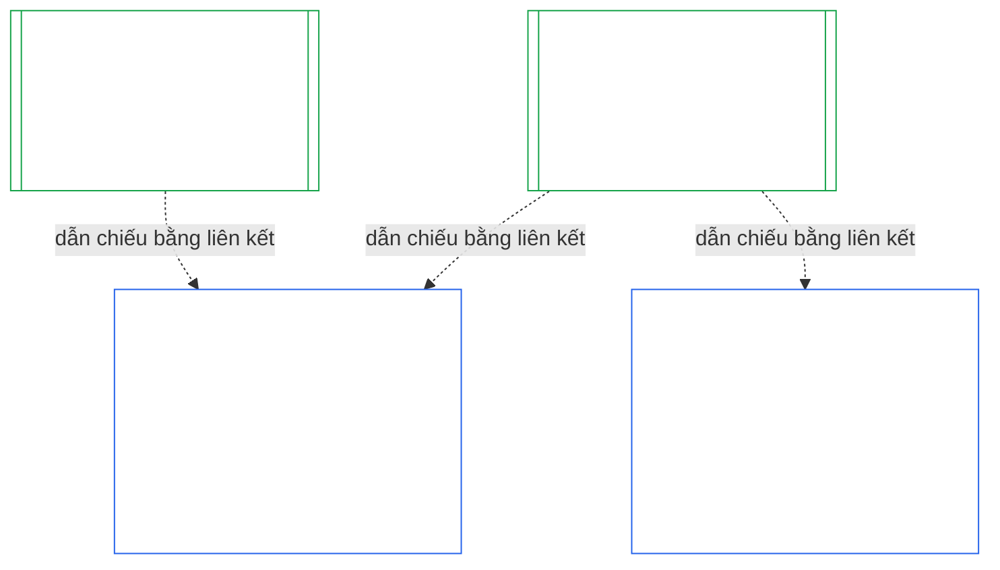

### 1. Mục đích và Vai trò

<strong>Truy xuất nguồn gốc</strong>

- Thượng nguồn:
  - [Chương Bảy §1 Khi nào Cần có Điều lệ Hệ thống và Điều lệ Tổ chức](core_07.000_charters.md#1-when-system-and-institutional-charters-are-required) (7.000 §1);
  - [Chương Chín, Phần A, §1 Mục đích và Vai trò](core_09.000_system_alignment_certification_evaluation.md#1-purpose-and-role) (9.000 §1);
  - [Điều XI-E](core_06.005_rights_part_b.md#article-xi-e-institutional-formation-and-business-creation) (*Thành lập Tổ chức và Tạo lập Doanh nghiệp*);
  - [Điều XXVIII-A](core_06.020_rights_part_e.md#xxviii-a-existing-instantiations-adoption-transition-window) (*Tiếp nhận theo Giai đoạn và Duy trì Sàn Quyền*).
- Hạ nguồn: [§2](#2-institution-class-evaluation); [§6](#6-forum-process); [§7](#7-certification-outcomes); [§9](#9-recertification-and-reopening).
- Đọc cùng với:
  - [Tổ chức](core_05.040_band_continuity.md#institution);
  - [Điều lệ Tổ chức](core_05.040_band_continuity.md#institutional-charter);
  - [Điều lệ Hệ thống](core_05.040_band_continuity.md#system-charter);
  - [Tạo lập Doanh nghiệp](core_05.055_band_participation.md#business-creation).

 

*Nói thẳng: chứng nhận của một hệ thống thuộc về hệ thống đó. Chứng nhận của một tổ chức dẫn chiếu các chứng nhận đó và bổ sung nội dung chỉ tổ chức mới có thể chịu trách nhiệm. Một hệ thống có thể thuộc nhiều tổ chức hoặc không thuộc tổ chức nào. Không điều gì ở đây cho phép chứng nhận cản trở việc thành lập tổ chức.*

Chứng nhận mức độ phù hợp của tổ chức và Chứng nhận Mức độ Phù hợp của Hệ thống là hai chứng nhận được nối với nhau bằng một liên kết. Quan hệ này là **kết hợp bằng liên kết**, không phải bao hàm. Trong hình, mũi tên đi từ Hồ sơ Chứng nhận Hệ thống đến từng Hồ sơ Chứng nhận Tổ chức có dẫn chiếu tới hồ sơ đó. Hệ thống không thuộc Tổ chức nào không có mũi tên và không cần mũi tên; Tổ chức không vận hành Hệ thống nào chỉ có một hồ sơ riêng.

Kết hợp bằng liên kết có hai mặt; trước tiên là mặt của Tổ chức.

Về phía Tổ chức:

- **Hồ sơ Chứng nhận Tổ chức dẫn chiếu hồ sơ của Hệ thống, không đánh giá lại:** hồ sơ dẫn chiếu Hồ sơ Chứng nhận Hệ thống bằng liên kết và ghi rõ phiên bản. Chương này không bao giờ thực hiện lại đánh giá Hệ thống, quyết định lại lớp của Hệ thống hoặc thay đổi kết quả, trạng thái hay điều kiện chứng nhận của Hệ thống.
- **Chứng nhận của Tổ chức không thể nâng trạng thái Hệ thống:** Hệ thống Chưa được Chứng nhận vẫn giữ trạng thái đó bất kể trạng thái của Tổ chức. Hệ thống đang có chứng nhận không được bảo vệ khỏi kết luận về Tổ chức.
- **Các sự kiện về Tổ chức chỉ được xác định một lần:** khi [Chương Chín, Phần A, §3.1 Kỷ luật Quản trị, Ưu đãi và Khả năng Tranh biện](core_09.000_system_alignment_certification_evaluation.md#31-governance-incentive-and-contestability-discipline) hỏi về quản trị và ưu đãi của đơn vị vận hành, Hồ sơ Chứng nhận Tổ chức hiện hành của đơn vị vận hành có thể cung cấp các sự kiện đó bằng liên kết. Các diễn đàn của Hệ thống vẫn quyết định liệu các sự kiện đó có đủ đối với Hệ thống hay không. Không được đưa ra kết luận khác về cùng một sự kiện của Tổ chức nếu không nêu lý do trong Hồ sơ Chứng nhận Hệ thống.

Về phía Hệ thống:

- **Hồ sơ Chứng nhận Hệ thống thuộc về Hệ thống:** đây là hồ sơ riêng của Hệ thống theo [Chương Chín](core_09.000_system_alignment_certification_evaluation.md#chapter-nine-system-alignment-certification).
- **Nhiều Tổ chức có thể dẫn chiếu cùng một Hồ sơ Chứng nhận Hệ thống:** theo [Chương Bảy §1 Khi nào Cần có Điều lệ Hệ thống và Điều lệ Tổ chức](core_07.000_charters.md#1-when-system-and-institutional-charters-are-required), một Hệ thống có thể do nhiều Tổ chức vận hành, quản trị có trách nhiệm hoặc kiểm soát trọng yếu. Mỗi Tổ chức dẫn chiếu cùng một hồ sơ.
- **Hệ thống không nhất thiết phải thuộc một Tổ chức:** một hữu tri đơn lẻ không phải là Tổ chức, vì vậy Hệ thống có thể không thuộc Tổ chức nào. Hệ thống không có Tổ chức được chứng nhận chỉ theo [Chương Chín](core_09.000_system_alignment_certification_evaluation.md#chapter-nine-system-alignment-certification), không cần bất kỳ nội dung nào từ Chương này. Hệ thống thuộc một Tổ chức vẫn được chứng nhận theo cùng cách: Chương này bổ sung hồ sơ riêng cho Tổ chức, không phải một bước trong quy trình chứng nhận riêng của Hệ thống.

#### 1.1 Đối tượng được chứng nhận

Tổ chức từ Lớp L trở lên thuộc phạm vi Chương này; lớp được xác định theo [§2.1 Lớp Tổ chức](#21-institution-class). Điều đó bao gồm cả Tổ chức không vận hành Hệ thống nào: Tổ chức không có Hồ sơ Chứng nhận Hệ thống để dẫn chiếu, và lớp được xác định từ tác động của chính Tổ chức. **Danh mục Hệ thống** của Tổ chức là tập hợp các Hệ thống mà Tổ chức vận hành, quản trị có trách nhiệm hoặc kiểm soát trọng yếu ([Danh mục Hệ thống](core_05.040_band_continuity.md#portfolio)).

- **Lớp A, B, C và L:** quy trình áp dụng, được điều chỉnh theo lớp theo [§2.2 Điều chỉnh theo Lớp](#22-scaling-by-class).
- **Lớp P:** khuyến khích sử dụng quy trình và có thể tự nguyện áp dụng. Quy trình trở thành bắt buộc khi Tổ chức được phân loại lại thành Lớp L trở lên hoặc khi Tổ chức tự nguyện khẳng định tuân thủ hiến pháp. Tổ chức Lớp P quyết định đảm nhận thẩm quyền mới trọng yếu được phân loại lại tối thiểu thành Lớp L khi gửi thông báo tại [§9.2.2 Tái chứng nhận cho thẩm quyền mới trọng yếu](#922-recertification-for-new-material-authority), vì thẩm quyền đó theo định nghĩa là trọng yếu ([§9.2.1 Điều gì được tính là thẩm quyền mới trọng yếu](#921-what-counts-as-new-material-authority)) và Tổ chức có tính trọng yếu trong bất kỳ lĩnh vực nào cũng thuộc tối thiểu Lớp L ([§2.1 Lớp Tổ chức](#21-institution-class), mục 2). Việc phân loại lại có hiệu lực từ khi gửi thông báo cho đến khi thông báo được rút trước khi giải quyết cho phép, hoặc thẩm quyền không được cho phép, với điều kiện chưa thực hiện thẩm quyền đó. Sau đó Tổ chức trở lại Lớp P và chứng nhận ban đầu giới hạn kết thúc. Thông báo mới sẽ bắt đầu lại quy trình; nếu thực hiện thẩm quyền mà chưa được cho phép, điều đó vẫn là kết luận theo [§9.2.2 Tái chứng nhận cho thẩm quyền mới trọng yếu](#922-recertification-for-new-material-authority) (*Không có thông báo hoặc thực hiện trước khi được cho phép*). Điều này tương ứng với [Chương Chín, Phần A, §1 Mục đích và Vai trò](core_09.000_system_alignment_certification_evaluation.md#1-purpose-and-role).
- **Một Hệ thống:** Tổ chức chỉ vận hành đúng một Hệ thống cần có Điều lệ Hệ thống thì có một lượt chứng nhận và một hồ sơ; Chương này gọi là **đánh giá một Hệ thống**. Hồ sơ Chứng nhận Hệ thống có một *phần kết luận về Tổ chức* gồm các nội dung trong [§8 Hồ sơ Chứng nhận Tổ chức](#8-institutional-certification-record) và đồng thời là Hồ sơ Chứng nhận Tổ chức. Các diễn đàn, ghế và thời hạn là những nội dung thuộc lượt chứng nhận riêng của Hệ thống, được bổ sung các nội dung về Tổ chức. Kết quả của từng đối tượng tuân theo các căn cứ từ chối và thu hồi riêng, như quy định tại [§7.4 Từ chối và thu hồi đối với Tổ chức](#74-denial-and-revocation-for-an-institution). [§9.5 Chuỗi hệ quả từ các chứng nhận Hệ thống](#95-cascade-from-system-certifications) không áp dụng như một chuỗi hệ quả vì Hệ thống là toàn bộ danh mục; tuy nhiên, các quy tắc 1 và 2 của [§7.4 Từ chối và thu hồi đối với Tổ chức](#74-denial-and-revocation-for-an-institution) vẫn áp dụng (chỉ dấu và phép thử xác định nguyên nhân nằm ở đâu).
- **Nhiều Hệ thống:** một Hồ sơ Chứng nhận Tổ chức cho Tổ chức, dẫn chiếu Hồ sơ Chứng nhận Hệ thống của từng Hệ thống mà Tổ chức vận hành. Mỗi Hệ thống giữ lượt chứng nhận và hồ sơ riêng.
- **Không có Hệ thống:** một Hồ sơ Chứng nhận Tổ chức riêng. Không có Hồ sơ Chứng nhận Hệ thống để dẫn chiếu vì Tổ chức không vận hành Hệ thống nào.

