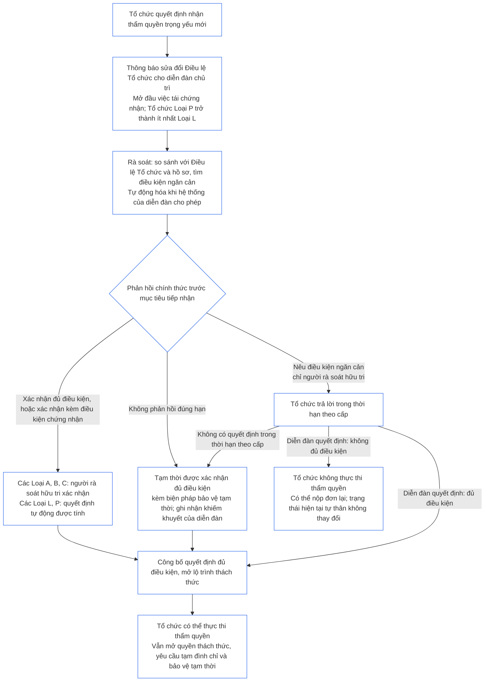

##### 9.2.2 Tái chứng nhận đối với thẩm quyền trọng yếu mới

Tổ chức quyết định nhận thẩm quyền trọng yếu mới phải được tái chứng nhận và phải chờ kết quả trước khi thực thi thẩm quyền đó. Đây là thời gian chờ được **Điều XI-E** (*Thành lập Tổ chức và Tạo lập Doanh nghiệp*) quy định. Trình tự như sau:

- **Thông báo trước:** Tổ chức gửi thông báo về sửa đổi Điều lệ Tổ chức mà [Chương Bảy §7.1 Sửa đổi văn kiện](core_07.000_charters.md#71-changing-the-document) đã yêu cầu, đồng thời gửi cho diễn đàn chủ trì. Thông báo mở đầu việc tái chứng nhận.
- **Chưa có hồ sơ:** Tổ chức chưa có Hồ sơ Chứng nhận Tổ chức cũng gửi thông báo như trên. Thông báo mở đầu đợt chứng nhận đầu tiên, giới hạn ở thẩm quyền mới; thẩm quyền được đánh giá theo Điều lệ Tổ chức và các đánh giá từ [§3 Đánh giá Chứng nhận Toàn Tổ chức](#3-whole-institution-certification-evaluation) đến [§5 Các Đánh giá về Sàn Quyền và Lĩnh vực](#5-rights-floor-and-domain-evaluations) trong chừng mực các nội dung đó liên quan đến thẩm quyền. Phần còn lại của đợt chứng nhận đầu tiên vẫn tuân theo thời hạn tại [§1.3 Thời hạn cho chứng nhận đầu tiên](#13-window-for-the-first-certification) (đối với Tổ chức Loại P được phân loại lại qua thông báo, thời hạn tính từ ngày thông báo); thời gian chờ thẩm quyền mới không phụ thuộc vào thời hạn đó.
- **Trong thời hạn theo cấp:** Việc tái chứng nhận tiến hành theo các thời hạn theo cấp tại [Chương Chín, Phần C, §9.3.4 Khoảng thời gian theo cấp](core_09.010_system_alignment_certification_record_recertification.md#934-tier-windows); cấp mặc định tương ứng với loại hình tổ chức. Việc bỏ lỡ thời hạn được xử lý theo [Điều XXVI-C](core_06.020_rights_part_e.md#article-xxvi-c-timely-resolution-and-anti-delay-floor) (*Sàn Giải quyết Kịp thời và Chống trì hoãn*); phí và thời gian chờ không được trở thành rào cản ([Gánh nặng Có thể Tránh](core_05.040_band_continuity.md#avoidable-burden)).
- **Tự động hóa khi có thể:** Thông báo, việc so sánh thẩm quyền mới với Điều lệ Tổ chức và hồ sơ hiện hành, rà soát điều kiện ngăn cản và xác nhận đủ điều kiện được tự động hóa trong phạm vi hệ thống của diễn đàn cho phép. [Chương Một §13.3 Giảm thiểu Gánh nặng Có thể Tránh](core_01.005_interaction_interpretation.md#133-minimization-of-avoidable-burden) quy định tự động hóa là biện pháp khắc phục được ưu tiên đối với gánh nặng có thể tránh, còn [Chương Một §16.4 Ghi chép tại Thời điểm Hành động](core_01.010_stewardship_capacity_principles.md#164-document-at-action) đặt gánh nặng tự động hóa lên hệ thống, không phải người quản trị có trách nhiệm.
  - **Xác nhận đủ điều kiện, không từ chối:** Rà soát tự động có thể xác nhận thẩm quyền mới đủ điều kiện, hoàn toàn hoặc kèm các điều kiện chứng nhận đã được hồ sơ hiện tại cho phép. Tự mình, rà soát tự động không được nêu điều kiện ngăn cản (một trong các điều kiện tại [§9.2.3 Điều kiện ngăn cản xác nhận thẩm quyền trọng yếu mới](#923-blockers-to-clearing-new-material-authority)) hoặc từ chối xác nhận. Hệ thống rà soát có thể nêu dấu hiệu về điều kiện ngăn cản khả dĩ, nhưng chỉ người rà soát hữu tri thuộc diễn đàn chủ trì mới được nêu điều kiện ngăn cản, sau khi xem xét dấu hiệu đó.
  - **Các Loại A, B và C:** Người rà soát hữu tri thuộc diễn đàn chủ trì xác nhận mọi quyết định đủ điều kiện trước khi quyết định đó được tính là phản hồi chính thức. Quy tắc này áp dụng với Tổ chức thuộc một trong các loại đó, cũng như Tổ chức mà thẩm quyền mới sẽ đưa vào một trong các loại đó. Mục tiêu tiếp nhận vẫn áp dụng cho việc xác nhận. Người rà soát thuộc diễn đàn chủ trì; diễn đàn này vốn đã giữ ghế xác minh hoặc cho phép và phải độc lập với Tổ chức ([§6.1 Bốn ghế trong chứng nhận tổ chức](#61-four-seats-in-an-institutional-certification)).
  - **Các Loại L và P:** Quyết định đủ điều kiện tự động được tính là phản hồi chính thức mà không cần xác nhận. Khi gửi thông báo, Tổ chức Loại P được phân loại lại thành ít nhất Loại L ([§1.1 Ai được chứng nhận](#11-who-is-certified)); do đó quy tắc Loại L áp dụng cho Tổ chức này.
  - **Trường hợp ngoại lệ:** Người rà soát hữu tri trực tiếp xử lý vấn đề trong mọi loại khi hệ thống rà soát phát hiện điều kiện ngăn cản khả dĩ, không thể xác định thẩm quyền có được bao quát hay có trọng yếu hay không, hoặc Tổ chức hay hữu tri bị ảnh hưởng yêu cầu rà soát. Yêu cầu rà soát được trả lời trong [mục tiêu tiếp nhận tương ứng](core_05.040_band_continuity.md#tier-window), tính từ ngày yêu cầu. Việc này không kéo dài thời hạn theo cấp.
  - **Cùng hồ sơ, cùng thời hạn:** Hồ sơ ghi các bước kiểm tra đã thực hiện, do đó quyết định đủ điều kiện tự động có thể bị thách thức như mọi quyết định khác. Tự động hóa không kéo dài mục tiêu tiếp nhận hoặc thời hạn theo cấp; hệ thống rà soát ngừng hoạt động hoặc không trả lời được tính là bỏ lỡ phản hồi theo gạch đầu dòng bên dưới. Diễn đàn chịu trách nhiệm cho hệ thống rà soát như đối với bất kỳ Hệ thống nào mình sử dụng ([§6.3 Các diễn đàn, cơ quan chứng nhận và văn phòng lập hồ sơ với tư cách tổ chức](#63-forums-certifiers-and-record-offices-as-institutions)).
- **Thời gian chờ:** Tổ chức không thực thi thẩm quyền mới cho đến khi tái chứng nhận xác nhận thẩm quyền đó đủ điều kiện.
  - **Mọi loại đều phải chờ:** Không loại nào được miễn; tình trạng khẩn cấp cũng không xóa bỏ thời gian chờ.
  - **Mọi hoạt động khác vẫn tiếp tục:** Tổ chức tiếp tục những việc đang làm ([§1.2 Không có giấy phép và không có cổng đối với việc thành lập hay hoạt động](#12-no-permission-and-no-gate-on-forming-or-running)).
  - **Không phải chờ bảo vệ:** Các diễn đàn không chờ tái chứng nhận mới bảo vệ khẩn cấp hữu tri bị ảnh hưởng ([Chương Chín, Phần B, §6.2 Trình tự giám sát](core_09.005_system_alignment_certification_record_process.md#62-supervisory-sequence)). Biện pháp này bảo vệ hữu tri và không phải là căn cứ để Tổ chức thực thi thẩm quyền sớm.
- **Công bố ngay khi được xác nhận:** Diễn đàn chủ trì công bố từng quyết định đủ điều kiện ngay khi ban hành, kể cả quyết định đủ điều kiện tạm thời, đồng thời mở lộ trình thách thức tại [§10 Thách thức một Chứng nhận](#10-challenging-a-certification). Tổ chức có thể thực thi thẩm quyền ngay sau khi được xác nhận đủ điều kiện. Tổ chức không phải chờ thời hạn thông báo hoặc chờ giải quyết thách thức. Hữu tri bị ảnh hưởng có thể thách thức quyết định như mọi quyết định khác và yêu cầu tạm đình chỉ hoặc bảo vệ tạm thời; các yêu cầu này không phải chờ ([§9.2.2 Tái chứng nhận đối với thẩm quyền trọng yếu mới](#922-recertification-for-new-material-authority), *Không phải chờ bảo vệ*). Khi công bố, diễn đàn chủ trì cũng thông báo quyết định cho các hữu tri bị ảnh hưởng mà diễn đàn biết và các diễn đàn của Hệ thống liên quan. Yêu cầu tạm đình chỉ hoặc bảo vệ tạm thời được xử lý trong mục tiêu tiếp nhận tương ứng ([CF-14.445 §3.1 Mục tiêu theo Giai đoạn và Giới hạn Tối đa](corpus_forum/cf_14.445_performance_backlog_publication_accessibility.md#cf-14445-31-stage-targets-and-outer-bounds)), hoặc trong giới hạn của chế độ Khẩn cấp nếu chế độ đó áp dụng.
- **Giả định đủ điều kiện:** Thẩm quyền được giả định là đủ điều kiện. Diễn đàn chủ trì chỉ từ chối xác nhận khi có bằng chứng được nêu trong hồ sơ chứng minh một điều kiện ngăn cản tại [§9.2.3 Điều kiện ngăn cản xác nhận thẩm quyền trọng yếu mới](#923-blockers-to-clearing-new-material-authority). Nếu các điều kiện chứng nhận gắn với điều kiện ngăn cản có thể kiểm soát vấn đề, thẩm quyền được xác nhận đủ điều kiện kèm các điều kiện chứng nhận đó, chứ không bị từ chối.
- **Xác nhận đủ điều kiện có nghĩa là gì:** Việc tái chứng nhận kết thúc bằng chứng nhận tạm thời hoặc đầy đủ, có thể kèm điều kiện chứng nhận hoặc không; mọi điều kiện chứng nhận bắt buộc trước khi thực thi thẩm quyền đều phải được xác minh độc lập.
- **Nếu diễn đàn không phản hồi đúng hạn:** Diễn đàn chủ trì phải đưa ra phản hồi chính thức trước mục tiêu tiếp nhận tương ứng ([CF-14.445 §3.1 Mục tiêu theo Giai đoạn và Giới hạn Tối đa](corpus_forum/cf_14.445_performance_backlog_publication_accessibility.md#cf-14445-31-stage-targets-and-outer-bounds)). Phản hồi xác nhận thẩm quyền đủ điều kiện, xác nhận kèm điều kiện chứng nhận hoặc nêu điều kiện ngăn cản cùng bằng chứng làm căn cứ. Phản hồi nêu điều kiện ngăn cản cho Tổ chức cơ hội trả lời; diễn đàn đưa ra quyết định trong thời hạn theo cấp nêu trên.
  - **Tạm thời được xác nhận đủ điều kiện:** Nếu không có phản hồi chính thức trước mục tiêu tiếp nhận hoặc điều kiện ngăn cản đã nêu không được quyết định trong thời hạn theo cấp, thẩm quyền tạm thời được xác nhận đủ điều kiện, kèm biện pháp bảo vệ tạm thời và giới hạn sự dựa cậy theo quy định tại [Chương Chín, Phần B, §7.2 Khiếm khuyết Chứng nhận và Khắc phục](core_09.005_system_alignment_certification_record_process.md#72-certification-defects-and-correction).
  - **Khiếm khuyết của diễn đàn:** Bỏ lỡ mục tiêu hoặc thời hạn là khiếm khuyết của diễn đàn, không phải lỗi của Tổ chức. Khiếm khuyết phải được ghi nhận, khắc phục và rà soát như một trường hợp quá hạn theo [Chương Mười Bốn §6 Giải quyết kịp thời, các cấp độ trọng yếu và kỷ luật chống trì hoãn](core_14.000_forum.md#6-timely-resolution-materiality-tiers-and-anti-delay-discipline) (*Rà soát quá hạn*).
  - **Chuyển cho diễn đàn khác:** Yêu cầu tái chứng nhận được chuyển cho một diễn đàn khác trong cùng họ diễn đàn ([Chương Mười Bốn §3 Chuyển giao, hợp nhất và phối hợp](core_14.000_forum.md#3-transfer-consolidation-and-coordination--continuity-and-anti-capture)). Diễn đàn đó tiếp tục tái chứng nhận theo thời hạn thông thường dành cho loại hình của Tổ chức, tính từ ngày chuyển giao.
- **Nếu không được xác nhận đủ điều kiện:** Tổ chức không thực thi thẩm quyền và có thể nộp đơn lại theo điều kiện tại Chương Chín, Phần B, §7.4 (*Không phải lệnh cấm vĩnh viễn*). Việc không xác nhận thẩm quyền mới đủ điều kiện tự nó không đồng nghĩa từ chối hoặc thu hồi trạng thái mà Tổ chức đang có đối với các hoạt động hiện tại. Trạng thái đó chỉ thay đổi khi có nhận định theo [§7.3 Mức độ sẵn sàng khắc phục của Tổ chức](#73-remediation-readiness-for-an-institution) và [§7.4 Từ chối và thu hồi đối với Tổ chức](#74-denial-and-revocation-for-an-institution).
- **Không thông báo hoặc thực thi trước khi được xác nhận:** Thực thi thẩm quyền trọng yếu mới mà không thông báo hoặc trước khi được xác nhận đủ điều kiện là hoạt động ngoài Điều lệ Tổ chức. Đây là một nhận định theo [§3 Đánh giá Chứng nhận Toàn Tổ chức](#3-whole-institution-certification-evaluation) (mục 1) và làm mở lại việc rà soát với tư cách một sự kiện Điều lệ Tổ chức.

<strong>Hướng dẫn đọc (không có hiệu lực vận hành): thời gian chờ đối với thẩm quyền trọng yếu mới</strong>

Hình này tóm tắt §9.2.2 Tái chứng nhận đối với thẩm quyền trọng yếu mới. Nếu hình khác với văn bản, văn bản được ưu tiên. Mọi hoạt động hiện tại của Tổ chức vẫn tiếp tục trong suốt quá trình; việc bảo vệ khẩn cấp hữu tri bị ảnh hưởng không bao giờ phải chờ. Ví dụ minh họa về Tổ chức nằm tại [CS-9.320 §12 Các hướng dẫn minh họa về Tổ chức](corpus_systems/cs_09.320_system_alignment_certification_illustrations.md#cs-9320-12-illustrative-institution-walkthroughs).

 

