#### 1.1 作为审计流程的认证，按系统类别缩放

作为监督机制，认证是[可审计性](core_05.050_band_oversight.md#auditability)及**第十六条**（*审计、透明度与独立核验*）项下一个特别庞大的审计流程：

- 由评议所监督，涵盖多个领域，并授予状态。
- 可以整合同族审计模式的结果，但不吸收或取代它们。每种模式仍由各自负责人负责，负责人列于审计流程归属文件的[同族审计模式图](corpus_joint_structure/cjs_05.115_audit_process.md#sibling-audit-modes-owner-map)：
  - 系统数据类型记录审计由 **CS-6.305（*信息类型与处理*）和 CS-6.310**（*数据分类*）负责；
  - 系统分类记录审计由 **CS-9.305（*系统分类机制*）和 CS-9.310**（*系统影响分类*）负责；
  - 管理者保障审查由 **CS-15.305**（*关键系统尽责管理*）负责；
  - 持续审计由 **CS-6.345**（*系统生命周期*）ACA 负责；
  - 复杂性审计由 **CS-6.315**（*可理解性与复杂性尽责管理*）和 **第二十三条-B**（*复杂性审计与模块化要求*）负责；
  - 主张核验由 **CJS-5.110 §5**（*监督：独立核验与主张完整性术语*）负责。
- 上述任何评估仍可单独进行，无须经过认证。认证不取代它们。

认证深度、记录负担、认证周期、利益相关方审查和质疑途径，必须按照[实质利害](core_00.000_preamble.md#material-stake)，依据[比例性](core_05.035_band_accountability.md#proportionality)进行缩放：

- 影响、依赖和风险较高的系统要求更有力的证明、更清楚的记录和更切实可行的参与方式——包括实质无障碍、利益相关方意见，以及根据依赖该系统的人群设计的质疑途径。
- 较低系统类别和边界明确的范围仍须诚实分类并获得合比例的保障；存在外部影响时，不会因此免除实质义务。

流程按影响类别适用，具体依照 **CS-9.305**（*系统分类机制*）中的[重新分类要求](corpus_systems/cs_09.305_system_classification_machinery.md#35-reclassification-requirement)：

- **A 类、B 类和 C 类：**这些系统影响、依赖和风险最高；[§3 全系统认证评估](#3-whole-system-certification-evaluation)、[§4 相关时适用的评估](#4-evaluations-where-implicated)和[§5 权利底线与领域评估](#5-rights-floor-and-domain-evaluations)项下的全系统评估，按各自子阶段的适用情况，必须以完整深度进行；
- **L 类：**同样必须进行评估，但应合比例；在 CS-9.305（*系统分类机制*）和 CS-9.310（*系统影响分类*）允许时，默认认证周期较长，记录也较简单；以及
- **P 类：**系统有效地属于 P 类期间，鼓励采用本流程，也可自愿使用。重新分类为 L 类或更高类别时，或运营方自愿声称系统符合宪法要求时，流程变为强制。

认证周期以及在周期中点进行的财务、资源或专项审计，由系统类别决定，见[第十四章 §6 及时解决、实质性等级与反拖延纪律](core_14.000_forum.md#review-cadence)（*审查频率*）。本章不重述具体数字。

#### 1.2 认证流程一览

*用直白的话说：诚实地给系统分类，开展适用的评估，让评议所独立审查证据和利益相关方的关切，并作出结果。完成为论坛审查而开启的那一份记录，并在公开质疑途径开放的情况下予以发布。认证系统只有在通知期届满、所需保护措施满足后才能投入运行。监测实际结果，回应事件和质疑，并按计划或事实变化进行复查。纠正缺陷，并在授权受影响范围或解除认证条件之前，由独立方核验纠正措施。每轮审查使用一份与上一份记录关联的新记录。*

流程分为**六个阶段**：**I 框定**、**II 评估**、**III 审查**、**IV 决定**、**V 记录**和**VI 运行**。第二阶段分为三个子阶段，各设一节：**IIa**（始终适用）、**IIb**（相关时适用）和 **IIc**（触发时适用）。第六阶段分为两个子阶段，各设一节：**VIa**（运行与重新认证，[§9 重新认证与重新开启](core_09.010_system_alignment_certification_record_recertification.md#9-recertification-and-reopening)）和 **VIb**（资格桥接，[§11 与资格的关系](core_09.010_system_alignment_certification_record_recertification.md#11-relationship-to-standing)）。图表按顺序展示完整认证流程。A 部分涵盖前两个阶段——框定和评估；[B 部分](core_09.005_system_alignment_certification_record_process.md#chapter-nine-part-b-system-alignment-certification--forum-process-and-outcomes)和[C 部分](core_09.010_system_alignment_certification_record_recertification.md#chapter-nine-part-c-system-alignment-certification--record-recertification-and-standing)涵盖最后四个阶段：论坛流程及含准入运行门槛的结果（B 部分），然后是记录与运行（质疑途径、重新认证与重新开启，以及资格桥接）（C 部分）。

每轮认证都必须重新开展所有适用的评估：首次认证时、依据[§2 系统类别评估](#2-system-class-evaluation)所定计划进行的每次重新认证时，以及每次重新开启或新审查时。实质事实发生变化时，应在下次计划重新认证之前重新开启审查，例如对系统的依赖增长、从共享基础设施中汲取的资源增加、系统回馈显著减少，或出现可信质疑。[C 部分 §9.2 重新开启触发条件](core_09.010_system_alignment_certification_record_recertification.md#92-reopening-triggers)列出这些触发条件。

```mermaid
flowchart TB
    T(["有实质影响的系统申请认证，<br/>或对它的依赖增加"])
    C["§2 第一阶段，框定<br/>诚实分类<br/><br/>类别决定评估深度和复查周期"]
    subgraph W["§3–§5 第二阶段，评估——全系统评估"]
        direction LR
        Al["§3.1–§3.4 IIa——始终适用<br/><br/>治理；系统性风险：评估并向<br/>需要的人披露；时间范围；数据类型"]
        Im["§4 IIb——相关时适用<br/><br/>隐私所在点、退出权、<br/>集会与异议"]
        Tr["§5 IIc——触发时适用<br/><br/>适用的权利底线检查<br/>及六项领域评估"]
        Al ~~~ Im ~~~ Tr
    end
    F["§6 第三阶段，审查<br/>独立审查证据与<br/>利益相关方关切<br/><br/>指定的评议所作出发现；<br/>质疑途径保持开放"]
    Rec["§8 第五阶段，记录<br/>一份系统认证记录<br/><br/>为论坛审查而开启；以结果、<br/>支持性发现、认证条件和运行计划完成"]
    S[["第十一章——资格<br/>记录<br/><br/>本章之外"]]
    O{"§7 第四阶段，决定<br/><br/>证据支持哪种结果<br/>和状态？"}
    Fc["§7、§9.3 完全认证<br/><br/>须连续完成规定次数的无问题临时重新认证；<br/>当前没有不对齐，也没有不对齐将至的迹象<br/>完整认证周期；可以附认证条件"]
    Pc["§7、§9.3 临时认证<br/><br/>首次授予、对齐问题后的恢复，<br/>或继续维持／降为临时状态<br/>临时周期较短；可以附认证条件"]
    Nc["§7 未认证<br/><br/>延期、拒绝、撤回或到期<br/>不得投入运行；说明理由和所需纠正工作"]
    Pub["§7、§10 发布已完成记录<br/><br/>开放已发布记录的质疑途径；<br/>对新增或扩展范围，说明准入运行和通知"]
    G{"§7 准入运行门槛<br/><br/>认证及适用的<br/>准入运行前提是否满足？"}
    Hold["满足准入运行前提<br/><br/>完成通知，并独立核验<br/>准入运行前所需的认证条件"]
    Rm["§7 保护并纠正<br/><br/>受影响范围不得开始新的运行；<br/>保护受影响的感知者，纠正设计或运行，<br/>并提交证据供独立核验"]
    Ch["§9–§10 第六阶段 VIa，运行与重新认证<br/>监测并保持质疑途径开放<br/><br/>在认证范围内运行并遵守认证条件；<br/>监测结果并回应事件和质疑"]
    S2[["第十一章——资格<br/>记录<br/><br/>本章之外"]]
    Sp["&nbsp;&nbsp;&nbsp;&nbsp;&nbsp;&nbsp;&nbsp;&nbsp;&nbsp;&nbsp;&nbsp;&nbsp;&nbsp;&nbsp;&nbsp;&nbsp;&nbsp;&nbsp;&nbsp;&nbsp;&nbsp;&nbsp;&nbsp;&nbsp;&nbsp;&nbsp;&nbsp;&nbsp;&nbsp;&nbsp;&nbsp;&nbsp;&nbsp;" ]
    SpL["&nbsp;&nbsp;&nbsp;&nbsp;&nbsp;&nbsp;&nbsp;&nbsp;&nbsp;&nbsp;&nbsp;&nbsp;&nbsp;&nbsp;&nbsp;&nbsp;&nbsp;&nbsp;&nbsp;&nbsp;&nbsp;&nbsp;&nbsp;&nbsp;&nbsp;&nbsp;&nbsp;&nbsp;&nbsp;&nbsp;&nbsp;&nbsp;&nbsp;&nbsp;&nbsp;"]
    SpA["&nbsp;&nbsp;&nbsp;&nbsp;&nbsp;&nbsp;&nbsp;&nbsp;&nbsp;&nbsp;&nbsp;&nbsp;&nbsp;&nbsp;&nbsp;&nbsp;&nbsp;&nbsp;&nbsp;&nbsp;&nbsp;&nbsp;&nbsp;&nbsp;&nbsp;&nbsp;&nbsp;&nbsp;&nbsp;&nbsp;&nbsp;&nbsp;&nbsp;&nbsp;&nbsp;&nbsp;&nbsp;&nbsp;&nbsp;&nbsp;&nbsp;&nbsp;&nbsp;&nbsp;&nbsp;"]
    Re["§9 下一个审查轮次<br/><br/>重新认证、重新开启或新审查；<br/>每轮都开启与上一份记录关联的新记录"]
    T --> C
    A1((A)) --> C
    C --> W
    W --> F
    F --> O
    O --> Fc
    O --> Pc
    O --> Nc
    Fc --> Rec
    Pc --> Rec
    Nc --> Rec
    Rec -.->|VIb，§11——<br/>仅限已验证输入；<br/>当前认证或认证期间<br/>产生的事实| S
    Rec --> Pub
    Rec ~~~ Sp
    Pub --> G
    G ~~~ SpL
    G -->|未认证| Rm
    G --->|是：在记录范围内<br/>运行| Ch
    G --->|已认证，<br/>前提尚待满足| Hold
    Hold --> G
    Ch -->|实质缺陷：<br/>保护并纠正| Rm
    Ch -->|按计划，或因<br/>实质变化或<br/>可信质疑<br/>而须审查| Re
    Ch -.->|VIb，§11——<br/>仅限已验证输入；<br/>运行可能提供事实，<br/>用于贡献和<br/>违规记录| S2
    Rm -->|纠正证据<br/>在下一轮<br/>审查中核查| Re
    S2 ~~~~ SpA
    SpA ~~~ Re
    Re --> A2((A))
    style Sp fill:none,stroke:none,color:#111111
    style SpL fill:none,stroke:none,color:#111111
    style SpA fill:none,stroke:none,color:#111111
    style T fill:none,stroke:#64748b,color:#ffffff
    style C fill:none,stroke:#16a34a,color:#ffffff
    style Ch fill:none,stroke:#16a34a,color:#ffffff
    style Al fill:none,stroke:#16a34a,color:#ffffff
    style Im fill:none,stroke:#16a34a,color:#ffffff
    style Tr fill:none,stroke:#16a34a,color:#ffffff
    style F fill:none,stroke:#ea580c,color:#ffffff
    style Rec fill:none,stroke:#2563eb,color:#ffffff
    style S fill:none,stroke:#db2777,color:#ffffff
    style S2 fill:none,stroke:#db2777,color:#ffffff
    style O fill:none,stroke:#ea580c,color:#ffffff
    style Fc fill:none,stroke:#9333ea,color:#ffffff
    style Pc fill:none,stroke:#9333ea,color:#ffffff
    style Nc fill:none,stroke:#9333ea,color:#ffffff
    style G fill:none,stroke:#ea580c,color:#ffffff
    style Pub fill:none,stroke:#2563eb,color:#ffffff
    style Rm fill:none,stroke:#9333ea,color:#ffffff
    style Hold fill:none,stroke:#16a34a,color:#ffffff
    style Re fill:none,stroke:#16a34a,color:#ffffff
    style A1 fill:none,stroke:#64748b,color:#ffffff
    style A2 fill:none,stroke:#64748b,color:#ffffff
```

<strong>读者指南（非操作性）：示例、执行清单与机构</strong>

> **A 类**、**B 类**和**C 类**示例档案，以及系统类别如何缩放本章各处的认证深度，见 [CS-9.320 §2 系统类别档案示例](corpus_systems/cs_09.320_system_alignment_certification_illustrations.md#cs-9320-2-illustrative-system-class-profiles)。同样三个系统在[§3 全系统认证评估](#3-whole-system-certification-evaluation)至[§5.6 可信度与系统依赖完整性评估](#56-trustworthiness-and-system-reliance-integrity-evaluation)各评估领域的逐步示例，见 [CS-9.320 系统对齐认证示例](corpus_systems/cs_09.320_system_alignment_certification_illustrations.md#cs-9320-system-alignment-certification-illustrations)；该文件将每份档案和示例链接回其所示例的 A 部分章节。
>
> 六阶段逐步执行清单及每个步骤对应规则所在章节的链接，见 [CS-9.315 §2 执行清单](corpus_systems/cs_09.315_system_alignment_certification_run_sheet.md#cs-9315-2-run-sheet)（*系统对齐认证执行清单*）。若执行清单与某章节不一致，以该章节为准。
>
> 三个虚构机构依照第十章流程进行的逐步示例，见 [CS-9.320 §12 机构逐步示例](corpus_systems/cs_09.320_system_alignment_certification_illustrations.md#cs-9320-12-illustrative-institution-walkthroughs)。
>
> 对机构而言，同样六个阶段见[第十章](core_10.000_institutional_alignment_certification.md#chapter-ten-institutional-alignment-certification)，其章节编号与本章相同：第一、二阶段见[第十章 §2 机构类别评估](core_10.000_institutional_alignment_certification.md#2-institution-class-evaluation)至[§5 权利底线与领域评估](core_10.000_institutional_alignment_certification.md#5-rights-floor-and-domain-evaluations)；第三至第五阶段见[§6 论坛流程](core_10.000_institutional_alignment_certification.md#6-forum-process)至[§8 机构认证记录](core_10.000_institutional_alignment_certification.md#8-institutional-certification-record)；第六阶段见[§9 重新认证与重新开启](core_10.000_institutional_alignment_certification.md#9-recertification-and-reopening)至[§11 与资格的关系](core_10.000_institutional_alignment_certification.md#11-relationship-to-standing)。

 

