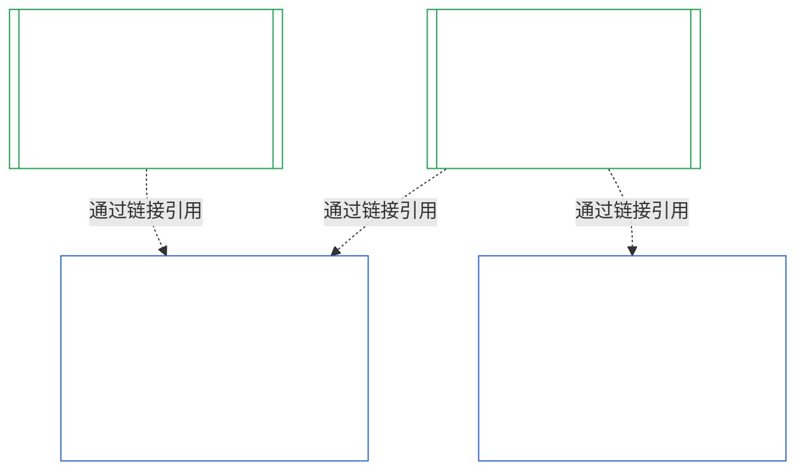

### 1. 目的与作用

<strong>脉络</strong>

- 上游：
  - [Chapter Seven §1 When System and Institutional Charters Are Required](core_07.000_charters.md#1-when-system-and-institutional-charters-are-required) (7.000 §1)；
  - [Chapter Nine Part A §1 Purpose and Role](core_09.000_system_alignment_certification_evaluation.md#1-purpose-and-role) (9.000 §1)；
  - [Article XI-E](core_06.005_rights_part_b.md#article-xi-e-institutional-formation-and-business-creation)（*机构成立与企业创建*）；
  - [Article XXVIII-A](core_06.020_rights_part_e.md#xxviii-a-existing-instantiations-adoption-transition-window)（*分阶段采纳与权利底线连续性*）。
- 下游：[§2](#2-institution-class-evaluation)；[§6](#6-forum-process)；[§7](#7-certification-outcomes)；[§9](#9-recertification-and-reopening)。
- 配合阅读：
  - [Institution](core_05.040_band_continuity.md#institution)；
  - [Institutional Charter](core_05.040_band_continuity.md#institutional-charter)；
  - [System Charter](core_05.040_band_continuity.md#system-charter)；
  - [Business Creation](core_05.055_band_participation.md#business-creation)。

 

*用直白的话说：系统认证属于系统。机构认证引用这些系统认证，并补充只有机构自身能负责的事项。一个系统可以归属于多个机构，也可以不归属于任何机构。本章绝不允许认证阻碍机构成立。*

机构对齐认证与系统对齐认证是两个通过链接相连的认证。二者关系是**通过链接组合**，而非包含关系。图中箭头从System Certification Record指向引用它的每份Institutional Certification Record。没有机构归属的System无需箭头，也无需机构记录；不运行任何System的机构则只有自己的记录。

通过链接组合有两个方面，首先是机构方面。

机构方面：

- **Institutional Certification Record引用System记录，不会重新评估：**通过链接引用System Certification Record，并注明其版本。本章绝不重新运行System评估，不重新裁定System类别，也不更改System的结果、状态或认证条件。
- **机构认证不能提升System认证：**未获认证的System仍然未获认证，无论机构状态如何。持有认证的System也不会因机构的认定而获得额外保护。
- **机构事实只认定一次：**当[Chapter Nine Part A §3.1 Governance, Incentive, and Contestability Discipline](core_09.000_system_alignment_certification_evaluation.md#31-governance-incentive-and-contestability-discipline)询问运营方的治理与激励时，若运营方有当前有效的Institutional Certification Record，可通过链接提供这些事实。System的评议所仍须决定这些事实对该System是否充分。若未在System Certification Record中说明理由，不得对同一机构事实作出不同认定。

System方面：

- **System Certification Record属于该System：**依据[Chapter Nine](core_09.000_system_alignment_certification_evaluation.md#chapter-nine-system-alignment-certification)，它是System自身的记录。
- **多家机构可以引用同一份System Certification Record：**依据[Chapter Seven §1 When System and Institutional Charters Are Required](core_07.000_charters.md#1-when-system-and-institutional-charters-are-required)，一个System可以由多家机构运营、尽责管理或实质控制。每家机构均引用同一份记录。
- **System不必隶属于任何机构：**单一感知者不是机构，因此System可能不归属于任何机构。无机构归属的System仅依据[Chapter Nine](core_09.000_system_alignment_certification_evaluation.md#chapter-nine-system-alignment-certification)认证，不需要本章的任何内容。归属于机构的System也以同样方式认证：本章为机构增加一份单独记录，而不是System自身认证流程中的一个步骤。

#### 1.1 哪些对象接受认证

Class L或更高类别的机构属于本章范围，类别依照[§2.1 Institution class](#21-institution-class)确定。这也包括完全不运行System的机构：它没有System Certification Record可供引用，其类别根据自身影响确定。机构的**组合**是其运营、尽责管理或实质控制的System集合（[Portfolio](core_05.040_band_continuity.md#portfolio)）。

- **Class A、B、C和L：**流程适用，并依照[§2.2 Scaling by class](#22-scaling-by-class)按类别调整。
- **Class P：**鼓励采用该流程，也可以自愿使用。若重新分类为Class L或更高类别，或机构自愿声称符合宪法要求，流程即变为强制。Class P机构决定承担新的实质权限时，在依照[§9.2.2 Recertification for new material authority](#922-recertification-for-new-material-authority)发出通知时，即重新分类为至少Class L；因为该权限按定义具有实质意义（[§9.2.1 What counts as new material authority](#921-what-counts-as-new-material-authority)），而在任何领域具有实质影响的机构至少属于Class L（[§2.1 Institution class](#21-institution-class)，第2项）。重新分类自发出通知起持续有效，直至在核准前撤回通知，或该权限未获核准为止，前提是尚未行使该权限。此时机构恢复为Class P，有限的首次认证结束。新通知会重新启动该流程；未经核准便行使权限，仍依照[§9.2.2 Recertification for new material authority](#922-recertification-for-new-material-authority)（*未通知或尚未核准*）作出认定。这与[Chapter Nine Part A §1 Purpose and Role](core_09.000_system_alignment_certification_evaluation.md#1-purpose-and-role)一致。
- **单一System：**机构恰好运行一个需要System Charter的System时，只有一次认证流程和一份记录，本章称之为**单一System评估**。System Certification Record载有[§8 Institutional Certification Record](#8-institutional-certification-record)规定各项内容的*机构认定栏*，并充当Institutional Certification Record。评议所、席位和时限沿用该System自身认证流程，并增加机构事项。其结果依各自的拒绝和撤销理由处理，见[§7.4 Denial and revocation for an Institution](#74-denial-and-revocation-for-an-institution)。由于该System就是整个组合，[§9.5 Cascade from System certifications](#95-cascade-from-system-certifications)不作为连带机制适用；但[§7.4 Denial and revocation for an Institution](#74-denial-and-revocation-for-an-institution)的规则1和2（指标，以及原因所在位置的检验）仍适用。
- **多个System：**机构有一份Institutional Certification Record，并链接到其运行的每个System各自的System Certification Record。每个System保留自己的认证流程和记录。
- **没有System：**机构单独持有一份Institutional Certification Record。由于机构没有运行任何System，因此没有可供链接的System Certification Record。

