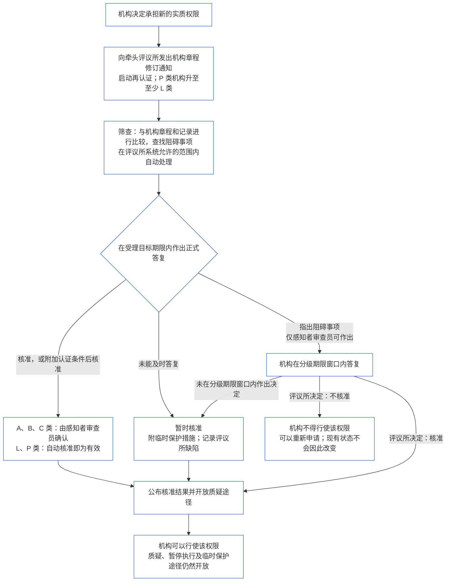

##### 9.2.2 新实质权限的再认证

机构决定承担新的实质权限时，必须接受再认证，并且在再认证结果作出之前必须等待，不得行使该权限。这就是 **第 XI-E 条**（*机构形成与企业创设*）规定的等待要求。具体如下：

- **先行通知：**机构应发出[第七章 §7.1 修改文件](core_07.000_charters.md#71-changing-the-document)已经要求的机构章程修订通知，并发送给牵头评议所。该通知启动再认证。
- **尚无记录时：**尚无机构认证记录的机构也应发出相同通知。该通知启动一项仅针对新权限的首次认证，依据机构章程以及[§3 全机构认证评估](#3-whole-institution-certification-evaluation)至[§5 权利底线与领域评估](#5-rights-floor-and-domain-evaluations)中与该权限相关的评估作出判断。首次认证的其余部分仍按[§1.3 首次认证的期限窗口](#13-window-for-the-first-certification)规定的期限窗口进行（若通知将 P 类机构重新分类，则期限窗口从通知发出时起算）；新权限的等待要求不受该期限窗口影响。
- **遵守分级期限窗口：**再认证应按[第九章 C 部分 §9.3.4 分级期限窗口](core_09.010_system_alignment_certification_record_recertification.md#934-tier-windows)所定期限窗口进行，级别推定与机构类别相同。错过期限窗口时，按[第 XXVI-C 条](core_06.020_rights_part_e.md#article-xxvi-c-timely-resolution-and-anti-delay-floor)（*及时解决与反拖延底线*）处理；费用和等待不得成为障碍（[可避免负担](core_05.040_band_continuity.md#avoidable-burden)）。
- **可自动处理的事项应自动处理：**在评议所系统允许的范围内，应自动处理通知、新权限与机构章程及现行记录的比较、阻碍事项筛查和权限核准。[第一章 §13.3 尽量减少可避免负担](core_01.005_interaction_interpretation.md#133-minimization-of-avoidable-burden)规定，自动化是消除可避免负担的优先补救措施；[第一章 §16.4 在行动时记录](core_01.010_stewardship_capacity_principles.md#164-document-at-action)规定，自动化负担应由系统而非管理者承担。
  - **只核准，不拒绝：**自动筛查可以核准新权限，也可以按现行记录已有依据的认证条件核准。自动筛查不得自行指出阻碍事项（即[§9.2.3 阻止核准新实质权限的事项](#923-blockers-to-clearing-new-material-authority)所列事项），也不得拒绝核准。筛查可以标记潜在阻碍事项，但只有牵头评议所中的感知者审查员，在查看标记内容之后，才能认定存在阻碍事项。
  - **A、B 和 C 类：**牵头评议所中的感知者审查员应确认每项核准，核准之后才算正式答复。这适用于属于上述类别的机构，也适用于新权限将使其归入上述类别的机构。确认仍受受理目标期限约束。审查员隶属牵头评议所；该评议所已经持有核验或授权席位，且必须独立于该机构（[§6.1 机构认证中的四个席位](#61-four-seats-in-an-institutional-certification)）。
  - **L 和 P 类：**自动核准即为正式答复，无需确认。P 类机构发出通知时会被重新分类为至少 L 类（[§1.1 谁接受认证](#11-who-is-certified)），因此对该机构适用 L 类规则。
  - **特殊情况：**在任何类别中，若筛查标记了潜在阻碍事项、无法判断该权限是否已被涵盖或是否具有实质性，或者机构或受影响的感知者要求审查，则改由感知者审查员处理。审查请求应在[相应受理目标期限](core_05.040_band_continuity.md#tier-window)内答复，期限从提出请求之日起算。提出审查请求不会延长期限窗口。
  - **同一记录与同一时钟：**记录应说明已执行的检查，因此可以像质疑其他决定一样质疑自动核准。自动化不会延长受理目标期限或分级期限窗口；筛查系统停机或未能答复，视为错过下方要点所述的答复期限。评议所应像对其使用的任何系统一样，对筛查系统负责（[§6.3 评议所、认证方与记录办公室作为机构](#63-forums-certifiers-and-record-offices-as-institutions)）。
- **等待要求：**再认证核准该权限之前，机构不得行使新权限。
  - **所有类别都要等待：**任何类别都不豁免；紧急情形或情况紧迫都不能免除等待。
  - **其他一切照常继续：**机构已经开展的活动继续进行（[§1.2 成立或运营不需许可，也没有门槛](#12-no-permission-and-no-gate-on-forming-or-running)）。
  - **保护措施无需等待：**评议所无需等再认证完成，即可紧急保护受影响的感知者（[第九章 B 部分 §6.2 监督程序](core_09.005_system_alignment_certification_record_process.md#62-supervisory-sequence)）。这项保护是为了保护感知者，并非机构提前行使权限的理由。
- **核准后即公布：**牵头评议所应在每项核准作出后立即公布，包括暂时核准，并开放[§10 对认证提出质疑](#10-challenging-a-certification)所规定的质疑途径。权限一经核准，机构即可行使；无需等待通知期届满或质疑得到裁定。受影响的感知者可以像质疑其他决定一样对核准提出质疑，也可以申请暂停执行或临时保护；此类申请无需等待（[§9.2.2 新实质权限的再认证](#922-recertification-for-new-material-authority)，*保护措施无需等待*）。公布时，牵头评议所还应通知其已知的受影响感知者以及相关系统的评议所。暂停执行或临时保护申请应在相应受理目标期限内答复（[CF-14.445 §3.1 阶段目标与外部界限](corpus_forum/cf_14.445_performance_backlog_publication_accessibility.md#cf-14445-31-stage-targets-and-outer-bounds)）；若适用紧急情境期限，则应在该期限内答复。
- **推定核准：**推定该权限已经核准。牵头评议所只有在根据记录中列明的证据证明存在[§9.2.3 阻止核准新实质权限的事项](#923-blockers-to-clearing-new-material-authority)所列阻碍事项时，才可以拒绝核准。若可以通过针对该阻碍事项附加认证条件加以控制，则应附加这些条件并核准权限，不得拒绝。
- **核准的含义：**再认证以临时认证或完整认证告终，可以附加或不附加认证条件；行使该权限前必须完成的每项认证条件都已经过独立核验。
- **评议所未能及时答复时：**牵头评议所必须在相应受理目标期限内作出正式答复（[CF-14.445 §3.1 阶段目标与外部界限](corpus_forum/cf_14.445_performance_backlog_publication_accessibility.md#cf-14445-31-stage-targets-and-outer-bounds)）。答复应核准该权限、附加认证条件后核准该权限，或说明阻碍事项及其依据证据。答复指出阻碍事项时，应给予机构答复机会，并由评议所在上述分级期限窗口内作出决定。
  - **暂时核准：**若在受理目标期限内未作出正式答复，或所述阻碍事项未能在分级期限窗口内裁定，则暂时核准该权限，并适用[第九章 B 部分 §7.2 认证缺陷与纠正](core_09.005_system_alignment_certification_record_process.md#72-certification-defects-and-correction)规定的临时保护和依赖限制。
  - **评议所缺陷：**错过目标期限或期限窗口是评议所的缺陷，并非机构的过错。应将其记入记录、纠正，并依照[第十四章 §6 及时解决、实质性分级与反拖延纪律](core_14.000_forum.md#6-timely-resolution-materiality-tiers-and-anti-delay-discipline)（*超期审查*）对超期情况进行审查。
  - **移交给其他评议所：**再认证请求应转交给同一族系中的其他评议所（[第十四章 §3 移交、合并与协调](core_14.000_forum.md#3-transfer-consolidation-and-coordination--continuity-and-anti-capture)）。该评议所应按机构类别的常规期限窗口继续进行再认证，期限从移交之日起算。
- **未获核准时：**机构不得行使该权限，并可按第九章 B 部分 §7.4（*并非永久禁入*）的条件重新申请。新权限未获核准本身，不构成拒绝或撤销机构现有活动所适用认证状态的理由。只有依据[§7.3 机构的补救准备度](#73-remediation-readiness-for-an-institution)和[§7.4 机构认证被拒与撤销](#74-denial-and-revocation-for-an-institution)作出认定，才会改变该状态。
- **未通知或未获核准前即行使权限：**未发出通知或尚未获核准便行使新的实质权限，属于超出机构章程范围的行为。这是[§3 全机构认证评估](#3-whole-institution-certification-evaluation)（项目 1）中的一项认定，并会作为机构章程事件重新开启审查。

<strong>读者指南（不具操作效力）：新实质权限的等待流程</strong>

本图概述 §9.2.2 新实质权限的再认证。若图示与正文有出入，以正文为准。机构已经开展的一切活动在整个过程中都会继续，保护受影响感知者的紧急措施绝不会等待。机构案例说明见 [CS-9.320 §12 机构示例演练](corpus_systems/cs_09.320_system_alignment_certification_illustrations.md#cs-9320-12-illustrative-institution-walkthroughs)。

 

