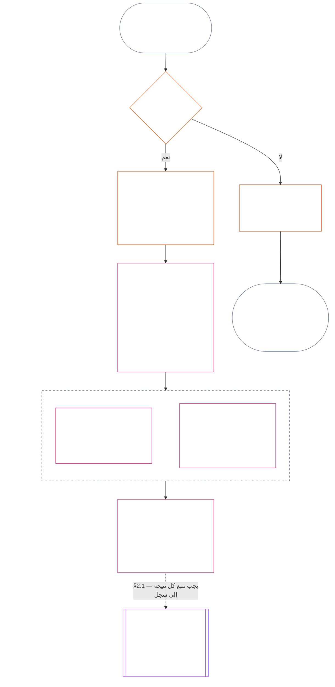

> مسودة ترجمة بالذكاء الاصطناعي — اللغة: العربية الفصحى الحديثة؛ المصدر: الالتزام 9c2c8c10c871d91157bcd27b9f56ad6a1cec90d3؛ الحالة: غير مراجعة؛ التغطية الجزئية: الفصل الحادي عشر، §§1–3 فقط. لا تمثل هذه المسودة ترجمة كاملة للفصل.

### 1. الأسئلة الثلاثة

*بعبارات بسيطة: يُحدَّد الوضعية بالإجابة عن ثلاثة أسئلة بالترتيب. لا تستنتج الوقائع من تصنيف مرغوب فيه، ولا تختر تصنيفًا لتبرير نتيجة مرغوب فيها.*

| السؤال | ما الذي يسأل عنه السؤال؟ | أين تتم الإجابة عنه؟ |
| --- | --- | --- |
| **1. ماذا حدث؟** | ما الوقائع التي جرى التحقق منها، وبشأن من أو ماذا، وخلال أي فترة، وما حالة سجل الوضعية والطعن فيه؟ | [القسم 2](#2-question-1--what-happened) و[القسم 3](#3-question-1-event-type-guide--what-kind-of-help-or-harm-occurred) |
| **2. ما مدى جودته أو سوئه؟** | ما نوع المساهمة أو الانتهاك ومقداره اللذان تثبتهما تلك الوقائع؟ | [القسم 1 من الفصل الثاني عشر](core_12.000_standing_measurement.md#1-question-2--how-good-or-bad-was-it) |
| **3. ماذا يترتب عليه؟** | ما الاعتراف أو الجاهزية أو الانتصاف أو الضمانة أو القيد أو غير ذلك من النتائج التي تترتب عليه؟ | [الفصل الثالث عشر](core_13.000_standing_integration.md#chapter-thirteen-standing-effects-and-integration) |

تعتمد كل إجابة على الإجابة السابقة لها:

- يقدّم السؤال 1 الوقائع المتحقق منها اللازمة للسؤال 2.
- يقيس السؤال 2 تلك الوقائع لأغراض السؤال 3.
- يجب ألا يعيد السؤال 3 صياغة الوقائع أو التصنيف بما يلائم نتيجة مفضلة.

تشكل الإجابات عن الأسئلة الثلاثة معًا تقييم الوضعية الكامل لواقعة محددة الحدود أو نمط معرّف واحد. وقد يكون للموضوع عدة تقييمات من هذا القبيل مع مرور الوقت، ولا يشكل أي منها درجة صافية أو تصنيفًا عامًا للموضوع. ويحفظ سجلا مساهمة الوضعية والانتهاك الإجابتين عن السؤالين 1 و2؛ أما قرار السؤال 3 فيبيّن ما يترتب عليهما.

#### 1.1 الغرض والنطاق

يحدد هذا الفصل إطار السجل الدستوري، ويحدد [الفصل الثاني عشر](core_12.000_standing_measurement.md#chapter-twelve-standing-measurement--question-2-how-good-or-bad-was-it) إطار القياس، بالنسبة إلى **الأنظمة** و**الكائنات الواعية** و**المؤسسات**، بما في ذلك كل نظام مصنّف بموجب [**CS-9.305**](corpus_systems/cs_09.305_system_classification_machinery.md#cs-9305-part-a-system-classification-machinery) (*آلية تصنيف الأنظمة*). ولا تقيس هذه الأطر النميمة أو الشعبية أو السمعة المبهمة أو الكرامة المتأصلة أو القيمة العامة؛ فلا يصلح أيٌّ من ذلك موضوعًا لتقييم الوضعية.

يجب أن تظل سلسلة إجراءات الوضعية فعالة عندما:

- تصبح المساهمات التي سبق التحقق منها قديمة إلى حد لا يعود معه إثبات الكفاءة أو الموثوقية الحالية؛
- تظل الانتهاكات دون حل؛
- يكون الإصلاح مكلفًا؛
- تتجاوز المسؤولية الحدود؛ أو
- يستخدم فاعلٌ التدرج التنظيمي أو إعادة التسمية لعرقلة المساءلة.

وتندرج الأمور الآتية في نصوص التنفيذ المعتمدة:

- الإجراءات اليومية؛
- خطوات التصعيد؛
- عمليات رد الحقوق والإصلاح؛
- تدابير المساءلة الإصلاحية؛ و
- تصميم الحوافز.

لا يجيز القياس في الفصل الثاني عشر، **في حد ذاته**، استخدام القوة أو الاحتجاز أو أي قيد آخر على الحرية. ويجب أن تستوفي أي نتيجة من هذا القبيل، بصورة مستقلة، متطلبات الفصل السادس، **المادة XX** (*العدالة بعد التحقق من الانتهاك*)، بما في ذلك متطلبات التناسب، واختيار البديل الأقل تقييدًا، وتحديد مدة زمنية، ورد الحقوق، والمساءلة الإصلاحية.

<strong>التتبّع · التعريفات · التقييم · الامتثال</strong>

- المنابع: [الفصل الأول §16 — الرعاية بالتفصيل](core_01.010_stewardship_capacity_principles.md#16-stewardship-in-depth)؛ [الفصول الثاني إلى الرابع](core_02.000_definition_structure.md)؛ [الفصل الخامس](core_05.000_definitions_home.md#chapter-five-foundational-definitions).
- المصبّات: [§2](#2-question-1--what-happened) (*السؤال 1*)؛ [§4](#4-standing-record-operational-requirements) (*متطلبات التحقق والسجل*)؛ [§5](#5-record-custody-and-opening-authority) (*حفظ السجل وصلاحية فتحه*)؛ [§6](#6-handling-a-standing-record) (*التعامل مع سجل الوضعية*)؛ [الفصل الثاني عشر §1](core_12.000_standing_measurement.md#1-question-2--how-good-or-bad-was-it) (*قياس السؤال 2*)؛ [الفصل الثاني عشر §2](core_12.000_standing_measurement.md#2-magnitude-and-severity-input-dimensions) (*مدخلات القياس*)؛ [الفصل الثاني عشر §3](core_12.000_standing_measurement.md#3-route-descriptor-catalogs-and-measurement-roles) (*فهارس أوصاف المسارات*)؛ [الفصل الثاني عشر §4](core_12.000_standing_measurement.md#4-slot-grammar-and-shared-scaling) (*قواعد الخانات والقياس المشترك*)؛ [الفصل الثاني عشر §5](core_12.000_standing_measurement.md#5-constitutional-inputs-to-axis-assignment) (*إسناد المحاور بحسب المصادر الدستورية*)؛ [الفصل الثاني عشر §6](core_12.000_standing_measurement.md#6-unified-proportional-lequ-scale--contribution-and-violation-axes) (*مقياس LEQU التناسبي الموحد للمحورين*)؛ [الفصل الثالث عشر](core_13.000_standing_integration.md#chapter-thirteen-standing-effects-and-integration) (*السؤال 3*).
- [الأهمية المادية](core_05.050_band_oversight.md#materiality) · [O](core_05.050_band_oversight.md#materiality) · [M](core_05.050_band_oversight.md#materiality-determination-a) · [A](core_05.050_band_oversight.md#materiality-determination-a) · [C](core_05.050_band_oversight.md#materiality-determination-c)
- [الضرر](core_05.035_band_accountability.md#harm) · [O](core_05.035_band_accountability.md#harm) · [M](core_05.035_band_accountability.md#harm-a) · [A](core_05.035_band_accountability.md#harm-a) · [C](core_05.035_band_accountability.md#harm-c)
- [التناسب](core_05.035_band_accountability.md#proportionality) · [O](core_05.035_band_accountability.md#proportionality) · [M](core_05.035_band_accountability.md#proportionality-a) · [A](core_05.035_band_accountability.md#proportionality-a) · [C](core_05.035_band_accountability.md#proportionality-c)

### 2. السؤال 1 — ماذا حدث؟

<strong>التتبّع</strong>

- المنابع: [§1](#1-the-three-questions) (*إطار الأسئلة الثلاثة*)؛ [الفصول الثاني إلى الرابع](core_02.000_definition_structure.md) (*السجل والتحقق وإمكانية تتبع التعريفات إلى النتائج*).
- ركائز الرباعية: **المشاركة**؛ **الرقابة** (قابلية الاعتراض ومسارات الطعن). الغايات الأساسية: **الازدهار** و**الاستمرارية** (سجلات قابلة للتتبع تحفظ نتائج المساهمة والانتهاك منفصلةً لقياسها لاحقًا).
- المصبّات:
  - [§2.2](#22-silence-is-the-default) (*الصمت هو الحالة الافتراضية*)؛
  - [§2.3](#23-protected-dissent-is-not-a-trigger) (*المعارضة المحمية ليست مُحفِّزًا*)؛
  - [§2.4](#24-linked-standing-records-and-no-offset-bridge) (*جسر السجلات المرتبطة وعدم المقاصة*)؛
  - [§2.5](#25-verified-input-gate) (*بوابة المدخلات المتحقق منها*)؛
  - [§2.6](#26-stage-boundary) (*الحد الفاصل بين المراحل*)؛
  - [§2.7](#27-forum-boundary) (*حدود دور المنتدى*)؛
  - [§3](#3-question-1-event-type-guide--what-kind-of-help-or-harm-occurred) (*دليل أنواع الأحداث*)؛
  - [§4](#4-standing-record-operational-requirements) (*متطلبات السجل*)؛
  - [§5](#5-record-custody-and-opening-authority) (*حفظ السجل وصلاحية فتحه*)؛
  - [§6](#6-handling-a-standing-record) (*التعامل مع سجل الوضعية*)؛
  - [الفصل الثاني عشر §1](core_12.000_standing_measurement.md#1-question-2--how-good-or-bad-was-it) (*قياس السؤال 2*)؛
  - [الفصل الثاني عشر §2](core_12.000_standing_measurement.md#2-magnitude-and-severity-input-dimensions) (*مدخلات القياس*)؛
  - [الفصل الثاني عشر §3](core_12.000_standing_measurement.md#3-route-descriptor-catalogs-and-measurement-roles) (*فهارس أوصاف المسارات*)؛
  - [الفصل الثاني عشر §4](core_12.000_standing_measurement.md#4-slot-grammar-and-shared-scaling) (*قواعد الخانات والقياس المشترك*)؛
  - [الفصل الثاني عشر §5](core_12.000_standing_measurement.md#5-constitutional-inputs-to-axis-assignment) (*إسناد المحاور بحسب المصادر الدستورية*)؛
  - [الفصل الثاني عشر §6](core_12.000_standing_measurement.md#6-unified-proportional-lequ-scale--contribution-and-violation-axes) (*مقياس LEQU التناسبي الموحد للمحورين*)؛
  - [الفصل الثالث عشر](core_13.000_standing_integration.md#chapter-thirteen-standing-effects-and-integration) (13.000) (*السؤال 3*).

 

*بعبارات بسيطة: ينشئ السؤال 1 رواية محددة الحدود وقابلة للاعتراض عما حدث. وهو يحدد الموضوع والواقعة أو النمط والفترة الزمنية والوقائع المتحقق منها وحالة السجل قبل النظر في أي تصنيف أو نتيجة. وتُستخدم سجلات وضعية منفصلة للمساعدة المتحقق منها وللانتهاكات المتحقق منها، كيلا يمحو أحدهما الآخر. وهذه السجلات ليست درجات شعبية أو أوصافًا مبهمة.*

**سجل الوضعية** هو سجل محدد الحدود يستخدمه هذا الفصل لموضوع معين ونطاق وظيفي وفترة سجل وحالة مراجعة وسياق قرار معين. وقبل بدء القياس، يجب أن يثبت ما يلي:

- من أو ما الذي يتعلق به سجل الوضعية؛
- ما إذا كان يتعلق بواقعة محددة الحدود أم بنمط معرّف؛
- متى وأين وقع السلوك والآثار المعنية؛
- أي الوقائع تم التحقق منها وأيها ما زال محل نزاع؛
- ما الأدلة والإسناد ومسار الطعن التي تسند تلك النتائج؛ و
- الحالة الراهنة لمراجعة سجل الوضعية وتصحيحه وإحلاله محل سجل سابق.

يتتبع المخطط واقعةً لمعرفة ما إذا كانت تُفعّل سجل وضعية وما الذي يحتفظ به السجل بعد ذلك؛ وتبيّن الأقسام الفرعية التالية كل قاعدة. ويخرج فرع «لا» من المسار الرئيسي إلى اليمين.

#### 2.1 سجلات الوضعية: أنواعها وموضوعاتها

يستخدم السؤال 1 **سجل وضعية مساهمة** للمساعدة المتحقق منها و**سجل وضعية انتهاك** للضرر المتحقق منه، بما في ذلك إخفاقات المساءلة. ولا يجمع سجل وضعية واحد نوعي النتائج معًا.

- قد يتعلق سجل الوضعية بكائن واعٍ أو مؤسسة أو نظام أو تقييم أو واقعة محددة الحدود أو دور أو جماعة أو سجل خاص بفاعل معين أو وحدة أخرى ذات صلة دستورية.
  - ويجب ألا يدمج موضوعات أو أدوارًا أو أنظمة أو جماعات أو فترات سجلات أو حالات مراجعة أو سياقات قرار متميزة في وسم وضعية واحد غير متمايز.
- قد يغطي سجل الوضعية **واقعة محددة الحدود** — أي حادثة واحدة لها بداية ونهاية واضحتان — أو **نمطًا** من السلوك المتكرر.
  - ويتطلب النمط تحديد الموضوع والنطاق وفترة المراجعة.
- قد يكون للموضوع نفسه عدة سجلات وضعية عبر الزمن، بما فيها سجلات وضعية مساهمة وانتهاك مرتبطة.
  - ويجب أن تحيل سجلات الوضعية ذات الصلة بعضها إلى بعض بموجب **القسم 4.2** عندما تشترك في الموضوع أو تتداخل في فترة السجل أو الواقعة المحددة الحدود أو النمط أو سياق القرار.
- سجل الوضعية ليس درجة سمعة مستقلة، ولا مرتبة للكرامة، ولا حالة دائمة، ولا وسمًا للقيمة العامة، ولا بطاقة نتائج مدمجة.
  - ترد المتطلبات التشغيلية في **القسم 4**.

ينتمي أي أثر لاحق على الوضعية إلى الفصل الثالث عشر، ويجب أن يكون قابلًا للتتبع إلى سجل الوضعية أو سجلات الوضعية المعنية من دون أن يصبح جزءًا من سجل الوضعية نفسه.

#### 2.2 الصمت هو الحالة الافتراضية

إن عدم وجود سجل وضعية هو الحالة العادية للكائن الواعي أو المؤسسة أو النظام، وهي الحالة التي سيظل فيها معظم الكائنات الواعية.

- لا يُفتح سجل وضعية إلا بعد التحقق من وجود مُحفِّز بموجب **القسم 4**. ويجب أن توافق سلطة محددة لفتح السجل على القيد، وأن يُجريه قَيِّم سجل مستقل (**القسم 5**). ولا يُفتح سجل وضعية مطلقًا:
  - لإنشاء خط أساس؛
  - لاستكمال قائمة أسماء؛ أو
  - لمجرد أن مسؤول بوابة لمسار محدد يفضّل ذلك.
- لا يخبرك عدم وجود سجل وضعية بأي شيء. فعبارات «غير مصنّف» و«غير متحقق منه» و«لا يوجد سجل في الملف» ليست دليلًا على الخطر أو انخفاض المساهمة أو أي أمر آخر. ولا يجوز لأحد معاملة غياب سجل على أنه سبب لمزيد من التدقيق أو لافتراض أدنى أو لجعل الوصول إلى مسار محدد مشروطًا.
- لا يجوز لمؤسسة أو نظام أن يشترط وجود سجل وضعية أو إقرارًا بـ«عدم وجود سجل» أو الموافقة على فتح سجل كشرط لما يلي:
  - الضروريات المنصوص عليها في **المادة III** (*البقاء والوصول الأساسي*)؛
  - الحمايات المنصوص عليها في **المادة III-C** (*العمل والحد الاقتصادي الأدنى*)؛
  - التجارة العادية؛ أو
  - المشاركة بصفتك طرفًا متأثرًا.
  والاستثناء هو حدود الكفاءة المنشورة لمسارات محددة مسماة وحساسة للثقة بموجب [الفصل الثالث عشر §6.2 حدود الكفاءة والتصاريح](core_13.000_standing_integration.md#62-competency-bars-and-clearances)، ويجب أن تبيّن تلك الحدود سبب حساسية المسار المحدد للثقة.
- عند فتح سجل وضعية عن موضوع ما، يجب إخطار الموضوع، كما يقتضي **القسم 4**. ولا يجوز تأخير الإخطار إلا إذا بررت حاجة موثقة إلى [حفظ الأدلة](core_05.050_band_oversight.md#evidence-preservation) أو إلى السلامة ذلك، ولمدة محددة ومحدودة فقط. فالإخطار هو ما يجعل سجل الوضعية قابلًا للاعتراض: إذ لا يستطيع موضوع لا يعلم بوجود سجل وضعية أن يطعن فيه أو يصححه.

#### 2.3 المعارضة المحمية ليست مُحفِّزًا

لا تُعد المعارضة أو الاحتجاج السلمي — بما في ذلك [العصيان المدني السلمي المحمي](core_06.005_rights_part_b.md#xi-d-nonviolent-civil-disobedience) — بموجب **المادة XI-D** (*التجمع والمعارضة والاحتجاج السلمي*) ([*حد المعارضة والاحتجاج السلمي*](core_06.005_rights_part_b.md#xi-d-dissent-and-peaceful-protest)) مُحفِّزًا متحققًا منه.

- لا تفتح سجل انتهاك الوضعية ولا تمدده ولا تشدد حدته، ولا تُعد مدخلًا للشدة بموجب **القسم 8.2**، ولا يجعلها تكرارها نمطًا.
- يُسجَّل السلوك المنفصل الذي ينتهك بصورة مستقلة حدًا دستوريًا وفقًا لشروطه الخاصة، من دون تشديد بسبب وجهة نظر الاحتجاج أو قضيته أو الجهة المستهدفة به.

#### 2.4 سجلات الوضعية المرتبطة وجسر عدم المقاصة

<strong>التتبّع</strong>

- المنابع: [§2.1](#21-standing-records-kinds-and-subjects) (*سجلا المساهمة والانتهاك المنفصلان*).
- المصبّات:
  - [§2.5](#25-verified-input-gate) (*بوابة المدخلات المتحقق منها*)؛
  - [§2.7](#27-forum-boundary) (*حدود دور المنتدى*)؛
  - [§4.2](#42-related-standing-record-cross-references) (*الإحالات المتبادلة*)؛
  - [الفصل الثاني عشر §1](core_12.000_standing_measurement.md#1-question-2--how-good-or-bad-was-it) (*قياس السؤال 2*)؛
  - [الفصل الثاني عشر §2](core_12.000_standing_measurement.md#2-magnitude-and-severity-input-dimensions) (*مدخلات القياس*)؛
  - [الفصل الثاني عشر §3](core_12.000_standing_measurement.md#3-route-descriptor-catalogs-and-measurement-roles) (*فهارس أوصاف المسارات*)؛
  - [الفصل الثاني عشر §4](core_12.000_standing_measurement.md#4-slot-grammar-and-shared-scaling) (*قواعد الخانات والقياس المشترك*)؛
  - [الفصل الثاني عشر §5](core_12.000_standing_measurement.md#5-constitutional-inputs-to-axis-assignment) (*إسناد المحاور بحسب المصادر الدستورية*)؛
  - [الفصل الثاني عشر §6](core_12.000_standing_measurement.md#6-unified-proportional-lequ-scale--contribution-and-violation-axes) (*مقياس LEQU التناسبي الموحد للمحورين*)؛
  - [الفصل الثالث عشر](core_13.000_standing_integration.md#chapter-thirteen-standing-effects-and-integration) (13.000) (*السؤال 3*).
- اقرأ مع: [الفصل الثالث عشر — تكامل الوضعية](core_13.000_standing_integration.md#2-automatic-integration-review-and-continuity) (13.000) (*عدم التنازل والتكامل بين السجلات المرتبطة*)؛ [الفصل الثالث عشر §6.2 — حدود الكفاءة والتصاريح](core_13.000_standing_integration.md#62-competency-bars-and-clearances) (13.000 §6.2)؛ [الفصل الثالث عشر §4.2 — أقفال الوضعية](core_13.000_standing_integration.md#42-prevention--general-standing-locks) (13.000 §4.2).

 

**القاعدة الأساسية:** يُحتفظ **بسجلات مساهمة الوضعية** المتحقق منها و**سجلات انتهاك الوضعية** المتحقق منها منفصلةً بموجب **القسم 2.1**. ويجب أن تستند كل نتيجة بشأن مساهمة أو انتهاك إلى وقائع مسندة خاصة بها في سجل وضعيةها الخاص. ويجب أن يحافظ التحليل والمواد الداعمة على إمكانية تتبع مساري السجل كلٌّ على حدة. ولا يُعد أي قيد منفرد أو مجموعة سجلات مرتبطة درجة صافية أو درجة ممزوجة أو مقايضة.

- **سجلات انتهاك الوضعية وأقفال الوضعية:**
  - بموجب الفصل الثالث عشر، يجوز لأقفال الوضعية المنطبقة والمستمدة من سجلات انتهاك الوضعية أن تحد الوضعية أو تقيد أهلية الأدوار أو تؤثر في الوصول إلى الانتصاف ما دام الانتهاك المتحقق منه دون حل.
  - يجب ألا تمحو أقفال الوضعية المساهمة الإيجابية المتحقق منها والمسجلة في سجلات مساهمة الوضعية.
  - لا تُخفض قيمة الانتهاكات المتحقق منها التي لم تُحل لمجرد مرور الزمن.
  - يجب ألا تعيد الانتهاكات المتحقق منها صياغة سجلات وضعية مساهمة غير مرتبطة لتصبح ملف سمعة سلبيًا زائفًا.
- **سجلات مساهمة الوضعية وتصاريح الكفاءة:**
  - يجوز للمساهمة المتحقق منها أن تدعم تصاريح الكفاءة المنطبقة استنادًا إلى حدود الكفاءة المنشورة، وأن تدعم الأهلية المرتبطة بالثقة أو الدور أو الاعتراف عندما تكون حديثة وذات صلة بالدور.
  - يجب ألا تعادل المساهمة المتحقق منها نتيجة انتهاك متحقق منها أو تخففها أو تبررها أو تعيد تسميتها.
  - لا يعفي استيفاء البوابة من أي قفل الوضعية منطبق.

**الاستثناء الوحيد:** إذا كانت نتيجة الانتهاك نفسها تنفي مساهمة مزعومة — مثلًا إذا أظهرت الأدلة أنك لم تفعل فعلًا ما يدعيه سجل مساهمتك — فيجوز تصحيح سجل مساهمة الوضعية المرتبط أو حذفه من خلال إجراءات الأدلة والمراجعة المناسبة، مع الإحالة المتبادلة المطلوبة بموجب **القسم 4.2**. لكن الانتهاك لا يمحو تلقائيًا مساعدة غير مرتبطة مسجلة في سجلات وضعية مساهمة منفصلة.

#### 2.5 بوابة المدخلات المتحقق منها

تعمل البوابة على النحو الآتي:

- لا يجوز لأي قرار يؤثر في الوضعية أو الثقة أو الدور أو الاعتراف أو الأهلية للاعتراف أن يستخدم إلا مدخلات متحققًا منها من **سجلات مساهمة الوضعية** أو **سجلات انتهاك الوضعية** ذات الصلة.
- لا توفر الادعاءات أو المزاعم غير المفصول فيها أو وسوم التوجيه المؤقتة أو روايات مرحلة الاستقبال وحدها، ولا غيرها من مواد مرحلة النزاع، طبيعة المساهمة أو طبيعة الانتهاك لأغراض الوضعية.
- المدخل المتحقق منه هو **نتيجة وضعية**: نتيجة مساهمة متحقق منها (المحور I) أو نتيجة انتهاك متحقق منها (المحور II).
- تظل نتائج المساهمة والانتهاك في سجلات وضعية منفصلة (انظر **القسم 2.1**).

#### 2.6 الحد الفاصل بين المراحل

تظل مراحل سجل الوضعية منفصلة:

- يسجل السؤال 1 الوقائع المتحقق منها؛ ويقيسها السؤال 2.
- يجوز فتح سجل وضعية بمجرد اكتمال أساسه الواقعي المتحقق منه، حتى لو ظل قياس السؤال 2 معلقًا.
- إلى أن يجري القياس، يجب أن تذكر حقول السؤال 2 أنه معلق بدلًا من الإيحاء بخانة أو فئة.
- يجب ألا يذكر سجل الوضعية أثرًا على **الوضعية** من آثار السؤال 3 أو يطبقه.

#### 2.7 حدود دور المنتدى

*بعبارات بسيطة: المنتديات هي أماكن الإشراف على النزاعات والطعن فيها وتحويلها إلى نتائج متحقق منها — لكن رفع دعوى أو الانتصار في سجال روائي لا يحدّث الوضعية. وتظل بوابة المدخلات المتحقق منها في **القسم 2.5** سارية. وعندما يتحقق المنتدى من الوقائع بموجب الفصول الثاني إلى الرابع، يجوز له **فتح سجل وضعية أو تحديثه أو تصحيحه** — أو **إبطال سجل سيئ عند الطعن**. ولا تدمج المنتديات الحسن والسيئ في درجة واحدة، ولا تستحدث فئة الوضعية من تلقاء نفسها.*

يختص هذا القسم بسؤال واحد: كيف يصل عمل المنتدى إلى سجل الوضعية. أما الخطوات الأخرى في السلسلة فتعود إلى الجهات المالكة المسماة هنا، وتسير السلسلة بالترتيب الآتي:

1. تُرفع منازعة ويحتفظ المنتدى **بسجل قضية المنتدى**، وهو ليس سجل وضعية. المالك: [الفصل الخامس عشر §2.3 سجلات قضايا المنتدى وسجلات الوضعية والمنازعات](core_15.000_forum.md#23-forum-case-records-standing-records-and-contests)؛ وانظر أيضًا [§2.7.1 سجل قضية المنتدى](#271-forum-case-record).
2. يتحقق المنتدى من الوقائع بموجب [الفصول الثاني إلى الرابع](core_02.000_definition_structure.md).
3. تجتاز النتائج المتحقق منها بوابة المدخلات المتحقق منها. المالك: [§2.5 بوابة المدخلات المتحقق منها](#25-verified-input-gate).
4. تفتح سلطة محددة لفتح السجل — ويمكن أن تكون منتدى — سجل الوضعية أو تحدّثه أو تصححه، أو تُبطل سجلًا سيئًا عند الطعن. المالك: [§4.1 الحد الأدنى لمحتويات السجل](#41-minimum-record-contents) لما يتضمنه سجل الوضعية و[§5 حفظ السجل وصلاحية فتحه](#5-record-custody-and-opening-authority) لمن يجوز له اتخاذ الإجراء.
5. لا يتضمن سجل الوضعية إلا الوقائع المتحقق منها، ثم يقيسها السؤال 2. المالكان: [§2.6 الحد الفاصل بين المراحل](#26-stage-boundary) و[الفصل الثاني عشر §1 السؤال 2 — ما مدى جودته أو سوئه؟](core_12.000_standing_measurement.md#1-question-2--how-good-or-bad-was-it).
6. يترتب أي أثر على الوضعية، إن وجد، بموجب [الفصل الثالث عشر](core_13.000_standing_integration.md#chapter-thirteen-standing-effects-and-integration)، وهو مالك آثار الوضعية.

تشرف مجموعات المنتديات بموجب [الفصل الخامس عشر](core_15.000_forum.md#chapter-fifteen-forums-and-jurisdiction) على كيفية انتقال المنازعات الملموسة عبر سلسلة إجراءات الوضعية. وتوفر المنتديات ما يلي بموجب [الفصل الخامس عشر §6 التسوية في الوقت المناسب ودرجات الأهمية والانضباط المناهض للتأخير](core_15.000_forum.md#6-timely-resolution-materiality-tiers-and-anti-delay-discipline) و[المادة XXVI-C](core_06.020_rights_part_e.md#article-xxvi-c-timely-resolution-and-anti-delay-floor) (*التسوية في الوقت المناسب والحد المناهض للتأخير*):

- طعنًا ميسور الوصول؛
- مراجعة مستقلة؛
- دعمًا جنائيًا تقنيًا؛
- ترتيبًا لتسلسل المعالجة؛ و
- نوافذ زمنية بحسب الدرجة.

وعندما تستوفي نتائج المنتدى بوابة المدخلات المتحقق منها بموجب الفصول الثاني إلى الرابع، يجوز لها:

- **فتح سجلات الوضعية أو تحديثها أو تصحيحها** بموجب **القسم 4.1**؛ أو
- **إبطال سجل سيئ عند الطعن**.

##### 2.7.1 سجل قضية المنتدى

ملف المنتدى الخاص بمنازعة مفتوحة هو [**سجل قضية المنتدى**](core_05.035_band_accountability.md#forum-case-record)، المعرّف في [الفصل الخامس عشر §2.3 سجلات قضايا المنتدى وسجلات الوضعية والمنازعات](core_15.000_forum.md#23-forum-case-records-standing-records-and-contests). وهو **ليس** سجل وضعية.

##### 2.7.2 نتائج المنتدى وقياس السؤال 2

يجوز أن توفر النتائج الواقعية للمنتدى المتحقق منها الأساس الواقعي لسجل وضعية للسؤال 1. لكنها **لا** تحدد قياس السؤال 2 لمدى جودة المساهمة المتحقق منها أو الانتهاك المتحقق منه أو سوئهما ([§2.6 الحد الفاصل بين المراحل](#26-stage-boundary)). وبناءً على ذلك:

- يجب ألا تدمج إجراءات المنتدى مواد المساهمة والانتهاك في درجة صافية واحدة أو إجابة ممزوجة عن موضوع الاستحقاق أو وسم وضعية غير متمايز؛ وتظل سجلات الوضعية المرتبطة منفصلة بموجب [§2.1 سجلات الوضعية: أنواعها وموضوعاتها](#21-standing-records-kinds-and-subjects) و[§2.4 سجلات الوضعية المرتبطة وجسر عدم المقاصة](#24-linked-standing-records-and-no-offset-bridge).
- يجب ألا تحل مخرجات المنتدى روايات النزاع أو سهولة التوجيه أو تفضيل الهيئة محل المدخلات المتحقق منها والقابلة للإثبات ([§2.5 بوابة المدخلات المتحقق منها](#25-verified-input-gate)) أو القياس المنفصل ([الفصل الثاني عشر §1 السؤال 2 — ما مدى جودته أو سوئه؟](core_12.000_standing_measurement.md#1-question-2--how-good-or-bad-was-it)) أو آليات آثار الوضعية التي يملكها [الفصل الثالث عشر](core_13.000_standing_integration.md#chapter-thirteen-standing-effects-and-integration).

##### 2.7.3 ما الذي لا تنتقص منه حدود دور المنتدى

لا تنتقص هذه الحدود من الطعن أو الانتصاف أو الإغاثة المؤقتة أو الضمانات الإجرائية المطلوبة بموجب:

- [المادة XIII-A](core_06.010_rights_part_c.md#article-xiii-a-reliability-and-trustworthiness-baseline) (*خط أساس الموثوقية والجدارة بالثقة*)؛
- [المادة XIII-B](core_06.010_rights_part_c.md#article-xiii-b-right-to-redress-and-remedy) (*الحق في جبر الضرر والانتصاف*)؛
- [الفصل الخامس عشر §6 التسوية في الوقت المناسب ودرجات الأهمية والانضباط المناهض للتأخير](core_15.000_forum.md#6-timely-resolution-materiality-tiers-and-anti-delay-discipline)؛
- [المادة XXVI-C](core_06.020_rights_part_e.md#article-xxvi-c-timely-resolution-and-anti-delay-floor) (*التسوية في الوقت المناسب والحد المناهض للتأخير*)؛ أو
- مواد العدالة ذات الصلة.

ويقتضي ذلك أن تدخل نتائج المنتدى المتحقق منها في الوضعية عبر البوابة نفسها التي تدخل منها المدخلات المتحقق منها الأخرى — لا من حولها.

### 3. دليل أنواع أحداث السؤال 1 — ما نوع المساعدة أو الضرر الذي وقع؟

*بعبارات بسيطة: استخدم هذه الجداول لوصف ما حدث بعد التحقق من الوقائع. وهي تساعد على تحديد نوع المساهمة أو الانتهاك المعني. لكنها لا تقرر مدى جودته أو سوئه، ولا تسند خانة، ولا تحدد ما يترتب عليه.*

#### 3.1 أنواع أحداث المساهمة

**قاعدة التأهل:** لا تُحتسب المساهمة المدعاة إلا عندما تكون قابلة للتتبع، ولا تُحمِّل الأضرار على الغير، ومتسقة مع الدستور النافذ ككل.

- قد تؤدي الأضرار المحمّلة على الغير أو التبعيات القسرية أو تضييق الحد الأدنى للحقوق أو الأعباء المخفية إلى استبعاد المساهمة المدعاة أو الحد منها.
- لا تعادل المساهمة المدعاة نتيجة انتهاك منفصلة.

يسمي كل صف في الجدول أدناه مسارًا شائعًا لمساعدة متحقق منها وصلتها الدستورية. وقد ينطبق أكثر من صف على سجل الوضعية نفسه.

| نوع المساهمة المتحقق منها | ما الذي حدث؟ | ركيزة أو ركائز الرباعية | الغاية أو الغايات الأساسية |
| --- | --- | --- | --- |
| البقاء وصيانة الجسد | تلقى شخص ما طعامًا أو مأوى أو رعاية طبية أو أمانًا | **المشاركة**، **الرقابة** | **الازدهار** |
| الرعاية والتعليم | رُبّي أطفال أو رُعي مسنون أو تلقى آخرون تعليمًا | **المشاركة**، **الرقابة** | **الازدهار**، **الاستمرارية** |
| التعافي من الصدمة | تلقى شخص مساعدة على التعافي من ضرر نفسي كان يعوق رفاهه | **المشاركة**، **المساءلة** | **الازدهار** |
| إزالة الأعباء الجسيمة | أُزيلت ديون ساحقة أو ظروف عمل استغلالية أو حواجز منهجية | **المشاركة**، **الرقابة** | **الازدهار** |
| استعادة القدرة على الاختيار | اكتسب شخص خيارات ذات معنى بشأن حياته | **المشاركة** | **الازدهار** |
| توسيع القدرة الإنتاجية | مكّنت أدوات أو بنى تحتية أو فرص الآخرين من الازدهار باستقلال | **المشاركة**، **الرقابة** | **الازدهار**، **الاستمرارية** |
| تحسين كفاءة الوقت | خُفّض الانتظار الممكن تجنبه أو الاحتكاك الإداري أو أعباء التنسيق، فعاد وقت قابل للاستخدام للرعاية أو الراحة أو الاختيار أو التعلم أو العمل المتسق مع الحقوق | **المشاركة**، **الرقابة** | **الازدهار** |
| خفض المخاطر البيئية أو مخاطر البنية التحتية | مُنع الانهيار البيئي أو تعطل نظام حيوي | **الرقابة**، **المساءلة** | **الاستمرارية**، **الازدهار** |
| خفض البصمة البيئية | خُفّض استخدام الموارد أو الانبعاثات أو الطلب على الأراضي والمياه على نحو متحقق منه، من دون نقل العبء إلى الغير أو النظم البيئية | **الرقابة**، **المساءلة** | **الاستمرارية**، **الازدهار** |
| إعادة تأهيل النظم البيئية | أُعيدت الأراضي أو المياه أو الموائل المتدهورة نحو حالة فاعلة ومستدامة ذاتيًا | **الرقابة**، **المساءلة** | **الاستمرارية**، **الازدهار** |
| حماية الأنواع المهددة بالانقراض | حُميت من الفقد أنواع معرضة لخطر الانقراض أو الموائل التي تعتمد عليها | **الرقابة**، **المساءلة** | **الاستمرارية**، **الازدهار** |
| خفض التلوث والنفايات | مُنع التلوث أو الانبعاثات الضارة أو النفايات أو أُزيلت أو أُديرت بأمان | **الرقابة**، **المساءلة** | **الازدهار**، **الاستمرارية** |
| تعزيز السلامة أو الحقيقة أو قابلية التدقيق أو القدرة على الطعن | أُنشئت مؤسسات أو ممارسات لحماية الحقوق ومساءلة أصحاب السلطة أو أُصلحت | **المشاركة**، **الرقابة**، **المساءلة** | **الازدهار**، **الاستمرارية** |

#### 3.2 أنواع أحداث الانتهاك

**قاعدة التأهل:** يتطلب نوع حدث الانتهاك نتيجة انتهاك متحققًا منها تظل قابلة للتتبع ومحددة الحدود وقابلة للتدقيق والاعتراض بموجب **الفصول الثاني إلى الرابع**.

- قد تساعد الادعاءات والوسوم المؤقتة وروايات المنتدى وتسميات الاستقبال في التوجيه أو الفرز الأولي، لكنها لا تستكمل السؤال 1.
- لا تعادل المساهمة الإيجابية انتهاكًا متحققًا منه ولا تبرره أو تلغيه أو تعيد تسميته.

يسمي كل صف في الجدول أدناه مسارًا شائعًا لخسارة أو خطر أو إخفاق في الواجب جرى التحقق منه وصلته الدستورية. وقد ينطبق أكثر من صف على سجل الوضعية نفسه.

| نوع الخسارة أو الخطر المتحقق منه | ما الذي حدث؟ | ركيزة أو ركائز الرباعية | الغاية أو الغايات الأساسية |
| --- | --- | --- | --- |
| الحرمان من البقاء أو صيانة الجسد | وقعت وفاة كان يمكن تجنبها أو حُرمت رعاية أو وقعت ظروف غير آمنة أو حرمان مادي من مقومات البقاء | **المساءلة**، **المشاركة** | **الازدهار** |
| عبء جسيم يمكن تجنبه | أضعفت أعباء ساحقة أو مفروضة أو منقولة منهجيًا الرفاه أو القدرة على الاختيار ماديًا | **المساءلة**، **المشاركة** | **الازدهار** |
| فقدان القدرة على الاختيار بالإكراه | وقع إكراه أو تلاعب أو تهديد ذو مصداقية أو احتجاز أو خطر على الحرية | **المساءلة**، **المشاركة** | **الازدهار** |
| الإخلال بالحد الأدنى للحقوق | انتُهكت ماديًا حدود دستورية غير قابلة للتفاوض أو سمو الدستور أو إمكانية الوصول إلى الطعن والانتصاف | **المساءلة**، **الرقابة** | **الازدهار**، **الاستمرارية** |
| الضرر البيئي أو ضرر البنية التحتية | تضررت الظروف اللازمة للرفاه الدستوري | **المساءلة**، **الرقابة** | **الاستمرارية**، **الازدهار** |
| ضرر التلوث أو النفايات | أضر التلوث أو الانبعاثات الضارة أو النفايات بالهواء أو الماء أو التربة أو الصحة | **المساءلة**، **الرقابة** | **الازدهار**، **الاستمرارية** |
| تدمير الأنواع أو الموائل | دُمّرت أنواع معرضة لخطر الانقراض أو الموائل التي تعتمد عليها، أو جُزئت أو دُفعت نحو الفقد، بما في ذلك الفقد الذي عومل على أنه قابل للمقاصة | **المساءلة**، **الرقابة** | **الاستمرارية**، **الازدهار** |
| فقدان القدرة البيئية على التعافي | أُغلقت قدرة نظام بيئي على التجدد بعد الضرر أو جُعل عكس ذلك صعبًا أو مستحيلًا على نحو كان يمكن تجنبه | **المساءلة**، **الرقابة** | **الاستمرارية**، **الازدهار** |
| ضرر بيئي محمّل على الغير أو استنزاف بيئي | نُقلت التكاليف البيئية إلى الغير أو إلى النظم البيئية، أو استُنزفت الموارد بما يتجاوز قدرتها على التجدد، أو أخفت مطالبة بشأن البصمة أو الاستدامة تدهورًا مستمرًا | **المساءلة**، **الرقابة** | **الاستمرارية**، **الازدهار** |
| تدمير القدرة الإنتاجية | حُظرت أدوات أو قدرات أو علاقات أو موارد لازمة للقدرة على الازدهار باستقلال | **المساءلة** | **الازدهار** |
| تدهور السلامة أو الحقيقة أو قابلية التدقيق | وقع إخفاء أو تضليل أو إفساد للسجلات أو تعذر الوصول إلى مسارات الطعن أو تجميع لا يمكن مراجعته | **الرقابة**، **المساءلة** | **الازدهار**، **الاستمرارية** |
| عرقلة المساءلة | وقع تدخل متحقق منه في آليات المساءلة — مثل نزاهة الأدلة أو التحقق أو إجراءات المنتدى أو سجلات الوضعية أو نوافذ الانتصاف أو مسارات الاعتراض والجبر؛ وعندما تكون العرقلة هجومًا فوقيًا على ضرر أساسي متميز، يُفتح سجل وضعية انتهاك منفصل مرتبط | **المساءلة**، **الرقابة**، **التوقيت** | **الازدهار**، **الاستمرارية** |
| استحواذ النظام أو إساءة استغلال التبعية | وقع تمكين بنيوي أو إساءة استغلال لاختلال التبعية أو تصميم مضاد للتحايل أو استحواذ على مسارات المساءلة | **المساءلة**، **المشاركة** | **الاستمرارية**، **الازدهار** |
