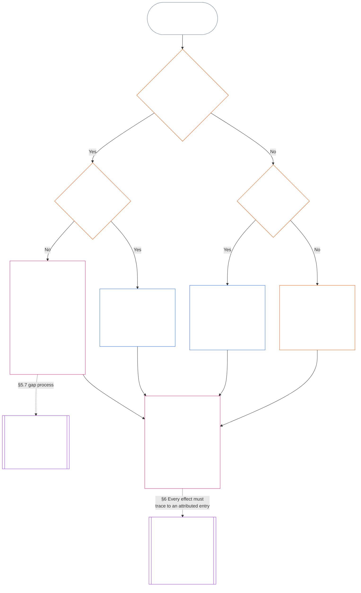

<!-- Locale: Arabic (ar, MSA) | Source: 9c2c8c10c871d91157bcd27b9f56ad6a1cec90d3 | AI-drafted, unreviewed | PARTIAL: Chapter Eleven §§5.7–5.9 only -->

#### 5.7 عندما لا يسمّي ميثاق النظام أو ميثاق المؤسسة مقعدًا

يتوقف تحديد الجهة التي يُحال إليها سجل الوضعية عند تعذّر المسار المسمّى المعتاد على ثلاثة أسئلة، يرتّبها المخطط أدناه. يتناول هذا القسم ميثاق نظام أو ميثاق مؤسسة لا يسمّي مقعدًا؛ أما [§5.8 المسار الاحتياطي عند عدم شمول ميثاق النظام أو ميثاق المؤسسة لسجل الوضعية](#58-fallback-when-no-system-charter-or-institutional-charter-reaches-the-standing-record) فيتناول الحالة التي لا يشمل فيها أيٌّ منهما سجل الوضعية.

<strong>إرشاد للقارئ (غير تشغيلي): كيفية قراءة المخطط</strong>

> بعبارات بسيطة: تتولى المكاتب التي يسمّيها ميثاق النظام أو ميثاق المؤسسة معالجة سجل الوضعية. إذا ترك الميثاق مقعدًا بلا تسمية، فهو غير صالح إلى أن تُعالج الفجوة، ويُحال سجل الوضعية إلى سلطة السجل الاحتياطي وأمين السجل الاحتياطي، أو إلى منتدى، لا إلى خريطة المسارات. وإذا لم يشمل أي ميثاق سجل الوضعية مطلقًا، حسمت خريطة المسارات المنشورة للمؤسسة الأمر؛ وإذا لم توجد خريطة، أُحيل السجل إلى تحقق مستقل أو، في الأعمال غير الرسمية والصغيرة النطاق، إلى الهيئة التي تعتمد عليه.
>
> ينتهي كل مسار في الصندوق نفسه: تتحقق جهة من الوقائع وتُدخل جهة منفصلة سجل الوضعية وتحوزه، ثم يحكم [§6 معالجة سجل الوضعية](#6-handling-a-standing-record) ما يفعله الحائزون به. الأسهم المتصلة هي المسار الرئيسي. والأسهم المنقّطة إحالات، وعليها اسم القسم الذي يجيزها. الصناديق ذات الخطين الجانبيين تخص فصلًا آخر، وآخر صندوق هو موضع استنباط آثار الوضعية من سجل الوضعية دون إعادة كتابته. لا يضيف المخطط واجبًا أو مقعدًا أو حقلًا.

 

إذا ترك ميثاق النظام أو ميثاق المؤسسة مقعدًا مطلوبًا من مقاعد السجل أو المسار المستقل دون تسمية:

- **النتيجة:** يكون ميثاق النظام أو ميثاق المؤسسة غير صالح، ولا يُسمح بتغيير يؤدي إلى ذلك ([الفصل السابع §4.7.1 وجود فجوة وكيفية تدوينها](core_07.000_charters.md#471-when-a-gap-exists-and-how-it-is-logged)).
- **الفصل السابع يملك إجراءات الفجوة:** يتولى [الفصل السابع §4.7 الفجوات في خريطة سجلات وضعية المشغّل](core_07.000_charters.md#47-gaps-in-the-map-for-operator-standing-records) أيضًا:
  - كيفية تدوين الفجوة؛
  - مهل الاستجابة والحل (بما فيها الاستبدال الطارئ)؛ و
  - موعد إعادة الحيازة إلى الحائزين المسمّين.

ويضيف هذا القسم لسجلات الوضعية ما يلي:

- **من لا يجوز له التصرف:** ما دام مقعد مطلوب شاغرًا ولا يسمّي ميثاق النظام أو ميثاق المؤسسة بديلًا صالحًا، لا يجوز لأي شخص أداء وظيفة ذلك المقعد، إلا عبر المسار الوارد في البند التالي.
- **إلى أين يُحال سجل الوضعية:** يُحال سجل الوضعية إلى سلطة السجل الاحتياطي وأمين السجل الاحتياطي، أو إلى منتدى بموجب **القسم 2.7**، وفق [§5.4 لا حيازة ذاتية](#54-no-self-custody)، ولا تحل خريطة المسارات محل ذلك. ويبقى كل سجل وضعية كاملًا مع أمين واحد.
- **سجلات الوضعية المحوزة بالفعل:**
  - في اليوم الذي يصل فيه إخطار الفجوة إلى منتدى أو مسجّل أو سلطة السجل الاحتياطي، ينتقل أي سجل وضعية للمشغّل تحوزه جهة داخل خط السيطرة المادية للطرف الميثاقي إلى أمين السجل الاحتياطي مع كامل أثره.
  - وحتى ذلك الحين، تحوزه تلك الجهة للقراءة فقط، ولا تدخل أي نسخة، وتزوّد أمين السجل الاحتياطي فورًا بنسخة كاملة مع أثرها الكامل.
  - يحتفظ الأمين الواقع خارج الخط بسجل الوضعية، ويدخل خلال الفجوة كل نسخة تأذن بها سلطة السجل الاحتياطي أو منتدى. وإذا خلص المنتدى إلى أن الأمين داخل الخط، ينتقل سجل الوضعية إلى أمين السجل الاحتياطي مع كامل أثره، كما لو كان لدى جهة داخل الخط.
- **المشرفون:** المشرف الذي يُطلب منه شغل مقعد لا يمنحه له ميثاق النظام أو ميثاق المؤسسة:
  - **يرفض المقعد:** امتلاكه إمكانية الوصول أو القدرة التقنية على إدخال سجل الوضعية لا يمنحه سلطة إدخاله.
  - **يسمّي الطلب والفجوة:** يسمّيهما كليهما في السجل.
  - **يحيل سجل الوضعية:** يرسله عبر المسار الوارد في *إلى أين يُحال سجل الوضعية* أعلاه.
  - **يواصل واجباته الأخرى:** تستمر واجباته القائمة بموجب [§5.4 لا حيازة ذاتية](#54-no-self-custody) (*المشرفون داخل الموضوع*): وقف ما يسيطر عليه، وتدوين المجموعة القابلة لإعادة البناء، وحفظ الأدلة التي يحوزها، والإخطار والتصعيد. ولا يتحقق أي من هذه الأفعال من الوقائع أو يُدخل سجل الوضعية. ويُرفق السجل والأدلة المحفوظة بسجل الوضعية بوصفهما مدخلين للسلطة التي تتحقق منه؛ فهما ليسا إدخالًا ولا يحسمان الوقائع.

#### 5.8 المسار الاحتياطي عند عدم شمول ميثاق النظام أو ميثاق المؤسسة لسجل الوضعية

عندما لا يغطي أي ميثاق نظام أو ميثاق مؤسسة النظام أو المؤسسة أو النشاط الذي يتناوله سجل الوضعية، كما في هيئة دون حد الفئة L لم تنشر أيًّا منهما، تسري خريطة المسارات المنشورة للمؤسسة بموجب **CI-8.205 §2** (*مسارات الفصل الوظيفي*):

- **سلطة فتح السجل:** الجهة التي تضعها خريطة المسارات في مسار الضمان والتدقيق للنظام أو المؤسسة أو النشاط الذي يتناوله سجل الوضعية. تتحقق تلك الجهة من الأساس الوقائعي وتأذن بالإدخال ([§5.2 سلطة فتح السجل المسمّاة](#52-named-record-opening-authority))؛ ولا تُدخل سجل الوضعية ولا تحوزه.
- **الأمين:** الجهة التي تشغل مسار النشر والأدلة.
- **استبعاد مسار التنفيذ:** لا يجوز أن تكون أي منهما الجهة التي تشغل مسار التنفيذ للنظام المعني.
- **عدم وجود خريطة مسارات أيضًا:** يُوجَّه سجل الوضعية إلى تحقق مستقل بموجب *لا حيازة ذاتية* أعلاه، أو، للسجلات غير الرسمية والصغيرة النطاق، إلى الهيئة المعتمدة عليه بموجب *السجلات غير الرسمية والصغيرة النطاق* أدناه.
- **المشرفون:** المشرف الذي يُطلب منه شغل مقعد لا تمنحه له خريطة المسارات يتبع قاعدة *المشرفون* في [§5.7 عندما لا يسمّي ميثاق النظام أو ميثاق المؤسسة مقعدًا](#57-when-a-system-charter-or-institutional-charter-leaves-a-seat-unnamed): يرفض المقعد، ويسمّي الطلب والفجوة في السجل، ويواصل واجباته الأخرى. ويرسل سجل الوضعية إلى الجهة التي تسمّيها خريطة المسارات، أو، عند عدم تسمية جهة، عبر المسار الوارد أعلاه في *عدم وجود خريطة مسارات أيضًا*.

#### 5.9 السجلات غير الرسمية والصغيرة النطاق

يتدرّج الفصل بين الواجبات بحسب الرهان المادي، لا بحسب الرسمية ([الفصل الثامن §2 المتطلبات الدستورية لأربعة مقاعد](core_08.000_functional_independence_separation_of_duties.md#2-four-seat-constitutional-requirement)).

- **الأعمال المشمولة:** تعتمد المجتمعات المحلية على أنواع كثيرة من المساهمات، وكثير منها غير مدفوع وغير رسمي. ويشمل ذلك العمل غير المدفوع، والمنظّم بين الأقران، والمعونة المتبادلة، والرعاية، والصيانة، والإصلاح، والتعليم، والإدارة المسؤولة المجتمعية، التي يوجب [الفصل الثالث عشر §6 أولوية عواقب المساهمة](core_13.000_standing_integration.md#6-contribution-consequences-second) الاعتراف بها وفق معايير متساوية.
  - **كيف تبدو محليًا:** يتشارك الجيران الطعام والأدوات (معونة متبادلة)؛ أو يرعون جارًا مريضًا أو مسنًا (رعاية)؛ أو يحافظون على حديقة أو جدول مشترك (صيانة وإدارة مسؤولة مجتمعية)؛ أو يصلحون أنابيب جار (إصلاح)؛ أو يدرّسون طالبًا أو يعلّمون شخصًا مهارة (تعليم). وكل منها نوع مستقل من المساهمة.
- **من يشغل مقعد التحقق:** في هذه الأعمال، يستوفي مقعد التحقق **أي هيئة مستقلة ذات سلطة منشورة للاعتماد على سجل الوضعية**، وتعمل تلك الهيئة عندئذ سلطةً للتحقق.
  - **من تكون عادةً:** غالبًا الهيئة التي ستعتمد على سجل الوضعية: مجموعة محلية مثل مجلس مستجمع مائي، أو منظمة تموّل العمل أو تضمن استمراره، أو سلطة الاعتراف بالسجلات **CI-6.255** (*المشاعات والتعاونيات والمعونة المتبادلة وحوكمة المجتمع غير السوقية*) (هيئة تعترف بسجلات العمل المجتمعي من هذا النوع)، أو منتدى بموجب **القسم 2.7**.
- **ما لا يكفي:** لا يُستوفى مقعد التحقق بمجرد رسمية سلطة التحقق.

في سجل وضعية من هذا النوع:

- لا يحتاج الكائن الواعي الذي يعمل بمفرده إلى مجموعة أو مؤسسة أو [ميثاق نظام](core_05.040_band_continuity.md#system-charter) أو [ميثاق مؤسسة](core_05.040_band_continuity.md#institutional-charter) لطلب سجل عن مساهمته. وفي هذه الحالة:
  - **من يطلب:** يشغل الكائن الواعي مقعد المبادرة في طلبه بصفته صاحب الموضوع والمطالب.
  - **مواده الخاصة:** إفادته وسجلاته وصوره مدخلات وليست تحققًا مطلقًا.
  - **مقعد التحقق:** أي هيئة مستقلة ذات سلطة منشورة للاعتماد على سجل الوضعية (سلطة التحقق).
  - **الإدخال والحيازة:** يُدخل سجل الوضعية ويحوزه أمين سجل منفصل.
  - **إذا طعن أحد فيه:** يُحال الطعن إلى مسار الطعن أو إلى منتدى بموجب **القسم 2.7**.
  - **عدم توافر هيئة تعتمد عليه:** إذا لم تتوفر هيئة من هذا النوع، يُحال سجل الوضعية إلى منتدى بموجب **القسم 2.7**.
  - **مثال، سبّاك متقاعد:** يجوز لسبّاك متقاعد أصلح أنابيب الجيران بلا أجر سنوات، من دون أن تكون له مجموعة تدعمه، أن يطلب من سلطة الاعتراف بالسجلات **CI-6.255** (*المشاعات والتعاونيات والمعونة المتبادلة وحوكمة المجتمع غير السوقية*) فتح سجل وضعية:
    - **يطلب ويدّعي:** السباك.
    - **يتحقق:** السلطة، بالاستناد إلى سجلات العمل وإفادات الجيران.
    - **يدخل ويحوز:** أمين سجل منفصل.
    - **إذا طعن أحد فيه:** يُحال الطعن إلى منتدى، لا إلى سلطة التحقق نفسها.
- يكون المشاركون أصحاب الموضوع، ومطالبين إذا طلبوا الاعتراف. وفي سجل جماعي بموجب **القسم 4.3**:
  - **المشاركون معًا:** كل منهم مطالب.
  - **إفادة عضو عن حصة عضو آخر:** مدخل، وليست تحققًا.
- تأتي المواد التي تسند سجل الوضعية من مصدرين:
  - **غير المشاركين:** يقدم المستفيدون والجيران وغيرهم من غير المشاركين إفادات بوصفها مواد تحقق بموجب **القسم 4.1**.
  - **سجل المجموعة الخاص:** الكائن الواعي الذي احتفظ به هو المسجّل والشاهد وفق *إفادات المسجّل مدخلات* أدناه.
- يُدخل أمين سجل الهيئة المعتمدة عليه ويحوز ما تحققت منه سلطة تحقق منفصلة:
  - **من لا يجوز له شغل أي من المقعدين:** لا يجوز أن يكون أمين السجل أو سلطة التحقق مطالبًا أو واقعًا في [خط السيطرة المادية](core_05.035_band_accountability.md#material-control-line) لمطالب.
  - **هيئة واحدة، مقعدان:** يجوز للهيئة المعتمدة نفسها استضافة المقعدين بموجب خريطة مسارات منشورة تتضمن ضمانات استقلال قابلة للتدقيق والطعن.
  - **لا يؤدي الشخص نفسه المهمتين مطلقًا:** لا يجوز لأي سلطة أو أمين أو كائن واعٍ أداء الواجبين في سجل الوضعية نفسه.
- لا تجعل وضعية المجموعة مطالبة العضو مشروطة:
  - **المجموعات غير الرسمية:** لا تمنع المجموعة التي ليس لها [ميثاق نظام](core_05.040_band_continuity.md#system-charter) أو [ميثاق مؤسسة](core_05.040_band_continuity.md#institutional-charter)، أو التي ليست مؤسسة أصلًا، أعضاءها من المطالبة.
  - **كل مشارك:** يجوز له طلب الاعتراف بصفته مطالبًا فرديًا عن عمل أدّاه ضمن المجموعة أو خارجها.
  - **ما يغطيه سجل الوضعية:** يتعلق بمساهمة المشارك لا بوضعية المجموعة.
  - **مثال، حلقة خياطة لحفف:** تشكل حلقة خياطة تقدّم لحففًا للاجئين الوافدين حديثًا نمطًا لهذا العمل: يجوز لكل خياط طلب سجل وضعية تتحقق منه هيئة مستقلة تعتمد عليه، مثل الوكالة التي تتلقى اللحف؛ ولا تحتاج الحلقة إلى ميثاق نظام أو ميثاق مؤسسة.
- قد ينشأ سجل وضعية انتهاك في البيئات غير الرسمية نفسها، وتظل المقاعد منفصلة فيها أيضًا:
  - **مثال، حادثة في حانة:** يصوّر شخص كائنًا واعيًا آخر في حانة يصبح ثملًا ومخلًا بالنظام وعنيفًا، مع أن أحدًا لم يُصب جسديًا.
    - **لا تُشترط الإصابة:** يمكن لتهديد عنف موثوق ومتحقق منه أن يسند سجل وضعية انتهاك حتى عندما لا يُصاب أحد (**القسم 3.2**، فقدان الفاعلية بالإكراه).
    - **الفيديو مدخل:** يكون الكائن الواعي الذي صوّر شاهدًا. واللقطات مدخل وليست تحققًا بذاتها مطلقًا، كما أن وجودها لا يفتح شيئًا من تلقاء نفسه (**القسم 2.2**).
    - **الكائن الواعي في الفيديو:** هو صاحب الموضوع. ويُخطر عند فتح سجل الوضعية، ولا يجوز له شغل أي مقعد ([§5.4 لا حيازة ذاتية](#54-no-self-custody)).
    - **مقعد التحقق:** هيئة مستقلة ذات سلطة منشورة للاعتماد على سجل الوضعية، مثل هيئة محلية للترخيص أو السلامة، أو منتدى بموجب **القسم 2.7**. ويُستبعد الكائن الواعي الذي صوّر ومالك الحانة إذا كان أي منهما مطالبًا أو واقعًا في [خط السيطرة المادية](core_05.035_band_accountability.md#material-control-line) لمطالب.
    - **الإدخال والحيازة والطعن:** يُدخل سجل الوضعية ويحوزه أمين سجل منفصل، ويُحال الطعن إلى مسار الطعن أو إلى منتدى بموجب **القسم 2.7**، لا إلى جهة التحقق.
- الحانة أو الإجراء الذي يشترط تحقق مؤسسة رسمية لا تستطيع مجموعة غير رسمية بلوغها، مع توافر هيئة مستقلة تعتمد على السجل، يمثل نمط [الفصل الثالث عشر §6.2 عتبات الكفاءة والتصاريح](core_13.000_standing_integration.md#62-competency-bars-and-clearances) للحواجز الاعتباطية، لا الفصل بين الواجبات.

لا يوجب أيٌّ من ذلك وجود سجل وضعية. يسري **القسم 2.2** *الصمت هو الوضع الافتراضي*: لا يُسجّل العمل غير الرسمي لمجرد إمكان تسجيله، ولا يصبح الفصل بين الواجبات ملزمًا إلا عند طلب سجل وضعية.
