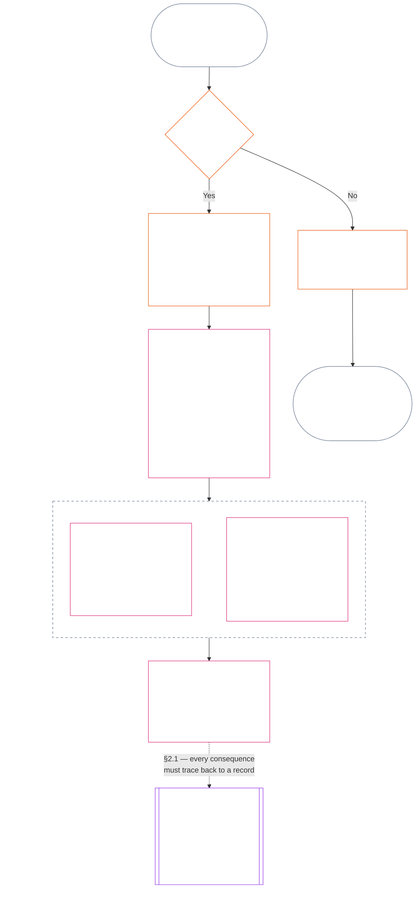
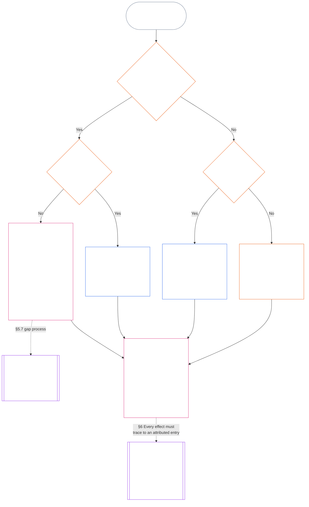

<!-- Locale: Arabic (ar, MSA) | Full Chapter Eleven | Source: 9c2c8c10c871d91157bcd27b9f56ad6a1cec90d3 | AI-drafted, unreviewed | Non-binding draft -->

# الفصل الحادي عشر: سجلات الوضعية — السؤال 1، ماذا حدث؟

<strong>موضع الملف في المتن (غير تشغيلي): بنية الملف وقواعد القراءة</strong>

> هذا الملف **جزء من دستور الكائنات الواعية** و**ملزم فقط عند قراءته معًا** مع ملفات `core_*` الأخرى المرقّمة بوصفها نصًا واحدًا. يتناول **الفصل الحادي عشر** أسئلة مسار الوضعية الثلاثة و**السؤال 1** (*ماذا حدث؟*) في **§1–§6**. يُجاب عن **السؤال 2** (*ما مدى جودة الأمر أو سوئه؟*) في [الفصل الثاني عشر](core_12.000_standing_measurement.md#chapter-twelve-standing-measurement--question-2-how-good-or-bad-was-it). ويتواصل السؤال 3 (*ماذا يحدث بسببه؟*) في [الفصل الثالث عشر](core_13.000_standing_integration.md#chapter-thirteen-standing-effects-and-integration)، وتقتصر المراجعة على تعيين سوء السلوك المضاد للدستور في [الفصل الرابع عشر](core_14.000_misconduct_designation.md#chapter-fourteen-anti-constitutional-misconduct) للنتائج المؤهلة على Violation Axis بقيمة `s` = 7–9. ويُحافَظ على ترتيب القراءة والفصل بين الأجزاء الملزمة والداعمة وبيانات طبعة المتن في [README.md](README.md).

<strong>إرشاد للقارئ (غير تشغيلي): موضع الفصل الحادي عشر وما يبقى هنا</strong>

> | السؤال | الجهة المالكة والدور |
> | --- | --- |
> | **1. ماذا حدث؟** | الفصل الحادي عشر (هذا الملف): إثبات الوقائع المتحقق منها في سجل وضعية محدود النطاق وقابل للطعن. |
> | **2. ما مدى جودة الأمر أو سوئه؟** | [الفصل الثاني عشر](core_12.000_standing_measurement.md#chapter-twelve-standing-measurement--question-2-how-good-or-bad-was-it): قياس الوقائع المتحقق منها من دون دمج المساعدة والضرر. |
> | **3. ماذا يحدث بسببه؟** | تابع إلى [الفصل الثالث عشر](core_13.000_standing_integration.md#chapter-thirteen-standing-effects-and-integration). |
>
> الادعاءات والشعبية وسرديات النزاع ليست أجوبة عن السؤال 1. ولا يجوز لتصنيف مرغوب فيه أن يقدّم وقائع السؤال 1، كما لا يجوز لنتيجة مرغوبة أن تقدّم تصنيف السؤال 2.

<strong>التتبّع</strong>

- السابق:
  - [الرباعية الدستورية](core_00.000_preamble.md#constitutional-tetrad)؛
  - [المقصدان الدستوريان](core_00.000_preamble.md#two-constitutional-aims)؛
  - [الرهان المادي](core_00.000_preamble.md#material-stake)؛
  - [الديباجة §6 سلاسل الإجراءات العملية الرئيسية](core_00.000_preamble.md#6-key-practical-process-pipelines) (*سلسلة الفصول من التاسع إلى الخامس عشر*).
- السابق:
  - [الفصل الأول](core_01.010_stewardship_capacity_principles.md#chapter-01-principles-and-constraints) (1.010) (*إدارة إتاحة اللغة الواضحة المسؤولة، كما تنعكس في مسرد الأقسام*);
  - [الفصل الأول §16 — الإدارة المسؤولة بالتعمق](core_01.010_stewardship_capacity_principles.md#16-stewardship-in-depth) (1.010 §16) (*أساس طبقة المبادئ للوضعية المرتبطة بالكفاءة والقابلة للتتبّع — الثقة والأدوار والاعتراف*);
  - [الفصول الثاني إلى الرابع](core_02.000_definition_structure.md) (*النزاهة والسجلات والتحقق*)؛
  - [الفصل الخامس](core_05.000_definitions_home.md#chapter-five-foundational-definitions) (5.000) (*التعريفات والسمو الدستوري مقروءان مع الفصول الثاني إلى الرابع*).
- السابق: [الفصل التاسع](core_09.000_system_alignment_certification_evaluation.md#chapter-nine-system-alignment-certification) (9.000) (*شهادة مواءمة النظام*)؛ [الفصل التاسع، الجزء ج §11](core_09.010_system_alignment_certification_record_recertification.md#11-relationship-to-standing) (9.010 §11) (*جسر الوضعية — مدخلات محتملة متحقق منها فقط*).
- مسار الوضعية:
  - [الديباجة §6.2 كيف تتكامل السلسلة الكاملة](core_00.000_preamble.md#62-how-the-full-chain-fits-together)؛
  - [الفصل الحادي عشر — سجلات الوضعية](core_11.000_standing_assessment.md#chapter-eleven-standing-records--question-1-what-happened) (11.000) (*إطار الأسئلة الثلاثة وسجلات السؤال 1*)؛
  - [الفصل الثاني عشر — قياس الوضعية](core_12.000_standing_measurement.md#chapter-twelve-standing-measurement--question-2-how-good-or-bad-was-it) (12.000) (*قياس السؤال 2*)؛
  - [الفصل الثالث عشر — آثار الوضعية والتكامل](core_13.000_standing_integration.md#chapter-thirteen-standing-effects-and-integration) (13.000) (*آثار السؤال 3 والتكامل*)؛
  - [الفصل الرابع عشر](core_14.000_misconduct_designation.md#chapter-fourteen-anti-constitutional-misconduct) (14.000) (*التعيين فقط للنتائج المؤهلة على Violation Axis بقيمة s = 7–9*).
- الأقسام الفرعية في هذا الملف:
  - [§1](#1-the-three-questions) (*إطار الأسئلة الثلاثة ونطاقها*)؛
  - [§2](#2-question-1--what-happened) (*السؤال 1 — الوقائع والسجلات المتحقق منها*)؛
  - [§3](#3-question-1-event-type-guide--what-kind-of-help-or-harm-occurred) (*دليل أنواع أحداث السؤال 1 — أنواع المساعدة والضرر*)؛
  - [§4](#4-standing-record-operational-requirements) (*متطلبات التحقق والسجل*)؛
  - [§5](#5-record-custody-and-opening-authority) (*حيازة السجل وسلطة فتحه*)؛
  - [§6](#6-handling-a-standing-record) (*معالجة سجل الوضعية*).
- اللاحق:
  - [الفصل الثاني عشر](core_12.000_standing_measurement.md#chapter-twelve-standing-measurement--question-2-how-good-or-bad-was-it) (12.000) (*السؤال 2 — أساس LEQU وأبعاد القياس وأوصاف المسارات وقواعد الخانات والمدخلات الدستورية ومقياس LEQU ومقاييس المساهمة المعيارية والأمثلة والتسليم إلى السؤال 3*)؛
  - [الفصل الرابع عشر](core_14.000_misconduct_designation.md#chapter-fourteen-part-a-anti-constitutional-misconduct-designation) (14.000) (*التعيين فقط — لا يعيد فتح قياس السؤال 2*)؛
  - [الفصل الخامس عشر](core_15.000_forum.md#chapter-fifteen-forums-and-jurisdiction) (15.000) (*إشراف المنتديات والتوجيه*)؛
  - [المادة XXVI-C](core_06.020_rights_part_e.md#article-xxvi-c-timely-resolution-and-anti-delay-floor) (*الحسم في الوقت المناسب*)؛
  - [المادة XX](core_06.015_rights_part_d.md#article-xx-a-justice-objective-and-scope) (*قيود العدالة*).
- يُقرأ مع: [الفصل الخامس *حالة الوضعية والمساهمة والانتهاك*](core_05.035_band_accountability.md#defa3-standing-state-contribution-and-violation) (5.035) (*توجيه التعريفات المعياري*).
- يُقرأ مع: [README.md](README.md) (*ترتيب القراءة*)؛ [doc_architecture.md](doc_architecture.md) (*الخرائط التحريرية غير الملزمة ما لم تُعتمد*).

 

الفصل الحادي عشر هو المالك الدستوري **للسجل الوقائعي المتحقق منه (السؤال 1)**. يمتد من [§1 الأسئلة الثلاثة](#1-the-three-questions) حتى [§6 معالجة سجل الوضعية](#6-handling-a-standing-record). ويملك [الفصل الثاني عشر](core_12.000_standing_measurement.md#chapter-twelve-standing-measurement--question-2-how-good-or-bad-was-it) السؤال 2، من [الفصل الثاني عشر §1 السؤال 2 — ما مدى جودة الأمر أو سوئه؟](core_12.000_standing_measurement.md#1-question-2--how-good-or-bad-was-it) إلى [الفصل الثاني عشر §9 التسليم إلى السؤال 3 — نقاط الربط بين قياسات الأسئلة](core_12.000_standing_measurement.md#9-hand-off-to-question-3--cross-question-measurement-hooks). ويستمر السؤال 3 في الفصل الثالث عشر.

*بعبارات بسيطة: يدوّن هذا الفصل ما حدث ويحوز سجل الوضعية. ويُقاس مدى جودته أو ضرره في الفصل الثاني عشر على مسارين منفصلين، لا في نتيجة صافية واحدة. ومجرد رفع دعوى لا ينشئ وضعية بحد ذاته.*

### 1. الأسئلة الثلاثة

*بعبارات بسيطة: يُحدَّد الوضعية بالإجابة عن ثلاثة أسئلة بالترتيب. لا تستنتج الوقائع من تصنيف مرغوب فيه، ولا تختر تصنيفًا لتبرير نتيجة مرغوب فيها.*

| السؤال | ما الذي يسأل عنه السؤال؟ | أين تتم الإجابة عنه؟ |
| --- | --- | --- |
| **1. ماذا حدث؟** | ما الوقائع التي جرى التحقق منها، وبشأن من أو ماذا، وخلال أي فترة، وما حالة سجل الوضعية والطعن فيه؟ | [القسم 2](#2-question-1--what-happened) و[القسم 3](#3-question-1-event-type-guide--what-kind-of-help-or-harm-occurred) |
| **2. ما مدى جودته أو سوئه؟** | ما نوع المساهمة أو الانتهاك ومقداره اللذان تثبتهما تلك الوقائع؟ | [القسم 1 من الفصل الثاني عشر](core_12.000_standing_measurement.md#1-question-2--how-good-or-bad-was-it) |
| **3. ماذا يترتب عليه؟** | ما الاعتراف أو الجاهزية أو الانتصاف أو الضمانة أو القيد أو غير ذلك من النتائج التي تترتب عليه؟ | [الفصل الثالث عشر](core_13.000_standing_integration.md#chapter-thirteen-standing-effects-and-integration) |

تعتمد كل إجابة على الإجابة السابقة لها:

- يقدّم السؤال 1 الوقائع المتحقق منها اللازمة للسؤال 2.
- يقيس السؤال 2 تلك الوقائع لأغراض السؤال 3.
- يجب ألا يعيد السؤال 3 صياغة الوقائع أو التصنيف بما يلائم نتيجة مفضلة.

تشكل الإجابات عن الأسئلة الثلاثة معًا تقييم الوضعية الكامل لواقعة محددة الحدود أو نمط معرّف واحد. وقد يكون للموضوع عدة تقييمات من هذا القبيل مع مرور الوقت، ولا يشكل أي منها درجة صافية أو تصنيفًا عامًا للموضوع. ويحفظ سجلا مساهمة الوضعية والانتهاك الإجابتين عن السؤالين 1 و2؛ أما قرار السؤال 3 فيبيّن ما يترتب عليهما.

#### 1.1 الغرض والنطاق

يحدد هذا الفصل إطار السجل الدستوري، ويحدد [الفصل الثاني عشر](core_12.000_standing_measurement.md#chapter-twelve-standing-measurement--question-2-how-good-or-bad-was-it) إطار القياس، بالنسبة إلى **الأنظمة** و**الكائنات الواعية** و**المؤسسات**، بما في ذلك كل نظام مصنّف بموجب [**CS-9.305**](corpus_systems/cs_09.305_system_classification_machinery.md#cs-9305-part-a-system-classification-machinery) (*آلية تصنيف الأنظمة*). ولا تقيس هذه الأطر النميمة أو الشعبية أو السمعة المبهمة أو الكرامة المتأصلة أو القيمة العامة؛ فلا يصلح أيٌّ من ذلك موضوعًا لتقييم الوضعية.

يجب أن تظل سلسلة إجراءات الوضعية فعالة عندما:

- تصبح المساهمات التي سبق التحقق منها قديمة إلى حد لا يعود معه إثبات الكفاءة أو الموثوقية الحالية؛
- تظل الانتهاكات دون حل؛
- يكون الإصلاح مكلفًا؛
- تتجاوز المسؤولية الحدود؛ أو
- يستخدم فاعلٌ التدرج التنظيمي أو إعادة التسمية لعرقلة المساءلة.

وتندرج الأمور الآتية في نصوص التنفيذ المعتمدة:

- الإجراءات اليومية؛
- خطوات التصعيد؛
- عمليات رد الحقوق والإصلاح؛
- تدابير المساءلة الإصلاحية؛ و
- تصميم الحوافز.

لا يجيز القياس في الفصل الثاني عشر، **في حد ذاته**، استخدام القوة أو الاحتجاز أو أي قيد آخر على الحرية. ويجب أن تستوفي أي نتيجة من هذا القبيل، بصورة مستقلة، متطلبات الفصل السادس، **المادة XX** (*العدالة بعد التحقق من الانتهاك*)، بما في ذلك متطلبات التناسب، واختيار البديل الأقل تقييدًا، وتحديد مدة زمنية، ورد الحقوق، والمساءلة الإصلاحية.

<strong>التتبّع · التعريفات · التقييم · الامتثال</strong>

- المنابع: [الفصل الأول §16 — الرعاية بالتفصيل](core_01.010_stewardship_capacity_principles.md#16-stewardship-in-depth)؛ [الفصول الثاني إلى الرابع](core_02.000_definition_structure.md)؛ [الفصل الخامس](core_05.000_definitions_home.md#chapter-five-foundational-definitions).
- المصبّات: [§2](#2-question-1--what-happened) (*السؤال 1*)؛ [§4](#4-standing-record-operational-requirements) (*متطلبات التحقق والسجل*)؛ [§5](#5-record-custody-and-opening-authority) (*حفظ السجل وصلاحية فتحه*)؛ [§6](#6-handling-a-standing-record) (*التعامل مع سجل الوضعية*)؛ [الفصل الثاني عشر §1](core_12.000_standing_measurement.md#1-question-2--how-good-or-bad-was-it) (*قياس السؤال 2*)؛ [الفصل الثاني عشر §2](core_12.000_standing_measurement.md#2-magnitude-and-severity-input-dimensions) (*مدخلات القياس*)؛ [الفصل الثاني عشر §3](core_12.000_standing_measurement.md#3-route-descriptor-catalogs-and-measurement-roles) (*فهارس أوصاف المسارات*)؛ [الفصل الثاني عشر §4](core_12.000_standing_measurement.md#4-slot-grammar-and-shared-scaling) (*قواعد الخانات والقياس المشترك*)؛ [الفصل الثاني عشر §5](core_12.000_standing_measurement.md#5-constitutional-inputs-to-axis-assignment) (*إسناد المحاور بحسب المصادر الدستورية*)؛ [الفصل الثاني عشر §6](core_12.000_standing_measurement.md#6-unified-proportional-lequ-scale--contribution-and-violation-axes) (*مقياس LEQU التناسبي الموحد للمحورين*)؛ [الفصل الثالث عشر](core_13.000_standing_integration.md#chapter-thirteen-standing-effects-and-integration) (*السؤال 3*).
- [الأهمية المادية](core_05.050_band_oversight.md#materiality) · [O](core_05.050_band_oversight.md#materiality) · [M](core_05.050_band_oversight.md#materiality-determination-a) · [A](core_05.050_band_oversight.md#materiality-determination-a) · [C](core_05.050_band_oversight.md#materiality-determination-c)
- [الضرر](core_05.035_band_accountability.md#harm) · [O](core_05.035_band_accountability.md#harm) · [M](core_05.035_band_accountability.md#harm-a) · [A](core_05.035_band_accountability.md#harm-a) · [C](core_05.035_band_accountability.md#harm-c)
- [التناسب](core_05.035_band_accountability.md#proportionality) · [O](core_05.035_band_accountability.md#proportionality) · [M](core_05.035_band_accountability.md#proportionality-a) · [A](core_05.035_band_accountability.md#proportionality-a) · [C](core_05.035_band_accountability.md#proportionality-c)

### 2. السؤال 1 — ماذا حدث؟

<strong>التتبّع</strong>

- المنابع: [§1](#1-the-three-questions) (*إطار الأسئلة الثلاثة*)؛ [الفصول الثاني إلى الرابع](core_02.000_definition_structure.md) (*السجل والتحقق وإمكانية تتبع التعريفات إلى النتائج*).
- ركائز الرباعية: **المشاركة**؛ **الرقابة** (قابلية الاعتراض ومسارات الطعن). الغايات الأساسية: **الازدهار** و**الاستمرارية** (سجلات قابلة للتتبع تحفظ نتائج المساهمة والانتهاك منفصلةً لقياسها لاحقًا).
- المصبّات:
  - [§2.2](#22-silence-is-the-default) (*الصمت هو الحالة الافتراضية*)؛
  - [§2.3](#23-protected-dissent-is-not-a-trigger) (*المعارضة المحمية ليست مُحفِّزًا*)؛
  - [§2.4](#24-linked-standing-records-and-no-offset-bridge) (*جسر السجلات المرتبطة وعدم المقاصة*)؛
  - [§2.5](#25-verified-input-gate) (*بوابة المدخلات المتحقق منها*)؛
  - [§2.6](#26-stage-boundary) (*الحد الفاصل بين المراحل*)؛
  - [§2.7](#27-forum-boundary) (*حدود دور المنتدى*)؛
  - [§3](#3-question-1-event-type-guide--what-kind-of-help-or-harm-occurred) (*دليل أنواع الأحداث*)؛
  - [§4](#4-standing-record-operational-requirements) (*متطلبات السجل*)؛
  - [§5](#5-record-custody-and-opening-authority) (*حفظ السجل وصلاحية فتحه*)؛
  - [§6](#6-handling-a-standing-record) (*التعامل مع سجل الوضعية*)؛
  - [الفصل الثاني عشر §1](core_12.000_standing_measurement.md#1-question-2--how-good-or-bad-was-it) (*قياس السؤال 2*)؛
  - [الفصل الثاني عشر §2](core_12.000_standing_measurement.md#2-magnitude-and-severity-input-dimensions) (*مدخلات القياس*)؛
  - [الفصل الثاني عشر §3](core_12.000_standing_measurement.md#3-route-descriptor-catalogs-and-measurement-roles) (*فهارس أوصاف المسارات*)؛
  - [الفصل الثاني عشر §4](core_12.000_standing_measurement.md#4-slot-grammar-and-shared-scaling) (*قواعد الخانات والقياس المشترك*)؛
  - [الفصل الثاني عشر §5](core_12.000_standing_measurement.md#5-constitutional-inputs-to-axis-assignment) (*إسناد المحاور بحسب المصادر الدستورية*)؛
  - [الفصل الثاني عشر §6](core_12.000_standing_measurement.md#6-unified-proportional-lequ-scale--contribution-and-violation-axes) (*مقياس LEQU التناسبي الموحد للمحورين*)؛
  - [الفصل الثالث عشر](core_13.000_standing_integration.md#chapter-thirteen-standing-effects-and-integration) (13.000) (*السؤال 3*).

 

*بعبارات بسيطة: ينشئ السؤال 1 رواية محددة الحدود وقابلة للاعتراض عما حدث. وهو يحدد الموضوع والواقعة أو النمط والفترة الزمنية والوقائع المتحقق منها وحالة السجل قبل النظر في أي تصنيف أو نتيجة. وتُستخدم سجلات وضعية منفصلة للمساعدة المتحقق منها وللانتهاكات المتحقق منها، كيلا يمحو أحدهما الآخر. وهذه السجلات ليست درجات شعبية أو أوصافًا مبهمة.*

**سجل الوضعية** هو سجل محدد الحدود يستخدمه هذا الفصل لموضوع معين ونطاق وظيفي وفترة سجل وحالة مراجعة وسياق قرار معين. وقبل بدء القياس، يجب أن يثبت ما يلي:

- من أو ما الذي يتعلق به سجل الوضعية؛
- ما إذا كان يتعلق بواقعة محددة الحدود أم بنمط معرّف؛
- متى وأين وقع السلوك والآثار المعنية؛
- أي الوقائع تم التحقق منها وأيها ما زال محل نزاع؛
- ما الأدلة والإسناد ومسار الطعن التي تسند تلك النتائج؛ و
- الحالة الراهنة لمراجعة سجل الوضعية وتصحيحه وإحلاله محل سجل سابق.

يتتبع المخطط واقعةً لمعرفة ما إذا كانت تُفعّل سجل وضعية وما الذي يحتفظ به السجل بعد ذلك؛ وتبيّن الأقسام الفرعية التالية كل قاعدة. ويخرج فرع «لا» من المسار الرئيسي إلى اليمين.

#### 2.1 سجلات الوضعية: أنواعها وموضوعاتها

يستخدم السؤال 1 **سجل وضعية مساهمة** للمساعدة المتحقق منها و**سجل وضعية انتهاك** للضرر المتحقق منه، بما في ذلك إخفاقات المساءلة. ولا يجمع سجل وضعية واحد نوعي النتائج معًا.

- قد يتعلق سجل الوضعية بكائن واعٍ أو مؤسسة أو نظام أو تقييم أو واقعة محددة الحدود أو دور أو جماعة أو سجل خاص بفاعل معين أو وحدة أخرى ذات صلة دستورية.
  - ويجب ألا يدمج موضوعات أو أدوارًا أو أنظمة أو جماعات أو فترات سجلات أو حالات مراجعة أو سياقات قرار متميزة في وسم وضعية واحد غير متمايز.
- قد يغطي سجل الوضعية **واقعة محددة الحدود** — أي حادثة واحدة لها بداية ونهاية واضحتان — أو **نمطًا** من السلوك المتكرر.
  - ويتطلب النمط تحديد الموضوع والنطاق وفترة المراجعة.
- قد يكون للموضوع نفسه عدة سجلات وضعية عبر الزمن، بما فيها سجلات وضعية مساهمة وانتهاك مرتبطة.
  - ويجب أن تحيل سجلات الوضعية ذات الصلة بعضها إلى بعض بموجب **القسم 4.2** عندما تشترك في الموضوع أو تتداخل في فترة السجل أو الواقعة المحددة الحدود أو النمط أو سياق القرار.
- سجل الوضعية ليس درجة سمعة مستقلة، ولا مرتبة للكرامة، ولا حالة دائمة، ولا وسمًا للقيمة العامة، ولا بطاقة نتائج مدمجة.
  - ترد المتطلبات التشغيلية في **القسم 4**.

ينتمي أي أثر لاحق على الوضعية إلى الفصل الثالث عشر، ويجب أن يكون قابلًا للتتبع إلى سجل الوضعية أو سجلات الوضعية المعنية من دون أن يصبح جزءًا من سجل الوضعية نفسه.

#### 2.2 الصمت هو الحالة الافتراضية

إن عدم وجود سجل وضعية هو الحالة العادية للكائن الواعي أو المؤسسة أو النظام، وهي الحالة التي سيظل فيها معظم الكائنات الواعية.

- لا يُفتح سجل وضعية إلا بعد التحقق من وجود مُحفِّز بموجب **القسم 4**. ويجب أن توافق سلطة محددة لفتح السجل على القيد، وأن يُجريه قَيِّم سجل مستقل (**القسم 5**). ولا يُفتح سجل وضعية مطلقًا:
  - لإنشاء خط أساس؛
  - لاستكمال قائمة أسماء؛ أو
  - لمجرد أن مسؤول بوابة لمسار محدد يفضّل ذلك.
- لا يخبرك عدم وجود سجل وضعية بأي شيء. فعبارات «غير مصنّف» و«غير متحقق منه» و«لا يوجد سجل في الملف» ليست دليلًا على الخطر أو انخفاض المساهمة أو أي أمر آخر. ولا يجوز لأحد معاملة غياب سجل على أنه سبب لمزيد من التدقيق أو لافتراض أدنى أو لجعل الوصول إلى مسار محدد مشروطًا.
- لا يجوز لمؤسسة أو نظام أن يشترط وجود سجل وضعية أو إقرارًا بـ«عدم وجود سجل» أو الموافقة على فتح سجل كشرط لما يلي:
  - الضروريات المنصوص عليها في **المادة III** (*البقاء والوصول الأساسي*)؛
  - الحمايات المنصوص عليها في **المادة III-C** (*العمل والحد الاقتصادي الأدنى*)؛
  - التجارة العادية؛ أو
  - المشاركة بصفتك طرفًا متأثرًا.
  والاستثناء هو حدود الكفاءة المنشورة لمسارات محددة مسماة وحساسة للثقة بموجب [الفصل الثالث عشر §6.2 حدود الكفاءة والتصاريح](core_13.000_standing_integration.md#62-competency-bars-and-clearances)، ويجب أن تبيّن تلك الحدود سبب حساسية المسار المحدد للثقة.
- عند فتح سجل وضعية عن موضوع ما، يجب إخطار الموضوع، كما يقتضي **القسم 4**. ولا يجوز تأخير الإخطار إلا إذا بررت حاجة موثقة إلى [حفظ الأدلة](core_05.050_band_oversight.md#evidence-preservation) أو إلى السلامة ذلك، ولمدة محددة ومحدودة فقط. فالإخطار هو ما يجعل سجل الوضعية قابلًا للاعتراض: إذ لا يستطيع موضوع لا يعلم بوجود سجل وضعية أن يطعن فيه أو يصححه.

#### 2.3 المعارضة المحمية ليست مُحفِّزًا

لا تُعد المعارضة أو الاحتجاج السلمي — بما في ذلك [العصيان المدني السلمي المحمي](core_06.005_rights_part_b.md#xi-d-nonviolent-civil-disobedience) — بموجب **المادة XI-D** (*التجمع والمعارضة والاحتجاج السلمي*) ([*حد المعارضة والاحتجاج السلمي*](core_06.005_rights_part_b.md#xi-d-dissent-and-peaceful-protest)) مُحفِّزًا متحققًا منه.

- لا تفتح سجل انتهاك الوضعية ولا تمدده ولا تشدد حدته، ولا تُعد مدخلًا للشدة بموجب **القسم 8.2**، ولا يجعلها تكرارها نمطًا.
- يُسجَّل السلوك المنفصل الذي ينتهك بصورة مستقلة حدًا دستوريًا وفقًا لشروطه الخاصة، من دون تشديد بسبب وجهة نظر الاحتجاج أو قضيته أو الجهة المستهدفة به.

#### 2.4 سجلات الوضعية المرتبطة وجسر عدم المقاصة

<strong>التتبّع</strong>

- المنابع: [§2.1](#21-standing-records-kinds-and-subjects) (*سجلا المساهمة والانتهاك المنفصلان*).
- المصبّات:
  - [§2.5](#25-verified-input-gate) (*بوابة المدخلات المتحقق منها*)؛
  - [§2.7](#27-forum-boundary) (*حدود دور المنتدى*)؛
  - [§4.2](#42-related-standing-record-cross-references) (*الإحالات المتبادلة*)؛
  - [الفصل الثاني عشر §1](core_12.000_standing_measurement.md#1-question-2--how-good-or-bad-was-it) (*قياس السؤال 2*)؛
  - [الفصل الثاني عشر §2](core_12.000_standing_measurement.md#2-magnitude-and-severity-input-dimensions) (*مدخلات القياس*)؛
  - [الفصل الثاني عشر §3](core_12.000_standing_measurement.md#3-route-descriptor-catalogs-and-measurement-roles) (*فهارس أوصاف المسارات*)؛
  - [الفصل الثاني عشر §4](core_12.000_standing_measurement.md#4-slot-grammar-and-shared-scaling) (*قواعد الخانات والقياس المشترك*)؛
  - [الفصل الثاني عشر §5](core_12.000_standing_measurement.md#5-constitutional-inputs-to-axis-assignment) (*إسناد المحاور بحسب المصادر الدستورية*)؛
  - [الفصل الثاني عشر §6](core_12.000_standing_measurement.md#6-unified-proportional-lequ-scale--contribution-and-violation-axes) (*مقياس LEQU التناسبي الموحد للمحورين*)؛
  - [الفصل الثالث عشر](core_13.000_standing_integration.md#chapter-thirteen-standing-effects-and-integration) (13.000) (*السؤال 3*).
- اقرأ مع: [الفصل الثالث عشر — تكامل الوضعية](core_13.000_standing_integration.md#2-automatic-integration-review-and-continuity) (13.000) (*عدم التنازل والتكامل بين السجلات المرتبطة*)؛ [الفصل الثالث عشر §6.2 — حدود الكفاءة والتصاريح](core_13.000_standing_integration.md#62-competency-bars-and-clearances) (13.000 §6.2)؛ [الفصل الثالث عشر §4.2 — أقفال الوضعية](core_13.000_standing_integration.md#42-prevention--general-standing-locks) (13.000 §4.2).

 

**القاعدة الأساسية:** يُحتفظ **بسجلات مساهمة الوضعية** المتحقق منها و**سجلات انتهاك الوضعية** المتحقق منها منفصلةً بموجب **القسم 2.1**. ويجب أن تستند كل نتيجة بشأن مساهمة أو انتهاك إلى وقائع مسندة خاصة بها في سجل وضعيةها الخاص. ويجب أن يحافظ التحليل والمواد الداعمة على إمكانية تتبع مساري السجل كلٌّ على حدة. ولا يُعد أي قيد منفرد أو مجموعة سجلات مرتبطة درجة صافية أو درجة ممزوجة أو مقايضة.

- **سجلات انتهاك الوضعية وأقفال الوضعية:**
  - بموجب الفصل الثالث عشر، يجوز لأقفال الوضعية المنطبقة والمستمدة من سجلات انتهاك الوضعية أن تحد الوضعية أو تقيد أهلية الأدوار أو تؤثر في الوصول إلى الانتصاف ما دام الانتهاك المتحقق منه دون حل.
  - يجب ألا تمحو أقفال الوضعية المساهمة الإيجابية المتحقق منها والمسجلة في سجلات مساهمة الوضعية.
  - لا تُخفض قيمة الانتهاكات المتحقق منها التي لم تُحل لمجرد مرور الزمن.
  - يجب ألا تعيد الانتهاكات المتحقق منها صياغة سجلات وضعية مساهمة غير مرتبطة لتصبح ملف سمعة سلبيًا زائفًا.
- **سجلات مساهمة الوضعية وتصاريح الكفاءة:**
  - يجوز للمساهمة المتحقق منها أن تدعم تصاريح الكفاءة المنطبقة استنادًا إلى حدود الكفاءة المنشورة، وأن تدعم الأهلية المرتبطة بالثقة أو الدور أو الاعتراف عندما تكون حديثة وذات صلة بالدور.
  - يجب ألا تعادل المساهمة المتحقق منها نتيجة انتهاك متحقق منها أو تخففها أو تبررها أو تعيد تسميتها.
  - لا يعفي استيفاء البوابة من أي قفل الوضعية منطبق.

**الاستثناء الوحيد:** إذا كانت نتيجة الانتهاك نفسها تنفي مساهمة مزعومة — مثلًا إذا أظهرت الأدلة أنك لم تفعل فعلًا ما يدعيه سجل مساهمتك — فيجوز تصحيح سجل مساهمة الوضعية المرتبط أو حذفه من خلال إجراءات الأدلة والمراجعة المناسبة، مع الإحالة المتبادلة المطلوبة بموجب **القسم 4.2**. لكن الانتهاك لا يمحو تلقائيًا مساعدة غير مرتبطة مسجلة في سجلات وضعية مساهمة منفصلة.

#### 2.5 بوابة المدخلات المتحقق منها

تعمل البوابة على النحو الآتي:

- لا يجوز لأي قرار يؤثر في الوضعية أو الثقة أو الدور أو الاعتراف أو الأهلية للاعتراف أن يستخدم إلا مدخلات متحققًا منها من **سجلات مساهمة الوضعية** أو **سجلات انتهاك الوضعية** ذات الصلة.
- لا توفر الادعاءات أو المزاعم غير المفصول فيها أو وسوم التوجيه المؤقتة أو روايات مرحلة الاستقبال وحدها، ولا غيرها من مواد مرحلة النزاع، طبيعة المساهمة أو طبيعة الانتهاك لأغراض الوضعية.
- المدخل المتحقق منه هو **نتيجة وضعية**: نتيجة مساهمة متحقق منها (المحور I) أو نتيجة انتهاك متحقق منها (المحور II).
- تظل نتائج المساهمة والانتهاك في سجلات وضعية منفصلة (انظر **القسم 2.1**).

#### 2.6 الحد الفاصل بين المراحل

تظل مراحل سجل الوضعية منفصلة:

- يسجل السؤال 1 الوقائع المتحقق منها؛ ويقيسها السؤال 2.
- يجوز فتح سجل وضعية بمجرد اكتمال أساسه الواقعي المتحقق منه، حتى لو ظل قياس السؤال 2 معلقًا.
- إلى أن يجري القياس، يجب أن تذكر حقول السؤال 2 أنه معلق بدلًا من الإيحاء بخانة أو فئة.
- يجب ألا يذكر سجل الوضعية أثرًا على **الوضعية** من آثار السؤال 3 أو يطبقه.

#### 2.7 حدود دور المنتدى

*بعبارات بسيطة: المنتديات هي أماكن الإشراف على النزاعات والطعن فيها وتحويلها إلى نتائج متحقق منها — لكن رفع دعوى أو الانتصار في سجال روائي لا يحدّث الوضعية. وتظل بوابة المدخلات المتحقق منها في **القسم 2.5** سارية. وعندما يتحقق المنتدى من الوقائع بموجب الفصول الثاني إلى الرابع، يجوز له **فتح سجل وضعية أو تحديثه أو تصحيحه** — أو **إبطال سجل سيئ عند الطعن**. ولا تدمج المنتديات الحسن والسيئ في درجة واحدة، ولا تستحدث فئة الوضعية من تلقاء نفسها.*

يختص هذا القسم بسؤال واحد: كيف يصل عمل المنتدى إلى سجل الوضعية. أما الخطوات الأخرى في السلسلة فتعود إلى الجهات المالكة المسماة هنا، وتسير السلسلة بالترتيب الآتي:

1. تُرفع منازعة ويحتفظ المنتدى **بسجل قضية المنتدى**، وهو ليس سجل وضعية. المالك: [الفصل الخامس عشر §2.3 سجلات قضايا المنتدى وسجلات الوضعية والمنازعات](core_15.000_forum.md#23-forum-case-records-standing-records-and-contests)؛ وانظر أيضًا [§2.7.1 سجل قضية المنتدى](#271-forum-case-record).
2. يتحقق المنتدى من الوقائع بموجب [الفصول الثاني إلى الرابع](core_02.000_definition_structure.md).
3. تجتاز النتائج المتحقق منها بوابة المدخلات المتحقق منها. المالك: [§2.5 بوابة المدخلات المتحقق منها](#25-verified-input-gate).
4. تفتح سلطة محددة لفتح السجل — ويمكن أن تكون منتدى — سجل الوضعية أو تحدّثه أو تصححه، أو تُبطل سجلًا سيئًا عند الطعن. المالك: [§4.1 الحد الأدنى لمحتويات السجل](#41-minimum-record-contents) لما يتضمنه سجل الوضعية و[§5 حفظ السجل وصلاحية فتحه](#5-record-custody-and-opening-authority) لمن يجوز له اتخاذ الإجراء.
5. لا يتضمن سجل الوضعية إلا الوقائع المتحقق منها، ثم يقيسها السؤال 2. المالكان: [§2.6 الحد الفاصل بين المراحل](#26-stage-boundary) و[الفصل الثاني عشر §1 السؤال 2 — ما مدى جودته أو سوئه؟](core_12.000_standing_measurement.md#1-question-2--how-good-or-bad-was-it).
6. يترتب أي أثر على الوضعية، إن وجد، بموجب [الفصل الثالث عشر](core_13.000_standing_integration.md#chapter-thirteen-standing-effects-and-integration)، وهو مالك آثار الوضعية.

تشرف مجموعات المنتديات بموجب [الفصل الخامس عشر](core_15.000_forum.md#chapter-fifteen-forums-and-jurisdiction) على كيفية انتقال المنازعات الملموسة عبر سلسلة إجراءات الوضعية. وتوفر المنتديات ما يلي بموجب [الفصل الخامس عشر §6 التسوية في الوقت المناسب ودرجات الأهمية والانضباط المناهض للتأخير](core_15.000_forum.md#6-timely-resolution-materiality-tiers-and-anti-delay-discipline) و[المادة XXVI-C](core_06.020_rights_part_e.md#article-xxvi-c-timely-resolution-and-anti-delay-floor) (*التسوية في الوقت المناسب والحد المناهض للتأخير*):

- طعنًا ميسور الوصول؛
- مراجعة مستقلة؛
- دعمًا جنائيًا تقنيًا؛
- ترتيبًا لتسلسل المعالجة؛ و
- نوافذ زمنية بحسب الدرجة.

وعندما تستوفي نتائج المنتدى بوابة المدخلات المتحقق منها بموجب الفصول الثاني إلى الرابع، يجوز لها:

- **فتح سجلات الوضعية أو تحديثها أو تصحيحها** بموجب **القسم 4.1**؛ أو
- **إبطال سجل سيئ عند الطعن**.

##### 2.7.1 سجل قضية المنتدى

ملف المنتدى الخاص بمنازعة مفتوحة هو [**سجل قضية المنتدى**](core_05.035_band_accountability.md#forum-case-record)، المعرّف في [الفصل الخامس عشر §2.3 سجلات قضايا المنتدى وسجلات الوضعية والمنازعات](core_15.000_forum.md#23-forum-case-records-standing-records-and-contests). وهو **ليس** سجل وضعية.

##### 2.7.2 نتائج المنتدى وقياس السؤال 2

يجوز أن توفر النتائج الواقعية للمنتدى المتحقق منها الأساس الواقعي لسجل وضعية للسؤال 1. لكنها **لا** تحدد قياس السؤال 2 لمدى جودة المساهمة المتحقق منها أو الانتهاك المتحقق منه أو سوئهما ([§2.6 الحد الفاصل بين المراحل](#26-stage-boundary)). وبناءً على ذلك:

- يجب ألا تدمج إجراءات المنتدى مواد المساهمة والانتهاك في درجة صافية واحدة أو إجابة ممزوجة عن موضوع الاستحقاق أو وسم وضعية غير متمايز؛ وتظل سجلات الوضعية المرتبطة منفصلة بموجب [§2.1 سجلات الوضعية: أنواعها وموضوعاتها](#21-standing-records-kinds-and-subjects) و[§2.4 سجلات الوضعية المرتبطة وجسر عدم المقاصة](#24-linked-standing-records-and-no-offset-bridge).
- يجب ألا تحل مخرجات المنتدى روايات النزاع أو سهولة التوجيه أو تفضيل الهيئة محل المدخلات المتحقق منها والقابلة للإثبات ([§2.5 بوابة المدخلات المتحقق منها](#25-verified-input-gate)) أو القياس المنفصل ([الفصل الثاني عشر §1 السؤال 2 — ما مدى جودته أو سوئه؟](core_12.000_standing_measurement.md#1-question-2--how-good-or-bad-was-it)) أو آليات آثار الوضعية التي يملكها [الفصل الثالث عشر](core_13.000_standing_integration.md#chapter-thirteen-standing-effects-and-integration).

##### 2.7.3 ما الذي لا تنتقص منه حدود دور المنتدى

لا تنتقص هذه الحدود من الطعن أو الانتصاف أو الإغاثة المؤقتة أو الضمانات الإجرائية المطلوبة بموجب:

- [المادة XIII-A](core_06.010_rights_part_c.md#article-xiii-a-reliability-and-trustworthiness-baseline) (*خط أساس الموثوقية والجدارة بالثقة*)؛
- [المادة XIII-B](core_06.010_rights_part_c.md#article-xiii-b-right-to-redress-and-remedy) (*الحق في جبر الضرر والانتصاف*)؛
- [الفصل الخامس عشر §6 التسوية في الوقت المناسب ودرجات الأهمية والانضباط المناهض للتأخير](core_15.000_forum.md#6-timely-resolution-materiality-tiers-and-anti-delay-discipline)؛
- [المادة XXVI-C](core_06.020_rights_part_e.md#article-xxvi-c-timely-resolution-and-anti-delay-floor) (*التسوية في الوقت المناسب والحد المناهض للتأخير*)؛ أو
- مواد العدالة ذات الصلة.

ويقتضي ذلك أن تدخل نتائج المنتدى المتحقق منها في الوضعية عبر البوابة نفسها التي تدخل منها المدخلات المتحقق منها الأخرى — لا من حولها.

### 3. دليل أنواع أحداث السؤال 1 — ما نوع المساعدة أو الضرر الذي وقع؟

*بعبارات بسيطة: استخدم هذه الجداول لوصف ما حدث بعد التحقق من الوقائع. وهي تساعد على تحديد نوع المساهمة أو الانتهاك المعني. لكنها لا تقرر مدى جودته أو سوئه، ولا تسند خانة، ولا تحدد ما يترتب عليه.*

#### 3.1 أنواع أحداث المساهمة

**قاعدة التأهل:** لا تُحتسب المساهمة المدعاة إلا عندما تكون قابلة للتتبع، ولا تُحمِّل الأضرار على الغير، ومتسقة مع الدستور النافذ ككل.

- قد تؤدي الأضرار المحمّلة على الغير أو التبعيات القسرية أو تضييق الحد الأدنى للحقوق أو الأعباء المخفية إلى استبعاد المساهمة المدعاة أو الحد منها.
- لا تعادل المساهمة المدعاة نتيجة انتهاك منفصلة.

يسمي كل صف في الجدول أدناه مسارًا شائعًا لمساعدة متحقق منها وصلتها الدستورية. وقد ينطبق أكثر من صف على سجل الوضعية نفسه.

| نوع المساهمة المتحقق منها | ما الذي حدث؟ | ركيزة أو ركائز الرباعية | الغاية أو الغايات الأساسية |
| --- | --- | --- | --- |
| البقاء وصيانة الجسد | تلقى شخص ما طعامًا أو مأوى أو رعاية طبية أو أمانًا | **المشاركة**، **الرقابة** | **الازدهار** |
| الرعاية والتعليم | رُبّي أطفال أو رُعي مسنون أو تلقى آخرون تعليمًا | **المشاركة**، **الرقابة** | **الازدهار**، **الاستمرارية** |
| التعافي من الصدمة | تلقى شخص مساعدة على التعافي من ضرر نفسي كان يعوق رفاهه | **المشاركة**، **المساءلة** | **الازدهار** |
| إزالة الأعباء الجسيمة | أُزيلت ديون ساحقة أو ظروف عمل استغلالية أو حواجز منهجية | **المشاركة**، **الرقابة** | **الازدهار** |
| استعادة القدرة على الاختيار | اكتسب شخص خيارات ذات معنى بشأن حياته | **المشاركة** | **الازدهار** |
| توسيع القدرة الإنتاجية | مكّنت أدوات أو بنى تحتية أو فرص الآخرين من الازدهار باستقلال | **المشاركة**، **الرقابة** | **الازدهار**، **الاستمرارية** |
| تحسين كفاءة الوقت | خُفّض الانتظار الممكن تجنبه أو الاحتكاك الإداري أو أعباء التنسيق، فعاد وقت قابل للاستخدام للرعاية أو الراحة أو الاختيار أو التعلم أو العمل المتسق مع الحقوق | **المشاركة**، **الرقابة** | **الازدهار** |
| خفض المخاطر البيئية أو مخاطر البنية التحتية | مُنع الانهيار البيئي أو تعطل نظام حيوي | **الرقابة**، **المساءلة** | **الاستمرارية**، **الازدهار** |
| خفض البصمة البيئية | خُفّض استخدام الموارد أو الانبعاثات أو الطلب على الأراضي والمياه على نحو متحقق منه، من دون نقل العبء إلى الغير أو النظم البيئية | **الرقابة**، **المساءلة** | **الاستمرارية**، **الازدهار** |
| إعادة تأهيل النظم البيئية | أُعيدت الأراضي أو المياه أو الموائل المتدهورة نحو حالة فاعلة ومستدامة ذاتيًا | **الرقابة**، **المساءلة** | **الاستمرارية**، **الازدهار** |
| حماية الأنواع المهددة بالانقراض | حُميت من الفقد أنواع معرضة لخطر الانقراض أو الموائل التي تعتمد عليها | **الرقابة**، **المساءلة** | **الاستمرارية**، **الازدهار** |
| خفض التلوث والنفايات | مُنع التلوث أو الانبعاثات الضارة أو النفايات أو أُزيلت أو أُديرت بأمان | **الرقابة**، **المساءلة** | **الازدهار**، **الاستمرارية** |
| تعزيز السلامة أو الحقيقة أو قابلية التدقيق أو القدرة على الطعن | أُنشئت مؤسسات أو ممارسات لحماية الحقوق ومساءلة أصحاب السلطة أو أُصلحت | **المشاركة**، **الرقابة**، **المساءلة** | **الازدهار**، **الاستمرارية** |

#### 3.2 أنواع أحداث الانتهاك

**قاعدة التأهل:** يتطلب نوع حدث الانتهاك نتيجة انتهاك متحققًا منها تظل قابلة للتتبع ومحددة الحدود وقابلة للتدقيق والاعتراض بموجب **الفصول الثاني إلى الرابع**.

- قد تساعد الادعاءات والوسوم المؤقتة وروايات المنتدى وتسميات الاستقبال في التوجيه أو الفرز الأولي، لكنها لا تستكمل السؤال 1.
- لا تعادل المساهمة الإيجابية انتهاكًا متحققًا منه ولا تبرره أو تلغيه أو تعيد تسميته.

يسمي كل صف في الجدول أدناه مسارًا شائعًا لخسارة أو خطر أو إخفاق في الواجب جرى التحقق منه وصلته الدستورية. وقد ينطبق أكثر من صف على سجل الوضعية نفسه.

| نوع الخسارة أو الخطر المتحقق منه | ما الذي حدث؟ | ركيزة أو ركائز الرباعية | الغاية أو الغايات الأساسية |
| --- | --- | --- | --- |
| الحرمان من البقاء أو صيانة الجسد | وقعت وفاة كان يمكن تجنبها أو حُرمت رعاية أو وقعت ظروف غير آمنة أو حرمان مادي من مقومات البقاء | **المساءلة**، **المشاركة** | **الازدهار** |
| عبء جسيم يمكن تجنبه | أضعفت أعباء ساحقة أو مفروضة أو منقولة منهجيًا الرفاه أو القدرة على الاختيار ماديًا | **المساءلة**، **المشاركة** | **الازدهار** |
| فقدان القدرة على الاختيار بالإكراه | وقع إكراه أو تلاعب أو تهديد ذو مصداقية أو احتجاز أو خطر على الحرية | **المساءلة**، **المشاركة** | **الازدهار** |
| الإخلال بالحد الأدنى للحقوق | انتُهكت ماديًا حدود دستورية غير قابلة للتفاوض أو سمو الدستور أو إمكانية الوصول إلى الطعن والانتصاف | **المساءلة**، **الرقابة** | **الازدهار**، **الاستمرارية** |
| الضرر البيئي أو ضرر البنية التحتية | تضررت الظروف اللازمة للرفاه الدستوري | **المساءلة**، **الرقابة** | **الاستمرارية**، **الازدهار** |
| ضرر التلوث أو النفايات | أضر التلوث أو الانبعاثات الضارة أو النفايات بالهواء أو الماء أو التربة أو الصحة | **المساءلة**، **الرقابة** | **الازدهار**، **الاستمرارية** |
| تدمير الأنواع أو الموائل | دُمّرت أنواع معرضة لخطر الانقراض أو الموائل التي تعتمد عليها، أو جُزئت أو دُفعت نحو الفقد، بما في ذلك الفقد الذي عومل على أنه قابل للمقاصة | **المساءلة**، **الرقابة** | **الاستمرارية**، **الازدهار** |
| فقدان القدرة البيئية على التعافي | أُغلقت قدرة نظام بيئي على التجدد بعد الضرر أو جُعل عكس ذلك صعبًا أو مستحيلًا على نحو كان يمكن تجنبه | **المساءلة**، **الرقابة** | **الاستمرارية**، **الازدهار** |
| ضرر بيئي محمّل على الغير أو استنزاف بيئي | نُقلت التكاليف البيئية إلى الغير أو إلى النظم البيئية، أو استُنزفت الموارد بما يتجاوز قدرتها على التجدد، أو أخفت مطالبة بشأن البصمة أو الاستدامة تدهورًا مستمرًا | **المساءلة**، **الرقابة** | **الاستمرارية**، **الازدهار** |
| تدمير القدرة الإنتاجية | حُظرت أدوات أو قدرات أو علاقات أو موارد لازمة للقدرة على الازدهار باستقلال | **المساءلة** | **الازدهار** |
| تدهور السلامة أو الحقيقة أو قابلية التدقيق | وقع إخفاء أو تضليل أو إفساد للسجلات أو تعذر الوصول إلى مسارات الطعن أو تجميع لا يمكن مراجعته | **الرقابة**، **المساءلة** | **الازدهار**، **الاستمرارية** |
| عرقلة المساءلة | وقع تدخل متحقق منه في آليات المساءلة — مثل نزاهة الأدلة أو التحقق أو إجراءات المنتدى أو سجلات الوضعية أو نوافذ الانتصاف أو مسارات الاعتراض والجبر؛ وعندما تكون العرقلة هجومًا فوقيًا على ضرر أساسي متميز، يُفتح سجل وضعية انتهاك منفصل مرتبط | **المساءلة**، **الرقابة**، **التوقيت** | **الازدهار**، **الاستمرارية** |
| استحواذ النظام أو إساءة استغلال التبعية | وقع تمكين بنيوي أو إساءة استغلال لاختلال التبعية أو تصميم مضاد للتحايل أو استحواذ على مسارات المساءلة | **المساءلة**، **المشاركة** | **الاستمرارية**، **الازدهار** |

### 4. متطلبات التحقق والسجل

<strong>التتبّع</strong>

- السابق: [§2](#2-question-1--what-happened) (*سجلات السؤال 1 ودليل أنواع الأحداث*)؛ [الفصول من الثاني إلى الرابع](core_02.000_definition_structure.md) (*السجل والتحقق وإمكانية تتبّع التعريفات إلى النتائج*).
- اللاحق:
  - [§4.1](#41-minimum-record-contents) (*الحد الأدنى للمحتوى*)؛
  - [§4.2](#42-related-standing-record-cross-references) (*الإحالات المتبادلة*)؛
  - [§5](#5-record-custody-and-opening-authority) (*حفظ السجل وسلطة فتحه*)؛
  - [§6](#6-handling-a-standing-record) (*التعامل مع سجل المكانة*)؛
  - [الفصل الثاني عشر §1](core_12.000_standing_measurement.md#1-question-2--how-good-or-bad-was-it) (*السؤال 2*).
- يُقرأ مع: [CF-15.415 §8 صلاحية المعلومات المقيّدة](corpus_forum/cf_15.415_routing_operations_transfer_certification_representative_treatment.md#cf-15415-8-restricted-information-authority) (*الخطوة الأولى عند النزاع بشأن قيد إفصاح منصوص عليه بموجب [§4.1](#41-minimum-record-contents)*).

 

*بعبارات بسيطة: يبيّن هذا القسم ما يجب أن يتضمنه كل سجل للمكانة، وكيف تحيل السجلات المرتبطة بعضها إلى بعض، وكيف تُدار إصداراتها. يحدّد [§5 حفظ السجل وسلطة فتحه](#5-record-custody-and-opening-authority) من يجوز له فتح سجل المكانة وحفظه، وكيف يمكن الطعن فيه أو تصحيحه. ولا تضاف قياسات السؤال 2 إلا بعد تسجيل الأساس الوقائعي المتحقق منه.*

قد يزداد مستوى تفاصيل الأدلة والسجلات المطلوبة مع الأهمية المادية وفئة النظام. ولا يستبعد هذا التدرّج أي كائن واعٍ أو مؤسسة أو نظام مشمول من مسار المكانة.

#### 4.1 الحد الأدنى لمحتوى السجل

يتضمن سجل المكانة الحقول أدناه، ويضيف القسمان الفرعيان الأخيران حقولًا خاصة بكل محور. وترد بوابة المدخلات المتحقق منها، التي تقرر ما يجوز أن يدخل في سجل المكانة، في [§2.5 بوابة المدخلات المتحقق منها](#25-verified-input-gate). أما قاعدة الفصل بين وقائع السؤال 1 وقياس السؤال 2 فترد في [§2.6 حدّ المراحل](#26-stage-boundary).

##### 4.1.1 الحقول التي يجب أن يتضمنها كل سجل للمكانة

يجب أن يتضمن كل سجل للمكانة، كحد أدنى:

- نوع سجل المكانة — **سجل مكانة للمساهمة** أو **سجل مكانة للانتهاك**؛
- من أو ما يجري تقييمه ونطاق التقييم، بما في ذلك حدود النظام ذات الصلة، وحدود الأدوار، والمجتمعات المتأثرة، وعلاقات الاعتماد؛
- السلوك أو النتيجة موضع التقييم، بما يشمل الأفعال، والامتناعات، والواجبات، والآثار، والحدث المحدود، والنمط الواقع ضمن النطاق، وسجل المساهمة، أو نتيجة الانتهاك التي يستند إليها سجل المكانة؛
- فترة السجل وحالة المراجعة الحالية — مثل مؤقت، أو نهائي لغرض محدد، أو قيد الطعن، أو مستبدل، أو مستحق لإعادة تقييم مقررة؛
- أي سجلات مكانة مرتبطة أحيل إليها وفقًا لـ **القسم 4.2**؛
- السجلات الرسمية، والشهود، والقياسات، وعمليات التدقيق، وقرارات المنتدى، أو غيرها من مواد التحقق التي تجعل سجل المكانة قابلًا للإثبات والمراجعة والطعن بموجب الفصول من الثاني إلى الرابع؛
- **سلطة فتح السجل** التي تحققت من الأساس الوقائعي وأذنت بالقيد، و**حافظ السجل** المنفصل الذي أدخل سجل المكانة ويحفظه؛ ويُسمّى كل منهما وفقًا لـ **القسم 5**؛
- كيفية الطعن في سجل المكانة، بما في ذلك:
  - المنتدى أو السلطة التي تراجعه؛
  - أي قيود على الإفصاح؛ و
  - شروط:
    - التصحيح؛
    - الاستعادة؛
    - الانتهاء؛ أو
    - المراجعة المقررة؛
- حقول قياس السؤال 2 الخاصة بكل محور، المطلوبة أدناه، بعد إجراء القياس.

##### 4.1.2 إجراء قابل للفحص والإسناد

ترتبط أدلة الإجراء القابل للإسناد بسجل المكانة على النحو الآتي:

- بالنسبة إلى الموظفين أو الوكلاء الذين يمارسون الإشراف على الأنظمة الحرجة أو سلطة تشغيلية مادية، تحدد [CS-16.305 §10 الإجراء القابل للفحص والإسناد](corpus_systems/cs_16.305_critical_system_stewardship.md#cs-16305-103-inspectable-attributable-action) أدلة الإجراء القابل لإعادة البناء والإسناد بوصفها عقد التسجيل الافتراضي للفرق المختلطة.
- يجوز أن تغذّي تلك الأدلة سجل المكانة هذا.
- لكنها لا تحل محل سجل المكانة هذا.
- لا يتضمن سجل المكانة أوزان نموذج الذكاء الاصطناعي (الأرقام داخل النموذج) ولا استدلاله الخاص. والاستثناء الوحيد هو ألا يبقى أي شيء آخر يبيّن من أو ما كان مسؤولًا.
- لا تخرج مسألة من قياس المكانة لمجرد أنها تتعلق بخصوصية شخص ما أو بالحالة الداخلية المحمية لنظام. وتظل المسألة خاضعة للقياس متى كانت ذات صلة بمسألة مكانة.

##### 4.1.3 لا إعفاء بسبب الخصوصية أو الغموض

لا تعفي الخصوصية أو السرية أو غموض الأجزاء الداخلية للنظام مسألةً من قياس المكانة. وعندما تتعارض هذه الاعتبارات مع شرط السجل المتحقق منه، يُحل التعارض بموجب [الفصل الأول §13.1 المبادئ الأساسية للمفاضلة](core_01.005_interaction_interpretation.md#131-core-tradeoff-principles) وانضباطه في تسجيل القرارات، مع الحفاظ على وصول المراجعين المستقلين.

##### 4.1.4 حقول إضافية لسجلات مكانة المساهمة

يجب أن تبيّن **سجلات مكانة المساهمة** أيضًا:

- قياس المساهمة وفق السؤال 2، بما في ذلك:
  - النطاق الأساسي؛
  - الخانة `s` عند إسنادها (انظر [الفصل الثاني عشر §4 قواعد الخانات والقياس المشترك](core_12.000_standing_measurement.md#4-slot-grammar-and-shared-scaling))؛
  - أساس الأدلة؛
  - تعليل الأهمية المادية؛ و
  - أي معايرة LEQU أو معايرة مماثلة معتمدة ومستخدمة لدعم شفاف؛
- عند تقاسم المساهمة، كيفية توزيع الفضل، مع مراعاة:
  - الوقت؛
  - الجهد؛
  - التنسيق؛
  - الصيانة؛
  - المساهمة السببية؛ و
  - أعمال الدعم الأقل ظهورًا؛
- قياس المساهمة المسجل هنا، الذي يجب أن يستند إليه أي أثر لاحق للمكانة بموجب الفصل الثالث عشر.

##### 4.1.5 حقول إضافية لسجلات مكانة الانتهاك

يجب أن تبيّن **سجلات مكانة الانتهاك** أيضًا:

- قياس الانتهاك وفق السؤال 2، بما في ذلك:
  - سلطة إصدار النتيجة أو أساس السجل؛
  - أثر LEQU؛
  - الخانة `s` عند إسنادها (انظر [الفصل الثاني عشر §4 قواعد الخانات والقياس المشترك](core_12.000_standing_measurement.md#4-slot-grammar-and-shared-scaling))؛
  - طابع الإجراء أو الاستجابة عند الاقتضاء؛ و
  - أي حالة تعيين بموجب الفصل الرابع عشر؛
- عندما يتقاسم عدة فاعلين مسؤولية انتهاك أو يوزعونها، الأسباب المتحقق منها لأي مكانة سلبية تسجل بحق فاعل بعينه، بما في ذلك:
  - الدور السببي؛
  - الواجب؛
  - السلطة؛
  - السيطرة؛
  - إمكانية التوقع؛
  - المنفعة؛
  - الإخفاء؛ أو
  - القدرة العملية على المنع؛
- عندما تتعلق نتيجة الانتهاك بإغفال إفصاح أمام منتدى أو إخفاق متعمد في إجراء التنحي (اقرأ **§8.2.2** (*كيفية تسجيل الطريقة التي وقع بها الضرر*) لضوابط القياس):
  - الأساس المتحقق منه للإغفال أو الإخفاق؛
  - واجب الإفصاح أو التنحي غير المستوفى؛
  - معرفة الفاعل أو تهوره أو قصده، متى ثبت ذلك؛ و
  - ما إذا كان السلوك قد أثّر ماديًا في:
    - مشروعية الهيئة؛
    - الاستقلال؛
    - الطعن في التنحي؛
    - سلامة الأدلة؛
    - توقيت الانتصاف؛
    - التوجيه البديل؛ أو
    - إمكانية الطعن عمليًا؛
- قياس الانتهاك المسجل هنا، الذي يجب أن يستند إليه أي أثر لاحق للمكانة بموجب الفصل الثالث عشر.

#### 4.2 الإحالات المتبادلة بين سجلات المكانة المرتبطة

إذا تعلق سجل مكانة للمساهمة وسجل مكانة للانتهاك بالموضوع نفسه، أو تداخلت فترتاهما، أو تناولا الحدث أو النمط أو القرار نفسه، وجب أن يحيل كل منهما إلى الآخر.

يجب أن تحدد كل إحالة متبادلة، كحد أدنى:

- سجل المكانة المرتبط، وما إذا كان سجل مساهمة أو سجل انتهاك؛
- سبب ارتباط سجلي المكانة، بما في ذلك الحالات التي تدحض فيها نتيجة انتهاك مساهمة مزعومة أو تصححها أو تحد منها بموجب **القسم 2.4**؛
- ما يشترك فيه سجلا المكانة: الموضوع أو الحدث أو النمط أو القرار؛ و
- كيفية تداخل فترتيهما أو المسائل التي يغطيانها.

ويجب أن تظل الإحالات المتبادلة:

- قابلة للتدقيق والطعن؛
- غير بديلة عن القياس المنفصل؛
- غير منشئة لدرجة مدمجة؛ و
- غير موحية بأن سجلي المكانة يغطيان المسائل أو الفترات نفسها حين لا يكون الأمر كذلك.

#### 4.3 السجلات الجماعية والسجلات الخاصة بكل فاعل

عندما يتقاسم عدة كائنات واعية أو كيانات المنفعة أو الانتهاك نفسه، يجوز للنظام الاحتفاظ بسجل مكانة جماعي وبسجلات منفصلة خاصة بكل فاعل. وتسري القواعد التالية:

- يجب أن تبقى نتائج المساهمة والانتهاك في سجلات مكانة منفصلة بموجب **القسم 2.1**.
- في حالة الفضل المشترك، ينبغي أن يتبع الاعتراف ما أسهم به كل كائن واعٍ فعلًا، مع مراعاة:
  - الدور؛
  - الوقت؛
  - الجهد؛
  - المخاطر؛
  - المهارة؛
  - التنسيق؛
  - الصيانة؛ و
  - الأثر السببي.
- عندما يساعد عدد كبير من الكائنات الواعية ويتعذر فصل حصص الأفراد بوضوح، يُفضّل التوزيع الواسع.
- في الانتهاكات المشتركة، لا يجوز إسناد اللوم لمجرد العضوية في مجموعة.
- تتطلب أي مكانة سلبية خاصة بفاعل رابطًا متحققًا منه بأحد الأمور التالية:
  - الدور السببي؛
  - الواجب؛
  - السلطة؛
  - السيطرة؛
  - إمكانية التوقع؛
  - المنفعة؛
  - الإخفاء؛ أو
  - القدرة العملية على المنع.

#### 4.4 إدارة الإصدارات

يجب إصدار نسخ جديدة من سجلات المكانة عند تغير أي مما يلي:

- الوقائع المهمة؛
- النتائج؛
- مخرجات المراجعة؛
- حالة المعالجة؛
- أدلة المساهمة؛
- معايرة التنفيذ؛ أو
- القواعد الدستورية.

يجوز لنسخة لاحقة أن:

- تحدّث سجل المكانة للمستقبل؛
- تصححه بأثر رجعي إذا كان خاطئًا؛
- تنهيه لسياق قرار اكتمل؛ أو
- تستبدله لسياق قرار جديد.

يجب أن تحفظ النسخة اللاحقة مسار التدقيق السابق، وأن تشرح ما الذي تغير، ومن أجرى التغيير، وبموجب أي سلطة لفتح السجل أو حفظه وفق **القسم 5**، واستنادًا إلى أي مواد تحقق، وبطلب من مَن.

#### 4.5 أدوات التنفيذ

يجوز للفرق إنشاء أدوات عملية لسجلات المكانة، بما في ذلك:

- حقول البيانات؛
- الوسوم؛
- الحدود؛
- النماذج؛
- لوحات المتابعة؛
- خطوات المراجعة؛ و
- **مقاييس المساهمة القياسية** المنشورة للمهام المتكررة بموجب **القسم 13**.

يجب أن تُبقي هذه الأدوات الحقول المطلوبة بموجب **القسم 4.1** ظاهرةً ومنفصلةً وقابلةً للطعن. ولا يجوز أن تطمرها في درجة واحدة مبهمة أو وسم مخفي.

### 5. حيازة السجل وسلطة فتحه

<strong>التتبّع</strong>

- السابق:
  - [الفصل الثامن §2 *المتطلبات الدستورية لأربعة مقاعد*](core_08.000_functional_independence_separation_of_duties.md#2-four-seat-constitutional-requirement) (8.000 §2) (*متطلب طبقة المبادئ الذي يطبقه هذا القسم على سجلات الوضعية؛ ولا يجوز تضييقه هنا*)؛
  - [الفصل الأول §19.3 *كشف عدم المواءمة ومراجعته*](core_01.010_stewardship_capacity_principles.md#193-misalignment-detection) (1.010 §19.3)؛
  - [§2.2](#22-silence-is-the-default) (*المحفّز المتحقق منه؛ إخطار صاحب الموضوع*)؛
  - [§4.1](#41-minimum-record-contents) (*الحد الأدنى للمحتويات*)؛
  - [§4.4](#44-versioning) (*إدارة الإصدارات*)؛
  - [§2.7](#27-forum-boundary) (*يجوز للمنتديات فتح السجل وتحديثه وتصحيحه أو إلغاؤه*)؛
  - [الفصول الثاني إلى الرابع](core_02.000_definition_structure.md) (*السجل والتحقق والتتبّع*)؛
  - [حفظ الأدلة](core_05.050_band_oversight.md#evidence-preservation) (*سلسلة حيازة الأدلة*).
- أضلاع الرباعية: **المساءلة** (فاعل مسمّى يجيب عن كل إدخال)؛ **الرقابة** (لا يتحقق أي طرف من ادعائه بنفسه). المقصدان الرئيسيان: **الازدهار** و**الاستمرارية**.
- يُقرأ مع:
  - [الفصل الخامس *ميثاق النظام*](core_05.040_band_continuity.md#system-charter) (5.040) و
  - [*ميثاق المؤسسة*](core_05.040_band_continuity.md#institutional-charter) (*وثائق نطاق منشورة تسمّي خريطة أدوار الميثاق فيها سلطة فتح السجل وأمينه للنطاق الميثاقي*)؛
  - [الفصل السابع §4 *خريطة أدوار الميثاق وحيازة سجل الوضعية*](core_07.000_charters.md#4-the-charter-role-map-and-standing-record-custody) (7.000 §4)؛
  - **CI-8.205 §6** (*محتويات ميثاق النظام وميثاق المؤسسة ومراجعتهما وقالب التأسيس*) — حقل حيازة سجل الوضعية؛
  - [**CJS-5.125 §11** *المسار الدستوري والفصل الوظيفي*](corpus_joint_structure/cjs_05.125_accountability_operations.md#constitutional-lane-and-functional-separation) (*المسارات الخمسة التي توزّع عليها واجبات السجل؛ الفصل بين الواجبات*)؛
  - **CI-8.205 §2** (*مسارات الفصل الوظيفي — خريطة المسارات المنشورة والمسار الاحتياطي عند سكوت ميثاق النظام أو ميثاق المؤسسة*)؛
  - **CI-8.205 §3** (*سلسلة السلطة وضوابط التفويض*)؛
  - **CI-16.205 §6** (*فهرس المقاعد — نماذج أدوار الإجراءات والحدود التشغيلية*) — مقاعد السجل الأربعة بوصفها أنواع المقاعد 1–4، مع قاعدة المقعد الخاطئ؛
  - **CF-15.435 §6** (*عدم التحقيق الذاتي*) و
  - **CF-15.435 §8** (*السجلات والإحالات والمسارات الاحتياطية*) لتسليم النتائج المتحقق منها؛
  - [الفصل الخامس عشر §2.1](core_15.000_forum.md#21-lead-default-limits) (15.000 §2.1) (*مسار احتياطي لمنع الحكم على الذات*)؛
  - [CS-16.305 §10 الإجراء القابل للفحص والقابل للإسناد](corpus_systems/cs_16.305_critical_system_stewardship.md#cs-16305-103-inspectable-attributable-action) (*من أذن؛ السجل ليس سجل الوضعية*)؛
  - [الفصل الأول §17.5](core_01.010_stewardship_capacity_principles.md#175-duty-to-resist) (1.010 §17.5) (*الوقف والرفض والتوثيق والتصعيد*).
- اللاحق: [§6](#6-handling-a-standing-record) (*ما يفعله الحائزون بسجل الوضعية بعد حسم الحيازة*)؛ [الفصل الثاني عشر §1](core_12.000_standing_measurement.md#1-question-2--how-good-or-bad-was-it) (*لا يقيس السؤال 2 إلا سجلات الوضعية المدخلة بموجب هذا القسم و§6*)؛ [الفصل الثالث عشر](core_13.000_standing_integration.md#chapter-thirteen-standing-effects-and-integration) (13.000) (*تُتبع آثار السؤال 3 إلى سجل منسوب*).

 

*بعبارات بسيطة: يطبّق هذا القسم قاعدة المقاعد الأربعة في [الفصل الثامن §2 المتطلبات الدستورية لأربعة مقاعد](core_08.000_functional_independence_separation_of_duties.md#2-four-seat-constitutional-requirement) على سجلات الوضعية. فطلب التغيير والتحقق من الوقائع وكتابة سجل الوضعية وحيازته والنظر في الطعن وظائف منفصلة، والجهة التي تتحقق من سجل الوضعية لا تدخله ولا تنظر في الطعن فيه ([§5.1 الفصل بين الواجبات](#51-separation-of-duties)). ويسمّي ميثاق النظام أو ميثاق المؤسسة شاغلي المقاعد عبر خريطة أدوار الميثاق في [الفصل السابع §4 خريطة أدوار الميثاق وحيازة سجل الوضعية](core_07.000_charters.md#4-the-charter-role-map-and-standing-record-custody). ويضيف هذا القسم ما يخص سجلات الوضعية: من يُستبعد من سجل وضعية ([§5.4 لا حيازة ذاتية](#54-no-self-custody))؛ وكيف يختلف ذلك الاستبعاد بين سجلات وضعية المشغّل والطرف المتأثر ([§5.5 نوعان من سجلات الوضعية بحسب الموضوع](#55-two-kinds-of-standing-record-by-subject)) وبين حالة أمين واحد متضارب المصالح ([§5.6 أمين متضارب المصالح لسجل وضعية واحد](#56-conflicted-custodian-on-a-single-standing-record))؛ وإلى أين يُحال سجل الوضعية عند عدم تسمية مقعد ([§5.7 عندما لا يسمّي ميثاق النظام أو ميثاق المؤسسة مقعدًا](#57-when-a-system-charter-or-institutional-charter-leaves-a-seat-unnamed)) أو عند عدم انطباق أيٍّ من الميثاقين ([§5.8 المسار الاحتياطي عند عدم شمول ميثاق النظام أو ميثاق المؤسسة لسجل الوضعية](#58-fallback-when-no-system-charter-or-institutional-charter-reaches-the-standing-record))؛ وكيف تتدرج القواعد للأعمال غير الرسمية والصغيرة النطاق ([§5.9 السجلات غير الرسمية والصغيرة النطاق](#59-informal-and-small-scope-records)). ثم يوضح [§6 معالجة سجل الوضعية](#6-handling-a-standing-record) ما يفعله الحائزون به بعد حسم الحيازة.*

#### 5.1 الفصل بين الواجبات

يطبّق هذا [الفصل الثامن §2 *المتطلبات الدستورية لأربعة مقاعد*](core_08.000_functional_independence_separation_of_duties.md#2-four-seat-constitutional-requirement) على سجلات الوضعية. تمسّ أربعة واجبات كل سجل وضعية، ويشكّل كل منها مقعدًا منفصلًا في سجل الوضعية نفسه:

| الواجب | معناه | المسار وفق [CJS-5.125 §11 *المسار الدستوري والفصل الوظيفي*](corpus_joint_structure/cjs_05.125_accountability_operations.md#constitutional-lane-and-functional-separation) |
| --- | --- | --- |
| **الطلب** | طلب فتح سجل وضعية أو تصحيحه أو إنهائه أو استبداله، بما في ذلك طلب صاحب الموضوع أو المطالب نفسه | التنفيذ، أو الطرف الطالب، الذي يشغل مقعد المبادرة في طلبه ولا يحتاج إلى مؤسسة كي يقدّمه |
| **التحقق** | إثبات الأساس الوقائعي بموجب الفصول الثاني إلى الرابع لاجتياز بوابة **القسم 2.5** — وهو عمل سلطة فتح السجل | الضمان والتدقيق |
| **الإدخال والحيازة** | تدوين النسخة بموجب **القسم 4.4**، وحيازة سجل الوضعية، ونشر مسار الطعن — وهو عمل أمين السجل | النشر والأدلة |
| **الطعن** | نظر الطعن في سجل الوضعية وإبطاله أو تصحيحه أو تأكيده بموجب **القسم 2.7** | الطعن والمراجعة |

يُقيَّد الجمع في الاستضافة على النحو الآتي (انظر [الفصل الثامن §6 التدرّج التناسبي والاستضافة المجمّعة](core_08.000_functional_independence_separation_of_duties.md#6-proportional-scaling-and-merged-hosting)):

- **اشتراك مقعد:** لا تشغل أي جهة مقعدين من هذه المقاعد في سجل الوضعية نفسه، إلا إذا نشرت المؤسسة ضمانة للاستضافة المجمّعة لذلك الاقتران بموجب **CJS-5.125 §11** (*المساءلة: شروط السلطة الموزعة والتناسبية*) و**CI-8.205 §2** (*مسارات الفصل الوظيفي*)، على أن تكون قابلة للتدقيق والطعن.
- **لا جمع مطلقًا:** لا يجوز لأي جهة أن تتحقق من سجل الوضعية نفسه وتدخله معًا، أو أن تتحقق منه وتنظر في الطعن فيه معًا.
- **المشغّل لا يتحقق مطلقًا:** تشغل الجهة التي تدير النظام الذي يتناوله سجل الوضعية مسار التنفيذ لذلك النظام؛ ومن ثم لا تتحقق مطلقًا من سجلات الوضعية المتعلقة به.
- **الجمع استثناء:** الاستضافة المجمّعة بضمانة منشورة استثناء متدرّج بحسب الفئة للمتبنين الصغار، وليست القاعدة الافتراضية.
- **رهان مرتفع:** عندما يكون الرهان المادي أو فئة النظام مرتفعًا، تكون المقاعد لدى جهات منفصلة.

#### 5.2 سلطة فتح السجل المسمّاة

تأذن **[سلطة فتح السجل](core_05.035_band_accountability.md#record-opening-authority)** بكل فتح لسجل الوضعية أو تصحيح أو إنهاء أو استبدال له: وهي دور أو جهة أو منتدى أو هيئة تُنشر سلطتها في التحقق من الأساس الوقائعي بموجب الفصول الثاني إلى الرابع والإذن بالتغيير قبل أن تتصرف.

- **التسمية في ميثاق النظام أو ميثاق المؤسسة:** إذا كان سجل الوضعية يتناول نظامًا أو مؤسسة أو نشاطًا يحمل [ميثاق نظام](core_05.040_band_continuity.md#system-charter) أو [ميثاق مؤسسة](core_05.040_band_continuity.md#institutional-charter)، يسمّي ذلك الميثاق سلطة فتح السجل وأمينه لسجلات الوضعية المتعلقة بنطاقه الميثاقي، أو يحيل إلى الوثيقة المنشورة التي تسمّيهما ([الفصل السابع §4.6 حيازة سجل الوضعية](core_07.000_charters.md#46-standing-record-custody)؛ **CI-8.205 §6** (*محتويات ميثاق النظام وميثاق المؤسسة ومراجعتهما وقالب التأسيس*)).
- **المنتديات:** تعمل المنتديات سلطاتٍ لفتح السجلات وفق شروط **القسم 2.7**؛ ولا ينظر المنتدى الذي تحقّق من سجل وضعية في الطعن فيه، بل يُحال الطعن إلى المراجعة الثانوية بموجب [الفصل الخامس عشر](core_15.000_forum.md#chapter-fifteen-forums-and-jurisdiction) و**CF-15.420** (*مسارات الاستئناف والمراجعة الثانوية واستنفاد السبل*).
- **عدم تسمية سلطة:** إذا شمل ميثاق النظام أو ميثاق المؤسسة سجل الوضعية لكنه لم يسمِّ مقعدًا مطلوبًا، ينطبق [§5.7 عندما لا يسمّي ميثاق النظام أو ميثاق المؤسسة مقعدًا](#57-when-a-system-charter-or-institutional-charter-leaves-a-seat-unnamed). وإذا لم يشمل سجل الوضعية أيٌّ من ميثاق النظام أو ميثاق المؤسسة أو تعيين المنتدى، ينطبق [§5.8 المسار الاحتياطي عند عدم شمول ميثاق النظام أو ميثاق المؤسسة لسجل الوضعية](#58-fallback-when-no-system-charter-or-institutional-charter-reaches-the-standing-record)، وعندها يجب أن يسمّي سلطةً وثيقة الاعتماد بموجب [الفصل التاسع عشر](core_19.000_amendment_ratification.md) أو القواعد المنشورة للهيئة التي تدير مسار سجلات الوضعية.
- **القيود المؤقتة:** تُوسم أي إدخالة جرت بلا سلطة مسمّاة بأنها **مؤقتة**: فهي تحفظ الأدلة والإخطار بموجب **القسم 2.2**، لكنها لا توفر مدخلًا متحققًا منه بموجب **القسم 4.1** ولا أثرًا للفصل الثالث عشر إلى أن تؤكدها سلطة مسمّاة أو تصححها أو تلغيها.

#### 5.3 أمين السجل

لكل سجل وضعية [**أمين سجل**](core_05.035_band_accountability.md#record-custodian) مسمّى يحوز السجل، ويتحكم في إصداره بموجب **القسم 4.4**، وينشر مسار الطعن بموجب **القسم 4.1**، ويجيب عن استمرارية سجل الوضعية. وهو مقعد منفصل عن سلطة فتح السجل ([§5.1 الفصل بين الواجبات](#51-separation-of-duties)).

- **يجب ألا تنقطع الحيازة:** إذا حُلّت جهة الحيازة أو تعارضت مصالحها أو استُبدلت، تنتقل الحيازة مع سجل التدقيق الكامل بموجب [حفظ الأدلة](core_05.050_band_oversight.md#evidence-preservation) إلى الخلف الذي يسمّيه ميثاق النظام أو ميثاق المؤسسة أو تعيين الاحتياط، أو، عند عدم تسمية أحد، إلى أمين سجل الاحتياط (**CF-15.415 §9** (*أمين سجل الاحتياط*)).
- **إذا تعذّر على أمين سجل الاحتياط التصرف:** يحوز المنتدى المشرف بموجب **القسم 2.7** سجل الوضعية أو يعيّن حائزًا يجتاز اختبارات **CI-8.205 §6** (*محتويات ميثاق النظام وميثاق المؤسسة ومراجعتهما وقالب التأسيس*)، الحقل 10. ويجوز لصاحب الموضوع أو المطالب أو الطاعن إحالة سجل الوضعية إلى ذلك المنتدى فورًا؛ ولا ينظر المنتدى الذي يحوز سجل الوضعية أو يعيّن حائزه في الطعن فيه.
- **سجل واحد أم كامل المخزون:** إذا اقتصر التعارض على سجل وضعية واحد، فلا ينتقل إلا ذلك السجل (انظر *أمين متعارض المصالح لسجل وضعية واحد* أدناه)؛ وإذا انتهت جهة الحيازة نفسها أو تعذّر عليها الاستمرار، تنتقل معها جميع سجلات الوضعية التي كانت تحوزها مع آثارها.

#### 5.4 لا حيازة ذاتية

لا يجوز لأي من الآتي أن يعمل سلطةً لفتح سجل أو أمينًا لسجل وضعية:

- صاحب موضوع سجل الوضعية؛
- طرف يطالب بالمساهمة أو يدّعي وقوع الانتهاك الذي يتناوله سجل الوضعية؛ و
- أي جهة في [خط السيطرة المادية](core_05.035_band_accountability.md#material-control-line) تسيطر ماديًا على تلك الأطراف أو تخضع لسيطرتها المادية.

وبالإضافة إلى هذا الاستبعاد:

- **المشرفون داخل الموضوع:** يحتفظ المشرف الذي يعد جزءًا من موضوع سجل الوضعية (أي يعمل داخل الطرف أو النطاق الميثاقي أو النظام الذي يتناوله السجل) ويمارس الإشراف على نظام حرج أو سلطة تشغيلية مادية بجميع واجباته بموجب [الفصل الأول §17.5 واجب المقاومة](core_01.010_stewardship_capacity_principles.md#175-duty-to-resist) و[CS-16.305 §10 الإجراء القابل للفحص والقابل للإسناد](corpus_systems/cs_16.305_critical_system_stewardship.md#cs-16305-103-inspectable-attributable-action) — وقف ما يسيطر عليه، وتدوين المجموعة القابلة لإعادة البناء، وحفظ الأدلة التي يحوزها، والإخطار، والتصعيد — ولا يشكل أيٌّ من هذه الأفعال تحققًا من الوقائع أو إدخالًا لسجل الوضعية.
  - **التحقق المستقل:** إذا كانت سلطة فتح السجل المعتادة هي نفسها صاحب الموضوع أو تقع ضمن خط السيطرة، يُوجَّه سجل الوضعية إلى تحقق مستقل: منتدى بموجب **القسم 2.7**، أو خدمة التحقيق المستقلة بموجب **CF-15.435 §6** (*عدم التحقيق الذاتي*)، أو هيئة احتياطية محددة مسبقًا ذات سلطة منشورة؛ أيٌّ منها يسمّيه أولًا ميثاق النظام أو ميثاق المؤسسة أو تعيين الاحتياط.
- **الافتراضات:** إذا لم يُسمَّ أحد، تكون سلطة السجل الاحتياطي (**CF-15.415 §7** (*سلطة السجل الاحتياطي*)) سلطة فتح السجل الافتراضية، ويكون أمين السجل الاحتياطي (**CF-15.415 §9** (*أمين السجل الاحتياطي*)) الأمين الافتراضي.
- **لا مسار مسمّى:** غياب أي مسار مسمّى من هذا القبيل فجوة يجب على المشرف تسميتها في السجل، وليس سببًا لإدخاله سجل الوضعية بنفسه.
- **القاعدتان معًا:** تستبعد هذه القاعدة الأطراف بسبب مصلحتها في سجل الوضعية؛ ويفصل [§5.1 الفصل بين الواجبات](#51-separation-of-duties) المقاعد بحسب الوظيفة. تنطبق القاعدتان، وتسود الإجابة الأضيق.

#### 5.5 نوعان من سجلات الوضعية بحسب الموضوع

تختلف تضاربات المصالح باختلاف الموضوع، لذلك تختلف قواعد الحيازة. سجل الوضعية الذي يكون موضوعه طرفًا ميثاقيًا أو نطاقه الميثاقي أو نظامًا يشرف عليه هو **سجل وضعية المشغّل**. أما سجل الوضعية الذي يكون موضوعه كائنًا واعيًا أو مؤسسة تستخدم تلك الأنظمة أو تعتمد عليها أو تتأثر بها فهو **سجل وضعية الطرف المتأثر**. سجل الوضعية الذي لا يندرج موضوعه ضمن أي منهما يتبع *الفصل بين الواجبات* و*لا حيازة ذاتية* أعلاه من دون قاعدة إضافية. يتبع النوعان هاتين القاعدتين، وتسود الإجابة الأضيق. وإذا شمل موضوع سجل الوضعية جانب الطرف الميثاقي والطرف المتأثر معًا، فتسري قواعد سجل وضعية المشغّل.

- **سجل وضعية المشغّل:** التضارب قائم بطبيعته، لأن الطرف الميثاقي سيحكم على نفسه. لذلك تُستبعد كل جهة في [خط السيطرة المادية](core_05.035_band_accountability.md#material-control-line) من كل سجل وضعية من هذا النوع، كقاعدة تشمل النطاق الميثاقي كله لا سجلًا بسجل.
  - تسمي خريطة أدوار الميثاق سلطة فتح السجل وأمينه ومقعد الطعن والمسار المستقل، وتقع جميعها خارج ذلك الخط ([الفصل السابع §4 خريطة أدوار الميثاق وحيازة سجل الوضعية](core_07.000_charters.md#4-the-charter-role-map-and-standing-record-custody)).
  - لا يجوز للطرف الميثاقي اختيارهم أو تعيينهم أو تمويلهم عبر قناة يسيطر عليها أو عزلهم، ولا يجوز له تغيير تلك القيود من تلقاء نفسه.
  - لا يجوز لأي جهة داخل الخط شغل أيٍّ من هذه المقاعد، منفردةً أو بموجب ضمانة للاستضافة المجمّعة.
- **سجل وضعية الطرف المتأثر:** يتمثل التضارب في مصلحة الطرف الميثاقي في سجل الوضعية، وهي تختلف من سجل إلى آخر. وغالبًا ما يكون الطرف الميثاقي هو المطالب أو الطرف المدّعي أو الطرف المتأثر بما يتناوله سجل الوضعية؛ كما تكون له سلطة على الموضوع من خلال الخدمة أو الوصول أو الدفع. لذلك يُحسم الاستبعاد لكل سجل على حدة.
  - لا يجوز لجهة تابعة للطرف الميثاقي أو واقعة ضمن خطه شغل مقعد إلا إذا لم يكن الطرف الميثاقي ولا أي جهة في خطه مطالبًا أو طرفًا مدّعيًا أو طرفًا ذا مصلحة يفصل فيها سجل الوضعية. وإلا يُوجَّه سجل الوضعية إلى جهات خريطة المسارات الواقعة خارج الخط، أو إلى تحقق مستقل، وفق ما تقضي به *لا حيازة ذاتية*.
  - تُعد سجلات الطرف الميثاقي وشكاواه وتقاريره الخاصة عن الموضوع مدخلات بموجب *إفادات المسجّل مدخلات*، ولا تكون تحققًا مطلقًا.
  - لا يجوز للطرف الميثاقي أن يجعل خدمة صاحب الموضوع أو وصوله مشروطًا بتعاونه مع سجل الوضعية. ويظل لصاحب الموضوع حق الإخطار بموجب **القسم 2.2** ومسار الطعن المنشور.

#### 5.6 أمين متضارب المصالح لسجل وضعية واحد

قد يُستبعد الأمين المسمّى بموجب *لا حيازة ذاتية* من سجل وضعية واحد، بينما يواصل العمل أمينًا لسجلات الوضعية الأخرى ضمن النطاق الميثاقي نفسه. والسبب المعتاد هو أن المطالب أو صاحب الموضوع أو الطاعن يرفع تقاريره إلى الأمين. يقتصر الاستبعاد على سجل الوضعية الواحد، ويدوم ما دام التضارب قائمًا. والحل هو تعيين أمين بديل لذلك السجل. فلا يتنحى الأمين ببساطة ويترك سجل الوضعية معلقًا، كما لا تنتقل سجلات الوضعية الأخرى التي يحوزها.

- **الأمين المستبعَد:** يقوم الأمين المستبعَد بما يلي:
  - **التدوين:** تدوين الطلب والتضارب على سجل الوضعية بموجب *الإدخال المنسوب* أدناه.
  - **الحفظ:** حفظ سجل الوضعية وأدلته من دون تغيير بموجب [حفظ الأدلة](core_05.050_band_oversight.md#evidence-preservation).
  - **الإبقاء مفتوحًا:** إبقاء مسار الطعن المنشور مفتوحًا.
  - **عدم الإدخال:** عدم إدخال أي نسخة جديدة من سجل الوضعية طوال استمرار التضارب.
- **جهة انتقال الحيازة:** تنتقل حيازة سجل الوضعية، مع سجل تدقيقه الكامل، إلى:
  - **بديل مسمّى:** الحائز البديل الذي يسمّيه ميثاق النظام أو ميثاق المؤسسة أو خريطة المسارات للنظام المعني (**CI-8.205 §6** (*محتويات ميثاق النظام وميثاق المؤسسة ومراجعتهما وقالب التأسيس*)، الحقل 10؛ ومسار النشر والأدلة خارج خط السيطرة في **CI-8.205 §2** (*مسارات الفصل الوظيفي*)).
  - **عدم وجود بديل مسمّى:** أمين السجل الاحتياطي (**CF-15.415 §9** (*أمين السجل الاحتياطي*)).
  - **تعذّر على أمين السجل الاحتياطي التصرف:** المنتدى المشرف بموجب **القسم 2.7**. إما أن يحوز المنتدى سجل الوضعية بنفسه أو يعيّن حائزًا يجتاز اختبارات **CI-8.205 §6** (*محتويات ميثاق النظام وميثاق المؤسسة ومراجعتهما وقالب التأسيس*)، الحقل 10.
- **التسمية:** يُسمّى في سجل الوضعية بصفة الأمين البديل كل من يتولى الحيازة، سواء أكان بديلًا مسمّى أو أمين السجل الاحتياطي أو المنتدى.
- **انتهاء التضارب:** يغادر الطرف ذو المصلحة خط السيطرة، أو يُغلق سجل الوضعية في سياق القرار الخاص به. ويجوز عندئذ إعادة الحيازة بنقل موثّق بموجب *أمين السجل* أعلاه.
- **الإدخال رغم ذلك:** يرتكب الأمين الذي يواصل إدخال النسخ ظنًا منه أن التضارب مجرد مسألة فنية إخفاق *لا حيازة ذاتية*. وليس من صلاحية الأمين أن يقرر أن التضارب ضئيل إلى حد لا يهم.
- **خلل خريطة المسارات:** إذا وضعت خريطة مسارات المؤسسة كل أمناء نظام ما داخل خط الإبلاغ للجهة التي تدير ذلك النظام، ففي الخريطة خلل بموجب **CI-8.205 §2** (*مسارات الفصل الوظيفي*) يجب على المؤسسة تصحيحه. وإلى أن تفعل، تُحال سجلات وضعيتها المتعلقة بذلك النظام إلى منتدى.

#### 5.7 عندما لا يسمّي ميثاق النظام أو ميثاق المؤسسة مقعدًا

يتوقف تحديد الجهة التي يُحال إليها سجل الوضعية عند تعذّر المسار المسمّى المعتاد على ثلاثة أسئلة، يرتّبها المخطط أدناه. يتناول هذا القسم ميثاق نظام أو ميثاق مؤسسة لا يسمّي مقعدًا؛ أما [§5.8 المسار الاحتياطي عند عدم شمول ميثاق النظام أو ميثاق المؤسسة لسجل الوضعية](#58-fallback-when-no-system-charter-or-institutional-charter-reaches-the-standing-record) فيتناول الحالة التي لا يشمل فيها أيٌّ منهما سجل الوضعية.

<strong>إرشاد للقارئ (غير تشغيلي): كيفية قراءة المخطط</strong>

> بعبارات بسيطة: تتولى المكاتب التي يسمّيها ميثاق النظام أو ميثاق المؤسسة معالجة سجل الوضعية. إذا ترك الميثاق مقعدًا بلا تسمية، فهو غير صالح إلى أن تُعالج الفجوة، ويُحال سجل الوضعية إلى سلطة السجل الاحتياطي وأمين السجل الاحتياطي، أو إلى منتدى، لا إلى خريطة المسارات. وإذا لم يشمل أي ميثاق سجل الوضعية مطلقًا، حسمت خريطة المسارات المنشورة للمؤسسة الأمر؛ وإذا لم توجد خريطة، أُحيل السجل إلى تحقق مستقل أو، في الأعمال غير الرسمية والصغيرة النطاق، إلى الهيئة التي تعتمد عليه.
>
> ينتهي كل مسار في الصندوق نفسه: تتحقق جهة من الوقائع وتُدخل جهة منفصلة سجل الوضعية وتحوزه، ثم يحكم [§6 معالجة سجل الوضعية](#6-handling-a-standing-record) ما يفعله الحائزون به. الأسهم المتصلة هي المسار الرئيسي. والأسهم المنقّطة إحالات، وعليها اسم القسم الذي يجيزها. الصناديق ذات الخطين الجانبيين تخص فصلًا آخر، وآخر صندوق هو موضع استنباط آثار الوضعية من سجل الوضعية دون إعادة كتابته. لا يضيف المخطط واجبًا أو مقعدًا أو حقلًا.

 

إذا ترك ميثاق النظام أو ميثاق المؤسسة مقعدًا مطلوبًا من مقاعد السجل أو المسار المستقل دون تسمية:

- **النتيجة:** يكون ميثاق النظام أو ميثاق المؤسسة غير صالح، ولا يُسمح بتغيير يؤدي إلى ذلك ([الفصل السابع §4.7.1 وجود فجوة وكيفية تدوينها](core_07.000_charters.md#471-when-a-gap-exists-and-how-it-is-logged)).
- **الفصل السابع يملك إجراءات الفجوة:** يتولى [الفصل السابع §4.7 الفجوات في خريطة سجلات وضعية المشغّل](core_07.000_charters.md#47-gaps-in-the-map-for-operator-standing-records) أيضًا:
  - كيفية تدوين الفجوة؛
  - مهل الاستجابة والحل (بما فيها الاستبدال الطارئ)؛ و
  - موعد إعادة الحيازة إلى الحائزين المسمّين.

ويضيف هذا القسم لسجلات الوضعية ما يلي:

- **من لا يجوز له التصرف:** ما دام مقعد مطلوب شاغرًا ولا يسمّي ميثاق النظام أو ميثاق المؤسسة بديلًا صالحًا، لا يجوز لأي شخص أداء وظيفة ذلك المقعد، إلا عبر المسار الوارد في البند التالي.
- **إلى أين يُحال سجل الوضعية:** يُحال سجل الوضعية إلى سلطة السجل الاحتياطي وأمين السجل الاحتياطي، أو إلى منتدى بموجب **القسم 2.7**، وفق [§5.4 لا حيازة ذاتية](#54-no-self-custody)، ولا تحل خريطة المسارات محل ذلك. ويبقى كل سجل وضعية كاملًا مع أمين واحد.
- **سجلات الوضعية المحوزة بالفعل:**
  - في اليوم الذي يصل فيه إخطار الفجوة إلى منتدى أو مسجّل أو سلطة السجل الاحتياطي، ينتقل أي سجل وضعية للمشغّل تحوزه جهة داخل خط السيطرة المادية للطرف الميثاقي إلى أمين السجل الاحتياطي مع كامل أثره.
  - وحتى ذلك الحين، تحوزه تلك الجهة للقراءة فقط، ولا تدخل أي نسخة، وتزوّد أمين السجل الاحتياطي فورًا بنسخة كاملة مع أثرها الكامل.
  - يحتفظ الأمين الواقع خارج الخط بسجل الوضعية، ويدخل خلال الفجوة كل نسخة تأذن بها سلطة السجل الاحتياطي أو منتدى. وإذا خلص المنتدى إلى أن الأمين داخل الخط، ينتقل سجل الوضعية إلى أمين السجل الاحتياطي مع كامل أثره، كما لو كان لدى جهة داخل الخط.
- **المشرفون:** المشرف الذي يُطلب منه شغل مقعد لا يمنحه له ميثاق النظام أو ميثاق المؤسسة:
  - **يرفض المقعد:** امتلاكه إمكانية الوصول أو القدرة التقنية على إدخال سجل الوضعية لا يمنحه سلطة إدخاله.
  - **يسمّي الطلب والفجوة:** يسمّيهما كليهما في السجل.
  - **يحيل سجل الوضعية:** يرسله عبر المسار الوارد في *إلى أين يُحال سجل الوضعية* أعلاه.
  - **يواصل واجباته الأخرى:** تستمر واجباته القائمة بموجب [§5.4 لا حيازة ذاتية](#54-no-self-custody) (*المشرفون داخل الموضوع*): وقف ما يسيطر عليه، وتدوين المجموعة القابلة لإعادة البناء، وحفظ الأدلة التي يحوزها، والإخطار والتصعيد. ولا يتحقق أي من هذه الأفعال من الوقائع أو يُدخل سجل الوضعية. ويُرفق السجل والأدلة المحفوظة بسجل الوضعية بوصفهما مدخلين للسلطة التي تتحقق منه؛ فهما ليسا إدخالًا ولا يحسمان الوقائع.

#### 5.8 المسار الاحتياطي عند عدم شمول ميثاق النظام أو ميثاق المؤسسة لسجل الوضعية

عندما لا يغطي أي ميثاق نظام أو ميثاق مؤسسة النظام أو المؤسسة أو النشاط الذي يتناوله سجل الوضعية، كما في هيئة دون حد الفئة L لم تنشر أيًّا منهما، تسري خريطة المسارات المنشورة للمؤسسة بموجب **CI-8.205 §2** (*مسارات الفصل الوظيفي*):

- **سلطة فتح السجل:** الجهة التي تضعها خريطة المسارات في مسار الضمان والتدقيق للنظام أو المؤسسة أو النشاط الذي يتناوله سجل الوضعية. تتحقق تلك الجهة من الأساس الوقائعي وتأذن بالإدخال ([§5.2 سلطة فتح السجل المسمّاة](#52-named-record-opening-authority))؛ ولا تُدخل سجل الوضعية ولا تحوزه.
- **الأمين:** الجهة التي تشغل مسار النشر والأدلة.
- **استبعاد مسار التنفيذ:** لا يجوز أن تكون أي منهما الجهة التي تشغل مسار التنفيذ للنظام المعني.
- **عدم وجود خريطة مسارات أيضًا:** يُوجَّه سجل الوضعية إلى تحقق مستقل بموجب *لا حيازة ذاتية* أعلاه، أو، للسجلات غير الرسمية والصغيرة النطاق، إلى الهيئة المعتمدة عليه بموجب *السجلات غير الرسمية والصغيرة النطاق* أدناه.
- **المشرفون:** المشرف الذي يُطلب منه شغل مقعد لا تمنحه له خريطة المسارات يتبع قاعدة *المشرفون* في [§5.7 عندما لا يسمّي ميثاق النظام أو ميثاق المؤسسة مقعدًا](#57-when-a-system-charter-or-institutional-charter-leaves-a-seat-unnamed): يرفض المقعد، ويسمّي الطلب والفجوة في السجل، ويواصل واجباته الأخرى. ويرسل سجل الوضعية إلى الجهة التي تسمّيها خريطة المسارات، أو، عند عدم تسمية جهة، عبر المسار الوارد أعلاه في *عدم وجود خريطة مسارات أيضًا*.

#### 5.9 السجلات غير الرسمية والصغيرة النطاق

يتدرّج الفصل بين الواجبات بحسب الرهان المادي، لا بحسب الرسمية ([الفصل الثامن §2 المتطلبات الدستورية لأربعة مقاعد](core_08.000_functional_independence_separation_of_duties.md#2-four-seat-constitutional-requirement)).

- **الأعمال المشمولة:** تعتمد المجتمعات المحلية على أنواع كثيرة من المساهمات، وكثير منها غير مدفوع وغير رسمي. ويشمل ذلك العمل غير المدفوع، والمنظّم بين الأقران، والمعونة المتبادلة، والرعاية، والصيانة، والإصلاح، والتعليم، والإدارة المسؤولة المجتمعية، التي يوجب [الفصل الثالث عشر §6 أولوية عواقب المساهمة](core_13.000_standing_integration.md#6-contribution-consequences-second) الاعتراف بها وفق معايير متساوية.
  - **كيف تبدو محليًا:** يتشارك الجيران الطعام والأدوات (معونة متبادلة)؛ أو يرعون جارًا مريضًا أو مسنًا (رعاية)؛ أو يحافظون على حديقة أو جدول مشترك (صيانة وإدارة مسؤولة مجتمعية)؛ أو يصلحون أنابيب جار (إصلاح)؛ أو يدرّسون طالبًا أو يعلّمون شخصًا مهارة (تعليم). وكل منها نوع مستقل من المساهمة.
- **من يشغل مقعد التحقق:** في هذه الأعمال، يستوفي مقعد التحقق **أي هيئة مستقلة ذات سلطة منشورة للاعتماد على سجل الوضعية**، وتعمل تلك الهيئة عندئذ سلطةً للتحقق.
  - **من تكون عادةً:** غالبًا الهيئة التي ستعتمد على سجل الوضعية: مجموعة محلية مثل مجلس مستجمع مائي، أو منظمة تموّل العمل أو تضمن استمراره، أو سلطة الاعتراف بالسجلات **CI-6.255** (*المشاعات والتعاونيات والمعونة المتبادلة وحوكمة المجتمع غير السوقية*) (هيئة تعترف بسجلات العمل المجتمعي من هذا النوع)، أو منتدى بموجب **القسم 2.7**.
- **ما لا يكفي:** لا يُستوفى مقعد التحقق بمجرد رسمية سلطة التحقق.

في سجل وضعية من هذا النوع:

- لا يحتاج الكائن الواعي الذي يعمل بمفرده إلى مجموعة أو مؤسسة أو [ميثاق نظام](core_05.040_band_continuity.md#system-charter) أو [ميثاق مؤسسة](core_05.040_band_continuity.md#institutional-charter) لطلب سجل عن مساهمته. وفي هذه الحالة:
  - **من يطلب:** يشغل الكائن الواعي مقعد المبادرة في طلبه بصفته صاحب الموضوع والمطالب.
  - **مواده الخاصة:** إفادته وسجلاته وصوره مدخلات وليست تحققًا مطلقًا.
  - **مقعد التحقق:** أي هيئة مستقلة ذات سلطة منشورة للاعتماد على سجل الوضعية (سلطة التحقق).
  - **الإدخال والحيازة:** يُدخل سجل الوضعية ويحوزه أمين سجل منفصل.
  - **إذا طعن أحد فيه:** يُحال الطعن إلى مسار الطعن أو إلى منتدى بموجب **القسم 2.7**.
  - **عدم توافر هيئة تعتمد عليه:** إذا لم تتوفر هيئة من هذا النوع، يُحال سجل الوضعية إلى منتدى بموجب **القسم 2.7**.
  - **مثال، سبّاك متقاعد:** يجوز لسبّاك متقاعد أصلح أنابيب الجيران بلا أجر سنوات، من دون أن تكون له مجموعة تدعمه، أن يطلب من سلطة الاعتراف بالسجلات **CI-6.255** (*المشاعات والتعاونيات والمعونة المتبادلة وحوكمة المجتمع غير السوقية*) فتح سجل وضعية:
    - **يطلب ويدّعي:** السباك.
    - **يتحقق:** السلطة، بالاستناد إلى سجلات العمل وإفادات الجيران.
    - **يدخل ويحوز:** أمين سجل منفصل.
    - **إذا طعن أحد فيه:** يُحال الطعن إلى منتدى، لا إلى سلطة التحقق نفسها.
- يكون المشاركون أصحاب الموضوع، ومطالبين إذا طلبوا الاعتراف. وفي سجل جماعي بموجب **القسم 4.3**:
  - **المشاركون معًا:** كل منهم مطالب.
  - **إفادة عضو عن حصة عضو آخر:** مدخل، وليست تحققًا.
- تأتي المواد التي تسند سجل الوضعية من مصدرين:
  - **غير المشاركين:** يقدم المستفيدون والجيران وغيرهم من غير المشاركين إفادات بوصفها مواد تحقق بموجب **القسم 4.1**.
  - **سجل المجموعة الخاص:** الكائن الواعي الذي احتفظ به هو المسجّل والشاهد وفق *إفادات المسجّل مدخلات* أدناه.
- يُدخل أمين سجل الهيئة المعتمدة عليه ويحوز ما تحققت منه سلطة تحقق منفصلة:
  - **من لا يجوز له شغل أي من المقعدين:** لا يجوز أن يكون أمين السجل أو سلطة التحقق مطالبًا أو واقعًا في [خط السيطرة المادية](core_05.035_band_accountability.md#material-control-line) لمطالب.
  - **هيئة واحدة، مقعدان:** يجوز للهيئة المعتمدة نفسها استضافة المقعدين بموجب خريطة مسارات منشورة تتضمن ضمانات استقلال قابلة للتدقيق والطعن.
  - **لا يؤدي الشخص نفسه المهمتين مطلقًا:** لا يجوز لأي سلطة أو أمين أو كائن واعٍ أداء الواجبين في سجل الوضعية نفسه.
- لا تجعل وضعية المجموعة مطالبة العضو مشروطة:
  - **المجموعات غير الرسمية:** لا تمنع المجموعة التي ليس لها [ميثاق نظام](core_05.040_band_continuity.md#system-charter) أو [ميثاق مؤسسة](core_05.040_band_continuity.md#institutional-charter)، أو التي ليست مؤسسة أصلًا، أعضاءها من المطالبة.
  - **كل مشارك:** يجوز له طلب الاعتراف بصفته مطالبًا فرديًا عن عمل أدّاه ضمن المجموعة أو خارجها.
  - **ما يغطيه سجل الوضعية:** يتعلق بمساهمة المشارك لا بوضعية المجموعة.
  - **مثال، حلقة خياطة لحفف:** تشكل حلقة خياطة تقدّم لحففًا للاجئين الوافدين حديثًا نمطًا لهذا العمل: يجوز لكل خياط طلب سجل وضعية تتحقق منه هيئة مستقلة تعتمد عليه، مثل الوكالة التي تتلقى اللحف؛ ولا تحتاج الحلقة إلى ميثاق نظام أو ميثاق مؤسسة.
- قد ينشأ سجل وضعية انتهاك في البيئات غير الرسمية نفسها، وتظل المقاعد منفصلة فيها أيضًا:
  - **مثال، حادثة في حانة:** يصوّر شخص كائنًا واعيًا آخر في حانة يصبح ثملًا ومخلًا بالنظام وعنيفًا، مع أن أحدًا لم يُصب جسديًا.
    - **لا تُشترط الإصابة:** يمكن لتهديد عنف موثوق ومتحقق منه أن يسند سجل وضعية انتهاك حتى عندما لا يُصاب أحد (**القسم 3.2**، فقدان الفاعلية بالإكراه).
    - **الفيديو مدخل:** يكون الكائن الواعي الذي صوّر شاهدًا. واللقطات مدخل وليست تحققًا بذاتها مطلقًا، كما أن وجودها لا يفتح شيئًا من تلقاء نفسه (**القسم 2.2**).
    - **الكائن الواعي في الفيديو:** هو صاحب الموضوع. ويُخطر عند فتح سجل الوضعية، ولا يجوز له شغل أي مقعد ([§5.4 لا حيازة ذاتية](#54-no-self-custody)).
    - **مقعد التحقق:** هيئة مستقلة ذات سلطة منشورة للاعتماد على سجل الوضعية، مثل هيئة محلية للترخيص أو السلامة، أو منتدى بموجب **القسم 2.7**. ويُستبعد الكائن الواعي الذي صوّر ومالك الحانة إذا كان أي منهما مطالبًا أو واقعًا في [خط السيطرة المادية](core_05.035_band_accountability.md#material-control-line) لمطالب.
    - **الإدخال والحيازة والطعن:** يُدخل سجل الوضعية ويحوزه أمين سجل منفصل، ويُحال الطعن إلى مسار الطعن أو إلى منتدى بموجب **القسم 2.7**، لا إلى جهة التحقق.
- الحانة أو الإجراء الذي يشترط تحقق مؤسسة رسمية لا تستطيع مجموعة غير رسمية بلوغها، مع توافر هيئة مستقلة تعتمد على السجل، يمثل نمط [الفصل الثالث عشر §6.2 عتبات الكفاءة والتصاريح](core_13.000_standing_integration.md#62-competency-bars-and-clearances) للحواجز الاعتباطية، لا الفصل بين الواجبات.

لا يوجب أيٌّ من ذلك وجود سجل وضعية. يسري **القسم 2.2** *الصمت هو الوضع الافتراضي*: لا يُسجّل العمل غير الرسمي لمجرد إمكان تسجيله، ولا يصبح الفصل بين الواجبات ملزمًا إلا عند طلب سجل وضعية.

### 6. معالجة سجل الوضعية

<strong>التتبّع</strong>

- السابق:
  - [§5](#5-record-custody-and-opening-authority) (*من يشغل كل مقعد ومن يُستبعد*);
  - [§2.2](#22-silence-is-the-default) (*المحفّز المتحقق منه؛ إخطار صاحب الموضوع*);
  - [§4.1](#41-minimum-record-contents) (*الحد الأدنى للمحتويات؛ حالة المراجعة*);
  - [§4.4](#44-versioning) (*إدارة الإصدارات*);
  - [حفظ الأدلة](core_05.050_band_oversight.md#evidence-preservation) (*سلسلة حيازة الأدلة*).
- أضلاع الرباعية: **المساءلة** (فاعل مسمّى يجيب عن كل إدخال)؛ **الرقابة** (لا يتحقق أي طرف من ادعائه بنفسه). المقصدان الرئيسيان: **الازدهار** و**الاستمرارية**.
- يُقرأ مع:
  - [الفصل الرابع §5](core_04.000_burden_traceability_verification.md#5-compliance-evidence-standard) (4.000 §5) (*معيار الأدلة الذي يطبقه مقعد التحقق على إفادات المسجّل والأطراف*);
  - [حسن النية](core_05.035_band_accountability.md#good-faith) (*افتراض الصراحة لا الدقة*);
  - [قابلية الطعن](core_05.035_band_accountability.md#contestability) و
  - [المادة XIII-A](core_06.010_rights_part_c.md#article-xiii-a-reliability-and-trustworthiness-baseline) (*يُدوّن الطعن المثار في سجل الوضعية ويُوجّه قبل أي إيداع*);
  - [الفصل الخامس عشر §2.3](core_15.000_forum.md#23-forum-case-records-standing-records-and-contests) (15.000 §2.3) (*الطعون في سجلات الوضعية بعد وصولها إلى منتدى*);
  - [الفصل الخامس عشر §6](core_15.000_forum.md#6-timely-resolution-materiality-tiers-and-anti-delay-discipline) (15.000 §6) (*المهل المتدرجة التي لا يجوز للحيازة تمديدها*) و
  - [المادة XXVI-C](core_06.020_rights_part_e.md#article-xxvi-c-timely-resolution-and-anti-delay-floor) (*الحسم في الوقت المناسب وأرضية منع التأخير*).
- اللاحق: [الفصل الثاني عشر §1](core_12.000_standing_measurement.md#1-question-2--how-good-or-bad-was-it) (*لا يقيس السؤال 2 إلا سجلات الوضعية المدخلة بموجب §5 وهذا القسم*)؛ [الفصل الثالث عشر](core_13.000_standing_integration.md#chapter-thirteen-standing-effects-and-integration) (13.000) (*تُتبع آثار السؤال 3 إلى سجل منسوب*).

 

*بعبارات بسيطة: بعد حسم الحيازة، تحكم أربع قواعد كيفية تعامل الكائنات الواعية والجهات الحائزة لسجل الوضعية معه. وما يقوله مسجّل سابق دليل يُوزن، لا حكم ([§6.1 إفادات المسجّل مدخلات](#61-recorder-statements-are-inputs)). ويسمّي كل تغيير من أجراه وبأي سلطة وبناءً على طلب من ([§6.2 الإدخال المنسوب](#62-attributed-entry)). ويُدوّن الطعن ويُوجّه يوم وروده ([§6.3 الطعن الوارد في سجل الوضعية](#63-challenge-received-on-the-standing-record)). ولا يكون سؤال الحيازة أبدًا سببًا للانتظار، وحيازة سجل الوضعية لا تعني ملكيته ([§6.4 الحيازة ليست تأخيرًا وليست ملكية](#64-custody-is-not-delay-and-custody-is-not-ownership)).*

#### 6.1 إفادات المسجّل مدخلات

تُوزن أقوال المسجّل السابق بعد الواقعة وفق الشروط الآتية:

- **المسجّل السابق شاهد:** يُدرج في سجل الوضعية، بوصفه مادة تحقق بموجب **القسم 4.1**، أي قول لاحق من الكائن الواعي أو الجهة التي فتحت سجل الوضعية أو تحققت منه أو حازته سابقًا — مؤيدًا أو داحضًا لمساهمة مزعومة أو إغفال مدّعى أو طعن — ويجتاز بوابة المدخلات المتحقق منها نفسها كأي مدخل آخر. والمسجّل السابق شاهد على سجل الوضعية لا قاضٍ فيه.
- **التأييد والدحض والاتفاق:** لا يتحقق تأييد المسجّل السابق للمساهمة بذاته؛ ولا يدحضها دحضه بذاته؛ ولا يحسم اتفاقه مع صاحب الموضوع أو الطاعن أي شيء من تلقاء نفسه.
- **إمكانية الوصول:** لا تجمّد إمكانية الوصول إلى المسجّل السابق أو تعذّرها سجل الوضعية ولا تستكمله: فإذا تعذّر الوصول إليه، يذكر سجل الوضعية ذلك ويتابع استنادًا إلى مواد التحقق المتبقية.
- **من يحدد الوزن:** وزن إفادة المسجّل مسألة للفصول الثاني إلى الرابع يبت فيها مقعد التحقق، وليست مسألة حيازة.
- **حسن النية والدقة:** تقرأ سلطة التحقق إفادة المسجّل على أساس [حسن النية](core_05.035_band_accountability.md#good-faith) ما لم تظهر قرينة مخالفة، لكن حسن النية يتعلق بالصراحة لا بالدقة؛ وتُثبت الدقة بالتعاضد وفق [الفصل الرابع §5 معيار أدلة الامتثال](core_04.000_burden_traceability_verification.md#5-compliance-evidence-standard).
- **الإفادات المؤيدة بقرائن:** تكتسب الإفادة المتفقة مع سجلات معاصرة أو نسخ سابقة أو تدقيقات أو تحقق مستقل وزن تلك المواد.
- **الإفادات المنفردة:** الإفادة المنفردة إقرار، ولا تنهض وحدها بعبء الإثبات. وتُعد إفادة المطالب أو صاحب الموضوع أو الطاعن أو جهة في خط سيطرته إقرارًا ذاتيًا لهذا الغرض.
- **الإفادات التي تفسّر إغفالًا:** إذا أوضحت الإفادة *لماذا* تُرك سجل الوضعية على حاله — كأن يقول مسجّل سابق إن بندًا أُغفل لعدم التحقق منه — فهي دليل على حالة السجل آنذاك وما لم يكن متحققًا منه في ذلك الوقت؛ لكنها لا تحسم ما إذا كان قد تم التحقق منذ ذلك الحين من الواقعة المغفلة، فهذا يبت فيه مقعد التحقق استنادًا إلى المواد الحالية.

#### 6.2 الإدخال المنسوب

يترك كل تغيير في سجل الوضعية أثرًا وفق الشروط الآتية:

- **ما يسمّيه كل تغيير:** يسمّي كل فتح أو تصحيح أو تصحيح بأثر رجعي أو إنهاء أو استبدال أو نقل للحيازة، في سجل الوضعية نفسه:
  - **المنشئ:** من أجرى التغيير؛
  - **مصدر السلطة:** بموجب أي سلطة منشورة؛
  - **الأدلة:** استنادًا إلى أي مواد تحقق؛ و
  - **الطالب:** بناءً على طلب من.
- **طلبات الأطراف ذوي المصلحة:** يُعالج طلب الطرف ذي المصلحة — صاحب الموضوع أو المطالب أو الطاعن أو جهة في خط سيطرته — على خطوتين:
  - **التدوين عند الاستلام:** يُدوّن بوصفه طلبًا لحظة استلامه، سواء عُمِل به أم لا؛ و
  - **التصرف عبر التحقق فقط:** لا يُعمل به إلا من خلال تحقق سلطة فتح السجل نفسها.
- **عدم جواز رفض التدوين:** لا يجوز للأمين ولا للسلطة رفض تدوين طلب أو رفض التصرف فيه.

#### 6.3 الطعن الوارد في سجل الوضعية

يُعالج الطعن وفق الشروط الآتية منذ لحظة وروده:

- **حالة لا تعليق:** [*قيد الطعن*](core_05.035_band_accountability.md#under-challenge) حالة وليس تعليقًا: يظل سجل الوضعية قابلًا للفحص، وتبقى نسخه السابقة قائمة، ولا يتوقف الاعتماد على النسخة المطعون فيها لأثر من آثار الفصل الثالث عشر إلا إذا أمر بذلك مقعد الطعن أو منتدى.
- **التدوين وتحديد الحالة والإخطار والتوجيه:** لا تبدأ [قابلية الطعن](core_05.035_band_accountability.md#contestability) عند المنتدى. فإذا اعترض طرف متأثر على سجل وضعية أو نسخة منه أو أثر مستمد منه — لدى الأمين أو سلطة فتح السجل أو أي جهة في المؤسسة — فعلى الأمين، لحظة الاستلام:
  - **التدوين:** تدوين الطعن في سجل الوضعية بموجب *الإدخال المنسوب* أعلاه؛
  - **تحديد الحالة:** تعيين حالة المراجعة بموجب **القسم 4.1** على أنها *قيد الطعن*؛
  - **الإخطار:** إخطار صاحب الموضوع وأي مطالب؛ و
  - **التوجيه:** توجيهه إلى مقعد الطعن الذي يسمّيه مسار الطعن المنشور في سجل الوضعية، أيًّا كان:
    - **مسار الطعن والمراجعة:** الجهة التي تشغل مسار الطعن والمراجعة بموجب **CI-8.205 §2** (*مسارات الفصل الوظيفي*)؛ أو
    - **المنتدى:** منتدى ذو اختصاص بموجب **القسم 2.7** و[الفصل الخامس عشر §2.3 سجلات قضايا المنتدى وسجلات الوضعية والطعون](core_15.000_forum.md#23-forum-case-records-standing-records-and-contests) (*الطعون في سجلات الوضعية*).
- **المسار المنشور أولًا:** يُعد سلوك مسار الطعن المنشور في سجل الوضعية الخطوة الأولى المعتادة بموجب [ترتيب المنازعات](core_15.000_forum.md#dispute-sequencing)؛ ويظل المنتدى المختص متاحًا عندما يكون المسار نفسه محل نزاع أو مفقودًا أو مستحوذًا عليه أو عاجزًا عن منح الإنصاف المطلوب.
- **من يبت:** لا يبت الأمين ولا السلطة في الطعن، سواء سلك المسار المنشور أو أُحيل إلى منتدى. يبت فيه مقعد الطعن: الجهة التي تشغل مسار الطعن والمراجعة أو المنتدى كما سبق.
- **الطعن ليس طلب تصحيح:** الطعن ليس طلب تصحيح ولا يجمّد التصحيح: رواية الطاعن، مثل رواية المطالب، مدخل للتحقق بموجب *إفادات المسجّل مدخلات* و**القسم 4.1**، وليست تحققًا أبدًا؛ ولا يجوز لأي طرف اعتبار الطعن المعلّق سببًا لإدخال نسخة أو رفض إدخال نسخة تحققت منها سلطة فتح السجل على نحو آخر.
- **الساعة:** تبدأ المهل المتدرجة بموجب [الفصل الخامس عشر §6 الحسم في الوقت المناسب، ودرجات الأهمية المادية، والانضباط المناهض للتأخير](core_15.000_forum.md#6-timely-resolution-materiality-tiers-and-anti-delay-discipline) (*الحسم في الوقت المناسب ودرجات الأهمية المادية والانضباط المناهض للتأخير*) و[المادة XXVI-C](core_06.020_rights_part_e.md#article-xxvi-c-timely-resolution-and-anti-delay-floor) (*الحسم في الوقت المناسب وأرضية منع التأخير*) من تاريخ الاستلام.
- **عدم تسمية مقعد للطعن:** إذا لم يُسمَّ مقعد للطعن (الجهة التي تنظر الطعون)، فلا يُسقط الطعن. ويكون المقعد المفقود عيبًا في ميثاق النظام أو ميثاق المؤسسة: الحقل 10 من **CI-8.205 §6** (*محتويات ميثاق النظام وميثاق المؤسسة ومراجعتهما وقالب التأسيس*). ويُدوّن العيب على سجل الوضعية ويُحال الطعن إلى المنتدى المشرف بموجب **القسم 2.7**. وإغلاق الطعن لعدم وجود جهة يحال إليها يُعد عرقلة بموجب [المادة XIII-A](core_06.010_rights_part_c.md#article-xiii-a-reliability-and-trustworthiness-baseline) (*أساس الموثوقية والجدارة بالثقة*) و**القسم 3.2** (*عرقلة المساءلة*).

#### 6.4 الحيازة ليست تأخيرًا وليست ملكية

تُعالج حيازة سجل الوضعية وأي نزاع بشأنه وفق الشروط الآتية:

- **أحِلْه ولا تنتظر:** إذا لم يتضح من ينبغي أن يحوز سجل الوضعية أو يتصرف بشأنه، فأحل المسألة إلى السلطة المسمّاة أو إلى سلطة مستقلة. لا تنتظر حسم السؤال أولًا.
- **لا مماطلة:** لا يجوز لأحد استخدام أي من الأمور الثلاثة التالية لإبقاء سجل الوضعية مفتوحًا أو مغلقًا أو غير مصحح بعد المهل (النوافذ المتدرجة) الواردة في [الفصل الخامس عشر §6 الحسم في الوقت المناسب، ودرجات الأهمية المادية، والانضباط المناهض للتأخير](core_15.000_forum.md#6-timely-resolution-materiality-tiers-and-anti-delay-discipline) و[المادة XXVI-C](core_06.020_rights_part_e.md#article-xxvi-c-timely-resolution-and-anti-delay-floor) (*الحسم في الوقت المناسب وأرضية منع التأخير*):
  - **نزاع الحيازة:** نزاع بشأن من يحوز سجل الوضعية؛
  - **تعذّر الوصول إلى مسجّل سابق:** مسجّل سابق لا يمكن الوصول إليه؛ أو
  - **مقعد غير مسمّى:** عدم تسمية سلطة فتح السجل أو أمينه أو مقعد الطعن لسجل الوضعية، إما لأن ميثاق النظام أو ميثاق المؤسسة تركه بلا تسمية ([§5.7 عندما لا يسمّي ميثاق النظام أو ميثاق المؤسسة مقعدًا](#57-when-a-system-charter-or-institutional-charter-leaves-a-seat-unnamed)) أو لأن أيًّا منهما لا يشمل سجل الوضعية ([§5.8 المسار الاحتياطي عند عدم شمول ميثاق النظام أو ميثاق المؤسسة لسجل الوضعية](#58-fallback-when-no-system-charter-or-institutional-charter-reaches-the-standing-record)).
- **الحيازة ليست ملكية:** لا تمنح حيازة سجل الوضعية سلطة على:
  - معايرة قياس السؤال 2؛
  - آثار الوضعية في الفصل الثالث عشر؛ أو
  - موضوع سجل الوضعية.
- **إساءة الاستخدام انتهاك مستقل:** يصبح الأمين الذي يفعل أيًّا مما يلي موضوع سجل وضعية انتهاك منفصل بموجب **القسم 3.2** (*عرقلة المساءلة*):
  - تطبيق أثر؛
  - إخفاء مسار الطعن؛ أو
  - جعل الإدخال مشروطًا بتعاون صاحب الموضوع.

**استمرار.** يتواصل قياس السؤال 2 في [الفصل الثاني عشر](core_12.000_standing_measurement.md#chapter-twelve-standing-measurement--question-2-how-good-or-bad-was-it)، بدءًا من [الفصل الثاني عشر القسم 1 — السؤال 2: ما مدى جودة الأمر أو سوئه؟](core_12.000_standing_measurement.md#1-question-2--how-good-or-bad-was-it).

---

**الملف السابق:** [core_10.000_institutional_alignment_certification.md](core_10.000_institutional_alignment_certification.md#chapter-ten-institutional-alignment-certification)

**الملف التالي:** [core_12.000_standing_measurement.md](core_12.000_standing_measurement.md)

