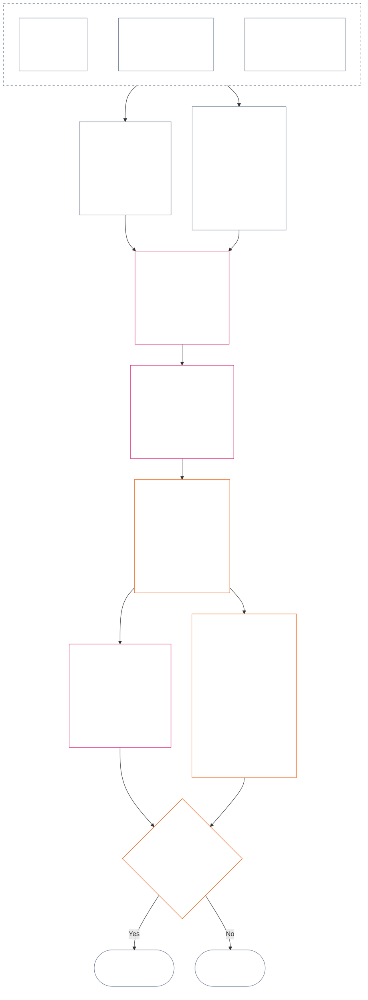

<!-- العربية الفصحى الحديثة | جزئي: الفصل 12، الأقسام 4–6 فقط | لقطة المصدر: 9c2c8c10c871d91157bcd27b9f56ad6a1cec90d3 | مسودة مولّدة بالذكاء الاصطناعي، غير مراجعة -->

### 4. قواعد الخانات والتحجيم المشترك

*بعبارات بسيطة: يمنح هذا القسم أسماء متسقة لتسعة مواضع ممكنة على كل واحد من محورين منفصلين، ويشرح كيفية تحجيم الأثر عبرها. يسجل أحد المحورين المساهمة المتحقَّق منها، ويسجل الآخر الانتهاكات المتحقَّق منها في سجل الوضعية. ولا يؤدي اشتراكهما في رقم الخانة إلى دمج المحورين أو مقاصة الضرر بالمساعدة. ويعيّن المقياس الموحد في **القسم 6** كلا المحورين بحسب أثر LEQU التناسبي.*

تستخدم قواعد الخانات رقم خانة `s` من **1** إلى **9**. ولكل محور موضع خانة خاص به:

- يسجل **محور المساهمة** طبيعة المساهمة الإيجابية؛ و
- يسجل **محور الانتهاك** النتائج المتحقَّق منها بشأن الانتهاك.

قد يظهر رقم الخانة نفسه على المحورين، لكنهما يظلان منفصلين. فخانة المساهمة ليست خانة انتهاك، وخانة الانتهاك ليست خانة مساهمة.

#### 4.1 الجدول 1 — تسميات عرض الخانات

يسمّي **الجدول 1** الخانات التسع ويعرض تسميات محور المساهمة ومحور الانتهاك جنبًا إلى جنب. وهو يوفّر لغة العرض فقط؛ أما تعيين الخانة فيجري بموجب المقياس الموحد في **القسم 6**.

|  `s` | تسمية العرض لمحور المساهمة | تسمية العرض لمحور الانتهاك |
| ---: | --- | --- |
|    1 | **مساهمة أساسية طفيفة** | **أثر دستوري طفيف** |
|    2 | **مساهمة أساسية صغيرة** | **أثر دستوري صغير** |
|    3 | **مساهمة إيجابية كبيرة** | **أثر دستوري كبير** |
|    4 | **مساهمة إيجابية مهمة** | **أثر دستوري مهم** |
|    5 | **مساهمة جادة إيجابية في الإدارة المسؤولة** | **أثر دستوري جسيم** |
|    6 | **مساهمة كبرى إيجابية في الإدارة المسؤولة** | **أثر دستوري كبير جدًا** |
|    7 | **مساهم رائد معترف به** | **أثر دستوري شديد** |
|    8 | **مساهم رائد متميّز** | **أثر دستوري خطير** |
|    9 | **مساهم رائد نموذجي** | **أثر دستوري كارثي** |

يستخدم محور المساهمة تسميات أساسية وإيجابية وإيجابية في الإدارة المسؤولة وريادية. أما محور الانتهاك فيستخدم تسميات محايدة للأثر في جميع الخانات. ويظل المحوران منفصلين؛ فلا ينشئان نتيجة صافية ولا يجيزان المقاصة بين سجلات المساهمة والانتهاك. ولا تصنّف خانة محور الانتهاك، في حد ذاتها، سوء السلوك المضاد للدستور؛ إذ يقرر [الفصل الرابع عشر](core_14.000_misconduct_designation.md#chapter-fourteen-anti-constitutional-misconduct) على نحو مستقل ما إذا كان توصيف سوء السلوك المضاد للدستور (ACMD) ينطبق على انتهاك متحقَّق منه في `s` = 7–9.

يجوز للتنفيذ نشر وحدات القياس وأساليب الأدلة والأمثلة للمساعدة في تقدير المنفعة أو الخسارة المكافئة لحياة كاملة. وهذه المواد إرشادية فقط، ولا يجوز لها تجاوز **القسم 6** أو **الفصل الأول** أو أرضية الحقوق الواردة في **الفصل السادس**.

#### 4.2 قواعد تحجيم الأثر المشتركة

*بعبارات بسيطة: لا يُقاس الأثر بعدد الأشخاص وحده. فقد تكون منفعة أو خسارة عميقة تؤثر في كائن واعٍ واحد أهم من أثر سطحي يؤثر في كثيرين. ويجب تقييم العدد والعمق والهشاشة والمدة والاستدامة والمدى والطبيعة الدستورية معًا.*

استخدم القواعد التالية لتفسير كلا المحورين في **القسم 6**:

| بُعد التحجيم | القاعدة المشتركة | التطبيق الخاص بالمحور |
| --- | --- | --- |
| **مقدار النتيجة الدستورية (LEQU)** | قيّم المنفعة أو الخسارة المتكاملة المتحقَّق منها. LEQU هي المرسى الأساسي للمقدار؛ وليست الأعداد الخام أو المال أو الناتج أو حجم المؤسسة كذلك. | تحتسب المساهمة المنفعة المتحقَّق منها والمتسقة مع الحقوق؛ ويحتسب الانتهاك الخسارة الدستورية أو الضرر أو الهدر أو إغلاق الخيارات أو الخطر المتحقَّق منه. |
| **نطاق الكائنات الواعية** | انظر إلى **العدد والعمق والهشاشة معًا**. لا تشترط أي خانة عددًا معينًا مستقلًا. وقد يدعم أثر عميق بما يكفي في كائن واعٍ واحد الخانة نفسها التي يدعمها أثر أوسع لكنه أقل عمقًا، إذا تساوى المقدار المتكامل وسائر معايير الصف؛ ويظل واجبًا استيفاء أي معيار صريح لمجموع LEQU أو لاتساع النطاق. | قد يزيد الاعتماد أو انخفاض القدرة أو الهشاشة غير المعتادة المادية. ولا يثبت حجم الجماعة وحده مساهمة أو شدة. |
| **النطاق الزمني** | انظر إلى المدة والتكرار والاستدامة، وإلى تعذّر عكس الخسارة. وقد يفوق حدث قصير لكنه تحويلي أثرًا طويلًا تافهًا؛ فالمدة وحدها ليست حاسمة. | تدعم المنفعة المستدامة مقدار مساهمة أعلى. وتدعم الخسارة المستمرة أو التي يتعذر عكسها شدة انتهاك أعلى. |
| **النطاق المكاني أو المؤسسي** | قد يزيد اتساع المدى المقدار، لكن الامتداد عبر المجتمعات أو المؤسسات غير مطلوب إذا كان العمق أو المدة أو الهشاشة أو الأهمية الدستورية الحرجة يدعم الخانة بذاته. | قد يزيد إصلاح المؤسسات مقدار المساهمة؛ وقد يزيد الضرر البنيوي أو النظامي شدة الانتهاك. |
| **الجودة أو الطبيعة الدستورية** | قِس كيفية إنتاج النتيجة بمعزل عن مدى انتشارها. ولا تحتسب الواقعة نفسها مرتين. | قد يضع الضرر المنقول إلى الغير أو العبء المخفي أو الاستحواذ أو الاعتماد حدًا للمساهمة المدعاة أو يستبعدها. وتظل الواجبات والإهمال والخداع والإكراه والعنف والتمكين البنيوي مسجلة منفصلة بوصفها طبيعة سلوك الانتهاك، ولا تغيّر خانة الأثر. |
| **أرضيات الحقوق والضمانات الحرجة** | لا تُقايَض مراعاة أرضية الحقوق بمنفعة أو خسارة إجمالية. | لا تثبت مراعاة الأرضية وحدها مساهمة مرتفعة. وقد يدعم الإخلال المادي بأرضية الحقوق أو الإخفاق في ضمانة حرجة شدة انتهاك أعلى حتى حين يتأثر عدد قليل من الكائنات الواعية مباشرة. |

الأبعاد ليست قائمة تحقق تشترط تحقق كل شكل من أشكال الاتساع. وضّح الأبعاد التي تحكمت في التقييم، وتلك التي لم تتحكم فيه، وسبب ذلك.

- **طريقة تعيين الخانة المشتركة:**
  - قدّر المنفعة أو الخسارة المتحقَّق منها والمتكاملة بوحدة LEQU بموجب التناسب، ثم عيّن الخانة الوحيدة التي يقع مقدارها ضمن نطاقها العددي.
  - تنطبق الحدود نفسها على المحورين.
  - تحتفظ خانات المساهمة بمتطلبات خط الأساس والتوافق الدستوري المنطبقة؛ ولا يمكن لاستيفاء عتبة رقمية أن يجعل الناتج المنقول ضرره إلى الغير أو المخالف دستوريًا مساهمةً محتسبة.
- **فصل الطبيعة:** أبقِ واصفات مسارات المنفعة والضرر وجودة السلوك وطبيعة السلوك المنطبقة متراكمةً في سجل الوضعية. وقد تؤثر الواجبات أو الإهمال أو الخداع أو التشديد أو الإكراه أو العنف أو القصد أو التمكين البنيوي في الإسناد أو الضمانات أو عواقب السؤال 3، لكن لا يرفع أي منها خانة أثر LEQU ولا يخفضها.
- **حدّ مراجعة سوء السلوك المضاد للدستور:** قد تبلغ الخسارة المتحقَّق منها على محور الانتهاك `s` = 7–9 من حيث الأثر، سواء ثبت سوء السلوك المضاد للدستور أم لم يثبت. ولا يحل الفصل الرابع عشر محل تعيين الأثر؛ بل يقرر على نحو مستقل ما إذا كان توصيف ACMD المقابل ينطبق.

إذا لم يقع خطر فعليًا بعد، فسجّل كلًا مما يلي على حدة:

- مدى احتمال وقوعه؛
- مدة تعرض الكائنات الواعية له؛
- مدى انتشاره المحتمل؛
- مقدار عدم اليقين في التقدير؛ و
- أسوأ نتيجة يظل وقوعها معقولًا.

لا تحتسب أسوأ نتيجة بوصفها ضررًا وقع بالفعل (خسارة LEQU)، ما لم يحدد تنفيذ معتمد معايرةً للمخاطر (طريقة لتحويل المخاطر إلى LEQU) يمكن لأي شخص الاطلاع عليها.

### 5. المدخلات الدستورية لتعيين المحور

*بعبارات بسيطة: قبل اختيار خانة، حدّد المصادر الدستورية التي تقرر خط الأساس أو المنفعة أو الواجب أو الضرر أو الانتهاك المقاس. استخدم الروابط أدناه لتطبيق تلك المصادر في مواضعها الأصلية المعتمدة؛ ولا تحوّل خطوة التوجيه هذه إلى درجة أخرى أو تعريف بديل.*

قبل تعيين خانة بموجب **القسم 6**، يجب أن يحدد سجل الوضعية ما يلي:

- خط الأساس أو الواجب أو القيد أو المصلحة المحمية الدستورية المنطبقة؛
- الأحكام التي تثبت المنفعة أو النتيجة السلبية أو الضرر أو الانتهاك المتحقَّق منه الجاري قياسه؛
- التعريفات والمبادئ ومواد أرضية الحقوق التي تؤثر ماديًا في المقدار أو طبيعة السلوك؛ و
- سبب انطباق كل مصدر محدد وكيفية تأثيره في تعيين المحور.

جداول التوجيه أدناه غير حصرية. ويظل كل تعريف أو مبدأ أو مادة إضافية تقتضيها الوقائع المتحقَّق منها منطبقًا، ويجب تحديده في سجل الوضعية. وكل مصدر مرتبط في موضعه المرجعي المعتمد هو الحاكم؛ ولا تعيد هذه الجداول صياغته أو تضييق نطاقه.

#### 5.1 مدخلات التعريفات

| المصدر المرجعي المعتمد | دور محور المساهمة | دور محور الانتهاك |
| --- | --- | --- |
| [حالة الوضعية والمساهمة والانتهاك](core_05.035_band_accountability.md#defa3-standing-state-contribution-and-violation) | يوضح ما يُعد مساهمة وأي وقائع مفحوصة يمكن استخدامها لقياسها. كما يضمن أن يتتبع سجل وضعية المساهمة الجانب الجيد وحده، من دون خلطه بالجانب السيئ. | يوضح ما يُعد انتهاكًا وكيفية تسجيله. كما يحيل أخطر الحالات إلى مراجعة سوء السلوك المضاد للدستور، وهي مراجعة مستقلة للسلوك الذي يقوض الدستور ذاته. |
| [المساءلة](core_05.005_apex_accountability_leg.md#accountability) | يتحقق مما إذا كان ادعاء الإدارة المسؤولة الجيدة أو الإصلاح يُبقي شخصًا ما قابلًا للمساءلة فعلًا. ويجب أن يبيّن من فعل ماذا، ومن عليه الإجابة عنه، وكيف يمكن مراجعته وإصلاحه وتصحيحه بما يتناسب مع أثره. | يكشف الحالات التي لا يتضح فيها من فعل شيئًا أو من يتحمل مسؤولية الإجابة عنه. ويشمل ذلك الحالات التي تتعطل فيها المسؤولية بعد تغير المؤسسة أو بنيتها. |
| [الضرر](core_05.035_band_accountability.md#harm) | قد يحد الضرر المنقول إلى الآخرين أو المخفي من المنفعة المدعاة أو يلغيها. وقد يُحتسب إصلاح الضرر منفعةً، ولكن فقط إذا كان الإصلاح متحقَّقًا منه وثبت استقلالًا. | يحدد أنواع الضرر المحتسبة عند قياس الخسارة والشدة: المباشر وغير المباشر والمتأخر والتراكمي والممتد عبر الأنظمة، والضرر الذي يلحق بذهن الكائن الواعي أو برفاهه العاطفي. |
| [المادية](core_05.050_band_oversight.md#materiality) و[وحدة مكافئ العمر (LEQU)](core_05.055_band_participation.md#lifespan-equivalent-unit-lequ) | تحددان مقدار احتساب المنفعة المتحقَّق منها بالاستناد إلى مدى انتشارها وهشاشة المتأثرين بها ومدة استمرارها. ويُقاس الناتج بوحدة LEQU، وهي المعيار المشترك لمنفعة تعادل حياة كاملة. | تحددان مقدار احتساب الخسارة أو الخطر المتحقَّق منه بالاستناد إلى مدى انتشاره وهشاشة المتأثرين به ومدة استمراره ومدى صعوبة عكسه. ويُقاس الناتج بوحدة LEQU، وهي المعيار نفسه المستخدم لخسارة تعادل حياة كاملة. |
| [طبيعة المساهمة](core_05.035_band_accountability.md#contribution-nature) | تقرر ما إذا كان شيء ما يُعد مساهمة. ويجب أن يكون جيدًا محضًا، لا مختلطًا بالضرر، وأن يستند إلى سجل مساهمة متحقَّق منه يمكن عرضه. ومن دون الأمرين لا يجوز تعيينه على محور المساهمة. | لا دور لها هنا. فهي لا تقرر ما يُعد ضررًا، ولا تخفض أبدًا مدى جسامة الانتهاك. |
| [طبيعة الانتهاك](core_05.035_band_accountability.md#violation-nature) | لا دور لها هنا. فلا يُحتسب الانتهاك مساهمةً سلبية أبدًا، ولا يمحو منفعة متحقَّقًا منها لا صلة لها به. | تقرر ما إذا كان شيء ما يُعد انتهاكًا. ويجب تصنيفه ضارًا والاستناد إلى نتيجة متحقَّق منها تثبت وقوع الانتهاك. ومن دون الأمرين لا يجوز تعيينه على محور الانتهاك. |
| [القيد الدستوري](core_05.045_band_integrative.md#constitutional-constraint) و[هرمية السلطات وتسلسلها الداخلي](core_05.045_band_integrative.md#authority-stack-and-internal-hierarchy) و[قابلية التدقيق](core_05.050_band_oversight.md#auditability) | تمنع احتساب منفعة مدعاة حين تعتمد على التغلب على الدستور أو التحايل على قواعده أو تضييق أرضية الحقوق (الحد الأدنى من الحماية التي يكفلها الدستور) أو الاكتفاء بالامتثال الشكلي. | تبرز العوامل التي تؤثر في جسامة الانتهاك الفعلية: خرق قيد دستوري مهم، أو وضع شيء فوق سلطة الدستور، أو التحايل على القواعد، أو جعل إنفاذها مستحيلًا. |
| [قابلية التدقيق](core_05.050_band_oversight.md#auditability) و[قابلية الطعن](core_05.035_band_accountability.md#contestability) | تشترطان إمكان إثبات المنفعة المدعاة وفحصها، ووجود وسيلة فعالة للطعن فيها لمن يعترض. | تشترطان أن تكون النتائج قابلة للفحص والطعن. فلا يستطيع اتهام أو وسم بلا تفسير تحديد جسامة الانتهاك. |

#### 5.2 مدخلات المبادئ

| مصدر المبدأ | دوره في تعيين المحور |
| --- | --- |
| [الرباعية الدستورية](core_00.000_preamble.md#constitutional-tetrad) و[المقصدان الدستوريان](core_00.000_preamble.md#two-constitutional-aims) و[الرهان المادي](core_00.000_preamble.md#material-stake) | تحدد ضوابط العمل الأربعة (المشاركة والرقابة والمساءلة وحسن التوقيت)، والنتيجتين اللتين يهدف إليهما الدستور (الازدهار والاستمرارية)، والإطار الذي يضبط كل تعيين وفق ما هو على المحك. |
| [الرفاه](core_01.000_values_principles.md#3-foundational-objective-wellbeing-flourishing-aim) و[الاعتراف والتعزيز والتطلع](core_01.000_values_principles.md#32-recognition-reinforcement-and-aspiration) | ترسيان المنفعة المراعية للحقوق والاعتراف الملائم لها على محور المساهمة. ولا تُعامل المكانة أو المكافآت أبدًا على أنها دليل على مساهمة. |
| [السلامة](core_01.000_values_principles.md#4-safety-harm-constraint) و[الحقيقة](core_01.000_values_principles.md#5-truth-epistemic-integrity-constraint) | تضعان حدودًا ملزمة على كلا المحورين. ولا تُحتسب المنفعة المتحققة عبر الضرر أو الخداع كاملةً، وقد يثبت الإخفاق المتحقَّق منه في السلامة أو الحقيقة حجم الانتهاك أو نوعه. |
| [الإدارة المسؤولة بعمق](core_01.010_stewardship_capacity_principles.md#16-stewardship-in-depth) و[الحوكمة في ظل انضباط الإدارة المسؤولة](core_01.010_stewardship_capacity_principles.md#18-governance-under-stewardship-discipline) | توجّهان كيفية وزن المساهمة المستدامة والواجبات الملازمة للدور والإصلاح المؤسسي والإشراف والمسؤولية، متى اقتضت الوقائع المتحقَّق منها ذلك. |
| [مبادئ المفاضلة الأساسية](core_01.005_interaction_interpretation.md#131-core-tradeoff-principles) و[الأرضيات الدستورية والسلامة والإجراءات غير المهينة](core_01.005_interaction_interpretation.md#1314-constitutional-floors-safety-and-anti-degrading-process) | تنطبقان حين يتصل السلوك المقاس بالضرورة أو تقليل الضرر قدر الإمكان أو التناسب أو تعارض الحقوق أو فرض قيد. ولا تجيزان عاقبة بمفردهما أبدًا. |

#### 5.3 مدخلات أرضية الحقوق والمواد

| مصدر المادة | دور تعيين المحور أو حدوده |
| --- | --- |
| أرضية الحقوق في [الفصل السادس](core_06.000_rights_part_a.md#chapter-six-foundational-rights) المنطبقة من الناحية الواقعية، بما في ذلك كل مادة يمسها سجل الوضعية المتحقَّق منه ماديًا | تحدد الحماية الأساسية أو المصالح أو الواجبات أو المنافع أو الانتهاكات محل النظر. ولا تُسقط أي مادة لمجرد عدم ورودها أدناه. |
| [المادة XIX — حالة الوضعية والمشاركة](core_06.015_rights_part_d.md#article-xix-standing-and-participation-status) | تفصل بين وضعية الكائن الواعي وكرامته والحد الأدنى من حماية أرضية الحقوق وصفته طرفًا متأثرًا وسمعته وأي تغيير لاحق في حالة مشاركته. |
| [المادة XIII-A — خط أساس الموثوقية والأمانة](core_06.010_rights_part_c.md#article-xiii-a-reliability-and-trustworthiness-baseline) و[المادة XIII-B — الحق في جبر الضرر والانتصاف](core_06.010_rights_part_c.md#article-xiii-b-right-to-redress-and-remedy) و[المادة XV-B — الشفافية وقابلية التدقيق والطعن](core_06.010_rights_part_c.md#article-xv-b-transparency-auditability-and-contestability) و[المادة XVI — التدقيق والشفافية والتحقّق المستقل](core_06.010_rights_part_c.md#article-xvi-audit-transparency-and-independent-verification) | تنطبق عندما تتعلق المنفعة أو الانتهاك المتحقَّق منه بحفظ سجلات نزيهة أو مشاركة المعلومات أو فحص الوقائع أو إمكان الطعن في قرار أو تصحيح الأخطاء. |
| [المادة XXIV — تحليل الأسباب الجذرية والاستجابة التكيفية](core_06.015_rights_part_d.md#article-xxiv-root-cause-analysis-and-adaptive-response) | تنطبق عندما تكون أسباب السلوك أو تصحيحه أو استمراره أو تكيّف الاستجابة معه ذات صلة، لأن ذلك يبيّن موقف السلوك بموجب الدستور. |
| [المادة XX — العدالة بعد الانتهاك المتحقَّق منه](core_06.015_rights_part_d.md#article-xx-justice-after-verified-violation) و[المادة XXVI-C — أرضية الحل في الوقت المناسب ومناهضة التأخير](core_06.020_rights_part_e.md#article-xxvi-c-timely-resolution-and-anti-delay-floor) | تنطبقان على أي إجراء أو تأخير تتصل به الوقائع فعلًا. وتحد **المادة XX** (*العدالة بعد الانتهاك المتحقَّق منه*) أساسًا مما يحدث بعد قياس الانتهاك (السؤال 3). ولا يجوز استخدامها لرفع خانة السؤال 2 أو خفضها لمجرد تبرير استجابة يفضلها أحدهم مسبقًا. |

**حدود التطبيق.** لا تفعل هذه الخطوة سوى الإشارة إلى المصادر الصحيحة.

- وهي لا:
  - تعيد فتح السؤال 1؛
  - تسمح بوقائع لم يجر التحقّق منها؛
  - تضيف مقياسًا أو درجة جديدة؛
  - تحتسب الواقعة نفسها مرتين عبر مصادر مختلفة؛
  - تدمج المحورين؛ أو
  - تجعل كل مصدر مدرج منطبقًا على كل سجل وضعية.
- تظل المساهمة والانتهاك مقاسين على نحو منفصل.
- تظل عواقب **المادة XX** (*العدالة بعد الانتهاك المتحقَّق منه*) خارج السؤال 2.
- تظل مراجعة التصنيف في الفصل الرابع عشر منفصلة عن خانة الأثر المعيّنة هنا.

### 6. مقياس LEQU التناسبي الموحد — محورا المساهمة والانتهاك

<strong>إرشادات للقارئ (غير تشغيلية): كيفية عمل التدرج بخمسة أضعاف</strong>

> يستخدم المقياس تدرجًا بخمسة أضعاف، مرتكزًا عند `s` = 7 = وحدة LEQU واحدة. ولكل محور، يكون الحد الأدنى للمقدار في الخانة `s` هو `5^(s−7)` LEQU للخانات من 2 إلى 9؛ وتبدأ الخانة 1 من الصفر. يجوز للتنفيذ المعتمد نشر الحدود الرقمية الناتجة وأمثلة المعايرة. وتشمل الخانة 1 خط أساس دستوريًا متحقَّقًا منه على محور المساهمة وخسارة متحقَّقًا منها دون أول عتبة إيجابية على محور الانتهاك؛ أما غياب المساهمة أو غياب الانتهاك فليس في حد ذاته سجلًا عند `s` = 1.
>
> **مرساة مفهومة للقارئ.** باستخدام عمر بشري مدته 80 عامًا مثالًا للمعايرة، اقرأ العمود الأوسط تصاعديًا باعتباره منفعة مكافئة لحياة كاملة أو وقتًا قابلًا للاستخدام أو موارد وقدرات متسقة مع الحقوق أُضيفت؛ واقرأه تنازليًا باعتباره خسارة مكافئة أو حرمانًا أو هدرًا أو إغلاقًا للخيارات. ولا تُحتسب كمية الموارد بذاتها؛ فالنتيجة الدستورية التي تنتجها أو تمنعها هي الحاسمة.

 

*بعبارات بسيطة: يضع **الجدول 2** المساهمة المتحقَّق منها والانتهاك المتحقَّق منه على مقياس الأثر التناسبي نفسه. وتعني الخانات الأعلى منفعة أو خسارة دستورية متكاملة أكبر. وتظل سجلات الوضعية والمحاور منفصلة: فالمقياس المشترك يقارن المقدار، لا القيمة الأخلاقية، ولا يجيز أبدًا أن تمحو المساعدة الضرر.*

يتبع المخطط تعيين خانة واحدة من البداية إلى النهاية. ويبيّن ترتيب تنفيذ الخطوات، وهو غير ترتيب النقاط أدناه؛ إذ تذكر النقاط كل قاعدة.

طبّق **التناسب** لتقدير أثر LEQU المتكامل استنادًا إلى العمق ونطاق الكائنات الواعية والهشاشة والمدة والاستدامة أو تعذّر العكس والمدى والأهمية الدستورية الحرجة. تشكّل هذه الأبعاد تقدير LEQU؛ وليست مكافآت مستقلة للخانة.

- استخدم **الجدول 2** بعد أن يؤكد السؤال 1 ما حدث، ويقيس السؤال 2 المنفعة أو الخسارة المتحقَّق منها، وتُطبّق **الأقسام 1–3 و4.2**، وتُحدد المصادر الدستورية المطلوبة بموجب **القسم 5**.
- عيّن خانة واحدة انطلاقًا من تقدير LEQU المتكامل.
  - وضّح أثر كل بُعد تحجيم مادي في التقدير، وسبب عدم تحكم الأبعاد المستبعدة فيه.
  - يجب أن يستوفي كل تعيين ما يلي:
    - قابلية التتبع؛
    - قابلية التدقيق؛
    - قابلية الطعن؛ و
    - أرضية الحقوق المنطبقة.
  - ويجب أن تستوفي المساهمة أيضًا شرط عدم نقل الأعباء إلى الغير والتوافق الدستوري.
- دوّن وقائع طبيعة السلوك على هيئة واصفات مستقلة قابلة للتتبع. وقد تتحكم في الإسناد أو كثافة المراجعة أو الضمانات أو الانتصاف أو تصنيف بموجب الفصل الرابع عشر؛ ولا تؤثر في الخانة إلا بالقدر الذي تغيّر فيه العواقب المتحقَّق منها أثر LEQU المتكامل.
- قيّم بالكامل العواقب المتحقَّق منها للفعل أو لمسار السلوك عبر أبعاد التحجيم المادية، بما فيها:
  - الإصابة الجسدية؛
  - الصدمة النفسية؛
  - آثار الإكراه؛
  - الحرمان من الحرية أو تعريضها للخطر؛
  - الضرر التراكمي؛ و
  - أي منفعة أو خسارة أخرى يعتد بها دستوريًا.
- لا تفعل ما يلي:
  - رفع الخانة أو خفضها لمجرد توصيف حدث أو مسار سلوك بأنه يتسم بما يلي:
    - الواجب؛
    - الإهمال؛
    - القصد؛
    - الإخفاء؛
    - التكرار؛
    - التشديد؛
    - الإكراه؛
    - العنف؛
    - تعريض الحرية للخطر؛
    - قابلية التصحيح؛ أو
    - عاقبة مفضلة.
  - استنتاج طبيعة السلوك من المقدار، أو إحلال طبيعة السلوك محل المقدار المتحقَّق منه.

يسرد **الجدول 2** الخانات التسع بالترتيب. ويبيّن كل صف رقم الخانة `s`، ومقدار المنفعة المضافة أو الخسارة المفروضة اللازم لبلوغها (مع استخدام عمر بشري مدته 80 عامًا مثالًا للمعايرة)، واسم الخانة على كل محور. تنطبق الحدود نفسها على المحورين، لكن الاسمين يظلان منفصلين: فخانة محور المساهمة وخانة محور الانتهاك سجلان مختلفان ولا تجري المقاصة بينهما مطلقًا.

| `s` | معايرة عمر بشري مدته 80 عامًا — المنفعة المضافة / الخسارة المفروضة | محور المساهمة | محور الانتهاك |
| ---: | --- | --- | --- |
| 1 | أقل من نحو **9 أيام** | **مساهمة أساسية طفيفة** — استيفاء متحقَّق منه للأرضية الدستورية في النطاق المقاس؛ ويظل أي تحسن قابل للقياس دون `s` = 2. | **أثر دستوري طفيف** — خسارة أو قصور تشغيلي متحقَّق منه دون `s` = 2، بما يشمل عيبًا شكليًا من دون ضرر جوهري مثبت. |
| 2 | نحو **9–47 يومًا** | **مساهمة أساسية صغيرة** — أداء موثوق ومحدود يتجاوز الحد الأدنى للأرضية ضمن مستوى الأثر هذا. | **أثر دستوري صغير** — خسارة محدودة متحقَّق منها في مستوى الأثر هذا. |
| 3 | نحو **47 يومًا–8 أشهر** | **مساهمة إيجابية كبيرة** — منفعة واضحة تتجاوز خط الأساس عند مستوى الأثر هذا. | **أثر دستوري كبير** — خسارة كبيرة متحقَّق منها عند مستوى الأثر هذا. |
| 4 | نحو **8 أشهر–3.2 سنوات** | **مساهمة إيجابية مهمة** — منفعة متحقَّق منها أعمق أو أطول أمدًا أو متكررة أو مستجيبة للهشاشة أو أوسع نطاقًا. | **أثر دستوري مهم** — خسارة دستورية مهمة متحقَّق منها. |
| 5 | نحو **3.2–16 سنة** | **مساهمة جادة إيجابية في الإدارة المسؤولة** — إدارة مسؤولة أو تنسيق أو صيانة أو إصلاح مستدام، أو منفعة مستمرة مماثلة. | **أثر دستوري جسيم** — خسارة دستورية جسيمة متحقَّق منها. |
| 6 | نحو **16–80 سنة** | **مساهمة كبرى إيجابية في الإدارة المسؤولة** — منفعة كبيرة متحقَّق منها تقترب من وحدة LEQU واحدة. | **أثر دستوري كبير جدًا** — خسارة كبيرة متحقَّق منها تقترب من وحدة LEQU واحدة. |
| 7 | نحو **عمر إلى 5 أعمار** (**80–400 سنة**) | **مساهم رائد معترف به** — منفعة متحقَّق منها لا تقل عن وحدة LEQU واحدة ومتوافقة دستوريًا. | **أثر دستوري شديد** — خسارة دستورية متحقَّق منها لا تقل عن وحدة LEQU واحدة. |
| 8 | نحو **5–25 عمرًا** (**400–2,000 سنة**) | **مساهم رائد متميّز** — منفعة متحقَّق منها تتجاوز `s` = 7 بدرجة مادية. | **أثر دستوري خطير** — خسارة متحقَّق منها تتجاوز `s` = 7 بدرجة مادية. |
| 9 | **25 عمرًا على الأقل** (**2,000+ سنة**) | **مساهم رائد نموذجي** — منفعة متحقَّق منها تتجاوز `s` = 8 بدرجة مادية. | **أثر دستوري كارثي** — خسارة متحقَّق منها تتجاوز `s` = 8 بدرجة مادية. |

<strong>ملاحظة التشغيل البيني للتنفيذ</strong>

> تتضمن هذه الأداة مادة تشغيل بيني موجّهة إلى التنفيذ. وهي تدعم فئات الفصل التشغيلية؛ ولا تنشئ نظام فئات موازيًا.

تُعرّف الحقول المقروءة آليًا لعرض الخانة (`sub_tier` و`sub_tier_display` وحقول العرض ذات الصلة) في [CH06_NINE_SLOT_STANDING_SCALE.md](implementation/CH06_NINE_SLOT_STANDING_SCALE.md) و[ch06_nine_slot_constants.json](implementation/ch06_nine_slot_constants.json). وتظل خريطة نطاقات التنفيذ الأربعة أداة مساعدة للتشغيل البيني، ولا تضيف عمودًا للنطاق الأساسي إلى **الجدول 2** التشغيلي.

ترد الطريقة المرجعية وتعيينات الخانات التطبيقية، بما فيها للكائنات الواعية ذات الأوزان ونقاط حفظ الحالة والافتقار إلى عمر فناء ثابت، في [LEQU_CALIBRATION_REFERENCE.md](implementation/LEQU_CALIBRATION_REFERENCE.md). ولا يجوز لهذه الأعمال أن تحل محل الحدود المشتركة وقاعدة التعيين التناسبي في **القسم 6**، أو أن تعيّن سجلًا قائمًا، أو أن تقرر من يُعد كائنًا واعيًا.

يجوز للتنفيذ المعتمد نشر تقديرات LEQU وتسميات عرض مرتبطة بمفاتيح. ويجب ألا تحل هذه الأدوات المساعدة محل الحدود المشتركة وقاعدة التعيين التناسبي في **القسم 6** أو ضمانات التصنيف في الفصل الرابع عشر، إلا من خلال تغيير في **وثيقة مطابقة**.

