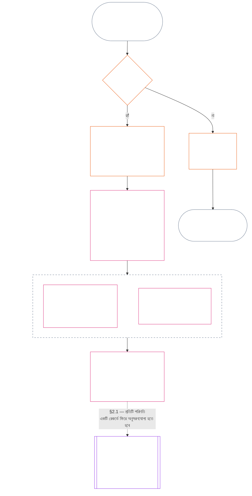

> AI-সহায়তায় অনুবাদের খসড়া — ভাষা: প্রমিত লিখিত বাংলা; উৎস: commit 9c2c8c10c871d91157bcd27b9f56ad6a1cec90d3; অবস্থা: পর্যালোচনাহীন; আংশিক পরিসর: অধ্যায় এগারো, শুধু §§1–3। এটি অধ্যায়টির সম্পূর্ণ অনুবাদ নয়।

### 1. তিনটি প্রশ্ন

*সহজ ভাষায়: তিনটি প্রশ্নের উত্তর ক্রমানুসারে দিয়ে অবস্থান নির্ধারণ করা হয়। কাঙ্ক্ষিত রেটিং থেকে তথ্য অনুমান করবেন না, আর কাঙ্ক্ষিত পরিণতি ন্যায্যতা দিতে রেটিং বেছে নেবেন না।*

| প্রশ্ন | প্রশ্নটি কী জানতে চায় | কোথায় উত্তর দেওয়া হয়েছে |
| --- | --- | --- |
| **1. কী ঘটেছিল?** | কোন তথ্য যাচাই হয়েছে, কার বা কিসের বিষয়ে, কোন সময়কালে, এবং অবস্থান-রেকর্ড ও আপত্তির কী অবস্থা? | [অনুচ্ছেদ 2](#2-question-1--what-happened) এবং [অনুচ্ছেদ 3](#3-question-1-event-type-guide--what-kind-of-help-or-harm-occurred) |
| **2. তা কতটা ভালো বা খারাপ ছিল?** | ওই তথ্য থেকে অবদান বা লঙ্ঘনের কোন ধরন ও মাত্রা প্রতিষ্ঠিত হয়? | [অধ্যায় বারো, অনুচ্ছেদ 1](core_12.000_standing_measurement.md#1-question-2--how-good-or-bad-was-it) |
| **3. এর ফলে কী ঘটে?** | স্বীকৃতি, প্রস্তুতি, প্রতিকার, সুরক্ষা, সীমাবদ্ধতা বা অন্য কোন পরিণতি অনুসরণ করে? | [অধ্যায় তেরো](core_13.000_standing_integration.md#chapter-thirteen-standing-effects-and-integration) |

প্রতিটি প্রশ্নের উত্তর আগের প্রশ্নের উত্তরের ওপর নির্ভর করে:

- প্রশ্ন 1, প্রশ্ন 2-এর জন্য যাচাইকৃত তথ্য দেয়।
- প্রশ্ন 2, প্রশ্ন 3-এর জন্য সেই তথ্য মাপে।
- পছন্দের ফলের সঙ্গে মেলাতে প্রশ্ন 3 তথ্য বা রেটিং নতুন করে লিখতে পারবে না।

তিনটি প্রশ্নের সব উত্তরে একসঙ্গে একটি সীমাবদ্ধ ঘটনা বা সংজ্ঞায়িত একটি ধরন-নিদর্শনের সম্পূর্ণ অবস্থান-মূল্যায়ন গঠিত হয়। সময়ের সঙ্গে কোনো বিষয়ের এমন একাধিক মূল্যায়ন থাকতে পারে, কিন্তু তার কোনোটিই নিট স্কোর বা বিষয়টির সামগ্রিক রেটিং নয়। অবদান ও লঙ্ঘনের অবস্থান-রেকর্ড প্রশ্ন 1 ও 2-এর উত্তর সংরক্ষণ করে; প্রশ্ন 3-এর সিদ্ধান্ত জানায় সেগুলোর ফলে কী ঘটে।

#### 1.1 উদ্দেশ্য ও পরিসর

এই অধ্যায় সাংবিধানিক রেকর্ডের কাঠামো এবং [অধ্যায় বারো](core_12.000_standing_measurement.md#chapter-twelve-standing-measurement--question-2-how-good-or-bad-was-it) পরিমাপের কাঠামো নির্ধারণ করে **সিস্টেম**, **সচেতন সত্তা** ও **প্রতিষ্ঠান**-এর জন্য; এর মধ্যে [**CS-9.305**](corpus_systems/cs_09.305_system_classification_machinery.md#cs-9305-part-a-system-classification-machinery) (*সিস্টেম শ্রেণিবিভাগের ব্যবস্থা*) অনুযায়ী শ্রেণিবদ্ধ প্রতিটি সিস্টেমও রয়েছে। এই কাঠামোগুলি গুজব, জনপ্রিয়তা, অস্পষ্ট সুনাম, অন্তর্নিহিত মর্যাদা বা সাধারণ মূল্য মাপে না; এগুলোর কোনোটিই অবস্থান-মূল্যায়নের গ্রহণযোগ্য বিষয় নয়।

নিম্নলিখিত পরিস্থিতিতেও অবস্থান-প্রক্রিয়ার ধারা কার্যকর থাকতে হবে:

- আগে যাচাইকৃত অবদান বর্তমান দক্ষতা বা নির্ভরযোগ্যতা দেখানোর পক্ষে অতিরিক্ত পুরোনো হয়ে যায়;
- লঙ্ঘন অমীমাংসিত থাকে;
- মেরামত ব্যয়বহুল হয়;
- দায়িত্ব সীমানা অতিক্রম করে; অথবা
- কোনো পক্ষ জবাবদিহি ব্যাহত করতে সাংগঠনিক স্তরায়ন বা নতুন নাম ব্যবহার করে।

নিম্নলিখিত বিষয়গুলি গৃহীত বাস্তবায়ন-পাঠে থাকবে:

- দৈনন্দিন পদ্ধতি;
- ধাপে ধাপে উচ্চতর পর্যায়ে নেওয়া;
- ক্ষতিপূরণ ও মেরামতের কার্যক্রম;
- পুনরুদ্ধারমূলক জবাবদিহির ব্যবস্থা; এবং
- প্রণোদনার নকশা।

অধ্যায় বারোর পরিমাপ নিজে থেকে বলপ্রয়োগ, আটক, বা অন্য কোনো স্বাধীনতা-সীমাবদ্ধতার **অনুমতি দেয় না**। এমন যেকোনো পরিণতিকে স্বাধীনভাবে অধ্যায় ছয়, **অনুচ্ছেদ XX** (*যাচাইকৃত লঙ্ঘনের পর ন্যায়বিচার*)-এর শর্ত পূরণ করতে হবে; এর মধ্যে আনুপাতিকতা, সর্বনিম্ন সীমাবদ্ধ বিকল্প, সময়সীমা, ক্ষতিপূরণ এবং পুনরুদ্ধারমূলক জবাবদিহির শর্তও রয়েছে।

<strong>উৎস-সংযোগ · সংজ্ঞা · মূল্যায়ন · সম্মতি</strong>

- পূর্ববর্তী ভিত্তি: [অধ্যায় এক §16 — গভীরভাবে তত্ত্বাবধান](core_01.010_stewardship_capacity_principles.md#16-stewardship-in-depth); [অধ্যায় দুই থেকে চার](core_02.000_definition_structure.md); [অধ্যায় পাঁচ](core_05.000_definitions_home.md#chapter-five-foundational-definitions)।
- পরবর্তী ধাপ: [§2](#2-question-1--what-happened) (*প্রশ্ন 1*); [§4](#4-standing-record-operational-requirements) (*যাচাই ও রেকর্ডের শর্ত*); [§5](#5-record-custody-and-opening-authority) (*রেকর্ডের হেফাজত ও খোলার কর্তৃত্ব*); [§6](#6-handling-a-standing-record) (*অবস্থান-রেকর্ড পরিচালনা*); [অধ্যায় বারো §1](core_12.000_standing_measurement.md#1-question-2--how-good-or-bad-was-it) (*প্রশ্ন 2-এর পরিমাপ*); [অধ্যায় বারো §2](core_12.000_standing_measurement.md#2-magnitude-and-severity-input-dimensions) (*পরিমাপের উপাদান*); [অধ্যায় বারো §3](core_12.000_standing_measurement.md#3-route-descriptor-catalogs-and-measurement-roles) (*পথ-বর্ণনার তালিকা*); [অধ্যায় বারো §4](core_12.000_standing_measurement.md#4-slot-grammar-and-shared-scaling) (*স্লটের ব্যাকরণ ও যৌথ স্কেলিং*); [অধ্যায় বারো §5](core_12.000_standing_measurement.md#5-constitutional-inputs-to-axis-assignment) (*অক্ষ নির্ধারণে সাংবিধানিক উপাদান*); [অধ্যায় বারো §6](core_12.000_standing_measurement.md#6-unified-proportional-lequ-scale--contribution-and-violation-axes) (*উভয় অক্ষের জন্য একীভূত আনুপাতিক LEQU স্কেল*); [অধ্যায় তেরো](core_13.000_standing_integration.md#chapter-thirteen-standing-effects-and-integration) (*প্রশ্ন 3*)।
- [বস্তুগততা](core_05.050_band_oversight.md#materiality) · [O](core_05.050_band_oversight.md#materiality) · [M](core_05.050_band_oversight.md#materiality-determination-a) · [A](core_05.050_band_oversight.md#materiality-determination-a) · [C](core_05.050_band_oversight.md#materiality-determination-c)
- [ক্ষতি](core_05.035_band_accountability.md#harm) · [O](core_05.035_band_accountability.md#harm) · [M](core_05.035_band_accountability.md#harm-a) · [A](core_05.035_band_accountability.md#harm-a) · [C](core_05.035_band_accountability.md#harm-c)
- [আনুপাতিকতা](core_05.035_band_accountability.md#proportionality) · [O](core_05.035_band_accountability.md#proportionality) · [M](core_05.035_band_accountability.md#proportionality-a) · [A](core_05.035_band_accountability.md#proportionality-a) · [C](core_05.035_band_accountability.md#proportionality-c)

### 2. প্রশ্ন 1 — কী ঘটেছিল?

<strong>উৎস-সংযোগ</strong>

- পূর্ববর্তী ভিত্তি: [§1](#1-the-three-questions) (*তিন-প্রশ্নের কাঠামো*); [অধ্যায় দুই থেকে চার](core_02.000_definition_structure.md) (*রেকর্ড, যাচাই, এবং সংজ্ঞা থেকে ফলাফল পর্যন্ত অনুসরণযোগ্যতা*)।
- টেট্রাডের স্তম্ভ: **অংশগ্রহণ**; **তদারকি** (আপত্তি জানানোর সুযোগ ও চ্যালেঞ্জের পথ)। প্রধান উদ্দেশ্য: **সমৃদ্ধি** ও **ধারাবাহিকতা** (পরে পরিমাপের জন্য অবদান ও লঙ্ঘনের পৃথক সিদ্ধান্ত সংরক্ষণকারী অনুসরণযোগ্য রেকর্ড)।
- পরবর্তী ধাপ:
  - [§2.2](#22-silence-is-the-default) (*নীরবতাই স্বাভাবিক অবস্থা*);
  - [§2.3](#23-protected-dissent-is-not-a-trigger) (*সুরক্ষিত ভিন্নমত কোনো সূচক নয়*);
  - [§2.4](#24-linked-standing-records-and-no-offset-bridge) (*সংযুক্ত অবস্থান-রেকর্ড ও অফসেট-নিষেধের সেতু*);
  - [§2.5](#25-verified-input-gate) (*যাচাইকৃত উপাদানের প্রবেশদ্বার*);
  - [§2.6](#26-stage-boundary) (*পর্যায়ের সীমানা*);
  - [§2.7](#27-forum-boundary) (*ফোরামের সীমানা*);
  - [§3](#3-question-1-event-type-guide--what-kind-of-help-or-harm-occurred) (*ঘটনার ধরন-নির্দেশিকা*);
  - [§4](#4-standing-record-operational-requirements) (*রেকর্ডের শর্ত*);
  - [§5](#5-record-custody-and-opening-authority) (*রেকর্ডের হেফাজত ও খোলার কর্তৃত্ব*);
  - [§6](#6-handling-a-standing-record) (*অবস্থান-রেকর্ড পরিচালনা*);
  - [অধ্যায় বারো §1](core_12.000_standing_measurement.md#1-question-2--how-good-or-bad-was-it) (*প্রশ্ন 2-এর পরিমাপ*);
  - [অধ্যায় বারো §2](core_12.000_standing_measurement.md#2-magnitude-and-severity-input-dimensions) (*পরিমাপের উপাদান*);
  - [অধ্যায় বারো §3](core_12.000_standing_measurement.md#3-route-descriptor-catalogs-and-measurement-roles) (*পথ-বর্ণনার তালিকা*);
  - [অধ্যায় বারো §4](core_12.000_standing_measurement.md#4-slot-grammar-and-shared-scaling) (*স্লটের ব্যাকরণ ও যৌথ স্কেলিং*);
  - [অধ্যায় বারো §5](core_12.000_standing_measurement.md#5-constitutional-inputs-to-axis-assignment) (*অক্ষ নির্ধারণে সাংবিধানিক উপাদান*);
  - [অধ্যায় বারো §6](core_12.000_standing_measurement.md#6-unified-proportional-lequ-scale--contribution-and-violation-axes) (*উভয় অক্ষের জন্য একীভূত আনুপাতিক LEQU স্কেল*);
  - [অধ্যায় তেরো](core_13.000_standing_integration.md#chapter-thirteen-standing-effects-and-integration) (13.000) (*প্রশ্ন 3*)।

 

*সহজ ভাষায়: প্রশ্ন 1 কী ঘটেছিল তার একটি সীমাবদ্ধ ও আপত্তিযোগ্য বিবরণ স্থাপন করে। কোনো রেটিং বা পরিণতি বিবেচনার আগে এটি বিষয়, ঘটনা বা ধরন-নিদর্শন, সময়কাল, যাচাইকৃত তথ্য এবং রেকর্ডের অবস্থা চিহ্নিত করে। যাচাইকৃত সহায়তা ও যাচাইকৃত লঙ্ঘন পৃথক অবস্থান-রেকর্ডে থাকে, যাতে একটি অন্যটিকে মুছে দিতে না পারে। এই রেকর্ডগুলি জনপ্রিয়তার স্কোর বা অস্পষ্ট তকমা নয়।*

**অবস্থান-রেকর্ড** হলো এই অধ্যায়ে কোনো নির্দিষ্ট বিষয়, কার্যকরী পরিসর, রেকর্ডের সময়সীমা, পর্যালোচনার অবস্থা এবং সিদ্ধান্তের প্রেক্ষাপটের জন্য ব্যবহৃত সীমাবদ্ধ রেকর্ড। পরিমাপ শুরু হওয়ার আগে এতে স্থাপন করতে হবে:

- অবস্থান-রেকর্ডটি কার বা কিসের বিষয়ে;
- রেকর্ডটি একটি সীমাবদ্ধ ঘটনা নাকি সংজ্ঞায়িত ধরন-নিদর্শন সম্পর্কে;
- প্রাসঙ্গিক আচরণ ও প্রভাব কখন এবং কোথায় ঘটেছে;
- কোন তথ্য যাচাইকৃত এবং কোনগুলি এখনও বিতর্কিত;
- কোন প্রমাণ, আরোপণ ও চ্যালেঞ্জের পথ ওই সিদ্ধান্তগুলিকে সমর্থন করে; এবং
- অবস্থান-রেকর্ডটির বর্তমান পর্যালোচনা, সংশোধন ও প্রতিস্থাপনের অবস্থা।

চিত্রটি কোনো ঘটনা অনুসরণ করে দেখে সেটি অবস্থান-রেকর্ডের সূচক কি না এবং রেকর্ডটি এরপর কী ধারণ করে; পরের উপ-অনুচ্ছেদগুলি প্রতিটি নিয়ম বলে। “না” শাখাটি মূল পথ থেকে ডানদিকে বেরিয়ে যায়।

#### 2.1 অবস্থান-রেকর্ড: ধরন ও বিষয়

প্রশ্ন 1 যাচাইকৃত সহায়তার জন্য **অবদান-অবস্থান রেকর্ড** এবং যাচাইকৃত ক্ষতির জন্য **লঙ্ঘন-অবস্থান রেকর্ড** ব্যবহার করে; এর মধ্যে জবাবদিহির ব্যর্থতাও রয়েছে। একটি অবস্থান-রেকর্ড দুই ধরনের সিদ্ধান্ত একত্র করে না।

- অবস্থান-রেকর্ড কোনো সচেতন সত্তা, প্রতিষ্ঠান, সিস্টেম, মূল্যায়ন, সীমাবদ্ধ ঘটনা, ভূমিকা, সমষ্টি, কোনো নির্দিষ্ট পক্ষের রেকর্ড, অথবা সাংবিধানিকভাবে প্রাসঙ্গিক অন্য কোনো একক সম্পর্কে হতে পারে।
  - এতে পৃথক বিষয়, ভূমিকা, সিস্টেম, সম্প্রদায়, রেকর্ডের সময়সীমা, পর্যালোচনার অবস্থা বা সিদ্ধান্ত-প্রেক্ষাপটকে এক অবিভাজ্য অবস্থান-লেবেলে মিশিয়ে ফেলা চলবে না।
- অবস্থান-রেকর্ডে **সীমাবদ্ধ ঘটনা** — স্পষ্ট শুরু ও শেষসহ একটি পর্ব — অথবা পুনরাবৃত্ত আচরণের একটি **ধরন-নিদর্শন** থাকতে পারে।
  - ধরন-নিদর্শনের জন্য সংজ্ঞায়িত বিষয়, পরিসর ও পর্যালোচনা-সময়কাল প্রয়োজন।
- একই বিষয়ের সময়ের সঙ্গে একাধিক অবস্থান-রেকর্ড থাকতে পারে, যার মধ্যে সংযুক্ত অবদান ও লঙ্ঘনের অবস্থান-রেকর্ডও রয়েছে।
  - বিষয়, আংশিকভাবে মিলে যাওয়া রেকর্ড-সময়সীমা, সীমাবদ্ধ ঘটনা, ধরন-নিদর্শন বা সিদ্ধান্ত-প্রেক্ষাপট এক হলে সম্পর্কিত অবস্থান-রেকর্ডগুলিকে **একে অপরের উল্লেখ করতে হবে**—**অনুচ্ছেদ 4.2** অনুযায়ী।
- অবস্থান-রেকর্ড স্বাধীন সুনামের স্কোর, মর্যাদার ক্রম, স্থায়ী অবস্থা, সাধারণ মূল্যবোধের লেবেল বা একীভূত স্কোরকার্ড নয়।
  - কার্যকরী শর্ত **অনুচ্ছেদ 4**-এ রয়েছে।

পরবর্তী যেকোনো অবস্থানগত প্রভাব অধ্যায় তেরোর অন্তর্গত এবং সংশ্লিষ্ট অবস্থান-রেকর্ডে ফিরে অনুসরণযোগ্য হতে হবে, কিন্তু নিজে অবস্থান-রেকর্ডের অংশ হতে পারবে না।

#### 2.2 নীরবতাই স্বাভাবিক অবস্থা

অবস্থান-রেকর্ড না থাকা সচেতন সত্তা, প্রতিষ্ঠান বা সিস্টেমের স্বাভাবিক অবস্থা; এবং অধিকাংশ সচেতন সত্তা এই অবস্থাতেই থাকবে।

- **অনুচ্ছেদ 4** অনুযায়ী কোনো সূচক যাচাই হলেই কেবল অবস্থান-রেকর্ড খোলা হয়। নির্দিষ্ট রেকর্ড-খোলার কর্তৃপক্ষকে এন্ট্রি অনুমোদন করতে হবে, এবং পৃথক রেকর্ড-কাস্টডিয়ানকে তা করতে হবে (**অনুচ্ছেদ 5**)। অবস্থান-রেকর্ড কখনো খোলা হবে না:
  - ভিত্তিমাত্রা স্থাপন করতে;
  - তালিকা পূর্ণ করতে; অথবা
  - কোনো নির্দিষ্ট পথের গেটকিপার তা চাইলে।
- অবস্থান-রেকর্ড না থাকা কিছুই জানায় না। “রেটিং নেই”, “যাচাইকৃত নয়” এবং “ফাইলে কোনো রেকর্ড নেই”—এসব ঝুঁকি, কম অবদান বা অন্য কোনো কিছুর প্রমাণ নয়। নিবিড় পর্যবেক্ষণ, কম ডিফল্ট মান, বা কোনো নির্দিষ্ট পথে শর্তসাপেক্ষ প্রবেশের কারণ হিসেবে অনুপস্থিত রেকর্ডকে কেউ ব্যবহার করতে পারবে না।
- কোনো প্রতিষ্ঠান বা সিস্টেম নিম্নলিখিত বিষয়ের শর্ত হিসেবে অবস্থান-রেকর্ড, “কোনো রেকর্ড নেই” মর্মে প্রত্যয়ন, বা রেকর্ড খোলার সম্মতি চাইতে পারবে না:
  - **অনুচ্ছেদ III** (*বেঁচে থাকা ও অপরিহার্য প্রবেশাধিকার*)-এর অপরিহার্য সুবিধা;
  - **অনুচ্ছেদ III-C** (*শ্রম ও অর্থনৈতিক ভিত্তি*)-এর সুরক্ষা;
  - সাধারণ বাণিজ্য; অথবা
  - প্রভাবিত পক্ষ হিসেবে অংশগ্রহণ।
  ব্যতিক্রম হলো [অধ্যায় তেরো §6.2 দক্ষতার সীমা ও ছাড়পত্র](core_13.000_standing_integration.md#62-competency-bars-and-clearances)-এর অধীন আস্থাসংবেদনশীল নির্দিষ্ট নামযুক্ত পথের জন্য প্রকাশিত দক্ষতার সীমা; ওই নির্দিষ্ট নামযুক্ত পথ কেন আস্থাসংবেদনশীল, তা সেই সীমায় বলতে হবে।
- কোনো বিষয় সম্পর্কে অবস্থান-রেকর্ড খোলা হলে, **অনুচ্ছেদ 4** অনুযায়ী বিষয়টিকে জানাতে হবে। নথিভুক্ত [প্রমাণ সংরক্ষণ](core_05.050_band_oversight.md#evidence-preservation) বা নিরাপত্তার প্রয়োজন তা সমর্থন করলেই কেবল, এবং সীমিত ও নির্দিষ্ট সময়ের জন্য, নোটিশ বিলম্বিত হতে পারে। নোটিশ অবস্থান-রেকর্ডকে আপত্তিযোগ্য করে: কোনো অবস্থান-রেকর্ড আছে তা যে বিষয় জানে না, সে তাতে আপত্তি জানাতে বা তা সংশোধন করতে পারে না।

#### 2.3 সুরক্ষিত ভিন্নমত কোনো সূচক নয়

**অনুচ্ছেদ XI-D** (*সমাবেশ, ভিন্নমত ও শান্তিপূর্ণ প্রতিবাদ*)-এর অধীন ভিন্নমত বা শান্তিপূর্ণ প্রতিবাদ — যার মধ্যে [সুরক্ষিত অহিংস নাগরিক অবাধ্যতা](core_06.005_rights_part_b.md#xi-d-nonviolent-civil-disobedience) রয়েছে ([*ভিন্নমত ও শান্তিপূর্ণ প্রতিবাদের ভিত্তি*](core_06.005_rights_part_b.md#xi-d-dissent-and-peaceful-protest)) — যাচাইকৃত সূচক নয়।

- এটি লঙ্ঘনের অবস্থান-রেকর্ড খোলে না, বাড়ায় না বা তীব্র করে না; **অনুচ্ছেদ 8.2**-এর অধীন তীব্রতার উপাদানও নয়; এবং এর পুনরাবৃত্তি একে ধরন-নিদর্শন করে না।
- সাংবিধানিক ভিত্তি স্বতন্ত্রভাবে লঙ্ঘন করে এমন পৃথকযোগ্য আচরণ নিজস্ব শর্তে নথিভুক্ত হবে; প্রতিবাদের দৃষ্টিভঙ্গি, উদ্দেশ্য বা লক্ষ্যকে কেন্দ্র করে তা তীব্র করা হবে না।

#### 2.4 সংযুক্ত অবস্থান-রেকর্ড ও অফসেট-নিষেধের সেতু

<strong>উৎস-সংযোগ</strong>

- পূর্ববর্তী ভিত্তি: [§2.1](#21-standing-records-kinds-and-subjects) (*অবদান ও লঙ্ঘনের পৃথক রেকর্ড*)।
- পরবর্তী ধাপ:
  - [§2.5](#25-verified-input-gate) (*যাচাইকৃত উপাদানের প্রবেশদ্বার*);
  - [§2.7](#27-forum-boundary) (*ফোরামের সীমানা*);
  - [§4.2](#42-related-standing-record-cross-references) (*পারস্পরিক উল্লেখ*);
  - [অধ্যায় বারো §1](core_12.000_standing_measurement.md#1-question-2--how-good-or-bad-was-it) (*প্রশ্ন 2-এর পরিমাপ*);
  - [অধ্যায় বারো §2](core_12.000_standing_measurement.md#2-magnitude-and-severity-input-dimensions) (*পরিমাপের উপাদান*);
  - [অধ্যায় বারো §3](core_12.000_standing_measurement.md#3-route-descriptor-catalogs-and-measurement-roles) (*পথ-বর্ণনার তালিকা*);
  - [অধ্যায় বারো §4](core_12.000_standing_measurement.md#4-slot-grammar-and-shared-scaling) (*স্লটের ব্যাকরণ ও যৌথ স্কেলিং*);
  - [অধ্যায় বারো §5](core_12.000_standing_measurement.md#5-constitutional-inputs-to-axis-assignment) (*অক্ষ নির্ধারণে সাংবিধানিক উপাদান*);
  - [অধ্যায় বারো §6](core_12.000_standing_measurement.md#6-unified-proportional-lequ-scale--contribution-and-violation-axes) (*উভয় অক্ষের জন্য একীভূত আনুপাতিক LEQU স্কেল*);
  - [অধ্যায় তেরো](core_13.000_standing_integration.md#chapter-thirteen-standing-effects-and-integration) (13.000) (*প্রশ্ন 3*)।
- এর সঙ্গে পড়ুন: [অধ্যায় তেরো — অবস্থানের সমন্বয়](core_13.000_standing_integration.md#2-automatic-integration-review-and-continuity) (13.000) (*অব্যাহতি না থাকা এবং সংযুক্ত রেকর্ডের সমন্বয়*); [অধ্যায় তেরো §6.2 — দক্ষতার সীমা ও ছাড়পত্র](core_13.000_standing_integration.md#62-competency-bars-and-clearances) (13.000 §6.2); [অধ্যায় তেরো §4.2 — অবস্থান-লক](core_13.000_standing_integration.md#42-prevention--general-standing-locks) (13.000 §4.2)।

 

**মূল নিয়ম:** যাচাইকৃত **অবদান-অবস্থান রেকর্ড** এবং যাচাইকৃত **লঙ্ঘন-অবস্থান রেকর্ড** **অনুচ্ছেদ 2.1** অনুযায়ী পৃথক রাখা হয়। অবদান বা লঙ্ঘনের প্রতিটি সিদ্ধান্তকে তার নিজস্ব অবস্থান-রেকর্ডে থাকা নিজস্ব সমর্থিত তথ্যের ওপর দাঁড়াতে হবে। বিশ্লেষণ ও সহায়ক উপকরণে রেকর্ডের দুটি পথ পৃথকভাবে অনুসরণযোগ্য রাখতে হবে। কোনো একক এন্ট্রি বা সংযুক্ত সেট নিট স্কোর, মিশ্র স্কোর বা বিনিময় নয়।

- **লঙ্ঘনের অবস্থান-রেকর্ড ও অবস্থান-লক:**
  - অধ্যায় তেরোর অধীন, লঙ্ঘনের অবস্থান-রেকর্ড থেকে নেওয়া প্রযোজ্য **অবস্থান-লক** অবস্থান সীমিত করতে, ভূমিকার যোগ্যতা সীমাবদ্ধ করতে, বা যাচাইকৃত লঙ্ঘন অমীমাংসিত থাকা অবস্থায় প্রতিকার পাওয়ার সুযোগে প্রভাব ফেলতে পারে।
  - অবস্থান-লক অবদান-অবস্থান রেকর্ডে নথিভুক্ত যাচাইকৃত ইতিবাচক অবদান মুছে দিতে পারবে না।
  - কেবল সময় পেরোনোর কারণে অমীমাংসিত যাচাইকৃত লঙ্ঘনের গুরুত্ব কমানো হয় না।
  - যাচাইকৃত লঙ্ঘন সম্পর্কহীন অবদান-অবস্থান রেকর্ডকে মিথ্যা নেতিবাচক সুনামের নথিতে বদলে দিতে পারবে না।
- **অবদানের অবস্থান-রেকর্ড ও দক্ষতার ছাড়পত্র:**
  - যাচাইকৃত অবদান প্রকাশিত **দক্ষতার সীমা** অনুযায়ী প্রযোজ্য **দক্ষতার ছাড়পত্র** সমর্থন করতে পারে, এবং তা বর্তমান ও ভূমিকা-প্রাসঙ্গিক হলে আস্থা, ভূমিকা বা স্বীকৃতিসংযুক্ত যোগ্যতাও সমর্থন করতে পারে।
  - যাচাইকৃত অবদান যাচাইকৃত লঙ্ঘনের সিদ্ধান্তকে অফসেট, গড়ে কমানো, ক্ষমা বা নতুন নামে চিহ্নিত করতে পারবে না।
  - প্রবেশদ্বারের শর্ত পূরণ হলে কোনো প্রযোজ্য অবস্থান-লক মওকুফ হয় না।

**একমাত্র ব্যতিক্রম:** কোনো লঙ্ঘনের সিদ্ধান্ত যদি নিজেই দাবিকৃত অবদানকে খণ্ডন করে — উদাহরণস্বরূপ, প্রমাণে দেখা যায় আপনার অবদান-রেকর্ডে যা দাবি করা হয়েছে তা আপনি আসলে করেননি — তাহলে যথাযথ প্রমাণ ও পর্যালোচনা-প্রক্রিয়ায়, **অনুচ্ছেদ 4.2**-এর আবশ্যক পারস্পরিক উল্লেখসহ, সংযুক্ত অবদান-অবস্থান রেকর্ড সংশোধন বা অপসারণ করা যেতে পারে। কিন্তু পৃথক অবদান-অবস্থান রেকর্ডে নথিভুক্ত সম্পর্কহীন সহায়তা লঙ্ঘনটি স্বয়ংক্রিয়ভাবে মুছে দেয় না।

#### 2.5 যাচাইকৃত উপাদানের প্রবেশদ্বার

প্রবেশদ্বারটি এভাবে কাজ করে:

- অবস্থান, আস্থা, ভূমিকা, স্বীকৃতি বা স্বীকৃতির যোগ্যতাকে প্রভাবিত করে এমন যেকোনো সিদ্ধান্তে কেবল প্রাসঙ্গিক **অবদান-অবস্থান রেকর্ড** বা **লঙ্ঘন-অবস্থান রেকর্ড** থেকে যাচাইকৃত উপাদান ব্যবহার করা যায়।
- অভিযোগ, নিষ্পত্তি না হওয়া দাবি, অস্থায়ী রাউটিং ট্যাগ, কেবল গ্রহণ-পর্যায়ের বিবরণ এবং বিরোধ-পর্যায়ের অন্য উপকরণ নিজে থেকে অবস্থানের জন্য অবদানের প্রকৃতি বা লঙ্ঘনের প্রকৃতি সরবরাহ করে না।
- যাচাইকৃত উপাদান হলো **অবস্থানের সিদ্ধান্ত**: যাচাইকৃত অবদানের সিদ্ধান্ত (অক্ষ I) বা যাচাইকৃত লঙ্ঘনের সিদ্ধান্ত (অক্ষ II)।
- অবদান ও লঙ্ঘনের সিদ্ধান্ত পৃথক অবস্থান-রেকর্ডে থাকবে (দেখুন **অনুচ্ছেদ 2.1**)।

#### 2.6 পর্যায়ের সীমানা

অবস্থান-রেকর্ডের পর্যায়গুলি পৃথক থাকে:

- প্রশ্ন 1 যাচাইকৃত তথ্য নথিভুক্ত করে; প্রশ্ন 2 সেগুলি পরিমাপ করে।
- যাচাইকৃত তথ্যভিত্তি সম্পূর্ণ হলেই অবস্থান-রেকর্ড খোলা যেতে পারে, যদিও প্রশ্ন 2-এর পরিমাপ তখনও অপেক্ষমাণ থাকে।
- পরিমাপ না হওয়া পর্যন্ত প্রশ্ন 2-এর ঘরগুলিতে স্লট বা শ্রেণি ইঙ্গিত না করে “অপেক্ষমাণ” বলতে হবে।
- অবস্থান-রেকর্ডে প্রশ্ন 3-এর কোনো **অবস্থানগত প্রভাব** বলা বা প্রয়োগ করা যাবে না।

#### 2.7 ফোরামের সীমানা

*সহজ ভাষায়: ফোরামে বিরোধ তত্ত্বাবধান করা হয়, চ্যালেঞ্জ করা হয় এবং যাচাইকৃত ফলে রূপান্তর করা হয় — কিন্তু মামলা দায়ের করা বা বর্ণনামূলক লড়াইয়ে জেতা অবস্থান হালনাগাদ করে না। **অনুচ্ছেদ 2.5**-এর যাচাইকৃত উপাদানের প্রবেশদ্বার এখনও প্রযোজ্য। অধ্যায় দুই থেকে চারের অধীনে ফোরাম তথ্য যাচাই করলে সেটি অবস্থান-রেকর্ড **খুলতে, হালনাগাদ করতে বা সংশোধন করতে** পারে — অথবা চ্যালেঞ্জের ভিত্তিতে **খারাপ রেকর্ড সরিয়ে দিতে** পারে। ফোরাম ভালো ও খারাপকে এক স্কোরে মেশায় না বা নিজে থেকে অবস্থানের শ্রেণি বানায় না।*

এই অনুচ্ছেদটি একটি প্রশ্নের অধিকারী: ফোরামের কাজ কীভাবে অবস্থান-রেকর্ডে পৌঁছায়। শৃঙ্খলের অন্য ধাপগুলি এখানে নাম করা মালিকদের অধীন, এবং শৃঙ্খলটি এই ক্রমে চলে:

1. একটি বিরোধ দায়ের হয় এবং ফোরাম **ফোরাম-মামলার রেকর্ড** রাখে, যা অবস্থান-রেকর্ড নয়। মালিক: [অধ্যায় পনেরো §2.3 ফোরাম-মামলার রেকর্ড, অবস্থান-রেকর্ড ও বিরোধ](core_15.000_forum.md#23-forum-case-records-standing-records-and-contests); আরও দেখুন [§2.7.1 ফোরাম-মামলার রেকর্ড](#271-forum-case-record)।
2. ফোরাম [অধ্যায় দুই থেকে চার](core_02.000_definition_structure.md)-এর অধীনে তথ্য যাচাই করে।
3. যাচাইকৃত সিদ্ধান্ত যাচাইকৃত উপাদানের প্রবেশদ্বার অতিক্রম করে। মালিক: [§2.5 যাচাইকৃত উপাদানের প্রবেশদ্বার](#25-verified-input-gate)।
4. নির্দিষ্ট রেকর্ড-খোলার কর্তৃপক্ষ—যা ফোরামও হতে পারে—অবস্থান-রেকর্ড খোলে, হালনাগাদ করে বা সংশোধন করে, অথবা চ্যালেঞ্জের ভিত্তিতে খারাপ রেকর্ড সরিয়ে দেয়। রেকর্ডে কী থাকবে তার মালিক [§4.1 রেকর্ডের ন্যূনতম বিষয়বস্তু](#41-minimum-record-contents); কে পদক্ষেপ নিতে পারে তার মালিক [§5 রেকর্ডের হেফাজত ও খোলার কর্তৃত্ব](#5-record-custody-and-opening-authority)।
5. অবস্থান-রেকর্ডে কেবল যাচাইকৃত তথ্য থাকে, এবং পরে প্রশ্ন 2 তা পরিমাপ করে। মালিক: [§2.6 পর্যায়ের সীমানা](#26-stage-boundary) এবং [অধ্যায় বারো §1 প্রশ্ন 2 — তা কতটা ভালো বা খারাপ ছিল?](core_12.000_standing_measurement.md#1-question-2--how-good-or-bad-was-it)।
6. কোনো অবস্থানগত প্রভাব থাকলে তা [অধ্যায় তেরো](core_13.000_standing_integration.md#chapter-thirteen-standing-effects-and-integration)-এর অধীনে অনুসরণ করে; অবস্থানগত প্রভাবের মালিক ওই অধ্যায়।

[অধ্যায় পনেরো](core_15.000_forum.md#chapter-fifteen-forums-and-jurisdiction)-এর অধীন ফোরাম-পরিবারগুলি তত্ত্বাবধান **করে** কীভাবে বাস্তব বিরোধ অবস্থান-প্রক্রিয়ার ধারা অতিক্রম করে। [অধ্যায় পনেরো §6 সময়মতো নিষ্পত্তি, বস্তুগততার স্তর এবং বিলম্ব-বিরোধী শৃঙ্খলা](core_15.000_forum.md#6-timely-resolution-materiality-tiers-and-anti-delay-discipline) এবং [অনুচ্ছেদ XXVI-C](core_06.020_rights_part_e.md#article-xxvi-c-timely-resolution-and-anti-delay-floor) (*সময়মতো নিষ্পত্তি ও বিলম্ব-বিরোধী ভিত্তি*) অনুযায়ী ফোরামগুলি দেয়:

- সহজলভ্য চ্যালেঞ্জ;
- স্বাধীন পর্যালোচনা;
- ফরেনসিক সহায়তা;
- প্রতিকার কার্যক্রমের ক্রম; এবং
- স্তরভিত্তিক সময়সীমা।

অধ্যায় দুই থেকে চারের অধীনে ফোরামের সিদ্ধান্তগুলি যাচাইকৃত উপাদানের প্রবেশদ্বার পূরণ করলে, সেগুলি পারে:

- **অনুচ্ছেদ 4.1** অনুযায়ী অবস্থান-রেকর্ড **খুলতে, হালনাগাদ করতে বা সংশোধন করতে**; অথবা
- চ্যালেঞ্জের ভিত্তিতে **খারাপ রেকর্ড সরিয়ে দিতে**।

##### 2.7.1 ফোরাম-মামলার রেকর্ড

খোলা বিরোধ সম্পর্কে ফোরামের নিজস্ব ফাইল হলো [**ফোরাম-মামলার রেকর্ড**](core_05.035_band_accountability.md#forum-case-record), যা [অধ্যায় পনেরো §2.3 ফোরাম-মামলার রেকর্ড, অবস্থান-রেকর্ড ও বিরোধ](core_15.000_forum.md#23-forum-case-records-standing-records-and-contests)-এ সংজ্ঞায়িত। এটি **অবস্থান-রেকর্ড নয়**।

##### 2.7.2 ফোরামের সিদ্ধান্ত এবং প্রশ্ন 2-এর পরিমাপ

ফোরামের যাচাইকৃত তথ্যভিত্তিক সিদ্ধান্ত প্রশ্ন 1-এর অবস্থান-রেকর্ডের তথ্যভিত্তি সরবরাহ করতে পারে। তবে যাচাইকৃত অবদান বা লঙ্ঘন কতটা ভালো বা খারাপ ছিল, সেই প্রশ্ন 2-এর পরিমাপ তারা **নির্ধারণ করে না** ([§2.6 পর্যায়ের সীমানা](#26-stage-boundary))। সেই অনুযায়ী:

- ফোরামের কার্যক্রমে অবদান ও লঙ্ঘনের উপকরণকে এক নিট স্কোর, মিশ্র মেরিটস-উত্তর বা অবিভাজ্য অবস্থান-লেবেলে **এক করা যাবে না**; সংযুক্ত অবস্থান-রেকর্ড পৃথক থাকবে [§2.1 অবস্থান-রেকর্ড: ধরন ও বিষয়](#21-standing-records-kinds-and-subjects) এবং [§2.4 সংযুক্ত অবস্থান-রেকর্ড ও অফসেট-নিষেধের সেতু](#24-linked-standing-records-and-no-offset-bridge) অনুযায়ী।
- ফোরামের ফলাফল বিরোধের বিবরণ, রাউটিংয়ের সুবিধা বা প্যানেলের পছন্দকে প্রমাণযোগ্য যাচাইকৃত উপাদান ([§2.5 যাচাইকৃত উপাদানের প্রবেশদ্বার](#25-verified-input-gate)), পৃথক পরিমাপ ([অধ্যায় বারো §1 প্রশ্ন 2 — তা কতটা ভালো বা খারাপ ছিল?](core_12.000_standing_measurement.md#1-question-2--how-good-or-bad-was-it)), অথবা [অধ্যায় তেরো](core_13.000_standing_integration.md#chapter-thirteen-standing-effects-and-integration)-এর অধীন অবস্থানগত প্রভাবের পদ্ধতির বিকল্প করতে **পারবে না**।

##### 2.7.3 ফোরামের সীমানা যা কমায় না

এই সীমানা নিম্নলিখিত অধীনে প্রয়োজনীয় চ্যালেঞ্জ, প্রতিকার, অন্তর্বর্তী স্বস্তি বা প্রক্রিয়াগত সুরক্ষা **কমায় না**:

- [অনুচ্ছেদ XIII-A](core_06.010_rights_part_c.md#article-xiii-a-reliability-and-trustworthiness-baseline) (*নির্ভরযোগ্যতা ও বিশ্বাসযোগ্যতার ভিত্তি*);
- [অনুচ্ছেদ XIII-B](core_06.010_rights_part_c.md#article-xiii-b-right-to-redress-and-remedy) (*ক্ষতিপূরণ ও প্রতিকারের অধিকার*);
- [অধ্যায় পনেরো §6 সময়মতো নিষ্পত্তি, বস্তুগততার স্তর এবং বিলম্ব-বিরোধী শৃঙ্খলা](core_15.000_forum.md#6-timely-resolution-materiality-tiers-and-anti-delay-discipline);
- [অনুচ্ছেদ XXVI-C](core_06.020_rights_part_e.md#article-xxvi-c-timely-resolution-and-anti-delay-floor) (*সময়মতো নিষ্পত্তি ও বিলম্ব-বিরোধী ভিত্তি*); অথবা
- সংশ্লিষ্ট ন্যায়বিচার-অনুচ্ছেদগুলি।

এর শর্ত হলো, ফোরামের যাচাইকৃত সিদ্ধান্ত অন্য যাচাইকৃত উপাদানের মতো একই প্রবেশদ্বার দিয়ে অবস্থানে প্রবেশ করবে—প্রবেশদ্বার পাশ কাটিয়ে নয়।

### 3. প্রশ্ন 1-এর ঘটনার ধরন-নির্দেশিকা — কী ধরনের সহায়তা বা ক্ষতি ঘটেছিল?

*সহজ ভাষায়: তথ্য যাচাইয়ের পরে কী ঘটেছে তা বর্ণনা করতে এই সারণিগুলি ব্যবহার করুন। এগুলি জড়িত অবদান বা লঙ্ঘনের ধরন শনাক্ত করতে সাহায্য করে। এগুলি তা কতটা ভালো বা খারাপ ছিল তা নির্ধারণ করে না, স্লট দেয় না, বা এর ফলে কী ঘটে তা স্থির করে না।*

#### 3.1 অবদানের ঘটনার ধরন

**যোগ্যতার নিয়ম:** দাবিকৃত অবদান কেবল তখনই গণ্য হবে যখন তা অনুসরণযোগ্য, বাইরের ওপর চাপিয়ে দেওয়া নয়, এবং কার্যকর সংবিধানের সঙ্গে সামগ্রিকভাবে সামঞ্জস্যপূর্ণ।

- বাইরে চাপিয়ে দেওয়া ক্ষতি, জবরদস্তিমূলক নির্ভরতা, রাইটস ফ্লোর সংকোচন, বা গোপন বোঝা দাবিকৃত অবদানকে অযোগ্য করতে বা সীমিত করতে পারে।
- দাবিকৃত অবদান পৃথক কোনো লঙ্ঘন-সিদ্ধান্ত অফসেট করে না।

নিচের সারণির প্রতিটি সারিতে যাচাইকৃত সহায়তার একটি সাধারণ পথ ও তার সাংবিধানিক তাৎপর্য বলা হয়েছে। একই অবস্থান-রেকর্ডে একাধিক সারি প্রযোজ্য হতে পারে।

| যাচাইকৃত অবদানের ধরন | কী ঘটেছিল | টেট্রাডের স্তম্ভ | প্রধান উদ্দেশ্য |
| --- | --- | --- | --- |
| বেঁচে থাকা ও শারীরিক রক্ষণাবেক্ষণ | কেউ খাদ্য, আশ্রয়, চিকিৎসা বা নিরাপত্তা পেয়েছে | **অংশগ্রহণ**, **তদারকি** | **সমৃদ্ধি** |
| যত্ন ও শিক্ষা | শিশুদের লালন করা হয়েছে, প্রবীণদের যত্ন নেওয়া হয়েছে, অথবা অন্যদের শিক্ষিত করা হয়েছে | **অংশগ্রহণ**, **তদারকি** | **সমৃদ্ধি**, **ধারাবাহিকতা** |
| আঘাত-পরবর্তী মানসিক পুনরুদ্ধার | সুস্থতায় বাধা দেওয়া মানসিক ক্ষতি থেকে সেরে উঠতে কেউ সহায়তা পেয়েছে | **অংশগ্রহণ**, **জবাবদিহি** | **সমৃদ্ধি** |
| গুরুতর বোঝা অপসারণ | বিপুল ঋণ, শোষণমূলক কর্মপরিবেশ বা পদ্ধতিগত বাধা সরানো হয়েছে | **অংশগ্রহণ**, **তদারকি** | **সমৃদ্ধি** |
| নিজস্ব সিদ্ধান্তক্ষমতা পুনরুদ্ধার | কেউ নিজের জীবন নিয়ে অর্থবহ পছন্দের সুযোগ পেয়েছে | **অংশগ্রহণ** | **সমৃদ্ধি** |
| উৎপাদনক্ষমতা বিস্তার | সরঞ্জাম, অবকাঠামো বা সুযোগ অন্যদের স্বাধীনভাবে উন্নতি করতে সক্ষম করেছে | **অংশগ্রহণ**, **তদারকি** | **সমৃদ্ধি**, **ধারাবাহিকতা** |
| সময়ের দক্ষতা উন্নত করা | এড়ানো সম্ভব এমন অপেক্ষা, প্রশাসনিক ঘর্ষণ বা সমন্বয়ের বাড়তি চাপ কমানো হয়েছে; ফলে যত্ন, বিশ্রাম, সিদ্ধান্তক্ষমতা, শিক্ষা বা অধিকারসম্মত কাজের জন্য ব্যবহারযোগ্য সময় ফিরেছে | **অংশগ্রহণ**, **তদারকি** | **সমৃদ্ধি** |
| পরিবেশগত বা অবকাঠামোগত ঝুঁকি কমানো | পরিবেশগত বিপর্যয় বা গুরুত্বপূর্ণ সিস্টেমের ব্যর্থতা ঠেকানো হয়েছে | **তদারকি**, **জবাবদিহি** | **ধারাবাহিকতা**, **সমৃদ্ধি** |
| পরিবেশগত পদচিহ্ন কমানো | অন্য বা বাস্তুতন্ত্রের ওপর বোঝা না চাপিয়ে সম্পদ ব্যবহার, নির্গমন বা ভূমি ও পানির চাহিদা যাচাই করে কমানো হয়েছে | **তদারকি**, **জবাবদিহি** | **ধারাবাহিকতা**, **সমৃদ্ধি** |
| বাস্তুতন্ত্র পুনর্বাসন | অবক্ষয়িত ভূমি, পানি বা আবাসস্থলকে কার্যকর ও স্বয়ংসম্পূর্ণ অবস্থার দিকে ফিরিয়ে নেওয়া হয়েছে | **তদারকি**, **জবাবদিহি** | **ধারাবাহিকতা**, **সমৃদ্ধি** |
| বিপন্ন প্রজাতি রক্ষা | বিলুপ্তির ঝুঁকিতে থাকা প্রজাতি বা তাদের নির্ভরশীল আবাসস্থলকে ক্ষতি থেকে রক্ষা করা হয়েছে | **তদারকি**, **জবাবদিহি** | **ধারাবাহিকতা**, **সমৃদ্ধি** |
| দূষণ ও বর্জ্য কমানো | দূষণ, ক্ষতিকর নির্গমন বা বর্জ্য প্রতিরোধ, অপসারণ বা নিরাপদ ব্যবস্থাপনা করা হয়েছে | **তদারকি**, **জবাবদিহি** | **সমৃদ্ধি**, **ধারাবাহিকতা** |
| নিরাপত্তা, সত্য, নিরীক্ষাযোগ্যতা বা চ্যালেঞ্জের সক্ষমতা জোরদার | অধিকার রক্ষা ও ক্ষমতাকে জবাবদিহির আওতায় রাখতে প্রতিষ্ঠান বা পদ্ধতি গড়ে তোলা বা মেরামত করা হয়েছে | **অংশগ্রহণ**, **তদারকি**, **জবাবদিহি** | **সমৃদ্ধি**, **ধারাবাহিকতা** |

#### 3.2 লঙ্ঘনের ঘটনার ধরন

**যোগ্যতার নিয়ম:** লঙ্ঘনের ঘটনার ধরনে অধ্যায় দুই থেকে চারের অধীনে অনুসরণযোগ্য, সীমাবদ্ধ, নিরীক্ষাযোগ্য ও আপত্তিযোগ্য থেকে যায়—এমন যাচাইকৃত লঙ্ঘন-সিদ্ধান্ত প্রয়োজন।

- অভিযোগ, অস্থায়ী ট্যাগ, ফোরামের বিবরণ এবং গ্রহণ-পর্যায়ের লেবেল রাউটিং বা প্রাথমিক বাছাইয়ে সহায়তা করতে পারে, কিন্তু সেগুলি প্রশ্ন 1 সম্পূর্ণ করে না।
- ইতিবাচক অবদান যাচাইকৃত লঙ্ঘনকে অফসেট, ক্ষমা, বাতিল বা নতুন নামে চিহ্নিত করে না।

নিচের সারণির প্রতিটি সারিতে যাচাইকৃত ক্ষতি, বিপদ বা কর্তব্য-ব্যর্থতার একটি সাধারণ পথ ও তার সাংবিধানিক তাৎপর্য বলা হয়েছে। একই অবস্থান-রেকর্ডে একাধিক সারি প্রযোজ্য হতে পারে।

| যাচাইকৃত ক্ষতি বা বিপদের ধরন | কী ঘটেছিল | টেট্রাডের স্তম্ভ | প্রধান উদ্দেশ্য |
| --- | --- | --- | --- |
| বেঁচে থাকা বা শারীরিক রক্ষণাবেক্ষণ থেকে বঞ্চনা | এড়ানো সম্ভব এমন মৃত্যু, চিকিৎসা অস্বীকার, অনিরাপদ অবস্থা বা বেঁচে থাকার বস্তুগত বঞ্চনা ঘটেছে | **জবাবদিহি**, **অংশগ্রহণ** | **সমৃদ্ধি** |
| এড়ানো সম্ভব এমন গুরুতর বোঝা | বিপুল, আরোপিত বা পদ্ধতিগতভাবে সরানো বোঝা বস্তুগতভাবে সুস্থতা বা সিদ্ধান্তক্ষমতা ক্ষুণ্ণ করেছে | **জবাবদিহি**, **অংশগ্রহণ** | **সমৃদ্ধি** |
| জবরদস্তিতে সিদ্ধান্তক্ষমতা হারানো | বলপ্রয়োগ, প্রভাবিত করা, বিশ্বাসযোগ্য হুমকি, আবদ্ধ রাখা বা স্বাধীনতার বিপদ ঘটেছে | **জবাবদিহি**, **অংশগ্রহণ** | **সমৃদ্ধি** |
| রাইটস ফ্লোর ব্যর্থ করা | আলোচনাতীত সাংবিধানিক ভিত্তি, সাংবিধানিক সর্বোচ্চতা, বা চ্যালেঞ্জ ও প্রতিকারের সুযোগ বস্তুগতভাবে লঙ্ঘিত হয়েছে | **জবাবদিহি**, **তদারকি** | **সমৃদ্ধি**, **ধারাবাহিকতা** |
| পরিবেশ বা অবকাঠামোর ক্ষতি | সাংবিধানিক সুস্থতার জন্য প্রয়োজনীয় অবস্থা ক্ষতিগ্রস্ত হয়েছে | **জবাবদিহি**, **তদারকি** | **ধারাবাহিকতা**, **সমৃদ্ধি** |
| দূষণ বা বর্জ্যজনিত ক্ষতি | দূষণ, ক্ষতিকর নির্গমন বা বর্জ্যে বায়ু, পানি, মাটি বা স্বাস্থ্যের ক্ষতি হয়েছে | **জবাবদিহি**, **তদারকি** | **সমৃদ্ধি**, **ধারাবাহিকতা** |
| প্রজাতি বা আবাসস্থল ধ্বংস | বিলুপ্তির ঝুঁকিতে থাকা প্রজাতি বা তাদের নির্ভরশীল আবাসস্থল ধ্বংস বা খণ্ডিত হয়েছে, কিংবা ক্ষতির দিকে ঠেলে দেওয়া হয়েছে; ক্ষতিকে অফসেটযোগ্য বলে গণ্য করাও এর মধ্যে রয়েছে | **জবাবদিহি**, **তদারকি** | **ধারাবাহিকতা**, **সমৃদ্ধি** |
| পরিবেশগত পুনরুদ্ধারক্ষমতা হারানো | ক্ষতির পর বাস্তুতন্ত্রের পুনরুৎপাদনক্ষমতা বন্ধ করা হয়েছে, বা এড়ানো সম্ভব ছিল এমনভাবে তা উল্টে দেওয়া কঠিন বা অসম্ভব করা হয়েছে | **জবাবদিহি**, **তদারকি** | **ধারাবাহিকতা**, **সমৃদ্ধি** |
| বাইরে চাপিয়ে দেওয়া পরিবেশগত ক্ষতি বা নিঃশেষ | পরিবেশগত ব্যয় অন্যদের বা বাস্তুতন্ত্রের ওপর সরানো হয়েছে, সম্পদ পুনরুৎপাদনের সীমার বাইরে নিঃশেষ করা হয়েছে, অথবা পদচিহ্ন বা স্থায়িত্বের দাবি চলমান অবক্ষয় আড়াল করেছে | **জবাবদিহি**, **তদারকি** | **ধারাবাহিকতা**, **সমৃদ্ধি** |
| উৎপাদনক্ষমতা ধ্বংস | স্বাধীনভাবে উন্নতির জন্য প্রয়োজনীয় সরঞ্জাম, সক্ষমতা, সম্পর্ক বা সম্পদের পথ বন্ধ করা হয়েছে | **জবাবদিহি** | **সমৃদ্ধি** |
| নিরাপত্তা, সত্য বা নিরীক্ষাযোগ্যতা ক্ষুণ্ণ | গোপনকরণ, ভুল তথ্য, ভাঙা রেকর্ড, অপ্রাপ্য চ্যালেঞ্জের পথ বা পর্যালোচনাযোগ্য নয় এমন সমষ্টিকরণ ঘটেছে | **তদারকি**, **জবাবদিহি** | **সমৃদ্ধি**, **ধারাবাহিকতা** |
| জবাবদিহিতে বাধা | জবাবদিহির ব্যবস্থায় যাচাইকৃত হস্তক্ষেপ ঘটেছে—প্রমাণের অখণ্ডতা, যাচাই, ফোরাম-প্রক্রিয়া, অবস্থান-রেকর্ড, প্রতিকারের সময়সীমা, বা আপত্তি ও ক্ষতিপূরণের পথ; স্বতন্ত্র অন্তর্নিহিত ক্ষতির বিরুদ্ধে বাধাটি যদি মেটা-আক্রমণ হয়, তবে সংযুক্ত পৃথক লঙ্ঘন-অবস্থান রেকর্ড খুলুন | **জবাবদিহি**, **তদারকি**, **সময়ানুবর্তিতা** | **সমৃদ্ধি**, **ধারাবাহিকতা** |
| সিস্টেম দখল বা নির্ভরতার অপব্যবহার | কাঠামোগত সক্ষমতা সৃষ্টি, নির্ভরতার অসমতা অপব্যবহার, এড়ানো-বিরোধী নকশা, বা জবাবদিহির পথ দখল ঘটেছে | **জবাবদিহি**, **অংশগ্রহণ** | **ধারাবাহিকতা**, **সমৃদ্ধি** |
