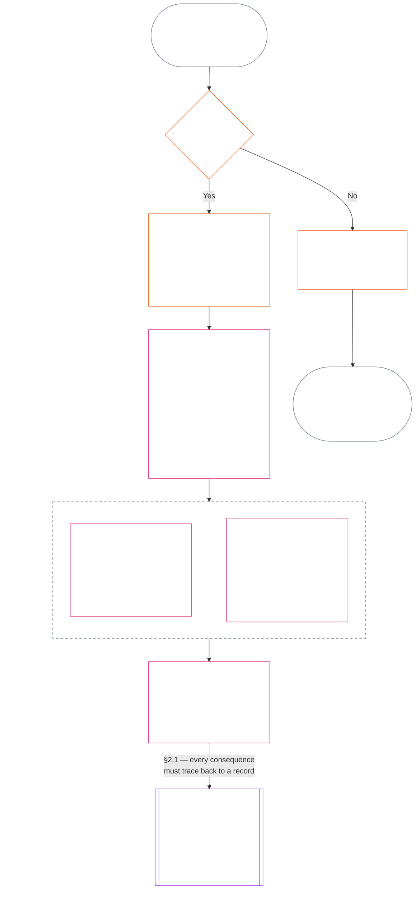
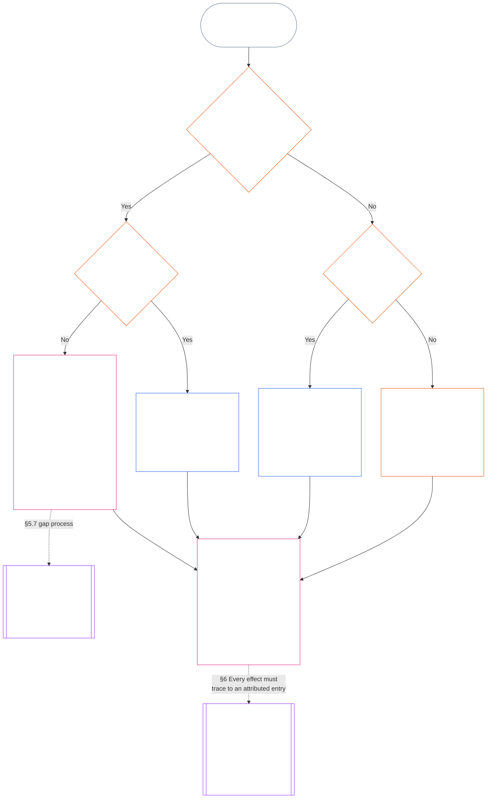

<!-- বাংলা | অধ্যায় একাদশের সম্পূর্ণ খসড়া | উৎস commit: 9c2c8c10c871d91157bcd27b9f56ad6a1cec90d3 | AI-প্রস্তুত, অ-পর্যালোচিত, অ-বাধ্যতামূলক খসড়া -->

# অধ্যায় একাদশ: স্থিতির নথি — প্রশ্ন 1, কী ঘটেছিল

<strong>কর্পাসে অবস্থান (কার্যকর নয়): ফাইলের কাঠামো ও পাঠের নিয়ম</strong>

> এই ফাইলটি **Sentient Constitution-এর অংশ** এবং একক পাঠ্য হিসেবে পড়া অন্য সংখ্যায়িত `core_*` ফাইলগুলোর সঙ্গে **শুধু একত্রে বাধ্যতামূলক**। এতে রয়েছে **অধ্যায় একাদশ**: স্থিতি-প্রক্রিয়ার তিনটি প্রশ্ন এবং **প্রশ্ন 1** (*কী ঘটেছিল?*), **§1–§6**-এ। **প্রশ্ন 2** (*কতটা ভালো বা খারাপ ছিল?*)-এর উত্তর [অধ্যায় দ্বাদশে](core_12.000_standing_measurement.md#chapter-twelve-standing-measurement--question-2-how-good-or-bad-was-it)। প্রশ্ন 3 (*এর ফলে কী ঘটে?*) চলতে থাকে [অধ্যায় ত্রয়োদশে](core_13.000_standing_integration.md#chapter-thirteen-standing-effects-and-integration); যোগ্য Violation Axis `s` = 7–9 ফলাফলের জন্য পর্যালোচনা সীমিত থাকে [অধ্যায় চতুর্দশের](core_14.000_misconduct_designation.md#chapter-fourteen-anti-constitutional-misconduct) সংবিধানবিরোধী অসদাচরণ-নির্ধারণে। পাঠক্রম, বাধ্যতামূলক/সহায়ক বিভাজন এবং কর্পাস সংস্করণের তথ্য [README.md](README.md)-এ রক্ষিত।

<strong>পাঠক-নির্দেশনা (কার্যকর নয়): অধ্যায় একাদশ কোথায় এবং এখানে কী থাকে</strong>

> | প্রশ্ন | দায়িত্বপ্রাপ্ত অধ্যায় ও ভূমিকা |
> | --- | --- |
> | **1. কী ঘটেছিল?** | অধ্যায় একাদশ (এই ফাইল): সীমাবদ্ধ ও চ্যালেঞ্জযোগ্য স্থিতি-নথিতে যাচাইকৃত তথ্য প্রতিষ্ঠা। |
> | **2. কতটা ভালো বা খারাপ ছিল?** | [অধ্যায় দ্বাদশ](core_12.000_standing_measurement.md#chapter-twelve-standing-measurement--question-2-how-good-or-bad-was-it): সাহায্য ও ক্ষতি একত্র না করে যাচাইকৃত তথ্যের পরিমাপ। |
> | **3. এর ফলে কী ঘটে?** | [অধ্যায় ত্রয়োদশে](core_13.000_standing_integration.md#chapter-thirteen-standing-effects-and-integration) এগিয়ে যান। |
>
> অভিযোগ, জনপ্রিয়তা এবং বিরোধের বর্ণনা প্রশ্ন 1-এর উত্তর নয়। কাঙ্ক্ষিত রেটিং প্রশ্ন 1-এর তথ্য দিতে পারে না, আর কাঙ্ক্ষিত পরিণতি প্রশ্ন 2-এর রেটিং দিতে পারে না।

<strong>অনুসরণ</strong>

- পূর্বসূত্র:
  - [Constitutional Tetrad](core_00.000_preamble.md#constitutional-tetrad);
  - [Two Constitutional Aims](core_00.000_preamble.md#two-constitutional-aims);
  - [material stake](core_00.000_preamble.md#material-stake);
  - [প্রস্তাবনা §6 Key Practical Process Pipelines](core_00.000_preamble.md#6-key-practical-process-pipelines) (*অধ্যায় 9 থেকে 15-এর শৃঙ্খল*)।
- পূর্বসূত্র:
  - [অধ্যায় এক](core_01.010_stewardship_capacity_principles.md#chapter-01-principles-and-constraints) (1.010) (*সহজবোধ্য প্রবেশগম্যতা*—বিভাগভিত্তিক ব্যাখ্যায় প্রতিফলিত দায়িত্বশীল তত্ত্বাবধান);
  - [অধ্যায় এক §16 — Stewardship In Depth](core_01.010_stewardship_capacity_principles.md#16-stewardship-in-depth) (1.010 §16) (*দক্ষতা-সংশ্লিষ্ট, অনুসরণযোগ্য স্থিতির নীতিগত ভিত্তি—আস্থা, ভূমিকা ও স্বীকৃতি*);
  - [অধ্যায় দুই থেকে চার](core_02.000_definition_structure.md) (*সততা, নথি ও যাচাই*);
  - [অধ্যায় পাঁচ](core_05.000_definitions_home.md#chapter-five-foundational-definitions) (5.000) (*অধ্যায় দুই থেকে চারসহ পঠিত সংজ্ঞা ও সর্বোচ্চতা*)।
- পূর্বসূত্র: [অধ্যায় নয়](core_09.000_system_alignment_certification_evaluation.md#chapter-nine-system-alignment-certification) (9.000) (*ব্যবস্থা-সামঞ্জস্য সনদায়ন*); [অধ্যায় নয় অংশ C §11](core_09.010_system_alignment_certification_record_recertification.md#11-relationship-to-standing) (9.010 §11) (*স্থিতি-সেতু—শুধু সম্ভাব্য যাচাইকৃত ইনপুট*)।
- স্থিতি-প্রক্রিয়া:
  - [প্রস্তাবনা §6.2 পূর্ণ শৃঙ্খল কীভাবে যুক্ত](core_00.000_preamble.md#62-how-the-full-chain-fits-together);
  - [অধ্যায় একাদশ — স্থিতির নথি](core_11.000_standing_assessment.md#chapter-eleven-standing-records--question-1-what-happened) (11.000) (*তিন-প্রশ্ন কাঠামো ও প্রশ্ন 1-এর নথি*);
  - [অধ্যায় দ্বাদশ — স্থিতি পরিমাপ](core_12.000_standing_measurement.md#chapter-twelve-standing-measurement--question-2-how-good-or-bad-was-it) (12.000) (*প্রশ্ন 2-এর পরিমাপ*);
  - [অধ্যায় ত্রয়োদশ — স্থিতির প্রভাব ও সমন্বয়](core_13.000_standing_integration.md#chapter-thirteen-standing-effects-and-integration) (13.000) (*প্রশ্ন 3-এর প্রভাব ও সমন্বয়*);
  - [অধ্যায় চতুর্দশ](core_14.000_misconduct_designation.md#chapter-fourteen-anti-constitutional-misconduct) (14.000) (*শুধু যোগ্য Violation Axis s = 7–9-এর নির্ধারণ*)।
- এই ফাইলের উপবিভাগ:
  - [§1](#1-the-three-questions) (*তিন-প্রশ্ন কাঠামো ও পরিধি*);
  - [§2](#2-question-1--what-happened) (*প্রশ্ন 1 — যাচাইকৃত তথ্য ও নথি*);
  - [§3](#3-question-1-event-type-guide--what-kind-of-help-or-harm-occurred) (*প্রশ্ন 1-এর ঘটনার ধরন নির্দেশিকা—সহায়তা ও ক্ষতির ধরন*);
  - [§4](#4-standing-record-operational-requirements) (*যাচাই ও নথির শর্ত*);
  - [§5](#5-record-custody-and-opening-authority) (*নথির হেফাজত ও খোলার কর্তৃত্ব*);
  - [§6](#6-handling-a-standing-record) (*স্থিতির নথি ব্যবস্থাপনা*);
- পরবর্তী:
  - [অধ্যায় দ্বাদশ](core_12.000_standing_measurement.md#chapter-twelve-standing-measurement--question-2-how-good-or-bad-was-it) (12.000) (*প্রশ্ন 2 — LEQU ভিত্তিরেখা, পরিমাপের মাত্রা, রুট বর্ণনাকারী, খানা-বিন্যাস, সাংবিধানিক ইনপুট, LEQU মাপকাঠি, মানক অবদান পরিমাপ, দৃষ্টান্ত এবং প্রশ্ন 3-এ হস্তান্তর*);
  - [অধ্যায় চতুর্দশ](core_14.000_misconduct_designation.md#chapter-fourteen-part-a-anti-constitutional-misconduct-designation) (14.000) (*শুধু নির্ধারণ—প্রশ্ন 2-এর পরিমাপ পুনরায় খোলে না*);
  - [অধ্যায় পঞ্চদশ](core_15.000_forum.md#chapter-fifteen-forums-and-jurisdiction) (15.000) (*ফোরামের তত্ত্বাবধান ও রাউটিং*);
  - [Article XXVI-C](core_06.020_rights_part_e.md#article-xxvi-c-timely-resolution-and-anti-delay-floor) (*সময়মতো নিষ্পত্তি*);
  - [Article XX](core_06.015_rights_part_d.md#article-xx-a-justice-objective-and-scope) (*ন্যায়বিচারের সীমাবদ্ধতা*)।
- সঙ্গে পড়ুন: [অধ্যায় পাঁচ *Standing State, Contribution, and Violation*](core_05.035_band_accountability.md#defa3-standing-state-contribution-and-violation) (5.035) (*প্রামাণ্য সংজ্ঞার রাউটিং*)।
- সঙ্গে পড়ুন: [README.md](README.md) (*পাঠক্রম*); [doc_architecture.md](doc_architecture.md) (*গৃহীত না হলে অ-বাধ্যতামূলক সম্পাদকীয় মানচিত্র*)।

 

অধ্যায় একাদশ **যাচাইকৃত তথ্যগত নথির (প্রশ্ন 1)** সাংবিধানিক দায়িত্বপ্রাপ্ত। এটি [§1 তিনটি প্রশ্ন](#1-the-three-questions) থেকে [§6 স্থিতির নথি ব্যবস্থাপনা](#6-handling-a-standing-record) পর্যন্ত বিস্তৃত। [অধ্যায় দ্বাদশ](core_12.000_standing_measurement.md#chapter-twelve-standing-measurement--question-2-how-good-or-bad-was-it) প্রশ্ন 2-এর দায়িত্বে; এর পরিধি [অধ্যায় দ্বাদশ §1 প্রশ্ন 2 — কতটা ভালো বা খারাপ ছিল?](core_12.000_standing_measurement.md#1-question-2--how-good-or-bad-was-it) থেকে [অধ্যায় দ্বাদশ §9 প্রশ্ন 3-এ হস্তান্তর — প্রশ্ন-অতিক্রমী পরিমাপের সংযোগ](core_12.000_standing_measurement.md#9-hand-off-to-question-3--cross-question-measurement-hooks) পর্যন্ত। প্রশ্ন 3 অধ্যায় ত্রয়োদশে চলতে থাকে।

*সহজ ভাষায়: এই অধ্যায়ে কী ঘটেছে তা লেখা হয় এবং স্থিতির নথি রাখা হয়। তা কতটা ভালো বা ক্ষতিকর ছিল, অধ্যায় দ্বাদশে দুটি আলাদা পথে মাপা হয়, কখনও এক নিট স্কোরে নয়। মামলা দায়ের করাই নিজে থেকে স্থিতি নয়।*

### 1. তিনটি প্রশ্ন

*সহজ ভাষায়: তিনটি প্রশ্নের উত্তর ক্রমানুসারে দিয়ে অবস্থান নির্ধারণ করা হয়। কাঙ্ক্ষিত রেটিং থেকে তথ্য অনুমান করবেন না, আর কাঙ্ক্ষিত পরিণতি ন্যায্যতা দিতে রেটিং বেছে নেবেন না।*

| প্রশ্ন | প্রশ্নটি কী জানতে চায় | কোথায় উত্তর দেওয়া হয়েছে |
| --- | --- | --- |
| **1. কী ঘটেছিল?** | কোন তথ্য যাচাই হয়েছে, কার বা কিসের বিষয়ে, কোন সময়কালে, এবং অবস্থান-রেকর্ড ও আপত্তির কী অবস্থা? | [অনুচ্ছেদ 2](#2-question-1--what-happened) এবং [অনুচ্ছেদ 3](#3-question-1-event-type-guide--what-kind-of-help-or-harm-occurred) |
| **2. তা কতটা ভালো বা খারাপ ছিল?** | ওই তথ্য থেকে অবদান বা লঙ্ঘনের কোন ধরন ও মাত্রা প্রতিষ্ঠিত হয়? | [অধ্যায় বারো, অনুচ্ছেদ 1](core_12.000_standing_measurement.md#1-question-2--how-good-or-bad-was-it) |
| **3. এর ফলে কী ঘটে?** | স্বীকৃতি, প্রস্তুতি, প্রতিকার, সুরক্ষা, সীমাবদ্ধতা বা অন্য কোন পরিণতি অনুসরণ করে? | [অধ্যায় তেরো](core_13.000_standing_integration.md#chapter-thirteen-standing-effects-and-integration) |

প্রতিটি প্রশ্নের উত্তর আগের প্রশ্নের উত্তরের ওপর নির্ভর করে:

- প্রশ্ন 1, প্রশ্ন 2-এর জন্য যাচাইকৃত তথ্য দেয়।
- প্রশ্ন 2, প্রশ্ন 3-এর জন্য সেই তথ্য মাপে।
- পছন্দের ফলের সঙ্গে মেলাতে প্রশ্ন 3 তথ্য বা রেটিং নতুন করে লিখতে পারবে না।

তিনটি প্রশ্নের সব উত্তরে একসঙ্গে একটি সীমাবদ্ধ ঘটনা বা সংজ্ঞায়িত একটি ধরন-নিদর্শনের সম্পূর্ণ অবস্থান-মূল্যায়ন গঠিত হয়। সময়ের সঙ্গে কোনো বিষয়ের এমন একাধিক মূল্যায়ন থাকতে পারে, কিন্তু তার কোনোটিই নিট স্কোর বা বিষয়টির সামগ্রিক রেটিং নয়। অবদান ও লঙ্ঘনের অবস্থান-রেকর্ড প্রশ্ন 1 ও 2-এর উত্তর সংরক্ষণ করে; প্রশ্ন 3-এর সিদ্ধান্ত জানায় সেগুলোর ফলে কী ঘটে।

#### 1.1 উদ্দেশ্য ও পরিসর

এই অধ্যায় সাংবিধানিক রেকর্ডের কাঠামো এবং [অধ্যায় বারো](core_12.000_standing_measurement.md#chapter-twelve-standing-measurement--question-2-how-good-or-bad-was-it) পরিমাপের কাঠামো নির্ধারণ করে **সিস্টেম**, **সচেতন সত্তা** ও **প্রতিষ্ঠান**-এর জন্য; এর মধ্যে [**CS-9.305**](corpus_systems/cs_09.305_system_classification_machinery.md#cs-9305-part-a-system-classification-machinery) (*সিস্টেম শ্রেণিবিভাগের ব্যবস্থা*) অনুযায়ী শ্রেণিবদ্ধ প্রতিটি সিস্টেমও রয়েছে। এই কাঠামোগুলি গুজব, জনপ্রিয়তা, অস্পষ্ট সুনাম, অন্তর্নিহিত মর্যাদা বা সাধারণ মূল্য মাপে না; এগুলোর কোনোটিই অবস্থান-মূল্যায়নের গ্রহণযোগ্য বিষয় নয়।

নিম্নলিখিত পরিস্থিতিতেও অবস্থান-প্রক্রিয়ার ধারা কার্যকর থাকতে হবে:

- আগে যাচাইকৃত অবদান বর্তমান দক্ষতা বা নির্ভরযোগ্যতা দেখানোর পক্ষে অতিরিক্ত পুরোনো হয়ে যায়;
- লঙ্ঘন অমীমাংসিত থাকে;
- মেরামত ব্যয়বহুল হয়;
- দায়িত্ব সীমানা অতিক্রম করে; অথবা
- কোনো পক্ষ জবাবদিহি ব্যাহত করতে সাংগঠনিক স্তরায়ন বা নতুন নাম ব্যবহার করে।

নিম্নলিখিত বিষয়গুলি গৃহীত বাস্তবায়ন-পাঠে থাকবে:

- দৈনন্দিন পদ্ধতি;
- ধাপে ধাপে উচ্চতর পর্যায়ে নেওয়া;
- ক্ষতিপূরণ ও মেরামতের কার্যক্রম;
- পুনরুদ্ধারমূলক জবাবদিহির ব্যবস্থা; এবং
- প্রণোদনার নকশা।

অধ্যায় বারোর পরিমাপ নিজে থেকে বলপ্রয়োগ, আটক, বা অন্য কোনো স্বাধীনতা-সীমাবদ্ধতার **অনুমতি দেয় না**। এমন যেকোনো পরিণতিকে স্বাধীনভাবে অধ্যায় ছয়, **অনুচ্ছেদ XX** (*যাচাইকৃত লঙ্ঘনের পর ন্যায়বিচার*)-এর শর্ত পূরণ করতে হবে; এর মধ্যে আনুপাতিকতা, সর্বনিম্ন সীমাবদ্ধ বিকল্প, সময়সীমা, ক্ষতিপূরণ এবং পুনরুদ্ধারমূলক জবাবদিহির শর্তও রয়েছে।

<strong>উৎস-সংযোগ · সংজ্ঞা · মূল্যায়ন · সম্মতি</strong>

- পূর্ববর্তী ভিত্তি: [অধ্যায় এক §16 — গভীরভাবে তত্ত্বাবধান](core_01.010_stewardship_capacity_principles.md#16-stewardship-in-depth); [অধ্যায় দুই থেকে চার](core_02.000_definition_structure.md); [অধ্যায় পাঁচ](core_05.000_definitions_home.md#chapter-five-foundational-definitions)।
- পরবর্তী ধাপ: [§2](#2-question-1--what-happened) (*প্রশ্ন 1*); [§4](#4-standing-record-operational-requirements) (*যাচাই ও রেকর্ডের শর্ত*); [§5](#5-record-custody-and-opening-authority) (*রেকর্ডের হেফাজত ও খোলার কর্তৃত্ব*); [§6](#6-handling-a-standing-record) (*অবস্থান-রেকর্ড পরিচালনা*); [অধ্যায় বারো §1](core_12.000_standing_measurement.md#1-question-2--how-good-or-bad-was-it) (*প্রশ্ন 2-এর পরিমাপ*); [অধ্যায় বারো §2](core_12.000_standing_measurement.md#2-magnitude-and-severity-input-dimensions) (*পরিমাপের উপাদান*); [অধ্যায় বারো §3](core_12.000_standing_measurement.md#3-route-descriptor-catalogs-and-measurement-roles) (*পথ-বর্ণনার তালিকা*); [অধ্যায় বারো §4](core_12.000_standing_measurement.md#4-slot-grammar-and-shared-scaling) (*স্লটের ব্যাকরণ ও যৌথ স্কেলিং*); [অধ্যায় বারো §5](core_12.000_standing_measurement.md#5-constitutional-inputs-to-axis-assignment) (*অক্ষ নির্ধারণে সাংবিধানিক উপাদান*); [অধ্যায় বারো §6](core_12.000_standing_measurement.md#6-unified-proportional-lequ-scale--contribution-and-violation-axes) (*উভয় অক্ষের জন্য একীভূত আনুপাতিক LEQU স্কেল*); [অধ্যায় তেরো](core_13.000_standing_integration.md#chapter-thirteen-standing-effects-and-integration) (*প্রশ্ন 3*)।
- [বস্তুগততা](core_05.050_band_oversight.md#materiality) · [O](core_05.050_band_oversight.md#materiality) · [M](core_05.050_band_oversight.md#materiality-determination-a) · [A](core_05.050_band_oversight.md#materiality-determination-a) · [C](core_05.050_band_oversight.md#materiality-determination-c)
- [ক্ষতি](core_05.035_band_accountability.md#harm) · [O](core_05.035_band_accountability.md#harm) · [M](core_05.035_band_accountability.md#harm-a) · [A](core_05.035_band_accountability.md#harm-a) · [C](core_05.035_band_accountability.md#harm-c)
- [আনুপাতিকতা](core_05.035_band_accountability.md#proportionality) · [O](core_05.035_band_accountability.md#proportionality) · [M](core_05.035_band_accountability.md#proportionality-a) · [A](core_05.035_band_accountability.md#proportionality-a) · [C](core_05.035_band_accountability.md#proportionality-c)

### 2. প্রশ্ন 1 — কী ঘটেছিল?

<strong>উৎস-সংযোগ</strong>

- পূর্ববর্তী ভিত্তি: [§1](#1-the-three-questions) (*তিন-প্রশ্নের কাঠামো*); [অধ্যায় দুই থেকে চার](core_02.000_definition_structure.md) (*রেকর্ড, যাচাই, এবং সংজ্ঞা থেকে ফলাফল পর্যন্ত অনুসরণযোগ্যতা*)।
- টেট্রাডের স্তম্ভ: **অংশগ্রহণ**; **তদারকি** (আপত্তি জানানোর সুযোগ ও চ্যালেঞ্জের পথ)। প্রধান উদ্দেশ্য: **সমৃদ্ধি** ও **ধারাবাহিকতা** (পরে পরিমাপের জন্য অবদান ও লঙ্ঘনের পৃথক সিদ্ধান্ত সংরক্ষণকারী অনুসরণযোগ্য রেকর্ড)।
- পরবর্তী ধাপ:
  - [§2.2](#22-silence-is-the-default) (*নীরবতাই স্বাভাবিক অবস্থা*);
  - [§2.3](#23-protected-dissent-is-not-a-trigger) (*সুরক্ষিত ভিন্নমত কোনো সূচক নয়*);
  - [§2.4](#24-linked-standing-records-and-no-offset-bridge) (*সংযুক্ত অবস্থান-রেকর্ড ও অফসেট-নিষেধের সেতু*);
  - [§2.5](#25-verified-input-gate) (*যাচাইকৃত উপাদানের প্রবেশদ্বার*);
  - [§2.6](#26-stage-boundary) (*পর্যায়ের সীমানা*);
  - [§2.7](#27-forum-boundary) (*ফোরামের সীমানা*);
  - [§3](#3-question-1-event-type-guide--what-kind-of-help-or-harm-occurred) (*ঘটনার ধরন-নির্দেশিকা*);
  - [§4](#4-standing-record-operational-requirements) (*রেকর্ডের শর্ত*);
  - [§5](#5-record-custody-and-opening-authority) (*রেকর্ডের হেফাজত ও খোলার কর্তৃত্ব*);
  - [§6](#6-handling-a-standing-record) (*অবস্থান-রেকর্ড পরিচালনা*);
  - [অধ্যায় বারো §1](core_12.000_standing_measurement.md#1-question-2--how-good-or-bad-was-it) (*প্রশ্ন 2-এর পরিমাপ*);
  - [অধ্যায় বারো §2](core_12.000_standing_measurement.md#2-magnitude-and-severity-input-dimensions) (*পরিমাপের উপাদান*);
  - [অধ্যায় বারো §3](core_12.000_standing_measurement.md#3-route-descriptor-catalogs-and-measurement-roles) (*পথ-বর্ণনার তালিকা*);
  - [অধ্যায় বারো §4](core_12.000_standing_measurement.md#4-slot-grammar-and-shared-scaling) (*স্লটের ব্যাকরণ ও যৌথ স্কেলিং*);
  - [অধ্যায় বারো §5](core_12.000_standing_measurement.md#5-constitutional-inputs-to-axis-assignment) (*অক্ষ নির্ধারণে সাংবিধানিক উপাদান*);
  - [অধ্যায় বারো §6](core_12.000_standing_measurement.md#6-unified-proportional-lequ-scale--contribution-and-violation-axes) (*উভয় অক্ষের জন্য একীভূত আনুপাতিক LEQU স্কেল*);
  - [অধ্যায় তেরো](core_13.000_standing_integration.md#chapter-thirteen-standing-effects-and-integration) (13.000) (*প্রশ্ন 3*)।

 

*সহজ ভাষায়: প্রশ্ন 1 কী ঘটেছিল তার একটি সীমাবদ্ধ ও আপত্তিযোগ্য বিবরণ স্থাপন করে। কোনো রেটিং বা পরিণতি বিবেচনার আগে এটি বিষয়, ঘটনা বা ধরন-নিদর্শন, সময়কাল, যাচাইকৃত তথ্য এবং রেকর্ডের অবস্থা চিহ্নিত করে। যাচাইকৃত সহায়তা ও যাচাইকৃত লঙ্ঘন পৃথক অবস্থান-রেকর্ডে থাকে, যাতে একটি অন্যটিকে মুছে দিতে না পারে। এই রেকর্ডগুলি জনপ্রিয়তার স্কোর বা অস্পষ্ট তকমা নয়।*

**অবস্থান-রেকর্ড** হলো এই অধ্যায়ে কোনো নির্দিষ্ট বিষয়, কার্যকরী পরিসর, রেকর্ডের সময়সীমা, পর্যালোচনার অবস্থা এবং সিদ্ধান্তের প্রেক্ষাপটের জন্য ব্যবহৃত সীমাবদ্ধ রেকর্ড। পরিমাপ শুরু হওয়ার আগে এতে স্থাপন করতে হবে:

- অবস্থান-রেকর্ডটি কার বা কিসের বিষয়ে;
- রেকর্ডটি একটি সীমাবদ্ধ ঘটনা নাকি সংজ্ঞায়িত ধরন-নিদর্শন সম্পর্কে;
- প্রাসঙ্গিক আচরণ ও প্রভাব কখন এবং কোথায় ঘটেছে;
- কোন তথ্য যাচাইকৃত এবং কোনগুলি এখনও বিতর্কিত;
- কোন প্রমাণ, আরোপণ ও চ্যালেঞ্জের পথ ওই সিদ্ধান্তগুলিকে সমর্থন করে; এবং
- অবস্থান-রেকর্ডটির বর্তমান পর্যালোচনা, সংশোধন ও প্রতিস্থাপনের অবস্থা।

চিত্রটি কোনো ঘটনা অনুসরণ করে দেখে সেটি অবস্থান-রেকর্ডের সূচক কি না এবং রেকর্ডটি এরপর কী ধারণ করে; পরের উপ-অনুচ্ছেদগুলি প্রতিটি নিয়ম বলে। “না” শাখাটি মূল পথ থেকে ডানদিকে বেরিয়ে যায়।

#### 2.1 অবস্থান-রেকর্ড: ধরন ও বিষয়

প্রশ্ন 1 যাচাইকৃত সহায়তার জন্য **অবদান-অবস্থান রেকর্ড** এবং যাচাইকৃত ক্ষতির জন্য **লঙ্ঘন-অবস্থান রেকর্ড** ব্যবহার করে; এর মধ্যে জবাবদিহির ব্যর্থতাও রয়েছে। একটি অবস্থান-রেকর্ড দুই ধরনের সিদ্ধান্ত একত্র করে না।

- অবস্থান-রেকর্ড কোনো সচেতন সত্তা, প্রতিষ্ঠান, সিস্টেম, মূল্যায়ন, সীমাবদ্ধ ঘটনা, ভূমিকা, সমষ্টি, কোনো নির্দিষ্ট পক্ষের রেকর্ড, অথবা সাংবিধানিকভাবে প্রাসঙ্গিক অন্য কোনো একক সম্পর্কে হতে পারে।
  - এতে পৃথক বিষয়, ভূমিকা, সিস্টেম, সম্প্রদায়, রেকর্ডের সময়সীমা, পর্যালোচনার অবস্থা বা সিদ্ধান্ত-প্রেক্ষাপটকে এক অবিভাজ্য অবস্থান-লেবেলে মিশিয়ে ফেলা চলবে না।
- অবস্থান-রেকর্ডে **সীমাবদ্ধ ঘটনা** — স্পষ্ট শুরু ও শেষসহ একটি পর্ব — অথবা পুনরাবৃত্ত আচরণের একটি **ধরন-নিদর্শন** থাকতে পারে।
  - ধরন-নিদর্শনের জন্য সংজ্ঞায়িত বিষয়, পরিসর ও পর্যালোচনা-সময়কাল প্রয়োজন।
- একই বিষয়ের সময়ের সঙ্গে একাধিক অবস্থান-রেকর্ড থাকতে পারে, যার মধ্যে সংযুক্ত অবদান ও লঙ্ঘনের অবস্থান-রেকর্ডও রয়েছে।
  - বিষয়, আংশিকভাবে মিলে যাওয়া রেকর্ড-সময়সীমা, সীমাবদ্ধ ঘটনা, ধরন-নিদর্শন বা সিদ্ধান্ত-প্রেক্ষাপট এক হলে সম্পর্কিত অবস্থান-রেকর্ডগুলিকে **একে অপরের উল্লেখ করতে হবে**—**অনুচ্ছেদ 4.2** অনুযায়ী।
- অবস্থান-রেকর্ড স্বাধীন সুনামের স্কোর, মর্যাদার ক্রম, স্থায়ী অবস্থা, সাধারণ মূল্যবোধের লেবেল বা একীভূত স্কোরকার্ড নয়।
  - কার্যকরী শর্ত **অনুচ্ছেদ 4**-এ রয়েছে।

পরবর্তী যেকোনো অবস্থানগত প্রভাব অধ্যায় তেরোর অন্তর্গত এবং সংশ্লিষ্ট অবস্থান-রেকর্ডে ফিরে অনুসরণযোগ্য হতে হবে, কিন্তু নিজে অবস্থান-রেকর্ডের অংশ হতে পারবে না।

#### 2.2 নীরবতাই স্বাভাবিক অবস্থা

অবস্থান-রেকর্ড না থাকা সচেতন সত্তা, প্রতিষ্ঠান বা সিস্টেমের স্বাভাবিক অবস্থা; এবং অধিকাংশ সচেতন সত্তা এই অবস্থাতেই থাকবে।

- **অনুচ্ছেদ 4** অনুযায়ী কোনো সূচক যাচাই হলেই কেবল অবস্থান-রেকর্ড খোলা হয়। নির্দিষ্ট রেকর্ড-খোলার কর্তৃপক্ষকে এন্ট্রি অনুমোদন করতে হবে, এবং পৃথক রেকর্ড-কাস্টডিয়ানকে তা করতে হবে (**অনুচ্ছেদ 5**)। অবস্থান-রেকর্ড কখনো খোলা হবে না:
  - ভিত্তিমাত্রা স্থাপন করতে;
  - তালিকা পূর্ণ করতে; অথবা
  - কোনো নির্দিষ্ট পথের গেটকিপার তা চাইলে।
- অবস্থান-রেকর্ড না থাকা কিছুই জানায় না। “রেটিং নেই”, “যাচাইকৃত নয়” এবং “ফাইলে কোনো রেকর্ড নেই”—এসব ঝুঁকি, কম অবদান বা অন্য কোনো কিছুর প্রমাণ নয়। নিবিড় পর্যবেক্ষণ, কম ডিফল্ট মান, বা কোনো নির্দিষ্ট পথে শর্তসাপেক্ষ প্রবেশের কারণ হিসেবে অনুপস্থিত রেকর্ডকে কেউ ব্যবহার করতে পারবে না।
- কোনো প্রতিষ্ঠান বা সিস্টেম নিম্নলিখিত বিষয়ের শর্ত হিসেবে অবস্থান-রেকর্ড, “কোনো রেকর্ড নেই” মর্মে প্রত্যয়ন, বা রেকর্ড খোলার সম্মতি চাইতে পারবে না:
  - **অনুচ্ছেদ III** (*বেঁচে থাকা ও অপরিহার্য প্রবেশাধিকার*)-এর অপরিহার্য সুবিধা;
  - **অনুচ্ছেদ III-C** (*শ্রম ও অর্থনৈতিক ভিত্তি*)-এর সুরক্ষা;
  - সাধারণ বাণিজ্য; অথবা
  - প্রভাবিত পক্ষ হিসেবে অংশগ্রহণ।
  ব্যতিক্রম হলো [অধ্যায় তেরো §6.2 দক্ষতার সীমা ও ছাড়পত্র](core_13.000_standing_integration.md#62-competency-bars-and-clearances)-এর অধীন আস্থাসংবেদনশীল নির্দিষ্ট নামযুক্ত পথের জন্য প্রকাশিত দক্ষতার সীমা; ওই নির্দিষ্ট নামযুক্ত পথ কেন আস্থাসংবেদনশীল, তা সেই সীমায় বলতে হবে।
- কোনো বিষয় সম্পর্কে অবস্থান-রেকর্ড খোলা হলে, **অনুচ্ছেদ 4** অনুযায়ী বিষয়টিকে জানাতে হবে। নথিভুক্ত [প্রমাণ সংরক্ষণ](core_05.050_band_oversight.md#evidence-preservation) বা নিরাপত্তার প্রয়োজন তা সমর্থন করলেই কেবল, এবং সীমিত ও নির্দিষ্ট সময়ের জন্য, নোটিশ বিলম্বিত হতে পারে। নোটিশ অবস্থান-রেকর্ডকে আপত্তিযোগ্য করে: কোনো অবস্থান-রেকর্ড আছে তা যে বিষয় জানে না, সে তাতে আপত্তি জানাতে বা তা সংশোধন করতে পারে না।

#### 2.3 সুরক্ষিত ভিন্নমত কোনো সূচক নয়

**অনুচ্ছেদ XI-D** (*সমাবেশ, ভিন্নমত ও শান্তিপূর্ণ প্রতিবাদ*)-এর অধীন ভিন্নমত বা শান্তিপূর্ণ প্রতিবাদ — যার মধ্যে [সুরক্ষিত অহিংস নাগরিক অবাধ্যতা](core_06.005_rights_part_b.md#xi-d-nonviolent-civil-disobedience) রয়েছে ([*ভিন্নমত ও শান্তিপূর্ণ প্রতিবাদের ভিত্তি*](core_06.005_rights_part_b.md#xi-d-dissent-and-peaceful-protest)) — যাচাইকৃত সূচক নয়।

- এটি লঙ্ঘনের অবস্থান-রেকর্ড খোলে না, বাড়ায় না বা তীব্র করে না; **অনুচ্ছেদ 8.2**-এর অধীন তীব্রতার উপাদানও নয়; এবং এর পুনরাবৃত্তি একে ধরন-নিদর্শন করে না।
- সাংবিধানিক ভিত্তি স্বতন্ত্রভাবে লঙ্ঘন করে এমন পৃথকযোগ্য আচরণ নিজস্ব শর্তে নথিভুক্ত হবে; প্রতিবাদের দৃষ্টিভঙ্গি, উদ্দেশ্য বা লক্ষ্যকে কেন্দ্র করে তা তীব্র করা হবে না।

#### 2.4 সংযুক্ত অবস্থান-রেকর্ড ও অফসেট-নিষেধের সেতু

<strong>উৎস-সংযোগ</strong>

- পূর্ববর্তী ভিত্তি: [§2.1](#21-standing-records-kinds-and-subjects) (*অবদান ও লঙ্ঘনের পৃথক রেকর্ড*)।
- পরবর্তী ধাপ:
  - [§2.5](#25-verified-input-gate) (*যাচাইকৃত উপাদানের প্রবেশদ্বার*);
  - [§2.7](#27-forum-boundary) (*ফোরামের সীমানা*);
  - [§4.2](#42-related-standing-record-cross-references) (*পারস্পরিক উল্লেখ*);
  - [অধ্যায় বারো §1](core_12.000_standing_measurement.md#1-question-2--how-good-or-bad-was-it) (*প্রশ্ন 2-এর পরিমাপ*);
  - [অধ্যায় বারো §2](core_12.000_standing_measurement.md#2-magnitude-and-severity-input-dimensions) (*পরিমাপের উপাদান*);
  - [অধ্যায় বারো §3](core_12.000_standing_measurement.md#3-route-descriptor-catalogs-and-measurement-roles) (*পথ-বর্ণনার তালিকা*);
  - [অধ্যায় বারো §4](core_12.000_standing_measurement.md#4-slot-grammar-and-shared-scaling) (*স্লটের ব্যাকরণ ও যৌথ স্কেলিং*);
  - [অধ্যায় বারো §5](core_12.000_standing_measurement.md#5-constitutional-inputs-to-axis-assignment) (*অক্ষ নির্ধারণে সাংবিধানিক উপাদান*);
  - [অধ্যায় বারো §6](core_12.000_standing_measurement.md#6-unified-proportional-lequ-scale--contribution-and-violation-axes) (*উভয় অক্ষের জন্য একীভূত আনুপাতিক LEQU স্কেল*);
  - [অধ্যায় তেরো](core_13.000_standing_integration.md#chapter-thirteen-standing-effects-and-integration) (13.000) (*প্রশ্ন 3*)।
- এর সঙ্গে পড়ুন: [অধ্যায় তেরো — অবস্থানের সমন্বয়](core_13.000_standing_integration.md#2-automatic-integration-review-and-continuity) (13.000) (*অব্যাহতি না থাকা এবং সংযুক্ত রেকর্ডের সমন্বয়*); [অধ্যায় তেরো §6.2 — দক্ষতার সীমা ও ছাড়পত্র](core_13.000_standing_integration.md#62-competency-bars-and-clearances) (13.000 §6.2); [অধ্যায় তেরো §4.2 — অবস্থান-লক](core_13.000_standing_integration.md#42-prevention--general-standing-locks) (13.000 §4.2)।

 

**মূল নিয়ম:** যাচাইকৃত **অবদান-অবস্থান রেকর্ড** এবং যাচাইকৃত **লঙ্ঘন-অবস্থান রেকর্ড** **অনুচ্ছেদ 2.1** অনুযায়ী পৃথক রাখা হয়। অবদান বা লঙ্ঘনের প্রতিটি সিদ্ধান্তকে তার নিজস্ব অবস্থান-রেকর্ডে থাকা নিজস্ব সমর্থিত তথ্যের ওপর দাঁড়াতে হবে। বিশ্লেষণ ও সহায়ক উপকরণে রেকর্ডের দুটি পথ পৃথকভাবে অনুসরণযোগ্য রাখতে হবে। কোনো একক এন্ট্রি বা সংযুক্ত সেট নিট স্কোর, মিশ্র স্কোর বা বিনিময় নয়।

- **লঙ্ঘনের অবস্থান-রেকর্ড ও অবস্থান-লক:**
  - অধ্যায় তেরোর অধীন, লঙ্ঘনের অবস্থান-রেকর্ড থেকে নেওয়া প্রযোজ্য **অবস্থান-লক** অবস্থান সীমিত করতে, ভূমিকার যোগ্যতা সীমাবদ্ধ করতে, বা যাচাইকৃত লঙ্ঘন অমীমাংসিত থাকা অবস্থায় প্রতিকার পাওয়ার সুযোগে প্রভাব ফেলতে পারে।
  - অবস্থান-লক অবদান-অবস্থান রেকর্ডে নথিভুক্ত যাচাইকৃত ইতিবাচক অবদান মুছে দিতে পারবে না।
  - কেবল সময় পেরোনোর কারণে অমীমাংসিত যাচাইকৃত লঙ্ঘনের গুরুত্ব কমানো হয় না।
  - যাচাইকৃত লঙ্ঘন সম্পর্কহীন অবদান-অবস্থান রেকর্ডকে মিথ্যা নেতিবাচক সুনামের নথিতে বদলে দিতে পারবে না।
- **অবদানের অবস্থান-রেকর্ড ও দক্ষতার ছাড়পত্র:**
  - যাচাইকৃত অবদান প্রকাশিত **দক্ষতার সীমা** অনুযায়ী প্রযোজ্য **দক্ষতার ছাড়পত্র** সমর্থন করতে পারে, এবং তা বর্তমান ও ভূমিকা-প্রাসঙ্গিক হলে আস্থা, ভূমিকা বা স্বীকৃতিসংযুক্ত যোগ্যতাও সমর্থন করতে পারে।
  - যাচাইকৃত অবদান যাচাইকৃত লঙ্ঘনের সিদ্ধান্তকে অফসেট, গড়ে কমানো, ক্ষমা বা নতুন নামে চিহ্নিত করতে পারবে না।
  - প্রবেশদ্বারের শর্ত পূরণ হলে কোনো প্রযোজ্য অবস্থান-লক মওকুফ হয় না।

**একমাত্র ব্যতিক্রম:** কোনো লঙ্ঘনের সিদ্ধান্ত যদি নিজেই দাবিকৃত অবদানকে খণ্ডন করে — উদাহরণস্বরূপ, প্রমাণে দেখা যায় আপনার অবদান-রেকর্ডে যা দাবি করা হয়েছে তা আপনি আসলে করেননি — তাহলে যথাযথ প্রমাণ ও পর্যালোচনা-প্রক্রিয়ায়, **অনুচ্ছেদ 4.2**-এর আবশ্যক পারস্পরিক উল্লেখসহ, সংযুক্ত অবদান-অবস্থান রেকর্ড সংশোধন বা অপসারণ করা যেতে পারে। কিন্তু পৃথক অবদান-অবস্থান রেকর্ডে নথিভুক্ত সম্পর্কহীন সহায়তা লঙ্ঘনটি স্বয়ংক্রিয়ভাবে মুছে দেয় না।

#### 2.5 যাচাইকৃত উপাদানের প্রবেশদ্বার

প্রবেশদ্বারটি এভাবে কাজ করে:

- অবস্থান, আস্থা, ভূমিকা, স্বীকৃতি বা স্বীকৃতির যোগ্যতাকে প্রভাবিত করে এমন যেকোনো সিদ্ধান্তে কেবল প্রাসঙ্গিক **অবদান-অবস্থান রেকর্ড** বা **লঙ্ঘন-অবস্থান রেকর্ড** থেকে যাচাইকৃত উপাদান ব্যবহার করা যায়।
- অভিযোগ, নিষ্পত্তি না হওয়া দাবি, অস্থায়ী রাউটিং ট্যাগ, কেবল গ্রহণ-পর্যায়ের বিবরণ এবং বিরোধ-পর্যায়ের অন্য উপকরণ নিজে থেকে অবস্থানের জন্য অবদানের প্রকৃতি বা লঙ্ঘনের প্রকৃতি সরবরাহ করে না।
- যাচাইকৃত উপাদান হলো **অবস্থানের সিদ্ধান্ত**: যাচাইকৃত অবদানের সিদ্ধান্ত (অক্ষ I) বা যাচাইকৃত লঙ্ঘনের সিদ্ধান্ত (অক্ষ II)।
- অবদান ও লঙ্ঘনের সিদ্ধান্ত পৃথক অবস্থান-রেকর্ডে থাকবে (দেখুন **অনুচ্ছেদ 2.1**)।

#### 2.6 পর্যায়ের সীমানা

অবস্থান-রেকর্ডের পর্যায়গুলি পৃথক থাকে:

- প্রশ্ন 1 যাচাইকৃত তথ্য নথিভুক্ত করে; প্রশ্ন 2 সেগুলি পরিমাপ করে।
- যাচাইকৃত তথ্যভিত্তি সম্পূর্ণ হলেই অবস্থান-রেকর্ড খোলা যেতে পারে, যদিও প্রশ্ন 2-এর পরিমাপ তখনও অপেক্ষমাণ থাকে।
- পরিমাপ না হওয়া পর্যন্ত প্রশ্ন 2-এর ঘরগুলিতে স্লট বা শ্রেণি ইঙ্গিত না করে “অপেক্ষমাণ” বলতে হবে।
- অবস্থান-রেকর্ডে প্রশ্ন 3-এর কোনো **অবস্থানগত প্রভাব** বলা বা প্রয়োগ করা যাবে না।

#### 2.7 ফোরামের সীমানা

*সহজ ভাষায়: ফোরামে বিরোধ তত্ত্বাবধান করা হয়, চ্যালেঞ্জ করা হয় এবং যাচাইকৃত ফলে রূপান্তর করা হয় — কিন্তু মামলা দায়ের করা বা বর্ণনামূলক লড়াইয়ে জেতা অবস্থান হালনাগাদ করে না। **অনুচ্ছেদ 2.5**-এর যাচাইকৃত উপাদানের প্রবেশদ্বার এখনও প্রযোজ্য। অধ্যায় দুই থেকে চারের অধীনে ফোরাম তথ্য যাচাই করলে সেটি অবস্থান-রেকর্ড **খুলতে, হালনাগাদ করতে বা সংশোধন করতে** পারে — অথবা চ্যালেঞ্জের ভিত্তিতে **খারাপ রেকর্ড সরিয়ে দিতে** পারে। ফোরাম ভালো ও খারাপকে এক স্কোরে মেশায় না বা নিজে থেকে অবস্থানের শ্রেণি বানায় না।*

এই অনুচ্ছেদটি একটি প্রশ্নের অধিকারী: ফোরামের কাজ কীভাবে অবস্থান-রেকর্ডে পৌঁছায়। শৃঙ্খলের অন্য ধাপগুলি এখানে নাম করা মালিকদের অধীন, এবং শৃঙ্খলটি এই ক্রমে চলে:

1. একটি বিরোধ দায়ের হয় এবং ফোরাম **ফোরাম-মামলার রেকর্ড** রাখে, যা অবস্থান-রেকর্ড নয়। মালিক: [অধ্যায় পনেরো §2.3 ফোরাম-মামলার রেকর্ড, অবস্থান-রেকর্ড ও বিরোধ](core_15.000_forum.md#23-forum-case-records-standing-records-and-contests); আরও দেখুন [§2.7.1 ফোরাম-মামলার রেকর্ড](#271-forum-case-record)।
2. ফোরাম [অধ্যায় দুই থেকে চার](core_02.000_definition_structure.md)-এর অধীনে তথ্য যাচাই করে।
3. যাচাইকৃত সিদ্ধান্ত যাচাইকৃত উপাদানের প্রবেশদ্বার অতিক্রম করে। মালিক: [§2.5 যাচাইকৃত উপাদানের প্রবেশদ্বার](#25-verified-input-gate)।
4. নির্দিষ্ট রেকর্ড-খোলার কর্তৃপক্ষ—যা ফোরামও হতে পারে—অবস্থান-রেকর্ড খোলে, হালনাগাদ করে বা সংশোধন করে, অথবা চ্যালেঞ্জের ভিত্তিতে খারাপ রেকর্ড সরিয়ে দেয়। রেকর্ডে কী থাকবে তার মালিক [§4.1 রেকর্ডের ন্যূনতম বিষয়বস্তু](#41-minimum-record-contents); কে পদক্ষেপ নিতে পারে তার মালিক [§5 রেকর্ডের হেফাজত ও খোলার কর্তৃত্ব](#5-record-custody-and-opening-authority)।
5. অবস্থান-রেকর্ডে কেবল যাচাইকৃত তথ্য থাকে, এবং পরে প্রশ্ন 2 তা পরিমাপ করে। মালিক: [§2.6 পর্যায়ের সীমানা](#26-stage-boundary) এবং [অধ্যায় বারো §1 প্রশ্ন 2 — তা কতটা ভালো বা খারাপ ছিল?](core_12.000_standing_measurement.md#1-question-2--how-good-or-bad-was-it)।
6. কোনো অবস্থানগত প্রভাব থাকলে তা [অধ্যায় তেরো](core_13.000_standing_integration.md#chapter-thirteen-standing-effects-and-integration)-এর অধীনে অনুসরণ করে; অবস্থানগত প্রভাবের মালিক ওই অধ্যায়।

[অধ্যায় পনেরো](core_15.000_forum.md#chapter-fifteen-forums-and-jurisdiction)-এর অধীন ফোরাম-পরিবারগুলি তত্ত্বাবধান **করে** কীভাবে বাস্তব বিরোধ অবস্থান-প্রক্রিয়ার ধারা অতিক্রম করে। [অধ্যায় পনেরো §6 সময়মতো নিষ্পত্তি, বস্তুগততার স্তর এবং বিলম্ব-বিরোধী শৃঙ্খলা](core_15.000_forum.md#6-timely-resolution-materiality-tiers-and-anti-delay-discipline) এবং [অনুচ্ছেদ XXVI-C](core_06.020_rights_part_e.md#article-xxvi-c-timely-resolution-and-anti-delay-floor) (*সময়মতো নিষ্পত্তি ও বিলম্ব-বিরোধী ভিত্তি*) অনুযায়ী ফোরামগুলি দেয়:

- সহজলভ্য চ্যালেঞ্জ;
- স্বাধীন পর্যালোচনা;
- ফরেনসিক সহায়তা;
- প্রতিকার কার্যক্রমের ক্রম; এবং
- স্তরভিত্তিক সময়সীমা।

অধ্যায় দুই থেকে চারের অধীনে ফোরামের সিদ্ধান্তগুলি যাচাইকৃত উপাদানের প্রবেশদ্বার পূরণ করলে, সেগুলি পারে:

- **অনুচ্ছেদ 4.1** অনুযায়ী অবস্থান-রেকর্ড **খুলতে, হালনাগাদ করতে বা সংশোধন করতে**; অথবা
- চ্যালেঞ্জের ভিত্তিতে **খারাপ রেকর্ড সরিয়ে দিতে**।

##### 2.7.1 ফোরাম-মামলার রেকর্ড

খোলা বিরোধ সম্পর্কে ফোরামের নিজস্ব ফাইল হলো [**ফোরাম-মামলার রেকর্ড**](core_05.035_band_accountability.md#forum-case-record), যা [অধ্যায় পনেরো §2.3 ফোরাম-মামলার রেকর্ড, অবস্থান-রেকর্ড ও বিরোধ](core_15.000_forum.md#23-forum-case-records-standing-records-and-contests)-এ সংজ্ঞায়িত। এটি **অবস্থান-রেকর্ড নয়**।

##### 2.7.2 ফোরামের সিদ্ধান্ত এবং প্রশ্ন 2-এর পরিমাপ

ফোরামের যাচাইকৃত তথ্যভিত্তিক সিদ্ধান্ত প্রশ্ন 1-এর অবস্থান-রেকর্ডের তথ্যভিত্তি সরবরাহ করতে পারে। তবে যাচাইকৃত অবদান বা লঙ্ঘন কতটা ভালো বা খারাপ ছিল, সেই প্রশ্ন 2-এর পরিমাপ তারা **নির্ধারণ করে না** ([§2.6 পর্যায়ের সীমানা](#26-stage-boundary))। সেই অনুযায়ী:

- ফোরামের কার্যক্রমে অবদান ও লঙ্ঘনের উপকরণকে এক নিট স্কোর, মিশ্র মেরিটস-উত্তর বা অবিভাজ্য অবস্থান-লেবেলে **এক করা যাবে না**; সংযুক্ত অবস্থান-রেকর্ড পৃথক থাকবে [§2.1 অবস্থান-রেকর্ড: ধরন ও বিষয়](#21-standing-records-kinds-and-subjects) এবং [§2.4 সংযুক্ত অবস্থান-রেকর্ড ও অফসেট-নিষেধের সেতু](#24-linked-standing-records-and-no-offset-bridge) অনুযায়ী।
- ফোরামের ফলাফল বিরোধের বিবরণ, রাউটিংয়ের সুবিধা বা প্যানেলের পছন্দকে প্রমাণযোগ্য যাচাইকৃত উপাদান ([§2.5 যাচাইকৃত উপাদানের প্রবেশদ্বার](#25-verified-input-gate)), পৃথক পরিমাপ ([অধ্যায় বারো §1 প্রশ্ন 2 — তা কতটা ভালো বা খারাপ ছিল?](core_12.000_standing_measurement.md#1-question-2--how-good-or-bad-was-it)), অথবা [অধ্যায় তেরো](core_13.000_standing_integration.md#chapter-thirteen-standing-effects-and-integration)-এর অধীন অবস্থানগত প্রভাবের পদ্ধতির বিকল্প করতে **পারবে না**।

##### 2.7.3 ফোরামের সীমানা যা কমায় না

এই সীমানা নিম্নলিখিত অধীনে প্রয়োজনীয় চ্যালেঞ্জ, প্রতিকার, অন্তর্বর্তী স্বস্তি বা প্রক্রিয়াগত সুরক্ষা **কমায় না**:

- [অনুচ্ছেদ XIII-A](core_06.010_rights_part_c.md#article-xiii-a-reliability-and-trustworthiness-baseline) (*নির্ভরযোগ্যতা ও বিশ্বাসযোগ্যতার ভিত্তি*);
- [অনুচ্ছেদ XIII-B](core_06.010_rights_part_c.md#article-xiii-b-right-to-redress-and-remedy) (*ক্ষতিপূরণ ও প্রতিকারের অধিকার*);
- [অধ্যায় পনেরো §6 সময়মতো নিষ্পত্তি, বস্তুগততার স্তর এবং বিলম্ব-বিরোধী শৃঙ্খলা](core_15.000_forum.md#6-timely-resolution-materiality-tiers-and-anti-delay-discipline);
- [অনুচ্ছেদ XXVI-C](core_06.020_rights_part_e.md#article-xxvi-c-timely-resolution-and-anti-delay-floor) (*সময়মতো নিষ্পত্তি ও বিলম্ব-বিরোধী ভিত্তি*); অথবা
- সংশ্লিষ্ট ন্যায়বিচার-অনুচ্ছেদগুলি।

এর শর্ত হলো, ফোরামের যাচাইকৃত সিদ্ধান্ত অন্য যাচাইকৃত উপাদানের মতো একই প্রবেশদ্বার দিয়ে অবস্থানে প্রবেশ করবে—প্রবেশদ্বার পাশ কাটিয়ে নয়।

### 3. প্রশ্ন 1-এর ঘটনার ধরন-নির্দেশিকা — কী ধরনের সহায়তা বা ক্ষতি ঘটেছিল?

*সহজ ভাষায়: তথ্য যাচাইয়ের পরে কী ঘটেছে তা বর্ণনা করতে এই সারণিগুলি ব্যবহার করুন। এগুলি জড়িত অবদান বা লঙ্ঘনের ধরন শনাক্ত করতে সাহায্য করে। এগুলি তা কতটা ভালো বা খারাপ ছিল তা নির্ধারণ করে না, স্লট দেয় না, বা এর ফলে কী ঘটে তা স্থির করে না।*

#### 3.1 অবদানের ঘটনার ধরন

**যোগ্যতার নিয়ম:** দাবিকৃত অবদান কেবল তখনই গণ্য হবে যখন তা অনুসরণযোগ্য, বাইরের ওপর চাপিয়ে দেওয়া নয়, এবং কার্যকর সংবিধানের সঙ্গে সামগ্রিকভাবে সামঞ্জস্যপূর্ণ।

- বাইরে চাপিয়ে দেওয়া ক্ষতি, জবরদস্তিমূলক নির্ভরতা, রাইটস ফ্লোর সংকোচন, বা গোপন বোঝা দাবিকৃত অবদানকে অযোগ্য করতে বা সীমিত করতে পারে।
- দাবিকৃত অবদান পৃথক কোনো লঙ্ঘন-সিদ্ধান্ত অফসেট করে না।

নিচের সারণির প্রতিটি সারিতে যাচাইকৃত সহায়তার একটি সাধারণ পথ ও তার সাংবিধানিক তাৎপর্য বলা হয়েছে। একই অবস্থান-রেকর্ডে একাধিক সারি প্রযোজ্য হতে পারে।

| যাচাইকৃত অবদানের ধরন | কী ঘটেছিল | টেট্রাডের স্তম্ভ | প্রধান উদ্দেশ্য |
| --- | --- | --- | --- |
| বেঁচে থাকা ও শারীরিক রক্ষণাবেক্ষণ | কেউ খাদ্য, আশ্রয়, চিকিৎসা বা নিরাপত্তা পেয়েছে | **অংশগ্রহণ**, **তদারকি** | **সমৃদ্ধি** |
| যত্ন ও শিক্ষা | শিশুদের লালন করা হয়েছে, প্রবীণদের যত্ন নেওয়া হয়েছে, অথবা অন্যদের শিক্ষিত করা হয়েছে | **অংশগ্রহণ**, **তদারকি** | **সমৃদ্ধি**, **ধারাবাহিকতা** |
| আঘাত-পরবর্তী মানসিক পুনরুদ্ধার | সুস্থতায় বাধা দেওয়া মানসিক ক্ষতি থেকে সেরে উঠতে কেউ সহায়তা পেয়েছে | **অংশগ্রহণ**, **জবাবদিহি** | **সমৃদ্ধি** |
| গুরুতর বোঝা অপসারণ | বিপুল ঋণ, শোষণমূলক কর্মপরিবেশ বা পদ্ধতিগত বাধা সরানো হয়েছে | **অংশগ্রহণ**, **তদারকি** | **সমৃদ্ধি** |
| নিজস্ব সিদ্ধান্তক্ষমতা পুনরুদ্ধার | কেউ নিজের জীবন নিয়ে অর্থবহ পছন্দের সুযোগ পেয়েছে | **অংশগ্রহণ** | **সমৃদ্ধি** |
| উৎপাদনক্ষমতা বিস্তার | সরঞ্জাম, অবকাঠামো বা সুযোগ অন্যদের স্বাধীনভাবে উন্নতি করতে সক্ষম করেছে | **অংশগ্রহণ**, **তদারকি** | **সমৃদ্ধি**, **ধারাবাহিকতা** |
| সময়ের দক্ষতা উন্নত করা | এড়ানো সম্ভব এমন অপেক্ষা, প্রশাসনিক ঘর্ষণ বা সমন্বয়ের বাড়তি চাপ কমানো হয়েছে; ফলে যত্ন, বিশ্রাম, সিদ্ধান্তক্ষমতা, শিক্ষা বা অধিকারসম্মত কাজের জন্য ব্যবহারযোগ্য সময় ফিরেছে | **অংশগ্রহণ**, **তদারকি** | **সমৃদ্ধি** |
| পরিবেশগত বা অবকাঠামোগত ঝুঁকি কমানো | পরিবেশগত বিপর্যয় বা গুরুত্বপূর্ণ সিস্টেমের ব্যর্থতা ঠেকানো হয়েছে | **তদারকি**, **জবাবদিহি** | **ধারাবাহিকতা**, **সমৃদ্ধি** |
| পরিবেশগত পদচিহ্ন কমানো | অন্য বা বাস্তুতন্ত্রের ওপর বোঝা না চাপিয়ে সম্পদ ব্যবহার, নির্গমন বা ভূমি ও পানির চাহিদা যাচাই করে কমানো হয়েছে | **তদারকি**, **জবাবদিহি** | **ধারাবাহিকতা**, **সমৃদ্ধি** |
| বাস্তুতন্ত্র পুনর্বাসন | অবক্ষয়িত ভূমি, পানি বা আবাসস্থলকে কার্যকর ও স্বয়ংসম্পূর্ণ অবস্থার দিকে ফিরিয়ে নেওয়া হয়েছে | **তদারকি**, **জবাবদিহি** | **ধারাবাহিকতা**, **সমৃদ্ধি** |
| বিপন্ন প্রজাতি রক্ষা | বিলুপ্তির ঝুঁকিতে থাকা প্রজাতি বা তাদের নির্ভরশীল আবাসস্থলকে ক্ষতি থেকে রক্ষা করা হয়েছে | **তদারকি**, **জবাবদিহি** | **ধারাবাহিকতা**, **সমৃদ্ধি** |
| দূষণ ও বর্জ্য কমানো | দূষণ, ক্ষতিকর নির্গমন বা বর্জ্য প্রতিরোধ, অপসারণ বা নিরাপদ ব্যবস্থাপনা করা হয়েছে | **তদারকি**, **জবাবদিহি** | **সমৃদ্ধি**, **ধারাবাহিকতা** |
| নিরাপত্তা, সত্য, নিরীক্ষাযোগ্যতা বা চ্যালেঞ্জের সক্ষমতা জোরদার | অধিকার রক্ষা ও ক্ষমতাকে জবাবদিহির আওতায় রাখতে প্রতিষ্ঠান বা পদ্ধতি গড়ে তোলা বা মেরামত করা হয়েছে | **অংশগ্রহণ**, **তদারকি**, **জবাবদিহি** | **সমৃদ্ধি**, **ধারাবাহিকতা** |

#### 3.2 লঙ্ঘনের ঘটনার ধরন

**যোগ্যতার নিয়ম:** লঙ্ঘনের ঘটনার ধরনে অধ্যায় দুই থেকে চারের অধীনে অনুসরণযোগ্য, সীমাবদ্ধ, নিরীক্ষাযোগ্য ও আপত্তিযোগ্য থেকে যায়—এমন যাচাইকৃত লঙ্ঘন-সিদ্ধান্ত প্রয়োজন।

- অভিযোগ, অস্থায়ী ট্যাগ, ফোরামের বিবরণ এবং গ্রহণ-পর্যায়ের লেবেল রাউটিং বা প্রাথমিক বাছাইয়ে সহায়তা করতে পারে, কিন্তু সেগুলি প্রশ্ন 1 সম্পূর্ণ করে না।
- ইতিবাচক অবদান যাচাইকৃত লঙ্ঘনকে অফসেট, ক্ষমা, বাতিল বা নতুন নামে চিহ্নিত করে না।

নিচের সারণির প্রতিটি সারিতে যাচাইকৃত ক্ষতি, বিপদ বা কর্তব্য-ব্যর্থতার একটি সাধারণ পথ ও তার সাংবিধানিক তাৎপর্য বলা হয়েছে। একই অবস্থান-রেকর্ডে একাধিক সারি প্রযোজ্য হতে পারে।

| যাচাইকৃত ক্ষতি বা বিপদের ধরন | কী ঘটেছিল | টেট্রাডের স্তম্ভ | প্রধান উদ্দেশ্য |
| --- | --- | --- | --- |
| বেঁচে থাকা বা শারীরিক রক্ষণাবেক্ষণ থেকে বঞ্চনা | এড়ানো সম্ভব এমন মৃত্যু, চিকিৎসা অস্বীকার, অনিরাপদ অবস্থা বা বেঁচে থাকার বস্তুগত বঞ্চনা ঘটেছে | **জবাবদিহি**, **অংশগ্রহণ** | **সমৃদ্ধি** |
| এড়ানো সম্ভব এমন গুরুতর বোঝা | বিপুল, আরোপিত বা পদ্ধতিগতভাবে সরানো বোঝা বস্তুগতভাবে সুস্থতা বা সিদ্ধান্তক্ষমতা ক্ষুণ্ণ করেছে | **জবাবদিহি**, **অংশগ্রহণ** | **সমৃদ্ধি** |
| জবরদস্তিতে সিদ্ধান্তক্ষমতা হারানো | বলপ্রয়োগ, প্রভাবিত করা, বিশ্বাসযোগ্য হুমকি, আবদ্ধ রাখা বা স্বাধীনতার বিপদ ঘটেছে | **জবাবদিহি**, **অংশগ্রহণ** | **সমৃদ্ধি** |
| রাইটস ফ্লোর ব্যর্থ করা | আলোচনাতীত সাংবিধানিক ভিত্তি, সাংবিধানিক সর্বোচ্চতা, বা চ্যালেঞ্জ ও প্রতিকারের সুযোগ বস্তুগতভাবে লঙ্ঘিত হয়েছে | **জবাবদিহি**, **তদারকি** | **সমৃদ্ধি**, **ধারাবাহিকতা** |
| পরিবেশ বা অবকাঠামোর ক্ষতি | সাংবিধানিক সুস্থতার জন্য প্রয়োজনীয় অবস্থা ক্ষতিগ্রস্ত হয়েছে | **জবাবদিহি**, **তদারকি** | **ধারাবাহিকতা**, **সমৃদ্ধি** |
| দূষণ বা বর্জ্যজনিত ক্ষতি | দূষণ, ক্ষতিকর নির্গমন বা বর্জ্যে বায়ু, পানি, মাটি বা স্বাস্থ্যের ক্ষতি হয়েছে | **জবাবদিহি**, **তদারকি** | **সমৃদ্ধি**, **ধারাবাহিকতা** |
| প্রজাতি বা আবাসস্থল ধ্বংস | বিলুপ্তির ঝুঁকিতে থাকা প্রজাতি বা তাদের নির্ভরশীল আবাসস্থল ধ্বংস বা খণ্ডিত হয়েছে, কিংবা ক্ষতির দিকে ঠেলে দেওয়া হয়েছে; ক্ষতিকে অফসেটযোগ্য বলে গণ্য করাও এর মধ্যে রয়েছে | **জবাবদিহি**, **তদারকি** | **ধারাবাহিকতা**, **সমৃদ্ধি** |
| পরিবেশগত পুনরুদ্ধারক্ষমতা হারানো | ক্ষতির পর বাস্তুতন্ত্রের পুনরুৎপাদনক্ষমতা বন্ধ করা হয়েছে, বা এড়ানো সম্ভব ছিল এমনভাবে তা উল্টে দেওয়া কঠিন বা অসম্ভব করা হয়েছে | **জবাবদিহি**, **তদারকি** | **ধারাবাহিকতা**, **সমৃদ্ধি** |
| বাইরে চাপিয়ে দেওয়া পরিবেশগত ক্ষতি বা নিঃশেষ | পরিবেশগত ব্যয় অন্যদের বা বাস্তুতন্ত্রের ওপর সরানো হয়েছে, সম্পদ পুনরুৎপাদনের সীমার বাইরে নিঃশেষ করা হয়েছে, অথবা পদচিহ্ন বা স্থায়িত্বের দাবি চলমান অবক্ষয় আড়াল করেছে | **জবাবদিহি**, **তদারকি** | **ধারাবাহিকতা**, **সমৃদ্ধি** |
| উৎপাদনক্ষমতা ধ্বংস | স্বাধীনভাবে উন্নতির জন্য প্রয়োজনীয় সরঞ্জাম, সক্ষমতা, সম্পর্ক বা সম্পদের পথ বন্ধ করা হয়েছে | **জবাবদিহি** | **সমৃদ্ধি** |
| নিরাপত্তা, সত্য বা নিরীক্ষাযোগ্যতা ক্ষুণ্ণ | গোপনকরণ, ভুল তথ্য, ভাঙা রেকর্ড, অপ্রাপ্য চ্যালেঞ্জের পথ বা পর্যালোচনাযোগ্য নয় এমন সমষ্টিকরণ ঘটেছে | **তদারকি**, **জবাবদিহি** | **সমৃদ্ধি**, **ধারাবাহিকতা** |
| জবাবদিহিতে বাধা | জবাবদিহির ব্যবস্থায় যাচাইকৃত হস্তক্ষেপ ঘটেছে—প্রমাণের অখণ্ডতা, যাচাই, ফোরাম-প্রক্রিয়া, অবস্থান-রেকর্ড, প্রতিকারের সময়সীমা, বা আপত্তি ও ক্ষতিপূরণের পথ; স্বতন্ত্র অন্তর্নিহিত ক্ষতির বিরুদ্ধে বাধাটি যদি মেটা-আক্রমণ হয়, তবে সংযুক্ত পৃথক লঙ্ঘন-অবস্থান রেকর্ড খুলুন | **জবাবদিহি**, **তদারকি**, **সময়ানুবর্তিতা** | **সমৃদ্ধি**, **ধারাবাহিকতা** |
| সিস্টেম দখল বা নির্ভরতার অপব্যবহার | কাঠামোগত সক্ষমতা সৃষ্টি, নির্ভরতার অসমতা অপব্যবহার, এড়ানো-বিরোধী নকশা, বা জবাবদিহির পথ দখল ঘটেছে | **জবাবদিহি**, **অংশগ্রহণ** | **ধারাবাহিকতা**, **সমৃদ্ধি** |

### 4. যাচাই ও নথির প্রয়োজনীয়তা

<strong>অনুসরণ</strong>

- ঊর্ধ্বসূত্র: [§2](#2-question-1--what-happened) (*প্রশ্ন 1-এর নথি ও ঘটনাপ্রকার নির্দেশিকা*); [অধ্যায় দুই থেকে চার](core_02.000_definition_structure.md) (*নথি, যাচাই, এবং সংজ্ঞা থেকে ফলাফল পর্যন্ত অনুসরণযোগ্যতা*)।
- পরবর্তী:
  - [§4.1](#41-minimum-record-contents) (*ন্যূনতম বিষয়বস্তু*);
  - [§4.2](#42-related-standing-record-cross-references) (*পারস্পরিক উল্লেখ*);
  - [§5](#5-record-custody-and-opening-authority) (*নথির হেফাজত ও খোলার কর্তৃত্ব*);
  - [§6](#6-handling-a-standing-record) (*প্রস্থিতি নথি পরিচালনা*);
  - [অধ্যায় বারো §1](core_12.000_standing_measurement.md#1-question-2--how-good-or-bad-was-it) (*প্রশ্ন 2*)।
- একসঙ্গে পড়ুন: [CF-15.415 §8 সীমাবদ্ধ তথ্যের কর্তৃত্ব](corpus_forum/cf_15.415_routing_operations_transfer_certification_representative_treatment.md#cf-15415-8-restricted-information-authority) (*[§4.1](#41-minimum-record-contents)-এ বলা প্রকাশ-সীমা নিয়ে বিরোধ হলে প্রথম গন্তব্য*)।

 

*সহজ ভাষায়: এই অংশে বলা হয়েছে প্রতিটি প্রস্থিতি নথিতে কী থাকতে হবে, সম্পর্কিত প্রস্থিতি নথিগুলি কীভাবে একে অন্যের উল্লেখ করবে, এবং নথির সংস্করণ কীভাবে রাখা হবে। কে প্রস্থিতি নথি খুলতে ও রাখতে পারে এবং কীভাবে তাতে চ্যালেঞ্জ বা সংশোধন করা যায়, তা [§5 নথির হেফাজত ও খোলার কর্তৃত্ব](#5-record-custody-and-opening-authority)-এ আছে। প্রশ্ন 2-এর পরিমাপ কেবল যাচাইকৃত তথ্যভিত্তি নথিভুক্ত হওয়ার পর যোগ করা যেতে পারে।*

বস্তুগত বাজি ও ব্যবস্থার শ্রেণি অনুযায়ী প্রয়োজনীয় প্রমাণ ও নথির বিবরণ বাড়তে পারে। এই মাত্রা নির্ধারণের কারণে আওতাভুক্ত কোনো সংজ্ঞ প্রাণী, প্রতিষ্ঠান বা ব্যবস্থা প্রস্থিতি-প্রক্রিয়ার বাইরে যায় না।

#### 4.1 নথির ন্যূনতম বিষয়বস্তু

প্রস্থিতি নথিতে নিচের ক্ষেত্রগুলি থাকে, আর শেষের দুটি উপধারায় প্রতিটি অক্ষের জন্য ক্ষেত্র যোগ করা হয়েছে। প্রস্থিতি নথিতে কী প্রবেশ করতে পারে তা নির্ধারণকারী যাচাইকৃত-ইনপুট গেট বলা হয়েছে [§2.5 যাচাইকৃত-ইনপুট গেট](#25-verified-input-gate)-এ। প্রশ্ন 1-এর তথ্যকে প্রশ্ন 2-এর পরিমাপ থেকে আলাদা রাখার নিয়ম বলা হয়েছে [§2.6 পর্যায়সীমা](#26-stage-boundary)-এ।

##### 4.1.1 প্রতিটি প্রস্থিতি নথিতে থাকা আবশ্যক ক্ষেত্র

প্রতিটি প্রস্থিতি নথিতে অন্তত থাকতে হবে:

- প্রস্থিতি নথির ধরন — **অবদান প্রস্থিতি নথি** অথবা **লঙ্ঘন প্রস্থিতি নথি**;
- কাকে বা কিসের মূল্যায়ন করা হচ্ছে এবং মূল্যায়নের পরিসর, যার মধ্যে প্রাসঙ্গিক ব্যবস্থা-সীমানা, ভূমিকা-সীমানা, প্রভাবিত সম্প্রদায় এবং নির্ভরতার সম্পর্ক রয়েছে;
- কোন আচরণ বা সিদ্ধান্তের মূল্যায়ন হচ্ছে; এর মধ্যে সংশ্লিষ্ট কাজ, কাজ না করা, কর্তব্য, প্রভাব, সীমাবদ্ধ ঘটনা, পরিসরের মধ্যে থাকা ধরন, অবদান নথি বা লঙ্ঘন সিদ্ধান্ত অন্তর্ভুক্ত;
- নথির সময়সীমা এবং বর্তমান পর্যালোচনা-অবস্থা — যেমন অস্থায়ী, নির্দিষ্ট উদ্দেশ্যে চূড়ান্ত, চ্যালেঞ্জাধীন, প্রতিস্থাপিত, বা নির্ধারিত পুনর্মূল্যায়নের জন্য অপেক্ষমাণ;
- **§4.2** অনুসারে পারস্পরিক উল্লেখ করা সম্পর্কিত প্রস্থিতি নথি;
- সরকারি নথি, সাক্ষী, পরিমাপ, নিরীক্ষা, মঞ্চের সিদ্ধান্ত বা অন্য যাচাই-উপাদান, যা অধ্যায় দুই থেকে চার অনুযায়ী প্রস্থিতি নথিকে প্রমাণযোগ্য, পর্যালোচনাযোগ্য ও চ্যালেঞ্জযোগ্য করে;
- যে **নথি-খোলার কর্তৃপক্ষ** তথ্যভিত্তি যাচাই করে প্রবেশ অনুমোদন করেছে, এবং তার থেকে পৃথক **নথি-রক্ষক**, যিনি প্রস্থিতি নথি প্রবেশ করিয়েছেন ও নিজের হেফাজতে রেখেছেন; উভয়ের নাম **§5** অনুযায়ী থাকতে হবে;
- প্রস্থিতি নথিকে চ্যালেঞ্জ করার পদ্ধতি, যার মধ্যে রয়েছে:
  - কোন মঞ্চ বা কর্তৃপক্ষ তা পর্যালোচনা করে;
  - কোনো প্রকাশ-সীমা; এবং
  - নিম্নলিখিতের শর্ত:
    - সংশোধন;
    - পুনর্বহাল;
    - মেয়াদোত্তীর্ণ হওয়া; বা
    - নির্ধারিত পর্যালোচনা;
- পরিমাপ হওয়ার পরে নিচে প্রয়োজনীয় অক্ষ-নির্দিষ্ট প্রশ্ন 2 পরিমাপের ক্ষেত্র।

##### 4.1.2 পরিদর্শনযোগ্য আরোপযোগ্য পদক্ষেপ

আরোপযোগ্য-পদক্ষেপের প্রমাণের সঙ্গে প্রস্থিতি নথির সম্পর্ক এভাবে:

- গুরুত্বপূর্ণ ব্যবস্থা-পরিচালনা বা বস্তুগত পরিচালন কর্তৃত্ব প্রয়োগকারী কর্মী/প্রতিনিধিদের জন্য, পুনর্গঠনযোগ্য আরোপযোগ্য-পদক্ষেপের প্রমাণকে **[CS-16.305 §10 পরিদর্শনযোগ্য আরোপযোগ্য পদক্ষেপ](corpus_systems/cs_16.305_critical_system_stewardship.md#cs-16305-103-inspectable-attributable-action)**-এ মিশ্র দলের জন্য ডিফল্ট লগিং চুক্তি হিসেবে নির্দিষ্ট করা হয়েছে।
- সেই প্রমাণ এই প্রস্থিতি নথিতে প্রবেশ করতে পারে।
- তা এই প্রস্থিতি নথির বিকল্প নয়।
- প্রস্থিতি নথিতে কোনো AI মডেলের ওজন (মডেলের ভেতরের সংখ্যাগুলি) বা তার ব্যক্তিগত যুক্তি থাকে না। একমাত্র ব্যতিক্রম হলো, কে বা কী দায়ী ছিল তা দেখানোর আর কিছু অবশিষ্ট না থাকলে।
- কোনো বিষয়ে কারও গোপনীয়তা বা ব্যবস্থার সুরক্ষিত অভ্যন্তরীণ অবস্থা জড়িত বলে তাকে প্রস্থিতি পরিমাপ থেকে বাদ দেওয়া যায় না। প্রস্থিতির বিষয়ে প্রাসঙ্গিক হলে সেটির পরিমাপ তবুও হয়।

##### 4.1.3 গোপনীয়তা বা অস্বচ্ছতার কোনো অব্যাহতি নেই

গোপনীয়তা, আস্থাভিত্তিক গোপনীয়তা, বা ব্যবস্থার অভ্যন্তরের অস্বচ্ছতা কোনো বিষয়কে প্রস্থিতি পরিমাপ থেকে অব্যাহতি দেয় না। এগুলি যাচাইকৃত-নথির শর্তের সঙ্গে সংঘর্ষে এলে, [অধ্যায় এক §13.1 মূল বিনিময়-নীতিমালা](core_01.005_interaction_interpretation.md#131-core-tradeoff-principles) ও তার সিদ্ধান্ত-নথির শৃঙ্খলা অনুযায়ী সেই সংঘর্ষের নিষ্পত্তি হয়; স্বাধীন পর্যালোচকের প্রবেশাধিকার অক্ষুণ্ণ থাকে।

##### 4.1.4 অবদান প্রস্থিতি নথির অতিরিক্ত ক্ষেত্র

**অবদান প্রস্থিতি নথিতে** আরও উল্লেখ করতে হবে:

- প্রশ্ন 2-এর অবদান পরিমাপ, যার মধ্যে রয়েছে:
  - প্রাথমিক ব্যান্ড;
  - বরাদ্দ করা হলে স্লট `s` (দেখুন [অধ্যায় বারো §4 স্লট ব্যাকরণ ও যৌথ স্কেলিং](core_12.000_standing_measurement.md#4-slot-grammar-and-shared-scaling));
  - প্রমাণের ভিত্তি;
  - বস্তুগততার যুক্তি; এবং
  - স্বচ্ছ সমর্থনের জন্য গৃহীত কোনো LEQU বা তুলনীয় ক্যালিব্রেশন;
- অবদান ভাগাভাগি হলে কৃতিত্ব কীভাবে বণ্টিত হয়েছে, যার মধ্যে বিবেচনা রয়েছে:
  - সময়;
  - প্রচেষ্টা;
  - সমন্বয়;
  - রক্ষণাবেক্ষণ;
  - কার্যকারণমূলক অবদান; এবং
  - কম দৃশ্যমান সহায়ক কাজ;
- এখানে নথিভুক্ত অবদান পরিমাপ, যার ওপর পরবর্তী অধ্যায় তেরোর যেকোনো প্রস্থিতি-প্রভাব ভিত্তি করতে হবে।

##### 4.1.5 লঙ্ঘন প্রস্থিতি নথির অতিরিক্ত ক্ষেত্র

**লঙ্ঘন প্রস্থিতি নথিতে** আরও উল্লেখ করতে হবে:

- প্রশ্ন 2-এর লঙ্ঘন পরিমাপ, যার মধ্যে রয়েছে:
  - সিদ্ধান্তদাতা কর্তৃপক্ষ বা নথির ভিত্তি;
  - LEQU প্রভাব;
  - বরাদ্দ করা হলে স্লট `s` (দেখুন [অধ্যায় বারো §4 স্লট ব্যাকরণ ও যৌথ স্কেলিং](core_12.000_standing_measurement.md#4-slot-grammar-and-shared-scaling));
  - প্রযোজ্য হলে প্রক্রিয়া/প্রতিক্রিয়ার ধরন; এবং
  - অধ্যায় চৌদ্দের কোনো পদবি-অবস্থা;
- একাধিক কর্তা কোনো লঙ্ঘনের দায়িত্ব ভাগ করলে বা ভাগাভাগি করে নিলে, কোনো নির্দিষ্ট কর্তার বিরুদ্ধে নথিভুক্ত প্রতিকূল প্রস্থিতির যাচাইকৃত কারণ, যার মধ্যে রয়েছে:
  - কার্যকারণমূলক ভূমিকা;
  - কর্তব্য;
  - কর্তৃত্ব;
  - নিয়ন্ত্রণ;
  - পূর্বানুমেয়তা;
  - সুবিধা;
  - গোপন করা; বা
  - বাস্তবসম্মত প্রতিরোধ-সামর্থ্য;
- লঙ্ঘন-সিদ্ধান্তে মঞ্চের প্রকাশ-তথ্য বাদ পড়া বা ইচ্ছাকৃতভাবে প্রত্যাহার-প্রক্রিয়া ব্যর্থ হওয়া জড়িত থাকলে (পরিমাপের শৃঙ্খলার জন্য **§8.2.2** (*ক্ষতি ঘটানোর পদ্ধতি কীভাবে নথিভুক্ত হয়*) পড়ুন):
  - বাদ দেওয়া বা ব্যর্থতার যাচাইকৃত ভিত্তি;
  - অপূর্ণ প্রকাশ বা প্রত্যাহারের কর্তব্য;
  - পাওয়া গেলে কর্তার জ্ঞান, বেপরোয়া আচরণ বা অভিপ্রায়; এবং
  - আচরণ বস্তুগতভাবে প্রভাবিত করেছে কি না:
    - প্যানেলের বৈধতা;
    - স্বাধীনতা;
    - প্রত্যাহার-চ্যালেঞ্জ;
    - প্রমাণের অখণ্ডতা;
    - প্রতিকারের সময়;
    - বিকল্প পথ-নির্দেশ; বা
    - কার্যকর চ্যালেঞ্জযোগ্যতা;
- এখানে নথিভুক্ত লঙ্ঘন পরিমাপ, যার ওপর পরবর্তী অধ্যায় তেরোর যেকোনো প্রস্থিতি-প্রভাব ভিত্তি করতে হবে।

#### 4.2 সম্পর্কিত প্রস্থিতি নথির পারস্পরিক উল্লেখ

অবদান প্রস্থিতি নথি ও লঙ্ঘন প্রস্থিতি নথি একই বিষয় নিয়ে হলে, সময়ের দিক থেকে পরস্পর মিলে গেলে, বা একই ঘটনা, ধরন কিংবা সিদ্ধান্তের সঙ্গে সম্পর্কিত হলে, প্রতিটি নথিকে অন্যটির উল্লেখ করতে হবে।

প্রতিটি পারস্পরিক উল্লেখে অন্তত শনাক্ত করতে হবে:

- সম্পর্কিত প্রস্থিতি নথিটি কোনটি, এবং সেটি অবদান নথি না লঙ্ঘন নথি;
- দুটি প্রস্থিতি নথি কেন সংযুক্ত, যার মধ্যে **§2.4** অনুযায়ী কোনো লঙ্ঘন-সিদ্ধান্ত কথিত অবদানকে কোথায় ভুল প্রমাণ, সংশোধন বা সীমিত করে;
- দুটি প্রস্থিতি নথির মধ্যে কী সাধারণ: বিষয়, ঘটনা, ধরন বা সিদ্ধান্ত; এবং
- তাদের সময়কাল বা আচ্ছাদিত বিষয়গুলি কীভাবে পরস্পরের সঙ্গে মিলে যায়।

পারস্পরিক উল্লেখ:

- নিরীক্ষাযোগ্য ও চ্যালেঞ্জের জন্য উন্মুক্ত থাকতে হবে;
- পৃথক পরিমাপের বিকল্প হতে পারবে না;
- একীভূত স্কোর তৈরি করতে পারবে না; এবং
- দুটি প্রস্থিতি নথি যখন একই বিষয় বা সময়কাল কভার করে না, তখন তাদের এমনভাবে দেখানো যাবে না যে তারা একই বিষয় বা সময়কাল কভার করে।

#### 4.3 সমষ্টিগত ও কর্তা-নির্দিষ্ট নথি

একাধিক সংজ্ঞ প্রাণী বা সত্তা একই সুবিধা বা লঙ্ঘন ভাগ করে নিলে, ব্যবস্থা একটি সমষ্টিগত প্রস্থিতি নথি এবং পৃথক কর্তা-নির্দিষ্ট নথি—দুটিই রাখতে পারে। এই নিয়মগুলি প্রযোজ্য:

- **§2.1** অনুযায়ী অবদান ও লঙ্ঘন-সিদ্ধান্ত পৃথক প্রস্থিতি নথিতে থাকতে হবে।
- ভাগ করা কৃতিত্বের ক্ষেত্রে স্বীকৃতি প্রত্যেক সংজ্ঞ প্রাণী বাস্তবে যা অবদান রেখেছে তার অনুসরণ করবে:
  - ভূমিকা;
  - সময়;
  - প্রচেষ্টা;
  - ঝুঁকি;
  - দক্ষতা;
  - সমন্বয়;
  - রক্ষণাবেক্ষণ; এবং
  - কার্যকারণমূলক প্রভাব।
- অনেক সংজ্ঞ প্রাণী সহায়তা করলে এবং ব্যক্তিগত অংশ স্পষ্টভাবে আলাদা করা না গেলে, বিস্তৃত বণ্টনকে অগ্রাধিকার দেওয়া হয়।
- ভাগ করা লঙ্ঘনের ক্ষেত্রে শুধু গোষ্ঠী-সদস্যতার ভিত্তিতে দোষ আরোপ করা যাবে না।
- কর্তা-নির্দিষ্ট প্রতিকূল প্রস্থিতির যাচাইকৃত যোগসূত্র থাকতে হবে নিম্নলিখিতের সঙ্গে:
  - কার্যকারণমূলক ভূমিকা;
  - কর্তব্য;
  - কর্তৃত্ব;
  - নিয়ন্ত্রণ;
  - পূর্বানুমেয়তা;
  - সুবিধা;
  - গোপন করা; বা
  - বাস্তবসম্মত প্রতিরোধ-সামর্থ্য।

#### 4.4 সংস্করণ নির্ধারণ

নিচের যেকোনো কিছু বদলালে প্রস্থিতি নথির সংস্করণ নির্ধারণ করতে হবে:

- গুরুত্বপূর্ণ তথ্য;
- সিদ্ধান্ত;
- পর্যালোচনার ফলাফল;
- প্রতিকারের অবস্থা;
- অবদানের প্রমাণ;
- বাস্তবায়ন ক্যালিব্রেশন; বা
- সাংবিধানিক নিয়ম।

পরবর্তী সংস্করণ:

- ভবিষ্যতের জন্য প্রস্থিতি নথি হালনাগাদ করতে পারে;
- ভুল হলে অতীত-প্রযোজ্যভাবে সংশোধন করতে পারে;
- সম্পন্ন সিদ্ধান্ত-পরিপ্রেক্ষিতে এর মেয়াদ শেষ করতে পারে; বা
- নতুন সিদ্ধান্ত-পরিপ্রেক্ষিতে আগেরটির স্থান নিতে পারে।

পরবর্তী সংস্করণে আগের নিরীক্ষা-ধারা সংরক্ষণ করতে হবে এবং কী বদলেছে, কে বদলেছে, **§5** অনুযায়ী কোন নথি-খোলার বা হেফাজত কর্তৃত্বে, কোন যাচাই-উপাদানের ভিত্তিতে, এবং কার অনুরোধে বদলেছে তা ব্যাখ্যা করতে হবে।

#### 4.5 বাস্তবায়ন সরঞ্জাম

দলগুলি প্রস্থিতি নথির জন্য ব্যবহারিক সরঞ্জাম তৈরি করতে পারে, যেমন:

- ডেটা ক্ষেত্র;
- ট্যাগ;
- সীমা;
- ফর্ম;
- ড্যাশবোর্ড;
- পর্যালোচনার ধাপ; এবং
- **§13** অনুযায়ী পুনরাবৃত্ত কাজের জন্য প্রকাশিত **মানক অবদান পরিমাপ**।

এই সরঞ্জামগুলিকে **§4.1**-এ প্রয়োজনীয় ক্ষেত্রগুলি আলাদাভাবে দৃশ্যমান ও চ্যালেঞ্জযোগ্য রাখতে হবে। একটি অস্বচ্ছ স্কোর বা লুকানো লেবেলের মধ্যে সেগুলি চাপা দেওয়া যাবে না।

### 5. নথির হেফাজত ও খোলার কর্তৃত্ব

<strong>অনুসরণ</strong>

- পূর্বসূত্র:
  - [অধ্যায় আট §2 *চার-আসনের সাংবিধানিক প্রয়োজনীয়তা*](core_08.000_functional_independence_separation_of_duties.md#2-four-seat-constitutional-requirement) (8.000 §2) (*এই বিভাগে স্থিতির নথিতে প্রয়োগ করা নীতিগত স্তরের শর্ত; এখানে তা সংকুচিত করা যাবে না*);
  - [অধ্যায় এক §19.3 *বহুমুখী শনাক্তকরণ ও পর্যালোচনা*](core_01.010_stewardship_capacity_principles.md#193-misalignment-detection) (1.010 §19.3);
  - [§2.2](#22-silence-is-the-default) (*যাচাইকৃত সূচক; বিষয়কে নোটিশ*);
  - [§4.1](#41-minimum-record-contents) (*ন্যূনতম বিষয়বস্তু*);
  - [§4.4](#44-versioning) (*সংস্করণ নির্ধারণ*);
  - [§2.7](#27-forum-boundary) (*ফোরাম খুলতে, হালনাগাদ করতে, সংশোধন করতে বা বাতিল করতে পারে*);
  - [অধ্যায় দুই থেকে চার](core_02.000_definition_structure.md) (*নথি, যাচাই ও অনুসরণযোগ্যতা*);
  - [শাহাদত সংরক্ষণ](core_05.050_band_oversight.md#evidence-preservation) (*শাহাদতের হেফাজত-শৃঙ্খল*)।
- চতুষ্টয়ের কার্যধারা: **জবাবদিহি** (প্রতিটি এন্ট্রির জন্য একজন নামযুক্ত ব্যক্তি উত্তর দেন); **তদারকি** (কোনো পক্ষ নিজের দাবির যাচাই করে না)। প্রধান উদ্দেশ্য: **শগফতگی** এবং **সততাপূর্ণ ধারাবাহিকতা**।
- সঙ্গে পড়ুন:
  - [অধ্যায় পাঁচ *System Charter*](core_05.040_band_continuity.md#system-charter) (5.040) এবং
  - [*Institutional Charter*](core_05.040_band_continuity.md#institutional-charter) (*প্রকাশিত পরিধি-নথি; Charter Role Map-এ সনদপ্রাপ্ত পরিধির রেকর্ড-খোলার কর্তৃপক্ষ ও রক্ষকের নাম থাকে*);
  - [অধ্যায় সাত §4 *Charter Role Map এবং স্থিতি-নথির হেফাজত*](core_07.000_charters.md#4-the-charter-role-map-and-standing-record-custody) (7.000 §4);
  - **CI-8.205 §6** (*System ও Institutional Charter-এর বিষয়বস্তু, পর্যালোচনা এবং গঠনের ছাঁচ*) — স্থিতি-নথির হেফাজত ক্ষেত্র;
  - [**CJS-5.125 §11** *সাংবিধানিক কার্যধারা ও কার্যকরী পৃথকীকরণ*](corpus_joint_structure/cjs_05.125_accountability_operations.md#constitutional-lane-and-functional-separation) (*নথির দায়িত্ব যে পাঁচ কার্যধারায় রাখা হয়; দায়িত্বের পৃথকীকরণ*);
  - **CI-8.205 §2** (*কার্যকরী পৃথকীকরণের কার্যধারা — প্রকাশিত কার্যধারা-মানচিত্র, System Charter বা Institutional Charter নীরব থাকলে বিকল্প ব্যবস্থা*);
  - **CI-8.205 §3** (*কর্তৃত্ব-শৃঙ্খল ও অর্পণ নিয়ন্ত্রণ*);
  - **CI-16.205 §6** (*আসন-তালিকা — প্রক্রিয়া-ভূমিকার ধরন ও কার্যকরী সীমানা*) — ভুল আসনের নিয়মসহ চারটি নথি-আসন 1–4 ধরন হিসেবে;
  - **CF-15.435 §6** (*নিজেই নিজের তদন্ত নয়*) এবং
  - যাচাইকৃত finding হস্তান্তরের জন্য **CF-15.435 §8** (*নথি, রেফারেল ও বিকল্প পথ*);
  - [অধ্যায় পঞ্চদশ §2.1](core_15.000_forum.md#21-lead-default-limits) (15.000 §2.1) (*নিজেই নিজের বিচার না করার বিকল্প ব্যবস্থা*);
  - [CS-16.305 §10 পরিদর্শনযোগ্য আরোপযোগ্য পদক্ষেপ](corpus_systems/cs_16.305_critical_system_stewardship.md#cs-16305-103-inspectable-attributable-action) (*কে অনুমোদন করেছে; লগ স্থিতির নথি নয়*);
  - [অধ্যায় এক §17.5](core_01.010_stewardship_capacity_principles.md#175-duty-to-resist) (1.010 §17.5) (*থামানো, প্রত্যাখ্যান, নথিভুক্ত ও ঊর্ধ্বতনে জানানো*)।
- পরবর্তী: [§6](#6-handling-a-standing-record) (*হেফাজত স্থির হওয়ার পর নথিধারীরা কী করেন*); [অধ্যায় দ্বাদশ §1](core_12.000_standing_measurement.md#1-question-2--how-good-or-bad-was-it) (*প্রশ্ন 2 শুধু এই বিভাগ ও §6-এ নথিভুক্ত স্থিতি-নথি মাপে*); [অধ্যায় ত্রয়োদশ](core_13.000_standing_integration.md#chapter-thirteen-standing-effects-and-integration) (13.000) (*প্রশ্ন 3-এর প্রভাব আরোপিত নথি অনুসরণ করে*)।

 

*সহজ ভাষায়: এই বিভাগ [অধ্যায় আট §2 চার-আসনের সাংবিধানিক প্রয়োজনীয়তা](core_08.000_functional_independence_separation_of_duties.md#2-four-seat-constitutional-requirement)-এর নিয়ম স্থিতি-নথিতে প্রয়োগ করে। পরিবর্তনের অনুরোধ করা, তথ্য যাচাই করা, স্থিতি-নথি লেখা ও রাখা, এবং চ্যালেঞ্জের শুনানি—এগুলো পৃথক কাজ; যে দপ্তর স্থিতি-নথি যাচাই করে, সে কখনও তা নথিভুক্ত করে না বা তার চ্যালেঞ্জের শুনানি করে না ([§5.1 দায়িত্বের পৃথকীকরণ](#51-separation-of-duties))। System Charter বা Institutional Charter, Charter Role Map-এর মাধ্যমে [অধ্যায় সাত §4 Charter Role Map এবং স্থিতি-নথির হেফাজত](core_07.000_charters.md#4-the-charter-role-map-and-standing-record-custody)-এ প্রতিটি আসনের দায়িত্বপ্রাপ্তকে নাম দেয়। এই বিভাগ স্থিতি-নথির জন্য বিশেষ বিষয়গুলো যোগ করে: স্থিতি-নথির হেফাজত থেকে কে বাদ থাকবে ([§5.4 নিজের নথির নিজে হেফাজত নয়](#54-no-self-custody)); অপারেটর ও ফریق-সংশ্লিষ্ট স্থিতি-নথিতে সেই বর্জন কীভাবে আলাদা ([§5.5 বিষয়ভেদে স্থিতি-নথির দুই ধরন](#55-two-kinds-of-standing-record-by-subject)) এবং একক স্বার্থসংঘাতপূর্ণ রক্ষকের ক্ষেত্রে কীভাবে আলাদা ([§5.6 একটি স্থিতি-নথিতে স্বার্থসংঘাতপূর্ণ রক্ষক](#56-conflicted-custodian-on-a-single-standing-record)); কোনো আসনের নাম না থাকলে স্থিতি-নথি কোথায় যাবে ([§5.7 System Charter বা Institutional Charter কোনো আসনের নাম না দিলে](#57-when-a-system-charter-or-institutional-charter-leaves-a-seat-unnamed)), অথবা কোনো সনদ প্রযোজ্য না হলে কোথায় যাবে ([§5.8 কোনো System Charter বা Institutional Charter স্থিতি-নথিতে প্রযোজ্য না হলে বিকল্প ব্যবস্থা](#58-fallback-when-no-system-charter-or-institutional-charter-reaches-the-standing-record)); এবং অনানুষ্ঠানিক ও ছোট-পরিসরের কাজে নিয়ম কীভাবে ছোট পরিসরে প্রয়োগ হবে ([§5.9 অনানুষ্ঠানিক ও ছোট-পরিসরের নথি](#59-informal-and-small-scope-records))। হেফাজত স্থির হলে [§6 স্থিতি-নথি ব্যবস্থাপনা](#6-handling-a-standing-record) এরপর ধারকের করণীয় বলে।*

#### 5.1 দায়িত্ব পৃথকীকরণ

এটি প্রস্থিতি নথিতে [অধ্যায় আট §2 *চার-আসনের সাংবিধানিক প্রয়োজনীয়তা*](core_08.000_functional_independence_separation_of_duties.md#2-four-seat-constitutional-requirement) প্রয়োগ করে। প্রতিটি প্রস্থিতি নথিতে চারটি দায়িত্ব যুক্ত থাকে, এবং একই প্রস্থিতি নথিতে প্রতিটি আলাদা আসন:

| দায়িত্ব | এর অর্থ | [CJS-5.125 §11 *সাংবিধানিক ক্ষেত্র ও কার্যকরী পৃথকীকরণ*](corpus_joint_structure/cjs_05.125_accountability_operations.md#constitutional-lane-and-functional-separation)-এর অধীনে ক্ষেত্র |
| --- | --- | --- |
| **অনুরোধ** | প্রস্থিতি নথি খোলা, সংশোধন, মেয়াদ শেষ বা প্রতিস্থাপনের অনুরোধ করা; এর মধ্যে বিষয় বা দাবিদারের নিজের অনুরোধও রয়েছে | কার্যসম্পাদন, অথবা অনুরোধকারী পক্ষ; নিজের অনুরোধে সূচনাকারী আসনটি তারই থাকে এবং এ জন্য কোনো প্রতিষ্ঠানের প্রয়োজন হয় না |
| **যাচাই** | অধ্যায় দুই থেকে চার অনুযায়ী **§2.5** গেটের জন্য তথ্যভিত্তি প্রতিষ্ঠা করা — নথি-খোলার কর্তৃপক্ষের কাজ | নিশ্চয়তা ও নিরীক্ষা |
| **প্রবেশ করানো ও রাখা** | **§4.4** অনুযায়ী সংস্করণ লেখা, প্রস্থিতি নথি নিজের হেফাজতে রাখা, চ্যালেঞ্জের পথ প্রকাশ করা — নথি-রক্ষকের কাজ | প্রকাশনা ও প্রমাণ |
| **চ্যালেঞ্জের শুনানি** | প্রস্থিতি নথির বিরুদ্ধে চ্যালেঞ্জ শুনে **§2.7** অনুযায়ী সেটি বাতিল, সংশোধন বা বহাল রাখা | চ্যালেঞ্জ ও পর্যালোচনা |

একীভূত দায়িত্ব একত্রে পরিচালনার সীমা নিম্নরূপ (দেখুন [অধ্যায় আট §6 আনুপাতিক মাত্রা ও একীভূত দায়িত্ব](core_08.000_functional_independence_separation_of_duties.md#6-proportional-scaling-and-merged-hosting)):

- **একটি আসন ভাগ করা:** একই প্রস্থিতি নথিতে কোনো দপ্তর এই আসনগুলির দুটি ধারণ করবে না, যদি না প্রতিষ্ঠান **CJS-5.125 §11** (*জবাবদিহি: বণ্টিত ও আনুপাতিক কর্তৃত্বের শর্ত*) এবং **CI-8.205 §2** (*কার্যগত পৃথকীকরণের ক্ষেত্রসমূহ*) অনুযায়ী সেই জোড়ার জন্য প্রকাশিত একীভূত-দায়িত্ব সুরক্ষা প্রকাশ করে, যা নিরীক্ষাযোগ্য ও চ্যালেঞ্জযোগ্য।
- **কখনো একীভূত নয়:** কোনো দপ্তর একই প্রস্থিতি নথি যাচাই ও প্রবেশ—দুটিই করবে না, বা যাচাই করে সেই নথির চ্যালেঞ্জ শুনবে না।
- **পরিচালক কখনো যাচাই করেন না:** যে দপ্তর প্রস্থিতি নথিতে আলোচিত ব্যবস্থা পরিচালনা করে, সেই ব্যবস্থার কার্যসম্পাদন ক্ষেত্রটি তার অধীনে; তাই সে নিজের ব্যবস্থা-সম্পর্কিত প্রস্থিতি নথি কখনো যাচাই করে না।
- **একীভূত দায়িত্ব ব্যতিক্রম:** প্রকাশিত সুরক্ষার অধীনে একীভূত দায়িত্ব ছোট গ্রহণকারীদের জন্য শ্রেণি-অনুপাতে প্রযোজ্য ব্যতিক্রম, স্বাভাবিক নিয়ম নয়।
- **উচ্চ ঝুঁকি:** বস্তুগত বাজি বা ব্যবস্থার শ্রেণি উচ্চ হলে আসনগুলি পৃথক দপ্তরে থাকবে।

#### 5.2 নামযুক্ত নথি-খোলার কর্তৃপক্ষ

প্রস্থিতি নথি খোলা, সংশোধন, মেয়াদোত্তীর্ণ করা বা প্রতিস্থাপনের প্রতিটি কাজ [**নথি-খোলার কর্তৃপক্ষ**](core_05.035_band_accountability.md#record-opening-authority) দ্বারা অনুমোদিত হয়: এমন একটি ভূমিকা, দপ্তর, মঞ্চ বা সংস্থা, যার অধ্যায় দুই থেকে চার অনুযায়ী তথ্যভিত্তি যাচাই এবং পরিবর্তন অনুমোদনের কর্তৃত্ব কাজ করার আগেই প্রকাশিত থাকে।

- **ব্যবস্থা সনদ বা প্রাতিষ্ঠানিক সনদে নামযুক্ত:** প্রস্থিতি নথি যদি এমন ব্যবস্থা, প্রতিষ্ঠান বা ব্যবসা নিয়ে হয় যার [ব্যবস্থা সনদ](core_05.040_band_continuity.md#system-charter) বা [প্রাতিষ্ঠানিক সনদ](core_05.040_band_continuity.md#institutional-charter) আছে, তবে সেই ব্যবস্থা সনদ বা প্রাতিষ্ঠানিক সনদ তার সনদপ্রাপ্ত পরিসরের প্রস্থিতি নথির জন্য নথি-খোলার কর্তৃপক্ষ ও নথি-রক্ষককে নাম দেবে, অথবা তাদের নাম উল্লেখ করা প্রকাশিত নথির দিকে নির্দেশ করবে ([অধ্যায় সাত §4.6 প্রস্থিতি-নথির হেফাজত](core_07.000_charters.md#46-standing-record-custody); **CI-8.205 §6** (*ব্যবস্থা ও প্রাতিষ্ঠানিক সনদের বিষয়বস্তু, পর্যালোচনা ও গঠনের নমুনা*))।
- **মঞ্চ:** **§2.7**-এর শর্তে মঞ্চ নথি-খোলার কর্তৃপক্ষ হিসেবে কাজ করে; যে মঞ্চ কোনো প্রস্থিতি নথি যাচাই করেছে সে ওই নথির চ্যালেঞ্জ শুনবে না। সেটি [অধ্যায় পনেরো](core_15.000_forum.md#chapter-fifteen-forums-and-jurisdiction) এবং **CF-15.420** (*আপিল, দ্বিতীয় পর্যালোচনা ও প্রতিকার-ব্যবস্থার পথ*) অনুযায়ী দ্বিতীয় পর্যালোচনায় যাবে।
- **কর্তৃপক্ষের নাম নেই:** ব্যবস্থা সনদ বা প্রাতিষ্ঠানিক সনদ প্রস্থিতি নথির ক্ষেত্রে প্রযোজ্য হলেও প্রয়োজনীয় কোনো আসনের নাম না দিলে, [§5.7 ব্যবস্থা সনদ বা প্রাতিষ্ঠানিক সনদে কোনো আসনের নাম না থাকা](#57-when-a-system-charter-or-institutional-charter-leaves-a-seat-unnamed) প্রযোজ্য। কোনো ব্যবস্থা সনদ, প্রাতিষ্ঠানিক সনদ বা মঞ্চের পদবি যদি প্রস্থিতি নথির ক্ষেত্রে প্রযোজ্য না হয়, তবে [§5.8 প্রস্থিতি নথির ক্ষেত্রে কোনো ব্যবস্থা সনদ বা প্রাতিষ্ঠানিক সনদ না পৌঁছালে বিকল্প ব্যবস্থা](#58-fallback-when-no-system-charter-or-institutional-charter-reaches-the-standing-record) প্রযোজ্য হবে; তখন [অধ্যায় উনিশ](core_19.000_amendment_ratification.md)-এর অধীনে গৃহীত নথি অথবা প্রস্থিতি-প্রক্রিয়া পরিচালনাকারী সংস্থার প্রকাশিত নিয়মে একজনকে নাম দিতে হবে।
- **অস্থায়ী প্রবেশ:** নামযুক্ত কর্তৃপক্ষ ছাড়া করা প্রবেশকে **অস্থায়ী** হিসেবে চিহ্নিত করা হবে: এটি **§2.2** অনুযায়ী প্রমাণ ও বিজ্ঞপ্তি সংরক্ষণ করে, কিন্তু **§4.1** অনুযায়ী কোনো যাচাইকৃত ইনপুট বা অধ্যায় তেরোর কোনো প্রভাব দেয় না, যতক্ষণ না নামযুক্ত কর্তৃপক্ষ তা নিশ্চিত, সংশোধন বা বাতিল করে।

#### 5.3 নথি-রক্ষক

প্রতিটি প্রস্থিতি নথির একজন নামযুক্ত [**নথি-রক্ষক**](core_05.035_band_accountability.md#record-custodian) থাকবেন, যিনি প্রস্থিতি নথি নিজের হেফাজতে রাখবেন, **§4.4** অনুযায়ী সংস্করণ নিয়ন্ত্রণ করবেন, **§4.1** অনুযায়ী চ্যালেঞ্জের পথ প্রকাশ করবেন এবং প্রস্থিতি নথির ধারাবাহিকতার জন্য জবাব দেবেন। এটি নথি-খোলার কর্তৃপক্ষ থেকে পৃথক আসন ([§5.1 দায়িত্ব পৃথকীকরণ](#51-separation-of-duties))।

- **হেফাজতে বিরতি চলবে না:** কোনো রক্ষক বিলুপ্ত, স্বার্থসংঘাতে জড়িত বা প্রতিস্থাপিত হলে, পূর্ণ নিরীক্ষা-ধারাসহ [প্রমাণ সংরক্ষণ](core_05.050_band_oversight.md#evidence-preservation) অনুযায়ী হেফাজত ব্যবস্থা সনদ, প্রাতিষ্ঠানিক সনদ বা বিকল্প মনোনয়নে নামযুক্ত উত্তরাধিকারীর কাছে যাবে; কেউ নামযুক্ত না থাকলে **Backup Record Custodian**-এর কাছে যাবে (**CF-15.415 §9** (*Backup Record Custodian*))।
- **Backup Record Custodian কাজ করতে না পারলে:** **§2.7** অনুযায়ী তত্ত্বাবধায়ক মঞ্চ প্রস্থিতি নথি নিজের হেফাজতে রাখবে অথবা এমন একজন ধারক মনোনীত করবে যিনি **CI-8.205 §6** (*ব্যবস্থা ও প্রাতিষ্ঠানিক সনদের বিষয়বস্তু, পর্যালোচনা ও গঠনের নমুনা*)-এর ক্ষেত্র 10-এর পরীক্ষাগুলি পূরণ করেন। বিষয়, দাবিদার বা চ্যালেঞ্জকারী অবিলম্বে প্রস্থিতি নথি সেই মঞ্চে নিতে পারেন; প্রস্থিতি নথি নিজের হেফাজতে রাখা বা তার ধারক মনোনীত করা মঞ্চ ওই প্রস্থিতি নথির চ্যালেঞ্জ শুনবে না।
- **একটি প্রস্থিতি নথি না পুরো সংগ্রহ:** সংঘাত যদি শুধু একটি প্রস্থিতি নথিতে থাকে, তবে শুধু সেটিই স্থানান্তরিত হয় (নিচে *একটি প্রস্থিতি নথিতে স্বার্থসংঘাতপূর্ণ রক্ষক* দেখুন); রক্ষক নিজেই শেষ হয়ে গেলে বা আর চালিয়ে যেতে না পারলে, তার হেফাজতে থাকা সব প্রস্থিতি নথি তাদের ধারাসহ স্থানান্তরিত হয়।

#### 5.4 নিজের নথির নিজে হেফাজত নয়

নিম্নলিখিত কেউ প্রস্থিতি নথির নথি-খোলার কর্তৃপক্ষ বা নথি-রক্ষক হিসেবে কাজ করতে পারবেন না:

- প্রস্থিতি নথির বিষয়;
- যে পক্ষ প্রস্থিতি নথির বিষয়বস্তুতে থাকা অবদান দাবি করে বা লঙ্ঘনের অভিযোগ তোলে; এবং
- [বস্তুগত নিয়ন্ত্রণ-রেখা](core_05.035_band_accountability.md#material-control-line)-এর এমন যেকোনো দপ্তর, যা ওই পক্ষগুলিকে বস্তুগতভাবে নিয়ন্ত্রণ করে বা যাদের দ্বারা বস্তুগতভাবে নিয়ন্ত্রিত হয়।

এই বর্জনের অতিরিক্ত:

- **বিষয়ের অভ্যন্তরের স্টুয়ার্ড:** প্রস্থিতি নথির বিষয়ের অংশ এমন কোনো স্টুয়ার্ড (অর্থাৎ, যে পক্ষ, সনদপ্রাপ্ত পরিসর বা ব্যবস্থা নিয়ে প্রস্থিতি নথি, তার ভেতরে কাজ করেন) এবং গুরুত্বপূর্ণ ব্যবস্থা-পরিচালনা বা বস্তুগত পরিচালন কর্তৃত্ব প্রয়োগ করেন, তাঁর [অধ্যায় এক §17.5 প্রতিরোধের কর্তব্য](core_01.010_stewardship_capacity_principles.md#175-duty-to-resist) ও [CS-16.305 §10 পরিদর্শনযোগ্য আরোপযোগ্য পদক্ষেপ](corpus_systems/cs_16.305_critical_system_stewardship.md#cs-16305-103-inspectable-attributable-action)-এর সব কর্তব্য বজায় থাকে — তাঁর নিয়ন্ত্রণাধীন কাজ থামানো, পুনর্গঠনযোগ্য সেট নথিভুক্ত করা, নিজের কাছে থাকা প্রমাণ সংরক্ষণ, বিজ্ঞপ্তি দেওয়া ও ঊর্ধ্বতন পর্যায়ে পাঠানো — আর এর কোনোটিই তথ্য যাচাই বা প্রস্থিতি নথিতে প্রবেশ করানো নয়।
  - **স্বাধীন যাচাই:** সাধারণ নথি-খোলার কর্তৃপক্ষ নিজেই বিষয় হলে বা সেই নিয়ন্ত্রণ-রেখার মধ্যে থাকলে, প্রস্থিতি নথি স্বাধীন যাচাইয়ের পথে যায়: **§2.7**-এর অধীন মঞ্চ, **CF-15.435 §6** (*নিজের তদন্ত নিজে নয়*)-এর অধীন স্বাধীন তদন্ত পরিষেবা, অথবা প্রকাশিত কর্তৃত্বসহ আগে থেকে মনোনীত বিকল্প সংস্থা — ব্যবস্থা সনদ, প্রাতিষ্ঠানিক সনদ বা বিকল্প মনোনয়নে যেটির নাম আগে রয়েছে।
- **ডিফল্ট:** কাউকে নাম না দেওয়া থাকলে, Backup Record Authority (**CF-15.415 §7** (*Backup Record Authority*)) ডিফল্ট নথি-খোলার কর্তৃপক্ষ এবং Backup Record Custodian (**CF-15.415 §9** (*Backup Record Custodian*)) ডিফল্ট নথি-রক্ষক।
- **নামযুক্ত পথ নেই:** এমন কোনো নামযুক্ত পথের অনুপস্থিতি একটি ঘাটতি; স্টুয়ার্ডকে তা লগে উল্লেখ করতে হবে, নিজে প্রস্থিতি নথিতে প্রবেশ করানোর কারণ হিসেবে ব্যবহার করা যাবে না।
- **দুটি নিয়ম একত্রে:** এই নিয়ম প্রস্থিতি নথিতে পক্ষগুলির স্বার্থের ভিত্তিতে তাদের বাদ দেয়; [§5.1 দায়িত্ব পৃথকীকরণ](#51-separation-of-duties) কাজের ভিত্তিতে আসন পৃথক করে। দুটিই প্রযোজ্য, এবং যে উত্তরটি বেশি সীমিত সেটিই নিয়ন্ত্রণ করবে।

#### 5.5 বিষয় অনুযায়ী দুই ধরনের প্রস্থিতি নথি

বিষয় অনুযায়ী স্বার্থসংঘাত আলাদা হয়, তাই হেফাজতের নিয়মও আলাদা। কোনো Chartered Party, তার সনদপ্রাপ্ত পরিসর বা তার পরিচালিত ব্যবস্থা যে প্রস্থিতি নথির বিষয়, সেটি **পরিচালক প্রস্থিতি নথি**। যে প্রস্থিতি নথির বিষয় ওই ব্যবস্থাগুলি ব্যবহার করে, নির্ভর করে বা যার দ্বারা প্রভাবিত কোনো সংজ্ঞ প্রাণী বা প্রতিষ্ঠান, সেটি **অংশীজন প্রস্থিতি নথি**। অন্য কোনো বিষয় হলে অতিরিক্ত নিয়ম ছাড়াই ওপরের *দায়িত্ব পৃথকীকরণ* ও *নিজের নথির নিজে হেফাজত নয়* নিয়ম অনুসরণ করে। উভয় ধরনই ওই দুটি নিয়ম মেনে চলে, এবং যে উত্তরটি বেশি সীমিত সেটিই নিয়ন্ত্রণ করবে। কোনো প্রস্থিতি নথির বিষয়ের মধ্যে Chartered Party-এর পক্ষ ও কোনো অংশীজন উভয়েই থাকলে, পরিচালক প্রস্থিতি নথির নিয়ম প্রযোজ্য হবে।

- **পরিচালক প্রস্থিতি নথি:** স্বার্থসংঘাত স্থায়ী, কারণ Chartered Party নিজেকেই বিচার করত। তাই তার [বস্তুগত নিয়ন্ত্রণ-রেখা](core_05.035_band_accountability.md#material-control-line)-এর প্রতিটি দপ্তর এ ধরনের সব প্রস্থিতি নথি থেকে বাদ থাকবে; এটি নথি-নথি ধরে নয়, সম্পূর্ণ সনদপ্রাপ্ত পরিসরের জন্য প্রযোজ্য নিয়ম।
  - Charter Role Map নথি-খোলার কর্তৃপক্ষ, নথি-রক্ষক, চ্যালেঞ্জ আসন এবং স্বাধীন পথের নাম দেয়; এরা সবাই সেই রেখার বাইরে থাকবে ([অধ্যায় সাত §4 Charter Role Map ও প্রস্থিতি-নথির হেফাজত](core_07.000_charters.md#4-the-charter-role-map-and-standing-record-custody))।
  - Chartered Party তাদের বেছে নিতে, নিয়োগ দিতে, নিজের নিয়ন্ত্রণাধীন মাধ্যমে অর্থায়ন করতে বা অপসারণ করতে পারবে না; নিজে থেকে ঐ এন্ট্রিগুলিও বদলাতে পারবে না।
  - রেখার ভেতরের কোনো দপ্তর এসব আসনের কোনোটি এককভাবে বা একীভূত-দায়িত্ব সুরক্ষার অধীনেও নিতে পারবে না।
- **অংশীজন প্রস্থিতি নথি:** স্বার্থসংঘাতটি হলো প্রস্থিতি নথিতে Chartered Party-এর স্বার্থ; যা নথিভেদে বদলায়। Chartered Party প্রায়ই দাবিদার, অভিযোগকারী পক্ষ বা প্রস্থিতি নথির বিষয়বস্তুতে প্রভাবিত পক্ষ হয়; পরিষেবা, প্রবেশাধিকার বা অর্থপ্রদানের মাধ্যমে বিষয়ের ওপর তার ক্ষমতাও থাকে। তাই বর্জন নথি ধরে ধরে নির্ধারিত হয়।
  - Chartered Party-এর কোনো দপ্তর বা তার নিয়ন্ত্রণ-রেখার কোনো দপ্তর কেবল তখনই আসন নিতে পারে, যদি Chartered Party বা তার রেখার কোনো দপ্তর দাবিদার, অভিযোগকারী পক্ষ বা প্রস্থিতি নথি যে স্বার্থের সিদ্ধান্ত দেয় তাতে স্বার্থযুক্ত পক্ষ না হয়। অন্যথায় *নিজের নথির নিজে হেফাজত নয়* অনুযায়ী প্রস্থিতি নথি নিয়ন্ত্রণ-রেখার বাইরের lane map দপ্তরগুলিতে বা স্বাধীন যাচাইয়ে যাবে।
  - বিষয় সম্পর্কে Chartered Party-এর নিজস্ব লগ, অভিযোগ ও প্রতিবেদন *নথিকারীর বিবৃতি ইনপুট* নিয়ম অনুযায়ী ইনপুট; কখনো যাচাই নয়।
  - প্রস্থিতি নথিতে সহযোগিতা করার ওপর Chartered Party বিষয়ের পরিষেবা বা প্রবেশাধিকার নির্ভরশীল করতে পারবে না। বিষয়ের **§2.2** অনুযায়ী বিজ্ঞপ্তি ও প্রকাশিত চ্যালেঞ্জের পথ বজায় থাকবে।

#### 5.6 একটি প্রস্থিতি নথিতে স্বার্থসংঘাতপূর্ণ রক্ষক

কখনো কখনো নামযুক্ত রক্ষক *নিজের নথির নিজে হেফাজত নয়* নিয়মে একটি প্রস্থিতি নথি থেকে বাদ পড়েন, অথচ একই সনদপ্রাপ্ত পরিসরের অন্য প্রস্থিতি নথিগুলির রক্ষক হিসেবে কাজ চালিয়ে যান। সাধারণত দাবিদার, বিষয় বা চ্যালেঞ্জকারী রক্ষকের অধীনস্থ হওয়ায় এটি ঘটে। বর্জন শুধু সেই একটি প্রস্থিতি নথির ক্ষেত্রে প্রযোজ্য এবং সংঘাত যতদিন থাকে ততদিন স্থায়ী। সমাধান হলো সেই প্রস্থিতি নথির জন্য বিকল্প রক্ষক। রক্ষক শুধু সরে দাঁড়িয়ে প্রস্থিতি নথিকে অপেক্ষায় ফেলে রাখতে পারেন না; তাঁর অন্য প্রস্থিতি নথিগুলিও সরবে না।

- **বাদ পড়া রক্ষক:** বাদ পড়া রক্ষক:
  - **লগ করেন:** নিচের *আরোপিত এন্ট্রি* নিয়ম অনুযায়ী প্রস্থিতি নথিতে অনুরোধ ও সংঘাত নথিভুক্ত করেন।
  - **সংরক্ষণ করেন:** [প্রমাণ সংরক্ষণ](core_05.050_band_oversight.md#evidence-preservation) অনুযায়ী প্রস্থিতি নথি ও তার প্রমাণ অপরিবর্তিত রাখেন।
  - **খোলা রাখেন:** প্রকাশিত চ্যালেঞ্জের পথ।
  - **প্রবেশ করান না:** সংঘাত চলাকালে প্রস্থিতি নথির কোনো নতুন সংস্করণ।
- **হেফাজত কোথায় যাবে:** সেই প্রস্থিতি নথির হেফাজত পূর্ণ নিরীক্ষা-ধারাসহ যাবে:
  - **নামযুক্ত বিকল্প রক্ষক:** সংশ্লিষ্ট ব্যবস্থার ব্যবস্থা সনদ, প্রাতিষ্ঠানিক সনদ বা lane map যে বিকল্প ধারকের নাম দেয় (**CI-8.205 §6** (*ব্যবস্থা ও প্রাতিষ্ঠানিক সনদের বিষয়বস্তু, পর্যালোচনা ও গঠনের নমুনা*) ক্ষেত্র 10; নিয়ন্ত্রণ-রেখার বাইরের **CI-8.205 §2** (*কার্যগত পৃথকীকরণ ক্ষেত্রসমূহ*) প্রকাশনা-ও-প্রমাণ ক্ষেত্র)।
  - **কেউ নামযুক্ত নয়:** Backup Record Custodian (**CF-15.415 §9** (*Backup Record Custodian*))।
  - **Backup Record Custodian কাজ করতে না পারলে:** **§2.7**-এর অধীন তত্ত্বাবধায়ক মঞ্চ। মঞ্চ নিজেই প্রস্থিতি নথি রাখবে অথবা **CI-8.205 §6** (*ব্যবস্থা ও প্রাতিষ্ঠানিক সনদের বিষয়বস্তু, পর্যালোচনা ও গঠনের নমুনা*) ক্ষেত্র 10-এর পরীক্ষা পূরণকারী ধারক মনোনীত করবে।
- **নামকরণ:** যে-ই হেফাজত নিক — নামযুক্ত বিকল্প, Backup Record Custodian বা মঞ্চ — তাকে প্রস্থিতি নথিতে বিকল্প রক্ষক হিসেবে নাম দিতে হবে।
- **সংঘাত শেষ হলে:** স্বার্থযুক্ত পক্ষ নিয়ন্ত্রণ-রেখা ছেড়ে গেলে, অথবা সিদ্ধান্ত-পরিপ্রেক্ষিতে প্রস্থিতি নথি বন্ধ হলে সংঘাত শেষ হয়। এরপর ওপরের *নথি-রক্ষক* নিয়ম অনুযায়ী লগ করা হস্তান্তরের মাধ্যমে হেফাজত ফেরত যেতে পারে।
- **তবুও সংস্করণ প্রবেশ করানো:** সংঘাতকে নিছক কারিগরি বিষয় মনে করে যে রক্ষক সংস্করণ প্রবেশ করাতে থাকেন, তিনি *নিজের নথির নিজে হেফাজত নয়* নিয়ম ভঙ্গ করেন। সংঘাত খুব সামান্য কি না, তা রক্ষক নিজে নির্ধারণ করবেন না।
- **Lane map-এর ত্রুটি:** কোনো প্রতিষ্ঠানের lane map যদি কোনো ব্যবস্থার সব রক্ষককে সেই ব্যবস্থা চালানো দপ্তরের রিপোর্টিং রেখার ভেতরে রাখে, তবে **CI-8.205 §2** (*কার্যগত পৃথকীকরণ ক্ষেত্রসমূহ*) অনুযায়ী lane map-এ ত্রুটি আছে, যা প্রতিষ্ঠানকে সংশোধন করতে হবে। সংশোধন না হওয়া পর্যন্ত ওই ব্যবস্থার প্রস্থিতি নথিগুলি একটি মঞ্চে যাবে।

#### 5.7 ব্যবস্থা সনদ বা প্রাতিষ্ঠানিক সনদে কোনো আসনের নাম না থাকলে

স্বাভাবিক নামযুক্ত পথ না থাকলে প্রস্থিতি নথি কোথায় যাবে, তা তিনটি প্রশ্নের উত্তরের ওপর নির্ভর করে; নিচের চিত্রে সেগুলি ক্রমানুসারে দেখানো হয়েছে। এই অংশে ব্যবস্থা সনদ বা প্রাতিষ্ঠানিক সনদে কোনো আসনের নাম না থাকার বিষয়টি রয়েছে; কোনো ব্যবস্থা সনদ বা প্রাতিষ্ঠানিক সনদই প্রস্থিতি নথির ক্ষেত্রে প্রযোজ্য না হলে [§5.8 ব্যবস্থা সনদ বা প্রাতিষ্ঠানিক সনদ প্রস্থিতি নথির ক্ষেত্রে প্রযোজ্য না হলে বিকল্প ব্যবস্থা](#58-fallback-when-no-system-charter-or-institutional-charter-reaches-the-standing-record) প্রযোজ্য।

<strong>পাঠক নির্দেশনা (অকার্যকরী): চিত্রটি কীভাবে পড়বেন</strong>

> সহজ ভাষায়: ব্যবস্থা সনদ বা প্রাতিষ্ঠানিক সনদ যে দপ্তরগুলিকে নাম দেয়, তারাই প্রস্থিতি নথি পরিচালনা করে। সনদে কোনো আসনের নাম না থাকলে ঘাটতি পূরণ না হওয়া পর্যন্ত সেটি অবৈধ; lane map এখানে বিকল্প হয় না। প্রস্থিতি নথি Backup Record Authority ও Backup Record Custodian-এর কাছে যায়, অথবা মঞ্চে যায়। কোনো ব্যবস্থা সনদ বা প্রাতিষ্ঠানিক সনদ প্রস্থিতি নথির ক্ষেত্রে একেবারেই প্রযোজ্য না হলে প্রতিষ্ঠানের প্রকাশিত lane map সিদ্ধান্ত দেয়; সেটিও না থাকলে প্রস্থিতি নথি স্বাধীন যাচাইয়ে যায় অথবা অনানুষ্ঠানিক ও ছোট-পরিসরের কাজে যে সংস্থা তার ওপর নির্ভর করে সেখানে যায়।
>
> প্রতিটি পথ একই বাক্সে শেষ হয়: একটি দপ্তর তথ্য যাচাই করে, আর পৃথক আরেকটি দপ্তর প্রস্থিতি নথি প্রবেশ করায় ও নিজের হেফাজতে রাখে; এরপর [§6 প্রস্থিতি নথি পরিচালনা](#6-handling-a-standing-record) ধারকের করণীয় নিয়ন্ত্রণ করে। অবিচ্ছিন্ন তীর প্রধান পথ দেখায়। বিন্দুযুক্ত তীর হস্তান্তর বোঝায়, এবং কোন অংশে তা হয় তা তীরে লেখা। দুই পাশে দণ্ডযুক্ত বাক্স অন্য অধ্যায়ের বিষয়; শেষ বাক্সে প্রস্থিতি-সম্পর্কিত প্রভাবগুলি নথি থেকে নেওয়া হয়, নথি না বদলিয়ে। চিত্রটি কোনো কর্তব্য, আসন বা ক্ষেত্র যোগ করে না।

 

প্রয়োজনীয় নথি-আসন বা স্বাধীন পথের নাম ব্যবস্থা সনদ বা প্রাতিষ্ঠানিক সনদে না থাকলে:

- **পরিণতি:** ব্যবস্থা সনদ বা প্রাতিষ্ঠানিক সনদ অবৈধ; এমন ফল ঘটাবে এমন কোনো পরিবর্তন অনুমোদিত নয় ([অধ্যায় সাত §4.7.1 ঘাটতি কখন থাকে এবং কীভাবে লগ হয়](core_07.000_charters.md#471-when-a-gap-exists-and-how-it-is-logged))।
- **অধ্যায় সাত ঘাটতি-প্রক্রিয়ার মালিক:** [অধ্যায় সাত §4.7 পরিচালক প্রস্থিতি নথির মানচিত্রে ঘাটতি](core_07.000_charters.md#47-gaps-in-the-map-for-operator-standing-records) আরও নিয়ন্ত্রণ করে:
  - ঘাটতি কীভাবে লগ হবে;
  - সাড়া ও সমাধানের সময়সীমা (জরুরি বিকল্প নিয়োগসহ); এবং
  - কখন হেফাজত নামযুক্ত ধারকদের কাছে ফিরবে।

প্রস্থিতি নথির ক্ষেত্রে এই অংশ আরও বলে:

- **কে কাজ করতে পারবেন না:** প্রয়োজনীয় আসন খালি থাকলে এবং ব্যবস্থা সনদ বা প্রাতিষ্ঠানিক সনদে বৈধ বিকল্পের নাম না থাকলে, পরের বুলেটে বলা পথ ছাড়া কেউ সেই আসনের কাজ করতে পারবেন না।
- **প্রস্থিতি নথি কোথায় যাবে:** [§5.4 নিজের নথির নিজে হেফাজত নয়](#54-no-self-custody) অনুযায়ী প্রস্থিতি নথি Backup Record Authority ও Backup Record Custodian-এর কাছে যাবে, অথবা **§2.7**-এর অধীন মঞ্চে যাবে; lane map এর বিকল্প নয়। প্রতিটি প্রস্থিতি নথি সম্পূর্ণ অবস্থায় একজন রক্ষকের কাছে থাকবে।
- **আগে থেকেই হেফাজতে থাকা প্রস্থিতি নথি:**
  - ঘাটতির বিজ্ঞপ্তি কোনো মঞ্চ, রেজিস্ট্রার বা Backup Record Authority-এর কাছে পৌঁছানোর দিন, Chartered Party-এর বস্তুগত নিয়ন্ত্রণ-রেখার ভেতরের কোনো দপ্তরের কাছে থাকা পরিচালক প্রস্থিতি নথি তার সম্পূর্ণ ধারাসহ Backup Record Custodian-এর কাছে যাবে।
  - ততক্ষণ পর্যন্ত সেই দপ্তর কেবল-পঠন অবস্থায় নথি রাখবে, কোনো সংস্করণ প্রবেশ করাবে না, এবং সম্পূর্ণ ধারাসহ পূর্ণ কপি অবিলম্বে Backup Record Custodian-কে দেবে।
  - রেখার বাইরের রক্ষক প্রস্থিতি নথি রাখবেন এবং ঘাটতি চলাকালে Backup Record Authority বা মঞ্চ যে সংস্করণ অনুমোদন করবে তা প্রবেশ করাবেন। মঞ্চ যদি রায় দেয় যে রক্ষক রেখার ভেতরে, তবে রেখার ভেতরের দপ্তরের মতোই প্রস্থিতি নথি সম্পূর্ণ ধারাসহ Backup Record Custodian-এর কাছে যাবে।
- **স্টুয়ার্ড:** ব্যবস্থা সনদ বা প্রাতিষ্ঠানিক সনদ যে আসন দেয়নি, স্টুয়ার্ডকে তা পূরণ করতে বলা হলে তিনি:
  - **আসন প্রত্যাখ্যান করেন:** প্রস্থিতি নথিতে প্রবেশের প্রবেশাধিকার বা কারিগরি সামর্থ্য থাকলেও প্রবেশের কর্তৃত্ব তৈরি হয় না।
  - **অনুরোধ ও ঘাটতি নামোল্লেখ করেন:** লগে দুটিই উল্লেখ করেন।
  - **প্রস্থিতি নথি পাঠিয়ে দেন:** ওপরের *প্রস্থিতি নথি কোথায় যাবে* নিয়মে বলা পথে পাঠান।
  - **অন্য কর্তব্য বজায় রাখেন:** [§5.4 নিজের নথির নিজে হেফাজত নয়](#54-no-self-custody)-এর (*বিষয়ের অভ্যন্তরের স্টুয়ার্ড*) বিদ্যমান কর্তব্য চলতে থাকে: নিজের নিয়ন্ত্রণাধীন কাজ থামানো, পুনর্গঠনযোগ্য সেট লগ করা, নিজের কাছে থাকা প্রমাণ সংরক্ষণ, বিজ্ঞপ্তি দেওয়া ও ঊর্ধ্বতন পর্যায়ে পাঠানো। এর কোনোটিই তথ্য যাচাই বা প্রস্থিতি নথিতে প্রবেশ নয়। লগ ও সংরক্ষিত প্রমাণ নথির সঙ্গে যাচাইকারী কর্তৃপক্ষের ইনপুট হিসেবে যাবে; সেগুলি কোনো এন্ট্রি নয় এবং তথ্য নির্ধারণও করে না।

#### 5.8 কোনো ব্যবস্থা সনদ বা প্রাতিষ্ঠানিক সনদ প্রস্থিতি নথির ক্ষেত্রে প্রযোজ্য না হলে বিকল্প ব্যবস্থা

প্রস্থিতি নথির বিষয় যে ব্যবস্থা, প্রতিষ্ঠান বা ব্যবসা — কোনো ব্যবস্থা সনদ বা প্রাতিষ্ঠানিক সনদ সেটিকে কভার না করলে, যেমন Class L সীমার নিচে থাকা এমন কোনো সংস্থা যার কোনো সনদ প্রকাশিত নেই, **CI-8.205 §2** (*কার্যগত পৃথকীকরণ ক্ষেত্রসমূহ*) অনুযায়ী প্রতিষ্ঠানের প্রকাশিত lane map প্রযোজ্য হবে:

- **নথি-খোলার কর্তৃপক্ষ:** lane map যে দপ্তরকে সংশ্লিষ্ট ব্যবস্থা, প্রতিষ্ঠান বা ব্যবসার জন্য নিশ্চয়তা ও নিরীক্ষা ক্ষেত্রে রাখে। সেই দপ্তর তথ্যভিত্তি যাচাই করে এন্ট্রি অনুমোদন করে ([§5.2 নামযুক্ত নথি-খোলার কর্তৃপক্ষ](#52-named-record-opening-authority)); তবে প্রস্থিতি নথিতে প্রবেশ করায় না বা হেফাজতে রাখে না।
- **রক্ষক:** প্রকাশনা ও প্রমাণ ক্ষেত্র ধারণকারী দপ্তর।
- **কার্যসম্পাদন ক্ষেত্র বাদ:** সংশ্লিষ্ট ব্যবস্থার কার্যসম্পাদন ক্ষেত্র ধারণকারী দপ্তর এ দুই ভূমিকার কোনোটিই নিতে পারে না।
- **lane map-ও না থাকলে:** ওপরের *নিজের নথির নিজে হেফাজত নয়* অনুযায়ী প্রস্থিতি নথি স্বাধীন যাচাইয়ে যাবে; অথবা অনানুষ্ঠানিক ও ছোট-পরিসরের নথির ক্ষেত্রে পরের *অনানুষ্ঠানিক ও ছোট-পরিসরের নথি* নিয়ম অনুযায়ী নির্ভরশীল সংস্থায় যাবে।
- **স্টুয়ার্ড:** lane map যে আসন দেয়নি তা পূরণ করতে বলা হলে, স্টুয়ার্ড [§5.7 ব্যবস্থা সনদ বা প্রাতিষ্ঠানিক সনদে কোনো আসনের নাম না থাকলে](#57-when-a-system-charter-or-institutional-charter-leaves-a-seat-unnamed)-এর *স্টুয়ার্ড* নিয়ম অনুসরণ করেন: আসন প্রত্যাখ্যান করেন, লগে অনুরোধ ও ঘাটতি উল্লেখ করেন এবং অন্য কর্তব্য বজায় রাখেন। lane map যে দপ্তরকে নাম দিয়েছে সেখানে প্রস্থিতি নথি পাঠান; কাউকে নাম না দেওয়া হলে ওপরের *lane map-ও না থাকলে* পথ অনুসরণ করেন।

#### 5.9 অনানুষ্ঠানিক ও ছোট-পরিসরের নথি

দায়িত্ব পৃথকীকরণ আনুষ্ঠানিকতার ভিত্তিতে নয়, বস্তুগত বাজির ভিত্তিতে মাত্রা পায় ([অধ্যায় আট §2 চার-আসনের সাংবিধানিক প্রয়োজনীয়তা](core_08.000_functional_independence_separation_of_duties.md#2-four-seat-constitutional-requirement))।

- **যে কাজের ক্ষেত্রে প্রযোজ্য:** স্থানীয় সম্প্রদায় বহু ধরনের অবদানে চলে; এর অনেকটাই বিনা পারিশ্রমিকে ও অনানুষ্ঠানিক। বিনা পারিশ্রমিক, সহকর্মীদের সংগঠিত, পারস্পরিক সহায়তা, পরিচর্যা, রক্ষণাবেক্ষণ, মেরামত, শিক্ষাদান ও সম্প্রদায়-স্টুয়ার্ডশিপের কাজে এটি প্রযোজ্য; [অধ্যায় তেরো §6 অবদানের পরিণতি দ্বিতীয়](core_13.000_standing_integration.md#6-contribution-consequences-second) অনুযায়ী এসব অবদানকে সমমানের মানদণ্ডে স্বীকৃতি দিতে হবে।
  - **স্থানীয় উদাহরণ:** প্রতিবেশীদের মধ্যে খাবার ও সরঞ্জাম ভাগ করা (পারস্পরিক সহায়তা); অসুস্থ বা বয়স্ক প্রতিবেশীর দেখাশোনা (পরিচর্যা); যৌথ বাগান বা খাল ভালো রাখা (রক্ষণাবেক্ষণ ও সম্প্রদায়-স্টুয়ার্ডশিপ); প্রতিবেশীর পাইপ মেরামত (মেরামত); কাউকে পড়ানো বা দক্ষতা শেখানো (শিক্ষাদান)। প্রতিটিই নিজস্ব ধরনের অবদান।
- **যাচাই আসন কে পূরণ করেন:** এ ধরনের কাজে যাচাই আসনের শর্ত পূরণ হয় **প্রস্থিতি নথির ওপর নির্ভর করার প্রকাশিত কর্তৃত্ব আছে এমন যেকোনো স্বাধীন সংস্থার** মাধ্যমে; সেই সংস্থাই যাচাইকারী কর্তৃপক্ষ হয়।
  - **সাধারণত কে হন:** প্রায়ই সেই সংস্থাই, যারা প্রস্থিতি নথির ওপর নির্ভর করবে: স্থানীয় গোষ্ঠী যেমন জলাধার-অঞ্চল পরিষদ, কাজের অর্থায়ন বা ধারাবাহিকতা রক্ষাকারী সংস্থা, **CI-6.255** (*কমন্স, সমবায়, পারস্পরিক সহায়তা ও বাজার-বহির্ভূত সম্প্রদায়-শাসন*)-এর নথি-স্বীকৃতি কর্তৃপক্ষ (এ ধরনের সম্প্রদায়ের কাজের নথি স্বীকারকারী সংস্থা), অথবা **§2.7**-এর অধীন মঞ্চ।
- **যা যথেষ্ট নয়:** যাচাইকারী কর্তৃপক্ষের আনুষ্ঠানিকতা যাচাই আসনের শর্ত পূরণ করে না।

এ ধরনের প্রস্থিতি নথিতে:

- একা কাজ করা কোনো সংজ্ঞ প্রাণীর নিজের অবদানের নথি চাওয়ার জন্য কোনো গোষ্ঠী, প্রতিষ্ঠান, [ব্যবস্থা সনদ](core_05.040_band_continuity.md#system-charter) বা [প্রাতিষ্ঠানিক সনদ](core_05.040_band_continuity.md#institutional-charter) লাগে না। সে ক্ষেত্রে:
  - **কে অনুরোধ করেন:** বিষয় ও দাবিদার হিসেবে নিজের অনুরোধের সূচনাকারী আসন তিনি ধারণ করেন।
  - **নিজস্ব উপকরণ:** তাঁর নিজের বিবরণ, লগ ও ছবি ইনপুট; কখনো যাচাই নয়।
  - **যাচাই আসন:** প্রস্থিতি নথির ওপর নির্ভর করার প্রকাশিত কর্তৃত্বসহ যেকোনো স্বাধীন সংস্থা (যাচাইকারী কর্তৃপক্ষ)।
  - **প্রবেশ ও হেফাজত:** পৃথক নথি-রক্ষক প্রস্থিতি নথিতে প্রবেশ করান ও হেফাজতে রাখেন।
  - **কেউ চ্যালেঞ্জ করলে:** চ্যালেঞ্জটি চ্যালেঞ্জ ক্ষেত্রে বা **§2.7**-এর অধীন মঞ্চে যায়।
  - **নির্ভরশীল সংস্থা না থাকলে:** এমন কোনো নির্ভরশীল সংস্থা না থাকলে প্রস্থিতি নথি **§2.7**-এর অধীন মঞ্চে যায়।
  - **উদাহরণ, অবসরপ্রাপ্ত প্লাম্বার:** কোনো অবসরপ্রাপ্ত প্লাম্বার বহু বছর ধরে বিনা পারিশ্রমিকে প্রতিবেশীদের পাইপ মেরামত করেছেন, তাঁর পেছনে কোনো গোষ্ঠী নেই; তিনি **CI-6.255** (*কমন্স, সমবায়, পারস্পরিক সহায়তা ও বাজার-বহির্ভূত সম্প্রদায়-শাসন*)-এর নথি-স্বীকৃতি কর্তৃপক্ষকে প্রস্থিতি নথি খুলতে বলতে পারেন:
    - **অনুরোধ ও দাবি করেন:** প্লাম্বার।
    - **যাচাই করেন:** কর্তৃপক্ষ; কাজের লগ ও প্রতিবেশীদের প্রত্যয়নের ভিত্তিতে।
    - **প্রবেশ ও হেফাজত রাখেন:** পৃথক নথি-রক্ষক।
    - **কেউ চ্যালেঞ্জ করলে:** চ্যালেঞ্জটি যাচাইকারী কর্তৃপক্ষের কাছে ফিরে নয়, মঞ্চে যায়।
- অংশগ্রহণকারীরা বিষয় এবং স্বীকৃতি চাইলে দাবিদার। **§4.3**-এর অধীনে সমষ্টিগত নথিতে:
  - **সহ-অংশগ্রহণকারীরা:** প্রত্যেকেই দাবিদার।
  - **অন্য সদস্যের অংশ নিয়ে কোনো সদস্যের বক্তব্য:** এটি ইনপুট, কখনো যাচাই নয়।
- প্রস্থিতি নথিকে সমর্থনকারী উপকরণ দুটি স্থান থেকে আসে:
  - **অংশগ্রহণকারী নন এমন ব্যক্তিরা:** সুবিধাভোগী, প্রতিবেশী ও অন্য অনংশগ্রহণকারীরা **§4.1** অনুযায়ী যাচাই-উপকরণ হিসেবে প্রত্যয়ন দেন।
  - **গোষ্ঠীর নিজস্ব লগ:** যে সংজ্ঞ প্রাণী লগ রেখেছেন, তিনি *নথিকারীর বিবৃতি ইনপুট* নিয়ম অনুযায়ী নথিকারী ও সাক্ষী।
- নির্ভরশীল সংস্থার নথি-রক্ষক পৃথক যাচাইকারী কর্তৃপক্ষ যা যাচাই করেছে তা প্রবেশ করান ও হেফাজতে রাখেন:
  - **কে কোনো আসনই নিতে পারবেন না:** নথি-রক্ষক বা যাচাইকারী কর্তৃপক্ষের কেউই দাবিদার বা দাবিদারের [বস্তুগত নিয়ন্ত্রণ-রেখা](core_05.035_band_accountability.md#material-control-line)-এর ভেতরের কেউ হতে পারবেন না।
  - **এক সংস্থা, দুই আসন:** নিরীক্ষাযোগ্য ও চ্যালেঞ্জযোগ্য স্বাধীনতা-সুরক্ষাসহ প্রকাশিত lane map-এর অধীনে একই নির্ভরশীল সংস্থা দুই আসনই রাখতে পারে।
  - **একই ব্যক্তি কখনো নয়:** কোনো কর্তৃপক্ষ, রক্ষক বা সংজ্ঞ প্রাণী একই প্রস্থিতি নথিতে দুটি দায়িত্ব পালন করতে পারবেন না।
- গোষ্ঠীর নিজস্ব অবস্থা কোনো সদস্যের দাবির শর্ত নয়:
  - **অনানুষ্ঠানিক গোষ্ঠী:** [ব্যবস্থা সনদ](core_05.040_band_continuity.md#system-charter) বা [প্রাতিষ্ঠানিক সনদ](core_05.040_band_continuity.md#institutional-charter) নেই, অথবা গোষ্ঠীটি আদৌ প্রতিষ্ঠান নয় — এমন গোষ্ঠী তার সদস্যদের বাধা দেয় না।
  - **প্রত্যেক অংশগ্রহণকারী:** গোষ্ঠীর ভেতরে বা বাইরে করা কাজের স্বীকৃতি একজন ব্যক্তি দাবিদার হিসেবে চাইতে পারেন।
  - **প্রস্থিতি নথির বিষয়:** এটি অংশগ্রহণকারীর অবদান নিয়ে, গোষ্ঠীর প্রস্থিতি নিয়ে নয়।
  - **উদাহরণ, কাঁথা-সেলাইয়ের দল:** নতুন আসা শরণার্থীদের কাঁথা দেওয়া একটি সেলাই-দল একটি নমুনা; প্রতিটি সেলাইকারী স্বাধীন নির্ভরশীল সংস্থা, যেমন কাঁথা গ্রহণকারী সংস্থা, দিয়ে যাচাইকৃত প্রস্থিতি নথি চাইতে পারেন; এ জন্য দলের কোনো ব্যবস্থা সনদ বা প্রাতিষ্ঠানিক সনদের দরকার নেই।
- একই অনানুষ্ঠানিক পরিবেশে লঙ্ঘন প্রস্থিতি নথিও হতে পারে; সেখানেও আসন পৃথক থাকবে:
  - **উদাহরণ, বারে ঘটনা:** কেউ বারে অন্য এক সংজ্ঞ প্রাণীকে ভিডিও করেন; তিনি মাতাল, বিশৃঙ্খল ও হিংস্র হয়ে ওঠেন, যদিও কেউ শারীরিকভাবে আহত হননি।
    - **আঘাত লাগা আবশ্যক নয়:** হিংসার একটি যাচাইকৃত বিশ্বাসযোগ্য হুমকি, কেউ আহত না হলেও, লঙ্ঘন প্রস্থিতি নথির ভিত্তি হতে পারে (**§3.2**, স্বায়ত্ততার ওপর জবরদস্তিমূলক ক্ষতি)।
    - **ভিডিওটি ইনপুট:** ভিডিও করা সংজ্ঞ প্রাণী সাক্ষী। ফুটেজ ইনপুট; একা কখনো যাচাই নয়, আর তার অস্তিত্ব নিজে থেকে কোনো প্রক্রিয়া খোলে না (**§2.2**)।
    - **ভিডিওতে থাকা সংজ্ঞ প্রাণী:** তিনিই বিষয়। প্রস্থিতি নথি খোলা হলে তাঁকে জানানো হয় এবং তিনি কোনো আসন নিতে পারেন না ([§5.4 নিজের নথির নিজে হেফাজত নয়](#54-no-self-custody))।
    - **যাচাই আসন:** প্রস্থিতি নথির ওপর নির্ভর করার প্রকাশিত কর্তৃত্বসহ স্বাধীন সংস্থা, যেমন স্থানীয় লাইসেন্স বা নিরাপত্তা সংস্থা, অথবা **§2.7**-এর অধীন মঞ্চ। ভিডিও করা সংজ্ঞ প্রাণী ও বারের মালিকের কেউ দাবিদার বা দাবিদারের [বস্তুগত নিয়ন্ত্রণ-রেখা](core_05.035_band_accountability.md#material-control-line)-এর ভেতরে থাকলে যাচাই আসন থেকে বাদ।
    - **প্রবেশ, হেফাজত ও চ্যালেঞ্জ:** পৃথক নথি-রক্ষক প্রস্থিতি নথিতে প্রবেশ করান ও হেফাজতে রাখেন; চ্যালেঞ্জটি **§2.7**-এর অধীন চ্যালেঞ্জ ক্ষেত্র বা মঞ্চে যায়, যাচাইকারী সংস্থায় ফেরত নয়।
- কোনো বার বা প্রক্রিয়া যদি এমন আনুষ্ঠানিক প্রতিষ্ঠানের যাচাই বাধ্যতামূলক করে, যেখানে অনানুষ্ঠানিক গোষ্ঠীর নাগাল নেই অথচ স্বাধীন নির্ভরশীল সংস্থা পাওয়া যায়, তাহলে সেটি [অধ্যায় তেরো §6.2 সক্ষমতার সীমা ও অনুমতিপত্র](core_13.000_standing_integration.md#62-competency-bars-and-clearances)-এর স্বেচ্ছাচারী দ্বাররক্ষার ধরন, দায়িত্ব পৃথকীকরণের বিষয় নয়।

এর কোনোটিই প্রস্থিতি নথি থাকা আবশ্যক করে না। **§2.2** *মৌনতা স্বাভাবিক অবস্থা* নিয়ন্ত্রণ করে: অনানুষ্ঠানিক কাজ শুধু নথিভুক্ত করা সম্ভব বলে নথিভুক্ত হয় না; প্রস্থিতি নথি চাওয়া হলেই কেবল দায়িত্ব পৃথকীকরণ বাধ্যতামূলক হয়।

### 6. প্রস্থিতি নথি পরিচালনা

<strong>সূত্র-অনুসরণ</strong>

- ঊর্ধ্বতন উৎস:
  - [§5](#5-record-custody-and-opening-authority) (*প্রতিটি আসন কার হাতে এবং কে বাদ পড়ে*);
  - [§2.2](#22-silence-is-the-default) (*যাচাইকৃত সূচক; বিষয়কে নোটিশ*);
  - [§4.1](#41-minimum-record-contents) (*ন্যূনতম বিষয়বস্তু; পর্যালোচনার অবস্থা*);
  - [§4.4](#44-versioning) (*সংস্করণ-নিয়ন্ত্রণ*);
  - [প্রমাণ সংরক্ষণ](core_05.050_band_oversight.md#evidence-preservation) (*প্রমাণের হেফাজত-শৃঙ্খল*)।
- চতুষ্কের অঙ্গ: **জবাবদিহি** (প্রতিটি নথিভুক্তির জন্য নামযুক্ত কর্তা জবাব দেন); **তত্ত্বাবধান** (কোনো পক্ষ নিজের দাবির যাচাইকারী নয়)। প্রধান উদ্দেশ্য: **সমুন্নতি** ও **সাতত্য**।
- সঙ্গে পড়ুন:
  - [Chapter Four §5](core_04.000_burden_traceability_verification.md#5-compliance-evidence-standard) (4.000 §5) (*যাচাই-আসন নথিকারী ও পক্ষের বক্তব্যে যে প্রমাণ-মান প্রয়োগ করে*);
  - [সৎ বিশ্বাস](core_05.035_band_accountability.md#good-faith) (*খোলামনতার অনুমান, নির্ভুলতার নয়*);
  - [চ্যালেঞ্জ-যোগ্যতা](core_05.035_band_accountability.md#contestability) এবং
  - [অনুচ্ছেদ XIII-A](core_06.010_rights_part_c.md#article-xiii-a-reliability-and-trustworthiness-baseline) (*প্রস্থিতি নথিতে উত্থাপিত চ্যালেঞ্জ দাখিলের আগে নথিভুক্ত ও প্রেরিত হয়*);
  - [Chapter Fifteen §2.3](core_15.000_forum.md#23-forum-case-records-standing-records-and-contests) (15.000 §2.3) (*প্রস্থিতি নথি মঞ্চে পৌঁছলে তার প্রতিদ্বন্দ্বিতা*);
  - [Chapter Fifteen §6](core_15.000_forum.md#6-timely-resolution-materiality-tiers-and-anti-delay-discipline) (15.000 §6) (*নথির রক্ষণাবেক্ষণ যে স্তরভিত্তিক সময়সীমা বাড়াতে পারে না*) এবং
  - [অনুচ্ছেদ XXVI-C](core_06.020_rights_part_e.md#article-xxvi-c-timely-resolution-and-anti-delay-floor) (*সময়মতো নিষ্পত্তি ও বিলম্ব-রোধী ন্যূনতম*)।
- অধস্তন উৎস: [Chapter Twelve §1](core_12.000_standing_measurement.md#1-question-2--how-good-or-bad-was-it) (*Question 2 শুধু §5 ও এই অংশ অনুযায়ী প্রবেশ করানো প্রস্থিতি নথি মাপে*); [Chapter Thirteen](core_13.000_standing_integration.md#chapter-thirteen-standing-effects-and-integration) (13.000) (*Question 3-এর প্রভাব আরোপিত নথি পর্যন্ত অনুসরণযোগ্য*)।

 

*সহজ ভাষায়: রক্ষণাবেক্ষণ স্থির হলে, প্রস্থিতি নথি হাতে থাকা সংজ্ঞ প্রাণী ও দপ্তরগুলোকে চারটি নিয়ম মেনে সেটি পরিচালনা করতে হয়। আগের নথিকারীর বক্তব্য বিবেচ্য প্রমাণ, রায় নয় ([§6.1 নথিকারীর বক্তব্য ইনপুট](#61-recorder-statements-are-inputs))। প্রতিটি পরিবর্তনে কে করেছে, কোন কর্তৃত্বে এবং কার অনুরোধে—তা উল্লেখ করতে হয় ([§6.2 আরোপিত নথিভুক্তি](#62-attributed-entry))। চ্যালেঞ্জ আসার দিনই তা নথিভুক্ত ও প্রেরিত হয় ([§6.3 প্রস্থিতি নথিতে প্রাপ্ত চ্যালেঞ্জ](#63-challenge-received-on-the-standing-record))। আর রক্ষণাবেক্ষণ নিয়ে প্রশ্ন অপেক্ষার কারণ নয়; প্রস্থিতি নথি হাতে থাকা মানে তার মালিক হওয়া নয় ([§6.4 রক্ষণাবেক্ষণ বিলম্ব নয়, মালিকানাও নয়](#64-custody-is-not-delay-and-custody-is-not-ownership))।*

#### 6.1 নথিকারীর বক্তব্য ইনপুট

আগের কোনো নথিকারী পরে যা বলেন, তা নিচের শর্তে বিবেচনা করা হয়:

- **আগের নথিকারী সাক্ষী:** প্রস্থিতি নথি খোলা, যাচাই বা আগে রক্ষণাবেক্ষণ করা সংজ্ঞ প্রাণী বা দপ্তরের পরবর্তী বক্তব্য—দাবিকৃত অবদান, কথিত বাদ পড়া বিষয় বা চ্যালেঞ্জ সমর্থন বা খণ্ডন যাই করুক—**অংশ 4.1** অনুযায়ী যাচাই-উপাদান হিসেবে প্রস্থিতি নথিতে প্রবেশ করে এবং অন্য যেকোনো ইনপুটের মতো একই যাচাইকৃত-ইনপুট যাচাইদ্বার অতিক্রম করে। আগের নথিকারী প্রস্থিতি নথির সাক্ষী, বিচারক নন।
- **সমর্থন, খণ্ডন, সম্মতি:** আগের নথিকারীর সমর্থন নিজে থেকে অবদান যাচাই করে না; তাঁর খণ্ডন নিজে থেকে অবদান অপ্রমাণিত করে না; বিষয় বা চ্যালেঞ্জকারীর সঙ্গে তাঁর সম্মতি নিজে থেকে কোনো কিছু নিষ্পত্তি করে না।
- **প্রাপ্যতা:** আগের নথিকারী প্রাপ্য থাকুন বা না থাকুন, প্রস্থিতি নথি স্থগিত বা সম্পন্ন হয় না। আগের নথিকারীকে পাওয়া না গেলে তা নথিতে বলা হয় এবং অবশিষ্ট যাচাইকৃত উপাদানের ভিত্তিতে কাজ চলে।
- **ওজন কে স্থির করে:** নথিকারীর বক্তব্যের ওজন কত হবে, তা Chapter Two থেকে Four-এর প্রশ্ন এবং যাচাই-আসনের বিষয়; রক্ষণাবেক্ষণের প্রশ্ন নয়।
- **সৎ বিশ্বাস ও নির্ভুলতা:** বিপরীত ইঙ্গিত না থাকলে যাচাইকারী কর্তৃপক্ষ [সৎ বিশ্বাস](core_05.035_band_accountability.md#good-faith)-এ প্রদত্ত বক্তব্য হিসেবে নথিকারীর বক্তব্য পড়ে; তবে সৎ বিশ্বাস খোলামনতার সঙ্গে সম্পর্কিত, নির্ভুলতার সঙ্গে নয়। [Chapter Four §5 সম্মতি-প্রমাণ মান](core_04.000_burden_traceability_verification.md#5-compliance-evidence-standard)-এর অধীনে সমর্থনকারী প্রমাণ দিয়ে নির্ভুলতা প্রতিষ্ঠিত হয়।
- **সমর্থনকারী প্রমাণযুক্ত বক্তব্য:** সমসাময়িক লগ, আগের সংস্করণ, নিরীক্ষা বা স্বাধীন যাচাইয়ের সঙ্গে মেলে এমন বক্তব্য ওই উপাদানগুলোর সমান ওজন বহন করে।
- **একমাত্র বক্তব্য হিসেবে থাকা বক্তব্য:** একা থাকা বক্তব্য হলো প্রত্যয়ন; তা নিজে থেকে প্রমাণের ভার বহন করে না। দাবিদার, বিষয়, চ্যালেঞ্জকারী বা তাদের নিয়ন্ত্রণ-শৃঙ্খলের দপ্তরের বক্তব্য এ উদ্দেশ্যে স্ব-প্রত্যয়ন।
- **কোনো বিষয় বাদ পড়ার ব্যাখ্যা:** আগের নথিকারী কেন প্রস্থিতি নথি আগের মতো রেখেছিলেন—যেমন কোনো বিষয় যাচাইকৃত না হওয়ায় বাদ দিয়েছিলেন—তা ব্যাখ্যা করলে, সেই বক্তব্য তখনকার নথির অবস্থা এবং তখন কী যাচাইকৃত ছিল না তার প্রমাণ। বাদ পড়া তথ্য পরে যাচাইকৃত হয়েছে কি না সে সিদ্ধান্ত এটি দেয় না; বর্তমান উপাদানের ভিত্তিতে যাচাই-আসন তা নির্ধারণ করে।

#### 6.2 আরোপিত নথিভুক্তি

প্রস্থিতি নথির প্রতিটি পরিবর্তনে নিচের শর্তে একটি অনুসরণপথ থাকে:

- **প্রতিটি পরিবর্তনে যা উল্লেখ করতে হবে:** প্রতিটি খোলা, সংশোধন, পশ্চাৎপ্রযোজ্য সংশোধন, মেয়াদোত্তীর্ণকরণ, প্রতিস্থাপন বা রক্ষণাবেক্ষণ হস্তান্তরের ক্ষেত্রে প্রস্থিতি নথিতেই উল্লেখ করতে হবে:
  - **প্রণেতা:** পরিবর্তনটি কে করেছেন;
  - **কর্তৃত্বের উৎস:** কোন প্রকাশিত কর্তৃত্বে;
  - **প্রমাণ:** কোন যাচাই-উপাদানের ভিত্তিতে; এবং
  - **অনুরোধকারী:** কার অনুরোধে।
- **স্বার্থসংশ্লিষ্ট পক্ষের অনুরোধ:** স্বার্থসংশ্লিষ্ট পক্ষ—বিষয়, দাবিদার, চ্যালেঞ্জকারী বা তাদের নিয়ন্ত্রণ-শৃঙ্খলের দপ্তর—অনুরোধ করলে তা দুই ধাপে পরিচালিত হয়:
  - **প্রাপ্তির সঙ্গে সঙ্গে নথিভুক্তি:** ব্যবস্থা নেওয়া হোক বা না হোক, পাওয়ার মুহূর্তে অনুরোধটি নথিভুক্ত হয়; এবং
  - **শুধু যাচাইয়ের মাধ্যমে ব্যবস্থা:** নথি-খোলার কর্তৃপক্ষের নিজস্ব যাচাইয়ের মাধ্যমেই কেবল তাতে ব্যবস্থা নেওয়া হয়।
- **নথিভুক্তি প্রত্যাখ্যান নয়:** রক্ষণাবেক্ষণকারী বা কর্তৃপক্ষ—কেউই অনুরোধ বা তাতে ব্যবস্থা না নেওয়ার সিদ্ধান্ত নথিভুক্ত করতে অস্বীকার করতে পারে না।

#### 6.3 প্রস্থিতি নথিতে প্রাপ্ত চ্যালেঞ্জ

চ্যালেঞ্জ পৌঁছানোর মুহূর্ত থেকে তা নিচের শর্তে পরিচালিত হয়:

- **অবস্থা, স্থগিতাদেশ নয়:** [*চ্যালেঞ্জাধীন*](core_05.035_band_accountability.md#under-challenge) একটি অবস্থা, স্থগিতাদেশ নয়: প্রস্থিতি নথি পরিদর্শনযোগ্য থাকে, আগের সংস্করণগুলো বহাল থাকে, এবং Chapter Thirteen-এর প্রভাবের জন্য চ্যালেঞ্জকৃত সংস্করণের ওপর নির্ভরতা কেবল প্রতিদ্বন্দ্বিতা-আসন বা কোনো মঞ্চ নির্দেশ দিলে স্থগিত হয়।
- **নথিভুক্তি, অবস্থা নির্ধারণ, নোটিশ, প্রেরণ:** [চ্যালেঞ্জ-যোগ্যতা](core_05.035_band_accountability.md#contestability) কোনো মঞ্চে পৌঁছানোর পর শুরু হয় না। প্রভাবিত কোনো পক্ষ প্রস্থিতি নথি, সংস্করণ বা তা থেকে দাবিকৃত প্রভাব নিয়ে রক্ষণাবেক্ষণকারী, নথি-খোলার কর্তৃপক্ষ বা প্রতিষ্ঠানের যেকোনো দপ্তরের কাছে আপত্তি জানালে, রক্ষণাবেক্ষণকারী প্রাপ্তির মুহূর্তে:
  - **নথিভুক্তি:** ওপরের *আরোপিত নথিভুক্তি* অনুযায়ী প্রস্থিতি নথিতে চ্যালেঞ্জ নথিভুক্ত করেন;
  - **অবস্থা নির্ধারণ:** **অংশ 4.1** অনুযায়ী পর্যালোচনার অবস্থা *চ্যালেঞ্জাধীন* করেন;
  - **নোটিশ:** বিষয় ও যেকোনো দাবিদারকে নোটিশ দেন; এবং
  - **প্রেরণ:** প্রস্থিতি নথির প্রকাশিত চ্যালেঞ্জ-পথ যে প্রতিদ্বন্দ্বিতা-আসন নির্দিষ্ট করে, সেখানে পাঠান:
    - **চ্যালেঞ্জ-ও-পর্যালোচনা ধারা:** **CI-8.205 §2** (*কার্যগত পৃথকীকরণের ধারা*)-এর অধীনে চ্যালেঞ্জ-ও-পর্যালোচনা ধারা ধারণকারী দপ্তর; অথবা
    - **মঞ্চ:** **অংশ 2.7** এবং [Chapter Fifteen §2.3 মঞ্চের মামলা-নথি, প্রস্থিতি নথি ও প্রতিদ্বন্দ্বিতা](core_15.000_forum.md#23-forum-case-records-standing-records-and-contests) (*প্রস্থিতি নথির প্রতিদ্বন্দ্বিতা*) অনুযায়ী এখতিয়ারসম্পন্ন মঞ্চ।
- **আগে প্রকাশিত পথ:** প্রস্থিতি নথির প্রকাশিত চ্যালেঞ্জ-পথ ধরে চ্যালেঞ্জ নেওয়া [বিরোধের ক্রমবিন্যাস](core_15.000_forum.md#dispute-sequencing)-এর অধীনে স্বাভাবিক প্রথম ধাপ; পথটি নিজেই বিতর্কিত, অনুপস্থিত, দখলকৃত বা প্রয়োজনীয় প্রতিকার দিতে অক্ষম হলে এখতিয়ারসম্পন্ন মঞ্চ ব্যবহার করা যায়।
- **কে সিদ্ধান্ত নেয়:** প্রকাশিত পথে হোক বা মঞ্চে, রক্ষণাবেক্ষণকারী ও কর্তৃপক্ষ চ্যালেঞ্জের সিদ্ধান্ত নেয় না। প্রতিদ্বন্দ্বিতা-আসন সিদ্ধান্ত নেয়: ওপরের বর্ণিত চ্যালেঞ্জ-ও-পর্যালোচনা ধারা-ধারী দপ্তর অথবা মঞ্চ।
- **চ্যালেঞ্জ সংশোধনের অনুরোধ নয়:** চ্যালেঞ্জ সংশোধনের অনুরোধ নয় এবং সেটি সংশোধন স্থগিতও করে না। দাবিদারের মতো চ্যালেঞ্জকারীর বক্তব্যও *নথিকারীর বক্তব্য ইনপুট* এবং **অংশ 4.1**-এর অধীনে যাচাইয়ের ইনপুট, যাচাই নিজে নয়। নথি-খোলার কর্তৃপক্ষ অন্যথায় যে সংস্করণ যাচাই করেছে, তা প্রবেশ করানো বা না করার কারণ হিসেবে কোনো পক্ষ বিচারাধীন চ্যালেঞ্জকে ব্যবহার করতে পারে না।
- **সময়সীমা:** [Chapter Fifteen §6 সময়মতো নিষ্পত্তি, বস্তুগততার স্তর ও বিলম্ব-রোধী শৃঙ্খলা](core_15.000_forum.md#6-timely-resolution-materiality-tiers-and-anti-delay-discipline) (*সময়মতো নিষ্পত্তি, বস্তুগততার স্তর ও বিলম্ব-রোধী শৃঙ্খলা*) এবং [অনুচ্ছেদ XXVI-C](core_06.020_rights_part_e.md#article-xxvi-c-timely-resolution-and-anti-delay-floor) (*সময়মতো নিষ্পত্তি ও বিলম্ব-রোধী ন্যূনতম*)-এর স্তরভিত্তিক সময়সীমা প্রাপ্তির মুহূর্ত থেকে চলে।
- **প্রতিদ্বন্দ্বিতা-আসন নির্দিষ্ট নেই:** কোনো প্রতিদ্বন্দ্বিতা-আসন (চ্যালেঞ্জ শোনে যে দপ্তর) নির্দিষ্ট না থাকলে চ্যালেঞ্জ বাদ পড়ে না। এটি System Charter বা Institutional Charter-এর ত্রুটি: **CI-8.205 §6** (*System ও Institutional Charter-এর বিষয়বস্তু, পর্যালোচনা ও গঠন-নমুনা*)-এর ক্ষেত্র 10। ত্রুটিটি প্রস্থিতি নথিতে লেখা হয় এবং চ্যালেঞ্জ **অংশ 2.7**-এর অধীনে তত্ত্বাবধায়ক মঞ্চে যায়। পাঠানোর জায়গা নেই বলে চ্যালেঞ্জ বন্ধ করা [অনুচ্ছেদ XIII-A](core_06.010_rights_part_c.md#article-xiii-a-reliability-and-trustworthiness-baseline) (*নির্ভরযোগ্যতা ও বিশ্বাসযোগ্যতার ভিত্তি*) এবং **অংশ 3.2** (*জবাবদিহিতে বাধা*)-এর অধীনে বাধা সৃষ্টি।

#### 6.4 রক্ষণাবেক্ষণ বিলম্ব নয়, মালিকানাও নয়

প্রস্থিতি নথি কার হাতে থাকে এবং তা নিয়ে যেকোনো বিরোধ নিচের শর্তে পরিচালিত হয়:

- **পাঠিয়ে দিন, অপেক্ষা নয়:** প্রস্থিতি নথি কার হাতে থাকা বা ব্যবস্থা নেওয়া উচিত তা অস্পষ্ট হলে, বিষয়টি নামযুক্ত কর্তৃপক্ষ বা কোনো স্বাধীন কর্তৃপক্ষের কাছে পাঠান। আগে প্রশ্নটির নিষ্পত্তির জন্য অপেক্ষা করবেন না।
- **গড়িমসি নয়:** [Chapter Fifteen §6 সময়মতো নিষ্পত্তি, বস্তুগততার স্তর ও বিলম্ব-রোধী শৃঙ্খলা](core_15.000_forum.md#6-timely-resolution-materiality-tiers-and-anti-delay-discipline) এবং [অনুচ্ছেদ XXVI-C](core_06.020_rights_part_e.md#article-xxvi-c-timely-resolution-and-anti-delay-floor) (*সময়মতো নিষ্পত্তি ও বিলম্ব-রোধী ন্যূনতম*)-এর সময়সীমা (স্তরভিত্তিক সময়) পেরিয়ে প্রস্থিতি নথি খোলা রাখা, বন্ধ রাখা বা সংশোধন না করে রাখার জন্য কেউ নিচের তিনটি বিষয়ের কোনোটি ব্যবহার করতে পারবে না:
  - **রক্ষণাবেক্ষণ নিয়ে বিরোধ:** প্রস্থিতি নথি কার হাতে থাকবে তা নিয়ে বিরোধ;
  - **নথিকারী অনুপস্থিত:** আগের নথিকারীকে পাওয়া যাচ্ছে না; বা
  - **আসন নামহীন:** প্রস্থিতি নথির নথি-খোলার কর্তৃপক্ষ, রক্ষণাবেক্ষণকারী বা প্রতিদ্বন্দ্বিতা-আসন নির্দিষ্ট করা হয়নি—হয় System Charter বা Institutional Charter আসনটির নাম দেয়নি ([§5.7 System Charter বা Institutional Charter কোনো আসন নামহীন রাখলে](#57-when-a-system-charter-or-institutional-charter-leaves-a-seat-unnamed)), অথবা কোনোটিই প্রস্থিতি নথিকে অন্তর্ভুক্ত করে না ([§5.8 কোনো System Charter বা Institutional Charter প্রস্থিতি নথিকে অন্তর্ভুক্ত না করলে বিকল্প ব্যবস্থা](#58-fallback-when-no-system-charter-or-institutional-charter-reaches-the-standing-record))।
- **হাতে থাকা মালিকানা নয়:** প্রস্থিতি নথি হাতে থাকলে নিচের বিষয়ে কোনো ক্ষমতা পাওয়া যায় না:
  - Question 2-এর পরিমাপ কীভাবে ক্যালিব্রেট হবে;
  - Chapter Thirteen-এর প্রস্থিতি-প্রভাব; বা
  - প্রস্থিতি নথির বিষয়।
- **অপব্যবহার নিজেই পৃথক লঙ্ঘন:** রক্ষণাবেক্ষণকারী নিচের কোনো কাজ করলে **অংশ 3.2** (*জবাবদিহিতে বাধা*)-এর অধীনে তার বিষয়েও পৃথক লঙ্ঘন-প্রস্থিতি নথি খোলা হয়:
  - কোনো প্রভাব প্রয়োগ করে;
  - চ্যালেঞ্জের পথ গোপন করে; বা
  - নথিভুক্তি বিষয়টির সহযোগিতার ওপর নির্ভরশীল করে।

**পরবর্তী ধাপ।** Question 2-এর পরিমাপ চলতে থাকে [Chapter Twelve](core_12.000_standing_measurement.md#chapter-twelve-standing-measurement--question-2-how-good-or-bad-was-it)-এ, শুরু [Chapter Twelve অংশ 1 — Question 2: এটি কতটা ভালো বা খারাপ ছিল?](core_12.000_standing_measurement.md#1-question-2--how-good-or-bad-was-it) দিয়ে।

---

**পূর্ববর্তী ফাইল:** [core_10.000_institutional_alignment_certification.md](core_10.000_institutional_alignment_certification.md#chapter-ten-institutional-alignment-certification)

**পরবর্তী ফাইল:** [core_12.000_standing_measurement.md](core_12.000_standing_measurement.md)
