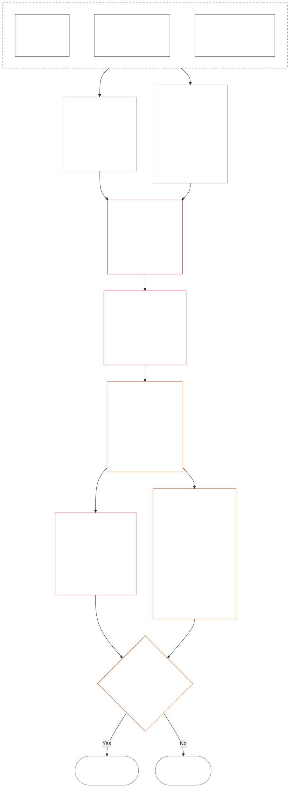

<!-- Locale: Bengali (bn) | Source snapshot: 9c2c8c10c871d91157bcd27b9f56ad6a1cec90d3 | AI-drafted, unreviewed | Partial coverage: Chapter 12 §§4–6 -->

### 4. স্লট ব্যাকরণ ও অভিন্ন স্কেলিং

*সহজ ভাষায়: এই অংশে দুটি পৃথক অক্ষের প্রতিটিতে সম্ভাব্য নয়টি অবস্থানের জন্য অভিন্ন নাম দেওয়া হয়েছে এবং প্রভাব কীভাবে সেগুলির মধ্যে স্কেল হয় তা ব্যাখ্যা করা হয়েছে। একটি অক্ষে যাচাইকৃত অবদান নথিভুক্ত হয়; অন্য প্রস্থিতি নথিতে যাচাইকৃত লঙ্ঘন নথিভুক্ত হয়। একই স্লট নম্বর থাকা অক্ষ দুটিকে এক করে না, কিংবা ক্ষতির সঙ্গে সহায়তাকে সমন্বয় করে না। **অংশ 6**-এর অভিন্ন স্কেল আনুপাতিক LEQU প্রভাব অনুযায়ী উভয় অক্ষে স্লট নির্ধারণ করে।*

স্লট ব্যাকরণে **1** থেকে **9** পর্যন্ত `s` স্লট নম্বর ব্যবহৃত হয়। প্রতিটি অক্ষের নিজস্ব স্লট অবস্থান রয়েছে:

- **Contribution Axis** ইতিবাচক অবদানের প্রকৃতি নথিভুক্ত করে; এবং
- **Violation Axis** যাচাইকৃত লঙ্ঘন-নির্ণয় নথিভুক্ত করে।

একই স্লট নম্বর দুই অক্ষেই থাকতে পারে, কিন্তু অক্ষ দুটি পৃথক থাকে। অবদানের স্লট লঙ্ঘনের স্লট নয়, এবং লঙ্ঘনের স্লট অবদানের স্লট নয়।

#### 4.1 সারণি 1 — স্লটের প্রদর্শিত লেবেল

**সারণি 1** নয়টি স্লটের নাম দেয় এবং পাশাপাশি Contribution Axis ও Violation Axis-এর প্রদর্শিত লেবেল দেখায়। এটি কেবল প্রদর্শনের ভাষা দেয়; **অংশ 6**-এর অভিন্ন স্কেল অনুসারে স্লট নির্ধারিত হয়।

| `s` | Contribution Axis-এর প্রদর্শিত লেবেল | Violation Axis-এর প্রদর্শিত লেবেল |
| ---: | --- | --- |
| 1 | **সামান্য ভিত্তিগত অবদান** | **সামান্য সাংবিধানিক প্রভাব** |
| 2 | **ক্ষুদ্র ভিত্তিগত অবদান** | **ক্ষুদ্র সাংবিধানিক প্রভাব** |
| 3 | **উল্লেখযোগ্য ইতিবাচক অবদান** | **উল্লেখযোগ্য সাংবিধানিক প্রভাব** |
| 4 | **গুরুত্বপূর্ণ ইতিবাচক অবদান** | **গুরুত্বপূর্ণ সাংবিধানিক প্রভাব** |
| 5 | **গুরুতর দায়িত্বশীল-ব্যবস্থাপনা-ইতিবাচক অবদান** | **গুরুতর সাংবিধানিক প্রভাব** |
| 6 | **বৃহৎ দায়িত্বশীল-ব্যবস্থাপনা-ইতিবাচক অবদান** | **বৃহৎ সাংবিধানিক প্রভাব** |
| 7 | **স্বীকৃত চ্যাম্পিয়ন** | **তীব্র সাংবিধানিক প্রভাব** |
| 8 | **বিশিষ্ট চ্যাম্পিয়ন** | **গুরুতরতম সাংবিধানিক প্রভাব** |
| 9 | **অনুকরণীয় চ্যাম্পিয়ন** | **বিপর্যয়কর সাংবিধানিক প্রভাব** |

Contribution Axis-এ ভিত্তিগত, ইতিবাচক, দায়িত্বশীল-ব্যবস্থাপনা-ইতিবাচক এবং চ্যাম্পিয়ন লেবেল ব্যবহৃত হয়। Violation Axis-এ প্রতিটি স্লটে নিরপেক্ষ প্রভাব-লেবেল ব্যবহৃত হয়। অক্ষ দুটি পৃথক থাকে; এগুলো কোনো নিট স্কোর তৈরি করে না বা অবদান ও লঙ্ঘনের নথির মধ্যে সমন্বয় অনুমোদন করে না। Violation Axis-এর স্লট নিজে থেকে সংবিধান-বিরোধী অসদাচরণ শ্রেণিবদ্ধ করে না; যাচাইকৃত `s` = 7–9 লঙ্ঘনে সংবিধান-বিরোধী অসদাচরণ উপাধি (ACMD) প্রযোজ্য কি না, তা [Chapter Fourteen](core_14.000_misconduct_designation.md#chapter-fourteen-anti-constitutional-misconduct) স্বাধীনভাবে নির্ধারণ করে।

সম্পূর্ণ-জীবন-সমতুল্য উপকার বা ক্ষতি অনুমান করতে বাস্তবায়নসমূহ পরিমাপের একক, প্রমাণের পদ্ধতি এবং উদাহরণ প্রকাশ করতে পারে। সেগুলো কেবল নির্দেশনা; **অংশ 6**, **Chapter One**, বা **Chapter Six**-এর অধিকার-তলকে অতিক্রম করতে পারে না।

#### 4.2 অভিন্ন প্রভাব-স্কেলিং নিয়ম

*সহজ ভাষায়: প্রভাব শুধু কতজন আক্রান্ত হয়েছে তা দিয়ে মাপা হয় না। একজন সংজ্ঞ প্রাণীর ওপর গভীর উপকার বা ক্ষতি অনেকের ওপর অগভীর প্রভাবের চেয়েও তাৎপর্যপূর্ণ হতে পারে। সংখ্যা, গভীরতা, দুর্বলতা, স্থায়িত্ব, স্থায়িত্বকাল, বিস্তার এবং সাংবিধানিক চরিত্র একসঙ্গে মূল্যায়ন করতে হবে।*

**অংশ 6**-এ উভয় অক্ষ ব্যাখ্যা করতে নিচের নিয়মগুলো প্রয়োগ করুন:

| স্কেলিংয়ের মাত্রা | অভিন্ন নিয়ম | অক্ষ-নির্দিষ্ট প্রয়োগ |
| --- | --- | --- |
| **সাংবিধানিক ফলের মাত্রা (LEQU)** | সমন্বিত যাচাইকৃত উপকার বা ক্ষতি মূল্যায়ন করুন। LEQU হলো মাত্রার প্রধান নোঙর; কাঁচা মাথাগণনা, অর্থ, উৎপাদন বা প্রতিষ্ঠানের আকার তা নয়। | অবদানে অধিকার-সঙ্গত উপকার গণ্য হয়; লঙ্ঘনে যাচাইকৃত সাংবিধানিক ক্ষতি, অপকার, অপচয়, সুযোগহানি বা বিপদ গণ্য হয়। |
| **সংজ্ঞ প্রাণীর পরিসর** | **সংখ্যা, গভীরতা ও দুর্বলতা একত্রে** বিবেচনা করুন। কোনো স্লটে মাথাগণনা স্বতন্ত্র শর্ত নয়। সমন্বিত মাত্রা ও সারির অন্যান্য মানদণ্ড সমান হলে একজন সংজ্ঞ প্রাণীর ওপর যথেষ্ট গভীর প্রভাব বৃহত্তর কিন্তু অগভীর প্রভাবের সমান স্লট সমর্থন করতে পারে; তবে স্পষ্ট সামষ্টিক-LEQU বা বিস্তৃত-পরিসরের শর্ত পূরণ করতেই হবে। | নির্ভরতা, হ্রাসপ্রাপ্ত সক্ষমতা বা বিশেষ দুর্বলতা বস্তুগততা বাড়াতে পারে। শুধু গোষ্ঠীর আকার অবদান বা তীব্রতা প্রতিষ্ঠা করে না। |
| **কালগত পরিসর** | স্থায়িত্বকাল, পুনরাবৃত্তি, স্থায়িত্ব এবং ক্ষতির ক্ষেত্রে অপরিবর্তনীয়তা বিবেচনা করুন। অল্পস্থায়ী কিন্তু রূপান্তরমূলক ঘটনা দীর্ঘস্থায়ী তুচ্ছ প্রভাবকে ছাড়িয়ে যেতে পারে; শুধু সময়কাল নির্ধারক নয়। | টেকসই উপকার অবদানের উচ্চতর মাত্রা সমর্থন করে। স্থায়ী বা অপরিবর্তনীয় ক্ষতি লঙ্ঘনের উচ্চতর তীব্রতা সমর্থন করে। |
| **স্থানিক বা প্রাতিষ্ঠানিক পরিসর** | বিস্তৃত পৌঁছনো মাত্রা বাড়াতে পারে; তবে গভীরতা, সময়কাল, দুর্বলতা বা সাংবিধানিক সমালোচনামূলকতা স্বাধীনভাবে স্লট সমর্থন করলে সম্প্রদায়-অতিক্রমী বা প্রতিষ্ঠান-অতিক্রমী বিস্তার আবশ্যক নয়। | প্রাতিষ্ঠানিক মেরামত অবদানের মাত্রা বাড়াতে পারে; কাঠামোগত বা পদ্ধতিগত ক্ষতি লঙ্ঘনের তীব্রতা বাড়াতে পারে। |
| **সাংবিধানিক গুণ বা চরিত্র** | ফল কীভাবে তৈরি হয়েছে তা তার বিস্তারের পরিমাণ থেকে আলাদাভাবে মাপুন। একই তথ্য দুবার গণনা করবেন না। | অন্যের ওপর চাপানো ক্ষতি, গোপন বোঝা, দখল বা নির্ভরতা দাবিকৃত অবদান সীমিত বা অযোগ্য করতে পারে। কর্তব্য, অবহেলা, প্রতারণা, জবরদস্তি, সহিংসতা বা কাঠামোগত সক্ষমকরণ লঙ্ঘন-আচরণের চরিত্র হিসেবে আলাদাভাবে নথিভুক্ত হয় এবং প্রভাবের স্লট বদলায় না। |
| **অধিকার-তল ও গুরুত্বপূর্ণ সুরক্ষা** | অধিকার-তল মেনে চলাকে সামষ্টিক উপকার বা ক্ষতির সঙ্গে বিনিময় করা যায় না। | অধিকার-তল মেনে চলা নিজে থেকে উচ্চ অবদান প্রতিষ্ঠা করে না। অধিকার-তল বস্তুগতভাবে ভঙ্গ করা বা গুরুত্বপূর্ণ সুরক্ষা ব্যর্থ হওয়া, সরাসরি আক্রান্ত সংজ্ঞ প্রাণী অল্প হলেও, উচ্চতর লঙ্ঘন-তীব্রতা সমর্থন করতে পারে। |

মাত্রাগুলো এমন চেকলিস্ট নয় যাতে প্রতিটি ধরনের পরিসর অবশ্যই থাকতে হবে। কোন মাত্রা নির্ধারক ছিল, কোনটি ছিল না এবং কেন—তা ব্যাখ্যা করুন।

- **অভিন্ন স্লট পদ্ধতি:**
  - Proportionality অনুসারে যাচাইকৃত উপকার বা ক্ষতির সমন্বিত LEQU অনুমান করুন; তারপর যে স্লটের সংখ্যাগত সীমায় সেই মাত্রা পড়ে, সেই একটি স্লট দিন।
  - উভয় অক্ষে একই সীমা প্রযোজ্য।
  - অবদানের স্লটে প্রযোজ্য ভিত্তি ও সাংবিধানিক-সামঞ্জস্যের শর্ত বহাল থাকে; সংখ্যাগত সীমা পূরণ করলেই অন্যের ওপর চাপানো বা সাংবিধানিকভাবে পরাজিত ফল অবদান হয়ে যায় না।
- **চরিত্রের পৃথকীকরণ:** প্রযোজ্য উপকার-পথ, ক্ষতি-পথ, আচরণের গুণমান এবং আচরণের চরিত্রের বর্ণনাকারী প্রস্থিতি নথিতে একত্রে রাখুন। কর্তব্য, অবহেলা, প্রতারণা, গুরুতরীকরণ, জবরদস্তি, সহিংসতা, অভিপ্রায় বা কাঠামোগত সক্ষমকরণ দায়-নির্ধারণ, সুরক্ষা বা প্রশ্ন 3-এর পরিণতিকে প্রভাবিত করতে পারে; কোনোটিই LEQU প্রভাবের স্লট বাড়ায় বা কমায় না।
- **সংবিধান-বিরোধী অসদাচরণ পর্যালোচনার সীমা:** সংবিধান-বিরোধী অসদাচরণ প্রতিষ্ঠিত হোক বা না হোক, প্রভাবের কারণে যাচাইকৃত Violation Axis ক্ষতি `s` = 7–9-এ পৌঁছাতে পারে। Chapter Fourteen প্রভাব-নির্ধারণের বিকল্প নয়; সংশ্লিষ্ট ACMD প্রযোজ্য কি না তা স্বাধীনভাবে নির্ধারণ করে।

কোনো বিপদ এখনো বাস্তবে না ঘটলে, নিচের প্রতিটি বিষয় আলাদাভাবে নথিভুক্ত করুন:

- তা ঘটার সম্ভাবনা কত;
- সংজ্ঞ প্রাণীরা কতক্ষণ তার মুখোমুখি হবে;
- তা কতদূর পৌঁছাতে পারে;
- অনুমানটি কতটা অনিশ্চিত; এবং
- বিশ্বাসযোগ্য সবচেয়ে খারাপ ফল কী।

গৃহীত বাস্তবায়নে পরিদর্শনযোগ্য ঝুঁকি-সমন্বয় (ঝুঁকিকে LEQU-তে রূপান্তরের পদ্ধতি) নির্ধারিত না থাকলে, সেই সবচেয়ে খারাপ ফলকে ইতিমধ্যে ঘটে যাওয়া ক্ষতি (LEQU loss) হিসেবে গণ্য করবেন না।

### 5. অক্ষ নির্ধারণের সাংবিধানিক ইনপুট

*সহজ ভাষায়: স্লট বাছার আগে কোন ভিত্তি, উপকার, কর্তব্য, ক্ষতি বা লঙ্ঘন মাপা হচ্ছে তা নির্ধারণকারী সাংবিধানিক উৎস শনাক্ত করুন। নিচের লিংকগুলো দিয়ে উৎসগুলো তাদের প্রামাণ্য স্থানে প্রয়োগ করুন; এই পথনির্দেশকে আরেকটি স্কোর বা বিকল্প সংজ্ঞায় পরিণত করবেন না।*

**অংশ 6** অনুসারে স্লট দেওয়ার আগে প্রস্থিতি নথিতে শনাক্ত করতে হবে:

- প্রযোজ্য সাংবিধানিক ভিত্তি, কর্তব্য, সীমাবদ্ধতা বা সুরক্ষিত স্বার্থ;
- যে বিধানগুলো মাপা যাচাইকৃত উপকার, প্রতিকূল ফল, ক্ষতি বা লঙ্ঘন প্রতিষ্ঠা করে;
- মাত্রা বা আচরণের চরিত্রকে বস্তুগতভাবে প্রভাবিত করা সংজ্ঞা, নীতি ও অধিকার-তলের অনুচ্ছেদ; এবং
- শনাক্ত প্রতিটি উৎস কেন প্রযোজ্য এবং অক্ষ-নির্ধারণে তার প্রভাব কী।

নিচের পথনির্দেশক সারণিগুলো পূর্ণাঙ্গ নয়। যাচাইকৃত ঘটনা থেকে প্রযোজ্য হওয়া প্রতিটি অতিরিক্ত সংজ্ঞা, নীতি বা অনুচ্ছেদও কার্যকর থাকবে এবং প্রস্থিতি নথিতে শনাক্ত করতে হবে। লিংকযুক্ত প্রতিটি প্রামাণ্য স্থানই নিয়ামক; সারণিগুলো তা পুনর্বর্ণনা বা সংকুচিত করে না।

#### 5.1 সংজ্ঞার ইনপুট

| প্রামাণ্য উৎস | Contribution Axis-এ ভূমিকা | Violation Axis-এ ভূমিকা |
| --- | --- | --- |
| [প্রস্থিতি, অবদান ও লঙ্ঘন](core_05.035_band_accountability.md#defa3-standing-state-contribution-and-violation) | কী অবদান হিসেবে গণ্য হয় এবং কোন যাচাইকৃত তথ্য তা মাপতে ব্যবহার করা যায় তা ব্যাখ্যা করে। অবদানের প্রস্থিতি নথিতে শুধু ইতিবাচক দিক থাকে, নেতিবাচক দিকের সঙ্গে মেশে না—তাও নিশ্চিত করে। | কী লঙ্ঘন হিসেবে গণ্য হয় এবং তা কীভাবে নথিভুক্ত হয় তা ব্যাখ্যা করে। সবচেয়ে গুরুতর ঘটনাগুলোকে সংবিধানকেই দুর্বল করে এমন আচরণের পৃথক পর্যালোচনা—Anti-Constitutional Misconduct Review-এও পাঠায়। |
| [জবাবদিহি](core_05.005_apex_accountability_leg.md#accountability) | ভালো দায়িত্বশীল ব্যবস্থাপনা বা মেরামতের দাবি সত্যিই কাউকে জবাবদিহির আওতায় রাখে কি না যাচাই করে। কে কী করেছে, কাকে তার উত্তর দিতে হবে এবং প্রভাবের অনুপাতে কীভাবে তা পর্যালোচনা, সংশোধন ও প্রতিকার করা যাবে তা দেখাতে হয়। | কে কাজটি করেছে বা কাকে জবাব দিতে হবে তা অস্পষ্ট এমন ঘটনা শনাক্ত করে; সংস্থা বা তার কাঠামো বদলালে দায়িত্ব অকার্যকর হয়ে যাওয়ার ঘটনাও এর অন্তর্ভুক্ত। |
| [ক্ষতি](core_05.035_band_accountability.md#harm) | অন্যের ওপর চাপানো বা গোপন ক্ষতি দাবিকৃত উপকার সীমিত বা বাতিল করতে পারে। ক্ষতির মেরামত উপকার হতে পারে, তবে মেরামত যাচাইকৃত এবং স্বাধীনভাবে প্রদর্শিত হলেই। | ক্ষতি ও তীব্রতা মাপার সময় গণ্য ক্ষতির ধরন নির্দিষ্ট করে: প্রত্যক্ষ, পরোক্ষ, বিলম্বিত, ক্রমসঞ্চিত, ব্যবস্থাজুড়ে বিস্তৃত এবং সংজ্ঞ প্রাণীর মন বা আবেগিক সুস্থতার ক্ষতি। |
| [বস্তুগততা](core_05.050_band_oversight.md#materiality) এবং [জীবনকাল-সমতুল্য একক (LEQU)](core_05.055_band_participation.md#lifespan-equivalent-unit-lequ) | যাচাইকৃত উপকার কতটা গণ্য হবে তা নির্ধারণ করে—তা কত দূর পৌঁছেছে, আক্রান্তরা কতটা দুর্বল এবং কত দিন স্থায়ী—এসবের ভিত্তিতে। ফল LEQU-তে মাপা হয়, যা পূর্ণ জীবনের সমপরিমাণ উপকারের অভিন্ন মাপকাঠি। | যাচাইকৃত ক্ষতি বা বিপদের মাত্রা নির্ধারণ করে—তা কত দূর পৌঁছেছে, আক্রান্তরা কতটা দুর্বল, কত দিন স্থায়ী এবং তা উল্টানো কত কঠিন—এসবের ভিত্তিতে। ফল LEQU-তে মাপা হয়, পূর্ণ জীবনের সমপরিমাণ ক্ষতির একই মাপকাঠিতে। |
| [অবদানের প্রকৃতি](core_05.035_band_accountability.md#contribution-nature) | কিছু অবদান হিসেবে গণ্য হবে কি না নির্ধারণ করে। তা কেবল ইতিবাচক হতে হবে, ক্ষতির সঙ্গে মেশানো যাবে না এবং প্রদর্শনযোগ্য যাচাইকৃত অবদান-নথি থাকতে হবে। দুটির কোনোটি না থাকলে Contribution Axis-এ স্লট দেওয়া যায় না। | এখানে কোনো ভূমিকা নেই। কী ক্ষতি তা নির্ধারণ করে না এবং লঙ্ঘনের তীব্রতা কখনো কমায় না। |
| [লঙ্ঘনের প্রকৃতি](core_05.035_band_accountability.md#violation-nature) | এখানে কোনো ভূমিকা নেই। লঙ্ঘনকে কখনো নেতিবাচক অবদান হিসেবে গণ্য করা হয় না এবং তার সঙ্গে সম্পর্কহীন যাচাইকৃত উপকার মুছে দেয় না। | কিছু লঙ্ঘন হিসেবে গণ্য হবে কি না নির্ধারণ করে। তা ক্ষতিকর হিসেবে শ্রেণিবদ্ধ হতে হবে এবং লঙ্ঘন ঘটেছে—এমন যাচাইকৃত সিদ্ধান্ত থাকতে হবে। দুটির কোনোটি না থাকলে Violation Axis-এ স্লট দেওয়া যায় না। |
| [সাংবিধানিক সীমাবদ্ধতা](core_05.045_band_integrative.md#constitutional-constraint), [কর্তৃত্বের স্তরবিন্যাস ও অভ্যন্তরীণ ক্রম](core_05.045_band_integrative.md#authority-stack-and-internal-hierarchy), এবং [নিরীক্ষাযোগ্যতা](core_05.050_band_oversight.md#auditability) | সংবিধান পরাস্ত করা, এর নিয়ম এড়ানো, অধিকার-তল (সংবিধানের নিশ্চয়তা দেওয়া ন্যূনতম সুরক্ষা) সংকুচিত করা বা কেবল কাগজে-কলমে মানার ওপর নির্ভরশীল দাবিকৃত উপকারকে অবদান হিসেবে গণনা হতে বাধা দেয়। | প্রকৃত লঙ্ঘনের তীব্রতাকে প্রভাবিত করে এমন বিষয় চিহ্নিত করে: গুরুত্বপূর্ণ সাংবিধানিক সীমা ভাঙা, সংবিধানের কর্তৃত্বের ওপরে অন্য কিছুকে স্থান দেওয়া, নিয়ম এড়ানো বা সেগুলোর প্রয়োগ অসম্ভব করা। |
| [নিরীক্ষাযোগ্যতা](core_05.050_band_oversight.md#auditability) এবং [চ্যালেঞ্জ-যোগ্যতা](core_05.035_band_accountability.md#contestability) | দাবিকৃত উপকার প্রদর্শন ও যাচাই করা যায় এবং দ্বিমতকারীদের কার্যকর চ্যালেঞ্জের পথ আছে—তা আবশ্যক করে। | যাচাই ও চ্যালেঞ্জ করা যায় এমন সিদ্ধান্ত আবশ্যক করে। অভিযোগ বা ব্যাখ্যাহীন লেবেল লঙ্ঘনের তীব্রতা নির্ধারণ করতে পারে না। |

#### 5.2 নীতির ইনপুট

| নীতির উৎস | অক্ষ নির্ধারণে ভূমিকা |
| --- | --- |
| [সাংবিধানিক চতুষ্ক](core_00.000_preamble.md#constitutional-tetrad), [দুই সাংবিধানিক উদ্দেশ্য](core_00.000_preamble.md#two-constitutional-aims), এবং [বস্তুগত বাজি](core_00.000_preamble.md#material-stake) | চারটি কার্যকর শৃঙ্খলা (অংশগ্রহণ, তত্ত্বাবধান, জবাবদিহি ও সময়ানুবর্তিতা), সংবিধানের লক্ষ্য দুই ফল (সমুন্নতি ও সাতত্য), এবং যা ঝুঁকিতে তার অনুপাতে প্রতিটি নির্ধারণের মাত্রা মাপার কাঠামো স্থির করে। |
| [সুস্থতা](core_01.000_values_principles.md#3-foundational-objective-wellbeing-flourishing-aim) এবং [স্বীকৃতি, শক্তিবৃদ্ধি ও আকাঙ্ক্ষা](core_01.000_values_principles.md#32-recognition-reinforcement-and-aspiration) | অধিকারকে সম্মান করা উপকার এবং তার উপযুক্ত স্বীকৃতিকে Contribution Axis-এ ভিত্তি দেয়। মর্যাদা বা পুরস্কার কখনো অবদানের প্রমাণ নয়। |
| [নিরাপত্তা](core_01.000_values_principles.md#4-safety-harm-constraint) এবং [সত্য](core_01.000_values_principles.md#5-truth-epistemic-integrity-constraint) | উভয় অক্ষে বাধ্যতামূলক সীমা স্থির করে। ক্ষতি বা প্রতারণার মাধ্যমে অর্জিত উপকার পুরোপুরি গণ্য হয় না; নিরাপত্তা বা সত্যের যাচাইকৃত ব্যর্থতা লঙ্ঘনের মাত্রা বা ধরন দেখাতে পারে। |
| [গভীর দায়িত্বশীল ব্যবস্থাপনা](core_01.010_stewardship_capacity_principles.md#16-stewardship-in-depth) এবং [দায়িত্বশীল ব্যবস্থাপনার শৃঙ্খলায় শাসন](core_01.010_stewardship_capacity_principles.md#18-governance-under-stewardship-discipline) | যাচাইকৃত ঘটনা প্রাসঙ্গিক হলে স্থায়ী অবদান, ভূমিকার সঙ্গে আসা কর্তব্য, প্রাতিষ্ঠানিক মেরামত, তত্ত্বাবধান ও দায়িত্ব কীভাবে ওজন করতে হবে তা নির্দেশ করে। |
| [মূল বিনিময় নীতিমালা](core_01.005_interaction_interpretation.md#131-core-tradeoff-principles) এবং [সাংবিধানিক ন্যূনতম, নিরাপত্তা ও অবমাননা-রোধী প্রক্রিয়া](core_01.005_interaction_interpretation.md#1314-constitutional-floors-safety-and-anti-degrading-process) | মাপা আচরণে প্রয়োজনীয়তা, ক্ষতি সর্বনিম্ন রাখা, আনুপাতিকতা, অধিকারের সংঘাত বা বিধিনিষেধ জড়িত হলে প্রযোজ্য। এগুলো নিজেরা কখনো কোনো পরিণতি অনুমোদন করে না। |

#### 5.3 অধিকার-তল ও অনুচ্ছেদের ইনপুট

| অনুচ্ছেদের উৎস | অক্ষ নির্ধারণের ভূমিকা বা সীমা |
| --- | --- |
| তথ্যগতভাবে প্রযোজ্য [Chapter Six-এর অধিকার-তল](core_06.000_rights_part_a.md#chapter-six-foundational-rights), যাচাইকৃত প্রস্থিতি নথিতে বস্তুগতভাবে জড়িত প্রতিটি অনুচ্ছেদসহ | ঝুঁকিতে থাকা মৌলিক সুরক্ষা, স্বার্থ, কর্তব্য, উপকার বা লঙ্ঘন স্থির করে। নিচে তালিকাভুক্ত নয় বলে কোনো অনুচ্ছেদ বাদ পড়ে না। |
| [অনুচ্ছেদ XIX — প্রস্থিতি ও অংশগ্রহণের অবস্থা](core_06.015_rights_part_d.md#article-xix-standing-and-participation-status) | সংজ্ঞ প্রাণীর প্রস্থিতি, মর্যাদা, অধিকার-তলের ন্যূনতম সুরক্ষা, প্রভাবিত পক্ষের অবস্থা, সুনাম এবং অংশগ্রহণের অবস্থার পরবর্তী পরিবর্তন—এসব আলাদা রাখে। |
| [অনুচ্ছেদ XIII-A — নির্ভরযোগ্যতা ও বিশ্বাসযোগ্যতার ভিত্তি](core_06.010_rights_part_c.md#article-xiii-a-reliability-and-trustworthiness-baseline) এবং [অনুচ্ছেদ XIII-B — প্রতিকার ও সংশোধনের অধিকার](core_06.010_rights_part_c.md#article-xiii-b-right-to-redress-and-remedy), [অনুচ্ছেদ XV-B — স্বচ্ছতা, নিরীক্ষাযোগ্যতা ও চ্যালেঞ্জ-যোগ্যতা](core_06.010_rights_part_c.md#article-xv-b-transparency-auditability-and-contestability), এবং [অনুচ্ছেদ XVI — নিরীক্ষা, স্বচ্ছতা ও স্বাধীন যাচাই](core_06.010_rights_part_c.md#article-xvi-audit-transparency-and-independent-verification) | যাচাইকৃত উপকার বা লঙ্ঘনে সৎ নথি রাখা, তথ্য ভাগ করা, ঘটনা যাচাই, সিদ্ধান্ত চ্যালেঞ্জ করা বা ভুল সংশোধন জড়িত হলে প্রযোজ্য। |
| [অনুচ্ছেদ XXIV — মূল কারণ বিশ্লেষণ ও অভিযোজিত প্রতিক্রিয়া](core_06.015_rights_part_d.md#article-xxiv-root-cause-analysis-and-adaptive-response) | আচরণের কারণ, তা সংশোধিত হয়েছে কি না, পুনরাবৃত্তি ঘটে কি না বা প্রতিক্রিয়া অভিযোজিত হয়েছে কি না গুরুত্বপূর্ণ হলে প্রযোজ্য; এসব দেখায় আচরণটি সংবিধানের অধীনে কী অবস্থায় আছে। |
| [অনুচ্ছেদ XX — যাচাইকৃত লঙ্ঘনের পর ন্যায়বিচার](core_06.015_rights_part_d.md#article-xx-justice-after-verified-violation) এবং [অনুচ্ছেদ XXVI-C — সময়মতো নিষ্পত্তি ও বিলম্ব-রোধী ন্যূনতম](core_06.020_rights_part_e.md#article-xxvi-c-timely-resolution-and-anti-delay-floor) | ঘটনা বাস্তবে যে প্রক্রিয়া বা বিলম্ব জড়িত করে তাতে প্রযোজ্য। **অনুচ্ছেদ XX** (*যাচাইকৃত লঙ্ঘনের পর ন্যায়বিচার*) মূলত লঙ্ঘন মাপার পর কী ঘটে তা সীমিত করে (প্রশ্ন 3)। আগে থেকেই পছন্দ করা প্রতিক্রিয়া ন্যায্য দেখাতে প্রশ্ন 2-এর স্লট বাড়ানো বা কমানোর জন্য এটি ব্যবহার করা যাবে না। |

**প্রয়োগের সীমা।** এই ধাপ শুধু সঠিক উৎসের দিকে নির্দেশ করে।

- এটি:
  - প্রশ্ন 1 নতুন করে খোলে না;
  - যাচাই না হওয়া তথ্য গ্রহণ করে না;
  - নতুন পরিমাপ বা স্কোর যোগ করে না;
  - বিভিন্ন উৎস দিয়ে একই তথ্য দুবার গণনা করে না;
  - দুই অক্ষকে এক করে না; বা
  - তালিকাভুক্ত প্রতিটি উৎসকে প্রতিটি প্রস্থিতি নথিতে প্রযোজ্য করে না।
- অবদান ও লঙ্ঘন পৃথকভাবেই মাপা হয়।
- **অনুচ্ছেদ XX** (*যাচাইকৃত লঙ্ঘনের পর ন্যায়বিচার*)-এর পরিণতি প্রশ্ন 2-এর বাইরে থাকে।
- Chapter Fourteen-এর উপাধি-পর্যালোচনা এখানে নির্ধারিত প্রভাব-স্লট থেকে পৃথক থাকে।

### 6. অভিন্ন আনুপাতিক LEQU স্কেল — Contribution ও Violation অক্ষ

<strong>পাঠক-নির্দেশনা (কার্যকরী নয়): পাঁচগুণ অগ্রগতি কীভাবে কাজ করে</strong>

> স্কেলটি `s` = 7 = এক LEQU-কে নোঙর করে পাঁচগুণ অগ্রগতি ব্যবহার করে। যেকোনো অক্ষে, 2 থেকে 9 স্লটের জন্য `s` স্লটের ন্যূনতম মাত্রা `5^(s−7)` LEQU; স্লট 1 শূন্য থেকে শুরু হয়। গৃহীত বাস্তবায়ন ফলস্বরূপ সংখ্যাগত সীমা ও ক্যালিব্রেশনের উদাহরণ প্রকাশ করতে পারে। স্লট 1-এ Contribution Axis-এ যাচাইকৃত সাংবিধানিক ভিত্তি এবং Violation Axis-এ প্রথম ইতিবাচক সীমার নিচে যাচাইকৃত ক্ষতি অন্তর্ভুক্ত; অবদান না থাকা বা লঙ্ঘন না থাকা নিজে `s` = 1 নথি নয়।
>
> **মানব-পাঠযোগ্য নোঙর।** ক্যালিব্রেশনের উদাহরণ হিসেবে 80 বছরের মানবজীবনকাল ধরে, মাঝের কলামটি ওপরের দিকে পড়ুন সম্পূর্ণ-জীবন-সমতুল্য উপকার, ব্যবহারযোগ্য সময়, বা অধিকার-সঙ্গত সম্পদ ও সক্ষমতা যোগ হওয়া হিসেবে; নিচের দিকে পড়ুন সমতুল্য ক্ষতি, বঞ্চনা, অপচয় বা সুযোগহানি হিসেবে। সম্পদের পরিমাণ নিজে গণ্য নয়—তা যে সাংবিধানিক ফল তৈরি বা ঠেকায়, সেটিই নির্ধারক।

 

*সহজ ভাষায়: **সারণি 2** যাচাইকৃত অবদান ও যাচাইকৃত লঙ্ঘনকে একই আনুপাতিক প্রভাব-স্কেলে রাখে। উঁচু স্লট মানে সমন্বিত সাংবিধানিক উপকার বা ক্ষতি বেশি। প্রস্থিতি নথি ও অক্ষ পৃথক থাকে: অভিন্ন স্কেল মাত্রার তুলনা করে, নৈতিক মূল্য নয়, এবং সহায়তা দিয়ে ক্ষতি বাতিল করতে দেয় না।*

চিত্রটি শুরু থেকে শেষ পর্যন্ত একটি স্লট-নির্ধারণ অনুসরণ করে। ধাপগুলোর কাজের ক্রম দেখায়; নিচের বুলেটগুলোর ক্রম নয়—বুলেটগুলো প্রতিটি নিয়ম বলে।

গভীরতা, সংজ্ঞ প্রাণীর পরিসর, দুর্বলতা, সময়কাল, স্থায়িত্ব বা অপরিবর্তনীয়তা, বিস্তার এবং সাংবিধানিক সমালোচনামূলকতা থেকে সমন্বিত LEQU প্রভাব অনুমান করতে **Proportionality** প্রয়োগ করুন। এই মাত্রাগুলো LEQU অনুমানকে আকার দেয়; এগুলো স্বতন্ত্র স্লট-বোনাস নয়।

- **সারণি 2** ব্যবহার করুন তখনই, যখন প্রশ্ন 1 কী ঘটেছে তা নিশ্চিত করে, প্রশ্ন 2 যাচাইকৃত উপকার বা ক্ষতি মাপে, **অংশ 1–3 ও 4.2** প্রয়োগ হয় এবং **অংশ 5**-এ চিহ্নিত প্রয়োজনীয় সাংবিধানিক উৎস শনাক্ত করা হয়।
- সমন্বিত LEQU অনুমান থেকে একটি স্লট দিন।
  - প্রতিটি বস্তুগত স্কেলিং মাত্রা অনুমানকে কীভাবে প্রভাবিত করেছে এবং বাদ পড়া মাত্রা কেন নির্ধারক ছিল না তা ব্যাখ্যা করুন।
  - প্রতিটি নির্ধারণে থাকতে হবে:
    - অনুসরণযোগ্যতা;
    - নিরীক্ষাযোগ্যতা;
    - চ্যালেঞ্জ-যোগ্যতা; এবং
    - প্রযোজ্য অধিকার-তল।
  - অবদানের ক্ষেত্রে অন্যের ওপর ক্ষতি না চাপানো এবং সাংবিধানিক সামঞ্জস্যও আবশ্যক।
- আচরণের চরিত্র-সংক্রান্ত তথ্য পৃথকভাবে অনুসরণযোগ্য বর্ণনাকারী হিসেবে নথিভুক্ত করুন। এগুলো দায়-নির্ধারণ, পর্যালোচনার তীব্রতা, সুরক্ষা, প্রতিকার বা Chapter Fourteen-এর উপাধিকে নিয়ন্ত্রণ করতে পারে; যাচাইকৃত পরিণতি সমন্বিত LEQU প্রভাব বদলালেই কেবল স্লট বদলাতে পারে।
- আচরণ বা আচরণধারার যাচাইকৃত পরিণতি বস্তুগত স্কেলিং মাত্রা ধরে সম্পূর্ণ মূল্যায়ন করুন, যার মধ্যে রয়েছে:
  - শারীরিক আঘাত;
  - মানসিক আঘাত;
  - জবরদস্তিমূলক প্রভাব;
  - স্বাধীনতা থেকে বঞ্চনা বা স্বাধীনতার বিপদ;
  - ক্রমসঞ্চিত ক্ষতি; এবং
  - সাংবিধানিকভাবে স্বীকৃত অন্য উপকার বা ক্ষতি।
- করবেন না:
  - কোনো ঘটনা বা আচরণধারাকে নিচের বৈশিষ্ট্যে বর্ণনা করা হয়েছে বলে শুধু স্লট বাড়ানো বা কমানো:
    - কর্তব্য;
    - অবহেলা;
    - অভিপ্রায়;
    - গোপনকরণ;
    - পুনরাবৃত্তি;
    - গুরুতরীকরণ;
    - জবরদস্তি;
    - সহিংসতা;
    - স্বাধীনতার বিপদ;
    - সংশোধনযোগ্যতা; বা
    - পছন্দসই পরিণতি।
  - মাত্রা থেকে আচরণের চরিত্র অনুমান করা বা যাচাইকৃত মাত্রার বদলে আচরণের চরিত্র ব্যবহার করা।

**সারণি 2** নয়টি স্লট ক্রমানুসারে দেয়। প্রতিটি সারিতে স্লট নম্বর `s`, ওই স্লটে পৌঁছতে কত উপকার যোগ বা ক্ষতি আরোপ হতে হয় (80 বছরের মানবজীবনকাল ক্যালিব্রেশনের উদাহরণ), এবং দুই অক্ষে স্লটের নাম আছে। উভয় অক্ষে একই সীমা, কিন্তু নাম দুটি পৃথক: Contribution Axis-এর স্লট ও Violation Axis-এর স্লট আলাদা নথি, কখনো একে অন্যকে বাতিল করে না।

| `s` | 80 বছরের মানব ক্যালিব্রেশন — যোগ হওয়া উপকার / আরোপিত ক্ষতি | Contribution Axis | Violation Axis |
| ---: | --- | --- | --- |
| 1 | প্রায় **9 দিনের** কম | **সামান্য ভিত্তিগত অবদান** — মূল্যায়িত পরিসরের সাংবিধানিক ন্যূনতম যাচাইকৃতভাবে পূরণ; পরিমাপযোগ্য উন্নতি `s` = 2-এর নিচে। | **সামান্য সাংবিধানিক প্রভাব** — `s` = 2-এর নিচে যাচাইকৃত ক্ষতি বা কার্যগত প্রতিবন্ধকতা; প্রমাণিত মূলগত ক্ষতি ছাড়া আনুষ্ঠানিক ত্রুটিও এর অন্তর্ভুক্ত। |
| 2 | প্রায় **9–47 দিন** | **ক্ষুদ্র ভিত্তিগত অবদান** — এই প্রভাব-স্তরে ন্যূনতম ভিত্তির ওপরে নির্ভরযোগ্য, সীমাবদ্ধ কার্যসম্পাদন। | **ক্ষুদ্র সাংবিধানিক প্রভাব** — এই প্রভাব-স্তরে যাচাইকৃত সীমাবদ্ধ ক্ষতি। |
| 3 | প্রায় **47 দিন–8 মাস** | **উল্লেখযোগ্য ইতিবাচক অবদান** — এই প্রভাব-স্তরে ভিত্তির অতিরিক্ত প্রদর্শনযোগ্য উপকার। | **উল্লেখযোগ্য সাংবিধানিক প্রভাব** — এই প্রভাব-স্তরে যাচাইকৃত উল্লেখযোগ্য ক্ষতি। |
| 4 | প্রায় **8 মাস–3.2 বছর** | **গুরুত্বপূর্ণ ইতিবাচক অবদান** — গভীরতর, স্থায়ী, পুনরাবৃত্ত, দুর্বলতার প্রতি সাড়া-দেওয়া বা ব্যাপকতর যাচাইকৃত উপকার। | **গুরুত্বপূর্ণ সাংবিধানিক প্রভাব** — যাচাইকৃত গুরুত্বপূর্ণ সাংবিধানিক ক্ষতি। |
| 5 | প্রায় **3.2–16 বছর** | **গুরুতর দায়িত্বশীল-ব্যবস্থাপনা-ইতিবাচক অবদান** — টেকসই দায়িত্বশীল ব্যবস্থাপনা, সমন্বয়, রক্ষণাবেক্ষণ, মেরামত বা তুলনীয় স্থায়ী উপকার। | **গুরুতর সাংবিধানিক প্রভাব** — যাচাইকৃত গুরুতর সাংবিধানিক ক্ষতি। |
| 6 | প্রায় **16–80 বছর** | **বৃহৎ দায়িত্বশীল-ব্যবস্থাপনা-ইতিবাচক অবদান** — এক LEQU-এর কাছাকাছি বৃহৎ যাচাইকৃত উপকার। | **বৃহৎ সাংবিধানিক প্রভাব** — এক LEQU-এর কাছাকাছি বৃহৎ যাচাইকৃত ক্ষতি। |
| 7 | প্রায় **1–5 জীবনকাল** (**80–400 বছর**) | **স্বীকৃত চ্যাম্পিয়ন** — অন্তত এক LEQU যাচাইকৃত, সাংবিধানিকভাবে সামঞ্জস্যপূর্ণ উপকার। | **তীব্র সাংবিধানিক প্রভাব** — অন্তত এক LEQU যাচাইকৃত সাংবিধানিক ক্ষতি। |
| 8 | প্রায় **5–25 জীবনকাল** (**400–2,000 বছর**) | **বিশিষ্ট চ্যাম্পিয়ন** — যাচাইকৃত উপকার বস্তুগতভাবে `s` = 7 ছাড়িয়ে যায়। | **গুরুতরতম সাংবিধানিক প্রভাব** — যাচাইকৃত ক্ষতি বস্তুগতভাবে `s` = 7 ছাড়িয়ে যায়। |
| 9 | অন্তত **25 জীবনকাল** (**2,000+ বছর**) | **অনুকরণীয় চ্যাম্পিয়ন** — যাচাইকৃত উপকার বস্তুগতভাবে `s` = 8 ছাড়িয়ে যায়। | **বিপর্যয়কর সাংবিধানিক প্রভাব** — যাচাইকৃত ক্ষতি বস্তুগতভাবে `s` = 8 ছাড়িয়ে যায়। |

<strong>বাস্তবায়ন আন্তঃকার্যক্ষমতা নোট</strong>

> এই উইজেটে বাস্তবায়ন-সংশ্লিষ্ট আন্তঃকার্যক্ষমতার উপাদান আছে। এটি অধ্যায়ের কার্যকরী শ্রেণিগুলোকে সমর্থন করে; সমান্তরাল শ্রেণি-ব্যবস্থা তৈরি করে না।

স্লট প্রদর্শনের যন্ত্র-পাঠযোগ্য ক্ষেত্র (`sub_tier`, `sub_tier_display` এবং সংশ্লিষ্ট প্রদর্শন-ক্ষেত্র) সংজ্ঞায়িত হয়েছে [CH06_NINE_SLOT_STANDING_SCALE.md](implementation/CH06_NINE_SLOT_STANDING_SCALE.md) এবং [ch06_nine_slot_constants.json](implementation/ch06_nine_slot_constants.json)-এ। বাস্তবায়নের চার-ব্যান্ড মানচিত্র আন্তঃকার্যক্ষমতার সহায়কই থাকে; কার্যকরী **সারণি 2**-তে প্রাথমিক-ব্যান্ড কলাম যোগ করে না।

ওজনযুক্ত সংজ্ঞ প্রাণী, সংরক্ষিত-অবস্থা চেকপয়েন্ট এবং নির্দিষ্ট মৃত্যু-সীমা না থাকা ক্ষেত্রসহ রেফারেন্স পদ্ধতি ও উদাহরণসহ স্লট নির্ধারণ [LEQU_CALIBRATION_REFERENCE.md](implementation/LEQU_CALIBRATION_REFERENCE.md)-এ রয়েছে। ওই কাজগুলো **অংশ 6**-এর অভিন্ন সীমা ও আনুপাতিক নির্ধারণের নিয়ম প্রতিস্থাপন করতে পারে না, চলমান নথিতে স্লট দিতে পারে না, বা কে গণ্য হবে তা নির্ধারণ করতে পারে না।

গৃহীত বাস্তবায়ন LEQU অনুমান ও নির্দিষ্ট কী-যুক্ত প্রদর্শন-লেবেল প্রকাশ করতে পারে। **conforming document** পরিবর্তন ছাড়া এসব সহায়ক **অংশ 6**-এর অভিন্ন সীমা ও আনুপাতিক নির্ধারণের নিয়ম বা Chapter Fourteen-এর উপাধি-সুরক্ষা প্রতিস্থাপন করতে পারবে না।

