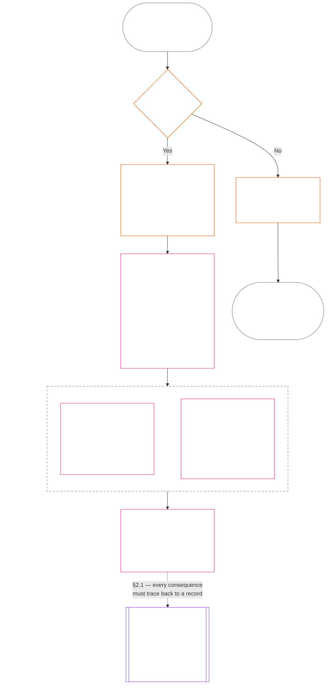

<!-- Borrador parcial de traducción al español. Fuente: commit 9c2c8c10c871d91157bcd27b9f56ad6a1cec90d3. Traducción asistida por IA; sin revisar. Cobertura: Capítulo Once, §§1–3 solamente. -->

### 1. Las tres preguntas

*En términos sencillos: la posición se determina respondiendo tres preguntas en orden. No deduzca hechos a partir de una calificación deseada ni elija una calificación para justificar una consecuencia deseada.*

| Pregunta | Qué pregunta | Dónde se responde |
| --- | --- | --- |
| **1. ¿Qué ocurrió?** | ¿Qué hechos están verificados, respecto de quién o qué, durante qué período, y con qué registro de posición y estado de impugnación? | [Sección 2](#2-question-1--what-happened) y [Sección 3](#3-question-1-event-type-guide--what-kind-of-help-or-harm-occurred) |
| **2. ¿Qué tan bueno o malo fue?** | ¿Qué tipo y magnitud de contribución o violación establecen esos hechos? | [Capítulo Doce, Sección 1](core_12.000_standing_measurement.md#1-question-2--how-good-or-bad-was-it) |
| **3. ¿Qué ocurre como consecuencia?** | ¿Qué reconocimiento, preparación, reparación, salvaguarda, restricción u otra consecuencia se deriva? | [Capítulo Trece](core_13.000_standing_integration.md#chapter-thirteen-standing-effects-and-integration) |

Cada pregunta depende de la respuesta anterior:

- La Pregunta 1 aporta los hechos verificados para la Pregunta 2.
- La Pregunta 2 mide esos hechos para la Pregunta 3.
- La Pregunta 3 no debe reescribir los hechos ni la calificación para ajustarlos a un resultado preferido.

En conjunto, las respuestas a las tres preguntas forman la evaluación completa de la posición para un acontecimiento acotado o un patrón definido. Un sujeto puede tener varias evaluaciones de ese tipo a lo largo del tiempo, y ninguna es una puntuación neta ni una calificación general del sujeto. Los registros de posición de contribución y de violación conservan las respuestas a las Preguntas 1 y 2; la decisión de la Pregunta 3 establece qué se deriva de ellas.

#### 1.1 Propósito y alcance

Este capítulo establece el marco constitucional de registro y el [Capítulo Doce](core_12.000_standing_measurement.md#chapter-twelve-standing-measurement--question-2-how-good-or-bad-was-it), el marco de medición, para **sistemas**, **sencientes** e **instituciones**, incluidos todos los sistemas clasificados conforme a [**CS-9.305**](corpus_systems/cs_09.305_system_classification_machinery.md#cs-9305-part-a-system-classification-machinery) (*Mecanismo de clasificación de sistemas*). Estos marcos no miden chismes, popularidad, reputación vaga, dignidad inherente ni valor general; ninguno de estos puede ser objeto de una evaluación de posición.

El proceso de posición debe seguir siendo eficaz cuando:

- las contribuciones verificadas anteriormente envejecen demasiado para demostrar competencia o fiabilidad actuales;
- las violaciones siguen sin resolverse;
- la reparación es costosa;
- la responsabilidad atraviesa fronteras; o
- un actor usa capas organizativas o cambios de nombre para obstaculizar la rendición de cuentas.

Estos asuntos corresponden a los textos de implementación adoptados:

- procedimientos cotidianos;
- pasos de escalamiento;
- operaciones de restitución y reparación;
- medidas de rendición de cuentas restaurativa; y
- diseño de incentivos.

La medición del Capítulo Doce **no** autoriza por sí misma el uso de la fuerza, la detención ni otra restricción de libertad. Toda consecuencia de ese tipo debe cumplir de manera independiente el Capítulo Seis, **Artículo XX** (*Justicia tras una violación verificada*), incluidos sus requisitos de proporcionalidad, mínima restricción, duración limitada, restitución y rendición de cuentas restaurativa.

<strong>Trazabilidad · Definiciones · Evaluación · Cumplimiento</strong>

- Antecedentes: [Capítulo Uno §16 — Administración en profundidad](core_01.010_stewardship_capacity_principles.md#16-stewardship-in-depth); [Capítulos Dos a Cuatro](core_02.000_definition_structure.md); [Capítulo Cinco](core_05.000_definitions_home.md#chapter-five-foundational-definitions).
- Derivaciones:
  - [§2](#2-question-1--what-happened) (*Pregunta 1*);
  - [§4](#4-standing-record-operational-requirements) (*verificación y requisitos de registro*);
  - [§5](#5-record-custody-and-opening-authority) (*custodia del registro y autoridad para abrirlo*);
  - [§6](#6-handling-a-standing-record) (*gestión de un registro de posición*);
  - [Capítulo Doce §1](core_12.000_standing_measurement.md#1-question-2--how-good-or-bad-was-it) (*medición de la Pregunta 2*);
  - [Capítulo Doce §2](core_12.000_standing_measurement.md#2-magnitude-and-severity-input-dimensions) (*dimensiones de entrada de medición*);
  - [Capítulo Doce §3](core_12.000_standing_measurement.md#3-route-descriptor-catalogs-and-measurement-roles) (*catálogos de descriptores de rutas*);
  - [Capítulo Doce §4](core_12.000_standing_measurement.md#4-slot-grammar-and-shared-scaling) (*gramática de casillas y escala compartida*);
  - [Capítulo Doce §5](core_12.000_standing_measurement.md#5-constitutional-inputs-to-axis-assignment) (*asignación según fuentes constitucionales*);
  - [Capítulo Doce §6](core_12.000_standing_measurement.md#6-unified-proportional-lequ-scale--contribution-and-violation-axes) (*escala LEQU proporcional unificada para ambos ejes*);
  - [Capítulo Trece](core_13.000_standing_integration.md#chapter-thirteen-standing-effects-and-integration) (*Pregunta 3*).
- [Materialidad](core_05.050_band_oversight.md#materiality) · [O](core_05.050_band_oversight.md#materiality) · [M](core_05.050_band_oversight.md#materiality-determination-a) · [A](core_05.050_band_oversight.md#materiality-determination-a) · [C](core_05.050_band_oversight.md#materiality-determination-c)
- [Daño](core_05.035_band_accountability.md#harm) · [O](core_05.035_band_accountability.md#harm) · [M](core_05.035_band_accountability.md#harm-a) · [A](core_05.035_band_accountability.md#harm-a) · [C](core_05.035_band_accountability.md#harm-c)
- [Proporcionalidad](core_05.035_band_accountability.md#proportionality) · [O](core_05.035_band_accountability.md#proportionality) · [M](core_05.035_band_accountability.md#proportionality-a) · [A](core_05.035_band_accountability.md#proportionality-a) · [C](core_05.035_band_accountability.md#proportionality-c)

### 2. Pregunta 1 — ¿qué ocurrió?

<strong>Trazabilidad</strong>

- Antecedentes: [§1](#1-the-three-questions) (*marco de las tres preguntas*); [Capítulos Dos a Cuatro](core_02.000_definition_structure.md) (*registro, verificación y trazabilidad de las definiciones hasta los resultados*).
- Ejes de la Tétrada: **participación**; **supervisión** (impugnabilidad y vías de impugnación). Objetivos principales: **Florecimiento** y **Continuidad** (registros trazables que conservan hallazgos separados de contribución y violación para su medición posterior).
- Derivaciones:
  - [§2.2](#22-silence-is-the-default) (*el silencio es la regla general*);
  - [§2.3](#23-protected-dissent-is-not-a-trigger) (*la disidencia protegida no es un desencadenante*);
  - [§2.4](#24-linked-standing-records-and-no-offset-bridge) (*puente de no compensación entre registros vinculados*);
  - [§2.5](#25-verified-input-gate) (*filtro de insumos verificados*);
  - [§2.6](#26-stage-boundary) (*límite entre etapas*);
  - [§2.7](#27-forum-boundary) (*límite de los foros*);
  - [§3](#3-question-1-event-type-guide--what-kind-of-help-or-harm-occurred) (*guía de tipos de acontecimiento*);
  - [§4](#4-standing-record-operational-requirements) (*requisitos del registro*);
  - [§5](#5-record-custody-and-opening-authority) (*custodia del registro y autoridad para abrirlo*);
  - [§6](#6-handling-a-standing-record) (*gestión de un registro de posición*);
  - [Capítulo Doce §1](core_12.000_standing_measurement.md#1-question-2--how-good-or-bad-was-it) (*medición de la Pregunta 2*);
  - [Capítulo Doce §2](core_12.000_standing_measurement.md#2-magnitude-and-severity-input-dimensions) (*dimensiones de entrada de medición*);
  - [Capítulo Doce §3](core_12.000_standing_measurement.md#3-route-descriptor-catalogs-and-measurement-roles) (*catálogos de descriptores de rutas*);
  - [Capítulo Doce §4](core_12.000_standing_measurement.md#4-slot-grammar-and-shared-scaling) (*gramática de casillas y escala compartida*);
  - [Capítulo Doce §5](core_12.000_standing_measurement.md#5-constitutional-inputs-to-axis-assignment) (*asignación según fuentes constitucionales*);
  - [Capítulo Doce §6](core_12.000_standing_measurement.md#6-unified-proportional-lequ-scale--contribution-and-violation-axes) (*escala LEQU proporcional unificada para ambos ejes*);
  - [Capítulo Trece](core_13.000_standing_integration.md#chapter-thirteen-standing-effects-and-integration) (13.000) (*Pregunta 3*).

 

*En términos sencillos: la Pregunta 1 establece un relato acotado e impugnable de lo que ocurrió. Identifica al sujeto, el acontecimiento o patrón, el período, los hechos verificados y el estado del registro antes de considerar cualquier calificación o consecuencia. La ayuda verificada y las violaciones verificadas usan registros de posición separados para que una no borre la otra. Estos registros no son puntuaciones de popularidad ni etiquetas vagas.*

Un **registro de posición** es el registro acotado que este capítulo utiliza para un sujeto, ámbito funcional, período del registro, estado de revisión y contexto decisorio determinados. Antes de iniciar la medición, debe establecer:

- a quién o a qué se refiere el registro de posición;
- si se refiere a un acontecimiento acotado o a un patrón definido;
- cuándo y dónde ocurrieron la conducta y los efectos pertinentes;
- cuáles hechos están verificados y cuáles siguen en disputa;
- qué pruebas, atribución y vía de impugnación respaldan esos hallazgos; y
- el estado actual de revisión, corrección y sustitución del registro de posición.

El diagrama sigue un acontecimiento para determinar si activa un registro de posición y qué contiene ese registro; las subsecciones siguientes enuncian cada regla. La rama «no» sale de la ruta principal hacia la derecha.

#### 2.1 Registros de posición: tipos y sujetos

La Pregunta 1 utiliza un **registro de posición de contribución** para la ayuda verificada y un **registro de posición de violación** para el daño verificado, incluidos los fallos de rendición de cuentas. Un mismo registro de posición no combina ambos tipos de hallazgo.

- Un registro de posición puede referirse a un senciente, una institución, un sistema, una evaluación, un acontecimiento acotado, una función, un colectivo, un registro específico de un actor u otra unidad pertinente en términos constitucionales.
  - No debe reducir sujetos, funciones, sistemas, comunidades, períodos del registro, estados de revisión o contextos decisorios distintos a una sola etiqueta de posición indiferenciada.
- Un registro de posición puede abarcar un **acontecimiento acotado** —un episodio con un inicio y un final claros— o un **patrón** de conducta repetida.
  - Un patrón requiere un sujeto, alcance y período de revisión definidos.
- El mismo sujeto puede tener varios registros de posición a lo largo del tiempo, incluidos registros vinculados de posición de contribución y de violación.
  - Los registros de posición relacionados deben **remitirse entre sí** conforme a la **sección 4.2** cuando compartan sujeto, períodos superpuestos, acontecimiento acotado, patrón o contexto decisorio.
- Un registro de posición no es una puntuación de reputación independiente, un rango de dignidad, un estado permanente, una etiqueta de valor general ni una tarjeta de puntuación combinada.
  - Los requisitos operativos figuran en la **sección 4**.

Todo efecto posterior sobre la posición corresponde al Capítulo Trece y debe poder rastrearse hasta el registro o los registros de posición pertinentes, sin pasar a formar parte del propio registro.

#### 2.2 El silencio es la regla general

No tener un registro de posición es el estado habitual de un senciente, una institución o un sistema, y será el estado en que permanecerá la mayoría de los sencientes.

- Un registro de posición solo se abre cuando se ha verificado un desencadenante conforme a la **sección 4**. Una autoridad designada para abrir registros debe aprobar la anotación y un custodio de registros distinto debe realizarla (**sección 5**). Nunca se abre un registro de posición:
  - para establecer una referencia inicial;
  - para completar una lista; o
  - porque así lo prefiera quien controla una puerta de acceso a una vía designada.
- No tener un registro de posición no dice nada. «Sin calificación», «no verificado» y «no consta ningún registro» no son pruebas de riesgo, contribución baja ni de ninguna otra cosa. Nadie puede tratar la ausencia de un registro como motivo para un escrutinio más estricto, un valor predeterminado inferior o acceso condicional a una vía designada.
- Ninguna institución ni sistema puede exigir un registro de posición, una constancia de «ausencia de registro» o consentimiento para abrir uno como condición para:
  - bienes esenciales del **Artículo III** (*Supervivencia y acceso esencial*);
  - protecciones del **Artículo III-C** (*Trabajo y piso económico*);
  - el comercio ordinario; o
  - participar como parte afectada.
  Los umbrales de competencia publicados para vías designadas específicas y sensibles a la confianza, según [Capítulo Trece §6.2 Umbrales de competencia y autorizaciones](core_13.000_standing_integration.md#62-competency-bars-and-clearances), constituyen la excepción; deben explicar por qué la vía designada es sensible a la confianza.
- Cuando se abre un registro de posición sobre un sujeto, se debe informar a ese sujeto, como exige la **sección 4**. La notificación solo puede aplazarse si una necesidad documentada de [Preservación de pruebas](core_05.050_band_oversight.md#evidence-preservation) o de seguridad lo justifica, y únicamente por un período limitado y establecido. La notificación es lo que hace impugnable un registro de posición: un sujeto que desconoce su existencia no puede impugnarlo ni corregirlo.

#### 2.3 La disidencia protegida no es un desencadenante

La disidencia o la protesta pacífica —incluida la [desobediencia civil no violenta protegida](core_06.005_rights_part_b.md#xi-d-nonviolent-civil-disobedience)— conforme al **Artículo XI-D** (*Reunión, disidencia y protesta pacífica*) ([*Piso de disidencia y protesta pacífica*](core_06.005_rights_part_b.md#xi-d-dissent-and-peaceful-protest)) no constituye un desencadenante verificado.

- No abre, prolonga ni agrava un registro de posición de violación, no es un factor de gravedad conforme a la **sección 8.2** y su repetición no la convierte en un patrón.
- La conducta separable que viole de manera independiente un piso constitucional se registra según sus propios términos, sin agravación por el punto de vista, la causa o el objetivo de la protesta.

#### 2.4 Registros de posición vinculados y puente de no compensación

<strong>Trazabilidad</strong>

- Antecedentes: [§2.1](#21-standing-records-kinds-and-subjects) (*registros separados de contribución y violación*).
- Derivaciones:
  - [§2.5](#25-verified-input-gate) (*filtro de insumos verificados*);
  - [§2.7](#27-forum-boundary) (*límite de los foros*);
  - [§4.2](#42-related-standing-record-cross-references) (*referencias cruzadas*);
  - [Capítulo Doce §1](core_12.000_standing_measurement.md#1-question-2--how-good-or-bad-was-it) (*medición de la Pregunta 2*);
  - [Capítulo Doce §2](core_12.000_standing_measurement.md#2-magnitude-and-severity-input-dimensions) (*dimensiones de entrada de medición*);
  - [Capítulo Doce §3](core_12.000_standing_measurement.md#3-route-descriptor-catalogs-and-measurement-roles) (*catálogos de descriptores de rutas*);
  - [Capítulo Doce §4](core_12.000_standing_measurement.md#4-slot-grammar-and-shared-scaling) (*gramática de casillas y escala compartida*);
  - [Capítulo Doce §5](core_12.000_standing_measurement.md#5-constitutional-inputs-to-axis-assignment) (*asignación según fuentes constitucionales*);
  - [Capítulo Doce §6](core_12.000_standing_measurement.md#6-unified-proportional-lequ-scale--contribution-and-violation-axes) (*escala LEQU proporcional unificada para ambos ejes*);
  - [Capítulo Trece](core_13.000_standing_integration.md#chapter-thirteen-standing-effects-and-integration) (13.000) (*Pregunta 3*).
- Léase junto con: [Capítulo Trece — Integración de la posición](core_13.000_standing_integration.md#2-automatic-integration-review-and-continuity) (13.000) (*integración sin renuncia y de registros vinculados*); [Capítulo Trece §6.2 — Umbrales de competencia y autorizaciones](core_13.000_standing_integration.md#62-competency-bars-and-clearances) (13.000 §6.2); [Capítulo Trece §4.2 — Bloqueos de posición](core_13.000_standing_integration.md#42-prevention--general-standing-locks) (13.000 §4.2).

 

**Regla fundamental:** los **registros de posición de contribución** verificada y los **registros de posición de violación** verificada se mantienen separados conforme a la **sección 2.1**. Cada hallazgo de contribución o violación debe basarse en hechos respaldados propios, incluidos en su propio registro de posición. El análisis y los materiales de respaldo deben mantener las dos vías de registro trazables por separado. Ninguna anotación ni conjunto de registros vinculados constituye una puntuación neta, una puntuación combinada ni una compensación.

- **Registros de posición de violación y bloqueos de posición:**
  - Conforme al Capítulo Trece, los **bloqueos de posición** aplicables que se deriven de registros de posición de violación pueden limitar la posición, restringir la elegibilidad para una función o afectar el acceso a una reparación mientras una violación verificada siga sin resolverse.
  - Los bloqueos de posición no deben borrar las contribuciones positivas verificadas que consten en registros de posición de contribución.
  - El mero transcurso del tiempo no reduce el peso de violaciones verificadas sin resolver.
  - Las violaciones verificadas no deben transformar registros de posición de contribución no relacionados en un expediente de reputación falsamente negativo.
- **Registros de posición de contribución y autorizaciones de competencia:**
  - Una contribución verificada puede respaldar las **autorizaciones de competencia** aplicables respecto de **umbrales de competencia** publicados, así como la elegibilidad vinculada a la confianza, una función o un reconocimiento cuando la contribución sea actual y pertinente para la función.
  - Una contribución verificada no debe compensar, reducir mediante promedios, excusar ni cambiar la etiqueta de un hallazgo de violación verificado.
  - Cumplir un umbral no exime de ningún bloqueo de posición aplicable.

**La única excepción:** si un hallazgo de violación refuta por sí mismo una contribución alegada —por ejemplo, si las pruebas muestran que en realidad no se hizo lo que afirma el registro de contribución—, entonces el registro de posición de contribución vinculado puede corregirse o eliminarse mediante el proceso debido de pruebas y revisión, con la referencia cruzada exigida por la **sección 4.2**. Pero la violación no borra automáticamente la ayuda no relacionada que conste en registros de posición de contribución separados.

#### 2.5 Filtro de insumos verificados

El filtro funciona así:

- Toda decisión que afecte la posición, la confianza, una función, el reconocimiento o la elegibilidad para reconocimiento solo puede usar insumos verificados de los **registros de posición de contribución** o los **registros de posición de violación** pertinentes.
- Las alegaciones, reclamaciones no resueltas, etiquetas provisionales de derivación, relatos limitados a la recepción inicial y otros materiales propios de la etapa de disputa no establecen por sí solos la naturaleza de la contribución ni de la violación para determinar la posición.
- Un insumo verificado es un **hallazgo de posición**: un hallazgo de contribución verificado (Eje I) o un hallazgo de violación verificado (Eje II).
- Los hallazgos de contribución y de violación permanecen en registros de posición separados (véase la **sección 2.1**).

#### 2.6 Límite entre etapas

Las etapas de un registro de posición se mantienen separadas:

- La Pregunta 1 registra hechos verificados; la Pregunta 2 los mide.
- Un registro de posición puede abrirse una vez que se complete su fundamento fáctico verificado, aunque la medición de la Pregunta 2 siga pendiente.
- Hasta que se realice la medición, los campos de la Pregunta 2 deben indicar que está pendiente, en vez de sugerir una casilla o categoría.
- El registro de posición no debe establecer ni aplicar un **efecto sobre la posición** de la Pregunta 3.

#### 2.7 Límite de los foros

*En términos sencillos: los foros supervisan las disputas, permiten impugnarlas y las convierten en resultados verificados; pero presentar un caso o imponerse en una disputa narrativa no actualiza la posición. Sigue aplicándose el filtro de insumos verificados de la **sección 2.5**. Cuando un foro verifica los hechos conforme a los Capítulos Dos a Cuatro, puede **abrir, actualizar o corregir** un registro de posición, o **dejar sin efecto un registro incorrecto tras una impugnación**. Los foros no combinan lo bueno y lo malo en una sola puntuación ni inventan por sí mismos la categoría de posición.*

Esta sección se ocupa de una sola pregunta: cómo llega el trabajo de un foro a un registro de posición. Los demás pasos de la cadena corresponden a los responsables aquí indicados, y la cadena se sigue en este orden:

1. Se presenta una disputa y el foro conserva un **registro del caso del foro**, que no es un registro de posición. Responsable: [Capítulo Quince §2.3 Registros de casos de foros, registros de posición e impugnaciones](core_15.000_forum.md#23-forum-case-records-standing-records-and-contests); véase también [§2.7.1 Registro del caso del foro](#271-forum-case-record).
2. El foro verifica los hechos conforme a los [Capítulos Dos a Cuatro](core_02.000_definition_structure.md).
3. Los hallazgos verificados pasan por el filtro de insumos verificados. Responsable: [§2.5 Filtro de insumos verificados](#25-verified-input-gate).
4. Una autoridad designada para abrir registros, que puede ser un foro, abre, actualiza o corrige el registro de posición, o deja sin efecto un registro incorrecto tras una impugnación. Responsables: [§4.1 Contenido mínimo del registro](#41-minimum-record-contents), que establece qué contiene el registro, y [§5 Custodia del registro y autoridad para abrirlo](#5-record-custody-and-opening-authority), que establece quién puede actuar.
5. El registro de posición contiene únicamente hechos verificados; después, la Pregunta 2 los mide. Responsables: [§2.6 Límite entre etapas](#26-stage-boundary) y [Capítulo Doce §1 Pregunta 2 — ¿qué tan bueno o malo fue?](core_12.000_standing_measurement.md#1-question-2--how-good-or-bad-was-it).
6. Si existe algún efecto sobre la posición, se deriva conforme al [Capítulo Trece](core_13.000_standing_integration.md#chapter-thirteen-standing-effects-and-integration), que es responsable de esos efectos.

Las familias de foros conforme al [Capítulo Quince](core_15.000_forum.md#chapter-fifteen-forums-and-jurisdiction) **supervisan** cómo las disputas concretas recorren el proceso de posición. Los foros aportan lo siguiente conforme al [Capítulo Quince §6 Resolución oportuna, niveles de materialidad y disciplina contra las demoras](core_15.000_forum.md#6-timely-resolution-materiality-tiers-and-anti-delay-discipline) y al [Artículo XXVI-C](core_06.020_rights_part_e.md#article-xxvi-c-timely-resolution-and-anti-delay-floor) (*Resolución oportuna y piso contra las demoras*):

- impugnación accesible;
- revisión independiente;
- apoyo forense;
- secuenciación de medidas correctivas; y
- plazos por nivel.

Cuando esos hallazgos del foro cumplen el filtro de insumos verificados conforme a los Capítulos Dos a Cuatro, pueden:

- **abrir, actualizar o corregir** registros de posición conforme a la **sección 4.1**; o
- **dejar sin efecto un registro incorrecto tras una impugnación**.

##### 2.7.1 Registro del caso del foro

El expediente propio del foro sobre una disputa abierta es el [**registro del caso del foro**](core_05.035_band_accountability.md#forum-case-record), definido en [Capítulo Quince §2.3 Registros de casos de foros, registros de posición e impugnaciones](core_15.000_forum.md#23-forum-case-records-standing-records-and-contests). **No** es un registro de posición.

##### 2.7.2 Hallazgos del foro y medición de la Pregunta 2

Los hallazgos fácticos verificados de un foro pueden proporcionar la base fáctica para un registro de posición de la Pregunta 1. **No** determinan la medición de la Pregunta 2 sobre qué tan buena o mala fue la contribución o violación verificada ([§2.6 Límite entre etapas](#26-stage-boundary)). Por consiguiente:

- Los procedimientos del foro **no deben** combinar materiales de contribución y violación en una sola puntuación neta, respuesta combinada sobre el fondo ni etiqueta de posición indiferenciada; los registros de posición vinculados siguen separados conforme a [§2.1 Registros de posición: tipos y sujetos](#21-standing-records-kinds-and-subjects) y [§2.4 Registros de posición vinculados y puente de no compensación](#24-linked-standing-records-and-no-offset-bridge).
- Los resultados del foro **no deben** sustituir insumos verificables por relatos de la disputa, conveniencia de derivación o preferencias del panel ([§2.5 Filtro de insumos verificados](#25-verified-input-gate)), ni reemplazar la medición separada ([Capítulo Doce §1 Pregunta 2 — ¿qué tan bueno o malo fue?](core_12.000_standing_measurement.md#1-question-2--how-good-or-bad-was-it)) ni los mecanismos de efectos sobre la posición que corresponden al [Capítulo Trece](core_13.000_standing_integration.md#chapter-thirteen-standing-effects-and-integration).

##### 2.7.3 Lo que el límite de los foros no reduce

Este límite **no** reduce la impugnación, la reparación, las medidas provisionales ni las garantías procesales exigidas conforme a:

- [Artículo XIII-A](core_06.010_rights_part_c.md#article-xiii-a-reliability-and-trustworthiness-baseline) (*Base de fiabilidad y confiabilidad*);
- [Artículo XIII-B](core_06.010_rights_part_c.md#article-xiii-b-right-to-redress-and-remedy) (*Derecho a la reparación y a medidas correctivas*);
- [Capítulo Quince §6 Resolución oportuna, niveles de materialidad y disciplina contra las demoras](core_15.000_forum.md#6-timely-resolution-materiality-tiers-and-anti-delay-discipline);
- [Artículo XXVI-C](core_06.020_rights_part_e.md#article-xxvi-c-timely-resolution-and-anti-delay-floor) (*Resolución oportuna y piso contra las demoras*); o
- los artículos de justicia relacionados.

Exige que los hallazgos verificados de los foros ingresen al proceso de posición por el mismo filtro que los demás insumos verificados, y no por fuera de él.

### 3. Guía de tipos de acontecimiento de la Pregunta 1 — ¿qué tipo de ayuda o daño ocurrió?

*En términos sencillos: use estas tablas para describir lo ocurrido una vez verificados los hechos. Ayudan a identificar el tipo de contribución o violación. No determinan qué tan bueno o malo fue, no asignan una casilla ni deciden qué ocurre como consecuencia.*

#### 3.1 Tipos de acontecimientos de contribución

**Regla de calificación:** Una contribución alegada solo cuenta cuando es trazable, no externaliza costos y es coherente con la Constitución operativa en su conjunto.

- Los daños externalizados, las dependencias coercitivas, la reducción del Piso de Derechos o las cargas ocultas pueden descalificar o limitar la contribución alegada.
- Una contribución alegada no compensa un hallazgo de violación separado.

Cada fila de la tabla siguiente nombra una vía común de ayuda verificada y su relevancia constitucional. Puede aplicarse más de una fila al mismo registro de posición.

| Tipo de contribución verificada | Qué ocurrió | Eje(s) de la Tétrada | Objetivo(s) principal(es) |
| --- | --- | --- | --- |
| Supervivencia y mantenimiento corporal | Alguien recibió alimentos, vivienda, atención médica o protección | **Participación**, **Supervisión** | **Florecimiento** |
| Cuidado y enseñanza | Se crió a niños, se cuidó a personas mayores o se educó a otras personas | **Participación**, **Supervisión** | **Florecimiento**, **Continuidad** |
| Resolución del trauma | Alguien recibió ayuda para recuperarse de un daño psicológico que impedía su bienestar | **Participación**, **Rendición de cuentas** | **Florecimiento** |
| Eliminación de cargas graves | Se eliminaron deudas abrumadoras, condiciones laborales explotadoras o barreras sistémicas | **Participación**, **Supervisión** | **Florecimiento** |
| Restablecimiento de la capacidad de decisión | Alguien obtuvo opciones significativas respecto de su propia vida | **Participación** | **Florecimiento** |
| Ampliación de la capacidad productiva | Herramientas, infraestructura u oportunidades permitieron que otras personas prosperaran de forma independiente | **Participación**, **Supervisión** | **Florecimiento**, **Continuidad** |
| Mejora de la eficiencia temporal | Se redujeron esperas evitables, fricción administrativa o costos de coordinación, y se devolvió tiempo aprovechable para cuidados, descanso, capacidad de decisión, aprendizaje o trabajo compatible con los derechos | **Participación**, **Supervisión** | **Florecimiento** |
| Reducción del riesgo ecológico o de infraestructura | Se evitó el colapso ambiental o el fallo de un sistema crítico | **Supervisión**, **Rendición de cuentas** | **Continuidad**, **Florecimiento** |
| Reducción de la huella ecológica | Se redujeron de manera verificable el uso de recursos, las emisiones o la demanda de tierra y agua, sin trasladar la carga a otras personas ni a los ecosistemas | **Supervisión**, **Rendición de cuentas** | **Continuidad**, **Florecimiento** |
| Rehabilitación de ecosistemas | Se restauraron tierras, aguas o hábitats degradados para acercarlos a un estado funcional y autosostenible | **Supervisión**, **Rendición de cuentas** | **Continuidad**, **Florecimiento** |
| Protección de especies amenazadas | Se protegió de la pérdida a especies en riesgo de extinción o a los hábitats de los que dependen | **Supervisión**, **Rendición de cuentas** | **Continuidad**, **Florecimiento** |
| Reducción de la contaminación y los residuos | Se previno, eliminó o gestionó de forma segura la contaminación, las emisiones nocivas o los residuos | **Supervisión**, **Rendición de cuentas** | **Florecimiento**, **Continuidad** |
| Fortalecimiento de la seguridad, la verdad, la auditabilidad o la capacidad de impugnación | Se construyeron o repararon instituciones o prácticas para proteger derechos y exigir rendición de cuentas a quienes ejercen poder | **Participación**, **Supervisión**, **Rendición de cuentas** | **Florecimiento**, **Continuidad** |

#### 3.2 Tipos de acontecimientos de violación

**Regla de calificación:** Un tipo de acontecimiento de violación requiere un hallazgo de violación verificado que siga siendo trazable, acotado, auditable e impugnable conforme a los **Capítulos Dos a Cuatro**.

- Las alegaciones, etiquetas provisionales, relatos del foro y etiquetas de recepción inicial pueden servir para derivación o clasificación inicial, pero no completan la Pregunta 1.
- Una contribución positiva no compensa, excusa, deshace ni cambia la etiqueta de una violación verificada.

Cada fila de la tabla siguiente nombra una vía común de pérdida, peligro o incumplimiento de deber verificado y su relevancia constitucional. Puede aplicarse más de una fila al mismo registro de posición.

| Tipo de pérdida o peligro verificado | Qué ocurrió | Eje(s) de la Tétrada | Objetivo(s) principal(es) |
| --- | --- | --- | --- |
| Privación de supervivencia o mantenimiento corporal | Se produjo una muerte evitable, se denegó atención, hubo condiciones inseguras o privación material de medios de supervivencia | **Rendición de cuentas**, **Participación** | **Florecimiento** |
| Carga grave evitable | Cargas abrumadoras, impuestas o trasladadas sistemáticamente perjudicaron materialmente el bienestar o la capacidad de decisión | **Rendición de cuentas**, **Participación** | **Florecimiento** |
| Pérdida coercitiva de capacidad de decisión | Hubo coerción, manipulación, amenaza creíble, confinamiento o peligro para la libertad | **Rendición de cuentas**, **Participación** | **Florecimiento** |
| Vulneración del Piso de Derechos | Se vulneraron materialmente pisos constitucionales no negociables, la supremacía constitucional o el acceso a la impugnación y a medidas correctivas | **Rendición de cuentas**, **Supervisión** | **Florecimiento**, **Continuidad** |
| Daño ecológico o de infraestructura | Se dañaron condiciones necesarias para el bienestar constitucional | **Rendición de cuentas**, **Supervisión** | **Continuidad**, **Florecimiento** |
| Daño por contaminación o residuos | La contaminación, las emisiones nocivas o los residuos dañaron el aire, el agua, el suelo o la salud | **Rendición de cuentas**, **Supervisión** | **Florecimiento**, **Continuidad** |
| Destrucción de especies o hábitats | Se destruyeron, fragmentaron o llevaron a la pérdida especies en riesgo de extinción o los hábitats de los que dependen, incluida una pérdida tratada como compensable | **Rendición de cuentas**, **Supervisión** | **Continuidad**, **Florecimiento** |
| Pérdida de capacidad de recuperación ecológica | Se eliminó la capacidad de un ecosistema para regenerarse tras un daño o se hizo evitable y gravemente difícil o imposible revertirlo | **Rendición de cuentas**, **Supervisión** | **Continuidad**, **Florecimiento** |
| Daño ecológico externalizado o agotamiento | Se trasladaron costos ecológicos a otras personas o ecosistemas, se agotaron recursos más allá de su capacidad de regeneración o una afirmación sobre huella o sostenibilidad ocultó un deterioro continuo | **Rendición de cuentas**, **Supervisión** | **Continuidad**, **Florecimiento** |
| Destrucción de capacidad productiva | Se impidieron herramientas, capacidades, relaciones o recursos necesarios para prosperar de manera independiente | **Rendición de cuentas** | **Florecimiento** |
| Deterioro de la seguridad, la verdad o la auditabilidad | Se produjeron ocultamiento, desinformación, registros defectuosos, vías de impugnación inaccesibles o agregación no revisable | **Supervisión**, **Rendición de cuentas** | **Florecimiento**, **Continuidad** |
| Obstrucción de la rendición de cuentas | Hubo interferencia verificada con los mecanismos de exigibilidad —integridad de las pruebas, verificación, proceso del foro, registros de posición, plazos de reparación o vías de impugnación y resarcimiento—; cuando la obstrucción constituye un ataque indirecto a un daño subyacente distinto, abra un registro de posición de violación separado y vinculado | **Rendición de cuentas**, **Supervisión**, **Oportunidad** | **Florecimiento**, **Continuidad** |
| Captura del sistema o abuso de dependencia | Hubo habilitación estructural, abuso de asimetrías de dependencia, diseño contra la elusión o captura de las vías de rendición de cuentas | **Rendición de cuentas**, **Participación** | **Continuidad**, **Florecimiento** |

