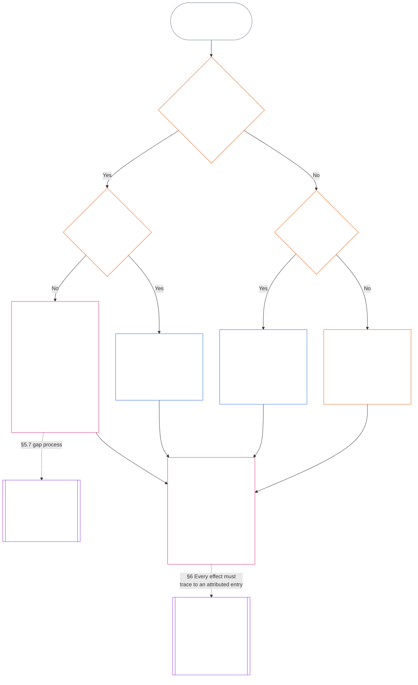

<!-- Borrador parcial de traducción al español. Fuente: commit 9c2c8c10c871d91157bcd27b9f56ad6a1cec90d3. Traducción asistida por IA; no revisada. Cobertura: Capítulo Once, §§5.7–5.9 solamente. -->

#### 5.7 Cuando una Carta del Sistema o Carta Institucional no designa un puesto

El destino de un registro de posición cuando la vía designada habitual no está disponible depende de tres preguntas, que el diagrama siguiente plantea en orden. Esta sección trata el caso en que una Carta del Sistema o Carta Institucional no designa un puesto; [§5.8 Alternativa cuando ninguna Carta del Sistema o Carta Institucional comprende el registro de posición](#58-fallback-when-no-system-charter-or-institutional-charter-reaches-the-standing-record) trata el caso en que ninguna comprende el registro.

<strong>Orientación para el lector (no operativa): cómo leer el diagrama</strong>

> En términos sencillos: los registros de posición son gestionados por las oficinas que designa la Carta del Sistema o la Carta Institucional. Si una de ellas no designa un puesto, la Carta no es válida hasta que se subsane la omisión, y el registro de posición pasa a la Autoridad Suplente para Abrir Registros y al Custodio Suplente de Registros, o a un foro; no pasa al mapa de carriles. Si ninguna Carta del Sistema ni Carta Institucional comprende el registro de posición, rige el mapa de carriles publicado por la institución y, si no existe, el registro pasa a una verificación independiente o, para el trabajo informal y de alcance reducido, al órgano que se basa en él.
>
> Todas las rutas terminan en el mismo recuadro: una oficina verifica los hechos y otra oficina distinta anota y conserva el registro de posición; después, [§6 Gestión de un registro de posición](#6-handling-a-standing-record) rige lo que hacen quienes lo custodian. Las flechas continuas muestran la ruta principal. Las flechas punteadas muestran transferencias, identificadas con la sección que las establece. Los recuadros con barras dobles laterales corresponden a otro capítulo; el último indica de dónde se derivan los efectos sobre la posición: del registro, sin reescribirlo. El diagrama no añade deberes, puestos ni campos.

 

Cuando una Carta del Sistema o Carta Institucional no designa un puesto obligatorio de registro o la vía independiente:

- **Consecuencia:** La Carta del Sistema o Carta Institucional no es válida, y no se permite una modificación que la vuelva inválida ([Capítulo Siete §4.7.1 Cuando existe una omisión y cómo se registra](core_07.000_charters.md#471-when-a-gap-exists-and-how-it-is-logged)).
- **El Capítulo Siete rige el proceso de subsanación:** [Capítulo Siete §4.7 Omisiones en el mapa para registros de posición del operador](core_07.000_charters.md#47-gaps-in-the-map-for-operator-standing-records) también rige:
  - cómo se registra una omisión;
  - los plazos de respuesta y resolución, incluida la sustitución de emergencia; y
  - cuándo vuelve la custodia a las personas designadas.

En cuanto a los registros de posición, esta sección añade lo siguiente:

- **Quién no puede actuar:** Mientras un puesto obligatorio esté vacante y la Carta del Sistema o Carta Institucional no designe un sustituto válido, nadie puede desempeñar la función de ese puesto, salvo mediante la vía del punto siguiente.
- **Destino del registro de posición:** El registro pasa a la Autoridad Suplente para Abrir Registros y al Custodio Suplente de Registros, o a un foro conforme a la **sección 2.7**, según dispone [§5.4 Prohibición de la autocustodia](#54-no-self-custody); el mapa de carriles no los sustituye. Cada registro de posición se conserva íntegro con un solo custodio.
- **Registros de posición que ya se custodian:**
  - El día en que la notificación de la omisión llegue a un foro, a un registrador o a la Autoridad Suplente para Abrir Registros, todo registro de posición del operador que custodie una oficina dentro de la Línea de Control Material de la Parte Charterizada pasa al Custodio Suplente de Registros con su historial completo.
  - Hasta entonces, esa oficina lo conserva en modo de solo lectura, no anota ninguna versión y entrega inmediatamente al Custodio Suplente de Registros una copia completa con todo su historial.
  - El custodio que esté fuera de la línea conserva el registro de posición y, durante la omisión, anota cada versión que autorice la Autoridad Suplente para Abrir Registros o un foro. Si un foro determina que el custodio está dentro de la línea, el registro pasa al Custodio Suplente de Registros con todo su historial, igual que cuando lo custodia una oficina dentro de la línea.
- **Responsables:** Si se pide a un responsable que ocupe un puesto que la Carta del Sistema o Carta Institucional no le asigna:
  - **Rechaza el puesto:** Tener acceso o capacidad técnica para anotar el registro de posición no le otorga autoridad para hacerlo.
  - **Registra la solicitud y la omisión:** Anota ambas en el registro.
  - **Remite el registro de posición:** Lo remite por la vía indicada arriba en *Destino del registro de posición*.
  - **Mantiene sus demás deberes:** Siguen vigentes los deberes que ya tiene conforme a [§5.4 Prohibición de la autocustodia](#54-no-self-custody) (*Responsables internos del sujeto*): detener lo que controla, registrar el conjunto reconstruible, preservar las pruebas que conserva, notificar y escalar el asunto. Ninguno de esos actos verifica los hechos ni anota el registro de posición. El registro y las pruebas conservadas acompañan al registro de posición como insumos para la autoridad verificadora; no constituyen una anotación ni deciden los hechos.

#### 5.8 Alternativa cuando ninguna Carta del Sistema o Carta Institucional comprende el registro de posición

Cuando ninguna Carta del Sistema ni Carta Institucional cubre el sistema, institución o empresa al que se refiere el registro de posición —como ocurre con un órgano por debajo del umbral de Clase L que no haya publicado ninguna—, rige el mapa de carriles publicado por la institución conforme a **CI-8.205 §2** (*Carriles de separación funcional*):

- **Autoridad para abrir el registro:** La oficina que el mapa de carriles sitúa en el carril de garantía y auditoría para el sistema, institución o empresa al que se refiere el registro. Esa oficina verifica el fundamento fáctico y autoriza la anotación ([§5.2 Autoridad designada para abrir el registro](#52-named-record-opening-authority)); no anota ni custodia el registro de posición.
- **Custodio:** La oficina que ocupa el carril de publicación y pruebas.
- **Exclusión del carril de ejecución:** Ninguna de las dos puede ser la oficina que ocupa el carril de ejecución del sistema correspondiente.
- **Tampoco hay mapa de carriles:** El registro se deriva a una verificación independiente conforme a *Prohibición de la autocustodia* o, si es informal y de alcance reducido, al órgano que se basa en él conforme a *Registros informales y de alcance reducido*, a continuación.
- **Responsables:** Si se pide a un responsable que ocupe un puesto que el mapa de carriles no le asigna, se aplica la regla *Responsables* de [§5.7 Cuando una Carta del Sistema o Carta Institucional no designa un puesto](#57-when-a-system-charter-or-institutional-charter-leaves-a-seat-unnamed): rechaza el puesto, anota la solicitud y la omisión en el registro y mantiene sus demás deberes. Remite el registro de posición a la oficina designada en el mapa de carriles o, si no se designa ninguna, por la vía indicada arriba en *Tampoco hay mapa de carriles*.

#### 5.9 Registros informales y de alcance reducido

La separación de funciones se escala según la importancia material, no según el grado de formalidad ([Capítulo Ocho §2 Requisito constitucional de cuatro puestos](core_08.000_functional_independence_separation_of_duties.md#2-four-seat-constitutional-requirement)).

- **Trabajo comprendido:** Las comunidades locales se sostienen con muchos tipos de contribución, buena parte de la cual no es remunerada ni formal. Esto se aplica al trabajo no remunerado, organizado entre pares, de ayuda mutua, cuidados, mantenimiento, reparación, enseñanza y administración comunitaria, que [Capítulo Trece §6 Las consecuencias de las contribuciones van primero](core_13.000_standing_integration.md#6-contribution-consequences-second) exige reconocer con criterios equivalentes.
  - **Ejemplos locales:** Vecinos que comparten alimentos y herramientas (ayuda mutua); cuidan a un vecino enfermo o anciano (cuidados); mantienen un huerto o arroyo compartido (mantenimiento y administración comunitaria); arreglan las tuberías de un vecino (reparación); dan tutorías o enseñan una habilidad (enseñanza). Cada actividad es un tipo de contribución propio.
- **Quién ocupa el puesto de verificación:** Para ese trabajo, el puesto de verificación puede ocuparlo **cualquier órgano independiente con autoridad publicada para basarse en el registro de posición**; ese órgano actúa entonces como autoridad verificadora.
  - **Quién suele ocuparlo:** A menudo es el órgano que se basará en el registro: un grupo local, como un consejo de cuenca; una organización que financie o sostenga el trabajo; la autoridad de reconocimiento de registros **CI-6.255** (*Bienes comunes, cooperativas, ayuda mutua y gobernanza comunitaria no mercantil*), que reconoce registros de trabajo comunitario de este tipo; o un foro conforme a la **sección 2.7**.
- **Qué no cuenta:** La formalidad de la autoridad verificadora no satisface el puesto de verificación.

En un registro de posición de este tipo:

- un senciente que actúe en solitario no necesita un grupo, institución, [Carta del Sistema](core_05.040_band_continuity.md#system-charter) ni [Carta Institucional](core_05.040_band_continuity.md#institutional-charter) para solicitar un registro de su propia contribución. En ese caso:
  - **Quién solicita:** El propio senciente ocupa el puesto de iniciación en su solicitud, como sujeto y reclamante.
  - **Sus propios materiales:** Su relato, registros y fotografías son insumos, nunca verificación.
  - **Puesto de verificación:** Un órgano independiente con autoridad publicada para basarse en el registro (la autoridad verificadora).
  - **Anotación y custodia:** Un custodio de registros distinto anota y conserva el registro de posición.
  - **Si alguien lo impugna:** La impugnación pasa al carril de impugnación o a un foro conforme a la **sección 2.7**.
  - **Si no hay un órgano que pueda basarse en él:** El registro de posición pasa a un foro conforme a la **sección 2.7**.
  - **Ejemplo, un fontanero jubilado:** Un fontanero jubilado que ha reparado sin remuneración las tuberías de sus vecinos durante años, sin pertenecer a ningún grupo, puede pedir a una autoridad de reconocimiento de registros **CI-6.255** (*Bienes comunes, cooperativas, ayuda mutua y gobernanza comunitaria no mercantil*) que abra un registro de posición:
    - **Solicita y reclama:** El fontanero.
    - **Verifica:** La autoridad, a partir de los registros de trabajo y las declaraciones de los vecinos.
    - **Anota y custodia:** Un custodio de registros distinto.
    - **Si alguien lo impugna:** La impugnación pasa a un foro, no a la autoridad verificadora.
- quienes participan son sujetos y, cuando solicitan reconocimiento, reclamantes. En un registro colectivo conforme a la **sección 4.3**:
  - **Coparticipantes:** Cada persona es reclamante.
  - **Declaración de un miembro sobre la contribución de otro:** Es un insumo, nunca verificación.
- los materiales que respaldan el registro de posición proceden de dos fuentes:
  - **Personas no participantes:** Beneficiarios, vecinos y otras personas no participantes aportan declaraciones como materiales de verificación conforme a la **sección 4.1**.
  - **Registro propio del grupo:** El senciente que lo llevó es registrador y testigo conforme a *Las declaraciones del registrador son insumos*, más abajo.
- el custodio del registro del órgano que se basa en él anota y conserva lo que haya verificado una autoridad verificadora distinta:
  - **Quién no puede ocupar ninguno de los dos puestos:** Ni el custodio ni la autoridad verificadora pueden ser reclamantes ni pertenecer a la [Línea de Control Material](core_05.035_band_accountability.md#material-control-line) de un reclamante.
  - **Un órgano, dos puestos:** El mismo órgano que se basa en el registro puede ocupar ambos puestos conforme a un mapa de carriles publicado con salvaguardas de independencia auditables e impugnables.
  - **Nunca la misma persona:** Ninguna autoridad, custodio ni senciente puede desempeñar ambos deberes en un mismo registro de posición.
- el estado de un grupo no condiciona la reclamación de uno de sus integrantes:
  - **Grupos informales:** Que un grupo no tenga [Carta del Sistema](core_05.040_band_continuity.md#system-charter) ni [Carta Institucional](core_05.040_band_continuity.md#institutional-charter), o que ni siquiera sea una institución, no impide actuar a sus integrantes.
  - **Cada participante:** Puede solicitar reconocimiento como reclamante individual por el trabajo realizado dentro o fuera del grupo.
  - **Objeto del registro de posición:** Se refiere a la contribución del participante, no a la posición del grupo.
  - **Ejemplo, un círculo de costura:** Un círculo de costura que dona mantas a personas refugiadas recién llegadas ilustra este patrón: cada integrante puede solicitar un registro de posición verificado por un órgano independiente que se base en él, como la entidad que recibe las mantas; el círculo no necesita una Carta del Sistema ni una Carta Institucional.
- también puede surgir un registro de posición de violación en estos mismos contextos informales, y los puestos siguen separados:
  - **Ejemplo, un incidente en un bar:** Alguien graba a otro senciente en un bar; esa persona se emborracha, causa disturbios y se comporta con violencia, aunque nadie sufra lesiones físicas.
    - **No se requiere lesión:** Una amenaza de violencia creíble y verificada puede respaldar un registro de posición de violación aunque nadie resulte herido (**sección 3.2**, pérdida coercitiva de capacidad de decisión).
    - **El video es un insumo:** Quien grabó es testigo. La grabación es un insumo, nunca verificación por sí sola; su existencia tampoco abre nada por sí misma (**sección 2.2**).
    - **La persona del video:** Es el sujeto. Se le notifica cuando se abre un registro de posición y no puede ocupar ninguno de los puestos ([§5.4 Prohibición de la autocustodia](#54-no-self-custody)).
    - **Puesto de verificación:** Un órgano independiente con autoridad publicada para basarse en el registro, como una autoridad local de licencias o seguridad, o un foro conforme a la **sección 2.7**. Quien grabó y el propietario del bar quedan excluidos si alguno es reclamante o pertenece a la [Línea de Control Material](core_05.035_band_accountability.md#material-control-line) de un reclamante.
    - **Anotación, custodia e impugnación:** Un custodio de registros distinto anota y conserva el registro; la impugnación pasa al carril correspondiente o a un foro conforme a la **sección 2.7**, no a la autoridad verificadora.
- una norma o proceso que exija la verificación de una institución formal inaccesible para un grupo informal, cuando haya un órgano independiente que pueda basarse en el registro, constituye el patrón de obstrucción arbitraria del acceso descrito en [Capítulo Trece §6.2 Umbrales de competencia y autorizaciones](core_13.000_standing_integration.md#62-competency-bars-and-clearances), no una separación de funciones.

Nada de esto exige que exista un registro de posición. Rige la **sección 2.2**, *El silencio es la regla general*: el trabajo informal no se registra solo porque sea posible registrarlo, y la separación de funciones solo se aplica una vez que se solicita un registro de posición.

