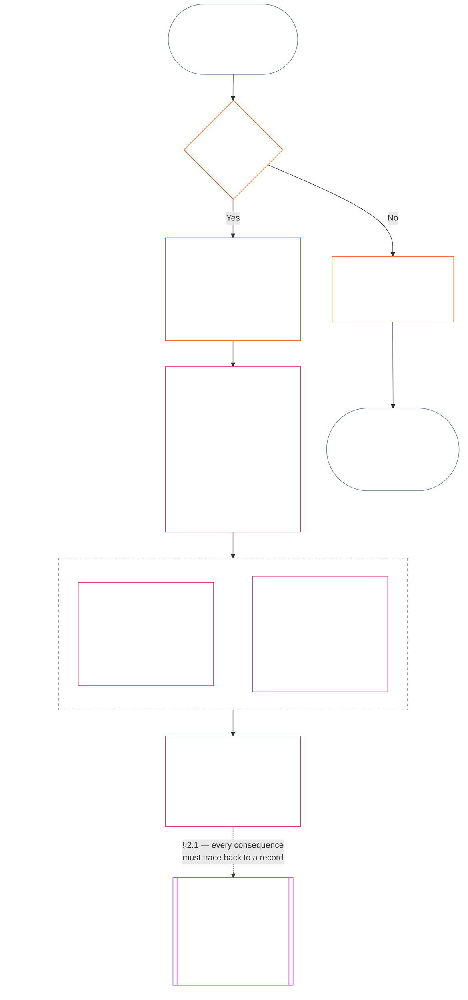
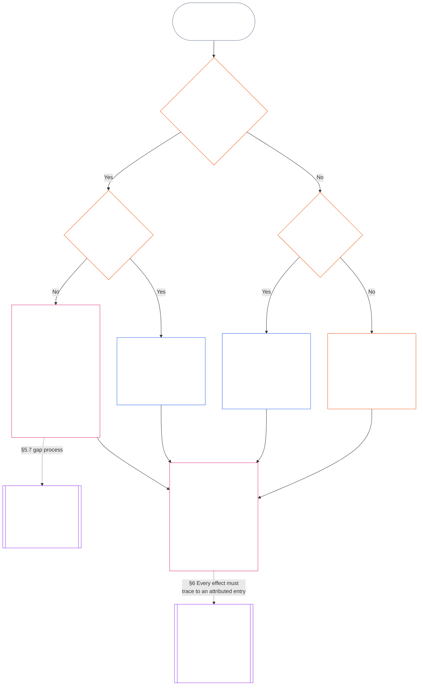

<!-- Capítulo Once completo; fuente: archivo core_11.000_standing_assessment.md, commit 9c2c8c10c871d91157bcd27b9f56ad6a1cec90d3. Borrador traducido con asistencia de IA; no revisado. Borrador no vinculante. -->

# CAPÍTULO ONCE: REGISTROS DE POSICIÓN — PREGUNTA 1, QUÉ OCURRIÓ

<strong>Ubicación en el corpus (no operativa): estructura del archivo y reglas de lectura</strong>

> Este archivo **forma parte de la Constitución Senciente** y solo es **vinculante en conjunto** con los demás archivos `core_*` numerados, leídos como un único texto. Contiene el **Capítulo Once**: las tres preguntas del proceso de posición y la **Pregunta 1** (*¿qué ocurrió?*), en **§1–§6**. La [Pregunta 2](core_12.000_standing_measurement.md#chapter-twelve-standing-measurement--question-2-how-good-or-bad-was-it) se responde en el Capítulo Doce. La Pregunta 3 (*¿qué ocurre como consecuencia?*) continúa en el [Capítulo Trece](core_13.000_standing_integration.md#chapter-thirteen-standing-effects-and-integration), con revisión limitada a la designación de conducta indebida anticonstitucional del [Capítulo Catorce](core_14.000_misconduct_designation.md#chapter-fourteen-anti-constitutional-misconduct) para hallazgos que reúnan los requisitos del Eje de Violación `s` = 7–9. El orden de lectura, la distinción entre textos vinculantes y de apoyo, y los metadatos de edición del corpus se mantienen en [README.md](README.md).

<strong>Orientación para el lector (no operativa): dónde se sitúa el Capítulo Once y qué contiene</strong>

> | Pregunta | Responsable y función |
> | --- | --- |
> | **1. ¿Qué ocurrió?** | Capítulo Once (este archivo): establecer hechos verificados en un registro de posición acotado e impugnable. |
> | **2. ¿Qué tan bueno o malo fue?** | [Capítulo Doce](core_12.000_standing_measurement.md#chapter-twelve-standing-measurement--question-2-how-good-or-bad-was-it): medir los hechos verificados sin combinar ayuda y daño. |
> | **3. ¿Qué ocurre como consecuencia?** | Continúa en el [Capítulo Trece](core_13.000_standing_integration.md#chapter-thirteen-standing-effects-and-integration). |
>
> Las alegaciones, la popularidad y los relatos de disputas no responden a la Pregunta 1. Una calificación deseada no aporta los hechos para la Pregunta 1, y una consecuencia deseada no aporta la calificación para la Pregunta 2.

<strong>Trazabilidad</strong>

- Antecedentes:
  - [Tétrada Constitucional](core_00.000_preamble.md#constitutional-tetrad);
  - [Dos Objetivos Constitucionales](core_00.000_preamble.md#two-constitutional-aims);
  - [importancia material](core_00.000_preamble.md#material-stake);
  - [Preámbulo §6 Procesos prácticos constitucionales clave](core_00.000_preamble.md#6-key-practical-process-pipelines) (*cadena de los Capítulos Nueve a Quince*).
- Antecedentes:
  - [Capítulo Uno](core_01.010_stewardship_capacity_principles.md#chapter-01-principles-and-constraints) (1.010) (*accesibilidad en lenguaje claro, reflejada en el resumen de cada sección*);
  - [Capítulo Uno §16 — Administración en profundidad](core_01.010_stewardship_capacity_principles.md#16-stewardship-in-depth) (1.010 §16) (*fundamento de la capa de principios para una posición vinculada a la competencia y trazable: confianza, funciones y reconocimiento*);
  - [Capítulos Dos a Cuatro](core_02.000_definition_structure.md) (*integridad, registros y verificación*);
  - [Capítulo Cinco](core_05.000_definitions_home.md#chapter-five-foundational-definitions) (5.000) (*definiciones y supremacía, en relación con los Capítulos Dos a Cuatro*).
- Antecedentes: [Capítulo Nueve](core_09.000_system_alignment_certification_evaluation.md#chapter-nine-system-alignment-certification) (9.000) (*certificación de alineación del sistema*); [Capítulo Nueve, Parte C §11](core_09.010_system_alignment_certification_record_recertification.md#11-relationship-to-standing) (9.010 §11) (*puente hacia la posición: solo posibles insumos verificados*).
- Proceso de posición:
  - [Preámbulo §6.2 Cómo encaja la cadena completa](core_00.000_preamble.md#62-how-the-full-chain-fits-together);
  - [Capítulo Once — Registros de posición](core_11.000_standing_assessment.md#chapter-eleven-standing-records--question-1-what-happened) (11.000) (*marco de las tres preguntas y registros de la Pregunta 1*);
  - [Capítulo Doce — Medición de la posición](core_12.000_standing_measurement.md#chapter-twelve-standing-measurement--question-2-how-good-or-bad-was-it) (12.000) (*medición de la Pregunta 2*);
  - [Capítulo Trece — Efectos e integración de la posición](core_13.000_standing_integration.md#chapter-thirteen-standing-effects-and-integration) (13.000) (*efectos e integración de la Pregunta 3*);
  - [Capítulo Catorce](core_14.000_misconduct_designation.md#chapter-fourteen-anti-constitutional-misconduct) (14.000) (*solo designación para hallazgos que reúnan los requisitos del Eje de Violación s = 7–9*).
- Subsecciones de este archivo:
  - [§1](#1-the-three-questions) (*marco de las tres preguntas y alcance*);
  - [§2](#2-question-1--what-happened) (*Pregunta 1: hechos y registros verificados*);
  - [§3](#3-question-1-event-type-guide--what-kind-of-help-or-harm-occurred) (*guía de tipos de acontecimiento de la Pregunta 1: tipos de ayuda y daño*);
  - [§4](#4-standing-record-operational-requirements) (*requisitos de verificación y registro*);
  - [§5](#5-record-custody-and-opening-authority) (*custodia del registro y autoridad para abrirlo*);
  - [§6](#6-handling-a-standing-record) (*gestión de un registro de posición*).
- Derivaciones:
  - [Capítulo Doce](core_12.000_standing_measurement.md#chapter-twelve-standing-measurement--question-2-how-good-or-bad-was-it) (12.000) (*Pregunta 2: base LEQU, dimensiones de medición, descriptores de rutas, gramática de casillas, insumos constitucionales, escala LEQU, medidas estándar de contribución, ejemplos y traspaso a la Pregunta 3*);
  - [Capítulo Catorce](core_14.000_misconduct_designation.md#chapter-fourteen-part-a-anti-constitutional-misconduct-designation) (14.000) (*solo designación; no reabre la medición de la Pregunta 2*);
  - [Capítulo Quince](core_15.000_forum.md#chapter-fifteen-forums-and-jurisdiction) (15.000) (*supervisión y derivación por foros*);
  - [Artículo XXVI-C](core_06.020_rights_part_e.md#article-xxvi-c-timely-resolution-and-anti-delay-floor) (*resolución oportuna*);
  - [Artículo XX](core_06.015_rights_part_d.md#article-xx-a-justice-objective-and-scope) (*límites de justicia*).
- Léase junto con: [Capítulo Cinco *Estado, contribución y violación en materia de posición*](core_05.035_band_accountability.md#defa3-standing-state-contribution-and-violation) (5.035) (*derivación canónica de definiciones*).
- Léase junto con: [README.md](README.md) (*orden de lectura*); [doc_architecture.md](doc_architecture.md) (*mapas editoriales no vinculantes, salvo adopción*).

 

El Capítulo Once es responsable en términos constitucionales del **registro fáctico verificado (Pregunta 1)**. Abarca desde [§1 Las tres preguntas](#1-the-three-questions) hasta [§6 Gestión de un registro de posición](#6-handling-a-standing-record). El [Capítulo Doce](core_12.000_standing_measurement.md#chapter-twelve-standing-measurement--question-2-how-good-or-bad-was-it) es responsable de la Pregunta 2, desde [Capítulo Doce §1 Pregunta 2 — ¿qué tan bueno o malo fue?](core_12.000_standing_measurement.md#1-question-2--how-good-or-bad-was-it) hasta [Capítulo Doce §9 Traspaso a la Pregunta 3 — conexiones de medición entre preguntas](core_12.000_standing_measurement.md#9-hand-off-to-question-3--cross-question-measurement-hooks). La Pregunta 3 continúa en el Capítulo Trece.

*En términos sencillos: este capítulo deja constancia de lo ocurrido y conserva el registro de posición. El Capítulo Doce mide lo bueno o perjudicial que fue en dos vías separadas, nunca en una única puntuación neta. Presentar un caso no confiere por sí solo una posición.*

### 1. Las tres preguntas

*En términos sencillos: la posición se determina respondiendo tres preguntas en orden. No deduzca hechos a partir de una calificación deseada ni elija una calificación para justificar una consecuencia deseada.*

| Pregunta | Qué pregunta | Dónde se responde |
| --- | --- | --- |
| **1. ¿Qué ocurrió?** | ¿Qué hechos están verificados, respecto de quién o qué, durante qué período, y con qué registro de posición y estado de impugnación? | [Sección 2](#2-question-1--what-happened) y [Sección 3](#3-question-1-event-type-guide--what-kind-of-help-or-harm-occurred) |
| **2. ¿Qué tan bueno o malo fue?** | ¿Qué tipo y magnitud de contribución o violación establecen esos hechos? | [Capítulo Doce, Sección 1](core_12.000_standing_measurement.md#1-question-2--how-good-or-bad-was-it) |
| **3. ¿Qué ocurre como consecuencia?** | ¿Qué reconocimiento, preparación, reparación, salvaguarda, restricción u otra consecuencia se deriva? | [Capítulo Trece](core_13.000_standing_integration.md#chapter-thirteen-standing-effects-and-integration) |

Cada pregunta depende de la respuesta anterior:

- La Pregunta 1 aporta los hechos verificados para la Pregunta 2.
- La Pregunta 2 mide esos hechos para la Pregunta 3.
- La Pregunta 3 no debe reescribir los hechos ni la calificación para ajustarlos a un resultado preferido.

En conjunto, las respuestas a las tres preguntas forman la evaluación completa de la posición para un acontecimiento acotado o un patrón definido. Un sujeto puede tener varias evaluaciones de ese tipo a lo largo del tiempo, y ninguna es una puntuación neta ni una calificación general del sujeto. Los registros de posición de contribución y de violación conservan las respuestas a las Preguntas 1 y 2; la decisión de la Pregunta 3 establece qué se deriva de ellas.

#### 1.1 Propósito y alcance

Este capítulo establece el marco constitucional de registro y el [Capítulo Doce](core_12.000_standing_measurement.md#chapter-twelve-standing-measurement--question-2-how-good-or-bad-was-it), el marco de medición, para **sistemas**, **sencientes** e **instituciones**, incluidos todos los sistemas clasificados conforme a [**CS-9.305**](corpus_systems/cs_09.305_system_classification_machinery.md#cs-9305-part-a-system-classification-machinery) (*Mecanismo de clasificación de sistemas*). Estos marcos no miden chismes, popularidad, reputación vaga, dignidad inherente ni valor general; ninguno de estos puede ser objeto de una evaluación de posición.

El proceso de posición debe seguir siendo eficaz cuando:

- las contribuciones verificadas anteriormente envejecen demasiado para demostrar competencia o fiabilidad actuales;
- las violaciones siguen sin resolverse;
- la reparación es costosa;
- la responsabilidad atraviesa fronteras; o
- un actor usa capas organizativas o cambios de nombre para obstaculizar la rendición de cuentas.

Estos asuntos corresponden a los textos de implementación adoptados:

- procedimientos cotidianos;
- pasos de escalamiento;
- operaciones de restitución y reparación;
- medidas de rendición de cuentas restaurativa; y
- diseño de incentivos.

La medición del Capítulo Doce **no** autoriza por sí misma el uso de la fuerza, la detención ni otra restricción de libertad. Toda consecuencia de ese tipo debe cumplir de manera independiente el Capítulo Seis, **Artículo XX** (*Justicia tras una violación verificada*), incluidos sus requisitos de proporcionalidad, mínima restricción, duración limitada, restitución y rendición de cuentas restaurativa.

<strong>Trazabilidad · Definiciones · Evaluación · Cumplimiento</strong>

- Antecedentes: [Capítulo Uno §16 — Administración en profundidad](core_01.010_stewardship_capacity_principles.md#16-stewardship-in-depth); [Capítulos Dos a Cuatro](core_02.000_definition_structure.md); [Capítulo Cinco](core_05.000_definitions_home.md#chapter-five-foundational-definitions).
- Derivaciones:
  - [§2](#2-question-1--what-happened) (*Pregunta 1*);
  - [§4](#4-standing-record-operational-requirements) (*verificación y requisitos de registro*);
  - [§5](#5-record-custody-and-opening-authority) (*custodia del registro y autoridad para abrirlo*);
  - [§6](#6-handling-a-standing-record) (*gestión de un registro de posición*);
  - [Capítulo Doce §1](core_12.000_standing_measurement.md#1-question-2--how-good-or-bad-was-it) (*medición de la Pregunta 2*);
  - [Capítulo Doce §2](core_12.000_standing_measurement.md#2-magnitude-and-severity-input-dimensions) (*dimensiones de entrada de medición*);
  - [Capítulo Doce §3](core_12.000_standing_measurement.md#3-route-descriptor-catalogs-and-measurement-roles) (*catálogos de descriptores de rutas*);
  - [Capítulo Doce §4](core_12.000_standing_measurement.md#4-slot-grammar-and-shared-scaling) (*gramática de casillas y escala compartida*);
  - [Capítulo Doce §5](core_12.000_standing_measurement.md#5-constitutional-inputs-to-axis-assignment) (*asignación según fuentes constitucionales*);
  - [Capítulo Doce §6](core_12.000_standing_measurement.md#6-unified-proportional-lequ-scale--contribution-and-violation-axes) (*escala LEQU proporcional unificada para ambos ejes*);
  - [Capítulo Trece](core_13.000_standing_integration.md#chapter-thirteen-standing-effects-and-integration) (*Pregunta 3*).
- [Materialidad](core_05.050_band_oversight.md#materiality) · [O](core_05.050_band_oversight.md#materiality) · [M](core_05.050_band_oversight.md#materiality-determination-a) · [A](core_05.050_band_oversight.md#materiality-determination-a) · [C](core_05.050_band_oversight.md#materiality-determination-c)
- [Daño](core_05.035_band_accountability.md#harm) · [O](core_05.035_band_accountability.md#harm) · [M](core_05.035_band_accountability.md#harm-a) · [A](core_05.035_band_accountability.md#harm-a) · [C](core_05.035_band_accountability.md#harm-c)
- [Proporcionalidad](core_05.035_band_accountability.md#proportionality) · [O](core_05.035_band_accountability.md#proportionality) · [M](core_05.035_band_accountability.md#proportionality-a) · [A](core_05.035_band_accountability.md#proportionality-a) · [C](core_05.035_band_accountability.md#proportionality-c)

### 2. Pregunta 1 — ¿qué ocurrió?

<strong>Trazabilidad</strong>

- Antecedentes: [§1](#1-the-three-questions) (*marco de las tres preguntas*); [Capítulos Dos a Cuatro](core_02.000_definition_structure.md) (*registro, verificación y trazabilidad de las definiciones hasta los resultados*).
- Ejes de la Tétrada: **participación**; **supervisión** (impugnabilidad y vías de impugnación). Objetivos principales: **Florecimiento** y **Continuidad** (registros trazables que conservan hallazgos separados de contribución y violación para su medición posterior).
- Derivaciones:
  - [§2.2](#22-silence-is-the-default) (*el silencio es la regla general*);
  - [§2.3](#23-protected-dissent-is-not-a-trigger) (*la disidencia protegida no es un desencadenante*);
  - [§2.4](#24-linked-standing-records-and-no-offset-bridge) (*puente de no compensación entre registros vinculados*);
  - [§2.5](#25-verified-input-gate) (*filtro de insumos verificados*);
  - [§2.6](#26-stage-boundary) (*límite entre etapas*);
  - [§2.7](#27-forum-boundary) (*límite de los foros*);
  - [§3](#3-question-1-event-type-guide--what-kind-of-help-or-harm-occurred) (*guía de tipos de acontecimiento*);
  - [§4](#4-standing-record-operational-requirements) (*requisitos del registro*);
  - [§5](#5-record-custody-and-opening-authority) (*custodia del registro y autoridad para abrirlo*);
  - [§6](#6-handling-a-standing-record) (*gestión de un registro de posición*);
  - [Capítulo Doce §1](core_12.000_standing_measurement.md#1-question-2--how-good-or-bad-was-it) (*medición de la Pregunta 2*);
  - [Capítulo Doce §2](core_12.000_standing_measurement.md#2-magnitude-and-severity-input-dimensions) (*dimensiones de entrada de medición*);
  - [Capítulo Doce §3](core_12.000_standing_measurement.md#3-route-descriptor-catalogs-and-measurement-roles) (*catálogos de descriptores de rutas*);
  - [Capítulo Doce §4](core_12.000_standing_measurement.md#4-slot-grammar-and-shared-scaling) (*gramática de casillas y escala compartida*);
  - [Capítulo Doce §5](core_12.000_standing_measurement.md#5-constitutional-inputs-to-axis-assignment) (*asignación según fuentes constitucionales*);
  - [Capítulo Doce §6](core_12.000_standing_measurement.md#6-unified-proportional-lequ-scale--contribution-and-violation-axes) (*escala LEQU proporcional unificada para ambos ejes*);
  - [Capítulo Trece](core_13.000_standing_integration.md#chapter-thirteen-standing-effects-and-integration) (13.000) (*Pregunta 3*).

 

*En términos sencillos: la Pregunta 1 establece un relato acotado e impugnable de lo que ocurrió. Identifica al sujeto, el acontecimiento o patrón, el período, los hechos verificados y el estado del registro antes de considerar cualquier calificación o consecuencia. La ayuda verificada y las violaciones verificadas usan registros de posición separados para que una no borre la otra. Estos registros no son puntuaciones de popularidad ni etiquetas vagas.*

Un **registro de posición** es el registro acotado que este capítulo utiliza para un sujeto, ámbito funcional, período del registro, estado de revisión y contexto decisorio determinados. Antes de iniciar la medición, debe establecer:

- a quién o a qué se refiere el registro de posición;
- si se refiere a un acontecimiento acotado o a un patrón definido;
- cuándo y dónde ocurrieron la conducta y los efectos pertinentes;
- cuáles hechos están verificados y cuáles siguen en disputa;
- qué pruebas, atribución y vía de impugnación respaldan esos hallazgos; y
- el estado actual de revisión, corrección y sustitución del registro de posición.

El diagrama sigue un acontecimiento para determinar si activa un registro de posición y qué contiene ese registro; las subsecciones siguientes enuncian cada regla. La rama «no» sale de la ruta principal hacia la derecha.

#### 2.1 Registros de posición: tipos y sujetos

La Pregunta 1 utiliza un **registro de posición de contribución** para la ayuda verificada y un **registro de posición de violación** para el daño verificado, incluidos los fallos de rendición de cuentas. Un mismo registro de posición no combina ambos tipos de hallazgo.

- Un registro de posición puede referirse a un senciente, una institución, un sistema, una evaluación, un acontecimiento acotado, una función, un colectivo, un registro específico de un actor u otra unidad pertinente en términos constitucionales.
  - No debe reducir sujetos, funciones, sistemas, comunidades, períodos del registro, estados de revisión o contextos decisorios distintos a una sola etiqueta de posición indiferenciada.
- Un registro de posición puede abarcar un **acontecimiento acotado** —un episodio con un inicio y un final claros— o un **patrón** de conducta repetida.
  - Un patrón requiere un sujeto, alcance y período de revisión definidos.
- El mismo sujeto puede tener varios registros de posición a lo largo del tiempo, incluidos registros vinculados de posición de contribución y de violación.
  - Los registros de posición relacionados deben **remitirse entre sí** conforme a la **sección 4.2** cuando compartan sujeto, períodos superpuestos, acontecimiento acotado, patrón o contexto decisorio.
- Un registro de posición no es una puntuación de reputación independiente, un rango de dignidad, un estado permanente, una etiqueta de valor general ni una tarjeta de puntuación combinada.
  - Los requisitos operativos figuran en la **sección 4**.

Todo efecto posterior sobre la posición corresponde al Capítulo Trece y debe poder rastrearse hasta el registro o los registros de posición pertinentes, sin pasar a formar parte del propio registro.

#### 2.2 El silencio es la regla general

No tener un registro de posición es el estado habitual de un senciente, una institución o un sistema, y será el estado en que permanecerá la mayoría de los sencientes.

- Un registro de posición solo se abre cuando se ha verificado un desencadenante conforme a la **sección 4**. Una autoridad designada para abrir registros debe aprobar la anotación y un custodio de registros distinto debe realizarla (**sección 5**). Nunca se abre un registro de posición:
  - para establecer una referencia inicial;
  - para completar una lista; o
  - porque así lo prefiera quien controla una puerta de acceso a una vía designada.
- No tener un registro de posición no dice nada. «Sin calificación», «no verificado» y «no consta ningún registro» no son pruebas de riesgo, contribución baja ni de ninguna otra cosa. Nadie puede tratar la ausencia de un registro como motivo para un escrutinio más estricto, un valor predeterminado inferior o acceso condicional a una vía designada.
- Ninguna institución ni sistema puede exigir un registro de posición, una constancia de «ausencia de registro» o consentimiento para abrir uno como condición para:
  - bienes esenciales del **Artículo III** (*Supervivencia y acceso esencial*);
  - protecciones del **Artículo III-C** (*Trabajo y piso económico*);
  - el comercio ordinario; o
  - participar como parte afectada.
  Los umbrales de competencia publicados para vías designadas específicas y sensibles a la confianza, según [Capítulo Trece §6.2 Umbrales de competencia y autorizaciones](core_13.000_standing_integration.md#62-competency-bars-and-clearances), constituyen la excepción; deben explicar por qué la vía designada es sensible a la confianza.
- Cuando se abre un registro de posición sobre un sujeto, se debe informar a ese sujeto, como exige la **sección 4**. La notificación solo puede aplazarse si una necesidad documentada de [Preservación de pruebas](core_05.050_band_oversight.md#evidence-preservation) o de seguridad lo justifica, y únicamente por un período limitado y establecido. La notificación es lo que hace impugnable un registro de posición: un sujeto que desconoce su existencia no puede impugnarlo ni corregirlo.

#### 2.3 La disidencia protegida no es un desencadenante

La disidencia o la protesta pacífica —incluida la [desobediencia civil no violenta protegida](core_06.005_rights_part_b.md#xi-d-nonviolent-civil-disobedience)— conforme al **Artículo XI-D** (*Reunión, disidencia y protesta pacífica*) ([*Piso de disidencia y protesta pacífica*](core_06.005_rights_part_b.md#xi-d-dissent-and-peaceful-protest)) no constituye un desencadenante verificado.

- No abre, prolonga ni agrava un registro de posición de violación, no es un factor de gravedad conforme a la **sección 8.2** y su repetición no la convierte en un patrón.
- La conducta separable que viole de manera independiente un piso constitucional se registra según sus propios términos, sin agravación por el punto de vista, la causa o el objetivo de la protesta.

#### 2.4 Registros de posición vinculados y puente de no compensación

<strong>Trazabilidad</strong>

- Antecedentes: [§2.1](#21-standing-records-kinds-and-subjects) (*registros separados de contribución y violación*).
- Derivaciones:
  - [§2.5](#25-verified-input-gate) (*filtro de insumos verificados*);
  - [§2.7](#27-forum-boundary) (*límite de los foros*);
  - [§4.2](#42-related-standing-record-cross-references) (*referencias cruzadas*);
  - [Capítulo Doce §1](core_12.000_standing_measurement.md#1-question-2--how-good-or-bad-was-it) (*medición de la Pregunta 2*);
  - [Capítulo Doce §2](core_12.000_standing_measurement.md#2-magnitude-and-severity-input-dimensions) (*dimensiones de entrada de medición*);
  - [Capítulo Doce §3](core_12.000_standing_measurement.md#3-route-descriptor-catalogs-and-measurement-roles) (*catálogos de descriptores de rutas*);
  - [Capítulo Doce §4](core_12.000_standing_measurement.md#4-slot-grammar-and-shared-scaling) (*gramática de casillas y escala compartida*);
  - [Capítulo Doce §5](core_12.000_standing_measurement.md#5-constitutional-inputs-to-axis-assignment) (*asignación según fuentes constitucionales*);
  - [Capítulo Doce §6](core_12.000_standing_measurement.md#6-unified-proportional-lequ-scale--contribution-and-violation-axes) (*escala LEQU proporcional unificada para ambos ejes*);
  - [Capítulo Trece](core_13.000_standing_integration.md#chapter-thirteen-standing-effects-and-integration) (13.000) (*Pregunta 3*).
- Léase junto con: [Capítulo Trece — Integración de la posición](core_13.000_standing_integration.md#2-automatic-integration-review-and-continuity) (13.000) (*integración sin renuncia y de registros vinculados*); [Capítulo Trece §6.2 — Umbrales de competencia y autorizaciones](core_13.000_standing_integration.md#62-competency-bars-and-clearances) (13.000 §6.2); [Capítulo Trece §4.2 — Bloqueos de posición](core_13.000_standing_integration.md#42-prevention--general-standing-locks) (13.000 §4.2).

 

**Regla fundamental:** los **registros de posición de contribución** verificada y los **registros de posición de violación** verificada se mantienen separados conforme a la **sección 2.1**. Cada hallazgo de contribución o violación debe basarse en hechos respaldados propios, incluidos en su propio registro de posición. El análisis y los materiales de respaldo deben mantener las dos vías de registro trazables por separado. Ninguna anotación ni conjunto de registros vinculados constituye una puntuación neta, una puntuación combinada ni una compensación.

- **Registros de posición de violación y bloqueos de posición:**
  - Conforme al Capítulo Trece, los **bloqueos de posición** aplicables que se deriven de registros de posición de violación pueden limitar la posición, restringir la elegibilidad para una función o afectar el acceso a una reparación mientras una violación verificada siga sin resolverse.
  - Los bloqueos de posición no deben borrar las contribuciones positivas verificadas que consten en registros de posición de contribución.
  - El mero transcurso del tiempo no reduce el peso de violaciones verificadas sin resolver.
  - Las violaciones verificadas no deben transformar registros de posición de contribución no relacionados en un expediente de reputación falsamente negativo.
- **Registros de posición de contribución y autorizaciones de competencia:**
  - Una contribución verificada puede respaldar las **autorizaciones de competencia** aplicables respecto de **umbrales de competencia** publicados, así como la elegibilidad vinculada a la confianza, una función o un reconocimiento cuando la contribución sea actual y pertinente para la función.
  - Una contribución verificada no debe compensar, reducir mediante promedios, excusar ni cambiar la etiqueta de un hallazgo de violación verificado.
  - Cumplir un umbral no exime de ningún bloqueo de posición aplicable.

**La única excepción:** si un hallazgo de violación refuta por sí mismo una contribución alegada —por ejemplo, si las pruebas muestran que en realidad no se hizo lo que afirma el registro de contribución—, entonces el registro de posición de contribución vinculado puede corregirse o eliminarse mediante el proceso debido de pruebas y revisión, con la referencia cruzada exigida por la **sección 4.2**. Pero la violación no borra automáticamente la ayuda no relacionada que conste en registros de posición de contribución separados.

#### 2.5 Filtro de insumos verificados

El filtro funciona así:

- Toda decisión que afecte la posición, la confianza, una función, el reconocimiento o la elegibilidad para reconocimiento solo puede usar insumos verificados de los **registros de posición de contribución** o los **registros de posición de violación** pertinentes.
- Las alegaciones, reclamaciones no resueltas, etiquetas provisionales de derivación, relatos limitados a la recepción inicial y otros materiales propios de la etapa de disputa no establecen por sí solos la naturaleza de la contribución ni de la violación para determinar la posición.
- Un insumo verificado es un **hallazgo de posición**: un hallazgo de contribución verificado (Eje I) o un hallazgo de violación verificado (Eje II).
- Los hallazgos de contribución y de violación permanecen en registros de posición separados (véase la **sección 2.1**).

#### 2.6 Límite entre etapas

Las etapas de un registro de posición se mantienen separadas:

- La Pregunta 1 registra hechos verificados; la Pregunta 2 los mide.
- Un registro de posición puede abrirse una vez que se complete su fundamento fáctico verificado, aunque la medición de la Pregunta 2 siga pendiente.
- Hasta que se realice la medición, los campos de la Pregunta 2 deben indicar que está pendiente, en vez de sugerir una casilla o categoría.
- El registro de posición no debe establecer ni aplicar un **efecto sobre la posición** de la Pregunta 3.

#### 2.7 Límite de los foros

*En términos sencillos: los foros supervisan las disputas, permiten impugnarlas y las convierten en resultados verificados; pero presentar un caso o imponerse en una disputa narrativa no actualiza la posición. Sigue aplicándose el filtro de insumos verificados de la **sección 2.5**. Cuando un foro verifica los hechos conforme a los Capítulos Dos a Cuatro, puede **abrir, actualizar o corregir** un registro de posición, o **dejar sin efecto un registro incorrecto tras una impugnación**. Los foros no combinan lo bueno y lo malo en una sola puntuación ni inventan por sí mismos la categoría de posición.*

Esta sección se ocupa de una sola pregunta: cómo llega el trabajo de un foro a un registro de posición. Los demás pasos de la cadena corresponden a los responsables aquí indicados, y la cadena se sigue en este orden:

1. Se presenta una disputa y el foro conserva un **registro del caso del foro**, que no es un registro de posición. Responsable: [Capítulo Quince §2.3 Registros de casos de foros, registros de posición e impugnaciones](core_15.000_forum.md#23-forum-case-records-standing-records-and-contests); véase también [§2.7.1 Registro del caso del foro](#271-forum-case-record).
2. El foro verifica los hechos conforme a los [Capítulos Dos a Cuatro](core_02.000_definition_structure.md).
3. Los hallazgos verificados pasan por el filtro de insumos verificados. Responsable: [§2.5 Filtro de insumos verificados](#25-verified-input-gate).
4. Una autoridad designada para abrir registros, que puede ser un foro, abre, actualiza o corrige el registro de posición, o deja sin efecto un registro incorrecto tras una impugnación. Responsables: [§4.1 Contenido mínimo del registro](#41-minimum-record-contents), que establece qué contiene el registro, y [§5 Custodia del registro y autoridad para abrirlo](#5-record-custody-and-opening-authority), que establece quién puede actuar.
5. El registro de posición contiene únicamente hechos verificados; después, la Pregunta 2 los mide. Responsables: [§2.6 Límite entre etapas](#26-stage-boundary) y [Capítulo Doce §1 Pregunta 2 — ¿qué tan bueno o malo fue?](core_12.000_standing_measurement.md#1-question-2--how-good-or-bad-was-it).
6. Si existe algún efecto sobre la posición, se deriva conforme al [Capítulo Trece](core_13.000_standing_integration.md#chapter-thirteen-standing-effects-and-integration), que es responsable de esos efectos.

Las familias de foros conforme al [Capítulo Quince](core_15.000_forum.md#chapter-fifteen-forums-and-jurisdiction) **supervisan** cómo las disputas concretas recorren el proceso de posición. Los foros aportan lo siguiente conforme al [Capítulo Quince §6 Resolución oportuna, niveles de materialidad y disciplina contra las demoras](core_15.000_forum.md#6-timely-resolution-materiality-tiers-and-anti-delay-discipline) y al [Artículo XXVI-C](core_06.020_rights_part_e.md#article-xxvi-c-timely-resolution-and-anti-delay-floor) (*Resolución oportuna y piso contra las demoras*):

- impugnación accesible;
- revisión independiente;
- apoyo forense;
- secuenciación de medidas correctivas; y
- plazos por nivel.

Cuando esos hallazgos del foro cumplen el filtro de insumos verificados conforme a los Capítulos Dos a Cuatro, pueden:

- **abrir, actualizar o corregir** registros de posición conforme a la **sección 4.1**; o
- **dejar sin efecto un registro incorrecto tras una impugnación**.

##### 2.7.1 Registro del caso del foro

El expediente propio del foro sobre una disputa abierta es el [**registro del caso del foro**](core_05.035_band_accountability.md#forum-case-record), definido en [Capítulo Quince §2.3 Registros de casos de foros, registros de posición e impugnaciones](core_15.000_forum.md#23-forum-case-records-standing-records-and-contests). **No** es un registro de posición.

##### 2.7.2 Hallazgos del foro y medición de la Pregunta 2

Los hallazgos fácticos verificados de un foro pueden proporcionar la base fáctica para un registro de posición de la Pregunta 1. **No** determinan la medición de la Pregunta 2 sobre qué tan buena o mala fue la contribución o violación verificada ([§2.6 Límite entre etapas](#26-stage-boundary)). Por consiguiente:

- Los procedimientos del foro **no deben** combinar materiales de contribución y violación en una sola puntuación neta, respuesta combinada sobre el fondo ni etiqueta de posición indiferenciada; los registros de posición vinculados siguen separados conforme a [§2.1 Registros de posición: tipos y sujetos](#21-standing-records-kinds-and-subjects) y [§2.4 Registros de posición vinculados y puente de no compensación](#24-linked-standing-records-and-no-offset-bridge).
- Los resultados del foro **no deben** sustituir insumos verificables por relatos de la disputa, conveniencia de derivación o preferencias del panel ([§2.5 Filtro de insumos verificados](#25-verified-input-gate)), ni reemplazar la medición separada ([Capítulo Doce §1 Pregunta 2 — ¿qué tan bueno o malo fue?](core_12.000_standing_measurement.md#1-question-2--how-good-or-bad-was-it)) ni los mecanismos de efectos sobre la posición que corresponden al [Capítulo Trece](core_13.000_standing_integration.md#chapter-thirteen-standing-effects-and-integration).

##### 2.7.3 Lo que el límite de los foros no reduce

Este límite **no** reduce la impugnación, la reparación, las medidas provisionales ni las garantías procesales exigidas conforme a:

- [Artículo XIII-A](core_06.010_rights_part_c.md#article-xiii-a-reliability-and-trustworthiness-baseline) (*Base de fiabilidad y confiabilidad*);
- [Artículo XIII-B](core_06.010_rights_part_c.md#article-xiii-b-right-to-redress-and-remedy) (*Derecho a la reparación y a medidas correctivas*);
- [Capítulo Quince §6 Resolución oportuna, niveles de materialidad y disciplina contra las demoras](core_15.000_forum.md#6-timely-resolution-materiality-tiers-and-anti-delay-discipline);
- [Artículo XXVI-C](core_06.020_rights_part_e.md#article-xxvi-c-timely-resolution-and-anti-delay-floor) (*Resolución oportuna y piso contra las demoras*); o
- los artículos de justicia relacionados.

Exige que los hallazgos verificados de los foros ingresen al proceso de posición por el mismo filtro que los demás insumos verificados, y no por fuera de él.

### 3. Guía de tipos de acontecimiento de la Pregunta 1 — ¿qué tipo de ayuda o daño ocurrió?

*En términos sencillos: use estas tablas para describir lo ocurrido una vez verificados los hechos. Ayudan a identificar el tipo de contribución o violación. No determinan qué tan bueno o malo fue, no asignan una casilla ni deciden qué ocurre como consecuencia.*

#### 3.1 Tipos de acontecimientos de contribución

**Regla de calificación:** Una contribución alegada solo cuenta cuando es trazable, no externaliza costos y es coherente con la Constitución operativa en su conjunto.

- Los daños externalizados, las dependencias coercitivas, la reducción del Piso de Derechos o las cargas ocultas pueden descalificar o limitar la contribución alegada.
- Una contribución alegada no compensa un hallazgo de violación separado.

Cada fila de la tabla siguiente nombra una vía común de ayuda verificada y su relevancia constitucional. Puede aplicarse más de una fila al mismo registro de posición.

| Tipo de contribución verificada | Qué ocurrió | Eje(s) de la Tétrada | Objetivo(s) principal(es) |
| --- | --- | --- | --- |
| Supervivencia y mantenimiento corporal | Alguien recibió alimentos, vivienda, atención médica o protección | **Participación**, **Supervisión** | **Florecimiento** |
| Cuidado y enseñanza | Se crió a niños, se cuidó a personas mayores o se educó a otras personas | **Participación**, **Supervisión** | **Florecimiento**, **Continuidad** |
| Resolución del trauma | Alguien recibió ayuda para recuperarse de un daño psicológico que impedía su bienestar | **Participación**, **Rendición de cuentas** | **Florecimiento** |
| Eliminación de cargas graves | Se eliminaron deudas abrumadoras, condiciones laborales explotadoras o barreras sistémicas | **Participación**, **Supervisión** | **Florecimiento** |
| Restablecimiento de la capacidad de decisión | Alguien obtuvo opciones significativas respecto de su propia vida | **Participación** | **Florecimiento** |
| Ampliación de la capacidad productiva | Herramientas, infraestructura u oportunidades permitieron que otras personas prosperaran de forma independiente | **Participación**, **Supervisión** | **Florecimiento**, **Continuidad** |
| Mejora de la eficiencia temporal | Se redujeron esperas evitables, fricción administrativa o costos de coordinación, y se devolvió tiempo aprovechable para cuidados, descanso, capacidad de decisión, aprendizaje o trabajo compatible con los derechos | **Participación**, **Supervisión** | **Florecimiento** |
| Reducción del riesgo ecológico o de infraestructura | Se evitó el colapso ambiental o el fallo de un sistema crítico | **Supervisión**, **Rendición de cuentas** | **Continuidad**, **Florecimiento** |
| Reducción de la huella ecológica | Se redujeron de manera verificable el uso de recursos, las emisiones o la demanda de tierra y agua, sin trasladar la carga a otras personas ni a los ecosistemas | **Supervisión**, **Rendición de cuentas** | **Continuidad**, **Florecimiento** |
| Rehabilitación de ecosistemas | Se restauraron tierras, aguas o hábitats degradados para acercarlos a un estado funcional y autosostenible | **Supervisión**, **Rendición de cuentas** | **Continuidad**, **Florecimiento** |
| Protección de especies amenazadas | Se protegió de la pérdida a especies en riesgo de extinción o a los hábitats de los que dependen | **Supervisión**, **Rendición de cuentas** | **Continuidad**, **Florecimiento** |
| Reducción de la contaminación y los residuos | Se previno, eliminó o gestionó de forma segura la contaminación, las emisiones nocivas o los residuos | **Supervisión**, **Rendición de cuentas** | **Florecimiento**, **Continuidad** |
| Fortalecimiento de la seguridad, la verdad, la auditabilidad o la capacidad de impugnación | Se construyeron o repararon instituciones o prácticas para proteger derechos y exigir rendición de cuentas a quienes ejercen poder | **Participación**, **Supervisión**, **Rendición de cuentas** | **Florecimiento**, **Continuidad** |

#### 3.2 Tipos de acontecimientos de violación

**Regla de calificación:** Un tipo de acontecimiento de violación requiere un hallazgo de violación verificado que siga siendo trazable, acotado, auditable e impugnable conforme a los **Capítulos Dos a Cuatro**.

- Las alegaciones, etiquetas provisionales, relatos del foro y etiquetas de recepción inicial pueden servir para derivación o clasificación inicial, pero no completan la Pregunta 1.
- Una contribución positiva no compensa, excusa, deshace ni cambia la etiqueta de una violación verificada.

Cada fila de la tabla siguiente nombra una vía común de pérdida, peligro o incumplimiento de deber verificado y su relevancia constitucional. Puede aplicarse más de una fila al mismo registro de posición.

| Tipo de pérdida o peligro verificado | Qué ocurrió | Eje(s) de la Tétrada | Objetivo(s) principal(es) |
| --- | --- | --- | --- |
| Privación de supervivencia o mantenimiento corporal | Se produjo una muerte evitable, se denegó atención, hubo condiciones inseguras o privación material de medios de supervivencia | **Rendición de cuentas**, **Participación** | **Florecimiento** |
| Carga grave evitable | Cargas abrumadoras, impuestas o trasladadas sistemáticamente perjudicaron materialmente el bienestar o la capacidad de decisión | **Rendición de cuentas**, **Participación** | **Florecimiento** |
| Pérdida coercitiva de capacidad de decisión | Hubo coerción, manipulación, amenaza creíble, confinamiento o peligro para la libertad | **Rendición de cuentas**, **Participación** | **Florecimiento** |
| Vulneración del Piso de Derechos | Se vulneraron materialmente pisos constitucionales no negociables, la supremacía constitucional o el acceso a la impugnación y a medidas correctivas | **Rendición de cuentas**, **Supervisión** | **Florecimiento**, **Continuidad** |
| Daño ecológico o de infraestructura | Se dañaron condiciones necesarias para el bienestar constitucional | **Rendición de cuentas**, **Supervisión** | **Continuidad**, **Florecimiento** |
| Daño por contaminación o residuos | La contaminación, las emisiones nocivas o los residuos dañaron el aire, el agua, el suelo o la salud | **Rendición de cuentas**, **Supervisión** | **Florecimiento**, **Continuidad** |
| Destrucción de especies o hábitats | Se destruyeron, fragmentaron o llevaron a la pérdida especies en riesgo de extinción o los hábitats de los que dependen, incluida una pérdida tratada como compensable | **Rendición de cuentas**, **Supervisión** | **Continuidad**, **Florecimiento** |
| Pérdida de capacidad de recuperación ecológica | Se eliminó la capacidad de un ecosistema para regenerarse tras un daño o se hizo evitable y gravemente difícil o imposible revertirlo | **Rendición de cuentas**, **Supervisión** | **Continuidad**, **Florecimiento** |
| Daño ecológico externalizado o agotamiento | Se trasladaron costos ecológicos a otras personas o ecosistemas, se agotaron recursos más allá de su capacidad de regeneración o una afirmación sobre huella o sostenibilidad ocultó un deterioro continuo | **Rendición de cuentas**, **Supervisión** | **Continuidad**, **Florecimiento** |
| Destrucción de capacidad productiva | Se impidieron herramientas, capacidades, relaciones o recursos necesarios para prosperar de manera independiente | **Rendición de cuentas** | **Florecimiento** |
| Deterioro de la seguridad, la verdad o la auditabilidad | Se produjeron ocultamiento, desinformación, registros defectuosos, vías de impugnación inaccesibles o agregación no revisable | **Supervisión**, **Rendición de cuentas** | **Florecimiento**, **Continuidad** |
| Obstrucción de la rendición de cuentas | Hubo interferencia verificada con los mecanismos de exigibilidad —integridad de las pruebas, verificación, proceso del foro, registros de posición, plazos de reparación o vías de impugnación y resarcimiento—; cuando la obstrucción constituye un ataque indirecto a un daño subyacente distinto, abra un registro de posición de violación separado y vinculado | **Rendición de cuentas**, **Supervisión**, **Oportunidad** | **Florecimiento**, **Continuidad** |
| Captura del sistema o abuso de dependencia | Hubo habilitación estructural, abuso de asimetrías de dependencia, diseño contra la elusión o captura de las vías de rendición de cuentas | **Rendición de cuentas**, **Participación** | **Continuidad**, **Florecimiento** |

### 4. Requisitos de verificación y registro

<strong>Trazabilidad</strong>

- Antecedentes: [§2](#2-question-1--what-happened) (*registros de la Pregunta 1 y guía de tipos de acontecimiento*); [Capítulos Dos a Cuatro](core_02.000_definition_structure.md) (*registro, verificación y trazabilidad de las definiciones hasta los resultados*).
- Derivaciones:
  - [§4.1](#41-minimum-record-contents) (*contenido mínimo*);
  - [§4.2](#42-related-standing-record-cross-references) (*referencias cruzadas*);
  - [§5](#5-record-custody-and-opening-authority) (*custodia del registro y autoridad para abrirlo*);
  - [§6](#6-handling-a-standing-record) (*gestión de un registro de posición*);
  - [Capítulo Doce §1](core_12.000_standing_measurement.md#1-question-2--how-good-or-bad-was-it) (*Pregunta 2*).
- Léase junto con: [CF-15.415 §8 Autoridad sobre información restringida](corpus_forum/cf_15.415_routing_operations_transfer_certification_representative_treatment.md#cf-15415-8-restricted-information-authority) (*primer paso para una disputa sobre un límite de divulgación indicado conforme a [§4.1](#41-minimum-record-contents)*).

 

*En términos sencillos: esta sección establece qué debe contener cada registro de posición, cómo se remiten entre sí los registros relacionados y cómo se versionan. Quién puede abrir y custodiar un registro de posición, y cómo puede impugnarse o corregirse, se explica en [§5 Custodia del registro y autoridad para abrirlo](#5-record-custody-and-opening-authority). Las mediciones de la Pregunta 2 solo pueden añadirse después de que se registre el fundamento fáctico verificado.*

El nivel de detalle exigido en materia de pruebas y registros puede aumentar según la importancia material y la clase del sistema. Esta escala no excluye del proceso de posición a ningún senciente, institución o sistema comprendido.

#### 4.1 Contenido mínimo del registro

Un registro de posición incluye los campos que siguen; las dos últimas subsecciones añaden campos para cada eje. El filtro de insumos verificados, que determina qué puede alimentar un registro de posición, se establece en [§2.5 Filtro de insumos verificados](#25-verified-input-gate). La regla que mantiene separados los hechos de la Pregunta 1 y la medición de la Pregunta 2 figura en [§2.6 Límite entre etapas](#26-stage-boundary).

##### 4.1.1 Campos obligatorios de todo registro de posición

Todo registro de posición debe incluir, como mínimo:

- el tipo de registro de posición: **registro de posición de contribución** o **registro de posición de violación**;
- a quién o a qué se evalúa y el alcance de la evaluación, incluidos los límites pertinentes del sistema, los límites de las funciones, las comunidades afectadas y las relaciones de dependencia;
- qué conducta o hallazgo se evalúa, incluidos los actos, las omisiones, los deberes, los efectos, el acontecimiento acotado, el patrón comprendido en el alcance, el registro de contribución o el hallazgo de violación en que se basa el registro de posición;
- el período del registro y el estado actual de revisión, por ejemplo, provisional, definitivo para un propósito declarado, impugnado, sustituido o pendiente de reevaluación programada;
- todo registro de posición relacionado que deba incluirse como referencia cruzada conforme a la **sección 4.2**;
- los registros oficiales, testimonios, mediciones, auditorías, decisiones de foros u otros materiales de verificación que permitan demostrar, revisar e impugnar el registro de posición conforme a los Capítulos Dos a Cuatro;
- la **autoridad para abrir el registro** que verificó el fundamento fáctico y autorizó la anotación, y el **custodio del registro** distinto que anotó y conserva el registro de posición; se debe identificar a ambos conforme a la **sección 5**;
- cómo impugnar el registro de posición, incluidos:
  - qué foro o autoridad lo revisa;
  - cualquier límite de divulgación; y
  - las condiciones para:
    - corregirlo;
    - restablecerlo;
    - dejarlo vencer; o
    - someterlo a revisión programada;
- los campos de medición de la Pregunta 2 específicos para cada eje que se exigen a continuación, una vez realizada la medición.

##### 4.1.2 Acción atribuible inspeccionable

Las pruebas de acciones atribuibles se relacionan con el registro de posición de la siguiente manera:

- Para el personal o los agentes que ejercen Administración de Sistemas Críticos o autoridad operativa material, [CS-16.305 §10 Acción atribuible inspeccionable](corpus_systems/cs_16.305_critical_system_stewardship.md#cs-16305-103-inspectable-attributable-action) especifica pruebas reconstruibles de acciones atribuibles como contrato de registro predeterminado para equipos mixtos.
- Esas pruebas pueden alimentar este registro de posición.
- No sustituyen este registro de posición.
- Un registro de posición no incluye los pesos de un modelo de IA (los números internos del modelo) ni su razonamiento privado. La única excepción se da cuando no queda ningún otro medio para demostrar quién o qué fue responsable.
- Un asunto no queda fuera de la medición de posición solo porque involucre la privacidad de alguien o el estado interno protegido de un sistema. Sigue midiéndose cuando sea pertinente para un asunto de posición.

##### 4.1.3 Sin excepción por privacidad u opacidad

La privacidad, la confidencialidad o la opacidad del interior de un sistema no eximen un asunto de la medición de posición. Cuando estos elementos entran en conflicto con el requisito de un registro verificado, el conflicto se resuelve conforme a [Capítulo Uno §13.1 Principios fundamentales para las compensaciones](core_01.005_interaction_interpretation.md#131-core-tradeoff-principles) y a su disciplina de registros de decisión, preservando el acceso de revisores independientes.

##### 4.1.4 Campos adicionales para los registros de posición de contribución

Los **registros de posición de contribución** también deben indicar:

- la medición de contribución de la Pregunta 2, incluidos:
  - la banda principal;
  - la casilla `s`, cuando se asigne (véase [Capítulo Doce §4 Gramática de casillas y escala compartida](core_12.000_standing_measurement.md#4-slot-grammar-and-shared-scaling));
  - el fundamento probatorio;
  - el razonamiento sobre materialidad; y
  - cualquier calibración LEQU o comparable adoptada y utilizada para brindar apoyo transparente;
- si la contribución es compartida, cómo se distribuyó el crédito, teniendo en cuenta:
  - el tiempo;
  - el esfuerzo;
  - la coordinación;
  - el mantenimiento;
  - la contribución causal; y
  - el trabajo de apoyo menos visible;
- la medición de contribución aquí registrada, en la que debe basarse todo efecto posterior sobre la posición conforme al Capítulo Trece.

##### 4.1.5 Campos adicionales para los registros de posición de violación

Los **registros de posición de violación** también deben indicar:

- la medición de violación de la Pregunta 2, incluidos:
  - la autoridad que emitió el hallazgo o el fundamento del registro;
  - el impacto LEQU;
  - la casilla `s`, cuando se asigne (véase [Capítulo Doce §4 Gramática de casillas y escala compartida](core_12.000_standing_measurement.md#4-slot-grammar-and-shared-scaling));
  - el carácter del proceso o de la respuesta, cuando corresponda; y
  - todo estado de designación conforme al Capítulo Catorce;
- cuando varios actores compartan o dividan la responsabilidad por una violación, los motivos verificados de toda posición adversa registrada contra un actor determinado, incluidos:
  - el papel causal;
  - el deber;
  - la autoridad;
  - el control;
  - la previsibilidad;
  - el beneficio;
  - el ocultamiento; o
  - la capacidad viable de prevención;
- cuando el hallazgo de violación implique una omisión de divulgación ante un foro o un fallo intencional en el proceso de recusación (para la disciplina de medición, léase **§8.2.2** (*Cómo se registra la forma en que se causó un daño*)):
  - el fundamento verificado de la omisión o del fallo;
  - el deber de divulgación o recusación incumplido;
  - el conocimiento, la imprudencia o la intención del actor, cuando se haya determinado; y
  - si la conducta afectó materialmente:
    - la legalidad del panel;
    - la independencia;
    - la impugnación de la recusación;
    - la integridad de las pruebas;
    - el plazo de reparación;
    - la derivación alternativa; o
    - la posibilidad práctica de impugnar;
- la medición de violación aquí registrada, en la que debe basarse todo efecto posterior sobre la posición conforme al Capítulo Trece.

#### 4.2 Referencias cruzadas entre registros de posición relacionados

Si un registro de posición de contribución y uno de violación se refieren al mismo sujeto, se superponen en el tiempo o tratan del mismo acontecimiento, patrón o decisión, cada uno debe remitir al otro.

Cada referencia cruzada debe identificar, como mínimo:

- el registro de posición relacionado y si es un registro de contribución o de violación;
- por qué están vinculados los dos registros de posición, incluidos los casos en que un hallazgo de violación refuta, corrige o limita una contribución alegada conforme a la **sección 2.4**;
- qué tienen en común los dos registros de posición: el sujeto, acontecimiento, patrón o decisión; y
- de qué manera se superponen sus períodos o los asuntos que abarcan.

Las referencias cruzadas:

- deben seguir siendo auditables e impugnables;
- no deben sustituir la medición separada;
- no deben crear una puntuación combinada; y
- no deben dar la impresión de que los dos registros de posición abarcan los mismos asuntos o períodos cuando no es así.

#### 4.3 Registros colectivos y específicos de actores

Cuando varios sencientes o entidades compartan el mismo beneficio o la misma violación, el sistema puede conservar tanto un registro de posición colectivo como registros separados y específicos de cada actor. Se aplican estas reglas:

- Los hallazgos de contribución y violación deben permanecer en registros de posición separados conforme a la **sección 2.1**.
- En el caso del crédito compartido, el reconocimiento debería corresponder a lo que cada senciente aportó realmente, teniendo en cuenta:
  - la función;
  - el tiempo;
  - el esfuerzo;
  - el riesgo;
  - la habilidad;
  - la coordinación;
  - el mantenimiento; y
  - el impacto causal.
- Cuando muchas personas sencientes hayan ayudado y no sea posible separar claramente las partes individuales, se favorece una distribución amplia.
- En el caso de violaciones compartidas, la culpa no debe atribuirse únicamente por pertenecer a un grupo.
- Una posición adversa específica de un actor requiere un vínculo verificado con:
  - el papel causal;
  - el deber;
  - la autoridad;
  - el control;
  - la previsibilidad;
  - el beneficio;
  - el ocultamiento; o
  - la capacidad viable de prevención.

#### 4.4 Versionado

Los registros de posición deben versionarse cuando cambie cualquiera de los siguientes elementos:

- hechos importantes;
- hallazgos;
- resultados de revisión;
- estado de reparación;
- pruebas de contribución;
- calibración de implementación; o
- reglas constitucionales.

Una versión posterior puede:

- actualizar el registro de posición para el futuro;
- corregirlo retroactivamente si era incorrecto;
- dejarlo vencer respecto de un contexto decisorio ya concluido; o
- sustituirlo para un nuevo contexto decisorio.

La versión posterior debe conservar la pista de auditoría previa y explicar qué cambió, quién realizó el cambio, bajo qué autoridad de apertura o custodia conforme a la **sección 5**, con base en qué materiales de verificación y a petición de quién.

#### 4.5 Herramientas de implementación

Los equipos pueden crear herramientas prácticas para los registros de posición, incluidos:

- campos de datos;
- etiquetas;
- umbrales;
- formularios;
- paneles de control;
- pasos de revisión; y
- **medidas estándar de contribución** publicadas para tareas recurrentes conforme a la **sección 13**.

Esas herramientas deben mantener separados, visibles e impugnables los campos exigidos por la **sección 4.1**. No deben ocultar esos campos dentro de una puntuación opaca o una etiqueta escondida.

### 5. Custodia del registro y autoridad para abrirlo

<strong>Trazabilidad</strong>

- Antecedentes:
  - [Capítulo Ocho §2 *Requisito constitucional de cuatro puestos*](core_08.000_functional_independence_separation_of_duties.md#2-four-seat-constitutional-requirement) (8.000 §2) (*requisito de la capa de principios que esta sección aplica a los registros de posición; no puede restringirse aquí*);
  - [Capítulo Uno §19.3 *Detección y revisión plural*](core_01.010_stewardship_capacity_principles.md#193-misalignment-detection) (1.010 §19.3);
  - [§2.2](#22-silence-is-the-default) (*desencadenante verificado; notificación al sujeto*);
  - [§4.1](#41-minimum-record-contents) (*contenido mínimo*);
  - [§4.4](#44-versioning) (*versionado*);
  - [§2.7](#27-forum-boundary) (*los foros pueden abrir, actualizar, corregir o dejar sin efecto un registro*);
  - [Capítulos Dos a Cuatro](core_02.000_definition_structure.md) (*registro, verificación y trazabilidad*);
  - [Preservación de pruebas](core_05.050_band_oversight.md#evidence-preservation) (*cadena de custodia de las pruebas*).
- Ejes de la Tétrada: **rendición de cuentas** (un actor designado responde por cada anotación); **supervisión** (ninguna parte verifica su propia alegación). Objetivos principales: **Florecimiento** y **Continuidad**.
- Léase junto con:
  - [Capítulo Cinco *Carta del Sistema*](core_05.040_band_continuity.md#system-charter) (5.040) y
  - [*Carta Institucional*](core_05.040_band_continuity.md#institutional-charter) (*documentos de alcance publicados cuyo Mapa de Funciones de la Carta designa la autoridad para abrir registros y el custodio del ámbito charterizado*);
  - [Capítulo Siete §4 *Mapa de Funciones de la Carta y custodia de registros de posición*](core_07.000_charters.md#4-the-charter-role-map-and-standing-record-custody) (7.000 §4);
  - **CI-8.205 §6** (*Contenido, revisión y plantilla de formación de la Carta del Sistema y la Carta Institucional*): el campo de custodia de registros de posición;
  - [**CJS-5.125 §11** *Carril constitucional y separación funcional*](corpus_joint_structure/cjs_05.125_accountability_operations.md#constitutional-lane-and-functional-separation) (*los cinco carriles a los que se asignan los deberes del registro; separación de funciones*);
  - **CI-8.205 §2** (*Carriles de separación funcional: mapa de carriles publicado y alternativa cuando una Carta del Sistema o Carta Institucional no se pronuncia*);
  - **CI-8.205 §3** (*cadena de autoridad y controles de delegación*);
  - **CI-16.205 §6** (*Catálogo de puestos: arquetipos de funciones procesales y límites operativos*): los cuatro puestos del registro como tipos de puesto 1–4, con la regla de puesto incorrecto;
  - **CF-15.435 §6** (*prohibición de investigarse a sí mismo*) y
  - **CF-15.435 §8** (*Registros, derivaciones y vías alternativas*) para transmitir hallazgos verificados;
  - [Capítulo Quince §2.1](core_15.000_forum.md#21-lead-default-limits) (15.000 §2.1) (*alternativa para evitar que una parte juzgue su propia causa*);
  - [CS-16.305 §10 Acción atribuible inspeccionable](corpus_systems/cs_16.305_critical_system_stewardship.md#cs-16305-103-inspectable-attributable-action) (*quién autorizó; el registro de actividad no es el registro de posición*);
  - [Capítulo Uno §17.5](core_01.010_stewardship_capacity_principles.md#175-duty-to-resist) (1.010 §17.5) (*detener, negarse, documentar y escalar*).
- Derivaciones: [§6](#6-handling-a-standing-record) (*qué hacen los custodios con el registro de posición una vez resuelta la custodia*); [Capítulo Doce §1](core_12.000_standing_measurement.md#1-question-2--how-good-or-bad-was-it) (*la Pregunta 2 solo mide registros de posición anotados conforme a esta sección y §6*); [Capítulo Trece](core_13.000_standing_integration.md#chapter-thirteen-standing-effects-and-integration) (13.000) (*los efectos de la Pregunta 3 se rastrean hasta una anotación atribuida*).

 

*En términos sencillos: esta sección aplica a los registros de posición la regla de los cuatro puestos del [Capítulo Ocho §2 Requisito constitucional de cuatro puestos](core_08.000_functional_independence_separation_of_duties.md#2-four-seat-constitutional-requirement). Solicitar un cambio, verificar los hechos, redactar y custodiar el registro de posición, y resolver una impugnación son funciones separadas; la oficina que verifica un registro de posición nunca lo anota ni escucha una impugnación ([§5.1 Separación de funciones](#51-separation-of-duties)). La Carta del Sistema o la Carta Institucional designa quién ocupa cada puesto mediante el Mapa de Funciones de la Carta del [Capítulo Siete §4 Mapa de Funciones de la Carta y custodia de registros de posición](core_07.000_charters.md#4-the-charter-role-map-and-standing-record-custody). Esta sección añade lo específico de los registros de posición: quién queda excluido de un registro ([§5.4 Prohibición de la autocustodia](#54-no-self-custody)); cómo difiere esa exclusión para registros de posición del operador y de una parte interesada ([§5.5 Dos tipos de registro de posición según el sujeto](#55-two-kinds-of-standing-record-by-subject)) y para un custodio en conflicto respecto de un solo registro ([§5.6 Custodio en conflicto respecto de un único registro de posición](#56-conflicted-custodian-on-a-single-standing-record)); adónde va un registro cuando no se designa un puesto ([§5.7 Cuando una Carta del Sistema o Carta Institucional no designa un puesto](#57-when-a-system-charter-or-institutional-charter-leaves-a-seat-unnamed)) o ninguna Carta del Sistema o Carta Institucional resulta aplicable ([§5.8 Alternativa cuando ninguna Carta del Sistema o Carta Institucional comprende el registro de posición](#58-fallback-when-no-system-charter-or-institutional-charter-reaches-the-standing-record)); y cómo se adaptan las reglas al trabajo informal y de alcance reducido ([§5.9 Registros informales y de alcance reducido](#59-informal-and-small-scope-records)). Después, [§6 Gestión de un registro de posición](#6-handling-a-standing-record) explica qué hacen los custodios con el registro una vez resuelta la custodia.*

#### 5.1 Separación de funciones

Esta sección aplica [Capítulo Ocho §2 *Requisito constitucional de cuatro puestos*](core_08.000_functional_independence_separation_of_duties.md#2-four-seat-constitutional-requirement) a los registros de posición. Cuatro deberes afectan a cada registro de posición, y cada uno ocupa un puesto distinto en ese mismo registro:

| Deber | En qué consiste | Carril conforme a [CJS-5.125 §11 *Carril constitucional y separación funcional*](corpus_joint_structure/cjs_05.125_accountability_operations.md#constitutional-lane-and-functional-separation) |
| --- | --- | --- |
| **Solicitar** | pedir que se abra, corrija, venza o sustituya un registro de posición, incluida la solicitud del propio sujeto o de un reclamante | ejecución, o la parte solicitante, que ocupa el puesto de iniciación en su propia solicitud y no necesita una institución para hacerlo |
| **Verificar** | establecer el fundamento fáctico conforme a los Capítulos Dos a Cuatro para el filtro de la **sección 2.5**; acto de la autoridad para abrir el registro | garantía y auditoría |
| **Anotar y custodiar** | redactar la versión conforme a la **sección 4.4**, conservar el registro de posición y publicar la vía de impugnación; actos del custodio del registro | publicación y pruebas |
| **Resolver la impugnación** | escuchar una impugnación del registro de posición y dejarlo sin efecto, corregirlo o confirmarlo conforme a la **sección 2.7** | impugnación y revisión |

La acumulación de funciones está limitada de la siguiente manera (véase [Capítulo Ocho §6 Escala proporcional y acumulación de funciones](core_08.000_functional_independence_separation_of_duties.md#6-proportional-scaling-and-merged-hosting)):

- **Compartir un puesto:** Ninguna oficina ocupa dos de estos puestos en un mismo registro de posición, salvo que la institución haya publicado una salvaguarda de acumulación para esa combinación conforme a **CJS-5.125 §11** (*Rendición de cuentas: términos de autoridad distribuida y proporcional*) y **CI-8.205 §2** (*Carriles de separación funcional*) que sea auditable e impugnable.
- **Nunca se acumulan:** Una oficina nunca verifica y anota el mismo registro de posición, ni verifica y escucha una impugnación de ese registro.
- **El operador nunca verifica:** La oficina que opera el sistema al que se refiere un registro de posición ocupa el carril de ejecución de ese sistema y, por tanto, nunca verifica registros de posición sobre él.
- **La acumulación es excepcional:** La acumulación de funciones conforme a una salvaguarda publicada es una excepción escalada según la clase para adoptantes pequeños; no es la regla general.
- **Apuestas altas:** Cuando la importancia material o la clase del sistema es alta, los puestos corresponden a oficinas separadas.

#### 5.2 Autoridad designada para abrir el registro

Toda apertura, corrección, vencimiento o sustitución de un registro de posición debe ser autorizada por una [**autoridad para abrir el registro**](core_05.035_band_accountability.md#record-opening-authority): una función, oficina, foro u órgano cuya autoridad para verificar el fundamento fáctico conforme a los Capítulos Dos a Cuatro y autorizar el cambio se haya publicado antes de que actúe.

- **Designación en la Carta del Sistema o Carta Institucional:** Cuando el registro de posición se refiera a un sistema, institución o empresa que tenga una [Carta del Sistema](core_05.040_band_continuity.md#system-charter) o una [Carta Institucional](core_05.040_band_continuity.md#institutional-charter), esa Carta del Sistema o Carta Institucional designa a la autoridad para abrir el registro y al custodio de registros de posición relativos a su ámbito charterizado, o remite al documento publicado que los designa ([Capítulo Siete §4.6 Custodia de registros de posición](core_07.000_charters.md#46-standing-record-custody); **CI-8.205 §6** (*Contenido, revisión y plantilla de formación de la Carta del Sistema y la Carta Institucional*)).
- **Foros:** Los foros actúan como autoridades para abrir registros conforme a los términos de la **sección 2.7**. Un foro que haya verificado un registro de posición no resuelve su impugnación; esta pasa a revisión secundaria conforme al [Capítulo Quince](core_15.000_forum.md#chapter-fifteen-forums-and-jurisdiction) y a **CF-15.420** (*Apelación, revisión secundaria y vías de agotamiento*).
- **No se designó autoridad:** Cuando una Carta del Sistema o Carta Institucional comprende el registro de posición, pero deja sin designar un puesto obligatorio, se aplica [§5.7 Cuando una Carta del Sistema o Carta Institucional deja un puesto sin designar](#57-when-a-system-charter-or-institutional-charter-leaves-a-seat-unnamed). Cuando ninguna Carta del Sistema, Carta Institucional ni designación de foro comprende el registro de posición, se aplica [§5.8 Alternativa cuando ninguna Carta del Sistema o Carta Institucional comprende el registro de posición](#58-fallback-when-no-system-charter-or-institutional-charter-reaches-the-standing-record), y el documento de adopción conforme al [Capítulo Diecinueve](core_19.000_amendment_ratification.md) o las reglas publicadas del órgano que opera el proceso de posición deben designar entonces una autoridad.
- **Anotaciones provisionales:** Una anotación realizada sin una autoridad designada se marca como **provisional**: conserva las pruebas y la notificación conforme a la **sección 2.2**, pero no aporta insumos verificados conforme a la **sección 4.1** ni produce un efecto conforme al Capítulo Trece hasta que una autoridad designada la confirme, corrija o deje sin efecto.

#### 5.3 Custodio del registro

Todo registro de posición tiene un [**custodio del registro**](core_05.035_band_accountability.md#record-custodian) designado, que conserva el registro de posición, controla su versionado conforme a la **sección 4.4**, publica la vía de impugnación conforme a la **sección 4.1** y responde por la continuidad del registro. Es un puesto separado de la autoridad para abrir el registro ([§5.1 Separación de funciones](#51-separation-of-duties)).

- **La custodia no debe interrumpirse:** Cuando un custodio se disuelve, tiene un conflicto o es sustituido, la custodia se transfiere con toda la pista de auditoría, conforme a [Preservación de pruebas](core_05.050_band_oversight.md#evidence-preservation), al sucesor designado en la Carta del Sistema, la Carta Institucional o la designación alternativa; si no se designó ninguno, se transfiere al Custodio Suplente de Registros (**CF-15.415 §9** (*Custodio Suplente de Registros*)).
- **Si el Custodio Suplente de Registros no puede actuar:** El foro supervisor conforme a la **sección 2.7** conserva el registro de posición o designa a un custodio que cumpla los criterios del campo 10 de **CI-8.205 §6** (*Contenido, revisión y plantilla de formación de la Carta del Sistema y la Carta Institucional*). El sujeto, un reclamante o una persona impugnante puede llevar inmediatamente un registro de posición ante ese foro; un foro que conserva un registro de posición o designa a su custodio no resuelve la impugnación de ese registro.
- **Un registro o el conjunto completo:** Cuando solo un registro de posición está en conflicto, únicamente se transfiere ese registro (véase *Custodio en conflicto respecto de un solo registro de posición*, más abajo); cuando el propio custodio cesa o no puede continuar, se transfieren todos los registros que conservaba, junto con su historial.

#### 5.4 Prohibición de la autocustodia

Las siguientes personas u oficinas no pueden actuar como autoridad para abrir el registro ni como custodio de un registro de posición:

- el sujeto del registro de posición;
- la parte que reclama la contribución o alega la violación a la que se refiere el registro de posición; y
- cualquier oficina de la [Línea de Control Material](core_05.035_band_accountability.md#material-control-line) que controle materialmente a esas partes o esté materialmente controlada por ellas.

Además de esa exclusión:

- **Responsables internos del sujeto:** Un responsable que forme parte del sujeto del registro de posición (es decir, que trabaje dentro de la parte, el ámbito charterizado o el sistema al que se refiere el registro) y ejerza Administración de Sistemas Críticos o autoridad operativa material conserva todos los deberes conforme a [Capítulo Uno §17.5 Deber de resistir](core_01.010_stewardship_capacity_principles.md#175-duty-to-resist) y [CS-16.305 §10 Acción atribuible inspeccionable](corpus_systems/cs_16.305_critical_system_stewardship.md#cs-16305-103-inspectable-attributable-action): detener lo que controla, registrar el conjunto reconstruible, preservar las pruebas que conserva, notificar y escalar el asunto. Ninguno de esos actos constituye la verificación de los hechos ni la anotación del registro de posición.
  - **Verificación independiente:** Cuando la autoridad habitual para abrir el registro sea el propio sujeto o esté dentro de esa línea, el registro de posición se deriva a una verificación independiente: un foro conforme a la **sección 2.7**, el servicio de investigación independiente conforme a **CF-15.435 §6** (*Prohibición de investigarse a sí mismo*) o un organismo suplente designado previamente con autoridad publicada, según cuál de ellos nombre primero la Carta del Sistema, la Carta Institucional o la designación alternativa.
- **Reglas predeterminadas:** Cuando no se designe a nadie, la Autoridad Suplente para Abrir Registros (**CF-15.415 §7** (*Autoridad Suplente para Abrir Registros*)) será la autoridad predeterminada para abrir el registro, y el Custodio Suplente de Registros (**CF-15.415 §9** (*Custodio Suplente de Registros*)) será el custodio predeterminado.
- **Sin vía designada:** La ausencia de una vía designada debe ser anotada como una deficiencia que el responsable debe señalar en el registro, no como motivo para que abra el registro de posición por sí mismo.
- **Aplicación conjunta de dos reglas:** Esta regla excluye a las partes por su interés en el registro de posición; [§5.1 Separación de funciones](#51-separation-of-duties) separa los puestos por función. Ambas se aplican y prevalece la respuesta más restrictiva.

#### 5.5 Dos tipos de registro de posición según el sujeto

Los conflictos de intereses varían según el sujeto, por lo que también varían las reglas de custodia. Un registro de posición cuyo sujeto sea una Parte Charterizada, su ámbito charterizado o un sistema que administra es un **registro de posición del operador**. Un registro de posición cuyo sujeto sea un senciente o una institución que usa esos sistemas, depende de ellos o se ve afectada por ellos es un **registro de posición de una parte interesada**. Un registro de posición cuyo sujeto no encaje en ninguno de esos tipos sigue las reglas *Separación de funciones* y *Prohibición de la autocustodia* anteriores, sin reglas adicionales. Ambos tipos están sujetos a esas dos reglas, y prevalece la respuesta más restrictiva. Si el sujeto de un registro de posición incluye tanto el lado de una Parte Charterizada como a una parte interesada, se aplican las reglas de los registros de posición del operador.

- **Registro de posición del operador:** El conflicto es permanente porque la Parte Charterizada se juzgaría a sí misma. Por tanto, todas las oficinas de su [Línea de Control Material](core_05.035_band_accountability.md#material-control-line) quedan excluidas de todos esos registros de posición, como regla aplicable a todo el ámbito charterizado y no registro por registro.
  - El Mapa de Funciones de la Carta designa la autoridad para abrir el registro, el custodio del registro, el puesto que resuelve impugnaciones y una vía independiente; todos deben estar fuera de esa línea ([Capítulo Siete §4 El Mapa de Funciones de la Carta y la custodia de los registros de posición](core_07.000_charters.md#4-the-charter-role-map-and-standing-record-custody)).
  - La Parte Charterizada no puede elegirlos, nombrarlos, financiarlos por un canal que controle ni destituirlos; tampoco puede modificar por sí sola esas designaciones.
  - Ninguna oficina dentro de esa línea puede ocupar ninguno de esos puestos, ni individualmente ni al amparo de una salvaguarda de acumulación de funciones.
- **Registro de posición de una parte interesada:** El conflicto es el interés de la Parte Charterizada en el registro de posición, que varía según el registro. A menudo, la Parte Charterizada es la reclamante, la parte que alega o la parte afectada por el asunto del registro de posición; además, ejerce poder sobre el sujeto mediante servicios, acceso o pagos. Por ello, la exclusión se decide registro por registro.
  - Una oficina de la Parte Charterizada o de su línea solo puede ocupar un puesto si ni la Parte Charterizada ni ninguna oficina de su línea es reclamante, parte alegante o parte cuyo interés se decide en el registro de posición. De lo contrario, el registro de posición se deriva a las oficinas del mapa de carriles situadas fuera de esa línea o a una verificación independiente, conforme a *Prohibición de la autocustodia*.
  - Los registros, quejas e informes de la propia Parte Charterizada sobre el sujeto son insumos conforme a *Las declaraciones del registrador son insumos*; nunca constituyen verificación.
  - La Parte Charterizada no debe condicionar los servicios o el acceso del sujeto a que este coopere con el registro de posición. El sujeto conserva su derecho a recibir notificación conforme a la **sección 2.2** y a utilizar la vía de impugnación publicada.

#### 5.6 Custodio en conflicto respecto de un único registro de posición

A veces, la *Prohibición de la autocustodia* excluye al custodio designado de un registro de posición, aunque siga siendo custodio de los demás registros de posición del mismo ámbito charterizado. La causa habitual es que la persona reclamante, el sujeto o la persona impugnante dependa del custodio. La exclusión solo abarca ese registro de posición y dura únicamente mientras exista el conflicto. La solución es designar un custodio sustituto para ese registro. El custodio no puede apartarse sin más y dejar el registro de posición en espera, ni se trasladan los demás registros de posición que custodia.

- **Custodio excluido:** El custodio excluido:
  - **Registra:** la solicitud y el conflicto en el registro de posición conforme a *Anotación atribuida*, más abajo.
  - **Preserva:** sin cambios el registro de posición y sus pruebas conforme a [Preservación de pruebas](core_05.050_band_oversight.md#evidence-preservation).
  - **Mantiene abierta:** la vía de impugnación publicada.
  - **No anota:** ninguna versión nueva del registro de posición mientras dure el conflicto.
- **Destino de la custodia:** La custodia de ese registro de posición se transfiere, junto con toda su pista de auditoría, a:
  - **Sustituto designado:** el custodio sustituto nombrado para el sistema correspondiente por la Carta del Sistema, la Carta Institucional o el mapa de carriles (**CI-8.205 §6** (*Contenido, revisión y plantilla de formación de la Carta del Sistema y la Carta Institucional*), campo 10; el carril de publicación y pruebas fuera de la línea de control de **CI-8.205 §2** (*Carriles de separación funcional*)).
  - **Si no se designó a nadie:** el Custodio Suplente de Registros (**CF-15.415 §9** (*Custodio Suplente de Registros*)).
  - **Si el Custodio Suplente de Registros no puede actuar:** el foro supervisor conforme a la **sección 2.7**. El foro conserva el registro de posición o designa a un custodio que cumpla los criterios del campo 10 de **CI-8.205 §6** (*Contenido, revisión y plantilla de formación de la Carta del Sistema y la Carta Institucional*).
- **Designación:** Quien asuma la custodia —el sustituto designado, el Custodio Suplente de Registros o el foro— debe figurar en el registro de posición como custodio sustituto.
- **Cuando termina el conflicto:** La parte interesada deja la línea de control o el registro de posición se cierra para su contexto decisorio. La custodia puede entonces volver mediante una transferencia registrada conforme a lo indicado arriba en *Custodio del registro*.
- **Anotar pese al conflicto:** Un custodio que siga anotando versiones porque considera que el conflicto es una mera formalidad incurre en el incumplimiento de *Prohibición de la autocustodia*. No corresponde al custodio decidir si un conflicto es demasiado pequeño para importar.
- **Defecto del mapa de carriles:** Si el mapa de carriles de una institución coloca a todos los custodios de un sistema dentro de la línea jerárquica de la oficina que opera ese sistema, el mapa presenta un defecto conforme a **CI-8.205 §2** (*Carriles de separación funcional*) que la institución debe corregir. Hasta que lo haga, los registros de posición de esa institución relativos al sistema pasan a un foro.

#### 5.7 Cuando una Carta del Sistema o Carta Institucional no designa un puesto

El destino de un registro de posición cuando la vía designada habitual no está disponible depende de tres preguntas, que el diagrama siguiente plantea en orden. Esta sección trata el caso en que una Carta del Sistema o Carta Institucional no designa un puesto; [§5.8 Alternativa cuando ninguna Carta del Sistema o Carta Institucional comprende el registro de posición](#58-fallback-when-no-system-charter-or-institutional-charter-reaches-the-standing-record) trata el caso en que ninguna comprende el registro.

<strong>Orientación para el lector (no operativa): cómo leer el diagrama</strong>

> En términos sencillos: los registros de posición son gestionados por las oficinas que designa la Carta del Sistema o la Carta Institucional. Si una de ellas no designa un puesto, la Carta no es válida hasta que se subsane la omisión, y el registro de posición pasa a la Autoridad Suplente para Abrir Registros y al Custodio Suplente de Registros, o a un foro; no pasa al mapa de carriles. Si ninguna Carta del Sistema ni Carta Institucional comprende el registro de posición, rige el mapa de carriles publicado por la institución y, si no existe, el registro pasa a una verificación independiente o, para el trabajo informal y de alcance reducido, al órgano que se basa en él.
>
> Todas las rutas terminan en el mismo recuadro: una oficina verifica los hechos y otra oficina distinta anota y conserva el registro de posición; después, [§6 Gestión de un registro de posición](#6-handling-a-standing-record) rige lo que hacen quienes lo custodian. Las flechas continuas muestran la ruta principal. Las flechas punteadas muestran transferencias, identificadas con la sección que las establece. Los recuadros con barras dobles laterales corresponden a otro capítulo; el último indica de dónde se derivan los efectos sobre la posición: del registro, sin reescribirlo. El diagrama no añade deberes, puestos ni campos.

 

Cuando una Carta del Sistema o Carta Institucional no designa un puesto obligatorio de registro o la vía independiente:

- **Consecuencia:** La Carta del Sistema o Carta Institucional no es válida, y no se permite una modificación que la vuelva inválida ([Capítulo Siete §4.7.1 Cuando existe una omisión y cómo se registra](core_07.000_charters.md#471-when-a-gap-exists-and-how-it-is-logged)).
- **El Capítulo Siete rige el proceso de subsanación:** [Capítulo Siete §4.7 Omisiones en el mapa para registros de posición del operador](core_07.000_charters.md#47-gaps-in-the-map-for-operator-standing-records) también rige:
  - cómo se registra una omisión;
  - los plazos de respuesta y resolución, incluida la sustitución de emergencia; y
  - cuándo vuelve la custodia a las personas designadas.

En cuanto a los registros de posición, esta sección añade lo siguiente:

- **Quién no puede actuar:** Mientras un puesto obligatorio esté vacante y la Carta del Sistema o Carta Institucional no designe un sustituto válido, nadie puede desempeñar la función de ese puesto, salvo mediante la vía del punto siguiente.
- **Destino del registro de posición:** El registro pasa a la Autoridad Suplente para Abrir Registros y al Custodio Suplente de Registros, o a un foro conforme a la **sección 2.7**, según dispone [§5.4 Prohibición de la autocustodia](#54-no-self-custody); el mapa de carriles no los sustituye. Cada registro de posición se conserva íntegro con un solo custodio.
- **Registros de posición que ya se custodian:**
  - El día en que la notificación de la omisión llegue a un foro, a un registrador o a la Autoridad Suplente para Abrir Registros, todo registro de posición del operador que custodie una oficina dentro de la Línea de Control Material de la Parte Charterizada pasa al Custodio Suplente de Registros con su historial completo.
  - Hasta entonces, esa oficina lo conserva en modo de solo lectura, no anota ninguna versión y entrega inmediatamente al Custodio Suplente de Registros una copia completa con todo su historial.
  - El custodio que esté fuera de la línea conserva el registro de posición y, durante la omisión, anota cada versión que autorice la Autoridad Suplente para Abrir Registros o un foro. Si un foro determina que el custodio está dentro de la línea, el registro pasa al Custodio Suplente de Registros con todo su historial, igual que cuando lo custodia una oficina dentro de la línea.
- **Responsables:** Si se pide a un responsable que ocupe un puesto que la Carta del Sistema o Carta Institucional no le asigna:
  - **Rechaza el puesto:** Tener acceso o capacidad técnica para anotar el registro de posición no le otorga autoridad para hacerlo.
  - **Registra la solicitud y la omisión:** Anota ambas en el registro.
  - **Remite el registro de posición:** Lo remite por la vía indicada arriba en *Destino del registro de posición*.
  - **Mantiene sus demás deberes:** Siguen vigentes los deberes que ya tiene conforme a [§5.4 Prohibición de la autocustodia](#54-no-self-custody) (*Responsables internos del sujeto*): detener lo que controla, registrar el conjunto reconstruible, preservar las pruebas que conserva, notificar y escalar el asunto. Ninguno de esos actos verifica los hechos ni anota el registro de posición. El registro y las pruebas conservadas acompañan al registro de posición como insumos para la autoridad verificadora; no constituyen una anotación ni deciden los hechos.

#### 5.8 Alternativa cuando ninguna Carta del Sistema o Carta Institucional comprende el registro de posición

Cuando ninguna Carta del Sistema ni Carta Institucional cubre el sistema, institución o empresa al que se refiere el registro de posición —como ocurre con un órgano por debajo del umbral de Clase L que no haya publicado ninguna—, rige el mapa de carriles publicado por la institución conforme a **CI-8.205 §2** (*Carriles de separación funcional*):

- **Autoridad para abrir el registro:** La oficina que el mapa de carriles sitúa en el carril de garantía y auditoría para el sistema, institución o empresa al que se refiere el registro. Esa oficina verifica el fundamento fáctico y autoriza la anotación ([§5.2 Autoridad designada para abrir el registro](#52-named-record-opening-authority)); no anota ni custodia el registro de posición.
- **Custodio:** La oficina que ocupa el carril de publicación y pruebas.
- **Exclusión del carril de ejecución:** Ninguna de las dos puede ser la oficina que ocupa el carril de ejecución del sistema correspondiente.
- **Tampoco hay mapa de carriles:** El registro se deriva a una verificación independiente conforme a *Prohibición de la autocustodia* o, si es informal y de alcance reducido, al órgano que se basa en él conforme a *Registros informales y de alcance reducido*, a continuación.
- **Responsables:** Si se pide a un responsable que ocupe un puesto que el mapa de carriles no le asigna, se aplica la regla *Responsables* de [§5.7 Cuando una Carta del Sistema o Carta Institucional no designa un puesto](#57-when-a-system-charter-or-institutional-charter-leaves-a-seat-unnamed): rechaza el puesto, anota la solicitud y la omisión en el registro y mantiene sus demás deberes. Remite el registro de posición a la oficina designada en el mapa de carriles o, si no se designa ninguna, por la vía indicada arriba en *Tampoco hay mapa de carriles*.

#### 5.9 Registros informales y de alcance reducido

La separación de funciones se escala según la importancia material, no según el grado de formalidad ([Capítulo Ocho §2 Requisito constitucional de cuatro puestos](core_08.000_functional_independence_separation_of_duties.md#2-four-seat-constitutional-requirement)).

- **Trabajo comprendido:** Las comunidades locales se sostienen con muchos tipos de contribución, buena parte de la cual no es remunerada ni formal. Esto se aplica al trabajo no remunerado, organizado entre pares, de ayuda mutua, cuidados, mantenimiento, reparación, enseñanza y administración comunitaria, que [Capítulo Trece §6 Las consecuencias de las contribuciones van primero](core_13.000_standing_integration.md#6-contribution-consequences-second) exige reconocer con criterios equivalentes.
  - **Ejemplos locales:** Vecinos que comparten alimentos y herramientas (ayuda mutua); cuidan a un vecino enfermo o anciano (cuidados); mantienen un huerto o arroyo compartido (mantenimiento y administración comunitaria); arreglan las tuberías de un vecino (reparación); dan tutorías o enseñan una habilidad (enseñanza). Cada actividad es un tipo de contribución propio.
- **Quién ocupa el puesto de verificación:** Para ese trabajo, el puesto de verificación puede ocuparlo **cualquier órgano independiente con autoridad publicada para basarse en el registro de posición**; ese órgano actúa entonces como autoridad verificadora.
  - **Quién suele ocuparlo:** A menudo es el órgano que se basará en el registro: un grupo local, como un consejo de cuenca; una organización que financie o sostenga el trabajo; la autoridad de reconocimiento de registros **CI-6.255** (*Bienes comunes, cooperativas, ayuda mutua y gobernanza comunitaria no mercantil*), que reconoce registros de trabajo comunitario de este tipo; o un foro conforme a la **sección 2.7**.
- **Qué no cuenta:** La formalidad de la autoridad verificadora no satisface el puesto de verificación.

En un registro de posición de este tipo:

- un senciente que actúe en solitario no necesita un grupo, institución, [Carta del Sistema](core_05.040_band_continuity.md#system-charter) ni [Carta Institucional](core_05.040_band_continuity.md#institutional-charter) para solicitar un registro de su propia contribución. En ese caso:
  - **Quién solicita:** El propio senciente ocupa el puesto de iniciación en su solicitud, como sujeto y reclamante.
  - **Sus propios materiales:** Su relato, registros y fotografías son insumos, nunca verificación.
  - **Puesto de verificación:** Un órgano independiente con autoridad publicada para basarse en el registro (la autoridad verificadora).
  - **Anotación y custodia:** Un custodio de registros distinto anota y conserva el registro de posición.
  - **Si alguien lo impugna:** La impugnación pasa al carril de impugnación o a un foro conforme a la **sección 2.7**.
  - **Si no hay un órgano que pueda basarse en él:** El registro de posición pasa a un foro conforme a la **sección 2.7**.
  - **Ejemplo, un fontanero jubilado:** Un fontanero jubilado que ha reparado sin remuneración las tuberías de sus vecinos durante años, sin pertenecer a ningún grupo, puede pedir a una autoridad de reconocimiento de registros **CI-6.255** (*Bienes comunes, cooperativas, ayuda mutua y gobernanza comunitaria no mercantil*) que abra un registro de posición:
    - **Solicita y reclama:** El fontanero.
    - **Verifica:** La autoridad, a partir de los registros de trabajo y las declaraciones de los vecinos.
    - **Anota y custodia:** Un custodio de registros distinto.
    - **Si alguien lo impugna:** La impugnación pasa a un foro, no a la autoridad verificadora.
- quienes participan son sujetos y, cuando solicitan reconocimiento, reclamantes. En un registro colectivo conforme a la **sección 4.3**:
  - **Coparticipantes:** Cada persona es reclamante.
  - **Declaración de un miembro sobre la contribución de otro:** Es un insumo, nunca verificación.
- los materiales que respaldan el registro de posición proceden de dos fuentes:
  - **Personas no participantes:** Beneficiarios, vecinos y otras personas no participantes aportan declaraciones como materiales de verificación conforme a la **sección 4.1**.
  - **Registro propio del grupo:** El senciente que lo llevó es registrador y testigo conforme a *Las declaraciones del registrador son insumos*, más abajo.
- el custodio del registro del órgano que se basa en él anota y conserva lo que haya verificado una autoridad verificadora distinta:
  - **Quién no puede ocupar ninguno de los dos puestos:** Ni el custodio ni la autoridad verificadora pueden ser reclamantes ni pertenecer a la [Línea de Control Material](core_05.035_band_accountability.md#material-control-line) de un reclamante.
  - **Un órgano, dos puestos:** El mismo órgano que se basa en el registro puede ocupar ambos puestos conforme a un mapa de carriles publicado con salvaguardas de independencia auditables e impugnables.
  - **Nunca la misma persona:** Ninguna autoridad, custodio ni senciente puede desempeñar ambos deberes en un mismo registro de posición.
- el estado de un grupo no condiciona la reclamación de uno de sus integrantes:
  - **Grupos informales:** Que un grupo no tenga [Carta del Sistema](core_05.040_band_continuity.md#system-charter) ni [Carta Institucional](core_05.040_band_continuity.md#institutional-charter), o que ni siquiera sea una institución, no impide actuar a sus integrantes.
  - **Cada participante:** Puede solicitar reconocimiento como reclamante individual por el trabajo realizado dentro o fuera del grupo.
  - **Objeto del registro de posición:** Se refiere a la contribución del participante, no a la posición del grupo.
  - **Ejemplo, un círculo de costura:** Un círculo de costura que dona mantas a personas refugiadas recién llegadas ilustra este patrón: cada integrante puede solicitar un registro de posición verificado por un órgano independiente que se base en él, como la entidad que recibe las mantas; el círculo no necesita una Carta del Sistema ni una Carta Institucional.
- también puede surgir un registro de posición de violación en estos mismos contextos informales, y los puestos siguen separados:
  - **Ejemplo, un incidente en un bar:** Alguien graba a otro senciente en un bar; esa persona se emborracha, causa disturbios y se comporta con violencia, aunque nadie sufra lesiones físicas.
    - **No se requiere lesión:** Una amenaza de violencia creíble y verificada puede respaldar un registro de posición de violación aunque nadie resulte herido (**sección 3.2**, pérdida coercitiva de capacidad de decisión).
    - **El video es un insumo:** Quien grabó es testigo. La grabación es un insumo, nunca verificación por sí sola; su existencia tampoco abre nada por sí misma (**sección 2.2**).
    - **La persona del video:** Es el sujeto. Se le notifica cuando se abre un registro de posición y no puede ocupar ninguno de los puestos ([§5.4 Prohibición de la autocustodia](#54-no-self-custody)).
    - **Puesto de verificación:** Un órgano independiente con autoridad publicada para basarse en el registro, como una autoridad local de licencias o seguridad, o un foro conforme a la **sección 2.7**. Quien grabó y el propietario del bar quedan excluidos si alguno es reclamante o pertenece a la [Línea de Control Material](core_05.035_band_accountability.md#material-control-line) de un reclamante.
    - **Anotación, custodia e impugnación:** Un custodio de registros distinto anota y conserva el registro; la impugnación pasa al carril correspondiente o a un foro conforme a la **sección 2.7**, no a la autoridad verificadora.
- una norma o proceso que exija la verificación de una institución formal inaccesible para un grupo informal, cuando haya un órgano independiente que pueda basarse en el registro, constituye el patrón de obstrucción arbitraria del acceso descrito en [Capítulo Trece §6.2 Umbrales de competencia y autorizaciones](core_13.000_standing_integration.md#62-competency-bars-and-clearances), no una separación de funciones.

Nada de esto exige que exista un registro de posición. Rige la **sección 2.2**, *El silencio es la regla general*: el trabajo informal no se registra solo porque sea posible registrarlo, y la separación de funciones solo se aplica una vez que se solicita un registro de posición.

### 6. Gestión de un registro de posición

<strong>Trazabilidad</strong>

- Antecedentes:
  - [§5](#5-record-custody-and-opening-authority) (*quién ocupa cada puesto y quién queda excluido*);
  - [§2.2](#22-silence-is-the-default) (*desencadenante verificado; notificación al sujeto*);
  - [§4.1](#41-minimum-record-contents) (*contenido mínimo; estado de revisión*);
  - [§4.4](#44-versioning) (*versionado*);
  - [Preservación de pruebas](core_05.050_band_oversight.md#evidence-preservation) (*cadena de custodia de las pruebas*).
- Ejes de la Tétrada: **rendición de cuentas** (un actor designado responde por cada anotación); **supervisión** (ninguna parte verifica su propia reclamación). Objetivos principales: **Florecimiento** y **Continuidad**.
- Léase junto con:
  - [Capítulo Cuatro §5](core_04.000_burden_traceability_verification.md#5-compliance-evidence-standard) (4.000 §5) (*norma probatoria que aplica el puesto de verificación a declaraciones del registrador y de las partes*);
  - [Buena fe](core_05.035_band_accountability.md#good-faith) (*presunción de franqueza, no de exactitud*);
  - [Impugnabilidad](core_05.035_band_accountability.md#contestability) y
  - [Artículo XIII-A](core_06.010_rights_part_c.md#article-xiii-a-reliability-and-trustworthiness-baseline) (*toda impugnación planteada en el registro de posición se anota y se deriva antes de presentar una solicitud*);
  - [Capítulo Quince §2.3](core_15.000_forum.md#23-forum-case-records-standing-records-and-contests) (15.000 §2.3) (*impugnaciones de registros de posición cuando llegan a un foro*);
  - [Capítulo Quince §6](core_15.000_forum.md#6-timely-resolution-materiality-tiers-and-anti-delay-discipline) (15.000 §6) (*plazos por nivel que la custodia no puede ampliar*) y
  - [Artículo XXVI-C](core_06.020_rights_part_e.md#article-xxvi-c-timely-resolution-and-anti-delay-floor) (*Resolución oportuna y piso contra las demoras*).
- Derivaciones: [Capítulo Doce §1](core_12.000_standing_measurement.md#1-question-2--how-good-or-bad-was-it) (*la Pregunta 2 solo mide registros de posición anotados conforme a §5 y esta sección*); [Capítulo Trece](core_13.000_standing_integration.md#chapter-thirteen-standing-effects-and-integration) (13.000) (*los efectos de la Pregunta 3 se rastrean hasta un registro atribuido*).

 

*En términos sencillos: una vez resuelta la custodia, cuatro reglas rigen la manera en que los sencientes y las oficinas que conservan un registro de posición lo gestionan. Lo que diga un registrador anterior es una prueba que debe valorarse, no una decisión ([§6.1 Las declaraciones del registrador son insumos](#61-recorder-statements-are-inputs)). Cada cambio identifica quién lo hizo, con qué autoridad y a petición de quién ([§6.2 Anotación atribuida](#62-attributed-entry)). Toda impugnación se registra y deriva el día en que se recibe ([§6.3 Impugnación recibida en el registro de posición](#63-challenge-received-on-the-standing-record)). Y una cuestión de custodia nunca es motivo para esperar; custodiar un registro de posición no equivale a ser su propietario ([§6.4 Custodiar no es demorar ni ser propietario](#64-custody-is-not-delay-and-custody-is-not-ownership)).*

#### 6.1 Las declaraciones del registrador son insumos

Las declaraciones posteriores de un registrador anterior se valoran conforme a estos términos:

- **El registrador anterior es testigo:** Una declaración posterior del senciente o de la oficina que abrió, verificó o custodiaba anteriormente un registro de posición —en apoyo o en refutación de una contribución alegada, una omisión alegada o una impugnación— se incorpora al registro de posición como material de verificación conforme a la **sección 4.1** y pasa por el mismo filtro de insumos verificados que cualquier otro insumo. El registrador anterior es testigo del registro de posición, no quien lo juzga.
- **Apoyo, refutación, acuerdo:** El apoyo del registrador anterior no verifica por sí solo una contribución; su refutación no la desmiente por sí sola; su acuerdo con el sujeto o con quien impugna no resuelve nada por sí mismo.
- **Disponibilidad:** Que un registrador anterior esté disponible o no lo esté no congela ni completa el registro de posición. Si no se puede contactar al registrador anterior, el registro lo indica y continúa con los materiales verificados restantes.
- **Quién determina el peso:** El peso que se atribuye a la declaración del registrador es una cuestión de los Capítulos Dos a Cuatro para el puesto de verificación, no una cuestión de custodia.
- **Buena fe y exactitud:** A falta de indicios en contrario, la autoridad verificadora considera que la declaración se ofrece de [buena fe](core_05.035_band_accountability.md#good-faith), pero la buena fe atañe a la franqueza, no a la exactitud; esta se determina mediante corroboración conforme a [Capítulo Cuatro §5 Norma de pruebas de cumplimiento](core_04.000_burden_traceability_verification.md#5-compliance-evidence-standard).
- **Declaraciones corroboradas:** Una declaración concordante con registros contemporáneos, versiones anteriores, auditorías o validaciones independientes tiene el peso de esos materiales.
- **Declaraciones aisladas:** Una declaración que no cuenta con otros elementos es una atestación y no satisface por sí sola la carga probatoria. Para este fin, la declaración de un reclamante, sujeto, impugnante u oficina de su línea de control es una autoatestación.
- **Declaraciones que explican una omisión:** Cuando la declaración explica *por qué* se dejó el registro de posición tal como estaba —por ejemplo, si un registrador anterior dice que se omitió un elemento porque no se había verificado—, constituye prueba del estado del registro en ese momento y de lo que entonces no estaba verificado. No determina si el hecho omitido se ha verificado desde entonces; eso lo decide el puesto de verificación a partir de los materiales actuales.

#### 6.2 Anotación atribuida

Todo cambio en un registro de posición deja un historial conforme a estos términos:

- **Qué identifica cada cambio:** Toda apertura, corrección, corrección retroactiva, vencimiento, sustitución o transferencia de custodia identifica, en el propio registro de posición:
  - **Autor:** quién hizo el cambio;
  - **Fuente de autoridad:** conforme a qué autoridad publicada;
  - **Pruebas:** con base en qué materiales de verificación; y
  - **Solicitante:** a petición de quién.
- **Solicitudes de partes interesadas:** Las solicitudes de una parte interesada —el sujeto, un reclamante, una persona impugnante o una oficina de su línea de control— se tramitan en dos pasos:
  - **Registro al recibirla:** se anota como solicitud en cuanto se recibe, se actúe o no al respecto; y
  - **Actuación únicamente mediante verificación:** solo se tramita mediante la verificación propia de la autoridad para abrir el registro.
- **No se permite negarse a registrar:** Ni el custodio ni la autoridad pueden negarse a registrar una solicitud o la decisión de no actuar al respecto.

#### 6.3 Impugnación recibida en el registro de posición

Desde el momento en que se recibe, una impugnación se gestiona conforme a estos términos:

- **Estado, no suspensión:** [*Impugnado*](core_05.035_band_accountability.md#under-challenge) es un estado, no una suspensión: el registro de posición sigue siendo inspeccionable y sus versiones anteriores permanecen vigentes. La posibilidad de basarse en la versión impugnada para producir un efecto conforme al Capítulo Trece solo se suspende cuando así lo ordena el puesto que resuelve impugnaciones o un foro.
- **Registrar, fijar el estado, notificar, derivar:** La [impugnabilidad](core_05.035_band_accountability.md#contestability) no comienza al llegar a un foro. Cuando una parte afectada impugna un registro de posición, una versión o un efecto que se alega que deriva de este —ante el custodio, la autoridad para abrir el registro o cualquier oficina de la institución—, el custodio, en el momento de recibirla:
  - **Registra:** la impugnación en el registro conforme a *Anotación atribuida*, arriba;
  - **Fija el estado:** establece el estado de revisión de la **sección 4.1** como *impugnado*;
  - **Notifica:** al sujeto y a todo reclamante; y
  - **Deriva:** la impugnación al puesto que la resolverá, según indique la vía publicada del registro de posición:
    - **Carril de impugnación y revisión:** la oficina que ocupa ese carril conforme a **CI-8.205 §2** (*Carriles de separación funcional*); o
    - **Foro:** un foro con jurisdicción conforme a la **sección 2.7** y a [Capítulo Quince §2.3 Registros de casos de foros, registros de posición e impugnaciones](core_15.000_forum.md#23-forum-case-records-standing-records-and-contests) (*Impugnaciones de registros de posición*).
- **Primero, la vía publicada:** Seguir la vía de impugnación publicada para el registro de posición es el primer paso ordinario conforme a [Secuencia de disputas](core_15.000_forum.md#dispute-sequencing). Sigue siendo posible recurrir a un foro con jurisdicción cuando la propia vía está impugnada, falta, ha sido capturada o no puede conceder la reparación necesaria.
- **Quién decide:** Ni el custodio ni la autoridad deciden la impugnación, tanto si se tramita por la vía publicada como si llega a un foro. La decide el puesto asignado a las impugnaciones: la oficina que ocupa el carril de impugnación y revisión, o el foro, según corresponda.
- **La impugnación no es una solicitud de corrección:** Una impugnación no constituye una solicitud de corrección ni la congela. El relato de quien impugna, al igual que el del reclamante, es un insumo para la verificación conforme a *Las declaraciones del registrador son insumos* y a la **sección 4.1**, nunca una verificación. Ninguna parte puede tratar una impugnación pendiente como motivo para anotar o negarse a anotar una versión que la autoridad para abrir el registro ya haya verificado por otros medios.
- **Plazos:** Los plazos por nivel conforme a [Capítulo Quince §6 Resolución oportuna, niveles de materialidad y disciplina contra las demoras](core_15.000_forum.md#6-timely-resolution-materiality-tiers-and-anti-delay-discipline) (*Resolución oportuna, niveles de materialidad y disciplina contra las demoras*) y al [Artículo XXVI-C](core_06.020_rights_part_e.md#article-xxvi-c-timely-resolution-and-anti-delay-floor) (*Resolución oportuna y piso contra las demoras*) empiezan a correr al recibirse la impugnación.
- **No se designó un puesto para impugnaciones:** Si no se ha designado un puesto para resolverlas (la oficina que escucha las impugnaciones), la impugnación no se descarta. La falta de ese puesto constituye un defecto de la Carta del Sistema o Carta Institucional: campo 10 de **CI-8.205 §6** (*Contenido, revisión y plantilla de formación de la Carta del Sistema y la Carta Institucional*). El defecto se anota en el registro de posición y la impugnación se remite al foro supervisor conforme a la **sección 2.7**. Cerrar una impugnación porque no hay dónde remitirla constituye obstrucción conforme a [Artículo XIII-A](core_06.010_rights_part_c.md#article-xiii-a-reliability-and-trustworthiness-baseline) (*Base de fiabilidad y confiabilidad*) y a la **sección 3.2** (*Obstrucción de la rendición de cuentas*).

#### 6.4 Custodiar no es demorar ni ser propietario

La identidad de quien conserva un registro de posición y cualquier disputa al respecto se gestionan conforme a estos términos:

- **Remitirlo, no esperar:** Si no está claro quién debe conservar o gestionar un registro de posición, remítase el asunto a la autoridad designada o a una autoridad independiente. No se espere a resolver primero la cuestión.
- **Sin demoras:** Nadie puede utilizar ninguno de estos tres elementos para mantener abierto o cerrado el registro de posición, ni para dejarlo sin corregir más allá de los plazos por nivel previstos en [Capítulo Quince §6 Resolución oportuna, niveles de materialidad y disciplina contra las demoras](core_15.000_forum.md#6-timely-resolution-materiality-tiers-and-anti-delay-discipline) y [Artículo XXVI-C](core_06.020_rights_part_e.md#article-xxvi-c-timely-resolution-and-anti-delay-floor) (*Resolución oportuna y piso contra las demoras*):
  - **Una disputa de custodia:** una disputa sobre quién conserva el registro;
  - **Un registrador ilocalizable:** un registrador anterior al que no se puede contactar; o
  - **Un puesto sin designar:** no se ha designado la autoridad para abrir el registro, el custodio o el puesto que resuelve impugnaciones, porque una Carta del Sistema o Carta Institucional lo dejó sin designar ([§5.7 Cuando una Carta del Sistema o Carta Institucional no designa un puesto](#57-when-a-system-charter-or-institutional-charter-leaves-a-seat-unnamed)) o porque ninguna comprende el registro de posición ([§5.8 Alternativa cuando ninguna Carta del Sistema o Carta Institucional comprende el registro de posición](#58-fallback-when-no-system-charter-or-institutional-charter-reaches-the-standing-record)).
- **Custodiar no es ser propietario:** Conservar un registro de posición no confiere poder sobre:
  - la calibración de la medición de la Pregunta 2;
  - los efectos sobre la posición conforme al Capítulo Trece; ni
  - el sujeto del registro de posición.
- **El uso indebido constituye otra violación:** El custodio que realice cualquiera de los actos siguientes pasa a ser sujeto de un registro de posición de violación separado conforme a la **sección 3.2** (*Obstrucción de la rendición de cuentas*):
  - aplicar un efecto;
  - ocultar la vía de impugnación; o
  - condicionar la anotación a la cooperación del sujeto.

**Continuación.** La medición de la Pregunta 2 continúa en el [Capítulo Doce](core_12.000_standing_measurement.md#chapter-twelve-standing-measurement--question-2-how-good-or-bad-was-it), a partir de [Capítulo Doce, sección 1 — Pregunta 2: ¿qué tan bueno o malo fue?](core_12.000_standing_measurement.md#1-question-2--how-good-or-bad-was-it).

---

**Archivo anterior:** [core_10.000_institutional_alignment_certification.md](core_10.000_institutional_alignment_certification.md#chapter-ten-institutional-alignment-certification)

**Archivo siguiente:** [core_12.000_standing_measurement.md](core_12.000_standing_measurement.md)
