<!-- Borrador parcial de traducción al español. Fuente: core_12.000_standing_measurement.md; snapshot de origen: 9c2c8c10c871d91157bcd27b9f56ad6a1cec90d3. Traducción asistida por IA; no revisada. Cobertura parcial: §§4–6. -->

### 4. Gramática de casillas y escala compartida

*En términos sencillos: esta sección establece nombres coherentes para nueve posiciones posibles en cada uno de dos ejes separados y explica cómo se escala el impacto entre ellos. Un eje registra la contribución verificada; el otro registra las violaciones verificadas. Compartir el número de casilla no combina los ejes ni compensa el daño con la ayuda. La escala unificada de la **sección 6** asigna ambos ejes según el impacto proporcional en LEQU.*

La gramática de casillas usa un número de casilla, `s`, del **1** al **9**. Cada eje tiene su propia posición de casilla:

- el **Eje de Contribución** registra el carácter de contribución positiva; y
- el **Eje de Violación** registra los hallazgos de violación verificados.

El mismo número de casilla puede aparecer en ambos ejes, pero estos permanecen separados. Una casilla de contribución no es una casilla de violación, y una casilla de violación no es una casilla de contribución.

#### 4.1 Tabla 1 — etiquetas de visualización de casillas

La **Tabla 1** nombra las nueve casillas y muestra, una junto a otra, las etiquetas de visualización del Eje de Contribución y del Eje de Violación. Solo proporciona el lenguaje para mostrar las casillas; su asignación se realiza conforme a la escala unificada de la **sección 6**.

|  `s` | Etiqueta de visualización del Eje de Contribución | Etiqueta de visualización del Eje de Violación |
| ---: | --- | --- |
|    1 | **Contribución de base menor** | **Impacto constitucional menor** |
|    2 | **Contribución de base pequeña** | **Impacto constitucional pequeño** |
|    3 | **Contribución positiva sustancial** | **Impacto constitucional sustancial** |
|    4 | **Contribución positiva significativa** | **Impacto constitucional significativo** |
|    5 | **Contribución positiva seria de administración responsable** | **Impacto constitucional serio** |
|    6 | **Contribución positiva importante de administración responsable** | **Impacto constitucional importante** |
|    7 | **Referente reconocido** | **Impacto constitucional grave** |
|    8 | **Referente distinguido** | **Impacto constitucional muy grave** |
|    9 | **Referente ejemplar** | **Impacto constitucional catastrófico** |

El Eje de Contribución usa etiquetas de base, positivas, positivas de administración responsable y de referente. El Eje de Violación usa etiquetas neutrales de impacto en todas las casillas. Los ejes permanecen separados: no crean una puntuación neta ni permiten compensar los registros de contribución y violación. Una casilla del Eje de Violación no clasifica por sí sola una conducta indebida anticonstitucional; [Capítulo Catorce](core_14.000_misconduct_designation.md#chapter-fourteen-anti-constitutional-misconduct) determina de manera independiente si la designación de conducta indebida anticonstitucional (ACMD) corresponde a una violación verificada con `s` = 7–9.

Las implementaciones pueden publicar unidades de medición, métodos de prueba y ejemplos para ayudar a estimar el beneficio o la pérdida equivalentes a una vida completa. Estos materiales son solo orientativos y no pueden prevalecer sobre la **sección 6**, el **Capítulo Uno** ni el Piso de Derechos del **Capítulo Seis**.

#### 4.2 Reglas compartidas de escala del impacto

*En términos sencillos: el impacto no se mide solo por el número de personas. Un beneficio o pérdida profunda que afecta a un senciente puede tener más importancia que un efecto superficial que afecta a muchos. El número, la profundidad, la vulnerabilidad, la duración, la perdurabilidad, el alcance y el carácter constitucional deben evaluarse en conjunto.*

Use las siguientes reglas para interpretar ambos ejes de la **sección 6**:

| Dimensión de escala | Regla compartida | Aplicación específica al eje |
| --- | --- | --- |
| **Magnitud del resultado constitucional (LEQU)** | Evalúe el beneficio o la pérdida verificados de forma integrada. LEQU es la referencia principal de magnitud; no lo son el número bruto de personas, el dinero, el volumen de producción ni el tamaño institucional. | La contribución cuenta el beneficio compatible con los derechos; la violación cuenta la pérdida constitucional, el daño, el desperdicio, el cierre de opciones o el peligro verificados. |
| **Alcance sobre los sencientes** | Considere conjuntamente el **número, la profundidad y la vulnerabilidad**. Ninguna casilla exige por separado un número mínimo de personas. Un impacto suficientemente profundo en un senciente puede justificar la misma casilla que un impacto más amplio pero superficial si la magnitud integrada y los demás criterios de la fila son iguales; aun así, debe cumplirse cualquier criterio expreso de LEQU agregado o alcance amplio. | La dependencia, la capacidad reducida o una vulnerabilidad inusual pueden aumentar la materialidad. El tamaño del grupo, por sí solo, no establece una contribución ni su gravedad. |
| **Alcance temporal** | Considere la duración, la recurrencia, la perdurabilidad y, en el caso de una pérdida, la irreversibilidad. Un evento breve pero transformador puede superar un efecto trivial prolongado; la duración por sí sola no determina el resultado. | Un beneficio perdurable respalda una mayor magnitud de contribución. Una pérdida persistente o irreversible respalda una mayor gravedad de violación. |
| **Alcance espacial o institucional** | Un alcance más amplio puede aumentar la magnitud, pero no se requiere que abarque varias comunidades o instituciones si la profundidad, duración, vulnerabilidad o importancia constitucional justifican la casilla de forma independiente. | La reparación institucional puede aumentar la magnitud de contribución; el daño estructural o sistémico puede aumentar la gravedad de violación. |
| **Calidad o carácter constitucional** | Mida por separado cómo se produjo el resultado y cuán ampliamente se extendió. No cuente dos veces el mismo hecho. | El daño trasladado a otros, las cargas ocultas, la captura o la dependencia pueden limitar o descalificar la contribución alegada. El deber, la negligencia, el engaño, la coacción, la violencia o la habilitación estructural se registran por separado como carácter de la conducta de violación y no modifican la casilla de impacto. |
| **Pisos de Derechos y salvaguardias críticas** | El cumplimiento del Piso de Derechos no se intercambia por un beneficio o una pérdida agregados. | Cumplir un piso no establece por sí solo una contribución alta. La vulneración material del Piso de Derechos o el incumplimiento de una salvaguardia crítica puede justificar una mayor gravedad de violación incluso cuando afecte directamente a pocos sencientes. |

Las dimensiones no son una lista de verificación que exija todas las formas de escala. Explique qué dimensiones fueron determinantes, cuáles no lo fueron y por qué.

- **Método compartido de asignación de casillas:**
  - Estime el beneficio o la pérdida verificados de manera integrada en LEQU conforme a la Proporcionalidad; luego asigne la única casilla cuya banda numérica incluya esa magnitud.
  - Los mismos umbrales se aplican a ambos ejes.
  - Las casillas de contribución conservan los requisitos aplicables de referencia básica y alineación constitucional; alcanzar un umbral numérico no convierte en contribución un resultado que externaliza daños o vulnera la Constitución.
- **Separación del carácter:** mantenga acumulados en el registro de posición los descriptores aplicables de rutas de beneficio y daño, calidad de conducta y carácter de conducta. El deber, la negligencia, el engaño, la agravación, la coacción, la violencia, la intención o la habilitación estructural pueden afectar la atribución, las salvaguardias o las consecuencias de la Pregunta 3, pero ninguno aumenta ni reduce la casilla de impacto LEQU.
- **Límite de la Revisión de Conducta Indebida Anticonstitucional:** una pérdida verificada del Eje de Violación puede alcanzar `s` = 7–9 por su impacto, se haya establecido o no una conducta indebida anticonstitucional. El Capítulo Catorce no sustituye la asignación del impacto; determina de manera independiente si corresponde la ACMD respectiva.

Si un peligro todavía no se ha materializado, registre por separado:

- la probabilidad de que ocurra;
- cuánto tiempo estarían expuestos a él los sencientes;
- hasta dónde podría llegar;
- la incertidumbre de la estimación; y
- el peor resultado que siga siendo verosímil.

No cuente ese peor resultado como daño ya ocurrido (pérdida LEQU), salvo que la implementación adoptada haya establecido una calibración del riesgo (un método para convertir el riesgo en LEQU) que cualquier persona pueda inspeccionar.

### 5. Fuentes constitucionales para asignar ejes

*En términos sencillos: antes de elegir una casilla, identifique las fuentes constitucionales que determinan qué referencia básica, beneficio, deber, daño o violación se mide. Use los enlaces siguientes para aplicar esas fuentes en sus ubicaciones canónicas; no convierta este paso de derivación en otra puntuación ni en una definición sustitutiva.*

Antes de asignar una casilla conforme a la **sección 6**, el registro de posición debe identificar:

- la referencia básica, el deber, la restricción o el interés protegido constitucional aplicable;
- las disposiciones que establecen el beneficio, resultado adverso, daño o violación verificados que se miden;
- las definiciones, principios y artículos del Piso de Derechos que afectan materialmente la magnitud o el carácter de la conducta; y
- por qué se aplica cada fuente identificada y cómo afecta la asignación al eje.

Las tablas de derivación que siguen no son exhaustivas. Toda definición, principio o artículo adicional activado por los hechos verificados sigue siendo aplicable y debe identificarse en el registro de posición. Rige cada fuente canónica enlazada; estas tablas no la reproducen ni restringen.

#### 5.1 Fuentes de definiciones

| Fuente canónica | Función en el Eje de Contribución | Función en el Eje de Violación |
| --- | --- | --- |
| [Estado de posición, contribución y violación](core_05.035_band_accountability.md#defa3-standing-state-contribution-and-violation) | Explica qué cuenta como contribución y qué hechos comprobados pueden utilizarse para medirla. También garantiza que un registro de posición de contribución siga únicamente el lado positivo y nunca lo mezcle con el negativo. | Explica qué cuenta como violación y cómo se registra. También remite los casos más graves a la Revisión de Conducta Indebida Anticonstitucional, una revisión aparte de las conductas que socavan la propia Constitución. |
| [Rendición de cuentas](core_05.005_apex_accountability_leg.md#accountability) | Comprueba si una afirmación de buena administración responsable o reparación realmente mantiene la responsabilidad exigible. Aún debe mostrar quién hizo qué, quién debe responder y cómo puede revisarse, repararse y corregirse de forma proporcional a su impacto. | Detecta casos en que no está claro quién hizo algo o quién debe responder. Esto incluye los casos en que la responsabilidad deja de funcionar después de que cambia la organización o su estructura. |
| [Daño](core_05.035_band_accountability.md#harm) | El daño trasladado a otros u ocultado puede limitar o anular un beneficio alegado. Reparar el daño puede contar como beneficio, pero solo cuando la reparación está verificada y demostrada de forma independiente. | Especifica qué tipos de daño cuentan para medir la pérdida y la gravedad: daño directo, indirecto, demorado, acumulativo, extendido entre sistemas y daño a la mente o al bienestar emocional de un senciente. |
| [Materialidad](core_05.050_band_oversight.md#materiality) y [Unidad Equivalente a una Vida (LEQU)](core_05.055_band_participation.md#lifespan-equivalent-unit-lequ) | Determinan cuánto cuenta un beneficio verificado según su alcance, la vulnerabilidad de las personas afectadas y su duración. El resultado se mide en LEQU, la medida común del beneficio equivalente a una vida entera. | Determinan cuánto cuenta una pérdida o peligro verificado según su alcance, la vulnerabilidad de las personas afectadas, su duración y cuán difícil es revertirlo. El resultado se mide en LEQU, la misma medida de una pérdida equivalente a una vida entera. |
| [Carácter de contribución](core_05.035_band_accountability.md#contribution-nature) | Decide si algo cuenta como contribución. Debe ser exclusivamente positivo, nunca mezclado con daño, y estar respaldado por un registro de contribución verificado que pueda mostrarse. Sin ambas condiciones, no puede asignársele una casilla del Eje de Contribución. | No cumple ninguna función aquí. No decide qué cuenta como daño ni reduce la gravedad de una violación. |
| [Carácter de violación](core_05.035_band_accountability.md#violation-nature) | No cumple ninguna función aquí. Una violación nunca se cuenta como contribución negativa ni borra un beneficio verificado que no esté relacionado con ella. | Decide si algo cuenta como violación. Debe clasificarse como dañino y estar respaldado por un hallazgo verificado de que ocurrió una violación. Sin ambas condiciones, no puede asignársele una casilla del Eje de Violación. |
| [Restricción constitucional](core_05.045_band_integrative.md#constitutional-constraint), [Jerarquía de autoridad y jerarquía interna](core_05.045_band_integrative.md#authority-stack-and-internal-hierarchy) y [Auditabilidad](core_05.050_band_oversight.md#auditability) | Impiden que cuente un beneficio alegado si depende de vulnerar la Constitución, eludir sus reglas, reducir el Piso de Derechos (las protecciones mínimas que garantiza la Constitución) o cumplir solo en apariencia. | Señalan los factores que afectan la gravedad real de una violación: quebrantar un límite constitucional relevante, colocar algo por encima de la autoridad de la Constitución, evadir las reglas o hacer imposible su aplicación. |
| [Auditabilidad](core_05.050_band_oversight.md#auditability) e [Impugnabilidad](core_05.035_band_accountability.md#contestability) | Exigen que el beneficio alegado pueda demostrarse y comprobarse, y que quien discrepe tenga una vía efectiva para impugnarlo. | Exigen hallazgos que puedan comprobarse e impugnarse. Una acusación o etiqueta sin explicación no puede determinar la gravedad de una violación. |

#### 5.2 Fuentes de principios

| Fuente del principio | Función al asignar ejes |
| --- | --- |
| [Tétrada Constitucional](core_00.000_preamble.md#constitutional-tetrad), [Dos Finalidades Constitucionales](core_00.000_preamble.md#two-constitutional-aims) y [enjuego material](core_00.000_preamble.md#material-stake) | Establecen las cuatro disciplinas operativas (participación, supervisión, rendición de cuentas y actuación a tiempo), los dos resultados que persigue la Constitución (Florecimiento y Continuidad) y el marco para dimensionar cada asignación según lo que está en juego. |
| [Bienestar](core_01.000_values_principles.md#3-foundational-objective-wellbeing-flourishing-aim) y [Reconocimiento, refuerzo y aspiración](core_01.000_values_principles.md#32-recognition-reinforcement-and-aspiration) | Sustentan en el Eje de Contribución los beneficios respetuosos de los derechos y el reconocimiento que corresponde a ellos. El prestigio o las recompensas nunca se tratan como prueba de una contribución. |
| [Seguridad](core_01.000_values_principles.md#4-safety-harm-constraint) y [Verdad](core_01.000_values_principles.md#5-truth-epistemic-integrity-constraint) | Establecen límites vinculantes para ambos ejes. El beneficio obtenido mediante daño o engaño no cuenta íntegramente, y un incumplimiento verificado de la seguridad o la verdad puede revelar la magnitud o el tipo de violación. |
| [Administración responsable en profundidad](core_01.010_stewardship_capacity_principles.md#16-stewardship-in-depth) y [Gobernanza bajo la disciplina de administración responsable](core_01.010_stewardship_capacity_principles.md#18-governance-under-stewardship-discipline) | Orientan la ponderación de contribuciones duraderas, deberes propios de una función, reparación institucional, supervisión y responsabilidad cuando lo requieran los hechos verificados. |
| [Principios centrales sobre disyuntivas](core_01.005_interaction_interpretation.md#131-core-tradeoff-principles) y [Pisos constitucionales, seguridad y procesos no degradantes](core_01.005_interaction_interpretation.md#1314-constitutional-floors-safety-and-anti-degrading-process) | Se aplican cuando la conducta medida implica necesidad, reducción del daño al mínimo, proporcionalidad, conflicto entre derechos o una restricción. Nunca autorizan por sí solos una consecuencia. |

#### 5.3 Fuentes del Piso de Derechos y de los artículos

| Fuente del artículo | Función o límite al asignar ejes |
| --- | --- |
| El [Piso de Derechos del Capítulo Seis](core_06.000_rights_part_a.md#chapter-six-foundational-rights) aplicable según los hechos, incluidos todos los artículos materialmente implicados por el registro de posición verificado | Establece las protecciones, intereses, deberes, beneficios o violaciones básicos en juego. No se omite ningún artículo por no estar enumerado a continuación. |
| [Artículo XIX — Estatus de posición y participación](core_06.015_rights_part_d.md#article-xix-standing-and-participation-status) | Mantiene separados la posición de un senciente, su dignidad, las protecciones mínimas del Piso de Derechos, el estatus de parte afectada, la reputación y cualquier cambio posterior de estatus de participación. |
| [Artículo XIII-A — Referencia básica de fiabilidad y confiabilidad](core_06.010_rights_part_c.md#article-xiii-a-reliability-and-trustworthiness-baseline) y [Artículo XIII-B — Derecho a reparación y remedio](core_06.010_rights_part_c.md#article-xiii-b-right-to-redress-and-remedy), [Artículo XV-B — Transparencia, auditabilidad e impugnabilidad](core_06.010_rights_part_c.md#article-xv-b-transparency-auditability-and-contestability) y [Artículo XVI — Auditoría, transparencia y verificación independiente](core_06.010_rights_part_c.md#article-xvi-audit-transparency-and-independent-verification) | Se aplican cuando el beneficio o la violación verificados implican llevar registros honestos, compartir información, comprobar los hechos, poder impugnar una decisión o corregir errores. |
| [Artículo XXIV — Análisis de causas fundamentales y respuesta adaptativa](core_06.015_rights_part_d.md#article-xxiv-root-cause-analysis-and-adaptive-response) | Se aplica cuando es relevante qué causó la conducta, si se corrigió, si continúa ocurriendo o si la respuesta se adaptó, porque eso demuestra cómo se sitúa la conducta ante la Constitución. |
| [Artículo XX — Justicia después de una violación verificada](core_06.015_rights_part_d.md#article-xx-justice-after-verified-violation) y [Artículo XXVI-C — Resolución oportuna y piso contra demoras](core_06.020_rights_part_e.md#article-xxvi-c-timely-resolution-and-anti-delay-floor) | Se aplican a todo proceso o demora que realmente involucren los hechos. El **Artículo XX** (*Justicia después de una violación verificada*) limita principalmente lo que ocurre después de medir una violación (Pregunta 3). No debe usarse para subir o bajar la casilla de la Pregunta 2 con el único fin de justificar una respuesta que alguien ya prefiera. |

**Límites de aplicación.** Este paso solo remite a las fuentes correctas.

- No:
  - reabre la Pregunta 1;
  - admite hechos que no se hayan verificado;
  - añade una medida o puntuación nueva;
  - cuenta dos veces un hecho mediante distintas fuentes;
  - combina los dos ejes; ni
  - hace aplicable toda fuente enumerada a todos los registros de posición.
- La contribución y la violación siguen midiéndose por separado.
- Las consecuencias del **Artículo XX** (*Justicia después de una violación verificada*) quedan fuera de la Pregunta 2.
- La revisión de designación del Capítulo Catorce permanece separada de la casilla de impacto asignada aquí.

### 6. Escala proporcional LEQU unificada — Ejes de Contribución y Violación

<strong>Orientación para el lector (no operativa): cómo funciona la progresión por cinco</strong>

> La escala usa una progresión por cinco anclada en `s` = 7 = una LEQU. Para cualquiera de los dos ejes, la magnitud mínima de la casilla `s` es `5^(s−7)` LEQU para las casillas 2 a 9; la casilla 1 comienza en cero. La implementación adoptada puede publicar los umbrales numéricos resultantes y ejemplos de calibración. La casilla 1 incluye una referencia constitucional básica verificada en el Eje de Contribución y una pérdida verificada por debajo del primer umbral positivo en el Eje de Violación; la ausencia de contribución o de violación no constituye por sí misma un registro `s` = 1.
>
> **Referencia comprensible para las personas.** Usando como ejemplo de calibración una vida humana de 80 años, lea la columna central hacia arriba como beneficio equivalente a una vida completa, tiempo utilizable, recursos compatibles con los derechos y capacidad añadidos; léala hacia abajo como pérdida, privación, desperdicio o cierre de opciones equivalentes. La cantidad de recursos no cuenta por sí sola: lo que determina el resultado es el efecto constitucional que produce o evita.

 

*En términos sencillos: la **Tabla 2** sitúa las contribuciones y violaciones verificadas en la misma escala proporcional de impacto. Las casillas superiores representan un beneficio o pérdida constitucional integrada de mayor magnitud. Los registros de posición y los ejes siguen separados: la escala común compara magnitudes, no el valor moral, y nunca permite compensar el daño con la ayuda.*

El diagrama sigue una asignación de casilla de principio a fin. Muestra el orden en que se realizan los pasos, que no es el orden de las viñetas siguientes; las viñetas exponen cada regla.

```mermaid
flowchart TB
    subgraph PRE["Use la Tabla 2 solo después de completar los tres pasos"]
        direction LR
        P1["Pregunta 1<br/><br/>Confirma qué<br/>ocurrió"]
        P2["§§1–3, §4.2 Pregunta 2<br/><br/>Mide el beneficio<br/>o la pérdida verificados"]
        P3["§5 Fuentes constitucionales<br/><br/>Fuentes requeridas<br/>identificadas"]
        P1 ~~~ P2 ~~~ P3
    end
    Dm["Dimensiones de escala<br/><br/>Profundidad, alcance sobre<br/>sencientes, vulnerabilidad,<br/>duración, perdurabilidad o<br/>irreversibilidad, alcance e<br/>importancia constitucional"]
    K["Consecuencias verificadas<br/><br/>Evaluadas íntegramente<br/>mediante las dimensiones<br/>de escala<br/>Lesión física, trauma<br/>psicológico, efectos<br/>coercitivos, privación o<br/>peligro para la libertad,<br/>daño acumulativo, otros<br/>beneficios o pérdidas<br/>reconocibles"]
    E["Aplicar la Proporcionalidad<br/><br/>Estimar el impacto LEQU<br/>integrado<br/>Las dimensiones determinan<br/>la estimación; no son<br/>bonificaciones independientes<br/>de casilla"]
    A["Asignar una casilla<br/><br/>A partir de la estimación<br/>integrada, usando la Tabla 2<br/>Explicar cómo afectó a la<br/>estimación cada dimensión<br/>material y por qué no<br/>determinaron el resultado<br/>las omitidas"]
    M["Toda asignación debe<br/>cumplir con lo siguiente<br/><br/>Trazabilidad, auditabilidad,<br/>impugnabilidad y el Piso de<br/>Derechos aplicable<br/>La contribución también debe<br/>cumplir la no externalización<br/>y la alineación constitucional"]
    D["Registrar el carácter<br/>de la conducta<br/><br/>Como descriptores<br/>rastreables por separado<br/>Pueden determinar la<br/>atribución, intensidad de<br/>revisión, salvaguardias,<br/>reparación o una designación<br/>del Capítulo Trece"]
    G["No subir ni bajar<br/>la casilla<br/><br/>Solo porque la conducta se<br/>caracterice por deber,<br/>negligencia, intención,<br/>ocultación, repetición,<br/>agravación, coacción,<br/>violencia, peligro para la<br/>libertad, posibilidad de<br/>corrección o una consecuencia<br/>preferida<br/>No inferir el carácter a<br/>partir de la magnitud ni<br/>sustituir la magnitud<br/>verificada por aquel"]
    Q{"¿Cambian las consecuencias<br/>verificadas el impacto LEQU<br/>integrado?"}
    Y(["La casilla solo cambia<br/>en la medida en que cambie<br/>la estimación"])
    N(["El carácter de la conducta<br/>no cambia la casilla"])
    PRE --> Dm
    PRE --> K
    Dm --> E
    K --> E
    E --> A --> M
    M --> D
    M --> G
    D --> Q
    G --> Q
    Q -->|Sí| Y
    Q -->|No| N
    style PRE fill:none,stroke:#64748b,color:#ffffff,stroke-dasharray: 5 5
    style P1 fill:none,stroke:#64748b,color:#ffffff
    style P2 fill:none,stroke:#64748b,color:#ffffff
    style P3 fill:none,stroke:#64748b,color:#ffffff
    style Dm fill:none,stroke:#64748b,color:#ffffff
    style K fill:none,stroke:#64748b,color:#ffffff
    style E fill:none,stroke:#db2777,color:#ffffff
    style A fill:none,stroke:#db2777,color:#ffffff
    style M fill:none,stroke:#ea580c,color:#ffffff
    style D fill:none,stroke:#db2777,color:#ffffff
    style G fill:none,stroke:#ea580c,color:#ffffff
    style Q fill:none,stroke:#ea580c,color:#ffffff
    style Y fill:none,stroke:#64748b,color:#ffffff
    style N fill:none,stroke:#64748b,color:#ffffff
```

Aplique la **Proporcionalidad** para estimar el impacto LEQU integrado según la profundidad, el alcance sobre sencientes, la vulnerabilidad, la duración, la perdurabilidad o irreversibilidad, el alcance y la importancia constitucional. Estas dimensiones determinan la estimación LEQU; no son bonificaciones independientes de casilla.

- Use la **Tabla 2** después de que la Pregunta 1 confirme qué ocurrió, la Pregunta 2 mida el beneficio o la pérdida verificados, se apliquen las **secciones 1–3 y 4.2**, y se identifiquen las fuentes constitucionales requeridas por la **sección 5**.
- Asigne una sola casilla a partir de la estimación LEQU integrada.
  - Explique cómo afectó a la estimación cada dimensión material de escala y por qué las dimensiones omitidas no determinaron el resultado.
  - Toda asignación debe cumplir con:
    - trazabilidad;
    - auditabilidad;
    - impugnabilidad; y
    - el Piso de Derechos aplicable.
  - La contribución también debe cumplir la no externalización y la alineación constitucional.
- Registre como descriptores rastreables por separado los hechos sobre el carácter de la conducta. Pueden determinar la atribución, la intensidad de revisión, las salvaguardias, la reparación o una designación del Capítulo Catorce; afectan la casilla solo en la medida en que las consecuencias verificadas alteren el impacto LEQU integrado.
- Evalúe íntegramente las consecuencias verificadas de la acción o el curso de conducta mediante las dimensiones materiales de escala, entre ellas:
  - lesiones físicas;
  - trauma psicológico;
  - efectos coercitivos;
  - privación o peligro para la libertad;
  - daño acumulativo; y
  - otros beneficios o pérdidas reconocibles constitucionalmente.
- No:
  - suba ni baje la casilla solo porque un evento o curso de conducta se caracterice por:
    - deber;
    - negligencia;
    - intención;
    - ocultación;
    - repetición;
    - agravación;
    - coacción;
    - violencia;
    - peligro para la libertad;
    - posibilidad de corrección; o
    - una consecuencia preferida.
  - infiera el carácter de la conducta a partir de la magnitud ni sustituya la magnitud verificada por dicho carácter.

La **Tabla 2** enumera las nueve casillas en orden. Cada fila indica el número de casilla `s`, cuánto beneficio añadido o pérdida impuesta alcanza esa casilla (usando como ejemplo de calibración una vida humana de 80 años) y el nombre de la casilla en cada eje. Los mismos umbrales se aplican a ambos ejes, pero sus nombres siguen separados: una casilla del Eje de Contribución y una del Eje de Violación corresponden a registros distintos y nunca se compensan.

| `s` | Calibración de 80 años de vida humana — beneficio añadido / pérdida impuesta | Eje de Contribución | Eje de Violación |
| ---: | --- | --- | --- |
| 1 | Menos de unos **9 días** | **Contribución de base menor** — cumplimiento verificado de la referencia constitucional básica para el alcance evaluado; cualquier mejora medible permanece por debajo de `s` = 2. | **Impacto constitucional menor** — pérdida o menoscabo operativo verificados por debajo de `s` = 2, incluido un defecto formal sin daño sustantivo demostrado. |
| 2 | Unos **9–47 días** | **Contribución de base pequeña** — desempeño fiable y acotado por encima del mínimo dentro de este nivel de impacto. | **Impacto constitucional pequeño** — pérdida verificada y acotada en este nivel de impacto. |
| 3 | Unos **47 días–8 meses** | **Contribución positiva sustancial** — beneficio demostrable por encima de la base en este nivel de impacto. | **Impacto constitucional sustancial** — pérdida sustancial verificada en este nivel de impacto. |
| 4 | Unos **8 meses–3,2 años** | **Contribución positiva significativa** — beneficio verificado más profundo, duradero, repetido, atento a vulnerabilidades o de mayor alcance. | **Impacto constitucional significativo** — pérdida constitucional significativa verificada. |
| 5 | Unos **3,2–16 años** | **Contribución positiva seria de administración responsable** — administración responsable, coordinación, mantenimiento, reparación duraderos o beneficio sostenido comparable. | **Impacto constitucional serio** — pérdida constitucional seria verificada. |
| 6 | Unos **16–80 años** | **Contribución positiva importante de administración responsable** — beneficio verificado importante que se aproxima a una LEQU. | **Impacto constitucional importante** — pérdida verificada importante que se aproxima a una LEQU. |
| 7 | Unas **1–5 vidas** (**80–400 años**) | **Referente reconocido** — al menos una LEQU de beneficio verificado y alineado constitucionalmente. | **Impacto constitucional grave** — al menos una LEQU de pérdida constitucional verificada. |
| 8 | Unas **5–25 vidas** (**400–2.000 años**) | **Referente distinguido** — beneficio verificado que supera materialmente `s` = 7. | **Impacto constitucional muy grave** — pérdida verificada que supera materialmente `s` = 7. |
| 9 | Al menos **25 vidas** (**más de 2.000 años**) | **Referente ejemplar** — beneficio verificado que supera materialmente `s` = 8. | **Impacto constitucional catastrófico** — pérdida verificada que supera materialmente `s` = 8. |

<strong>Nota de interoperabilidad para la implementación</strong>

> Este componente contiene material de interoperabilidad dirigido a implementaciones. Respalda las categorías operativas del capítulo; no crea un sistema paralelo de categorías.

Los campos legibles por máquina para mostrar casillas (`sub_tier`, `sub_tier_display` y campos de visualización relacionados) se definen en [CH06_NINE_SLOT_STANDING_SCALE.md](implementation/CH06_NINE_SLOT_STANDING_SCALE.md) y [ch06_nine_slot_constants.json](implementation/ch06_nine_slot_constants.json). El mapa de cuatro bandas de la implementación sigue siendo una ayuda de interoperabilidad y no añade una columna de banda primaria a la **Tabla 2** operativa.

Un método de referencia y ejemplos prácticos de asignación de casillas, incluso para sencientes con ponderaciones, puntos de control de estado guardado y sin mortalidad fija, se encuentran en [LEQU_CALIBRATION_REFERENCE.md](implementation/LEQU_CALIBRATION_REFERENCE.md). Esos procedimientos no pueden sustituir los umbrales compartidos ni la regla de asignación proporcional de la **sección 6**, asignar un registro activo ni decidir quién cuenta.

La implementación adoptada puede publicar estimaciones LEQU y etiquetas de visualización codificadas. Esas ayudas no deben sustituir los umbrales compartidos ni la regla de asignación proporcional de la **sección 6**, ni las salvaguardias de designación del Capítulo Catorce, excepto mediante un cambio a un **documento conforme**.

