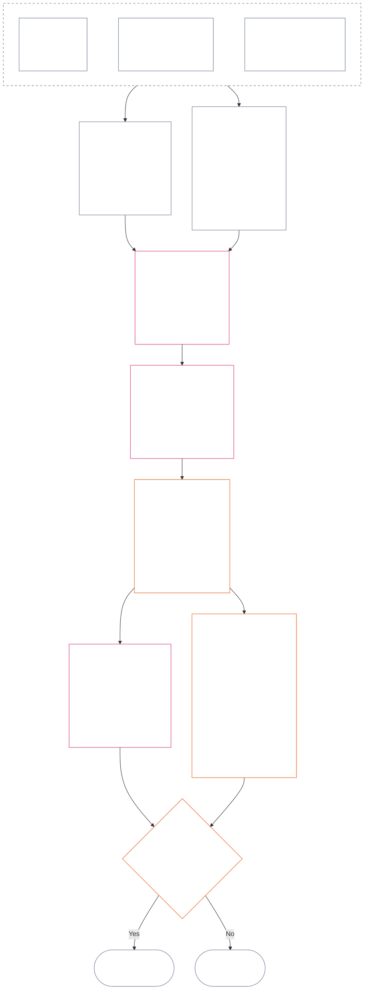

<!-- Borrador completo de traducción al español del Capítulo Doce. Fuente: core_12.000_standing_measurement.md; snapshot de origen: 9c2c8c10c871d91157bcd27b9f56ad6a1cec90d3. Traducción asistida por IA; no revisada; borrador no vinculante. -->

# CAPÍTULO DOCE: MEDICIÓN DE POSICIÓN — PREGUNTA 2, ¿QUÉ TAN BUENO O MALO FUE?

<strong>Ubicación en el corpus (no operativa): estructura del archivo y reglas de lectura</strong>

> Este archivo **forma parte de la Constitución Senciente** y es **vinculante únicamente junto con** los demás archivos numerados `core_*`, leídos como un solo texto. Contiene el **Capítulo Doce** — **Pregunta 2** (*¿qué tan bueno o malo fue?*): la referencia LEQU y sus límites, las dimensiones de entrada de medición, los catálogos de descriptores de ruta, la gramática de casillas y la escala compartida, las fuentes constitucionales para asignar ejes, la escala proporcional LEQU unificada, las medidas estándar de contribución, los ejemplos prácticos y el traspaso a la Pregunta 3 (**§§1–9**). El marco de las tres preguntas y la **Pregunta 1** (*¿qué ocurrió?*) —hechos verificados, tipos de eventos, requisitos de registro, custodia y gestión del registro— están en el [Capítulo Once](core_11.000_standing_assessment.md#chapter-eleven-standing-records--question-1-what-happened). La Pregunta 3 (*¿qué ocurre como consecuencia?*) continúa en el [Capítulo Trece](core_13.000_standing_integration.md#chapter-thirteen-standing-effects-and-integration), y la revisión se limita a la designación de conducta indebida anticonstitucional del [Capítulo Catorce](core_14.000_misconduct_designation.md#chapter-fourteen-anti-constitutional-misconduct) para hallazgos calificadores de violación en el Eje de Violación con `s` = 7–9. El orden de lectura, la distinción entre texto vinculante y material de apoyo, y los metadatos de la edición del corpus se mantienen en [README.md](README.md).

<strong>Traza</strong>

- Anterior:
  - [Capítulo Once §1](core_11.000_standing_assessment.md#1-the-three-questions) (*marco de las tres preguntas*);
  - [Capítulo Once §2](core_11.000_standing_assessment.md#2-question-1--what-happened) a [Capítulo Once §6](core_11.000_standing_assessment.md#6-handling-a-standing-record) (*Pregunta 1 — hechos verificados, registros de posición, custodia y gestión*);
  - [Tétrada Constitucional](core_00.000_preamble.md#constitutional-tetrad);
  - [Dos Finalidades Constitucionales](core_00.000_preamble.md#two-constitutional-aims);
  - [Preámbulo §6 Cadenas prácticas de proceso clave](core_00.000_preamble.md#6-key-practical-process-pipelines) (*cadena de los Capítulos Nueve a Quince*).
- Subsecciones de este archivo:
  - [§1](#1-question-2--how-good-or-bad-was-it) (*Pregunta 2 — referencia LEQU, puente de estatus, límites y alcance*);
  - [§2](#2-magnitude-and-severity-input-dimensions) (*dimensiones de entrada de medición para ambos ejes*);
  - [§3](#3-route-descriptor-catalogs-and-measurement-roles) (*catálogos de descriptores de ruta*);
  - [§4](#4-slot-grammar-and-shared-scaling) (*gramática de casillas y escala compartida*);
  - [§5](#5-constitutional-inputs-to-axis-assignment) (*derivación constitucional para asignar ejes*);
  - [§6](#6-unified-proportional-lequ-scale--contribution-and-violation-axes) (*escala proporcional LEQU unificada para ambos ejes*);
  - [§7](#7-standard-contribution-measures) (*medidas estándar de contribución publicadas por adoptantes*);
  - [§8](#8-measurement-illustrations) (*ejemplos prácticos de medición*);
  - [§9](#9-hand-off-to-question-3--cross-question-measurement-hooks) (*traspaso a la Pregunta 3*).
- Posterior:
  - [Capítulo Trece](core_13.000_standing_integration.md#chapter-thirteen-standing-effects-and-integration) (13.000) (*efectos e integración de la Pregunta 3*);
  - [Capítulo Catorce](core_14.000_misconduct_designation.md#chapter-fourteen-anti-constitutional-misconduct) (14.000) (*solo designación: no reabre la medición de la Pregunta 2*).
- Leer junto con: [Capítulo Cinco *Estado de posición, contribución y violación*](core_05.035_band_accountability.md#defa3-standing-state-contribution-and-violation) (5.035) (*derivación canónica de definiciones*).

 

El Capítulo Doce es el titular constitucional de la **Pregunta 2**, que mide los hechos verificados por el [Capítulo Once](core_11.000_standing_assessment.md#chapter-eleven-standing-records--question-1-what-happened). Comienza en [§1 Pregunta 2 — ¿qué tan bueno o malo fue?](#1-question-2--how-good-or-bad-was-it). El [Capítulo Once](core_11.000_standing_assessment.md#chapter-eleven-standing-records--question-1-what-happened) establece el marco de las tres preguntas, la Pregunta 1 y el registro de posición, y termina en el [Capítulo Once §6 Gestión de un registro de posición](core_11.000_standing_assessment.md#6-handling-a-standing-record).

*En términos sencillos: el Capítulo Once determina qué ocurrió y quién custodia el registro de posición. Este capítulo lo mide: qué tan buena fue la contribución o qué tan grave fue la violación, en dos escalas separadas que nunca se suman para obtener una puntuación neta. Lo que se deriva de la medición corresponde al Capítulo Trece.*

### 1. Pregunta 2 — ¿qué tan bueno o malo fue?

<strong>Traza</strong>

- Anterior: [Capítulo Once §2](core_11.000_standing_assessment.md#2-question-1--what-happened) (*Pregunta 1 — registros de posición y hechos verificados*); [Capítulo Once §2.5](core_11.000_standing_assessment.md#25-verified-input-gate) (*puerta de datos verificados*); [Capítulo Once §4](core_11.000_standing_assessment.md#4-standing-record-operational-requirements) (*requisitos del registro*); [Capítulo Once §1](core_11.000_standing_assessment.md#1-the-three-questions) (*marco de las tres preguntas*).
- Posterior:
  - [§2](#2-magnitude-and-severity-input-dimensions) (*dimensiones de entrada de medición para ambos ejes*);
  - [§3](#3-route-descriptor-catalogs-and-measurement-roles) (*catálogos de descriptores de ruta*);
  - [§4](#4-slot-grammar-and-shared-scaling) (*gramática de casillas y escala compartida*);
  - [§5](#5-constitutional-inputs-to-axis-assignment) (*derivación constitucional para asignar ejes*);
  - [§6](#6-unified-proportional-lequ-scale--contribution-and-violation-axes) (*asignación a los ejes de Contribución y Violación*);
  - [§7](#7-standard-contribution-measures) (*medidas estándar de contribución publicadas por adoptantes*);
  - [§8](#8-measurement-illustrations) (*ejemplos prácticos de medición*);
  - [§9](#9-hand-off-to-question-3--cross-question-measurement-hooks) (*traspaso a la Pregunta 3*);
  - [Capítulo Trece §6.2](core_13.000_standing_integration.md#62-competency-bars-and-clearances) (13.000 §6.2) (*Pregunta 3 de contribución — delegación segura*);
  - [Capítulo Trece §4.2](core_13.000_standing_integration.md#42-prevention--general-standing-locks) (13.000 §4.2) (*bloqueos de prevención*);
  - [Capítulo Trece §5](core_13.000_standing_integration.md#5-lock-design-and-enforcement) (13.000 §5) (*diseño y aplicación de bloqueos*).
- Leer junto con: [Capítulo Once §4.1](core_11.000_standing_assessment.md#41-minimum-record-contents) (*campos verificados del registro de posición; sin efectos de posición en el Capítulo Once*).

 

*En términos sencillos: la Pregunta 2 mide los hechos verificados de la Pregunta 1. Pregunta **qué tan buena fue la contribución** o **qué tan grave fue la violación**. Aquí se presentan por primera vez los dos ejes formales de medición: el **Eje de Contribución** para la ayuda verificada y el **Eje de Violación** para el daño verificado. Los ejes permanecen separados; no son dos lados de una puntuación neta.*

Para decidir en qué casilla ubicar la contribución o violación de alguien, este capítulo mide el impacto mediante una **Unidad Equivalente a una Vida (LEQU, por sus siglas en inglés)**. Una LEQU equivale aproximadamente a salvar o destruir toda una vida de bienestar de un senciente. No se trata de contar cuerpos ni dólares, sino de determinar si una acción cambió de forma significativa el bienestar de la comunidad constitucional. La misma unidad sirve para cualquier ser senciente, humano o no.

#### 1.1 Referencia LEQU

Una **Unidad Equivalente a una Vida** (**LEQU**) es la unidad abreviada de ese beneficio o pérdida constitucional equivalente a una vida completa, cuando la implementación adoptada requiere una calibración numérica.

- La unidad no depende del sustrato.
- Un adoptante actual puede usar una vida humana ordinaria como ejemplo de calibración en contextos biológicos humanos, pero la referencia vinculante es senciente y constitucional, no está ligada a una especie.

Un **beneficio constitucional equivalente a una vida completa** significa un beneficio verificado comparable a preservar, restaurar o liberar una vida senciente completa de bienestar no trivial y compatible con los derechos. Una **pérdida constitucional equivalente a una vida completa** significa daño, desperdicio, destrucción, cierre de opciones, privación o materialización de un riesgo verificados y comparables a destruir, consumir injustamente o impedir un beneficio constitucional equivalente a una vida completa.

#### 1.2 Límites para el uso de LEQU

Se aplican los siguientes límites siempre que se use LEQU.

- **No es una regla de puntuación neta:** no se pueden «compensar» violaciones con contribuciones ni viceversa. Cada eje se sostiene por separado.
- **No es una métrica obligatoria de vida humana:** LEQU es genérica para los sencientes; se aplica a cualquier ser consciente, no solo a los humanos.
- **No es una métrica de acusación:** las alegaciones, etiquetas de admisión, decisiones de derivación, reputación, estatus desfavorecido o desaprobación moral no aportan beneficio al Eje de Contribución ni gravedad al Eje de Violación sin datos verificados conforme al **Capítulo Once sección 2.5** y calibración conforme a la **sección 6**.
- **No es una licencia para intercambiar derechos:** las afirmaciones que se presenten como eficiencia, capacidad productiva, innovación, reducción de cargas, seguridad, represalia, respuesta a emergencias o necesidad institucional deben descontarse o rechazarse cuando dependan de:
  - coacción;
  - traslado discriminatorio de cargas;
  - agotamiento ecológico;
  - trabajo no remunerado oculto;
  - opacidad evitable;
  - reducción del Piso de Derechos;
  - captura;
  - indicadores indirectos engañosos;
  - pérdida de impugnabilidad; o
  - agregación no revisable.

#### 1.3 Solo Pregunta 2 — alcance y derivación

Esta parte cubre únicamente la Pregunta 2, el paso de medición. Toma hechos ya verificados (Pregunta 1) y pregunta qué tan buena fue una contribución o qué tan grave fue una violación.

- Parta de los hechos ya verificados conforme al **Capítulo Once sección 2** e incorporados al registro de posición conforme al **Capítulo Once sección 4**, y mídalos usando las dimensiones de la **sección 2**.
- Luego asigne a cada tipo de ayuda o daño su nombre estándar de los catálogos: el catálogo de **ruta de beneficio** para la ayuda (**sección 3.1**) y el de **ruta de daño** para el daño (**sección 3.2**).
- Cada nombre también indica cuánto cuenta ese tipo de ayuda o daño para determinar *qué tan bueno* o *qué tan grave* fue.
- Las reglas sobre lo que se deriva de un beneficio están en el [lado de beneficio](core_13.000_standing_integration.md#62-competency-bars-and-clearances), y las reglas sobre lo que se deriva de un daño, en el [lado de daño](core_13.000_standing_integration.md#42-prevention--general-standing-locks).
- La Pregunta 3 decide qué ocurre después. Comience con [Capítulo Trece §3 Integración de descriptores y normalización de adjuntos](core_13.000_standing_integration.md#3-descriptor-integration-and-attachment-normalization).

#### 1.4 Puente con el estatus de senciencia

La medición de la posición **no** decide si una entidad es **senciente**.

- Las disputas de estatus se remiten a [Adjudicación del estatus de senciencia](core_05.055_band_participation.md#sentience-status-adjudication) y al [Artículo VI-B](core_06.005_rights_part_b.md#article-vi-b-sentience-status-adjudication-floor) (*Piso de Adjudicación del Estatus de Senciencia*). No se remiten a puntuaciones LEQU ni a registros de clasificación.
- Mientras siga abierta una disputa de estatus conforme a [Vida Senciente en Disputa](core_05.055_band_participation.md#contested-sentient-life), el **Artículo VI-B** (*Piso de Adjudicación del Estatus de Senciencia*) incluye por defecto a la entidad: esta puede seguir midiéndose y presentar un registro de posición hasta que se resuelva la disputa, y los operadores no deben tratar la disputa abierta, por sí sola, como motivo para negarle posición.
- Si se determina que la entidad es [Senciente](core_05.055_band_participation.md#sentient), o su estatus se restringe o restablece tras una adjudicación en una decisión que puede revisarse:
  - el sujeto del registro de posición se actualiza a partir de ese momento; y
  - no se debe retrotraer una exclusión injusta para borrar la elegibilidad de la entidad a ser medida durante el período intermedio, salvo mediante [Reparación y Remediación](core_05.035_band_accountability.md#redress-and-remediation).

### 2. Dimensiones de entrada de magnitud y gravedad

*En términos sencillos: esta sección explica qué produce la Pregunta 2 (**sección 2.1**) y luego enumera qué se debe examinar al medir una contribución verificada o una violación verificada (**sección 2.2**). Cada eje se mide por separado. Las reglas de escala compartida están en la **sección 4.2**, y la casilla se obtiene de la escala de la **sección 6**.*

La escala de casillas mide la magnitud y el tipo de un resultado constitucional. Solo cuenta los resultados verificados.

**Qué cuenta la escala y cómo se relaciona con las pruebas centrales de la Constitución:**

- **[Dos Finalidades Constitucionales](core_00.000_preamble.md#two-constitutional-aims):** ambos ejes miden el efecto sobre el **Florecimiento** y la **Continuidad**. El Eje de Contribución los impulsa. El Eje de Violación los hace retroceder.
- **[Dos Preguntas Fundamentales](core_00.000_preamble.md#two-fundamental-questions):** cada eje aporta los hechos verificados para una pregunta. Responder una no responde la otra; por ello, los dos ejes nunca se compensan entre sí.
  - **Primera pregunta:** el Eje de Contribución aporta los hechos verificados. ¿El sistema recompensa conductas que ayudan a los sencientes a florecer y perdurar, dicen la verdad y reparan el daño?
    - **Cuenta:** el beneficio constitucional verificado, incluida la reducción verificada de riesgos.
    - **No cuenta:** el volumen de producción bruto, el prestigio, la riqueza, cuánto se usa algo, la rapidez ni el tamaño de la institución.
  - **Segunda pregunta:** el Eje de Violación aporta los hechos verificados. ¿El sistema recompensa conductas que dañan, engañan, excluyen, demoran, desperdician o trasladan injustificadamente costos a otros?
    - **Cuenta:** pérdida constitucional, daño, desperdicio, opciones perdidas (cierre de opciones), peligro o aumento del riesgo verificados.
    - **No cuenta por sí solos:** el estatus desfavorecido, las alegaciones o la desaprobación moral.
- **[Tétrada Constitucional](core_00.000_preamble.md#constitutional-tetrad):**
  - **Supervisión y rendición de cuentas:** «verificado» significa que un actor identificado responde por el hallazgo y que ninguna parte verifica su propia afirmación.
  - **Actuación a tiempo:** la demora evitable se registra como hecho independiente, no se incorpora al tamaño de la pérdida.

#### 2.1 Qué produce la Pregunta 2

La Pregunta 2 consigna lo siguiente en el registro de posición de cada eje. Son mediciones, no efectos de posición (las consecuencias que decide la Pregunta 3):

| **Qué se produce** | **Eje de Contribución** | **Eje de Violación** |
| --- | --- | --- |
| **Dónde se consigna** | El registro de posición de contribución. | El registro de posición de violación. |
| **Casilla** | La casilla aplicable más alta del **Eje de Contribución** (`s` = 1–9). | La casilla aplicable más alta del **Eje de Violación** (`s` = 1–9). |
| **Descriptores de ruta** | Los **descriptores de ruta de beneficio** aplicables, acumulados. | Los **descriptores de ruta de daño** aplicables, acumulados. |
| **Datos que se entregan a la Pregunta 3** | Los datos que fijan el punto de partida para reconocer la contribución, conforme a [Capítulo Trece §6 Consecuencias de contribución en segundo lugar](core_13.000_standing_integration.md#6-contribution-consequences-second). | Los datos que fijan la banda predeterminada de bloqueo (el punto de partida para determinar cuán estricto es un bloqueo), conforme a [Capítulo Trece §5 Diseño y aplicación de bloqueos](core_13.000_standing_integration.md#5-lock-design-and-enforcement). |
| **Total LEQU** | Evalúe por separado cada tipo pertinente de beneficio (ecológico, sistémico o de recursos) y luego consigne un total LEQU para toda la contribución. | Evalúe por separado cada tipo pertinente de daño (daño ecológico, daño sistémico o pérdida de recursos) y luego consigne un total LEQU para toda la violación. |

Recordatorio: nada de esto cancela un registro de violación abierto. La regla de no compensación está en [Capítulo Once §2.4 Registros de posición vinculados y puente de no compensación](core_11.000_standing_assessment.md#24-linked-standing-records-and-no-offset-bridge).

#### 2.2 Dimensiones de entrada de magnitud de contribución y gravedad de violación

**Pregunta 2 — ¿qué tan bueno o grave fue?** Para decidir dónde queda una contribución en el Eje de Contribución o una violación en el Eje de Violación (su **casilla**, de 1 a 9), y qué descriptores de beneficio o daño corresponden, examine tres partes. Pueden aplicarse varios descriptores a la vez y se acumulan. Consigne los resultados en el registro de posición del eje, como se indica en la **sección 2.1**. La **sección 6** contiene la escala unificada para la parte 2, que es la misma para beneficios y daños. Explica cómo estimar en LEQU el beneficio o la pérdida totales (una Unidad Equivalente a una Vida, aproximadamente el bienestar de una vida entera) y qué casilla corresponde a cada cantidad. En el Eje de Contribución, las casillas se agrupan en cuatro bandas.

**1. Compruebe cómo se produjo.** Los dos ejes lo tratan de manera distinta:

- **Contribución (calidad de la conducta):** puede aumentar o limitar cuánto beneficio cuenta: ¿fue trazable?, ¿evitó trasladar costos a otros?, ¿se realizó con cuidado?, ¿es compatible con la Constitución? Las cinco comprobaciones están en [§2.2.1 Cómo afecta al cómputo la manera en que se produjo un beneficio](#221-how-the-way-a-benefit-was-produced-affects-what-counts).
- **Violación (carácter de la conducta):** se registra por separado de la magnitud del impacto. El deber, la negligencia, el engaño, la ocultación, la obstrucción de la rendición de cuentas, la coacción, la violencia, la intención, la crueldad y la habilitación estructural determinan quién responde, qué salvaguardias se necesitan y cómo responder, pero no modifican la casilla LEQU. Las reglas para registrar cada elemento están en [§2.2.2 Cómo se registra la manera en que se causó un daño](#222-how-the-way-a-harm-was-caused-is-recorded).

**2. Determine la magnitud: ¿cuán grande es el beneficio o la pérdida?** Esto determina la casilla.

| **Qué examinar** | **Qué efecto tiene** | **Dónde se establece** |
| --- | --- | --- |
| **Magnitud total (LEQU)** | La medida principal y la que determina la casilla. En una contribución, es el beneficio total verificado realizado, contado en LEQU. En una violación, es la pérdida constitucional total verificada. La designación de conducta indebida del Capítulo Catorce se decide por separado. | [§6 Escala proporcional LEQU unificada](#6-unified-proportional-lequ-scale--contribution-and-violation-axes) |
| **A quiénes alcanza (cuántos, con qué profundidad y cuán vulnerables)** | Ajusta la estimación LEQU y cuánto importa el beneficio o daño (su materialidad). | [§4.2 Reglas compartidas de escala del impacto](#42-shared-impact-scaling-rules); [Materialidad](core_05.050_band_oversight.md#materiality) |
| **Cuánto dura (duración; perdurabilidad de un beneficio, irreversibilidad de un daño)** | Ajusta la estimación LEQU. En una contribución, la administración responsable duradera, el beneficio intergeneracional o la reparación perdurable de una institución apuntan a las casillas superiores. En una violación, el trauma duradero, la pérdida irreversible y el daño duradero a la capacidad de los sencientes para actuar por sí mismos aumentan la estimación de la pérdida total. | [§4.2 Reglas compartidas de escala del impacto](#42-shared-impact-scaling-rules) |
| **Hasta dónde llega (a través de lugares o instituciones)** | Ajusta la estimación LEQU. En una contribución, por ejemplo, por el beneficio extendido a comunidades o instituciones, o a escala de una civilización. En una violación, el daño que se extiende a comunidades o instituciones, o a toda una civilización, puede aumentar la estimación de la pérdida total. | [§4.2 Reglas compartidas de escala del impacto](#42-shared-impact-scaling-rules) |

**3. Nombre los tipos de beneficio o daño (rutas).** Nombre las maneras en que se produjo el beneficio o daño verificado. Puede aplicarse más de una y se acumulan. Las listas están en el [**Catálogo de descriptores de rutas de beneficio**](#31-contribution-route-descriptor-catalog-and-measurement-roles) y el [**Catálogo de descriptores de rutas de daño**](#32-violation-route-descriptor-catalog-and-measurement-roles).

##### 2.2.1 Cómo afecta al cómputo la manera en que se produjo un beneficio

Compruebe esto antes de elegir una casilla del Eje de Contribución:

| **Qué se determina** | **Efecto en el beneficio** |
| --- | --- |
| Corrección pronta y verificada de un problema después de haber sido notificado | Puede contar como **Diligencia** (conducta cuidadosa y responsable) cuando produce un beneficio real y demostrable. |
| Daño trasladado a otros o carga ocultada | Limita el beneficio atribuido a la vía controvertida (la ruta específica a la que se atribuye el beneficio) o lo excluye. |
| Riesgo de captura verificado (el arreglo podría quedar bajo el control de intereses estrechos), dependencia estructural (los sencientes quedan integrados de modo que dependen de él) o diseño de salida y bloqueo (es difícil abandonarlo) | Limita el reconocimiento de la administración responsable. |
| Reparación verificada de una barrera de accesibilidad o participación | Puede aumentar cuánto importa el beneficio (su materialidad) y respaldar el descriptor de ruta de beneficio **Acceso e Inclusión** conforme a la **sección 3.1**. |
| Recompensa significativa procedente de un esquema de incentivos contrario a la Constitución, de conducta anticonstitucional o de un proceso materialmente defectuoso | Por defecto, no cuenta como beneficio. En ese caso, aplique [Capítulo Trece §5.4 Reglas especiales sobre violaciones](core_13.000_standing_integration.md#54-special-violation-rules) y el límite de transición de adopción del [Artículo XXVIII-A](core_06.020_rights_part_e.md#incentive-alignment-adoption-transition-carve-out) (*Adopción gradual y continuidad del Piso de Derechos*). |

##### 2.2.2 Cómo se registra la manera en que se causó un daño

La magnitud de un daño (su total LEQU, de la parte 2 anterior) determina la casilla. La manera en que se causó no la determina; por eso, cada tipo de conducta siguiente se registra por separado:

**Conducta que añade pérdida, contabilizada una sola vez en la magnitud:**

| **Qué se determina** | **Cómo se registra** |
| --- | --- |
| Demora evitable en responder o elevar el asunto, cuando existían el deber y la capacidad de actuar | Se registra como hecho de conducta separado. Toda pérdida adicional causada por la demora se cuenta una vez en la estimación LEQU. |
| Daño verificado de forma independiente a la integridad de un foro (perjuicio a la imparcialidad del foro) | Se cuenta exactamente una vez en la estimación LEQU. La omisión deshonesta, el incumplimiento deliberado del proceso de recusación, la coacción, el peligro para la libertad y otros hechos de conducta permanecen como descriptores separados y no modifican la casilla. |
| **Obstrucción de la rendición de cuentas** (interferencia verificada con los mecanismos que permiten exigir responsabilidad a quien corresponda, como la integridad de las pruebas, la verificación, el proceso del foro, los registros de posición, los plazos de reparación o las vías de impugnación y reparación) | Permanece como hecho de conducta registrado por separado. Toda pérdida adicional que cause en la vía identificada se cuenta una vez en la estimación LEQU, pero la etiqueta de obstrucción en sí no modifica la casilla. |

**Hechos de conducta registrados aparte de la magnitud del daño:**

| **Qué se determina** | **Cómo se registra** |
| --- | --- |
| Engaño, ocultación, evasión, repetición de la conducta tras recibir aviso, desprecio temerario, habilitación estructural (configurar las cosas para que el daño sea fácil o probable) o abuso de un desequilibrio importante de dependencia (explotar a quien depende mucho de uno) | Cada uno permanece como hecho de conducta registrado por separado. |
| Violencia, coacción, manipulación o peligro para la libertad | Permanece registrado por separado y puede requerir salvaguardias más estrictas cualquiera que sea la casilla. |
| [Crueldad](core_05.035_band_accountability.md#cruelty) (sufrimiento verificado como fin en sí mismo, o daño gratuito o degradante que excede lo necesario y proporcionado) | Permanece como hecho de conducta registrado por separado. Puede requerir salvaguardias más estrictas y límites a las reparaciones degradantes conforme al [Capítulo Trece §4 Violación, corrección y prevención](core_13.000_standing_integration.md#4-violation-correction-and-prevention), pero no modifica la casilla. |

**Responsabilidad y atribución:**

| **Qué se determina** | **Cómo se registra** |
| --- | --- |
| Difusión (cómo se distribuye la responsabilidad: quién cumplió qué función causal, tuvo qué autoridad o control, pudo prever el daño, se benefició, lo ocultó o pudo prevenirlo) | No forma parte del **alcance senciente** ni permite culpar a alguien por pertenecer a un grupo. |
| Colaborar con un daño o no oponerse a él | Puede respaldar una determinación de carácter basado en el deber, agravado o de rendición de cuentas colectiva solo si se verifica el vínculo con ese actor específico exigido por el **Capítulo Once secciones 4.1 y 4.3**. |

**Recompensas desalineadas:**

| **Qué se determina** | **Cómo se registra** |
| --- | --- |
| Aceptar o conservar a sabiendas una recompensa significativa contraria a la Constitución, sin informar oportunamente y con protección (informe protegido contra represalias) | Se registra conforme al [Capítulo Trece §5.4 Reglas especiales sobre violaciones](core_13.000_standing_integration.md#54-special-violation-rules), sujeto al [Artículo XXVIII-A](core_06.020_rights_part_e.md#incentive-alignment-adoption-transition-carve-out) (*Adopción gradual y continuidad del Piso de Derechos*). Solo la pérdida constitucional verificada que cause afecta la casilla. |

**Límite relativo a recompensas desalineadas.** Este capítulo solo mide cómo afecta una recompensa desalineada verificada (una recompensa contraria a la Constitución) al Eje de Contribución o al Eje de Violación. [Capítulo Trece §5.4 Reglas especiales sobre violaciones](core_13.000_standing_integration.md#54-special-violation-rules) establece el deber de informar, las exclusiones, las consecuencias de renunciar a la recompensa (decomiso), los deberes de corrección y las reglas de derivación.

### 3. Catálogos de descriptores de ruta y funciones de medición

*En términos sencillos: los dos catálogos siguientes nombran los tipos de ayuda verificada (**sección 3.1**) y de daño verificado (**sección 3.2**) que puede contener un registro de posición. Un descriptor indica cómo ocurrió el beneficio o el daño; los descriptores se acumulan y están subordinados a la casilla.*

**Regla de descriptores.** Los dos catálogos siguientes, [§3.1 Catálogo de descriptores de rutas de contribución y funciones de medición](#31-contribution-route-descriptor-catalog-and-measurement-roles) y [§3.2 Catálogo de descriptores de rutas de violación y funciones de medición](#32-violation-route-descriptor-catalog-and-measurement-roles), constituyen la lista oficial de descriptores para ambos ejes. Un descriptor indica **cómo** ocurrió el beneficio o daño verificado. Se aplican estas reglas:

- Los descriptores se acumulan y ninguno excluye a otro: un registro de posición puede incluir varios cuando los hechos verificados lo justifiquen.
- Están subordinados a la casilla: la casilla indica la magnitud del beneficio o daño; los descriptores añaden detalles sobre cómo ocurrió, pero nunca la reemplazan.
- Los descriptores enumerados constituyen una base, no la lista completa; el catálogo no descarta otros tipos de beneficio o daño.
- Las implementaciones pueden usar identificadores estables (IDs propios y fijos) asociados al catálogo, pero no deben crear una taxonomía incompatible cuyas categorías sean excluyentes, de manera que un registro de posición solo pueda llevar una.
- Antes de verificar los hechos, un descriptor alegado puede respaldar la preservación lícita de pruebas, la clasificación del caso o salvaguardias temporales.
- Solo puede consignarse un descriptor verificado como resultado de la Pregunta 2 o usarse para afectar la posición.

#### 3.1 Catálogo de descriptores de rutas de contribución y funciones de medición

Estos son los descriptores de rutas de beneficio y lo que mide cada uno en la Pregunta 2 (¿qué tan bueno fue?). Se organizan en cinco ámbitos, con una tabla para cada uno; el catálogo de Violación de la [§3.2 Catálogo de descriptores de rutas de violación y funciones de medición](#32-violation-route-descriptor-catalog-and-measurement-roles) usa los mismos cinco ámbitos en el mismo orden. Su función en la Pregunta 3, la delegación segura, se establece en [Capítulo Trece §6.2 Umbrales de competencia y habilitaciones](core_13.000_standing_integration.md#62-competency-bars-and-clearances).

**Integridad del catálogo.** Si una implementación muestra varios descriptores en una fila o bajo una etiqueta, esa fila o etiqueta debe corresponder a cada descriptor aplicable. Este catálogo establece únicamente los nombres de los descriptores y lo que mide cada uno en la Pregunta 2. Las reglas de la Pregunta 3 (adjuntos, reparaciones, bloqueos, habilitaciones y otros efectos de posición) se encuentran únicamente en el Capítulo Trece.

##### 3.1.1 Seguridad corporal, relaciones, cuidados y capacidad de actuar

| **Descriptor de ruta de beneficio** | **Qué mide en la Pregunta 2** |
| --- | --- |
| **Paz corporal, mental o comunitaria** | Beneficio derivado de la calma corporal, psicológica y comunitaria. Ajusta cuánto importa el beneficio (su materialidad). |
| **Relaciones confiables** | Beneficio derivado de relaciones confiables, incluidas las basadas en un deber de confianza en contextos de desigualdad entre las partes. |
| **Cuidados y apoyo a la dependencia** | Cuidados verificados para sencientes que dependen de otros. También cuentan los cuidados informales cuando pueden demostrarse. |
| **Acceso e Inclusión** | Beneficio derivado de la participación efectiva y la accesibilidad. Ajusta cuánto importa el beneficio en contextos donde una parte depende mucho de la otra. |

##### 3.1.2 Reparación, propiedad y recursos

| **Descriptor de ruta de beneficio** | **Qué mide en la Pregunta 2** |
| --- | --- |
| **Beneficio reparador y restaurativo** | Beneficio derivado de reparar, compensar y reducir daños. |
| **Administración responsable de recursos** | Cuidado diligente de los recursos materiales y distribución confiable de estos. |

##### 3.1.3 Conocimiento, educación, registros y descubrimientos

| **Descriptor de ruta de beneficio** | **Qué mide en la Pregunta 2** |
| --- | --- |
| **Integridad de la infosfera** | Fortalecimiento de registros, transparencia y comunicaciones. |
| **Educación y desarrollo de capacidades** | Beneficio derivado del aprendizaje, la alfabetización y el crecimiento de la capacidad de los sencientes para actuar por sí mismos. La casilla depende del beneficio LEQU total. |
| **Contribución a STEM y los descubrimientos** | Descubrimientos que otros pueden reproducir e investigación que aumenta la seguridad. |

##### 3.1.4 Sistemas y funcionamiento constitucional

| **Descriptor de ruta de beneficio** | **Qué mide en la Pregunta 2** |
| --- | --- |
| **Optimización de sistemas** | Corrección de procesos que abarcan instituciones y reducción de riesgos. |
| **Alineación constitucional** | Fortalecimiento del Piso de Derechos y facilitación de la impugnación de decisiones. |

##### 3.1.5 Ecología y diligencia

| **Descriptor de ruta de beneficio** | **Qué mide en la Pregunta 2** |
| --- | --- |
| **Administración ecológica responsable** | Beneficio para los hábitats y la biodiversidad, y acciones responsables frente al clima. |
| **Diligencia** | Prevención de riesgos previsibles y supervisión competente. |

#### 3.2 Catálogo de descriptores de rutas de violación y funciones de medición

Estos son los descriptores de rutas de daño y lo que mide cada uno en la Pregunta 2 (¿qué tan grave fue?). Se organizan en cinco ámbitos, con una tabla para cada uno, usando los mismos cinco ámbitos y el mismo orden que en la [§3.1 Catálogo de descriptores de rutas de contribución y funciones de medición](#31-contribution-route-descriptor-catalog-and-measurement-roles). Para la Pregunta 3, las reglas de integración y adjuntos están en [Capítulo Trece §3 Integración de descriptores y normalización de adjuntos](core_13.000_standing_integration.md#3-descriptor-integration-and-attachment-normalization), y las reglas de prevención y diseño de bloqueos, en [Capítulo Trece §4.2 Prevención — bloqueos generales de posición](core_13.000_standing_integration.md#42-prevention--general-standing-locks) y [Capítulo Trece §5 Diseño y aplicación de bloqueos](core_13.000_standing_integration.md#5-lock-design-and-enforcement).

**Integridad del catálogo.** Si una implementación muestra varios descriptores en una fila o bajo una etiqueta, esa fila o etiqueta debe corresponder a cada descriptor aplicable. Este catálogo establece únicamente los nombres de los descriptores y lo que mide cada uno en la Pregunta 2. Las reglas de la Pregunta 3 (adjuntos, reparaciones, bloqueos, habilitaciones y otros efectos de posición) se encuentran únicamente en el Capítulo Trece.

##### 3.2.1 Seguridad corporal, relaciones, cuidados y capacidad de actuar

| **Descriptor de ruta de daño** | **Qué mide en la Pregunta 2** |
| --- | --- |
| **Conducta indebida violenta** | La violencia, la coacción o el peligro para la libertad se registran por separado de la casilla de impacto LEQU. Puede requerir salvaguardias reforzadas. |
| **Conducta indebida interpersonal o por incumplimiento del deber de cuidado** | El daño importa más (mayor materialidad) cuando una parte depende mucho de la otra. |
| **Conducta indebida por barreras de accesibilidad y participación** | El daño importa más (mayor materialidad) cuando una parte depende mucho de la otra; pueden acumularse factores agravantes. |
| **Conducta indebida sobre privacidad y autonomía personal** | Se aplican factores agravantes cuando se verifican ocultación o explotación, y pueden acumularse. |
| **Conducta indebida sobre capacidad de actuar y manipulación** | La coacción, la manipulación o el peligro para la libertad se registran por separado de la casilla de impacto. |

##### 3.2.2 Reparación, propiedad y recursos

| **Descriptor de ruta de daño** | **Qué mide en la Pregunta 2** |
| --- | --- |
| **Conducta indebida susceptible de corrección reparadora** | Registra el carácter corregible del daño (si puede subsanarse y cómo). La casilla depende de la pérdida LEQU total. |
| **Conducta indebida sobre la propiedad** | La ruta correspondiente a la pérdida de propiedad. La casilla depende de la pérdida LEQU total. |

##### 3.2.3 Conocimiento, educación, registros y descubrimientos

| **Descriptor de ruta de daño** | **Qué mide en la Pregunta 2** |
| --- | --- |
| **Conducta indebida contra la infosfera** | Daño a la Seguridad o la Verdad. La ocultación y el engaño siguen siendo hechos separados sobre cómo se causó el daño (su carácter). |
| **Conducta indebida educativa** | Daño al aprendizaje o a la capacidad de los sencientes para actuar por sí mismos (sus capacidades). La casilla depende de la pérdida LEQU total. |
| **Conducta indebida en investigación y descubrimientos** | Daño a la investigación o los descubrimientos. La casilla depende de la pérdida LEQU total. |

##### 3.2.4 Sistemas y funcionamiento constitucional

| **Descriptor de ruta de daño** | **Qué mide en la Pregunta 2** |
| --- | --- |
| **Conducta indebida sistémica** | La difusión (responsabilidad distribuida entre actores) y la habilitación estructural se registran por separado. La casilla depende de la pérdida LEQU total. |
| **Conducta indebida por obstrucción de la rendición de cuentas** | Abarca obstruir la rendición de cuentas: impedir que se exija responder por un daño. Se registra como una manera en que ocurrió el daño. La forma de llevar a cabo la obstrucción (por ejemplo, mediante ocultación o negligencia) se registra como hecho separado, y la casilla deriva de la pérdida LEQU total. Cuando la casilla está entre las más altas (véase [§4.1 Tabla 1 — etiquetas de visualización de casillas](#41-table-1--slot-display-labels)), el caso también puede registrarse como **Conducta Indebida Anticonstitucional** para remitirlo a la [Revisión de Conducta Indebida Anticonstitucional](core_05.035_band_accountability.md#anti-constitutional-misconduct-review) del Capítulo Catorce. La remisión no equivale a una designación de conducta indebida anticonstitucional: el Capítulo Catorce la decide por separado. |
| **Conducta indebida por salida y confinamiento** | Incluye las características de la Conducta Indebida Sistémica, además de difusión o captura cuando estas son estructurales (integradas en el funcionamiento del sistema). |
| **Conducta indebida por ciclo de vida e irreversibilidad** | La irreversibilidad afecta la magnitud de la pérdida LEQU. La ocultación o negligencia se registra por separado como carácter. |
| **Conducta Indebida Anticonstitucional** (descriptor) | Remite las violaciones de las casillas más altas (véase [§4.1 Tabla 1 — etiquetas de visualización de casillas](#41-table-1--slot-display-labels)) a la revisión de designación del Capítulo Catorce, sin cambiar su casilla de impacto. |

##### 3.2.5 Ecología y diligencia

| **Descriptor de ruta de daño** | **Qué mide en la Pregunta 2** |
| --- | --- |
| **Conducta indebida ecológica** | La pérdida LEQU se pondera según la pérdida de [Capacidad de Recuperación Ecológica](core_05.040_band_continuity.md#ecological-recovery-capacity) (capacidad de un ecosistema para regenerarse después de un daño). Puede acumularse con la ruta violenta (Conducta Indebida Violenta). |
| **Conducta indebida negligente** | El deber, la previsibilidad y la posibilidad de prevención se registran por separado de la casilla de impacto. |

### 4. Gramática de casillas y escala compartida

*En términos sencillos: esta sección establece nombres coherentes para nueve posiciones posibles en cada uno de dos ejes separados y explica cómo se escala el impacto entre ellos. Un eje registra la contribución verificada; el otro registra las violaciones verificadas. Compartir el número de casilla no combina los ejes ni compensa el daño con la ayuda. La escala unificada de la **sección 6** asigna ambos ejes según el impacto proporcional en LEQU.*

La gramática de casillas usa un número de casilla, `s`, del **1** al **9**. Cada eje tiene su propia posición de casilla:

- el **Eje de Contribución** registra el carácter de contribución positiva; y
- el **Eje de Violación** registra los hallazgos de violación verificados.

El mismo número de casilla puede aparecer en ambos ejes, pero estos permanecen separados. Una casilla de contribución no es una casilla de violación, y una casilla de violación no es una casilla de contribución.

#### 4.1 Tabla 1 — etiquetas de visualización de casillas

La **Tabla 1** nombra las nueve casillas y muestra, una junto a otra, las etiquetas de visualización del Eje de Contribución y del Eje de Violación. Solo proporciona el lenguaje para mostrar las casillas; su asignación se realiza conforme a la escala unificada de la **sección 6**.

|  `s` | Etiqueta de visualización del Eje de Contribución | Etiqueta de visualización del Eje de Violación |
| ---: | --- | --- |
|    1 | **Contribución de base menor** | **Impacto constitucional menor** |
|    2 | **Contribución de base pequeña** | **Impacto constitucional pequeño** |
|    3 | **Contribución positiva sustancial** | **Impacto constitucional sustancial** |
|    4 | **Contribución positiva significativa** | **Impacto constitucional significativo** |
|    5 | **Contribución positiva seria de administración responsable** | **Impacto constitucional serio** |
|    6 | **Contribución positiva importante de administración responsable** | **Impacto constitucional importante** |
|    7 | **Referente reconocido** | **Impacto constitucional grave** |
|    8 | **Referente distinguido** | **Impacto constitucional muy grave** |
|    9 | **Referente ejemplar** | **Impacto constitucional catastrófico** |

El Eje de Contribución usa etiquetas de base, positivas, positivas de administración responsable y de referente. El Eje de Violación usa etiquetas neutrales de impacto en todas las casillas. Los ejes permanecen separados: no crean una puntuación neta ni permiten compensar los registros de contribución y violación. Una casilla del Eje de Violación no clasifica por sí sola una conducta indebida anticonstitucional; [Capítulo Catorce](core_14.000_misconduct_designation.md#chapter-fourteen-anti-constitutional-misconduct) determina de manera independiente si la designación de conducta indebida anticonstitucional (ACMD) corresponde a una violación verificada con `s` = 7–9.

Las implementaciones pueden publicar unidades de medición, métodos de prueba y ejemplos para ayudar a estimar el beneficio o la pérdida equivalentes a una vida completa. Estos materiales son solo orientativos y no pueden prevalecer sobre la **sección 6**, el **Capítulo Uno** ni el Piso de Derechos del **Capítulo Seis**.

#### 4.2 Reglas compartidas de escala del impacto

*En términos sencillos: el impacto no se mide solo por el número de personas. Un beneficio o pérdida profunda que afecta a un senciente puede tener más importancia que un efecto superficial que afecta a muchos. El número, la profundidad, la vulnerabilidad, la duración, la perdurabilidad, el alcance y el carácter constitucional deben evaluarse en conjunto.*

Use las siguientes reglas para interpretar ambos ejes de la **sección 6**:

| Dimensión de escala | Regla compartida | Aplicación específica al eje |
| --- | --- | --- |
| **Magnitud del resultado constitucional (LEQU)** | Evalúe el beneficio o la pérdida verificados de forma integrada. LEQU es la referencia principal de magnitud; no lo son el número bruto de personas, el dinero, el volumen de producción ni el tamaño institucional. | La contribución cuenta el beneficio compatible con los derechos; la violación cuenta la pérdida constitucional, el daño, el desperdicio, el cierre de opciones o el peligro verificados. |
| **Alcance sobre los sencientes** | Considere conjuntamente el **número, la profundidad y la vulnerabilidad**. Ninguna casilla exige por separado un número mínimo de personas. Un impacto suficientemente profundo en un senciente puede justificar la misma casilla que un impacto más amplio pero superficial si la magnitud integrada y los demás criterios de la fila son iguales; aun así, debe cumplirse cualquier criterio expreso de LEQU agregado o alcance amplio. | La dependencia, la capacidad reducida o una vulnerabilidad inusual pueden aumentar la materialidad. El tamaño del grupo, por sí solo, no establece una contribución ni su gravedad. |
| **Alcance temporal** | Considere la duración, la recurrencia, la perdurabilidad y, en el caso de una pérdida, la irreversibilidad. Un evento breve pero transformador puede superar un efecto trivial prolongado; la duración por sí sola no determina el resultado. | Un beneficio perdurable respalda una mayor magnitud de contribución. Una pérdida persistente o irreversible respalda una mayor gravedad de violación. |
| **Alcance espacial o institucional** | Un alcance más amplio puede aumentar la magnitud, pero no se requiere que abarque varias comunidades o instituciones si la profundidad, duración, vulnerabilidad o importancia constitucional justifican la casilla de forma independiente. | La reparación institucional puede aumentar la magnitud de contribución; el daño estructural o sistémico puede aumentar la gravedad de violación. |
| **Calidad o carácter constitucional** | Mida por separado cómo se produjo el resultado y cuán ampliamente se extendió. No cuente dos veces el mismo hecho. | El daño trasladado a otros, las cargas ocultas, la captura o la dependencia pueden limitar o descalificar la contribución alegada. El deber, la negligencia, el engaño, la coacción, la violencia o la habilitación estructural se registran por separado como carácter de la conducta de violación y no modifican la casilla de impacto. |
| **Pisos de Derechos y salvaguardias críticas** | El cumplimiento del Piso de Derechos no se intercambia por un beneficio o una pérdida agregados. | Cumplir un piso no establece por sí solo una contribución alta. La vulneración material del Piso de Derechos o el incumplimiento de una salvaguardia crítica puede justificar una mayor gravedad de violación incluso cuando afecte directamente a pocos sencientes. |

Las dimensiones no son una lista de verificación que exija todas las formas de escala. Explique qué dimensiones fueron determinantes, cuáles no lo fueron y por qué.

- **Método compartido de asignación de casillas:**
  - Estime el beneficio o la pérdida verificados de manera integrada en LEQU conforme a la Proporcionalidad; luego asigne la única casilla cuya banda numérica incluya esa magnitud.
  - Los mismos umbrales se aplican a ambos ejes.
  - Las casillas de contribución conservan los requisitos aplicables de referencia básica y alineación constitucional; alcanzar un umbral numérico no convierte en contribución un resultado que externaliza daños o vulnera la Constitución.
- **Separación del carácter:** mantenga acumulados en el registro de posición los descriptores aplicables de rutas de beneficio y daño, calidad de conducta y carácter de conducta. El deber, la negligencia, el engaño, la agravación, la coacción, la violencia, la intención o la habilitación estructural pueden afectar la atribución, las salvaguardias o las consecuencias de la Pregunta 3, pero ninguno aumenta ni reduce la casilla de impacto LEQU.
- **Límite de la Revisión de Conducta Indebida Anticonstitucional:** una pérdida verificada del Eje de Violación puede alcanzar `s` = 7–9 por su impacto, se haya establecido o no una conducta indebida anticonstitucional. El Capítulo Catorce no sustituye la asignación del impacto; determina de manera independiente si corresponde la ACMD respectiva.

Si un peligro todavía no se ha materializado, registre por separado:

- la probabilidad de que ocurra;
- cuánto tiempo estarían expuestos a él los sencientes;
- hasta dónde podría llegar;
- la incertidumbre de la estimación; y
- el peor resultado que siga siendo verosímil.

No cuente ese peor resultado como daño ya ocurrido (pérdida LEQU), salvo que la implementación adoptada haya establecido una calibración del riesgo (un método para convertir el riesgo en LEQU) que cualquier persona pueda inspeccionar.

### 5. Fuentes constitucionales para asignar ejes

*En términos sencillos: antes de elegir una casilla, identifique las fuentes constitucionales que determinan qué referencia básica, beneficio, deber, daño o violación se mide. Use los enlaces siguientes para aplicar esas fuentes en sus ubicaciones canónicas; no convierta este paso de derivación en otra puntuación ni en una definición sustitutiva.*

Antes de asignar una casilla conforme a la **sección 6**, el registro de posición debe identificar:

- la referencia básica, el deber, la restricción o el interés protegido constitucional aplicable;
- las disposiciones que establecen el beneficio, resultado adverso, daño o violación verificados que se miden;
- las definiciones, principios y artículos del Piso de Derechos que afectan materialmente la magnitud o el carácter de la conducta; y
- por qué se aplica cada fuente identificada y cómo afecta la asignación al eje.

Las tablas de derivación que siguen no son exhaustivas. Toda definición, principio o artículo adicional activado por los hechos verificados sigue siendo aplicable y debe identificarse en el registro de posición. Rige cada fuente canónica enlazada; estas tablas no la reproducen ni restringen.

#### 5.1 Fuentes de definiciones

| Fuente canónica | Función en el Eje de Contribución | Función en el Eje de Violación |
| --- | --- | --- |
| [Estado de posición, contribución y violación](core_05.035_band_accountability.md#defa3-standing-state-contribution-and-violation) | Explica qué cuenta como contribución y qué hechos comprobados pueden utilizarse para medirla. También garantiza que un registro de posición de contribución siga únicamente el lado positivo y nunca lo mezcle con el negativo. | Explica qué cuenta como violación y cómo se registra. También remite los casos más graves a la Revisión de Conducta Indebida Anticonstitucional, una revisión aparte de las conductas que socavan la propia Constitución. |
| [Rendición de cuentas](core_05.005_apex_accountability_leg.md#accountability) | Comprueba si una afirmación de buena administración responsable o reparación realmente mantiene la responsabilidad exigible. Aún debe mostrar quién hizo qué, quién debe responder y cómo puede revisarse, repararse y corregirse de forma proporcional a su impacto. | Detecta casos en que no está claro quién hizo algo o quién debe responder. Esto incluye los casos en que la responsabilidad deja de funcionar después de que cambia la organización o su estructura. |
| [Daño](core_05.035_band_accountability.md#harm) | El daño trasladado a otros u ocultado puede limitar o anular un beneficio alegado. Reparar el daño puede contar como beneficio, pero solo cuando la reparación está verificada y demostrada de forma independiente. | Especifica qué tipos de daño cuentan para medir la pérdida y la gravedad: daño directo, indirecto, demorado, acumulativo, extendido entre sistemas y daño a la mente o al bienestar emocional de un senciente. |
| [Materialidad](core_05.050_band_oversight.md#materiality) y [Unidad Equivalente a una Vida (LEQU)](core_05.055_band_participation.md#lifespan-equivalent-unit-lequ) | Determinan cuánto cuenta un beneficio verificado según su alcance, la vulnerabilidad de las personas afectadas y su duración. El resultado se mide en LEQU, la medida común del beneficio equivalente a una vida entera. | Determinan cuánto cuenta una pérdida o peligro verificado según su alcance, la vulnerabilidad de las personas afectadas, su duración y cuán difícil es revertirlo. El resultado se mide en LEQU, la misma medida de una pérdida equivalente a una vida entera. |
| [Carácter de contribución](core_05.035_band_accountability.md#contribution-nature) | Decide si algo cuenta como contribución. Debe ser exclusivamente positivo, nunca mezclado con daño, y estar respaldado por un registro de contribución verificado que pueda mostrarse. Sin ambas condiciones, no puede asignársele una casilla del Eje de Contribución. | No cumple ninguna función aquí. No decide qué cuenta como daño ni reduce la gravedad de una violación. |
| [Carácter de violación](core_05.035_band_accountability.md#violation-nature) | No cumple ninguna función aquí. Una violación nunca se cuenta como contribución negativa ni borra un beneficio verificado que no esté relacionado con ella. | Decide si algo cuenta como violación. Debe clasificarse como dañino y estar respaldado por un hallazgo verificado de que ocurrió una violación. Sin ambas condiciones, no puede asignársele una casilla del Eje de Violación. |
| [Restricción constitucional](core_05.045_band_integrative.md#constitutional-constraint), [Jerarquía de autoridad y jerarquía interna](core_05.045_band_integrative.md#authority-stack-and-internal-hierarchy) y [Auditabilidad](core_05.050_band_oversight.md#auditability) | Impiden que cuente un beneficio alegado si depende de vulnerar la Constitución, eludir sus reglas, reducir el Piso de Derechos (las protecciones mínimas que garantiza la Constitución) o cumplir solo en apariencia. | Señalan los factores que afectan la gravedad real de una violación: quebrantar un límite constitucional relevante, colocar algo por encima de la autoridad de la Constitución, evadir las reglas o hacer imposible su aplicación. |
| [Auditabilidad](core_05.050_band_oversight.md#auditability) e [Impugnabilidad](core_05.035_band_accountability.md#contestability) | Exigen que el beneficio alegado pueda demostrarse y comprobarse, y que quien discrepe tenga una vía efectiva para impugnarlo. | Exigen hallazgos que puedan comprobarse e impugnarse. Una acusación o etiqueta sin explicación no puede determinar la gravedad de una violación. |

#### 5.2 Fuentes de principios

| Fuente del principio | Función al asignar ejes |
| --- | --- |
| [Tétrada Constitucional](core_00.000_preamble.md#constitutional-tetrad), [Dos Finalidades Constitucionales](core_00.000_preamble.md#two-constitutional-aims) y [enjuego material](core_00.000_preamble.md#material-stake) | Establecen las cuatro disciplinas operativas (participación, supervisión, rendición de cuentas y actuación a tiempo), los dos resultados que persigue la Constitución (Florecimiento y Continuidad) y el marco para dimensionar cada asignación según lo que está en juego. |
| [Bienestar](core_01.000_values_principles.md#3-foundational-objective-wellbeing-flourishing-aim) y [Reconocimiento, refuerzo y aspiración](core_01.000_values_principles.md#32-recognition-reinforcement-and-aspiration) | Sustentan en el Eje de Contribución los beneficios respetuosos de los derechos y el reconocimiento que corresponde a ellos. El prestigio o las recompensas nunca se tratan como prueba de una contribución. |
| [Seguridad](core_01.000_values_principles.md#4-safety-harm-constraint) y [Verdad](core_01.000_values_principles.md#5-truth-epistemic-integrity-constraint) | Establecen límites vinculantes para ambos ejes. El beneficio obtenido mediante daño o engaño no cuenta íntegramente, y un incumplimiento verificado de la seguridad o la verdad puede revelar la magnitud o el tipo de violación. |
| [Administración responsable en profundidad](core_01.010_stewardship_capacity_principles.md#16-stewardship-in-depth) y [Gobernanza bajo la disciplina de administración responsable](core_01.010_stewardship_capacity_principles.md#18-governance-under-stewardship-discipline) | Orientan la ponderación de contribuciones duraderas, deberes propios de una función, reparación institucional, supervisión y responsabilidad cuando lo requieran los hechos verificados. |
| [Principios centrales sobre disyuntivas](core_01.005_interaction_interpretation.md#131-core-tradeoff-principles) y [Pisos constitucionales, seguridad y procesos no degradantes](core_01.005_interaction_interpretation.md#1314-constitutional-floors-safety-and-anti-degrading-process) | Se aplican cuando la conducta medida implica necesidad, reducción del daño al mínimo, proporcionalidad, conflicto entre derechos o una restricción. Nunca autorizan por sí solos una consecuencia. |

#### 5.3 Fuentes del Piso de Derechos y de los artículos

| Fuente del artículo | Función o límite al asignar ejes |
| --- | --- |
| El [Piso de Derechos del Capítulo Seis](core_06.000_rights_part_a.md#chapter-six-foundational-rights) aplicable según los hechos, incluidos todos los artículos materialmente implicados por el registro de posición verificado | Establece las protecciones, intereses, deberes, beneficios o violaciones básicos en juego. No se omite ningún artículo por no estar enumerado a continuación. |
| [Artículo XIX — Estatus de posición y participación](core_06.015_rights_part_d.md#article-xix-standing-and-participation-status) | Mantiene separados la posición de un senciente, su dignidad, las protecciones mínimas del Piso de Derechos, el estatus de parte afectada, la reputación y cualquier cambio posterior de estatus de participación. |
| [Artículo XIII-A — Referencia básica de fiabilidad y confiabilidad](core_06.010_rights_part_c.md#article-xiii-a-reliability-and-trustworthiness-baseline) y [Artículo XIII-B — Derecho a reparación y remedio](core_06.010_rights_part_c.md#article-xiii-b-right-to-redress-and-remedy), [Artículo XV-B — Transparencia, auditabilidad e impugnabilidad](core_06.010_rights_part_c.md#article-xv-b-transparency-auditability-and-contestability) y [Artículo XVI — Auditoría, transparencia y verificación independiente](core_06.010_rights_part_c.md#article-xvi-audit-transparency-and-independent-verification) | Se aplican cuando el beneficio o la violación verificados implican llevar registros honestos, compartir información, comprobar los hechos, poder impugnar una decisión o corregir errores. |
| [Artículo XXIV — Análisis de causas fundamentales y respuesta adaptativa](core_06.015_rights_part_d.md#article-xxiv-root-cause-analysis-and-adaptive-response) | Se aplica cuando es relevante qué causó la conducta, si se corrigió, si continúa ocurriendo o si la respuesta se adaptó, porque eso demuestra cómo se sitúa la conducta ante la Constitución. |
| [Artículo XX — Justicia después de una violación verificada](core_06.015_rights_part_d.md#article-xx-justice-after-verified-violation) y [Artículo XXVI-C — Resolución oportuna y piso contra demoras](core_06.020_rights_part_e.md#article-xxvi-c-timely-resolution-and-anti-delay-floor) | Se aplican a todo proceso o demora que realmente involucren los hechos. El **Artículo XX** (*Justicia después de una violación verificada*) limita principalmente lo que ocurre después de medir una violación (Pregunta 3). No debe usarse para subir o bajar la casilla de la Pregunta 2 con el único fin de justificar una respuesta que alguien ya prefiera. |

**Límites de aplicación.** Este paso solo remite a las fuentes correctas.

- No:
  - reabre la Pregunta 1;
  - admite hechos que no se hayan verificado;
  - añade una medida o puntuación nueva;
  - cuenta dos veces un hecho mediante distintas fuentes;
  - combina los dos ejes; ni
  - hace aplicable toda fuente enumerada a todos los registros de posición.
- La contribución y la violación siguen midiéndose por separado.
- Las consecuencias del **Artículo XX** (*Justicia después de una violación verificada*) quedan fuera de la Pregunta 2.
- La revisión de designación del Capítulo Catorce permanece separada de la casilla de impacto asignada aquí.

### 6. Escala proporcional LEQU unificada — Ejes de Contribución y Violación

<strong>Orientación para el lector (no operativa): cómo funciona la progresión por cinco</strong>

> La escala usa una progresión por cinco anclada en `s` = 7 = una LEQU. Para cualquiera de los dos ejes, la magnitud mínima de la casilla `s` es `5^(s−7)` LEQU para las casillas 2 a 9; la casilla 1 comienza en cero. La implementación adoptada puede publicar los umbrales numéricos resultantes y ejemplos de calibración. La casilla 1 incluye una referencia constitucional básica verificada en el Eje de Contribución y una pérdida verificada por debajo del primer umbral positivo en el Eje de Violación; la ausencia de contribución o de violación no constituye por sí misma un registro `s` = 1.
>
> **Referencia comprensible para las personas.** Usando como ejemplo de calibración una vida humana de 80 años, lea la columna central hacia arriba como beneficio equivalente a una vida completa, tiempo utilizable, recursos compatibles con los derechos y capacidad añadidos; léala hacia abajo como pérdida, privación, desperdicio o cierre de opciones equivalentes. La cantidad de recursos no cuenta por sí sola: lo que determina el resultado es el efecto constitucional que produce o evita.

 

*En términos sencillos: la **Tabla 2** sitúa las contribuciones y violaciones verificadas en la misma escala proporcional de impacto. Las casillas superiores representan un beneficio o pérdida constitucional integrada de mayor magnitud. Los registros de posición y los ejes siguen separados: la escala común compara magnitudes, no el valor moral, y nunca permite compensar el daño con la ayuda.*

El diagrama sigue una asignación de casilla de principio a fin. Muestra el orden en que se realizan los pasos, que no es el orden de las viñetas siguientes; las viñetas exponen cada regla.

Aplique la **Proporcionalidad** para estimar el impacto LEQU integrado según la profundidad, el alcance sobre sencientes, la vulnerabilidad, la duración, la perdurabilidad o irreversibilidad, el alcance y la importancia constitucional. Estas dimensiones determinan la estimación LEQU; no son bonificaciones independientes de casilla.

- Use la **Tabla 2** después de que la Pregunta 1 confirme qué ocurrió, la Pregunta 2 mida el beneficio o la pérdida verificados, se apliquen las **secciones 1–3 y 4.2**, y se identifiquen las fuentes constitucionales requeridas por la **sección 5**.
- Asigne una sola casilla a partir de la estimación LEQU integrada.
  - Explique cómo afectó a la estimación cada dimensión material de escala y por qué las dimensiones omitidas no determinaron el resultado.
  - Toda asignación debe cumplir con:
    - trazabilidad;
    - auditabilidad;
    - impugnabilidad; y
    - el Piso de Derechos aplicable.
  - La contribución también debe cumplir la no externalización y la alineación constitucional.
- Registre como descriptores rastreables por separado los hechos sobre el carácter de la conducta. Pueden determinar la atribución, la intensidad de revisión, las salvaguardias, la reparación o una designación del Capítulo Catorce; afectan la casilla solo en la medida en que las consecuencias verificadas alteren el impacto LEQU integrado.
- Evalúe íntegramente las consecuencias verificadas de la acción o el curso de conducta mediante las dimensiones materiales de escala, entre ellas:
  - lesiones físicas;
  - trauma psicológico;
  - efectos coercitivos;
  - privación o peligro para la libertad;
  - daño acumulativo; y
  - otros beneficios o pérdidas reconocibles constitucionalmente.
- No:
  - suba ni baje la casilla solo porque un evento o curso de conducta se caracterice por:
    - deber;
    - negligencia;
    - intención;
    - ocultación;
    - repetición;
    - agravación;
    - coacción;
    - violencia;
    - peligro para la libertad;
    - posibilidad de corrección; o
    - una consecuencia preferida.
  - infiera el carácter de la conducta a partir de la magnitud ni sustituya la magnitud verificada por dicho carácter.

La **Tabla 2** enumera las nueve casillas en orden. Cada fila indica el número de casilla `s`, cuánto beneficio añadido o pérdida impuesta alcanza esa casilla (usando como ejemplo de calibración una vida humana de 80 años) y el nombre de la casilla en cada eje. Los mismos umbrales se aplican a ambos ejes, pero sus nombres siguen separados: una casilla del Eje de Contribución y una del Eje de Violación corresponden a registros distintos y nunca se compensan.

| `s` | Calibración de 80 años de vida humana — beneficio añadido / pérdida impuesta | Eje de Contribución | Eje de Violación |
| ---: | --- | --- | --- |
| 1 | Menos de unos **9 días** | **Contribución de base menor** — cumplimiento verificado de la referencia constitucional básica para el alcance evaluado; cualquier mejora medible permanece por debajo de `s` = 2. | **Impacto constitucional menor** — pérdida o menoscabo operativo verificados por debajo de `s` = 2, incluido un defecto formal sin daño sustantivo demostrado. |
| 2 | Unos **9–47 días** | **Contribución de base pequeña** — desempeño fiable y acotado por encima del mínimo dentro de este nivel de impacto. | **Impacto constitucional pequeño** — pérdida verificada y acotada en este nivel de impacto. |
| 3 | Unos **47 días–8 meses** | **Contribución positiva sustancial** — beneficio demostrable por encima de la base en este nivel de impacto. | **Impacto constitucional sustancial** — pérdida sustancial verificada en este nivel de impacto. |
| 4 | Unos **8 meses–3,2 años** | **Contribución positiva significativa** — beneficio verificado más profundo, duradero, repetido, atento a vulnerabilidades o de mayor alcance. | **Impacto constitucional significativo** — pérdida constitucional significativa verificada. |
| 5 | Unos **3,2–16 años** | **Contribución positiva seria de administración responsable** — administración responsable, coordinación, mantenimiento, reparación duraderos o beneficio sostenido comparable. | **Impacto constitucional serio** — pérdida constitucional seria verificada. |
| 6 | Unos **16–80 años** | **Contribución positiva importante de administración responsable** — beneficio verificado importante que se aproxima a una LEQU. | **Impacto constitucional importante** — pérdida verificada importante que se aproxima a una LEQU. |
| 7 | Unas **1–5 vidas** (**80–400 años**) | **Referente reconocido** — al menos una LEQU de beneficio verificado y alineado constitucionalmente. | **Impacto constitucional grave** — al menos una LEQU de pérdida constitucional verificada. |
| 8 | Unas **5–25 vidas** (**400–2.000 años**) | **Referente distinguido** — beneficio verificado que supera materialmente `s` = 7. | **Impacto constitucional muy grave** — pérdida verificada que supera materialmente `s` = 7. |
| 9 | Al menos **25 vidas** (**más de 2.000 años**) | **Referente ejemplar** — beneficio verificado que supera materialmente `s` = 8. | **Impacto constitucional catastrófico** — pérdida verificada que supera materialmente `s` = 8. |

<strong>Nota de interoperabilidad para la implementación</strong>

> Este componente contiene material de interoperabilidad dirigido a implementaciones. Respalda las categorías operativas del capítulo; no crea un sistema paralelo de categorías.

Los campos legibles por máquina para mostrar casillas (`sub_tier`, `sub_tier_display` y campos de visualización relacionados) se definen en [CH06_NINE_SLOT_STANDING_SCALE.md](implementation/CH06_NINE_SLOT_STANDING_SCALE.md) y [ch06_nine_slot_constants.json](implementation/ch06_nine_slot_constants.json). El mapa de cuatro bandas de la implementación sigue siendo una ayuda de interoperabilidad y no añade una columna de banda primaria a la **Tabla 2** operativa.

Un método de referencia y ejemplos prácticos de asignación de casillas, incluso para sencientes con ponderaciones, puntos de control de estado guardado y sin mortalidad fija, se encuentran en [LEQU_CALIBRATION_REFERENCE.md](implementation/LEQU_CALIBRATION_REFERENCE.md). Esos procedimientos no pueden sustituir los umbrales compartidos ni la regla de asignación proporcional de la **sección 6**, asignar un registro activo ni decidir quién cuenta.

La implementación adoptada puede publicar estimaciones LEQU y etiquetas de visualización codificadas. Esas ayudas no deben sustituir los umbrales compartidos ni la regla de asignación proporcional de la **sección 6**, ni las salvaguardias de designación del Capítulo Catorce, excepto mediante un cambio a un **documento conforme**.

### 7. Medidas estándar de contribución

*En términos sencillos: para las tareas que los sencientes realizan repetidamente, como recoger basura o completar una unidad de restauración de un arroyo, un adoptante puede publicar una medición predeterminada de la Pregunta 2 para que no sea necesario estimar cada instancia verificada por separado. El valor predeterminado es un piso, no un tope: el trabajo cuyo resultado verificado sea mayor se mide según lo que logró, y el que no alcance ese valor se mide según lo que se verificó. Los valores predeterminados se actualizan conforme a un calendario publicado, pueden impugnarse y nunca crean el deber de realizar la tarea.*

La implementación adoptada puede publicar **medidas estándar de contribución**: una estimación predeterminada de la Pregunta 2 —LEQU, alcance y descriptores de rutas de beneficio— para la realización verificada de una tarea recurrente definida con un alcance especificado, como recoger basura en un tramo determinado, una unidad de restauración de un curso de agua, una parcela de recuperación de tierras o un ciclo de mantenimiento. Las medidas hacen comprensible y digna de repetirse la administración responsable rutinaria conforme al [Capítulo Uno §3.2](core_01.000_values_principles.md#32-recognition-reinforcement-and-aspiration) (*Reconocimiento, refuerzo y aspiración*), sin necesidad de estimar cada instancia desde cero. Una medida es una ayuda de medición conforme al **Capítulo Once sección 4.5** y:

- **Aplicación de una medida**
  - Solo se aplica al trabajo verificado en la Pregunta 1 conforme al **Capítulo Once sección 5**; nunca sustituye la verificación de que la tarea fue realizada, dentro del alcance indicado y por el sujeto identificado.
  - Es un **piso para el desempeño estándar, no un tope**:
    - El trabajo cuyo impacto verificado exceda el impacto supuesto por la medida —un método mejor, un resultado más duradero, menos cargas externalizadas, un beneficio más amplio o profundo— se mide por su impacto verificado real conforme a la **sección 4.2**, de modo que siga vigente el incentivo para realizar la tarea mejor que lo previsto en la medida.
    - El trabajo cuyo alcance o perdurabilidad verificados queden por debajo de lo supuesto por la medida se mide según lo verificado, no según la etiqueta.
- **Revisión de una medida**
  - Se **revisa conforme a una frecuencia publicada y se vuelve a establecer su referencia a medida que mejora la eficiencia**, de modo que refleje el costo y el resultado actuales de la tarea, en lugar de congelar el esfuerzo de ayer como crédito de hoy.
  - La revisión se aplica en adelante; los registros ya abiertos conservan su base de medición conforme al **Capítulo Once sección 4.4**, a menos que esa base fuera errónea al registrarse.
  - La revisión debe basarse en pruebas, publicarse y poder impugnarse.
  - No se puede usar una revisión para suprimir el reconocimiento de una clase de trabajo, comunidad o grupo, ni para reducir una medida más rápido que la mejora de eficiencia verificada que la sustenta ([Capítulo Uno §19 Alineación de incentivos y captura del sistema](core_01.010_stewardship_capacity_principles.md#19-incentive-alignment-and-system-capture)).
- **Salvaguardias contra el uso indebido y el exceso de alcance**
  - Una medida no crea cuotas, deberes de desempeño ni umbrales de competencia conforme a [Capítulo Trece §6.2 Umbrales de competencia y habilitaciones](core_13.000_standing_integration.md#62-competency-bars-and-clearances); prevalece la regla **Capítulo Once sección 2.2** *El silencio es el valor predeterminado*, y un senciente que nunca realice una tarea estándar no tendrá un registro por ese motivo.
  - La oficina que establece o revisa una medida ocupa el puesto de dirección y políticas conforme al **Capítulo Once sección 5.1** *Separación de funciones*; no es la oficina que verifica el desempeño según esa medida, ni ninguna de las dos es una parte cuyo reconocimiento mida la medida.

Las medidas no pueden prevalecer sobre la **sección 6**, el **Capítulo Uno** ni el Piso de Derechos del **Capítulo Seis**. El método de referencia y el calendario con ejemplos se encuentran en [LEQU_CALIBRATION_REFERENCE.md](implementation/LEQU_CALIBRATION_REFERENCE.md) (*respaldo del proceso; no puede asignar un registro activo*).

### 8. Ejemplos de medición

*En términos sencillos: dos ejemplos prácticos, las **viñetas 8 y 9**, miden una contribución verificada y una violación verificada. Aparecen junto a los demás ejemplos prácticos y no añaden ninguna regla.*

Los ejemplos prácticos se encuentran en las [Viñetas de aplicación de los Capítulos Once–Quince](corpus_joint_structure/cjs_11.105_application_vignettes.md#cjs-11105-application-vignettes), que ilustran este capítulo y no establecen reglas:

- [Viñeta 8: Restauración cooperativa ribereña (medición de contribución)](corpus_joint_structure/cjs_11.105_application_vignettes.md#cjs-11105-8-riparian-cooperative-restoration-contribution-measurement): una contribución verificada, medida desde los hechos de la Pregunta 1 hasta los resultados de la Pregunta 2.
- [Viñeta 9: Negligencia de una persona responsable de cuenca con resultados de pruebas ocultos (medición de violación)](corpus_joint_structure/cjs_11.105_application_vignettes.md#cjs-11105-9-watershed-steward-negligence-with-concealed-test-results-violation-measurement): una violación verificada medida del mismo modo, junto con una contribución vinculada que no la compensa.

### 9. Traspaso a la Pregunta 3 — hechos de medición entre preguntas

**Guía entre preguntas.** Algunos hechos verificados se usan para dos preguntas diferentes.

- **Pregunta 2: ¿qué tan bueno o grave fue?** Las **viñetas 8 y 9** ([§8 Ejemplos de medición](#8-measurement-illustrations)) muestran cómo afecta cada hecho. Los registros de Contribución y Violación siempre se miden por separado, y uno nunca compensa al otro ([Capítulo Once §2.4 Registros de posición vinculados y puente de no compensación](core_11.000_standing_assessment.md#24-linked-standing-records-and-no-offset-bridge)).
- **Pregunta 3: ¿qué ocurre como consecuencia?** La tabla siguiente muestra cuáles de esos mismos hechos también pueden ser pertinentes.
- Un hecho puede ser pertinente para ambas preguntas y para un solo eje (Contribución o Violación) sin serlo para el otro.
- Registre por separado el uso del hecho en la Pregunta 2 y en la Pregunta 3.
  - No los sume.
  - No cuente dos veces el mismo hecho.

Hechos verificados, agrupados según su tratamiento en la Pregunta 2:

**Hechos que también inciden en una contribución:**

| **Hecho verificado** | **Responsable de la Pregunta 2 en este capítulo** | **Responsable de integración de la Pregunta 3** |
| --- | --- | --- |
| **Daño externalizado / carga ocultada** | [§2.2.1 Cómo afecta al cómputo la manera en que se produjo un beneficio](#221-how-the-way-a-benefit-was-produced-affects-what-counts) | [Capítulo Trece §6.2 Umbrales de competencia y habilitaciones](core_13.000_standing_integration.md#62-competency-bars-and-clearances): puede bloquear o limitar la habilitación hasta que se remedie. |
| **Habilitación sistémica / estructural** | [§2.2.1 Cómo afecta al cómputo la manera en que se produjo un beneficio](#221-how-the-way-a-benefit-was-produced-affects-what-counts); [§2.2.2 Cómo se registra la manera en que se causó un daño](#222-how-the-way-a-harm-was-caused-is-recorded) y **Conducta Indebida Sistémica** en [§3.2 Catálogo de descriptores de rutas de violación y funciones de medición](#32-violation-route-descriptor-catalog-and-measurement-roles) | [Capítulo Trece §6.2 Umbrales de competencia y habilitaciones](core_13.000_standing_integration.md#62-competency-bars-and-clearances) y [Capítulo Trece §4.2 Prevención — bloqueos generales de posición](core_13.000_standing_integration.md#42-prevention--general-standing-locks): salvaguardias de delegación o bloqueos del vehículo institucional. |
| **Riesgo de salida / confinamiento o cierre de opciones** | [§2.2.1 Cómo afecta al cómputo la manera en que se produjo un beneficio](#221-how-the-way-a-benefit-was-produced-affects-what-counts); **Conducta Indebida por Salida y Confinamiento** en [§3.2 Catálogo de descriptores de rutas de violación y funciones de medición](#32-violation-route-descriptor-catalog-and-measurement-roles) | [Capítulo Trece §6.2 Umbrales de competencia y habilitaciones](core_13.000_standing_integration.md#62-competency-bars-and-clearances) y [Capítulo Trece §4.2 Prevención — bloqueos generales de posición](core_13.000_standing_integration.md#42-prevention--general-standing-locks): salvaguardias de delegación o bloqueos de las vías de salida. |
| **Reparación de una barrera de accesibilidad / participación** | **Acceso e Inclusión** en [§3.1 Catálogo de descriptores de rutas de contribución y funciones de medición](#31-contribution-route-descriptor-catalog-and-measurement-roles) | [Capítulo Trece §6.2 Umbrales de competencia y habilitaciones](core_13.000_standing_integration.md#62-competency-bars-and-clearances): experiencia inclusiva o umbral limitado a una vía nominada. |

**Cómo se causó un daño:**

| **Hecho verificado** | **Responsable de la Pregunta 2 en este capítulo** | **Responsable de integración de la Pregunta 3** |
| --- | --- | --- |
| **Obstrucción de la rendición de cuentas** | [§2.2.2 Cómo se registra la manera en que se causó un daño](#222-how-the-way-a-harm-was-caused-is-recorded) y **Conducta Indebida por Obstrucción de la Rendición de Cuentas** en [§3.2 Catálogo de descriptores de rutas de violación y funciones de medición](#32-violation-route-descriptor-catalog-and-measurement-roles) | [Capítulo Trece §4.2 Prevención — bloqueos generales de posición](core_13.000_standing_integration.md#42-prevention--general-standing-locks) y [§5.4 Reglas especiales sobre violaciones](core_13.000_standing_integration.md#54-special-violation-rules): bloqueos limitados a vías nominadas; [Capítulo Trece §10.13 Obstrucción de la rendición de cuentas](core_13.000_standing_integration.md#1013-obstruction-of-accountability) (*patrón de la Pregunta 3*); designación del Capítulo Catorce únicamente por la vía de acceso a la Revisión de Conducta Indebida Anticonstitucional conforme a [Capítulo Trece §10.8 Alegación de conducta indebida anticonstitucional](core_13.000_standing_integration.md#108-anti-constitutional-misconduct-allegation). |
| **Daño a la integridad del foro** | [§2.2.2 Cómo se registra la manera en que se causó un daño](#222-how-the-way-a-harm-was-caused-is-recorded) | [Capítulo Trece §5.5 Bloqueos especiales](core_13.000_standing_integration.md#55-special-locks): efectos de bloqueo de posición por daño a la integridad del foro. |
| **Engaño / ocultación / evasión** | [§2.2.2 Cómo se registra la manera en que se causó un daño](#222-how-the-way-a-harm-was-caused-is-recorded) | [Capítulo Trece §4.2 Prevención — bloqueos generales de posición](core_13.000_standing_integration.md#42-prevention--general-standing-locks): bloqueo agravado por ocultación o evasión. |
| **Persistencia / patrón / recurrencia después de recibir aviso** | [§2.2.2 Cómo se registra la manera en que se causó un daño](#222-how-the-way-a-harm-was-caused-is-recorded) | [Capítulo Trece §4.2 Prevención — bloqueos generales de posición](core_13.000_standing_integration.md#42-prevention--general-standing-locks): bloqueo por persistencia y recurrencia. |
| **Violencia / coacción / peligro para la libertad** | [§2.2.2 Cómo se registra la manera en que se causó un daño](#222-how-the-way-a-harm-was-caused-is-recorded) y **Conducta Indebida Violenta** en [§3.2 Catálogo de descriptores de rutas de violación y funciones de medición](#32-violation-route-descriptor-catalog-and-measurement-roles) | [Capítulo Trece §4.2 Prevención — bloqueos generales de posición](core_13.000_standing_integration.md#42-prevention--general-standing-locks): bloqueos de protección y salvaguardia. |
| **Crueldad** | [§2.2.2 Cómo se registra la manera en que se causó un daño](#222-how-the-way-a-harm-was-caused-is-recorded); [Crueldad](core_05.035_band_accountability.md#cruelty) | [Capítulo Trece §4.2 Prevención — bloqueos generales de posición](core_13.000_standing_integration.md#42-prevention--general-standing-locks): bloqueos de protección y salvaguardia; [Capítulo Trece §4.3 Expresión pública voluntaria de rendición de cuentas](core_13.000_standing_integration.md#43-voluntary-public-accountability-expression): expresión restaurativa no degradante cuando se utilice. |
| **Difusión de responsabilidad o control** | [§2.2.2 Cómo se registra la manera en que se causó un daño](#222-how-the-way-a-harm-was-caused-is-recorded); atribución específica al actor conforme a [Capítulo Once §4.1 Contenido mínimo del registro](core_11.000_standing_assessment.md#41-minimum-record-contents) y [Capítulo Once §4.3 Registros colectivos y específicos de actores](core_11.000_standing_assessment.md#43-collective-and-actor-specific-records) | [Capítulo Trece §4.2 Prevención — bloqueos generales de posición](core_13.000_standing_integration.md#42-prevention--general-standing-locks): alcance más amplio de una vía nominada o consideración de un vehículo institucional. |
| **Participación aquiescente / no oponerse** | [§2.2.2 Cómo se registra la manera en que se causó un daño](#222-how-the-way-a-harm-was-caused-is-recorded) | [Capítulo Trece §4.2 Prevención — bloqueos generales de posición](core_13.000_standing_integration.md#42-prevention--general-standing-locks): alcance de vía nominada y efectos de persistencia y recurrencia. |

**Tipos de daño con descriptores propios de violación:**

| **Hecho verificado** | **Responsable de la Pregunta 2 en este capítulo** | **Responsable de integración de la Pregunta 3** |
| --- | --- | --- |
| **Vulneración de la accesibilidad / daño por barrera a la participación** | **Conducta Indebida por Barreras de Accesibilidad y Participación** en [§3.2 Catálogo de descriptores de rutas de violación y funciones de medición](#32-violation-route-descriptor-catalog-and-measurement-roles) | [Capítulo Trece §4.2 Prevención — bloqueos generales de posición](core_13.000_standing_integration.md#42-prevention--general-standing-locks): bloqueos de vías nominadas de participación y accesibilidad. |
| **Daño a la privacidad / autonomía personal** | **Conducta Indebida sobre Privacidad y Autonomía Personal** en [§3.2 Catálogo de descriptores de rutas de violación y funciones de medición](#32-violation-route-descriptor-catalog-and-measurement-roles) | [Capítulo Trece §4.2 Prevención — bloqueos generales de posición](core_13.000_standing_integration.md#42-prevention--general-standing-locks): bloqueos de vías nominadas relacionadas con datos, imagen, publicación o estados internos. |
| **Ocultación del ciclo de vida / irreversibilidad** | **Conducta Indebida por Ciclo de Vida e Irreversibilidad** en [§3.2 Catálogo de descriptores de rutas de violación y funciones de medición](#32-violation-route-descriptor-catalog-and-measurement-roles) | [Capítulo Trece §4.2 Prevención — bloqueos generales de posición](core_13.000_standing_integration.md#42-prevention--general-standing-locks): bloqueos relativos al despliegue y la autoridad sobre el ciclo de vida. |

#### 9.1 Hechos parecidos que deben mantenerse separados

Algunos hechos están relacionados, pero responden a preguntas distintas. Regístrelos por separado:

| **Primer hecho** | **Hecho distinto** | **Por qué se mantienen separados** |
| --- | --- | --- |
| **Demora en responder al problema original o elevarlo** | **Demora en iniciar o llevar a cabo la reparación** | El primero ayuda a medir la Pregunta 2 conforme a [§2.2 Dimensiones de entrada de magnitud de contribución y gravedad de violación](#22-contribution-magnitude-input-and-violation-severity-input-dimensions). El segundo es un hecho posterior de la Pregunta 3 conforme a [Capítulo Trece §9.5 Aplicación oportuna](core_13.000_standing_integration.md#95-timely-implementation). |
| **Número de sencientes afectados** | **Cómo se distribuyeron la responsabilidad o el control entre actores o sistemas** | El primero ayuda a medir la magnitud del beneficio o del daño conforme a [§2.2 Dimensiones de entrada de magnitud de contribución y gravedad de violación](#22-contribution-magnitude-input-and-violation-severity-input-dimensions). El segundo se refiere a la responsabilidad específica de los actores, la difusión y el posible alcance de una vía nominada de la Pregunta 3. |

---

**Continuación.** Los efectos de posición y la integración continúan en el [Capítulo Trece](core_13.000_standing_integration.md#chapter-thirteen-standing-effects-and-integration), a partir de la **sección 1 — Efectos de posición**.

---

**Archivo anterior:** [core_11.000_standing_assessment.md](core_11.000_standing_assessment.md)

**Archivo siguiente:** [core_13.000_standing_integration.md](core_13.000_standing_integration.md)
