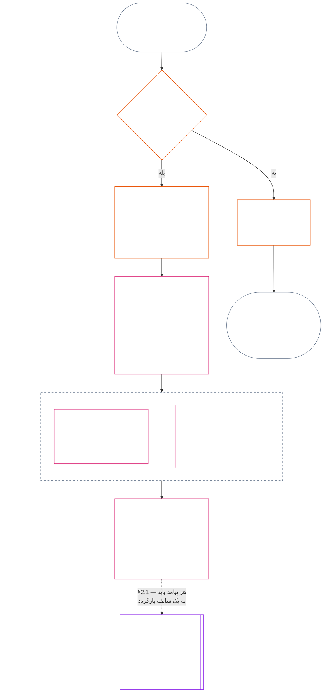

> پیش‌نویس ترجمه با هوش مصنوعی — زبان: فارسی نوشتاری ایرانی؛ منبع: commit 9c2c8c10c871d91157bcd27b9f56ad6a1cec90d3؛ وضعیت: بررسی‌نشده؛ پوشش جزئی: فصل یازدهم، فقط §§1–3. این پیش‌نویس ترجمهٔ کامل فصل نیست.

### 1. سه پرسش

*به زبان ساده: وضعیت با پاسخ‌دادن به سه پرسش به‌ترتیب تعیین می‌شود. از رتبه‌بندی مطلوب، واقعیت‌ها را استنباط نکنید و برای توجیه پیامد مطلوب، رتبه‌بندی را انتخاب نکنید.*

| پرسش | پرسش چه می‌خواهد بداند؟ | پاسخ کجا داده می‌شود؟ |
| --- | --- | --- |
| **1. چه اتفاقی افتاد؟** | کدام واقعیت‌ها راستی‌آزمایی شده‌اند، دربارهٔ چه کسی یا چه چیزی، در چه دوره‌ای، و وضعیت سابقهٔ وضعیت و اعتراض به آن چیست؟ | [بخش 2](#2-question-1--what-happened) و [بخش 3](#3-question-1-event-type-guide--what-kind-of-help-or-harm-occurred) |
| **2. چقدر خوب یا بد بود؟** | آن واقعیت‌ها چه نوع و چه اندازه‌ای از مشارکت یا نقض را اثبات می‌کنند؟ | [فصل دوازدهم، بخش 1](core_12.000_standing_measurement.md#1-question-2--how-good-or-bad-was-it) |
| **3. در پی آن چه رخ می‌دهد؟** | چه شناخت، آمادگی، جبران، تضمین، محدودیت یا پیامد دیگری در پی می‌آید؟ | [فصل سیزدهم](core_13.000_standing_integration.md#chapter-thirteen-standing-effects-and-integration) |

پاسخ هر پرسش به پاسخ پرسش پیش از آن وابسته است:

- پرسش 1 واقعیت‌های راستی‌آزمایی‌شده را برای پرسش 2 فراهم می‌کند.
- پرسش 2 آن واقعیت‌ها را برای پرسش 3 اندازه‌گیری می‌کند.
- پرسش 3 نباید واقعیت‌ها یا رتبه‌بندی را برای رسیدن به نتیجه‌ای ترجیحی بازنویسی کند.

پاسخ‌های هر سه پرسش در کنار هم ارزیابی کامل وضعیت را برای یک رویداد محدود یا یک الگوی تعریف‌شده تشکیل می‌دهند. یک موضوع ممکن است در طول زمان چند ارزیابی از این دست داشته باشد، اما هیچ‌یک امتیاز خالص یا رتبه‌بندی کلی آن موضوع نیست. سوابق وضعیتِ مشارکت و نقض پاسخ‌های پرسش‌های 1 و 2 را حفظ می‌کنند؛ تصمیم پرسش 3 می‌گوید چه چیزی از آن‌ها در پی می‌آید.

#### 1.1 هدف و دامنه

این فصل چارچوب سابقهٔ قانون اساسی را و [فصل دوازدهم](core_12.000_standing_measurement.md#chapter-twelve-standing-measurement--question-2-how-good-or-bad-was-it) چارچوب اندازه‌گیری را برای **سیستم‌ها**، **حس‌مندان** و **نهادها** تعیین می‌کند؛ ازجمله برای هر سیستمی که بر اساس [**CS-9.305**](corpus_systems/cs_09.305_system_classification_machinery.md#cs-9305-part-a-system-classification-machinery) (*سازوکار طبقه‌بندی سیستم*) طبقه‌بندی شده باشد. این چارچوب‌ها شایعه، محبوبیت، شهرت مبهم، کرامت ذاتی یا ارزش کلی را اندازه‌گیری نمی‌کنند؛ هیچ‌یک موضوع مجاز ارزیابی وضعیت نیست.

زنجیرهٔ وضعیت باید در این شرایط نیز کارآمد بماند:

- مشارکت‌هایی که قبلاً راستی‌آزمایی شده‌اند آن‌قدر قدیمی شوند که دیگر شایستگی یا قابلیت اعتماد کنونی را نشان ندهند؛
- نقض‌ها حل‌نشده بمانند؛
- جبران پرهزینه باشد؛
- مسئولیت از مرزها عبور کند؛ یا
- کنشگری برای مختل‌کردن پاسخگویی از لایه‌بندی یا تغییر نام سازمانی استفاده کند.

موارد زیر در متن اجراییِ مصوب قرار می‌گیرند:

- رویه‌های روزمره؛
- گام‌های تشدید؛
- عملیات اعاده و جبران؛
- سنجه‌های پاسخگویی ترمیمی؛ و
- طراحی مشوق‌ها.

اندازه‌گیری فصل دوازدهم **به‌خودی‌خود** مجوز استفاده از زور، بازداشت یا محدودیت دیگری بر آزادی نیست. هر پیامد از این دست باید مستقلاً الزامات فصل ششم، **مادهٔ XX** (*عدالت پس از نقض راستی‌آزمایی‌شده*) را برآورده کند؛ ازجمله الزامات تناسب، کم‌محدودکننده‌ترین گزینه، محدودیت زمانی، اعاده و پاسخگویی ترمیمی.

<strong>ردیابی · تعریف‌ها · ارزیابی · انطباق</strong>

- پیشین‌ها: [فصل یک §16 — سرپرستی در عمق](core_01.010_stewardship_capacity_principles.md#16-stewardship-in-depth)؛ [فصل‌های دو تا چهار](core_02.000_definition_structure.md)؛ [فصل پنج](core_05.000_definitions_home.md#chapter-five-foundational-definitions).
- پسین‌ها: [§2](#2-question-1--what-happened) (*پرسش 1*)؛ [§4](#4-standing-record-operational-requirements) (*الزامات راستی‌آزمایی و سابقه*)؛ [§5](#5-record-custody-and-opening-authority) (*نگهداری سابقه و اختیار گشودن آن*)؛ [§6](#6-handling-a-standing-record) (*رسیدگی به سابقهٔ وضعیت*)؛ [فصل دوازدهم §1](core_12.000_standing_measurement.md#1-question-2--how-good-or-bad-was-it) (*اندازه‌گیری پرسش 2*)؛ [فصل دوازدهم §2](core_12.000_standing_measurement.md#2-magnitude-and-severity-input-dimensions) (*ابعاد ورودی اندازه‌گیری*)؛ [فصل دوازدهم §3](core_12.000_standing_measurement.md#3-route-descriptor-catalogs-and-measurement-roles) (*فهرست توصیف‌گرهای مسیر*)؛ [فصل دوازدهم §4](core_12.000_standing_measurement.md#4-slot-grammar-and-shared-scaling) (*دستور جایگاه و مقیاس‌بندی مشترک*)؛ [فصل دوازدهم §5](core_12.000_standing_measurement.md#5-constitutional-inputs-to-axis-assignment) (*ورودی‌های قانون اساسی برای تخصیص محور*)؛ [فصل دوازدهم §6](core_12.000_standing_measurement.md#6-unified-proportional-lequ-scale--contribution-and-violation-axes) (*مقیاس تناسبی یکپارچهٔ LEQU برای هر دو محور*)؛ [فصل سیزدهم](core_13.000_standing_integration.md#chapter-thirteen-standing-effects-and-integration) (*پرسش 3*).
- [اهمیت مادی](core_05.050_band_oversight.md#materiality) · [O](core_05.050_band_oversight.md#materiality) · [M](core_05.050_band_oversight.md#materiality-determination-a) · [A](core_05.050_band_oversight.md#materiality-determination-a) · [C](core_05.050_band_oversight.md#materiality-determination-c)
- [آسیب](core_05.035_band_accountability.md#harm) · [O](core_05.035_band_accountability.md#harm) · [M](core_05.035_band_accountability.md#harm-a) · [A](core_05.035_band_accountability.md#harm-a) · [C](core_05.035_band_accountability.md#harm-c)
- [تناسب](core_05.035_band_accountability.md#proportionality) · [O](core_05.035_band_accountability.md#proportionality) · [M](core_05.035_band_accountability.md#proportionality-a) · [A](core_05.035_band_accountability.md#proportionality-a) · [C](core_05.035_band_accountability.md#proportionality-c)

### 2. پرسش 1 — چه اتفاقی افتاد؟

<strong>ردیابی</strong>

- پیشین‌ها: [§1](#1-the-three-questions) (*چارچوب سه‌پرسشی*)؛ [فصل‌های دو تا چهار](core_02.000_definition_structure.md) (*سابقه، راستی‌آزمایی و قابلیت ردیابی تعریف‌ها تا نتایج*).
- پایه‌های چهارگانه: **مشارکت**؛ **نظارت** (قابلیت اعتراض و مسیرهای چالش). هدف‌های اصلی: **شکوفایی** و **پیوستگی** (سوابق قابل‌ردیابی که یافته‌های مشارکت و نقض را برای اندازه‌گیری بعدی جداگانه حفظ می‌کنند).
- پسین‌ها:
  - [§2.2](#22-silence-is-the-default) (*سکوت حالت پیش‌فرض است*)؛
  - [§2.3](#23-protected-dissent-is-not-a-trigger) (*اعتراضِ حمایت‌شده محرک نیست*)؛
  - [§2.4](#24-linked-standing-records-and-no-offset-bridge) (*پل سوابق وضعیت پیوندخورده و نبود تهاتر*)؛
  - [§2.5](#25-verified-input-gate) (*دروازهٔ ورودی راستی‌آزمایی‌شده*)؛
  - [§2.6](#26-stage-boundary) (*مرز مرحله*)؛
  - [§2.7](#27-forum-boundary) (*مرز مجمع*)؛
  - [§3](#3-question-1-event-type-guide--what-kind-of-help-or-harm-occurred) (*راهنمای نوع رویداد*)؛
  - [§4](#4-standing-record-operational-requirements) (*الزامات سابقه*)؛
  - [§5](#5-record-custody-and-opening-authority) (*نگهداری سابقه و اختیار گشودن آن*)؛
  - [§6](#6-handling-a-standing-record) (*رسیدگی به سابقهٔ وضعیت*)؛
  - [فصل دوازدهم §1](core_12.000_standing_measurement.md#1-question-2--how-good-or-bad-was-it) (*اندازه‌گیری پرسش 2*)؛
  - [فصل دوازدهم §2](core_12.000_standing_measurement.md#2-magnitude-and-severity-input-dimensions) (*ابعاد ورودی اندازه‌گیری*)؛
  - [فصل دوازدهم §3](core_12.000_standing_measurement.md#3-route-descriptor-catalogs-and-measurement-roles) (*فهرست توصیف‌گرهای مسیر*)؛
  - [فصل دوازدهم §4](core_12.000_standing_measurement.md#4-slot-grammar-and-shared-scaling) (*دستور جایگاه و مقیاس‌بندی مشترک*)؛
  - [فصل دوازدهم §5](core_12.000_standing_measurement.md#5-constitutional-inputs-to-axis-assignment) (*ورودی‌های قانون اساسی برای تخصیص محور*)؛
  - [فصل دوازدهم §6](core_12.000_standing_measurement.md#6-unified-proportional-lequ-scale--contribution-and-violation-axes) (*مقیاس تناسبی یکپارچهٔ LEQU برای هر دو محور*)؛
  - [فصل سیزدهم](core_13.000_standing_integration.md#chapter-thirteen-standing-effects-and-integration) (13.000) (*پرسش 3*).

 

*به زبان ساده: پرسش 1 گزارشی محدود و اعتراض‌پذیر از آنچه رخ داده برقرار می‌کند. پیش از بررسی هر رتبه‌بندی یا پیامدی، موضوع، رویداد یا الگو، دورهٔ زمانی، واقعیت‌های راستی‌آزمایی‌شده و وضعیت سابقه را مشخص می‌کند. کمکِ راستی‌آزمایی‌شده و نقضِ راستی‌آزمایی‌شده در سوابق وضعیت جداگانه ثبت می‌شوند تا یکی دیگری را پاک نکند. این سوابق امتیاز محبوبیت یا برچسب‌های مبهم نیستند.*

**سابقهٔ وضعیت** سابقه‌ای محدود است که این فصل برای موضوع، دامنهٔ کارکردی، بازهٔ سابقه، وضعیت بازبینی و زمینهٔ تصمیم معینی به کار می‌برد. پیش از آغاز اندازه‌گیری، باید مشخص کند:

- سابقهٔ وضعیت دربارهٔ چه کسی یا چه چیزی است؛
- به یک رویداد محدود مربوط است یا الگویی تعریف‌شده؛
- رفتار و آثار مربوط چه وقت و کجا رخ داده‌اند؛
- کدام واقعیت‌ها راستی‌آزمایی شده و کدام‌ها هنوز مورد اختلاف‌اند؛
- چه شواهد، انتساب و مسیر چالشی از یافته‌ها پشتیبانی می‌کنند؛ و
- وضعیت کنونیِ بازبینی، اصلاح و جایگزینی سابقهٔ وضعیت چیست.

نمودار رویدادی را دنبال می‌کند تا ببیند آیا محرکِ سابقهٔ وضعیت است و سپس سابقه چه چیزهایی را در خود نگه می‌دارد؛ زیر‌بخش‌های بعدی هر قاعده را بیان می‌کنند. شاخهٔ «نه» از مسیر اصلی به سمت راست خارج می‌شود.

#### 2.1 سوابق وضعیت: انواع و موضوع‌ها

پرسش 1 برای کمکِ راستی‌آزمایی‌شده از **سابقهٔ وضعیت مشارکت** و برای آسیبِ راستی‌آزمایی‌شده، ازجمله شکست‌های پاسخگویی، از **سابقهٔ وضعیت نقض** استفاده می‌کند. یک سابقهٔ وضعیت هر دو نوع یافته را با هم ترکیب نمی‌کند.

- سابقهٔ وضعیت می‌تواند دربارهٔ یک حس‌مند، نهاد، سیستم، ارزیابی، رویداد محدود، نقش، جمع، سابقهٔ مربوط به کنشگری خاص یا واحد دیگری با اهمیت برای قانون اساسی باشد.
  - نباید موضوع‌ها، نقش‌ها، سیستم‌ها، اجتماعات، بازه‌های سابقه، وضعیت‌های بازبینی یا زمینه‌های تصمیم متمایز را در یک برچسب وضعیتِ تفکیک‌نشده ادغام کند.
- سابقهٔ وضعیت می‌تواند یک **رویداد محدود** — یک رخداد با آغاز و پایان روشن — یا یک **الگو** از رفتار تکرارشونده را پوشش دهد.
  - الگو به موضوع، دامنه و دورهٔ بازبینی تعریف‌شده نیاز دارد.
- یک موضوع ممکن است در طول زمان چند سابقهٔ وضعیت داشته باشد، ازجمله سوابق وضعیتِ پیوندخوردهٔ مشارکت و نقض.
  - هرگاه موضوع مشترک، بازهٔ هم‌پوشان سابقه، رویداد محدود، الگو یا زمینهٔ تصمیم مشترک باشد، سوابق وضعیت مرتبط باید طبق **بخش 4.2** به یکدیگر **ارجاع متقابل** دهند.
- سابقهٔ وضعیت، امتیاز مستقل شهرت، رتبهٔ کرامت، وضعیت دائمی، برچسب ارزش کلی یا کارنامهٔ امتیازِ ادغام‌شده نیست.
  - الزامات عملیاتی در **بخش 4** آمده‌اند.

هر اثر بعدی بر وضعیت به فصل سیزدهم تعلق دارد و باید بدون آن‌که بخشی از خود سابقه شود، به سابقه یا سوابق وضعیت مرتبط قابل‌ردیابی باشد.

#### 2.2 سکوت حالت پیش‌فرض است

نداشتن سابقهٔ وضعیت، حالت معمولِ یک حس‌مند، نهاد یا سیستم است و بیشتر حس‌مندان در همین حالت می‌مانند.

- سابقهٔ وضعیت فقط وقتی گشوده می‌شود که محرکی طبق **بخش 4** راستی‌آزمایی شده باشد. مرجع نام‌گذاری‌شدهٔ گشودن سابقه باید ورودی را تأیید کند و نگهدارندهٔ جداگانهٔ سابقه باید آن را ثبت کند (**بخش 5**). سابقهٔ وضعیت هرگز برای موارد زیر گشوده نمی‌شود:
  - ایجاد خط مبنا؛
  - تکمیل یک فهرست؛ یا
  - صرفاً به این دلیل که دروازه‌بانِ یک مسیر نام‌گذاری‌شده آن را ترجیح می‌دهد.
- نداشتن سابقهٔ وضعیت هیچ چیزی نمی‌گوید. «رتبه‌بندی‌نشده»، «راستی‌آزمایی‌نشده» و «سابقه‌ای در پرونده نیست» مدرک خطر، مشارکت کم یا هیچ چیز دیگری نیست. هیچ‌کس نمی‌تواند سابقهٔ مفقود را دلیل نظارت دقیق‌تر، پیش‌فرض پایین‌تر یا دسترسی مشروط به یک مسیر نام‌گذاری‌شده قرار دهد.
- هیچ نهاد یا سیستمی نمی‌تواند وجود سابقهٔ وضعیت، گواهیِ «سابقه‌ای وجود ندارد» یا رضایت به گشودن سابقه را شرط موارد زیر قرار دهد:
  - نیازهای ضروریِ **مادهٔ III** (*بقا و دسترسی ضروری*)؛
  - حمایت‌های **مادهٔ III-C** (*کار و کف اقتصادی*)؛
  - دادوستد معمول؛ یا
  - مشارکت به‌عنوان طرف اثرپذیر.
  استثنا، آستانه‌های شایستگیِ منتشرشده برای مسیرهای نام‌گذاری‌شدهٔ معین و حساس به اعتماد طبق [فصل سیزدهم §6.2 آستانه‌های شایستگی و مجوزها](core_13.000_standing_integration.md#62-competency-bars-and-clearances) است؛ آن آستانه‌ها باید توضیح دهند چرا مسیر نام‌گذاری‌شده به اعتماد حساس است.
- وقتی سابقهٔ وضعیت دربارهٔ موضوعی گشوده می‌شود، طبق الزام **بخش 4** باید آن موضوع را آگاه کرد. اطلاع‌رسانی فقط وقتی ممکن است به تأخیر افتد که نیاز مستند به [حفظ مدرک](core_05.050_band_oversight.md#evidence-preservation) یا ایمنی آن را توجیه کند، و فقط برای مدتی محدود و تعیین‌شده. اطلاع‌رسانی سابقهٔ وضعیت را اعتراض‌پذیر می‌کند: موضوعی که نمی‌داند سابقه‌ای وجود دارد نمی‌تواند به آن اعتراض کند یا آن را اصلاح کند.

#### 2.3 اعتراض حمایت‌شده محرک نیست

اعتراض یا تظاهرات مسالمت‌آمیز — ازجمله [نافرمانی مدنیِ حمایت‌شده و بدون خشونت](core_06.005_rights_part_b.md#xi-d-nonviolent-civil-disobedience) — طبق **مادهٔ XI-D** (*تجمع، اعتراض و تظاهرات مسالمت‌آمیز*) ([*کف اعتراض و تظاهرات مسالمت‌آمیز*](core_06.005_rights_part_b.md#xi-d-dissent-and-peaceful-protest)) محرکِ راستی‌آزمایی‌شده نیست.

- این کار سابقهٔ وضعیت نقض را نمی‌گشاید، تمدید یا تشدید نمی‌کند؛ ورودی شدت طبق **بخش 8.2** نیست؛ و تکرارش آن را به الگو تبدیل نمی‌کند.
- رفتارِ قابل‌تفکیکی که مستقلاً یک کفِ قانون اساسی را نقض می‌کند بر اساس شرایط خودش ثبت می‌شود، بدون تشدید به‌دلیل دیدگاه، هدف یا طرفِ هدفِ اعتراض.

#### 2.4 سوابق وضعیت پیوندخورده و پلِ نبود تهاتر

<strong>ردیابی</strong>

- پیشین: [§2.1](#21-standing-records-kinds-and-subjects) (*سوابق جداگانهٔ مشارکت و نقض*).
- پسین‌ها:
  - [§2.5](#25-verified-input-gate) (*دروازهٔ ورودی راستی‌آزمایی‌شده*)؛
  - [§2.7](#27-forum-boundary) (*مرز مجمع*)؛
  - [§4.2](#42-related-standing-record-cross-references) (*ارجاع‌های متقابل*)؛
  - [فصل دوازدهم §1](core_12.000_standing_measurement.md#1-question-2--how-good-or-bad-was-it) (*اندازه‌گیری پرسش 2*)؛
  - [فصل دوازدهم §2](core_12.000_standing_measurement.md#2-magnitude-and-severity-input-dimensions) (*ابعاد ورودی اندازه‌گیری*)؛
  - [فصل دوازدهم §3](core_12.000_standing_measurement.md#3-route-descriptor-catalogs-and-measurement-roles) (*فهرست توصیف‌گرهای مسیر*)؛
  - [فصل دوازدهم §4](core_12.000_standing_measurement.md#4-slot-grammar-and-shared-scaling) (*دستور جایگاه و مقیاس‌بندی مشترک*)؛
  - [فصل دوازدهم §5](core_12.000_standing_measurement.md#5-constitutional-inputs-to-axis-assignment) (*ورودی‌های قانون اساسی برای تخصیص محور*)؛
  - [فصل دوازدهم §6](core_12.000_standing_measurement.md#6-unified-proportional-lequ-scale--contribution-and-violation-axes) (*مقیاس تناسبی یکپارچهٔ LEQU برای هر دو محور*)؛
  - [فصل سیزدهم](core_13.000_standing_integration.md#chapter-thirteen-standing-effects-and-integration) (13.000) (*پرسش 3*).
- همراه با: [فصل سیزدهم — یکپارچه‌سازی وضعیت](core_13.000_standing_integration.md#2-automatic-integration-review-and-continuity) (13.000) (*عدم اسقاط و یکپارچگی سوابق پیوندخورده*)؛ [فصل سیزدهم §6.2 — آستانه‌های شایستگی و مجوزها](core_13.000_standing_integration.md#62-competency-bars-and-clearances) (13.000 §6.2)؛ [فصل سیزدهم §4.2 — قفل‌های وضعیت](core_13.000_standing_integration.md#42-prevention--general-standing-locks) (13.000 §4.2).

 

**قاعدهٔ اصلی:** **سوابق وضعیتِ مشارکت** راستی‌آزمایی‌شده و **سوابق وضعیتِ نقض** راستی‌آزمایی‌شده طبق **بخش 2.1** جدا نگه داشته می‌شوند. هر یافتهٔ مشارکت یا نقض باید بر واقعیت‌های پشتیبانی‌شدهٔ خودش در سابقهٔ وضعیت خودش متکی باشد. تحلیل و مدارک پشتیبان باید دو مسیر سابقه را جداگانه قابل‌ردیابی نگه دارند. هیچ مدخل منفرد یا مجموعهٔ پیوندخورده‌ای امتیاز خالص، امتیاز ترکیبی یا معامله نیست.

- **سوابق وضعیتِ نقض و قفل‌های وضعیت:**
  - طبق فصل سیزدهم، **قفل‌های وضعیت** قابل‌اعمال که از سوابق وضعیت نقض گرفته شده‌اند، ممکن است وضعیت را محدود کنند، صلاحیت نقش را کاهش دهند یا تا زمانی که نقض راستی‌آزمایی‌شده حل‌نشده است بر دسترسی به جبران اثر بگذارند.
  - قفل‌های وضعیت نباید مشارکت مثبت راستی‌آزمایی‌شده‌ای را که در سوابق وضعیت مشارکت ثبت شده محو کنند.
  - صرف گذشت زمان، از شدت نقض‌های راستی‌آزمایی‌شدهٔ حل‌نشده نمی‌کاهد.
  - نقض‌های راستی‌آزمایی‌شده نباید سوابق وضعیتِ مشارکت نامرتبط را به پروندهٔ شهرت منفیِ کاذب تبدیل کنند.
- **سوابق وضعیتِ مشارکت و مجوزهای شایستگی:**
  - مشارکت راستی‌آزمایی‌شده ممکن است از **مجوزهای شایستگی** قابل‌اعمال بر اساس **آستانه‌های شایستگی** منتشرشده حمایت کند و، در صورت به‌روز و مرتبط‌بودن با نقش، از صلاحیت مرتبط با اعتماد، نقش یا شناخت نیز پشتیبانی کند.
  - مشارکت راستی‌آزمایی‌شده نباید یافتهٔ نقضِ راستی‌آزمایی‌شده را تهاتر، میانگین‌گیری و کم‌اهمیت، توجیه یا بازنام‌گذاری کند.
  - برآورده‌شدن دروازه هیچ قفل وضعیتِ قابل‌اعمالی را اسقاط نمی‌کند.

**تنها استثنا:** اگر خودِ یافتهٔ نقض، مشارکت ادعاشده را رد کند — برای مثال، اگر مدرک نشان دهد کاری را که سابقهٔ مشارکت شما ادعا می‌کند واقعاً انجام نداده‌اید — سابقهٔ وضعیت مشارکتِ پیوندخورده را می‌توان از راه فرایند درستِ شواهد و بازبینی اصلاح یا حذف کرد، با ارجاع متقابلِ لازم طبق **بخش 4.2**. اما نقض به‌طور خودکار کمک نامرتبطی را که در سوابق وضعیتِ جداگانهٔ مشارکت ثبت شده پاک نمی‌کند.

#### 2.5 دروازهٔ ورودی راستی‌آزمایی‌شده

این دروازه چنین عمل می‌کند:

- هر تصمیمی که بر وضعیت، اعتماد، نقش، شناخت یا صلاحیت برای دریافت شناخت اثر بگذارد فقط می‌تواند از ورودی‌های راستی‌آزمایی‌شدهٔ **سوابق وضعیتِ مشارکت** یا **سوابق وضعیتِ نقض** مربوط استفاده کند.
- ادعاها، دعوی‌های تعیین‌تکلیف‌نشده، برچسب‌های مسیریابی موقت، روایت‌های صرفاً ورودی و دیگر مواد مرحلهٔ اختلاف، به‌تنهایی ماهیت مشارکت یا ماهیت نقض را برای وضعیت فراهم نمی‌کنند.
- ورودی راستی‌آزمایی‌شده یک **یافتهٔ وضعیت** است: یافتهٔ مشارکتِ راستی‌آزمایی‌شده (محور I) یا یافتهٔ نقضِ راستی‌آزمایی‌شده (محور II).
- یافته‌های مشارکت و نقض در سوابق وضعیت جداگانه می‌مانند (نگاه کنید به **بخش 2.1**).

#### 2.6 مرز مرحله

مرحله‌های سابقهٔ وضعیت جدا می‌مانند:

- پرسش 1 واقعیت‌های راستی‌آزمایی‌شده را ثبت می‌کند؛ پرسش 2 آن‌ها را اندازه‌گیری می‌کند.
- سابقهٔ وضعیت به‌محض کامل‌شدن مبنای واقعیِ راستی‌آزمایی‌شده‌اش می‌تواند گشوده شود، حتی اگر اندازه‌گیری پرسش 2 هنوز در انتظار باشد.
- تا پیش از اندازه‌گیری، بخش‌های مربوط به پرسش 2 باید بگویند که کار در انتظار است، نه این‌که جایگاه یا دسته‌ای را القا کنند.
- سابقهٔ وضعیت نباید **اثر وضعیتیِ** پرسش 3 را بیان یا اعمال کند.

#### 2.7 مرز مجمع

*به زبان ساده: مجمع‌ها جایی هستند که اختلاف‌ها نظارت، به چالش کشیده و به نتیجه‌های راستی‌آزمایی‌شده تبدیل می‌شوند — اما ثبت پرونده یا پیروزی در نبرد روایی وضعیت را به‌روز نمی‌کند. دروازهٔ ورودی راستی‌آزمایی‌شده در **بخش 2.5** همچنان اعمال می‌شود. وقتی مجمع بر اساس فصل‌های دو تا چهار واقعیت‌ها را راستی‌آزمایی کند، می‌تواند سابقهٔ وضعیت را **بگشاید، به‌روز کند یا اصلاح کند** — یا پس از اعتراض، **سابقهٔ نادرست را کنار بگذارد**. مجمع‌ها خوب و بد را در یک امتیاز ادغام نمی‌کنند و خودشان دستهٔ وضعیت را ابداع نمی‌کنند.*

این بخش مالک یک پرسش است: کار مجمع چگونه به سابقهٔ وضعیت می‌رسد. گام‌های دیگر زنجیره در اختیار مالکانی است که اینجا نام برده شده‌اند، و زنجیره به‌ترتیب زیر پیش می‌رود:

1. اختلافی ثبت می‌شود و مجمع **سابقهٔ پروندهٔ مجمع** را نگه می‌دارد؛ این سابقه، سابقهٔ وضعیت نیست. مالک: [فصل پانزدهم §2.3 سوابق پروندهٔ مجمع، سوابق وضعیت و اختلاف‌ها](core_15.000_forum.md#23-forum-case-records-standing-records-and-contests)؛ همچنین [§2.7.1 سابقهٔ پروندهٔ مجمع](#271-forum-case-record) را ببینید.
2. مجمع واقعیت‌ها را بر اساس [فصل‌های دو تا چهار](core_02.000_definition_structure.md) راستی‌آزمایی می‌کند.
3. یافته‌های راستی‌آزمایی‌شده از دروازهٔ ورودی راستی‌آزمایی‌شده می‌گذرند. مالک: [§2.5 دروازهٔ ورودی راستی‌آزمایی‌شده](#25-verified-input-gate).
4. مرجع نام‌گذاری‌شدهٔ گشودن سابقه، که می‌تواند مجمع باشد، سابقهٔ وضعیت را می‌گشاید، به‌روز می‌کند یا اصلاح می‌کند، یا پس از اعتراض سابقهٔ نادرست را کنار می‌گذارد. مالکان: [§4.1 حداقل محتوای سابقه](#41-minimum-record-contents) برای آنچه سابقهٔ وضعیت نگه می‌دارد، و [§5 نگهداری سابقه و اختیار گشودن آن](#5-record-custody-and-opening-authority) برای اینکه چه کسی می‌تواند اقدام کند.
5. سابقهٔ وضعیت فقط واقعیت‌های راستی‌آزمایی‌شده را نگه می‌دارد و سپس پرسش 2 آن‌ها را اندازه‌گیری می‌کند. مالکان: [§2.6 مرز مرحله](#26-stage-boundary) و [فصل دوازدهم §1 پرسش 2 — چقدر خوب یا بد بود؟](core_12.000_standing_measurement.md#1-question-2--how-good-or-bad-was-it).
6. اگر اثری بر وضعیت باشد، طبق [فصل سیزدهم](core_13.000_standing_integration.md#chapter-thirteen-standing-effects-and-integration) در پی می‌آید؛ آن فصل مالک آثار وضعیت است.

خانواده‌های مجمع طبق [فصل پانزدهم](core_15.000_forum.md#chapter-fifteen-forums-and-jurisdiction) **نظارت می‌کنند** که اختلاف‌های عینی چگونه از زنجیرهٔ وضعیت عبور می‌کنند. مجمع‌ها موارد زیر را طبق [فصل پانزدهم §6 حل‌وفصل به‌موقع، سطوح اهمیت مادی و انضباط ضدتأخیر](core_15.000_forum.md#6-timely-resolution-materiality-tiers-and-anti-delay-discipline) و [مادهٔ XXVI-C](core_06.020_rights_part_e.md#article-xxvi-c-timely-resolution-and-anti-delay-floor) (*حل‌وفصل به‌موقع و کف ضدتأخیر*) فراهم می‌کنند:

- امکان اعتراضِ دسترس‌پذیر؛
- بازبینی مستقل؛
- پشتیبانی پزشکی قانونی؛
- ترتیب‌بندی اصلاح؛ و
- مهلت‌های مرحله‌بندی‌شده.

وقتی یافته‌های مجمع در فصل‌های دو تا چهار دروازهٔ ورودی راستی‌آزمایی‌شده را برآورده کنند، می‌توانند:

- طبق **بخش 4.1** سوابق وضعیت را **بگشایند، به‌روز کنند یا اصلاح کنند**؛ یا
- پس از اعتراض، **سابقهٔ نادرست را کنار بگذارند**.

##### 2.7.1 سابقهٔ پروندهٔ مجمع

پروندهٔ خودِ مجمع دربارهٔ اختلافِ گشوده، [**سابقهٔ پروندهٔ مجمع**](core_05.035_band_accountability.md#forum-case-record) است که در [فصل پانزدهم §2.3 سوابق پروندهٔ مجمع، سوابق وضعیت و اختلاف‌ها](core_15.000_forum.md#23-forum-case-records-standing-records-and-contests) تعریف شده است. این **سابقهٔ وضعیت نیست**.

##### 2.7.2 یافته‌های مجمع و اندازه‌گیری پرسش 2

یافته‌های واقعیِ راستی‌آزمایی‌شدهٔ مجمع ممکن است مبنای واقعیِ سابقهٔ وضعیتِ پرسش 1 را فراهم کنند. آن‌ها اندازه‌گیری پرسش 2 دربارهٔ خوب یا بد بودن مشارکت یا نقضِ راستی‌آزمایی‌شده را **تعیین نمی‌کنند** ([§2.6 مرز مرحله](#26-stage-boundary)). بنابراین:

- رسیدگی‌های مجمع نباید مواد مشارکت و نقض را در یک امتیاز خالص، پاسخ ترکیبی دربارهٔ ماهیت اختلاف یا برچسب وضعیتِ تفکیک‌نشده **ادغام کنند**؛ سوابق وضعیت پیوندخورده طبق [§2.1 سوابق وضعیت: انواع و موضوع‌ها](#21-standing-records-kinds-and-subjects) و [§2.4 سوابق وضعیت پیوندخورده و پلِ نبود تهاتر](#24-linked-standing-records-and-no-offset-bridge) جدا می‌مانند.
- خروجی مجمع نباید روایت اختلاف، آسودگی مسیریابی یا ترجیح هیئت را جایگزین ورودی‌های راستی‌آزمایی‌شدهٔ اثبات‌پذیر ([§2.5 دروازهٔ ورودی راستی‌آزمایی‌شده](#25-verified-input-gate))، اندازه‌گیری جداگانه ([فصل دوازدهم §1 پرسش 2 — چقدر خوب یا بد بود؟](core_12.000_standing_measurement.md#1-question-2--how-good-or-bad-was-it)) یا سازوکارهای اثر بر وضعیتِ متعلق به [فصل سیزدهم](core_13.000_standing_integration.md#chapter-thirteen-standing-effects-and-integration) **کند**.

##### 2.7.3 آنچه مرز مجمع کاهش نمی‌دهد

این مرز چالش، جبران، تسکین موقت یا حمایت‌های رویه‌ایِ لازم طبق موارد زیر را **کاهش نمی‌دهد**:

- [مادهٔ XIII-A](core_06.010_rights_part_c.md#article-xiii-a-reliability-and-trustworthiness-baseline) (*خط مبنای قابلیت اعتماد و امانت‌داری*)؛
- [مادهٔ XIII-B](core_06.010_rights_part_c.md#article-xiii-b-right-to-redress-and-remedy) (*حق جبران و درمان*)؛
- [فصل پانزدهم §6 حل‌وفصل به‌موقع، سطوح اهمیت مادی و انضباط ضدتأخیر](core_15.000_forum.md#6-timely-resolution-materiality-tiers-and-anti-delay-discipline)؛
- [مادهٔ XXVI-C](core_06.020_rights_part_e.md#article-xxvi-c-timely-resolution-and-anti-delay-floor) (*حل‌وفصل به‌موقع و کف ضدتأخیر*)؛ یا
- مواد مرتبطِ عدالت.

این مرز مقرر می‌کند که یافته‌های راستی‌آزمایی‌شدهٔ مجمع از همان دروازه‌ای وارد وضعیت شوند که دیگر ورودی‌های راستی‌آزمایی‌شده از آن می‌گذرند — نه اینکه آن را دور بزنند.

### 3. راهنمای نوع رویدادِ پرسش 1 — چه نوع کمک یا آسیبی رخ داد؟

*به زبان ساده: پس از راستی‌آزمایی واقعیت‌ها، برای توصیف آنچه رخ داد از این جدول‌ها استفاده کنید. آن‌ها به شناسایی نوع مشارکت یا نقض کمک می‌کنند. تعیین نمی‌کنند چقدر خوب یا بد بوده، جایگاهی تخصیص نمی‌دهند و مشخص نمی‌کنند در پی آن چه رخ می‌دهد.*

#### 3.1 انواع رویداد مشارکت

**قاعدهٔ احراز:** مشارکتِ ادعاشده فقط وقتی محاسبه می‌شود که قابل‌ردیابی، بدون برون‌ریزکردن آسیب و در کلیت با قانون اساسیِ لازم‌الاجرا سازگار باشد.

- آسیب‌های برون‌ریز‌شده، وابستگی‌های قهری، محدودکردن کف حقوق یا بارهای پنهان ممکن است مشارکت ادعاشده را بی‌اعتبار یا محدود کنند.
- مشارکت ادعاشده یک یافتهٔ جداگانهٔ نقض را تهاتر نمی‌کند.

هر ردیف جدول زیر مسیر رایجی از کمکِ راستی‌آزمایی‌شده و ارتباط آن با قانون اساسی را نام می‌برد. ممکن است چند ردیف دربارهٔ یک سابقهٔ وضعیت مصداق داشته باشند.

| نوع مشارکتِ راستی‌آزمایی‌شده | چه اتفاقی افتاد؟ | پایه یا پایه‌های چهارگانه | هدف یا هدف‌های اصلی |
| --- | --- | --- | --- |
| بقا و نگهداری جسمانی | کسی غذا، سرپناه، مراقبت پزشکی یا ایمنی دریافت کرد | **مشارکت**، **نظارت** | **شکوفایی** |
| مراقبت و آموزش | از کودکان مراقبت شد، سالمندان نگهداری شدند یا دیگران آموزش دیدند | **مشارکت**، **نظارت** | **شکوفایی**، **پیوستگی** |
| بهبود از تروما | کسی برای بهبود از آسیب روانیِ مانع بهزیستی کمک دریافت کرد | **مشارکت**، **پاسخگویی** | **شکوفایی** |
| حذف بارهای شدید | بدهی کمرشکن، شرایط کاری استثمارگرانه یا موانع نظام‌مند برداشته شد | **مشارکت**، **نظارت** | **شکوفایی** |
| بازگرداندن عاملیت | کسی انتخاب‌های معناداری دربارهٔ زندگی خود به دست آورد | **مشارکت** | **شکوفایی** |
| گسترش ظرفیت مولد | ابزار، زیرساخت یا فرصت دیگران را قادر کرد مستقلانه شکوفا شوند | **مشارکت**، **نظارت** | **شکوفایی**، **پیوستگی** |
| بهبود کارآمدی زمان | انتظارِ اجتناب‌پذیر، اصطکاک اداری یا سربار هماهنگی کاهش یافت و زمان قابل‌استفاده برای مراقبت، استراحت، عاملیت، یادگیری یا کار سازگار با حقوق بازگردانده شد | **مشارکت**، **نظارت** | **شکوفایی** |
| کاهش خطر زیست‌محیطی یا زیرساختی | فروپاشی محیطی یا خرابی سیستم حیاتی پیشگیری شد | **نظارت**، **پاسخگویی** | **پیوستگی**، **شکوفایی** |
| کاهش ردپای زیست‌محیطی | مصرف منابع، انتشار یا نیاز به زمین و آب به‌صورت راستی‌آزمایی‌شده کاهش یافت، بی‌آنکه بار به دیگران یا اکوسیستم‌ها منتقل شود | **نظارت**، **پاسخگویی** | **پیوستگی**، **شکوفایی** |
| احیای اکوسیستم‌ها | زمین، آب یا زیستگاهی تخریب‌شده به‌سوی وضعیتی کارآمد و خودپایدار بازگردانده شد | **نظارت**، **پاسخگویی** | **پیوستگی**، **شکوفایی** |
| حفاظت از گونه‌های در معرض خطر | گونه‌های در معرض خطر انقراض، یا زیستگاه‌های مورد اتکای آن‌ها، از نابودی محافظت شدند | **نظارت**، **پاسخگویی** | **پیوستگی**، **شکوفایی** |
| کاهش آلودگی و پسماند | آلودگی، انتشار زیان‌بار یا پسماند پیشگیری، حذف یا به‌طور ایمن مدیریت شد | **نظارت**، **پاسخگویی** | **شکوفایی**، **پیوستگی** |
| تقویت ایمنی، حقیقت، قابلیت حسابرسی یا ظرفیت چالش | نهادها یا رویه‌هایی برای حمایت از حقوق و پاسخگو نگه‌داشتن قدرت ساخته یا اصلاح شدند | **مشارکت**، **نظارت**، **پاسخگویی** | **شکوفایی**، **پیوستگی** |

#### 3.2 انواع رویداد نقض

**قاعدهٔ احراز:** نوع رویداد نقض به یافتهٔ نقضِ راستی‌آزمایی‌شده‌ای نیاز دارد که طبق **فصل‌های دو تا چهار** همچنان قابل‌ردیابی، محدود، حسابرسی‌پذیر و اعتراض‌پذیر باشد.

- ادعاها، برچسب‌های موقت، روایت‌های مجمع و برچسب‌های پذیرش ممکن است به مسیریابی یا غربالگری کمک کنند، اما پرسش 1 را کامل نمی‌کنند.
- مشارکت مثبت، نقضِ راستی‌آزمایی‌شده را تهاتر، توجیه، خنثی یا بازنام‌گذاری نمی‌کند.

هر ردیف جدول زیر مسیر رایجی از فقدان، خطر یا شکست وظیفهٔ راستی‌آزمایی‌شده و ارتباط آن با قانون اساسی را نام می‌برد. ممکن است چند ردیف دربارهٔ یک سابقهٔ وضعیت مصداق داشته باشند.

| نوع فقدان یا خطرِ راستی‌آزمایی‌شده | چه اتفاقی افتاد؟ | پایه یا پایه‌های چهارگانه | هدف یا هدف‌های اصلی |
| --- | --- | --- | --- |
| محرومیت از بقا یا نگهداری جسمانی | مرگِ اجتناب‌پذیر، محرومیت از مراقبت، شرایط ناایمن یا محرومیت مادی از بقا رخ داد | **پاسخگویی**، **مشارکت** | **شکوفایی** |
| بار شدیدِ اجتناب‌پذیر | بارهای کمرشکن، تحمیل‌شده یا نظام‌منداً منتقل‌شده به‌طور مادی بهزیستی یا عاملیت را مختل کردند | **پاسخگویی**، **مشارکت** | **شکوفایی** |
| از دست‌دادن قهری عاملیت | اجبار، دست‌کاری، تهدید معتبر، حبس یا خطر آزادی رخ داد | **پاسخگویی**، **مشارکت** | **شکوفایی** |
| خنثی‌سازی کف حقوق | کف‌های غیرقابل‌مذاکرهٔ قانون اساسی، برتری آن یا دسترسی به چالش و جبران به‌طور مادی نقض شدند | **پاسخگویی**، **نظارت** | **شکوفایی**، **پیوستگی** |
| آسیب زیست‌محیطی یا زیرساختی | شرایط لازم برای بهزیستی قانون اساسی آسیب دیدند | **پاسخگویی**، **نظارت** | **پیوستگی**، **شکوفایی** |
| آسیب آلودگی یا پسماند | آلودگی، انتشار زیان‌بار یا پسماند به هوا، آب، خاک یا سلامت آسیب رساند | **پاسخگویی**، **نظارت** | **شکوفایی**، **پیوستگی** |
| تخریب گونه یا زیستگاه | گونه‌های در معرض خطر انقراض یا زیستگاه‌های مورد اتکای آن‌ها نابود، تکه‌تکه یا به‌سوی نابودی سوق داده شدند؛ ازجمله نابودی‌ای که قابل‌تهاتر تلقی می‌شود | **پاسخگویی**، **نظارت** | **پیوستگی**، **شکوفایی** |
| از دست‌رفتن ظرفیت بازیابی زیست‌محیطی | توان اکوسیستم برای نوزایی پس از آسیب از میان برده شد یا بازگرداندنش به‌نحوی اجتناب‌پذیر دشوار یا ناممکن شد | **پاسخگویی**، **نظارت** | **پیوستگی**، **شکوفایی** |
| آسیب یا تخلیهٔ زیست‌محیطی برون‌ریز‌شده | هزینه‌های زیست‌محیطی به دیگران یا اکوسیستم‌ها منتقل شدند، منابع بیش از ظرفیت نوزایی تخلیه شدند، یا ادعای ردپا یا پایداری، وخامت مداوم را پنهان کرد | **پاسخگویی**، **نظارت** | **پیوستگی**، **شکوفایی** |
| نابودی ظرفیت مولد | ابزار، قابلیت‌ها، روابط یا منابع لازم برای شکوفایی مستقلانه از دسترس خارج شدند | **پاسخگویی** | **شکوفایی** |
| تضعیف ایمنی، حقیقت یا قابلیت حسابرسی | پنهان‌کاری، اطلاعات نادرست، سوابق شکسته، مسیرهای چالشِ غیرقابل‌دسترس یا تجمیعِ بازبینی‌ناپذیر رخ داد | **نظارت**، **پاسخگویی** | **شکوفایی**، **پیوستگی** |
| اخلال در پاسخگویی | مداخلهٔ راستی‌آزمایی‌شده در سازوکار پاسخ‌خواهی — سلامت شواهد، راستی‌آزمایی، فرایند مجمع، سوابق وضعیت، پنجره‌های جبران یا مسیرهای اعتراض و دادخواهی — رخ داد؛ اگر اخلال، حمله‌ای فراسطحی به آسیبی زیربنایی و متمایز است، یک سابقهٔ وضعیتِ نقضِ جداگانه و پیوندخورده بگشایید | **پاسخگویی**، **نظارت**، **به‌هنگامی** | **شکوفایی**، **پیوستگی** |
| تسخیر سیستم یا سوءاستفاده از وابستگی | توانمندسازی ساختاری، سوءاستفاده از عدم‌تقارن وابستگی، طراحی ضدگریز یا تسخیر مسیرهای پاسخگویی رخ داد | **پاسخگویی**، **مشارکت** | **پیوستگی**، **شکوفایی** |
