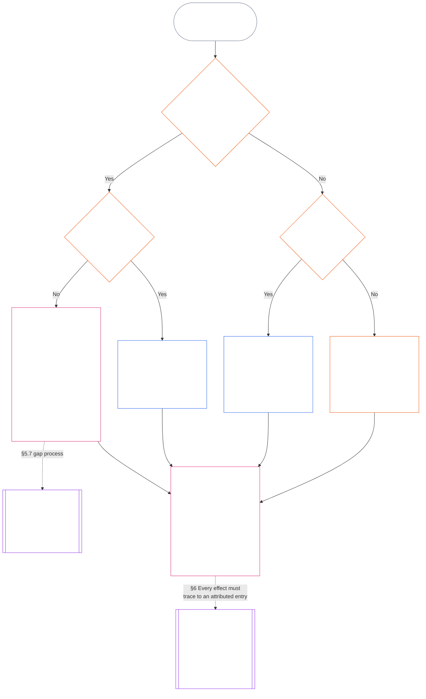

<!-- زبان: فارسی (fa) | منبع: 9c2c8c10c871d91157bcd27b9f56ad6a1cec90d3 | پیش‌نویس هوش مصنوعی، بازبینی‌نشده؛ پوشش جزئی: فصل ۱۱، §§۵.۷ تا ۵.۹ -->

#### ۵.۷ هرگاه منشور سیستم یا منشور نهادی کرسی‌ای را نام نبرد

اینکه سابقهٔ جایگاه در نبود مسیر معمولِ نام‌برده‌شده به کجا می‌رود، به سه پرسش بستگی دارد که نمودار زیر به‌ترتیب بررسی می‌کند. این بخش به منشور سیستم یا منشور نهادی‌ای می‌پردازد که کرسی‌ای را نام نبرده است؛ [§۵.۸ راهکار جایگزین وقتی هیچ منشور سیستم یا منشور نهادی به سابقهٔ جایگاه مربوط نیست](#58-fallback-when-no-system-charter-or-institutional-charter-reaches-the-standing-record) حالتی را پوشش می‌دهد که هیچ‌یک به سابقهٔ جایگاه مربوط نباشند.

<strong>راهنمای خواننده (غیرعملیاتی): شیوهٔ خواندن نمودار</strong>

> *به زبان ساده: سابقهٔ جایگاه را دفترهایی رسیدگی می‌کنند که منشور سیستم یا منشور نهادی نام برده است. اگر منشور سیستم یا منشور نهادی کرسی‌ای را نام نبرد، تا رفع خلأ نامعتبر است و سابقهٔ جایگاه به مرجع پشتیبان سوابق و متولی پشتیبان سوابق، یا به مجمع می‌رود، نه به نقشهٔ مسیرها. اگر هیچ منشور سیستم یا منشور نهادی اصلاً به سابقهٔ جایگاه مربوط نباشد، نقشهٔ مسیرهای منتشرشدهٔ نهاد تصمیم می‌گیرد؛ و اگر چنین نقشه‌ای نباشد، سابقهٔ جایگاه برای راستی‌آزمایی مستقل یا، در کارهای غیررسمی و کم‌دامنه، به پیکره‌ای می‌رود که به آن اتکا می‌کند.*
>
> هر مسیر به یک جعبهٔ مشترک ختم می‌شود: یک دفتر واقعیت‌ها را راستی‌آزمایی می‌کند و دفتری جداگانه سابقهٔ جایگاه را ثبت و نگهداری می‌کند؛ سپس [§۶ رسیدگی به سابقهٔ جایگاه](#6-handling-a-standing-record) بر کار نگهدارندگان حاکم است. پیکان‌های پیوسته مسیر اصلی‌اند. پیکان‌های نقطه‌چین واگذاری‌ها را نشان می‌دهند و برچسب بخشِ مجازکننده را دارند. جعبه‌هایی که در دو سویشان خط دوتایی دارند به فصل دیگری تعلق دارند؛ جعبهٔ آخر جایی است که آثار بر جایگاه از سابقهٔ جایگاه استخراج می‌شوند، بی‌آنکه آن را بازنویسی کنند. نمودار هیچ تکلیف، کرسی یا فیلدی نمی‌افزاید.

 

منشور سیستمی یا منشور نهادی که کرسیِ لازم برای سابقه یا مسیر مستقل را نام نبرد:

- **پیامد:** منشور سیستم یا منشور نهادی نامعتبر است و تغییری که چنین نتیجه‌ای ایجاد کند مجاز نیست ([فصل هفتم §۴.۷.۱ وجود خلأ و شیوهٔ ثبت آن](core_07.000_charters.md#471-when-a-gap-exists-and-how-it-is-logged)).
- **فرایند رسیدگی به خلأ در اختیار فصل هفتم است:** [فصل هفتم §۴.۷ خلأها در نقشهٔ سوابق جایگاهِ بهره‌بردار](core_07.000_charters.md#47-gaps-in-the-map-for-operator-standing-records) همچنین موارد زیر را پوشش می‌دهد:
  - چگونگی ثبت خلأ؛
  - مهلت‌های پاسخ و حل‌وفصل (ازجمله جایگزینی اضطراری)؛ و
  - زمان بازگشت نگهداری به نگهدارندگان نام‌برده.

برای سوابق جایگاه، این بخش موارد زیر را می‌افزاید:

- **چه کسی نمی‌تواند اقدام کند:** تا وقتی کرسیِ لازم خالی است و منشور سیستم یا منشور نهادی جایگزین معتبری نام نبرده، هیچ‌کس نمی‌تواند کارکرد آن کرسی را انجام دهد، مگر از مسیر بند بعدی.
- **سابقهٔ جایگاه به کجا می‌رود:** همان‌طور که [§۵.۴ منع نگهداریِ شخصی](#54-no-self-custody) مقرر می‌کند، سابقهٔ جایگاه به مرجع پشتیبان سوابق و متولی پشتیبان سوابق، یا به مجمعی طبق **بخش ۲.۷** می‌رود و نقشهٔ مسیرها جایگزین آن نمی‌شود. هر سابقهٔ جایگاه نزد یک متولی به‌صورت کامل باقی می‌ماند.
- **سوابق جایگاهی که پیش‌تر نگهداری می‌شدند:**
  - در روزی که مجمع، ثبت‌دار یا مرجع پشتیبان سوابق از خلأ آگاه می‌شود، هر سابقهٔ جایگاهِ بهره‌بردار که دفتری در خط کنترل مادیِ طرف منشوردار نگه می‌دارد، همراه با رد کاملش به متولی پشتیبان سوابق منتقل می‌شود.
  - تا آن زمان، آن دفتر سابقه را فقط‌خواندنی نگه می‌دارد، هیچ نسخه‌ای ثبت نمی‌کند و بی‌درنگ نسخهٔ کامل آن را همراه با رد کاملش به متولی پشتیبان سوابق می‌دهد.
  - متولیِ بیرون از خط، سابقهٔ جایگاه را نگه می‌دارد و در دورهٔ خلأ، هر نسخه‌ای را که مرجع پشتیبان سوابق یا مجمع مجاز کند ثبت می‌کند. اگر مجمع تشخیص دهد متولی درون خط است، سابقهٔ جایگاه مانند مورد دفترِ درون خط، همراه با رد کاملش به متولی پشتیبان سوابق منتقل می‌شود.
- **سرپرستان:** سرپرستی که از او خواسته شود کرسی‌ای را پر کند که منشور سیستم یا منشور نهادی به او نداده است:
  - **کرسی را نمی‌پذیرد:** دسترسی یا توانایی فنی برای ثبت سابقهٔ جایگاه، به او اختیار ثبت آن را نمی‌دهد.
  - **درخواست و خلأ را نام می‌برد:** هر دو را در گزارش نام می‌برد.
  - **سابقهٔ جایگاه را ارجاع می‌دهد:** آن را از مسیر *سابقهٔ جایگاه به کجا می‌رود* در بالا می‌فرستد.
  - **تکالیف دیگرش را ادامه می‌دهد:** تکالیف موجود او طبق [§۵.۴ منع نگهداریِ شخصی](#54-no-self-custody) (*سرپرستان درون موضوع*) همچنان برقرارند: آنچه کنترل می‌کند متوقف می‌کند، مجموعهٔ قابل بازسازی را ثبت می‌کند، شواهدی را که در اختیار دارد حفظ می‌کند، آگاه می‌سازد و موضوع را به مرجع بالاتر ارجاع می‌دهد. هیچ‌یک از این اقدامات واقعیت‌ها را راستی‌آزمایی یا سابقهٔ جایگاه را ثبت نمی‌کند. گزارش و شواهد حفظ‌شده همراه سابقهٔ جایگاه به‌عنوان دادهٔ ورودی به مرجع راستی‌آزماینده می‌روند؛ آن‌ها ثبت محسوب نمی‌شوند و واقعیت‌ها را تعیین نمی‌کنند.

#### ۵.۸ راهکار جایگزین وقتی هیچ منشور سیستم یا منشور نهادی به سابقهٔ جایگاه مربوط نیست

هرگاه هیچ منشور سیستمی یا منشور نهادی، سیستم، نهاد یا کسب‌وکاری را که سابقهٔ جایگاه دربارهٔ آن است پوشش ندهد — برای نمونه پیکره‌ای پایین‌تر از خط ردهٔ L که هیچ منشوری منتشر نکرده — نقشهٔ مسیرهای منتشرشدهٔ نهاد طبق **CI-8.205 §۲** (*مسیرهای تفکیک کارکردی*) حاکم است:

- **مرجع اختیار گشودن سابقه:** دفتری که نقشهٔ مسیرها برای سیستم، نهاد یا کسب‌وکارِ موضوع سابقهٔ جایگاه در مسیر اطمینان‌بخشی و ممیزی قرار می‌دهد. آن دفتر مبنای واقعی را راستی‌آزمایی و ثبت را مجاز می‌کند ([§۵.۲ مرجع نام‌بردهٔ اختیار گشودن سابقه](#52-named-record-opening-authority))؛ سابقهٔ جایگاه را ثبت یا نگهداری نمی‌کند.
- **متولی:** دفتری که مسیر انتشار و شواهد را در اختیار دارد.
- **محرومیت مسیر اجرا:** هیچ‌یک نمی‌تواند دفتری باشد که مسیر اجرا برای سیستم مورد نظر را در اختیار دارد.
- **نبود نقشهٔ مسیرها:** سابقهٔ جایگاه برای راستی‌آزمایی مستقل طبق *منع نگهداریِ شخصی* در بالا ارجاع می‌شود؛ یا، برای سوابق غیررسمی و کم‌دامنه، به پیکرهٔ متکی بر سابقه طبق *سوابق غیررسمی و کم‌دامنه* در ادامه می‌رود.
- **سرپرستان:** سرپرستی که از او خواسته شود کرسی‌ای را پر کند که نقشهٔ مسیرها به او نداده است، از قاعدهٔ *سرپرستان* در [§۵.۷ هرگاه منشور سیستم یا منشور نهادی کرسی‌ای را نام نبرد](#57-when-a-system-charter-or-institutional-charter-leaves-a-seat-unnamed) پیروی می‌کند: کرسی را نمی‌پذیرد، درخواست و خلأ را در گزارش نام می‌برد و تکالیف دیگرش را ادامه می‌دهد. سابقهٔ جایگاه را به دفتری که نقشهٔ مسیرها نام برده می‌فرستد یا، اگر هیچ دفتری نام نبرده باشد، از مسیر *نبود نقشهٔ مسیرها* در بالا ارجاع می‌دهد.

#### ۵.۹ سوابق غیررسمی و کم‌دامنه

تفکیک وظایف متناسب با اهمیت مادی است، نه با میزان رسمی‌بودن ([فصل هشتم §۲ الزام قانون اساسی چهارکرسی](core_08.000_functional_independence_separation_of_duties.md#2-four-seat-constitutional-requirement)).

- **کارهای مشمول:** جوامع محلی با انواع بسیاری از مشارکت‌ها اداره می‌شوند و بخش بزرگی از آن‌ها بدون دستمزد و غیررسمی است. این قاعده بر کارهای بدون دستمزد، همتا‌سازمان‌دهی‌شده، یاری متقابل، مراقبت، نگهداری، تعمیر، آموزش و سرپرستی اجتماعی اعمال می‌شود؛ کارهایی که [فصل سیزدهم §۶ پیامدهای مشارکت در درجهٔ دوم](core_13.000_standing_integration.md#6-contribution-consequences-second) الزام می‌کند با معیارهای برابر به رسمیت شناخته شوند.
  - **نمونه‌های محلی:** همسایگانی که غذا و ابزار را با هم تقسیم می‌کنند (یاری متقابل)؛ مراقبت از همسایهٔ بیمار یا سالخورده (مراقبت)؛ رسیدگی به باغ مشترک یا جویبار (نگهداری و سرپرستی اجتماعی)؛ تعمیر لوله‌های همسایه (تعمیر)؛ آموزش خصوصی یا نشان‌دادن مهارتی به کسی (آموزش). هرکدام نوع جداگانه‌ای از مشارکت است.
- **چه کسی کرسی راستی‌آزمایی را پر می‌کند:** برای این کارها، کرسی راستی‌آزمایی را **هر پیکرهٔ مستقلی که اختیار منتشرشده برای اتکا به سابقهٔ جایگاه دارد** برآورده می‌کند؛ سپس آن پیکره به‌عنوان مرجع راستی‌آزماینده عمل می‌کند.
  - **معمولاً چه پیکره‌ای است:** اغلب همان پیکره‌ای که به سابقهٔ جایگاه اتکا می‌کند: گروهی محلی مانند شورای حوزهٔ آبخیز، سازمانی که کار را تأمین مالی می‌کند یا ادامه می‌دهد، مرجع شناسایی سوابق **CI-6.255** (*مشاعات، تعاونی‌ها، یاری متقابل و حکمرانی اجتماعیِ غیربازاری*) (پیکره‌ای که سوابق چنین کار اجتماعی‌ای را به رسمیت می‌شناسد)، یا مجمعی طبق **بخش ۲.۷**.
- **چه چیزی کافی نیست:** رسمی‌بودن مرجع راستی‌آزماینده به‌تنهایی کرسی راستی‌آزمایی را برآورده نمی‌کند.

در چنین سابقهٔ جایگاهی:

- حس‌مندی که به‌تنهایی عمل می‌کند برای درخواست سابقهٔ مشارکت خودش به گروه، نهاد، [منشور سیستم](core_05.040_band_continuity.md#system-charter) یا [منشور نهادی](core_05.040_band_continuity.md#institutional-charter) نیاز ندارد. در این حالت:
  - **چه کسی درخواست می‌دهد:** خود او در مقام موضوع و مدعی، کرسی آغازگر را برای درخواست خودش در اختیار دارد.
  - **مواد خود او:** شرح، گزارش‌ها و عکس‌های خودش دادهٔ ورودی‌اند و هرگز راستی‌آزمایی نیستند.
  - **کرسی راستی‌آزمایی:** هر پیکرهٔ مستقلی که اختیار منتشرشده برای اتکا به سابقهٔ جایگاه دارد (مرجع راستی‌آزماینده).
  - **ثبت و نگهداری:** متولی سابقه‌ای جداگانه سابقهٔ جایگاه را ثبت و نگهداری می‌کند.
  - **اگر کسی اعتراض کند:** اعتراض به مسیر اعتراض یا مجمعی طبق **بخش ۲.۷** می‌رود.
  - **نبود پیکرهٔ متکی:** هرگاه چنین پیکره‌ای در دسترس نباشد، سابقهٔ جایگاه به مجمعی طبق **بخش ۲.۷** می‌رود.
  - **نمونه، لوله‌کش بازنشسته:** لوله‌کش بازنشسته‌ای که سال‌ها بدون دستمزد لوله‌های همسایه‌ها را تعمیر کرده و هیچ گروهی پشت سرش نیست، می‌تواند از مرجع شناسایی سوابق **CI-6.255** (*مشاعات، تعاونی‌ها، یاری متقابل و حکمرانی اجتماعیِ غیربازاری*) بخواهد سابقهٔ جایگاهی را بگشاید:
    - **درخواست و ادعا:** لوله‌کش.
    - **راستی‌آزمایی:** مرجع، با تکیه بر گزارش کارها و گواهی همسایه‌ها.
    - **ثبت و نگهداری:** متولی سابقه‌ای جداگانه.
    - **اگر کسی اعتراض کند:** اعتراض به مجمع می‌رود، نه به مرجع راستی‌آزماینده.
- شرکت‌کنندگان موضوع‌اند و هرگاه خواهان بازشناسی باشند، مدعی نیز هستند. در سابقهٔ جمعی طبق **بخش ۴.۳**:
  - **هم‌شرکت‌کنندگان:** هرکدام مدعی‌اند.
  - **اظهار یک عضو دربارهٔ سهم عضو دیگر:** دادهٔ ورودی است و هرگز راستی‌آزمایی نیست.
- مواد پشتیبان سابقهٔ جایگاه از دو جا می‌آیند:
  - **غیرشرکت‌کنندگان:** بهره‌مندان، همسایگان و دیگر غیرشرکت‌کنندگان گواهی‌هایی را به‌عنوان مواد راستی‌آزمایی طبق **بخش ۴.۱** فراهم می‌کنند.
  - **گزارش خود گروه:** حس‌مندی که آن را نگه داشته، طبق *اظهارات ثبت‌کننده دادهٔ ورودی هستند* ثبت‌کننده و شاهد است.
- متولی سابقهٔ پیکرهٔ متکی، آنچه را مرجع راستی‌آزمایندهٔ جداگانه راستی‌آزمایی کرده ثبت و نگهداری می‌کند:
  - **چه کسی نمی‌تواند هیچ‌یک از دو کرسی را داشته باشد:** نه متولی سابقه و نه مرجع راستی‌آزماینده نمی‌تواند مدعی یا در [خط کنترل مادی](core_05.035_band_accountability.md#material-control-line) مدعی باشد.
  - **یک پیکره، دو کرسی:** همان پیکرهٔ متکی می‌تواند هر دو کرسی را طبق نقشهٔ مسیرهای منتشرشده با حفاظ‌های استقلالِ قابل ممیزی و اعتراض میزبانی کند.
  - **هرگز یکسان نیستند:** هیچ مرجع، متولی یا حس‌مندی نمی‌تواند هر دو وظیفه را در یک سابقهٔ جایگاه انجام دهد.
- وضعیت یک گروه، ادعای عضو را مشروط نمی‌کند:
  - **گروه‌های غیررسمی:** گروهی که [منشور سیستم](core_05.040_band_continuity.md#system-charter) یا [منشور نهادی](core_05.040_band_continuity.md#institutional-charter) ندارد، یا اصلاً نهاد نیست، مانع اعضایش نمی‌شود.
  - **هر شرکت‌کننده:** می‌تواند برای کاری که درون گروه یا بیرون از آن انجام داده است، به‌عنوان مدعی فردی خواهان بازشناسی شود.
  - **موضوع سابقهٔ جایگاه:** سابقه به مشارکت شرکت‌کننده مربوط است، نه جایگاه گروه.
  - **نمونه، حلقهٔ لحاف‌دوزی:** حلقهٔ لحاف‌دوزی‌ای که به پناهندگان تازه‌وارد لحاف می‌دهد نمونهٔ این الگوست: هر لحاف‌دوز می‌تواند خواهان سابقهٔ جایگاه شود که پیکرهٔ متکیِ مستقلی، مانند سازمان دریافت‌کنندهٔ لحاف‌ها، آن را راستی‌آزمایی می‌کند؛ حلقه برای این کار به منشور سیستم یا منشور نهادی نیاز ندارد.
- سابقهٔ جایگاهِ نقض نیز می‌تواند در همین محیط‌های غیررسمی پدید آید و کرسی‌ها در آنجا هم جدا می‌مانند:
  - **نمونه، رویداد در بار:** کسی از حس‌مند دیگری در باری فیلم می‌گیرد که مست می‌شود، نظم را برهم می‌زند و خشونت می‌کند، هرچند کسی آسیب جسمی نمی‌بیند.
    - **نیازی به جراحت نیست:** تهدید معتبرِ راستی‌آزمایی‌شده به خشونت می‌تواند حتی وقتی کسی آسیب ندیده است مبنای سابقهٔ جایگاهِ نقض باشد (**بخش ۳.۲**، از دست رفتن عاملیتِ اجباری).
    - **ویدئو دادهٔ ورودی است:** حس‌مندی که فیلم گرفته شاهد است. فیلم‌برداری دادهٔ ورودی است و به‌تنهایی هرگز راستی‌آزمایی نیست؛ وجود آن به‌تنهایی چیزی را نمی‌گشاید (**بخش ۲.۲**).
    - **حس‌مندِ در ویدئو:** او موضوع است. هنگام گشوده‌شدن سابقهٔ جایگاه به او اطلاع داده می‌شود و نمی‌تواند هیچ کرسی‌ای را پر کند ([§۵.۴ منع نگهداریِ شخصی](#54-no-self-custody)).
    - **کرسی راستی‌آزمایی:** پیکره‌ای مستقل با اختیار منتشرشده برای اتکا به سابقهٔ جایگاه، مانند مرجع محلی صدور مجوز یا ایمنی، یا مجمعی طبق **بخش ۲.۷**. اگر حس‌مندی که فیلم گرفته یا مالک بار مدعی باشد یا در [خط کنترل مادی](core_05.035_band_accountability.md#material-control-line) مدعی قرار گیرد، از این کرسی مستثناست.
    - **ثبت، نگهداری و اعتراض:** متولی سابقه‌ای جداگانه سابقهٔ جایگاه را ثبت و نگهداری می‌کند و اعتراض به مسیر اعتراض یا مجمعی طبق **بخش ۲.۷** می‌رود، نه به مرجع راستی‌آزماینده.
- باری یا فرایندی که راستی‌آزماییِ یک نهاد رسمی را الزامی کند که گروه غیررسمی به آن دسترسی ندارد، با وجود دسترس‌بودن پیکرهٔ متکیِ مستقل، الگوی [فصل سیزدهم §۶.۲ موانع شایستگی و مجوزها](core_13.000_standing_integration.md#62-competency-bars-and-clearances) برای دروازه‌بانیِ خودسرانه است، نه تفکیک وظایف.

هیچ‌یک از این موارد وجود سابقهٔ جایگاه را الزامی نمی‌کند. **بخش ۲.۲** *سکوت پیش‌فرض است* حاکم است: کار غیررسمی صرفاً به‌دلیل امکان ثبت، ثبت نمی‌شود و تفکیک وظایف فقط وقتی الزام‌آور می‌شود که درخواست سابقهٔ جایگاه شده باشد.
