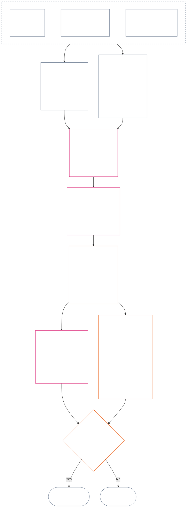

<!-- زبان: فارسی (fa) | منبع: 9c2c8c10c871d91157bcd27b9f56ad6a1cec90d3 | پیش‌نویس هوش مصنوعی، بازبینی‌نشده؛ پوشش جزئی: فصل ۱۲، §§۴ تا ۶ -->

### 4. دستور زبان جایگاه و مقیاس‌بندی مشترک

*به زبان ساده: این بخش برای هر یک از دو محور جداگانه، نام‌های سازگاری برای نه جایگاه ممکن می‌دهد و توضیح می‌دهد اثر چگونه در آن‌ها مقیاس‌بندی می‌شود. یک محور مشارکتِ راستی‌آزمایی‌شده را ثبت می‌کند و محور دیگر نقض‌های راستی‌آزمایی‌شده را در سابقه ثبت می‌کند. مشترک‌بودن شمارهٔ جایگاه، محورها را ادغام نمی‌کند و آسیب را با یاری تهاتر نمی‌کند. مقیاس یکپارچه در **بخش 6** هر دو محور را بر پایهٔ اثر متناسب LEQU تعیین می‌کند.*

دستور زبان جایگاه از شمارهٔ `s`، از **1** تا **9**، استفاده می‌کند. هر محور جایگاه خود را دارد:

- **محور مشارکت** ماهیت مثبتِ مشارکت را ثبت می‌کند؛ و
- **محور نقض** یافته‌های نقضِ راستی‌آزمایی‌شده را ثبت می‌کند.

شمارهٔ جایگاه یکسان می‌تواند در هر دو محور بیاید، اما محور‌ها جدا می‌مانند. جایگاه مشارکت، جایگاه نقض نیست و جایگاه نقض هم جایگاه مشارکت نیست.

#### 4.1 جدول 1 — برچسب‌های نمایشی جایگاه

**جدول 1** نه جایگاه را نام می‌برد و برچسب‌های نمایشی محور مشارکت و محور نقض را کنار هم نشان می‌دهد. این جدول فقط زبان نمایشی فراهم می‌کند؛ تخصیص جایگاه طبق مقیاس یکپارچه در **بخش 6** انجام می‌شود.

| `s` | برچسب نمایشی محور مشارکت | برچسب نمایشی محور نقض |
| ---: | --- | --- |
| 1 | **مشارکت پایهٔ اندک** | **اثر قانون اساسیِ اندک** |
| 2 | **مشارکت پایهٔ کوچک** | **اثر قانون اساسیِ کوچک** |
| 3 | **مشارکت مثبتِ چشمگیر** | **اثر قانون اساسیِ چشمگیر** |
| 4 | **مشارکت مثبتِ معنادار** | **اثر قانون اساسیِ معنادار** |
| 5 | **مشارکت جدیِ مثبت در سرپرستی** | **اثر جدی بر قانون اساسی** |
| 6 | **مشارکت عمدهٔ مثبت در سرپرستی** | **اثر عمده بر قانون اساسی** |
| 7 | **قهرمانِ به‌رسمیت‌شناخته‌شده** | **اثر شدید بر قانون اساسی** |
| 8 | **قهرمانِ ممتاز** | **اثر وخیم بر قانون اساسی** |
| 9 | **قهرمانِ نمونه** | **اثر فاجعه‌بار بر قانون اساسی** |

محور مشارکت از برچسب‌های پایه، مثبت، مثبت در سرپرستی و قهرمان استفاده می‌کند. محور نقض در همهٔ جایگاه‌ها از برچسب‌های خنثای اثر استفاده می‌کند. محور‌ها جدا می‌مانند و امتیاز خالص ایجاد نمی‌کنند یا تهاتر میان سوابق مشارکت و نقض را مجاز نمی‌دانند. جایگاه محور نقض به‌تنهایی تخلف ضدقانون‌اساسی را طبقه‌بندی نمی‌کند؛ [فصل چهاردهم](core_14.000_misconduct_designation.md#chapter-fourteen-anti-constitutional-misconduct) جداگانه تعیین می‌کند که آیا تعیینِ تخلف ضدقانون‌اساسی (ACMD) به نقضِ راستی‌آزمایی‌شدهٔ `s` = 7–9 تعلق می‌گیرد یا نه.

اجراها می‌توانند واحدهای اندازه‌گیری، روش‌های شواهد و نمونه‌هایی برای کمک به برآورد منفعت یا زیانِ هم‌ارز با یک عمر کامل منتشر کنند. این مواد فقط راهنما هستند و نمی‌توانند **بخش 6**، **فصل یکم** یا **کف حقوقِ فصل ششم** را کنار بزنند.

#### 4.2 قواعد مشترک مقیاس‌بندی اثر

*به زبان ساده: اثر را فقط با شمار افراد نمی‌سنجند. منفعت یا زیان عمیقی که یک حس‌مند را متأثر کند ممکن است از اثری سطحی بر افراد بسیار مهم‌تر باشد. شمار، عمق، آسیب‌پذیری، مدت، دوام، گستره و ویژگی قانون اساسی باید با هم ارزیابی شوند.*

برای تفسیر هر دو محور در **بخش 6**، از قواعد زیر استفاده کنید:

| بُعد مقیاس‌بندی | قاعدهٔ مشترک | کاربرد ویژهٔ محور |
| --- | --- | --- |
| **اندازهٔ پیامد قانون اساسی (LEQU)** | منفعت یا زیانِ یکپارچه و راستی‌آزمایی‌شده را ارزیابی کنید. LEQU تکیه‌گاه اصلیِ اندازه است؛ شمار خام افراد، پول، برون‌داد یا اندازهٔ نهادی چنین نیست. | مشارکت، منفعتِ سازگار با حقوق را می‌شمارد؛ نقض، زیان قانون اساسیِ راستی‌آزمایی‌شده، آسیب، اتلاف، سلب امکان یا خطر را می‌شمارد. |
| **دامنهٔ حس‌مندان** | **شمار، عمق و آسیب‌پذیری را با هم** در نظر بگیرید. هیچ جایگاهی شمار افراد را شرطی مستقل نمی‌کند. اثرِ به‌اندازهٔ کافی عمیق بر یک حس‌مند می‌تواند همان جایگاهِ اثر گسترده‌تر اما سطحی‌تر را پشتیبانی کند، هرگاه اندازهٔ یکپارچه و معیارهای دیگر ردیف برابر باشند؛ هر معیار صریحِ LEQU تجمیعی یا دامنهٔ گسترده همچنان باید برآورده شود. | وابستگی، ظرفیت کاهش‌یافته یا آسیب‌پذیریِ نامعمول می‌تواند اهمیت مادی را افزایش دهد. اندازهٔ گروه به‌تنهایی مشارکت یا شدت را ثابت نمی‌کند. |
| **دامنهٔ زمانی** | مدت، تکرار، دوام و، برای زیان، برگشت‌ناپذیری را در نظر بگیرید. رویدادی کوتاه اما دگرگون‌کننده ممکن است از اثری ناچیز و طولانی مهم‌تر باشد؛ مدت به‌تنهایی تعیین‌کننده نیست. | منفعت پایدار از اندازهٔ مشارکت بالاتر پشتیبانی می‌کند. زیان پایدار یا برگشت‌ناپذیر از شدت نقض بالاتر پشتیبانی می‌کند. |
| **دامنهٔ مکانی یا نهادی** | گسترهٔ بیشتر ممکن است اندازه را افزایش دهد، اما گسترهٔ میان‌جامعه‌ای یا میان‌نهادی الزامی نیست، هرگاه عمق، مدت، آسیب‌پذیری یا اهمیت حیاتی قانون اساسی مستقلاً جایگاه را پشتیبانی کند. | ترمیم نهادی ممکن است اندازهٔ مشارکت را افزایش دهد؛ آسیب ساختاری یا سیستمی ممکن است شدت نقض را افزایش دهد. |
| **کیفیت یا ویژگی قانون اساسی** | چگونگی ایجاد پیامد را جدا از گسترهٔ انتشار آن بسنجید. یک واقعیت را دوبار نشمارید. | آسیبِ تحمیل‌شده بر دیگران، بار پنهان، تسخیر یا وابستگی ممکن است مشارکتِ ادعاشده را سقف‌گذاری یا فاقد اعتبار کند. تکلیف، سهل‌انگاری، فریب، اجبار، خشونت یا توانمندسازی ساختاری جداگانه به‌عنوان ویژگی رفتارِ نقض ثبت می‌شوند و جایگاه اثر را تغییر نمی‌دهند. |
| **کف‌های حقوق و حفاظ‌های حیاتی** | رعایت کف حقوق با منفعت یا زیان تجمیعی تهاتر نمی‌شود. | رعایت یک کف به‌تنهایی مشارکت بالا را ثابت نمی‌کند. نقض مادیِ کف حقوق یا شکست حفاظ حیاتی، حتی وقتی شمار کمی از حس‌مندان مستقیماً متأثر شده‌اند، می‌تواند شدت نقض بالاتر را پشتیبانی کند. |

ابعاد، فهرست بازبینی‌ای نیستند که مستلزم کاربرد هر نوع مقیاس باشند. توضیح دهید کدام ابعاد تعیین‌کننده بودند، کدام نبودند و چرا.

- **روش مشترک تعیین جایگاه:**
  - منفعت یا زیانِ یکپارچه و راستی‌آزمایی‌شده را طبق تناسب برحسب LEQU برآورد کنید، سپس تنها جایگاهی را تخصیص دهید که باند عددی آن اندازه را دربرمی‌گیرد.
  - آستانه‌های هر دو محور یکسان‌اند.
  - جایگاه‌های مشارکت همچنان تابع الزاماتِ مبنای مربوط و هم‌راستایی با قانون اساسی‌اند؛ رسیدن به آستانهٔ عددی نمی‌تواند برون‌دادِ آسیبِ تحمیل‌شده بر دیگران یا شکست قانون اساسی را به مشارکتِ محسوب‌شده تبدیل کند.
- **جدایی ویژگی‌ها:** توصیف‌گرهای مسیر منفعت، مسیر آسیب، کیفیت رفتار و ویژگی رفتار را که مصداق دارند به‌صورت انباشته در سابقهٔ جایگاه نگه دارید. تکلیف، سهل‌انگاری، فریب، تشدید، اجبار، خشونت، قصد یا توانمندسازی ساختاری ممکن است بر انتساب، حفاظ‌ها یا پیامدهای پرسش ۳ اثر بگذارند، اما هیچ‌کدام جایگاه اثر LEQU را بالا یا پایین نمی‌برند.
- **مرز بازبینیِ تخلف ضدقانون‌اساسی:** زیانِ راستی‌آزمایی‌شده در محور نقض، چه تخلف ضدقانون‌اساسی ثابت شده باشد چه نه، می‌تواند بر پایهٔ اثر به `s` = 7–9 برسد. فصل چهاردهم جای تخصیص اثر را نمی‌گیرد؛ جداگانه تعیین می‌کند آیا ACMD مربوط تعلق می‌گیرد یا نه.

اگر خطری هنوز واقعاً رخ نداده، هر یک از موارد زیر را جداگانه ثبت کنید:

- احتمال وقوع آن؛
- مدتِ در معرض خطر بودن حس‌مندان؛
- گسترهٔ احتمالی آن؛
- میزان عدم‌قطعیت برآورد؛ و
- بدترین پیامدِ همچنان باورپذیر.

بدترین پیامد را به‌عنوان آسیبی که قبلاً رخ داده (زیان LEQU) نشمارید، مگر آنکه اجرای پذیرفته‌شده معیارسنجی خطر (روشی برای تبدیل خطر به LEQU) تعیین کرده باشد که هرکس بتواند آن را بررسی کند.

### 5. داده‌های ورودی قانون اساسی برای تخصیص محور

*به زبان ساده: پیش از انتخاب جایگاه، منابع قانون اساسی‌ای را مشخص کنید که مبنا، منفعت، تکلیف، آسیب یا نقضِ مورد اندازه‌گیری را بیان می‌کنند. برای اعمال آن منابع از پیوندهای زیر به محل معیار آن‌ها بروید؛ این گام ارجاع را به امتیازی دیگر یا جایگزین تعریف تبدیل نکنید.*

پیش از تخصیص جایگاه طبق **بخش 6**، سابقهٔ جایگاه باید موارد زیر را مشخص کند:

- مبنای قانون اساسی، تکلیف، محدودیت یا منفعتِ حمایت‌شدهٔ قابل اعمال؛
- موادی که منفعتِ راستی‌آزمایی‌شده، پیامد نامطلوب، آسیب یا نقضِ مورد اندازه‌گیری را اثبات می‌کنند؛
- تعریف‌ها، اصول و موادِ کف حقوق که به‌طور مادی بر اندازه یا ویژگی رفتار اثر می‌گذارند؛ و
- دلیلِ قابل اعمال بودن هر منبعِ مشخص‌شده و چگونگی اثر آن بر تخصیص محور.

جدول‌های ارجاع زیر فهرست کامل نیستند. هر تعریف، اصل یا مادهٔ افزوده‌ای که واقعیت‌های راستی‌آزمایی‌شده فعال کنند همچنان قابل اعمال است و باید در سابقهٔ جایگاه مشخص شود. محل معیارِ هر پیوند حاکم است؛ این جدول‌ها آن را بازگو یا محدود نمی‌کنند.

#### 5.1 داده‌های ورودیِ تعریفی

| منبع معیار | نقش در محور مشارکت | نقش در محور نقض |
| --- | --- | --- |
| [وضعیت جایگاه، مشارکت و نقض](core_05.035_band_accountability.md#defa3-standing-state-contribution-and-violation) | توضیح می‌دهد چه چیزی مشارکت محسوب می‌شود و کدام واقعیت‌های بررسی‌شده برای سنجش آن به کار می‌روند. همچنین تضمین می‌کند سابقهٔ جایگاهِ مشارکت فقط سوی مثبت را دنبال کند و با سوی منفی آمیخته نشود. | توضیح می‌دهد چه چیزی نقض محسوب می‌شود و چگونه ثبت می‌شود. همچنین جدی‌ترین پرونده‌ها را به بازبینی تخلف ضدقانون‌اساسی می‌فرستد؛ بازبینی‌ای جداگانه برای رفتاری که خود قانون اساسی را تضعیف می‌کند. |
| [پاسخگویی](core_05.005_apex_accountability_leg.md#accountability) | بررسی می‌کند آیا ادعای سرپرستی یا ترمیمِ خوب واقعاً فردی را پاسخگو نگه می‌دارد یا نه. همچنان باید نشان دهد چه کسی چه کرده، چه کسی باید پاسخ دهد و چگونه می‌توان آن را، متناسب با اثرش، بازبینی، جبران و اصلاح کرد. | مواردی را می‌یابد که معلوم نیست چه کسی کاری کرده یا چه کسی باید پاسخگو باشد. این موارد شامل حالتی است که با تغییر سازمان یا ساختار آن، مسئولیت‌پذیری از کار می‌افتد. |
| [آسیب](core_05.035_band_accountability.md#harm) | آسیبی که به دیگران تحمیل یا پنهان می‌شود می‌تواند منفعتِ ادعاشده را محدود یا خنثی کند. جبران آسیب می‌تواند منفعت شمرده شود، اما فقط اگر جبران راستی‌آزمایی و مستقلاً اثبات شود. | انواع آسیبی را مشخص می‌کند که در اندازه‌گیری زیان و شدت شمرده می‌شوند: مستقیم، غیرمستقیم، با تأخیر، انباشته، منتشرشده در چند سیستم، و آسیب به ذهن یا بهزیستی عاطفی حس‌مند. |
| [اهمیت مادی](core_05.050_band_oversight.md#materiality) و [واحد هم‌ارز طول عمر (LEQU)](core_05.055_band_participation.md#lifespan-equivalent-unit-lequ) | بر پایهٔ گسترهٔ اثر، آسیب‌پذیریِ متأثران و مدت اثر، میزان محسوب‌شدنِ منفعتِ راستی‌آزمایی‌شده را تعیین می‌کنند. نتیجه با LEQU سنجیده می‌شود؛ معیار مشترک منفعتِ هم‌ارز با یک عمر کامل. | بر پایهٔ گسترهٔ اثر، آسیب‌پذیری متأثران، مدت اثر و دشواری جبران، میزان محسوب‌شدنِ زیان یا خطرِ راستی‌آزمایی‌شده را تعیین می‌کنند. نتیجه با LEQU سنجیده می‌شود؛ همان معیارِ زیانِ هم‌ارز با یک عمر کامل. |
| [ماهیت مشارکت](core_05.035_band_accountability.md#contribution-nature) | تعیین می‌کند چیزی مشارکت محسوب می‌شود یا نه. باید فقط مثبت باشد و با آسیب آمیخته نشود و پشتوانهٔ سابقهٔ مشارکتِ راستی‌آزمایی‌شده و قابل ارائه داشته باشد. بدون هر دو شرط، تخصیص به محور مشارکت ممکن نیست. | در اینجا نقشی ندارد. تعیین نمی‌کند چه چیزی آسیب است و هرگز از جدیت نقض نمی‌کاهد. |
| [ماهیت نقض](core_05.035_band_accountability.md#violation-nature) | در اینجا نقشی ندارد. نقض هرگز مشارکت منفی شمرده نمی‌شود و منفعت راستی‌آزمایی‌شدهٔ نامرتبط با آن را محو نمی‌کند. | تعیین می‌کند چیزی نقض محسوب می‌شود یا نه. باید در ردهٔ آسیب‌زا قرار گیرد و پشتوانهٔ یافتهٔ راستی‌آزمایی‌شدهٔ وقوع نقض را داشته باشد. بدون هر دو شرط، تخصیص به محور نقض ممکن نیست. |
| [محدودیت قانون اساسی](core_05.045_band_integrative.md#constitutional-constraint)، [سلسله‌مراتب اختیار و درون‌سازمانی](core_05.045_band_integrative.md#authority-stack-and-internal-hierarchy) و [قابلیت ممیزی](core_05.050_band_oversight.md#auditability) | مانع محسوب‌شدن منفعت ادعاشده می‌شوند اگر منفعت به شکست قانون اساسی، گریز از قواعد آن، تنگ‌کردن کف حقوق (حداقل حمایت‌هایی که قانون اساسی تضمین می‌کند) یا صرفاً رعایت صوری وابسته باشد. | مواردی را مشخص می‌کنند که بر جدیت واقعی نقض اثر دارند: شکستن محدودیت مهم قانون اساسی، بالاتردانستن چیزی از اختیار قانون اساسی، گریز از قواعد یا ناممکن‌کردن اجرای آن‌ها. |
| [قابلیت ممیزی](core_05.050_band_oversight.md#auditability) و [قابلیت اعتراض](core_05.035_band_accountability.md#contestability) | الزام می‌کنند منفعت ادعاشده قابل ارائه و بررسی باشد و هر مخالفی راهی عملی برای اعتراض داشته باشد. | الزام می‌کنند یافته‌ها قابل بررسی و اعتراض باشند. اتهام یا برچسبِ بی‌توضیح نمی‌تواند میزان جدیت نقض را تعیین کند. |

#### 5.2 داده‌های ورودیِ اصول

| منبع اصل | نقش در تخصیص محور |
| --- | --- |
| [چهارگانهٔ قانون اساسی](core_00.000_preamble.md#constitutional-tetrad)، [دو هدف قانون اساسی](core_00.000_preamble.md#two-constitutional-aims) و [اهمیت مادی](core_00.000_preamble.md#material-stake) | چهار انضباط کاری (مشارکت، نظارت، پاسخگویی و به‌هنگامی)، دو پیامد مورد هدف قانون اساسی (شکوفایی و پیوستگی) و چارچوبی را تعیین می‌کنند که هر تخصیص را متناسب با موضوعِ در معرض خطر می‌سازد. |
| [بهزیستی](core_01.000_values_principles.md#3-foundational-objective-wellbeing-flourishing-aim) و [بازشناسی، تقویت و آرمان‌خواهی](core_01.000_values_principles.md#32-recognition-reinforcement-and-aspiration) | منفعتِ رعایت‌کنندهٔ حقوق و بازشناسیِ متناسب با آن را در محور مشارکت مبنا قرار می‌دهند. پرستیژ یا پاداش هرگز شاهد مشارکت محسوب نمی‌شود. |
| [ایمنی](core_01.000_values_principles.md#4-safety-harm-constraint) و [حقیقت](core_01.000_values_principles.md#5-truth-epistemic-integrity-constraint) | محدودیت‌های الزام‌آوری را بر هر دو محور تعیین می‌کنند. منفعتِ به‌دست‌آمده از راه آسیب یا فریب به‌طور کامل محسوب نمی‌شود و شکستِ راستی‌آزمایی‌شدهٔ ایمنی یا حقیقت می‌تواند اندازه یا نوع نقض را نشان دهد. |
| [سرپرستی به‌تفصیل](core_01.010_stewardship_capacity_principles.md#16-stewardship-in-depth) و [حکمرانی تحت انضباط سرپرستی](core_01.010_stewardship_capacity_principles.md#18-governance-under-stewardship-discipline) | هرگاه واقعیت‌های راستی‌آزمایی‌شده اقتضا کنند، نحوهٔ سنجش مشارکت پایدار، تکالیف ناشی از نقش، ترمیم نهادی، نظارت و مسئولیت را هدایت می‌کنند. |
| [اصول مبادلهٔ بنیادین](core_01.005_interaction_interpretation.md#131-core-tradeoff-principles) و [کف‌های قانون اساسی، ایمنی و فرایندِ منع‌کنندهٔ تحقیر](core_01.005_interaction_interpretation.md#1314-constitutional-floors-safety-and-anti-degrading-process) | هرگاه رفتارِ مورد اندازه‌گیری با ضرورت، به‌حداقل‌رساندن آسیب، تناسب، تعارض حقوق یا محدودیت سروکار داشته باشد اعمال می‌شوند. این اصول هرگز به‌تنهایی پیامدی را مجاز نمی‌کنند. |

#### 5.3 داده‌های ورودیِ کف حقوق و مواد

| منبع ماده | نقش یا مرز در تخصیص محور |
| --- | --- |
| [کف حقوقِ فصل ششم](core_06.000_rights_part_a.md#chapter-six-foundational-rights) که از نظر واقعیت قابل اعمال است، ازجمله هر ماده‌ای که سابقهٔ جایگاهِ راستی‌آزمایی‌شده به‌طور مادی درگیرش می‌کند | حمایت‌ها، منافع، تکالیف، منافع مثبت یا نقض‌های بنیادینِ در میان را تعیین می‌کند. هیچ ماده‌ای صرفاً به‌دلیل فهرست‌نشدن در پایین کنار گذاشته نمی‌شود. |
| [مادهٔ XIX — جایگاه و وضعیت مشارکت](core_06.015_rights_part_d.md#article-xix-standing-and-participation-status) | این موارد را جدا نگه می‌دارد: جایگاه حس‌مند، کرامت، حمایت‌های حداقلیِ کف حقوق، وضعیت طرفِ اثرپذیر، شهرت و هر تغییر بعدی در وضعیت مشارکت. |
| [مادهٔ XIII-A — مبنای قابلیت اتکا و اعتمادپذیری](core_06.010_rights_part_c.md#article-xiii-a-reliability-and-trustworthiness-baseline) و [مادهٔ XIII-B — حق جبران و راهکار](core_06.010_rights_part_c.md#article-xiii-b-right-to-redress-and-remedy)، [مادهٔ XV-B — شفافیت، قابلیت ممیزی و قابلیت اعتراض](core_06.010_rights_part_c.md#article-xv-b-transparency-auditability-and-contestability) و [مادهٔ XVI — ممیزی، شفافیت و راستی‌آزمایی مستقل](core_06.010_rights_part_c.md#article-xvi-audit-transparency-and-independent-verification) | هرگاه منفعت یا نقضِ راستی‌آزمایی‌شده به نگهداری سوابق درست، اشتراک اطلاعات، بررسی واقعیت‌ها، امکان اعتراض به تصمیم یا اصلاح خطا مربوط باشد، اعمال می‌شوند. |
| [مادهٔ XXIV — تحلیل علت ریشه‌ای و پاسخ انطباقی](core_06.015_rights_part_d.md#article-xxiv-root-cause-analysis-and-adaptive-response) | هرگاه علت رفتار، اصلاح‌شدن آن، تداومش یا انطباق پاسخ اهمیت داشته باشد اعمال می‌شود، زیرا این موارد نشان می‌دهند رفتار طبق قانون اساسی در چه وضعی است. |
| [مادهٔ XX — عدالت پس از نقضِ راستی‌آزمایی‌شده](core_06.015_rights_part_d.md#article-xx-justice-after-verified-violation) و [مادهٔ XXVI-C — حل‌وفصل به‌موقع و کفِ منع تأخیر](core_06.020_rights_part_e.md#article-xxvi-c-timely-resolution-and-anti-delay-floor) | بر هر فرایند یا تأخیری که واقعیت‌ها واقعاً دربرگیرند اعمال می‌شوند. **مادهٔ XX** (*عدالت پس از نقضِ راستی‌آزمایی‌شده*) عمدتاً آنچه را پس از اندازه‌گیری نقض رخ می‌دهد محدود می‌کند (پرسش ۳). برای توجیه پاسخی که از پیش مطلوب دانسته شده، نباید از آن برای بالا یا پایین‌بردن جایگاه پرسش ۲ استفاده کرد. |

**محدودیت‌های کاربرد.** این گام فقط به منابع درست ارجاع می‌دهد.

- این گام:
  - پرسش ۱ را دوباره نمی‌گشاید؛
  - واقعیت‌های راستی‌آزمایی‌نشده را نمی‌پذیرد؛
  - سنجه یا امتیاز تازه‌ای نمی‌افزاید؛
  - یک واقعیت را از راه منابع مختلف دوبار نمی‌شمارد؛
  - دو محور را ادغام نمی‌کند؛ یا
  - همهٔ منابع فهرست‌شده را برای هر سابقهٔ جایگاه قابل اعمال نمی‌سازد.
- مشارکت و نقض همچنان جداگانه سنجیده می‌شوند.
- پیامدهای **مادهٔ XX** (*عدالت پس از نقضِ راستی‌آزمایی‌شده*) بیرون از پرسش ۲ می‌مانند.
- بازبینیِ تعیین وضعیت فصل چهاردهم از جایگاه اثرِ تخصیص‌یافته در اینجا جدا می‌ماند.

### 6. مقیاس متناسبِ یکپارچهٔ LEQU — محورهای مشارکت و نقض

<strong>راهنمای خواننده (غیرعملیاتی): چگونگی کارکرد پیشرویِ پنج‌برابری</strong>

> مقیاس از پیشرویِ پنج‌برابری استفاده می‌کند که در `s` = 7 برابر با یک LEQU لنگر می‌اندازد. برای هر یک از دو محور، کمینهٔ اندازه برای جایگاه `s` در جایگاه‌های 2 تا 9 برابر است با `5^(s−7)` LEQU؛ جایگاه 1 از صفر آغاز می‌شود. اجرای پذیرفته‌شده می‌تواند آستانه‌های عددیِ حاصل و نمونه‌های معیارسنجی را منتشر کند. جایگاه 1 در محور مشارکت، برآورده‌کردنِ راستی‌آزمایی‌شدهٔ مبنای قانون اساسی و در محور نقض، زیانِ راستی‌آزمایی‌شدهٔ پایین‌تر از نخستین آستانهٔ مثبت را دربرمی‌گیرد؛ نبودِ مشارکت یا نبودِ نقض به‌خودی‌خود سابقهٔ `s` = 1 نیست.
>
> **لنگرِ قابل فهم برای انسان.** اگر طول عمر انسان را 80 سال به‌عنوان نمونهٔ معیارسنجی بگیریم، ستون میانی را رو به بالا به‌عنوان منفعتِ هم‌ارز با یک عمر کامل، زمان قابل استفاده یا منابع و ظرفیت‌های سازگار با حقوق که افزوده شده‌اند بخوانید؛ و رو به پایین به‌عنوان زیان، محرومیت، اتلاف یا سلب امکانِ هم‌ارز. مقدار منبع به‌تنهایی شمرده نمی‌شود؛ پیامد قانون اساسی‌ای که ایجاد یا از آن جلوگیری می‌شود تعیین‌کننده است.

 

*به زبان ساده: **جدول 2** مشارکت و نقضِ راستی‌آزمایی‌شده را روی یک مقیاس متناسبِ اثر قرار می‌دهد. جایگاه‌های بالاتر به‌معنای منفعت یا زیانِ یکپارچهٔ بزرگ‌تر برای قانون اساسی‌اند. سوابق جایگاه و محور‌ها جدا می‌مانند: مقیاس مشترک اندازه را مقایسه می‌کند، نه ارزش اخلاقی را، و هرگز اجازه نمی‌دهد یاری آسیب را خنثی کند.*

نمودار یک تخصیص جایگاه را از آغاز تا پایان دنبال می‌کند. ترتیب گام‌هایی را نشان می‌دهد که باید طی شوند؛ این ترتیب با ترتیب بندهای زیر یکی نیست. بندها هر قاعده را بیان می‌کنند.

برای برآورد اثر یکپارچهٔ LEQU، **تناسب** را بر پایهٔ عمق، دامنهٔ حس‌مندان، آسیب‌پذیری، مدت، دوام یا برگشت‌ناپذیری، گستره و اهمیت حیاتی قانون اساسی اعمال کنید. این ابعاد برآورد LEQU را شکل می‌دهند؛ جایزه‌های مستقل برای جایگاه نیستند.

- **جدول 2** را پس از آن به کار ببرید که پرسش ۱ آنچه رخ داده را تأیید کرده باشد، پرسش ۲ منفعت یا زیانِ راستی‌آزمایی‌شده را سنجیده باشد، **بخش‌های 1–3 و 4.2** اعمال شده باشند و منابع قانون اساسیِ لازم طبق **بخش 5** مشخص شده باشند.
- از برآورد یکپارچهٔ LEQU یک جایگاه تخصیص دهید.
  - توضیح دهید هر بُعد مادیِ مقیاس‌بندی چگونه برآورد را متأثر کرده و چرا ابعاد حذف‌شده تعیین‌کننده نبودند.
  - هر تخصیص باید این موارد را برآورده کند:
    - ردیابی‌پذیری؛
    - قابلیت ممیزی؛
    - قابلیت اعتراض؛ و
    - کف حقوقِ قابل اعمال.
  - مشارکت همچنین باید شرطِ تحمیل‌نکردن هزینه به دیگران و هم‌راستایی با قانون اساسی را برآورده کند.
- واقعیت‌های مربوط به ویژگی رفتار را به‌صورت توصیف‌گرهای جداگانه و قابل ردیابی ثبت کنید. این واقعیت‌ها ممکن است انتساب، شدت بازبینی، حفاظ‌ها، جبران یا تعیین وضعیت فصل چهاردهم را کنترل کنند؛ فقط تا جایی بر جایگاه اثر می‌گذارند که پیامدهای راستی‌آزمایی‌شده اثر یکپارچهٔ LEQU را تغییر دهند.
- پیامدهای راستی‌آزمایی‌شدهٔ کنش یا دورهٔ رفتار را به‌طور کامل و از راه ابعاد مادی مقیاس‌بندی ارزیابی کنید، ازجمله:
  - آسیب جسمی؛
  - آسیب روان‌شناختی؛
  - آثار اجباری؛
  - محرومیت یا خطر برای آزادی؛
  - آسیب انباشته؛ و
  - دیگر منفعت یا زیانِ به‌رسمیت‌شناخته‌شده در قانون اساسی.
- این کارها را نکنید:
  - جایگاه را صرفاً به این دلیل بالا یا پایین نبرید که یک رویداد یا دورهٔ رفتار با این موارد توصیف می‌شود:
    - تکلیف؛
    - سهل‌انگاری؛
    - قصد؛
    - پنهان‌کاری؛
    - تکرار؛
    - تشدید؛
    - اجبار؛
    - خشونت؛
    - خطر برای آزادی؛
    - قابلیت اصلاح؛ یا
    - پیامدِ مطلوب.
  - ویژگی رفتار را از اندازه استنباط نکنید و آن را جایگزین اندازهٔ راستی‌آزمایی‌شده نکنید.

**جدول 2** نه جایگاه را به‌ترتیب فهرست می‌کند. هر ردیف شمارهٔ جایگاه `s`، مقدار منفعت افزوده‌شده یا زیان تحمیل‌شده برای رسیدن به آن جایگاه (با طول عمر انسانِ 80 ساله به‌عنوان نمونهٔ معیارسنجی) و نام جایگاه را در هر محور نشان می‌دهد. آستانه‌ها در هر دو محور یکسان‌اند، اما دو نام جدا می‌مانند: جایگاه محور مشارکت و جایگاه محور نقض سوابقی متفاوت‌اند و هرگز تهاتر نمی‌شوند.

| `s` | معیارسنجی با عمر انسانِ 80 ساله — منفعت افزوده‌شده / زیان تحمیل‌شده | محور مشارکت | محور نقض |
| ---: | --- | --- | --- |
| 1 | کمتر از حدود **9 روز** | **مشارکت پایهٔ اندک** — برآورده‌کردنِ راستی‌آزمایی‌شدهٔ کف قانون اساسی برای دامنهٔ ارزیابی‌شده؛ هر افزایش قابل اندازه‌گیری پایین‌تر از `s` = 2 می‌ماند. | **اثر قانون اساسیِ اندک** — زیان یا اختلال عملیاتیِ راستی‌آزمایی‌شده پایین‌تر از `s` = 2، ازجمله نقص رسمی بدون آسیب ماهویِ اثبات‌شده. |
| 2 | حدود **9–47 روز** | **مشارکت پایهٔ کوچک** — عملکرد قابل اتکا و محدودشده، فراتر از کف حداقلی در این سطح اثر. | **اثر قانون اساسیِ کوچک** — زیان محدودشدهٔ راستی‌آزمایی‌شده در این سطح اثر. |
| 3 | حدود **47 روز تا 8 ماه** | **مشارکت مثبتِ چشمگیر** — منفعت اثبات‌پذیرِ فراتر از مبنا در این سطح اثر. | **اثر قانون اساسیِ چشمگیر** — زیان چشمگیرِ راستی‌آزمایی‌شده در این سطح اثر. |
| 4 | حدود **8 ماه تا 3.2 سال** | **مشارکت مثبتِ معنادار** — منفعتِ راستی‌آزمایی‌شدهٔ عمیق‌تر، پایدار، تکرارشونده، پاسخ‌گو به آسیب‌پذیری یا گسترده‌تر. | **اثر معنادار بر قانون اساسی** — زیان قانون اساسیِ معنادار و راستی‌آزمایی‌شده. |
| 5 | حدود **3.2 تا 16 سال** | **مشارکت جدیِ مثبت در سرپرستی** — سرپرستیِ پایدار، هماهنگی، نگهداری، ترمیم یا منفعت پایدارِ قابل مقایسه. | **اثر جدی بر قانون اساسی** — زیان جدیِ قانون اساسیِ راستی‌آزمایی‌شده. |
| 6 | حدود **16 تا 80 سال** | **مشارکت عمدهٔ مثبت در سرپرستی** — منفعت عمدهٔ راستی‌آزمایی‌شده که به یک LEQU نزدیک می‌شود. | **اثر عمده بر قانون اساسی** — زیان عمدهٔ راستی‌آزمایی‌شده که به یک LEQU نزدیک می‌شود. |
| 7 | حدود **1 تا 5 عمر** (**80 تا 400 سال**) | **قهرمانِ به‌رسمیت‌شناخته‌شده** — دست‌کم یک LEQU منفعتِ راستی‌آزمایی‌شده و هم‌راستا با قانون اساسی. | **اثر شدید بر قانون اساسی** — دست‌کم یک LEQU زیانِ راستی‌آزمایی‌شدهٔ قانون اساسی. |
| 8 | حدود **5 تا 25 عمر** (**400 تا 2,000 سال**) | **قهرمانِ ممتاز** — منفعتِ راستی‌آزمایی‌شده‌ای که به‌طور مادی از `s` = 7 بیشتر است. | **اثر وخیم بر قانون اساسی** — زیانِ راستی‌آزمایی‌شده‌ای که به‌طور مادی از `s` = 7 بیشتر است. |
| 9 | دست‌کم **25 عمر** (**2,000+ سال**) | **قهرمانِ نمونه** — منفعتِ راستی‌آزمایی‌شده‌ای که به‌طور مادی از `s` = 8 بیشتر است. | **اثر فاجعه‌بار بر قانون اساسی** — زیانِ راستی‌آزمایی‌شده‌ای که به‌طور مادی از `s` = 8 بیشتر است. |

<strong>یادداشت تعامل‌پذیری اجرا</strong>

> این ابزارک حاوی مواد تعامل‌پذیریِ ویژهٔ اجراست. از دسته‌های عملیاتی فصل پشتیبانی می‌کند؛ نظام دسته‌بندیِ موازی ایجاد نمی‌کند.

فیلدهای ماشینیِ جایگاه نمایشی (`sub_tier`، `sub_tier_display` و فیلدهای نمایشی مرتبط) در [CH06_NINE_SLOT_STANDING_SCALE.md](implementation/CH06_NINE_SLOT_STANDING_SCALE.md) و [ch06_nine_slot_constants.json](implementation/ch06_nine_slot_constants.json) تعریف شده‌اند. نقشهٔ چهارباندهٔ اجرا همچنان یاریِ تعامل‌پذیری است و ستونی برای باند اصلی به **جدول 2** عملیاتی نمی‌افزاید.

روش مرجع و تخصیص‌های نمونهٔ جایگاه، ازجمله برای حس‌مندانی با وزن‌ها، نقاط بازرسیِ وضعیت ذخیره‌شده و بدون مرگ‌ومیر ثابت، در [LEQU_CALIBRATION_REFERENCE.md](implementation/LEQU_CALIBRATION_REFERENCE.md) آمده‌اند. آن محاسبات نمی‌توانند جای آستانه‌های مشترک و قاعدهٔ تخصیص متناسب در **بخش 6** را بگیرند، برای سابقه‌ای زنده جایگاه تعیین کنند یا تعیین کنند چه کسی به‌حساب می‌آید.

اجرای پذیرفته‌شده می‌تواند برآوردهای LEQU و برچسب‌های نمایشیِ کلیدگذاری‌شده منتشر کند. این ابزارهای کمکی، جز از راه تغییر **سندِ منطبق**، نباید جای آستانه‌های مشترک و قاعدهٔ تخصیص متناسب در **بخش 6** یا حفاظ‌های تعیین وضعیت فصل چهاردهم را بگیرند.

