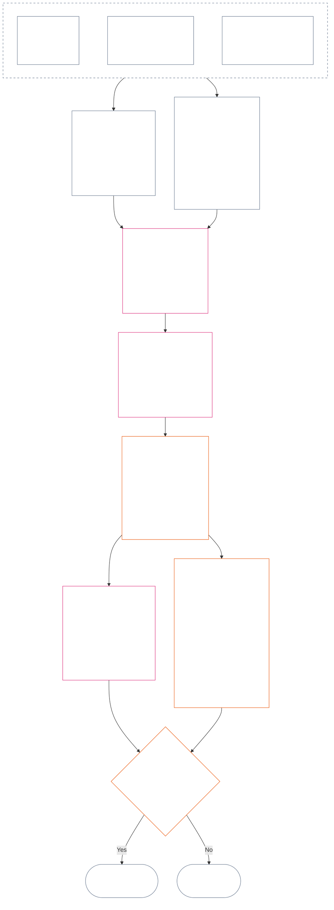

<!-- زبان: فارسی (fa) | منبع: 9c2c8c10c871d91157bcd27b9f56ad6a1cec90d3 | پیش‌نویس کامل فصل دوازدهم؛ پیش‌نویس هوش مصنوعی، بازبینی‌نشده؛ پیش‌نویس غیرالزام‌آور -->

# فصل دوازدهم: اندازه‌گیری جایگاه — پرسش 2، چقدر خوب یا بد بود؟

<strong>جایگاه در پیکره (غیرعملیاتی): ساختار پرونده و قواعد خواندن</strong>

> این پرونده **بخشی از قانون اساسی حس‌مندان** است و فقط **در کنار** دیگر پرونده‌های شماره‌دار `core_*` که به‌صورت یک متن خوانده می‌شوند الزام‌آور است. این پرونده **فصل دوازدهم** — **پرسش 2** (*چقدر خوب یا بد بود؟*) — را دربرمی‌گیرد: مبنای LEQU و محدودیت‌های آن، ابعاد ورودیِ اندازه‌گیری، فهرست توصیف‌گرهای مسیر، دستور زبان جایگاه و مقیاس‌بندی مشترک، داده‌های ورودی قانون اساسی برای تخصیص محور، مقیاس متناسبِ یکپارچهٔ LEQU، معیارهای استاندارد مشارکت، نمونه‌های عملی و تحویل به پرسش 3 (**§1 تا §9**). چارچوب سه‌پرسشی و **پرسش 1** (*چه اتفاقی افتاد؟*) — واقعیت‌های راستی‌آزمایی‌شده، انواع رویداد، الزامات ثبت، نگهداری سوابق و رسیدگی — در [فصل یازدهم](core_11.000_standing_assessment.md#chapter-eleven-standing-records--question-1-what-happened) آمده است. پرسش 3 (*در پی آن چه رخ می‌دهد؟*) در [فصل سیزدهم](core_13.000_standing_integration.md#chapter-thirteen-standing-effects-and-integration) ادامه می‌یابد؛ بازبینی برای یافته‌های واجد شرایطِ محور نقض با `s` = 7–9 به تعیینِ تخلف ضدقانون‌اساسی در [فصل چهاردهم](core_14.000_misconduct_designation.md#chapter-fourteen-anti-constitutional-misconduct) محدود است. ترتیب خواندن، تفکیک متن الزام‌آور از پشتیبان و فرادادهٔ ویرایش پیکره در [README.md](README.md) نگهداری می‌شوند.

<strong>ردیابی</strong>

- پیشین:
  - [فصل یازدهم §1](core_11.000_standing_assessment.md#1-the-three-questions) (*چارچوب سه‌پرسشی*)؛
  - [فصل یازدهم §2](core_11.000_standing_assessment.md#2-question-1--what-happened) تا [فصل یازدهم §6](core_11.000_standing_assessment.md#6-handling-a-standing-record) (*پرسش 1 — واقعیت‌های راستی‌آزمایی‌شده، سوابق جایگاه، نگهداری و رسیدگی*)؛
  - [چهارگانهٔ قانون اساسی](core_00.000_preamble.md#constitutional-tetrad)؛
  - [دو هدف قانون اساسی](core_00.000_preamble.md#two-constitutional-aims)؛
  - [مقدمه §6 زنجیره‌های عملی فرایندهای کلیدی](core_00.000_preamble.md#6-key-practical-process-pipelines) (*زنجیرهٔ فصل‌های نهم تا پانزدهم*).
- زیربخش‌های این پرونده:
  - [§1](#1-question-2--how-good-or-bad-was-it) (*پرسش 2 — مبنای LEQU، پیوند وضعیت، محدودیت‌ها و دامنه*)؛
  - [§2](#2-magnitude-and-severity-input-dimensions) (*داده‌های ورودی اندازه‌گیری برای هر دو محور*)؛
  - [§3](#3-route-descriptor-catalogs-and-measurement-roles) (*فهرست توصیف‌گرهای مسیر*)؛
  - [§4](#4-slot-grammar-and-shared-scaling) (*دستور زبان جایگاه و مقیاس‌بندی مشترک*)؛
  - [§5](#5-constitutional-inputs-to-axis-assignment) (*ارجاع به منابع قانون اساسی*)؛
  - [§6](#6-unified-proportional-lequ-scale--contribution-and-violation-axes) (*مقیاس متناسبِ یکپارچهٔ LEQU برای هر دو محور*)؛
  - [§7](#7-standard-contribution-measures) (*معیارهای استاندارد مشارکت که پذیرندگان منتشر می‌کنند*)؛
  - [§8](#8-measurement-illustrations) (*نمونه‌های عملی اندازه‌گیری*)؛
  - [§9](#9-hand-off-to-question-3--cross-question-measurement-hooks) (*تحویل به پرسش 3*).
- پسین:
  - [فصل سیزدهم](core_13.000_standing_integration.md#chapter-thirteen-standing-effects-and-integration) (13.000) (*آثار و یکپارچه‌سازی پرسش 3*)؛
  - [فصل چهاردهم](core_14.000_misconduct_designation.md#chapter-fourteen-anti-constitutional-misconduct) (14.000) (*فقط تعیین وضعیت — اندازه‌گیری پرسش 2 را دوباره نمی‌گشاید*).
- همراه با این مورد خوانده شود: [فصل پنجم *وضعیت جایگاه، مشارکت و نقض*](core_05.035_band_accountability.md#defa3-standing-state-contribution-and-violation) (5.035) (*ارجاع به تعریف‌های معیار*).

 

فصل دوازدهم متولی قانون اساسیِ **پرسش 2** است که واقعیت‌های راستی‌آزمایی‌شده در [فصل یازدهم](core_11.000_standing_assessment.md#chapter-eleven-standing-records--question-1-what-happened) را می‌سنجد. این فصل از [§1 پرسش 2 — چقدر خوب یا بد بود؟](#1-question-2--how-good-or-bad-was-it) آغاز می‌شود. [فصل یازدهم](core_11.000_standing_assessment.md#chapter-eleven-standing-records--question-1-what-happened) متولی چارچوب سه‌پرسشی، پرسش 1 و سابقهٔ جایگاه است و در [فصل یازدهم §6 رسیدگی به سابقهٔ جایگاه](core_11.000_standing_assessment.md#6-handling-a-standing-record) پایان می‌یابد.

*به زبان ساده: فصل یازدهم تعیین می‌کند چه رخ داده و چه کسی سابقهٔ جایگاه را نگه می‌دارد. این فصل آن را می‌سنجد: مشارکت چقدر خوب یا نقض چقدر بد بوده، در دو مقیاس جداگانه که هرگز به امتیاز خالص جمع نمی‌شوند. آنچه پس از اندازه‌گیری رخ می‌دهد در فصل سیزدهم است.*

### 1. پرسش ۲ — چقدر خوب یا بد بود؟

<strong>ردیابی</strong>

- پیشین: [فصل یازدهم §۲](core_11.000_standing_assessment.md#2-question-1--what-happened) (*پرسش ۱ — سوابق جایگاه و واقعیت‌های راستی‌آزمایی‌شده*)؛ [فصل یازدهم §۲.۵](core_11.000_standing_assessment.md#25-verified-input-gate) (*دروازهٔ ورودیِ راستی‌آزمایی‌شده*)؛ [فصل یازدهم §۴](core_11.000_standing_assessment.md#4-standing-record-operational-requirements) (*الزامات ثبت*)؛ [فصل یازدهم §۱](core_11.000_standing_assessment.md#1-the-three-questions) (*چارچوب سه‌پرسشی*).
- پسین:
  - [§۲](#2-magnitude-and-severity-input-dimensions) (*داده‌های ورودی اندازه‌گیری برای هر دو محور*)؛
  - [§۳](#3-route-descriptor-catalogs-and-measurement-roles) (*فهرست توصیف‌گرهای مسیر*)؛
  - [§۴](#4-slot-grammar-and-shared-scaling) (*دستور زبان جایگاه و مقیاس‌بندی مشترک*)؛
  - [§۵](#5-constitutional-inputs-to-axis-assignment) (*ارجاع به منابع قانون اساسی*)؛
  - [§۶](#6-unified-proportional-lequ-scale--contribution-and-violation-axes) (*تخصیص به محور مشارکت و محور نقض*)؛
  - [§۷](#7-standard-contribution-measures) (*معیارهای استاندارد مشارکت که پذیرندگان منتشر می‌کنند*)؛
  - [§۸](#8-measurement-illustrations) (*نمونه‌های عملی اندازه‌گیری*)؛
  - [§۹](#9-hand-off-to-question-3--cross-question-measurement-hooks) (*تحویل به پرسش ۳*)؛
  - [فصل سیزدهم §۶.۲](core_13.000_standing_integration.md#62-competency-bars-and-clearances) (13.000 §6.2) (*پرسش ۳ دربارهٔ مشارکت — واگذاری امن*)؛
  - [فصل سیزدهم §۴.۲](core_13.000_standing_integration.md#42-prevention--general-standing-locks) (13.000 §4.2) (*قفل‌های پیشگیری*)؛
  - [فصل سیزدهم §۵](core_13.000_standing_integration.md#5-lock-design-and-enforcement) (13.000 §5) (*طراحی و اجرای قفل*).
- همراه با این مورد خوانده شود: [فصل یازدهم §۴.۱](core_11.000_standing_assessment.md#41-minimum-record-contents) (*فیلدهای سابقهٔ جایگاهِ راستی‌آزمایی‌شده؛ فصل یازدهم آثار جایگاهی ایجاد نمی‌کند*).

 

*به زبان ساده: پرسش ۲ واقعیت‌های راستی‌آزمایی‌شدهٔ پرسش ۱ را می‌سنجد. می‌پرسد **مشارکت چقدر خوب بود؟** یا **نقض چقدر بد بود؟** اینجاست که فصل برای نخستین بار دو محور رسمی اندازه‌گیری را معرفی می‌کند: **محور مشارکت** برای یاریِ راستی‌آزمایی‌شده و **محور نقض** برای آسیبِ راستی‌آزمایی‌شده. دو محور جدا می‌مانند و دو سوی یک امتیاز خالص نیستند.*

برای تعیین جایگاهی که مشارکت یا نقضِ کسی به آن تعلق دارد، این فصل اثر را با **واحدِ هم‌ارزِ طول عمر (LEQU)** می‌سنجد. یک LEQU تقریباً برابر است با نجات‌دادن یا نابودکردن تمام طول عمرِ بهزیستیِ یک حس‌مند. موضوع، شمارش بدن‌ها یا دلارها نیست؛ پرسش این است که آیا کنش، بهزیستیِ جامعهٔ قانون اساسی را به‌طور معنادار تغییر داده است یا نه. همین واحد برای هر حس‌مندی، انسان یا غیرانسان، کاربرد دارد.

#### 1.1 مبنای LEQU

**واحد هم‌ارز طول عمر** (**LEQU**) واحد اختصاریِ منفعت یا زیان قانون اساسیِ هم‌ارز با یک عمر کامل است، هنگامی که اجرای پذیرفته‌شده به معیارسنجی عددی نیاز دارد.

- این واحد به بستر وابسته نیست.
- پذیرندهٔ کنونی می‌تواند طول عمر معمول انسان را به‌عنوان نمونهٔ معیارسنجی در بافت انسانِ زیستی به کار ببرد، اما مبنای الزام‌آور حس‌مندانه و قانون اساسی است، نه محدود به گونه.

**منفعت قانون اساسیِ هم‌ارز با یک عمر کامل** یعنی منفعتِ راستی‌آزمایی‌شده‌ای هم‌سنگِ حفظ، بازگرداندن یا آزادکردن یک طول عمر کاملِ حس‌مندانه از بهزیستیِ معنادار و سازگار با حقوق. **زیان قانون اساسیِ هم‌ارز با یک عمر کامل** یعنی آسیب، اتلاف، تخریب، سلب امکان، محرومیت یا تحقق خطرِ راستی‌آزمایی‌شده‌ای هم‌سنگِ نابودکردن، مصرف ناحق یا جلوگیری از منفعت قانون اساسیِ هم‌ارز با یک عمر کامل.

#### 1.2 محدودیت‌های کاربرد LEQU

هرگاه از LEQU استفاده شود، محدودیت‌های زیر اعمال می‌شوند.

- **قاعدهٔ امتیاز خالص نیست:** نمی‌توان نقض‌ها را با مشارکت‌ها «خنثی کرد» یا برعکس. هر محور مستقل است.
- **معیار اجباریِ عمر انسان نیست:** LEQU عام و حس‌مندمحور است؛ برای هر موجود آگاهی‌مند کاربرد دارد، نه فقط انسان‌ها.
- **معیار اتهام‌زنی نیست:** بدون داده‌های ورودیِ راستی‌آزمایی‌شده طبق **فصل یازدهم بخش 2.5** و معیارسنجی طبق **بخش 6**، ادعاها، برچسب‌های پذیرش، تصمیم‌های ارجاع، شهرت، وضعیت نامطلوب یا بیزاری اخلاقی، منفعت محور مشارکت یا شدت محور نقض را فراهم نمی‌کنند.
- **مجوز معاملهٔ حقوق نیست:** ادعاهایی که با کارایی، ظرفیت تولیدی، نوآوری، کاهش بار، امنیت، تلافی، پاسخ اضطراری یا ضرورت نهادی صورت‌بندی می‌شوند، هرجا به موارد زیر وابسته باشند باید تعدیل یا رد شوند:
  - اجبار؛
  - انتقال تبعیض‌آمیز بار؛
  - تهی‌سازی بوم‌شناختی؛
  - کار پنهانِ بدون دستمزد؛
  - کدورتِ قابل اجتناب؛
  - تنگ‌کردن کف حقوق؛
  - تسخیر؛
  - شاخص‌های جانشینِ گمراه‌کننده؛
  - از دست‌رفتن قابلیت اعتراض؛ یا
  - تجمیعِ بازبینی‌ناپذیر.

#### 1.3 فقط پرسش 2 — دامنه و ارجاع

این بخش فقط پرسش ۲، یعنی گام اندازه‌گیری، را پوشش می‌دهد. واقعیت‌هایی را که پیش‌تر راستی‌آزمایی شده‌اند (پرسش ۱) می‌گیرد و می‌پرسد مشارکت چقدر خوب یا نقض چقدر بد بوده است.

- از واقعیت‌هایی آغاز کنید که طبق **فصل یازدهم بخش 2** راستی‌آزمایی و طبق **فصل یازدهم بخش 4** در سابقهٔ جایگاه ثبت شده‌اند؛ سپس با ابعاد **بخش 2** آن‌ها را بسنجید.
- سپس برای هر نوع یاری یا آسیب، نام معیارش را از فهرست‌ها برگزینید: فهرست **مسیر منفعت** برای یاری (**بخش 3.1**) و فهرست **مسیر آسیب** برای آسیب (**بخش 3.2**).
- هر نام همچنین نشان می‌دهد آن نوع یاری یا آسیب تا چه اندازه در پاسخ به *چقدر خوب* یا *چقدر بد* سهم دارد.
- قواعد پیامدهای منفعت در [سمت منفعت](core_13.000_standing_integration.md#62-competency-bars-and-clearances) و قواعد پیامدهای آسیب در [سمت آسیب](core_13.000_standing_integration.md#42-prevention--general-standing-locks) آمده‌اند.
- پرسش ۳ تعیین می‌کند بعد چه رخ می‌دهد. از [فصل سیزدهم §3 یکپارچه‌سازی توصیف‌گر و نرمال‌سازیِ اتصال](core_13.000_standing_integration.md#3-descriptor-integration-and-attachment-normalization) آغاز کنید.

#### 1.4 پیوند وضعیت حس‌مندی

اندازه‌گیری جایگاه تعیین **نمی‌کند** که آیا موجودی **حس‌مند** است یا نه.

- اختلاف‌های وضعیت به [رسیدگی قضایی به وضعیت حس‌مندی](core_05.055_band_participation.md#sentience-status-adjudication) و [مادهٔ VI-B](core_06.005_rights_part_b.md#article-vi-b-sentience-status-adjudication-floor) (*کف رسیدگی قضایی به وضعیت حس‌مندی*) ارجاع می‌شوند. این اختلاف‌ها به امتیازهای LEQU یا سوابق طبقه‌بندی ارجاع نمی‌شوند.
- تا زمانی که اختلاف وضعیت ذیل [حیات حس‌مندِ مورد اختلاف](core_05.055_band_participation.md#contested-sentient-life) باز است، **مادهٔ VI-B** (*کف رسیدگی قضایی به وضعیت حس‌مندی*) موجود را به‌طور پیش‌فرض دربرمی‌گیرد: تا تعیین تکلیف اختلاف، همچنان می‌توان آن را سنجید و می‌تواند سابقهٔ جایگاه تشکیل دهد؛ بهره‌برداران نباید صرفاً اختلافِ باز را دلیلی برای محروم‌کردن آن از جایگاه بدانند.
- اگر در تصمیمی که خود قابل بازبینی است، موجود [حس‌مند](core_05.055_band_participation.md#sentient) تشخیص داده شود یا وضعیتش پس از رسیدگی قضایی محدود یا اعاده شود:
  - از آن زمان به بعد موضوع سابقهٔ جایگاه به‌روزرسانی می‌شود؛ و
  - محرومیت ناحق نباید به گذشته نسبت داده شود تا صلاحیت موجود برای اندازه‌گیری در این فاصله را محو کند، مگر از راه [جبران و اصلاح](core_05.035_band_accountability.md#redress-and-remediation).

### 2. ابعاد ورودیِ اندازه و شدت

*به زبان ساده: این بخش می‌گوید پرسش ۲ چه چیزی تولید می‌کند (**بخش 2.1**) و سپس مواردی را فهرست می‌کند که هنگام سنجش مشارکت یا نقضِ راستی‌آزمایی‌شده باید بررسی شوند (**بخش 2.2**). هر محور جداگانه سنجیده می‌شود. قواعد مقیاس‌بندی مشترک در **بخش 4.2** هستند و جایگاه از مقیاس **بخش 6** به دست می‌آید.*

مقیاس جایگاه اندازه و نوع پیامدِ قانون اساسی را می‌سنجد. فقط پیامدهای راستی‌آزمایی‌شده را می‌شمارد.

**آنچه مقیاس می‌شمارد و پیوند آن با آزمون‌های بنیادین قانون اساسی:**

- **[دو هدف قانون اساسی](core_00.000_preamble.md#two-constitutional-aims):** هر دو محور اثر بر **شکوفایی** و **پیوستگی** را می‌سنجند. محور مشارکت آن‌ها را پیش می‌برد و محور نقض به عقب می‌راند.
- **[دو پرسش بنیادین](core_00.000_preamble.md#two-fundamental-questions):** هر محور واقعیت‌های راستی‌آزمایی‌شدهٔ یک پرسش را فراهم می‌کند. پاسخ به یکی پاسخ دیگری نیست؛ بنابراین دو محور هرگز در یک امتیاز خالص ادغام نمی‌شوند.
  - **پرسش نخست:** محور مشارکت واقعیت‌های راستی‌آزمایی‌شده را فراهم می‌کند. آیا سیستم به رفتاری پاداش می‌دهد که به شکوفایی و پایداری حس‌مندان کمک می‌کند، حقیقت را می‌گوید و آسیب را جبران می‌کند؟
    - **محسوب می‌شود:** منفعت قانون اساسیِ راستی‌آزمایی‌شده، ازجمله کاهش خطرِ راستی‌آزمایی‌شده.
    - **محسوب نمی‌شود:** برون‌داد خام، پرستیژ، ثروت، میزان استفاده از چیزی، سرعت یا بزرگی نهاد.
  - **پرسش دوم:** محور نقض واقعیت‌های راستی‌آزمایی‌شده را فراهم می‌کند. آیا سیستم به رفتاری پاداش می‌دهد که به‌ناحق آسیب می‌زند، گمراه می‌کند،طرد می‌کند، تأخیر می‌اندازد، اتلاف می‌کند یا هزینه را بر دوش دیگران می‌گذارد؟
    - **محسوب می‌شود:** زیان قانون اساسیِ راستی‌آزمایی‌شده، آسیب، اتلاف، گزینه‌های ازدست‌رفته (سلب امکان)، خطر یا تشدید خطر.
    - **به‌تنهایی محسوب نمی‌شود:** وضعیت نامطلوب، ادعاها یا بیزاری اخلاقی.
- **[چهارگانهٔ قانون اساسی](core_00.000_preamble.md#constitutional-tetrad):**
  - **نظارت و پاسخگویی:** «راستی‌آزمایی‌شده» یعنی عامل نام‌برده‌ای پاسخگوی یافته است و هیچ طرفی ادعای خودش را راستی‌آزمایی نمی‌کند.
  - **به‌هنگامی:** تأخیرِ قابل اجتناب به‌عنوان واقعیتی مستقل ثبت می‌شود، نه اینکه در اندازهٔ زیان ادغام شود.

#### 2.1 آنچه پرسش 2 تولید می‌کند

پرسش ۲ موارد زیر را برای هر محور در سابقهٔ جایگاه ثبت می‌کند. این‌ها اندازه‌گیری‌اند، نه آثار جایگاه (پیامدهایی که پرسش ۳ تعیین می‌کند):

| **آنچه تولید می‌شود** | **محور مشارکت** | **محور نقض** |
| --- | --- | --- |
| **محل ثبت** | سابقهٔ جایگاهِ مشارکت. | سابقهٔ جایگاهِ نقض. |
| **جایگاه** | بالاترین **جایگاهِ محور مشارکت** که مصداق دارد (`s` = 1–9). | بالاترین **جایگاهِ محور نقض** که مصداق دارد (`s` = 1–9). |
| **توصیف‌گرهای مسیر** | توصیف‌گرهای **مسیر منفعت** که مصداق دارند، به‌صورت انباشته. | توصیف‌گرهای **مسیر آسیب** که مصداق دارند، به‌صورت انباشته. |
| **داده‌های ورودی تحویلی به پرسش 3** | داده‌هایی که نقطهٔ آغازِ بازشناسی مشارکت را طبق [فصل سیزدهم §6 پیامدهای مشارکت در درجهٔ دوم](core_13.000_standing_integration.md#6-contribution-consequences-second) تعیین می‌کنند. | داده‌هایی که باند پیش‌فرضِ قفل را (نقطهٔ آغاز میزان سخت‌گیری قفل) طبق [فصل سیزدهم §5 طراحی و اجرای قفل](core_13.000_standing_integration.md#5-lock-design-and-enforcement) تعیین می‌کنند. |
| **کل LEQU** | هر نوع منفعتِ مرتبط (بوم‌شناختی، سیستمی یا منبعی) را جداگانه ارزیابی کنید و سپس یک کل LEQU برای کل مشارکت ثبت کنید. | هر نوع آسیبِ مرتبط (آسیب بوم‌شناختی، آسیب سیستمی یا ازدست‌رفتن منبع) را جداگانه ارزیابی کنید و سپس یک کل LEQU برای کل نقض ثبت کنید. |

یادآوری: هیچ‌یک از این موارد سابقهٔ بازِ نقض را خنثی نمی‌کند. قاعدهٔ نبودِ تهاتر در [فصل یازدهم §2.4 سوابق جایگاهِ پیوندخورده و پلِ نبودِ تهاتر](core_11.000_standing_assessment.md#24-linked-standing-records-and-no-offset-bridge) آمده است.

#### 2.2 ابعاد ورودیِ اندازهٔ مشارکت و شدتِ نقض

**پرسش 2 — چقدر خوب یا بد بود؟** برای تعیین جایگاه مشارکت در محور مشارکت یا جایگاه نقض در محور نقض (یعنی **جایگاه** آن از 1 تا 9) و توصیف‌گرهای منفعت یا آسیبِ مربوط، سه بخش را طی کنید. ممکن است چند توصیف‌گر هم‌زمان مصداق داشته باشند و با هم انباشته شوند. نتایج را طبق فهرست **بخش 2.1** در سابقهٔ جایگاهِ همان محور بنویسید. **بخش 6** مقیاس یکپارچهٔ بخش دوم را دارد و این مقیاس برای منفعت و آسیب یکسان است. این بخش توضیح می‌دهد کل منفعت یا زیان را برحسب LEQU (واحد هم‌ارز طول عمر، تقریباً بهزیستیِ یک عمر کامل) چگونه برآورد کنید و هر مقدار به کدام جایگاه تعلق دارد. در محور مشارکت، جایگاه‌ها در چهار باند گروه‌بندی می‌شوند.

**1. بررسی کنید چگونه پدید آمد.** دو محور این مورد را متفاوت بررسی می‌کنند:

- **مشارکت (کیفیت رفتار):** این مورد می‌تواند میزان منفعتِ محسوب‌شده را افزایش یا محدود کند: آیا قابل ردیابی بود، از تحمیل هزینه به دیگران پرهیز کرد، با مراقبت انجام شد و با قانون اساسی سازگار است؟ پنج بررسی در [§2.2.1 تأثیر شیوهٔ ایجاد منفعت بر آنچه محسوب می‌شود](#221-how-the-way-a-benefit-was-produced-affects-what-counts) آمده‌اند.
- **نقض (ویژگی رفتار):** این مورد جدا از اندازهٔ اثر ثبت می‌شود. تکلیف، سهل‌انگاری، فریب، پنهان‌کاری، مانع‌تراشی در پاسخگویی، اجبار، خشونت، قصد، بی‌رحمی و توانمندسازی ساختاری بر مسئولیت چه کسی، حفاظ‌های لازم و شیوهٔ پاسخ اثر می‌گذارند، اما جایگاه LEQU را تغییر نمی‌دهند. قواعد ثبت هرکدام در [§2.2.2 ثبتِ چگونگی وقوع آسیب](#222-how-the-way-a-harm-was-caused-is-recorded) آمده‌اند.

**2. اندازه‌اش را تعیین کنید: منفعت یا زیان چقدر بزرگ است؟** همین مورد جایگاه را تعیین می‌کند.

| **چه چیزی بررسی شود** | **اثر آن** | **محل بیان** |
| --- | --- | --- |
| **اندازهٔ کلی (LEQU)** | معیار اصلی و عامل تعیین‌کنندهٔ جایگاه است. برای مشارکت، کل منفعتِ راستی‌آزمایی‌شدهٔ ایجادشده است که با LEQU شمرده می‌شود. برای نقض، کل زیان قانون اساسیِ راستی‌آزمایی‌شده است. تعیین تخلف فصل چهاردهم جداگانه انجام می‌شود. | [§6 مقیاس متناسبِ یکپارچهٔ LEQU](#6-unified-proportional-lequ-scale--contribution-and-violation-axes) |
| **دامنهٔ اثر (تعداد، عمق اثر و میزان آسیب‌پذیری)** | برآورد LEQU و میزان اهمیت منفعت یا آسیب (اهمیت مادی آن) را تعدیل می‌کند. | [§4.2 قواعد مشترک مقیاس‌بندی اثر](#42-shared-impact-scaling-rules)؛ [اهمیت مادی](core_05.050_band_oversight.md#materiality) |
| **مدت اثر (پایداری؛ دوام منفعت، برگشت‌ناپذیری آسیب)** | برآورد LEQU را تعدیل می‌کند. در مشارکت، سرپرستیِ پایدار، منفعت میان‌نسلی یا ترمیم ماندگار یک نهاد به جایگاه‌های بالاتر اشاره دارند. در نقض، آسیب روانیِ پایدار، زیانِ جبران‌ناپذیر و آسیب ماندگار به توانایی حس‌مندان برای عمل‌کردن به ارادهٔ خود، برآورد کل زیان را افزایش می‌دهند. | [§4.2 قواعد مشترک مقیاس‌بندی اثر](#42-shared-impact-scaling-rules) |
| **گسترهٔ اثر (در مکان‌ها یا نهادهای گوناگون)** | برآورد LEQU را تعدیل می‌کند. برای نمونه، منفعتی در چند جامعه یا نهاد یا در مقیاس یک تمدن؛ یا در نقض، آسیبی که در چند جامعه یا نهاد یا سراسر یک تمدن گسترش یابد و ممکن است برآورد کل زیان را افزایش دهد. | [§4.2 قواعد مشترک مقیاس‌بندی اثر](#42-shared-impact-scaling-rules) |

**3. انواع منفعت یا آسیب (مسیرها) را نام ببرید.** شیوه‌های وقوع منفعت یا آسیبِ راستی‌آزمایی‌شده را نام ببرید. چند مورد می‌توانند مصداق داشته باشند و انباشته شوند. فهرست‌ها در [**فهرست توصیف‌گرهای مسیر منفعت**](#31-contribution-route-descriptor-catalog-and-measurement-roles) و [**فهرست توصیف‌گرهای مسیر آسیب**](#32-violation-route-descriptor-catalog-and-measurement-roles) آمده‌اند.

##### 2.2.1 تأثیر شیوهٔ ایجاد منفعت بر آنچه محسوب می‌شود

پیش از انتخاب جایگاهی در محور مشارکت، این موارد را بررسی کنید:

| **آنچه می‌یابید** | **اثر آن بر منفعت** |
| --- | --- |
| رسیدگی سریع و راستی‌آزمایی‌شده به مشکلی پس از آگاه‌شدن از آن | اگر منفعت واقعی و اثبات‌پذیر ایجاد کند، ممکن است **کوشایی** (رفتار دقیق و مسئولانه) محسوب شود. |
| تحمیل آسیب به دیگران یا پنهان‌کردن بار | منفعتی را که به مسیر مورد اختلاف (مسیر مشخصی که منفعت به آن نسبت داده می‌شود) اعتبار داده می‌شود سقف‌گذاری می‌کند یا آن را منتفی می‌سازد. |
| خطر تسخیرِ راستی‌آزمایی‌شده (امکان تسلط منافع محدود بر ترتیبات)، وابستگی ساختاری (حس‌مندان به اتکا بر آن خو گرفته‌اند) یا طراحی خروج و قفل‌شدگی (ترک آن دشوار است) | اعتبار سرپرستیِ خوب را محدود می‌کند. |
| ترمیمِ راستی‌آزمایی‌شدهٔ مانع دسترس‌پذیری یا مشارکت | ممکن است اهمیت منفعت (اهمیت مادی آن) را افزایش دهد و از توصیف‌گر مسیر منفعتِ **دسترسی و شمول** طبق **بخش 3.1** پشتیبانی کند. |
| پاداش چشمگیر حاصل از سازوکار انگیزشیِ ناسازگار با قانون اساسی، رفتار ضدقانون‌اساسی یا فرایندی با نقص مادی | به‌طور پیش‌فرض منفعت محسوب نمی‌شود. در این حالت، [فصل سیزدهم §5.4 قواعد ویژهٔ نقض](core_13.000_standing_integration.md#54-special-violation-rules) و محدودیت دورهٔ گذارِ پذیرش در [مادهٔ XXVIII-A](core_06.020_rights_part_e.md#incentive-alignment-adoption-transition-carve-out) (*پذیرش مرحله‌ای و پیوستگی کف حقوق*) را اعمال کنید. |

##### 2.2.2 ثبتِ چگونگی وقوع آسیب

اندازهٔ آسیب (کل LEQU آن، از بخش دوم بالا) جایگاه را تعیین می‌کند. چگونگی وقوع آسیب چنین نمی‌کند؛ بنابراین هر نوع رفتار زیر جداگانه ثبت می‌شود:

**رفتاری که به زیان می‌افزاید و فقط یک بار در اندازه شمرده می‌شود:**

| **آنچه می‌یابید** | **شیوهٔ ثبت** |
| --- | --- |
| تأخیر قابل اجتناب در پاسخ یا ارجاع به مرجع بالاتر، هرگاه تکلیف اقدام و توان انجام آن وجود داشته باشد | به‌عنوان واقعیتی جداگانه دربارهٔ رفتار ثبت می‌شود. هر زیان اضافیِ ناشی از تأخیر، یک بار در برآورد LEQU شمرده می‌شود. |
| آسیبِ مستقلاً راستی‌آزمایی‌شده به تمامیت یک مجمع (آسیب به انصاف مجمع) | دقیقاً یک بار در برآورد LEQU شمرده می‌شود. حذف ناصادقانه، قصور عمدی در فرایند کناره‌گیری، اجبار، خطر برای آزادی و دیگر واقعیت‌های رفتاری، توصیف‌گرهای جداگانه می‌مانند و جایگاه را تغییر نمی‌دهند. |
| **مانع‌تراشی در پاسخگویی** (مداخلهٔ راستی‌آزمایی‌شده در سازوکار پاسخگوکردن مسئولان، مانند تمامیت شواهد، راستی‌آزمایی، فرایند مجمع، سوابق جایگاه، مهلت‌های جبران یا مسیرهای اعتراض و دادخواهی) | به‌عنوان واقعیتی جداگانه دربارهٔ رفتار ثبت می‌شود. هر زیان اضافی که در مسیر نام‌برده ایجاد کرده یک بار در برآورد LEQU شمرده می‌شود، اما خود برچسب مانع‌تراشی جایگاه را تغییر نمی‌دهد. |

**واقعیت‌های رفتاری که جدا از اندازهٔ آسیب ثبت می‌شوند:**

| **آنچه می‌یابید** | **شیوهٔ ثبت** |
| --- | --- |
| فریب، پنهان‌کاری، طفره‌روی، تکرار رفتار پس از اخطار، بی‌اعتناییِ بی‌پروا، توانمندسازی ساختاری (چیدن امور به‌گونه‌ای که آسیب آسان یا محتمل شود) یا سوءاستفاده از عدم‌تعادل بزرگِ وابستگی (بهره‌کشی از کسی که به‌شدت به شما متکی است) | هرکدام به‌عنوان واقعیتی جداگانه دربارهٔ رفتار ثبت می‌شود. |
| خشونت، اجبار، دست‌کاری یا خطر برای آزادی | جداگانه ثبت می‌شود و ممکن است فارغ از جایگاه، حفاظ‌های قوی‌تری لازم کند. |
| [بی‌رحمی](core_05.035_band_accountability.md#cruelty) (رنجِ راستی‌آزمایی‌شده به‌عنوان هدفی فی‌نفسه، یا آسیب بی‌دلیل یا تحقیرآمیز فراتر از آنچه ضروری و متناسب بوده است) | به‌عنوان واقعیتی جداگانه دربارهٔ رفتار ثبت می‌شود. ممکن است طبق [فصل سیزدهم §4 نقض، اصلاح و پیشگیری](core_13.000_standing_integration.md#4-violation-correction-and-prevention) حفاظ‌های قوی‌تر و محدودیت بر جبران‌های تحقیرآمیز لازم کند، اما جایگاه را تغییر نمی‌دهد. |

**مسئولیت و انتساب:**

| **آنچه می‌یابید** | **شیوهٔ ثبت** |
| --- | --- |
| پراکندگی مسئولیت (چگونگی توزیع آن: چه کسی چه نقش علّی داشت، کدام اختیار یا کنترل را داشت، می‌توانست آسیب را پیش‌بینی کند، از آن بهره برد، آن را پنهان کرد یا می‌توانست از آن جلوگیری کند) | جزئی از **دامنهٔ حس‌مندانه** نیست و سرزنش کسی را صرفاً به‌دلیل عضویت در گروه مجاز نمی‌کند. |
| همراهی با آسیب یا مقاومت‌نکردن در برابر آن | فقط هنگامی می‌تواند یافته‌ای با ویژگیِ تکلیف‌محور، تشدیدشده یا پاسخگویی جمعی را پشتیبانی کند که پیوندِ لازم با عامل مشخص طبق **فصل یازدهم بخش‌های 4.1 و 4.3** راستی‌آزمایی شده باشد. |

**پاداش‌های ناسازگار:**

| **آنچه می‌یابید** | **شیوهٔ ثبت** |
| --- | --- |
| پذیرفتن یا نگه‌داشتن آگاهانهٔ پاداش چشمگیری که با قانون اساسی ناسازگار است، بدون گزارش‌دهیِ به‌موقع و حمایت‌شده (گزارش‌دهیِ مصون از تلافی) | طبق [فصل سیزدهم §5.4 قواعد ویژهٔ نقض](core_13.000_standing_integration.md#54-special-violation-rules)، با رعایت [مادهٔ XXVIII-A](core_06.020_rights_part_e.md#incentive-alignment-adoption-transition-carve-out) (*پذیرش مرحله‌ای و پیوستگی کف حقوق*) ثبت می‌شود. فقط زیان قانون اساسیِ ناشی از آن که راستی‌آزمایی شده باشد بر جایگاه اثر می‌گذارد. |

**مرز پاداش ناسازگار.** این فصل فقط اثر پاداش ناسازگارِ راستی‌آزمایی‌شده (پاداشی که با قانون اساسی ناسازگار است) را بر محور مشارکت یا محور نقض اندازه‌گیری می‌کند. [فصل سیزدهم §5.4 قواعد ویژهٔ نقض](core_13.000_standing_integration.md#54-special-violation-rules) تکلیف گزارش‌دهی، استثناها، پیامدهای واگذاری پاداش (ضبط)، تکالیف اصلاح و قواعد ارجاع را بیان می‌کند.

### 3. فهرست توصیف‌گرهای مسیر و نقش‌های اندازه‌گیری

*به زبان ساده: دو فهرست زیر انواع یاری (**بخش 3.1**) و آسیب (**بخش 3.2**) را نام می‌برند که سابقهٔ جایگاه می‌تواند دربرگیرد. توصیف‌گر می‌گوید منفعت یا آسیب چگونه رخ داده است؛ توصیف‌گرها انباشته می‌شوند و تابع جایگاه‌اند.*

**قاعدهٔ توصیف‌گرها.** دو فهرست زیر، [§3.1 فهرست توصیف‌گرهای مسیر مشارکت و نقش‌های اندازه‌گیری](#31-contribution-route-descriptor-catalog-and-measurement-roles) و [§3.2 فهرست توصیف‌گرهای مسیر نقض و نقش‌های اندازه‌گیری](#32-violation-route-descriptor-catalog-and-measurement-roles)، فهرست رسمی توصیف‌گرهای هر دو محور هستند. توصیف‌گر می‌گوید منفعت یا آسیبِ راستی‌آزمایی‌شده **چگونه** رخ داده است. قواعد زیر اعمال می‌شوند:

- توصیف‌گرها انباشته می‌شوند و هیچ توصیف‌گری دیگری را کنار نمی‌زند: اگر واقعیت‌های راستی‌آزمایی‌شده اقتضا کنند، یک سابقهٔ جایگاه می‌تواند چندین توصیف‌گر داشته باشد.
- توصیف‌گرها در مرتبه‌ای پایین‌تر از جایگاه‌اند: جایگاه اندازهٔ منفعت یا آسیب را می‌گوید و توصیف‌گرها جزئیات چگونگی وقوع آن را می‌افزایند، اما هرگز جای آن را نمی‌گیرند.
- توصیف‌گرهای فهرست‌شده پایه‌اند، نه مجموعهٔ کامل؛ فهرست، انواع دیگر منفعت یا آسیب را منتفی نمی‌کند.
- اجراها می‌توانند شناسه‌های پایدار (شناسه‌های ثابتِ خودشان) را به فهرست نگاشت کنند، اما نباید رده‌بندیِ متعارضی بسازند که دسته‌هایش انحصاری باشند و سابقهٔ جایگاه را به داشتن فقط یک توصیف‌گر محدود کنند.
- پیش از راستی‌آزمایی واقعیت‌ها، توصیف‌گر ادعاشده ممکن است از حفظ قانونی شواهد، دسته‌بندی پرونده یا حفاظ‌های موقت پشتیبانی کند.
- فقط توصیف‌گر راستی‌آزمایی‌شده می‌تواند به‌عنوان برون‌داد پرسش ۲ ثبت شود یا بر جایگاه اثر بگذارد.

#### 3.1 فهرست توصیف‌گرهای مسیر مشارکت و نقش‌های اندازه‌گیری

این‌ها توصیف‌گرهای مسیر منفعت و سنجهٔ هرکدام در پرسش ۲ (چقدر خوب بود؟) هستند. آن‌ها در پنج حوزه دسته‌بندی شده‌اند و برای هر حوزه یک جدول آمده است. فهرست نقض در [§3.2 فهرست توصیف‌گرهای مسیر نقض و نقش‌های اندازه‌گیری](#32-violation-route-descriptor-catalog-and-measurement-roles) از همان پنج حوزه به همان ترتیب استفاده می‌کند. نقش آن‌ها در پرسش ۳، یعنی واگذاری امن، در [فصل سیزدهم §6.2 موانع شایستگی و مجوزها](core_13.000_standing_integration.md#62-competency-bars-and-clearances) آمده است.

**کامل‌بودن فهرست.** اگر اجرایی چند توصیف‌گر را در یک ردیف یا زیر یک برچسب نشان دهد، آن ردیف یا برچسب باید به همهٔ توصیف‌گرهای مصداق‌دار نگاشت شود. این فهرست فقط نام توصیف‌گرها و سنجهٔ هرکدام در پرسش ۲ را تعیین می‌کند. قواعد پرسش ۳ (اتصال، جبران‌ها، قفل‌ها، مجوزها و دیگر آثار جایگاه) فقط در فصل سیزدهم آمده‌اند.

##### 3.1.1 ایمنی جسم و روان، روابط، مراقبت و عاملیت

| **توصیف‌گر مسیر منفعت** | **سنجهٔ آن در پرسش 2** |
| --- | --- |
| **آرامش جسم، ذهن و/یا جامعه** | منفعت ناشی از آرامش جسمی، روان‌شناختی و اجتماعی. اهمیت منفعت (اهمیت مادی آن) را تعدیل می‌کند. |
| **روابط قابل اتکا** | منفعت روابط قابل اعتماد، ازجمله روابط مبتنی بر تکلیف اعتماد، در موقعیت‌هایی که دو طرف برابر نیستند. |
| **مراقبت و پشتیبانی از وابستگی** | مراقبتِ راستی‌آزمایی‌شده از حس‌مندانی که به دیگران وابسته‌اند. مراقبت غیررسمی نیز اگر قابل اثبات باشد محسوب می‌شود. |
| **دسترسی و شمول** | منفعت مشارکت واقعی و دسترس‌پذیری. در موقعیت‌هایی که یک طرف به‌شدت به طرف دیگر وابسته است، اهمیت منفعت را تعدیل می‌کند. |

##### 3.1.2 ترمیم، دارایی و منابع

| **توصیف‌گر مسیر منفعت** | **سنجهٔ آن در پرسش 2** |
| --- | --- |
| **منفعت جبرانی و بازسازنده** | منفعت ناشی از ترمیم، جبران و کاهش آسیب. |
| **سرپرستیِ سنجیدهٔ منابع** | مراقبت دقیق از منابع مادی و توزیع (تخصیص) قابل اتکای آن‌ها. |

##### 3.1.3 دانش، آموزش، سوابق و اکتشاف

| **توصیف‌گر مسیر منفعت** | **سنجهٔ آن در پرسش 2** |
| --- | --- |
| **تمامیت حوزهٔ اطلاعات** | تقویت سوابق، شفافیت و ارتباطات. |
| **آموزش و توانمندسازی** | منفعت یادگیری، سواد و افزایش توانایی حس‌مندان برای عمل‌کردن به ارادهٔ خود. جایگاه از کل منفعت LEQU پیروی می‌کند. |
| **مشارکت در علوم، فناوری، مهندسی، ریاضیات و اکتشاف** | اکتشاف‌هایی که دیگران می‌توانند بازتولید کنند و پژوهش‌هایی که امور را ایمن‌تر می‌کنند. |

##### 3.1.4 سیستم‌ها و کارکرد قانون اساسی

| **توصیف‌گر مسیر منفعت** | **سنجهٔ آن در پرسش 2** |
| --- | --- |
| **بهینه‌سازی سیستم** | اصلاح فرایندهایی که از مرز نهادها می‌گذرند و کاهش خطر. |
| **هم‌راستایی با قانون اساسی** | تقویت کف حقوق و آسان‌ترکردن اعتراض به تصمیم‌ها. |

##### 3.1.5 بوم‌شناسی و کوشایی

| **توصیف‌گر مسیر منفعت** | **سنجهٔ آن در پرسش 2** |
| --- | --- |
| **سرپرستی بوم‌شناختی** | منفعت برای زیستگاه و تنوع زیستی، و اقدام مسئولانه نسبت به اقلیم. |
| **کوشایی** | پیشگیری از خطرهای قابل پیش‌بینی و نظارت شایسته. |

#### 3.2 فهرست توصیف‌گرهای مسیر نقض و نقش‌های اندازه‌گیری

این‌ها توصیف‌گرهای مسیر آسیب و سنجهٔ هرکدام در پرسش ۲ (چقدر بد بود؟) هستند. آن‌ها در پنج حوزه دسته‌بندی شده‌اند، با همان پنج حوزه و همان ترتیبِ [§3.1 فهرست توصیف‌گرهای مسیر مشارکت و نقش‌های اندازه‌گیری](#31-contribution-route-descriptor-catalog-and-measurement-roles). برای پرسش ۳، قواعد یکپارچه‌سازی و اتصال در [فصل سیزدهم §3 یکپارچه‌سازی توصیف‌گر و نرمال‌سازیِ اتصال](core_13.000_standing_integration.md#3-descriptor-integration-and-attachment-normalization) و پیشگیری و طراحی قفل در [فصل سیزدهم §4.2 پیشگیری — قفل‌های عمومی جایگاه](core_13.000_standing_integration.md#42-prevention--general-standing-locks) و [فصل سیزدهم §5 طراحی و اجرای قفل](core_13.000_standing_integration.md#5-lock-design-and-enforcement) آمده‌اند.

**کامل‌بودن فهرست.** اگر اجرایی چند توصیف‌گر را در یک ردیف یا زیر یک برچسب نشان دهد، آن ردیف یا برچسب باید به همهٔ توصیف‌گرهای مصداق‌دار نگاشت شود. این فهرست فقط نام توصیف‌گرها و سنجهٔ هرکدام در پرسش ۲ را تعیین می‌کند. قواعد پرسش ۳ (اتصال، جبران‌ها، قفل‌ها، مجوزها و دیگر آثار جایگاه) فقط در فصل سیزدهم آمده‌اند.

##### 3.2.1 ایمنی جسم و روان، روابط، مراقبت و عاملیت

| **توصیف‌گر مسیر آسیب** | **سنجهٔ آن در پرسش 2** |
| --- | --- |
| **رفتار خلافِ خشونت‌آمیز** | خشونت، اجبار یا خطر برای آزادی جدا از جایگاه اثر LEQU ثبت می‌شود. ممکن است حفاظ‌های تشدیدشده لازم کند. |
| **رفتار خلافِ بین‌فردی / تکلیف مراقبت** | هرجا یک طرف به‌شدت به طرف دیگر وابسته باشد، اهمیت آسیب (اهمیت مادی آن) بیشتر است. |
| **رفتار خلافِ دسترس‌پذیری و مانع مشارکت** | هرجا یک طرف به‌شدت به طرف دیگر وابسته باشد، اهمیت آسیب (اهمیت مادی آن) بیشتر است و ویژگی‌های تشدیدکننده می‌توانند بر آن انباشته شوند. |
| **رفتار خلافِ حریم خصوصی و مالکیت بر خود** | هرگاه پنهان‌کاری یا بهره‌کشی راستی‌آزمایی شود، ویژگی‌های تشدیدکننده اعمال می‌شوند و ممکن است انباشته شوند. |
| **رفتار خلافِ عاملیت و دست‌کاری** | اجبار، دست‌کاری یا خطر برای آزادی جدا از جایگاه اثر ثبت می‌شود. |

##### 3.2.2 ترمیم، دارایی و منابع

| **توصیف‌گر مسیر آسیب** | **سنجهٔ آن در پرسش 2** |
| --- | --- |
| **رفتار خلافِ قابل اصلاح از راه جبران** | ویژگی اصلاحی آن را ثبت می‌کند (اینکه آیا و چگونه می‌توان آسیب را جبران کرد). جایگاه از کل زیان LEQU پیروی می‌کند. |
| **رفتار خلافِ مربوط به دارایی** | مسیرِ ازدست‌رفتن دارایی. جایگاه از کل زیان LEQU پیروی می‌کند. |

##### 3.2.3 دانش، آموزش، سوابق و اکتشاف

| **توصیف‌گر مسیر آسیب** | **سنجهٔ آن در پرسش 2** |
| --- | --- |
| **رفتار خلاف در حوزهٔ اطلاعات** | آسیب به ایمنی یا حقیقت. پنهان‌کاری و فریب به‌عنوان واقعیت‌های جداگانه دربارهٔ چگونگی وقوع آسیب (ویژگی آن) باقی می‌مانند. |
| **رفتار خلاف آموزشی** | آسیب به یادگیری یا توانایی حس‌مندان برای عمل‌کردن به ارادهٔ خود (توانمندی‌هایشان). جایگاه از کل زیان LEQU پیروی می‌کند. |
| **رفتار خلاف در پژوهش و اکتشاف** | آسیب به پژوهش یا اکتشاف. جایگاه از کل زیان LEQU پیروی می‌کند. |

##### 3.2.4 سیستم‌ها و کارکرد قانون اساسی

| **توصیف‌گر مسیر آسیب** | **سنجهٔ آن در پرسش 2** |
| --- | --- |
| **رفتار خلاف سیستمی** | پراکندگی مسئولیت میان عاملان و توانمندسازی ساختاری جداگانه ثبت می‌شوند. جایگاه از کل زیان LEQU پیروی می‌کند. |
| **رفتار خلافِ مانع پاسخگویی** | مانع‌تراشی در پاسخگویی را دربرمی‌گیرد: سدکردن پاسخگوکردن عامل آسیب. این مورد به‌عنوان شیوهٔ وقوع آسیب ثبت می‌شود. چگونگی انجام مانع‌تراشی (مثلاً پنهان‌کاری یا سهل‌انگاری) به‌عنوان واقعیتی جدا ثبت می‌شود و جایگاه از کل زیان LEQU به دست می‌آید. هرگاه جایگاه در شمار بالاترین‌ها باشد (بنگرید به [§4.1 جدول 1 — برچسب‌های نمایشی جایگاه](#41-table-1--slot-display-labels))، پرونده ممکن است **تخلف ضدقانون‌اساسی** نیز ثبت شود تا برای [بازبینی تخلف ضدقانون‌اساسی](core_05.035_band_accountability.md#anti-constitutional-misconduct-review) در فصل چهاردهم فرستاده شود. ارجاع به آنجا با تعیین تخلف ضدقانون‌اساسی یکی نیست؛ فصل چهاردهم آن را جداگانه تعیین می‌کند. |
| **رفتار خلافِ خروج و قفل‌شدگی** | ویژگی‌های رفتار خلاف سیستمی را دربرمی‌گیرد و، هنگامی که پراکندگی مسئولیت یا تسخیر ساختاری باشد (درون شیوهٔ کار سیستم تعبیه شده باشد)، آن‌ها را نیز می‌افزاید. |
| **رفتار خلافِ چرخهٔ حیات و برگشت‌ناپذیری** | برگشت‌ناپذیری بر اندازهٔ زیان LEQU اثر می‌گذارد. پنهان‌کاری یا سهل‌انگاری جداگانه به‌عنوان ویژگی رفتار ثبت می‌شود. |
| **تخلف ضدقانون‌اساسی** (توصیف‌گر) | نقضِ واقع در جایگاه‌های بالاتر (بنگرید به [§4.1 جدول 1 — برچسب‌های نمایشی جایگاه](#41-table-1--slot-display-labels)) را برای بازبینیِ تعیین وضعیت به فصل چهاردهم می‌فرستد، بدون آنکه جایگاه اثر را تغییر دهد. |

##### 3.2.5 بوم‌شناسی و کوشایی

| **توصیف‌گر مسیر آسیب** | **سنجهٔ آن در پرسش 2** |
| --- | --- |
| **رفتار خلاف بوم‌شناختی** | زیان LEQU با ازدست‌رفتن [ظرفیت بازیابی بوم‌شناختی](core_05.040_band_continuity.md#ecological-recovery-capacity) (توانایی باززایی یک بوم‌سازگان پس از آسیب) وزن‌دهی می‌شود. ممکن است با مسیر خشونت‌آمیز (رفتار خلافِ خشونت‌آمیز) انباشته شود. |
| **رفتار خلافِ ناشی از سهل‌انگاری** | تکلیف، پیش‌بینی‌پذیری و امکان پیشگیری جدا از جایگاه اثر ثبت می‌شوند. |

### 4. دستور زبان جایگاه و مقیاس‌بندی مشترک

*به زبان ساده: این بخش برای هر یک از دو محور جداگانه، نام‌های سازگاری برای نه جایگاه ممکن می‌دهد و توضیح می‌دهد اثر چگونه در آن‌ها مقیاس‌بندی می‌شود. یک محور مشارکتِ راستی‌آزمایی‌شده را ثبت می‌کند و محور دیگر نقض‌های راستی‌آزمایی‌شده را در سابقه ثبت می‌کند. مشترک‌بودن شمارهٔ جایگاه، محورها را ادغام نمی‌کند و آسیب را با یاری تهاتر نمی‌کند. مقیاس یکپارچه در **بخش 6** هر دو محور را بر پایهٔ اثر متناسب LEQU تعیین می‌کند.*

دستور زبان جایگاه از شمارهٔ `s`، از **1** تا **9**، استفاده می‌کند. هر محور جایگاه خود را دارد:

- **محور مشارکت** ماهیت مثبتِ مشارکت را ثبت می‌کند؛ و
- **محور نقض** یافته‌های نقضِ راستی‌آزمایی‌شده را ثبت می‌کند.

شمارهٔ جایگاه یکسان می‌تواند در هر دو محور بیاید، اما محور‌ها جدا می‌مانند. جایگاه مشارکت، جایگاه نقض نیست و جایگاه نقض هم جایگاه مشارکت نیست.

#### 4.1 جدول 1 — برچسب‌های نمایشی جایگاه

**جدول 1** نه جایگاه را نام می‌برد و برچسب‌های نمایشی محور مشارکت و محور نقض را کنار هم نشان می‌دهد. این جدول فقط زبان نمایشی فراهم می‌کند؛ تخصیص جایگاه طبق مقیاس یکپارچه در **بخش 6** انجام می‌شود.

| `s` | برچسب نمایشی محور مشارکت | برچسب نمایشی محور نقض |
| ---: | --- | --- |
| 1 | **مشارکت پایهٔ اندک** | **اثر قانون اساسیِ اندک** |
| 2 | **مشارکت پایهٔ کوچک** | **اثر قانون اساسیِ کوچک** |
| 3 | **مشارکت مثبتِ چشمگیر** | **اثر قانون اساسیِ چشمگیر** |
| 4 | **مشارکت مثبتِ معنادار** | **اثر قانون اساسیِ معنادار** |
| 5 | **مشارکت جدیِ مثبت در سرپرستی** | **اثر جدی بر قانون اساسی** |
| 6 | **مشارکت عمدهٔ مثبت در سرپرستی** | **اثر عمده بر قانون اساسی** |
| 7 | **قهرمانِ به‌رسمیت‌شناخته‌شده** | **اثر شدید بر قانون اساسی** |
| 8 | **قهرمانِ ممتاز** | **اثر وخیم بر قانون اساسی** |
| 9 | **قهرمانِ نمونه** | **اثر فاجعه‌بار بر قانون اساسی** |

محور مشارکت از برچسب‌های پایه، مثبت، مثبت در سرپرستی و قهرمان استفاده می‌کند. محور نقض در همهٔ جایگاه‌ها از برچسب‌های خنثای اثر استفاده می‌کند. محور‌ها جدا می‌مانند و امتیاز خالص ایجاد نمی‌کنند یا تهاتر میان سوابق مشارکت و نقض را مجاز نمی‌دانند. جایگاه محور نقض به‌تنهایی تخلف ضدقانون‌اساسی را طبقه‌بندی نمی‌کند؛ [فصل چهاردهم](core_14.000_misconduct_designation.md#chapter-fourteen-anti-constitutional-misconduct) جداگانه تعیین می‌کند که آیا تعیینِ تخلف ضدقانون‌اساسی (ACMD) به نقضِ راستی‌آزمایی‌شدهٔ `s` = 7–9 تعلق می‌گیرد یا نه.

اجراها می‌توانند واحدهای اندازه‌گیری، روش‌های شواهد و نمونه‌هایی برای کمک به برآورد منفعت یا زیانِ هم‌ارز با یک عمر کامل منتشر کنند. این مواد فقط راهنما هستند و نمی‌توانند **بخش 6**، **فصل یکم** یا **کف حقوقِ فصل ششم** را کنار بزنند.

#### 4.2 قواعد مشترک مقیاس‌بندی اثر

*به زبان ساده: اثر را فقط با شمار افراد نمی‌سنجند. منفعت یا زیان عمیقی که یک حس‌مند را متأثر کند ممکن است از اثری سطحی بر افراد بسیار مهم‌تر باشد. شمار، عمق، آسیب‌پذیری، مدت، دوام، گستره و ویژگی قانون اساسی باید با هم ارزیابی شوند.*

برای تفسیر هر دو محور در **بخش 6**، از قواعد زیر استفاده کنید:

| بُعد مقیاس‌بندی | قاعدهٔ مشترک | کاربرد ویژهٔ محور |
| --- | --- | --- |
| **اندازهٔ پیامد قانون اساسی (LEQU)** | منفعت یا زیانِ یکپارچه و راستی‌آزمایی‌شده را ارزیابی کنید. LEQU تکیه‌گاه اصلیِ اندازه است؛ شمار خام افراد، پول، برون‌داد یا اندازهٔ نهادی چنین نیست. | مشارکت، منفعتِ سازگار با حقوق را می‌شمارد؛ نقض، زیان قانون اساسیِ راستی‌آزمایی‌شده، آسیب، اتلاف، سلب امکان یا خطر را می‌شمارد. |
| **دامنهٔ حس‌مندان** | **شمار، عمق و آسیب‌پذیری را با هم** در نظر بگیرید. هیچ جایگاهی شمار افراد را شرطی مستقل نمی‌کند. اثرِ به‌اندازهٔ کافی عمیق بر یک حس‌مند می‌تواند همان جایگاهِ اثر گسترده‌تر اما سطحی‌تر را پشتیبانی کند، هرگاه اندازهٔ یکپارچه و معیارهای دیگر ردیف برابر باشند؛ هر معیار صریحِ LEQU تجمیعی یا دامنهٔ گسترده همچنان باید برآورده شود. | وابستگی، ظرفیت کاهش‌یافته یا آسیب‌پذیریِ نامعمول می‌تواند اهمیت مادی را افزایش دهد. اندازهٔ گروه به‌تنهایی مشارکت یا شدت را ثابت نمی‌کند. |
| **دامنهٔ زمانی** | مدت، تکرار، دوام و، برای زیان، برگشت‌ناپذیری را در نظر بگیرید. رویدادی کوتاه اما دگرگون‌کننده ممکن است از اثری ناچیز و طولانی مهم‌تر باشد؛ مدت به‌تنهایی تعیین‌کننده نیست. | منفعت پایدار از اندازهٔ مشارکت بالاتر پشتیبانی می‌کند. زیان پایدار یا برگشت‌ناپذیر از شدت نقض بالاتر پشتیبانی می‌کند. |
| **دامنهٔ مکانی یا نهادی** | گسترهٔ بیشتر ممکن است اندازه را افزایش دهد، اما گسترهٔ میان‌جامعه‌ای یا میان‌نهادی الزامی نیست، هرگاه عمق، مدت، آسیب‌پذیری یا اهمیت حیاتی قانون اساسی مستقلاً جایگاه را پشتیبانی کند. | ترمیم نهادی ممکن است اندازهٔ مشارکت را افزایش دهد؛ آسیب ساختاری یا سیستمی ممکن است شدت نقض را افزایش دهد. |
| **کیفیت یا ویژگی قانون اساسی** | چگونگی ایجاد پیامد را جدا از گسترهٔ انتشار آن بسنجید. یک واقعیت را دوبار نشمارید. | آسیبِ تحمیل‌شده بر دیگران، بار پنهان، تسخیر یا وابستگی ممکن است مشارکتِ ادعاشده را سقف‌گذاری یا فاقد اعتبار کند. تکلیف، سهل‌انگاری، فریب، اجبار، خشونت یا توانمندسازی ساختاری جداگانه به‌عنوان ویژگی رفتارِ نقض ثبت می‌شوند و جایگاه اثر را تغییر نمی‌دهند. |
| **کف‌های حقوق و حفاظ‌های حیاتی** | رعایت کف حقوق با منفعت یا زیان تجمیعی تهاتر نمی‌شود. | رعایت یک کف به‌تنهایی مشارکت بالا را ثابت نمی‌کند. نقض مادیِ کف حقوق یا شکست حفاظ حیاتی، حتی وقتی شمار کمی از حس‌مندان مستقیماً متأثر شده‌اند، می‌تواند شدت نقض بالاتر را پشتیبانی کند. |

ابعاد، فهرست بازبینی‌ای نیستند که مستلزم کاربرد هر نوع مقیاس باشند. توضیح دهید کدام ابعاد تعیین‌کننده بودند، کدام نبودند و چرا.

- **روش مشترک تعیین جایگاه:**
  - منفعت یا زیانِ یکپارچه و راستی‌آزمایی‌شده را طبق تناسب برحسب LEQU برآورد کنید، سپس تنها جایگاهی را تخصیص دهید که باند عددی آن اندازه را دربرمی‌گیرد.
  - آستانه‌های هر دو محور یکسان‌اند.
  - جایگاه‌های مشارکت همچنان تابع الزاماتِ مبنای مربوط و هم‌راستایی با قانون اساسی‌اند؛ رسیدن به آستانهٔ عددی نمی‌تواند برون‌دادِ آسیبِ تحمیل‌شده بر دیگران یا شکست قانون اساسی را به مشارکتِ محسوب‌شده تبدیل کند.
- **جدایی ویژگی‌ها:** توصیف‌گرهای مسیر منفعت، مسیر آسیب، کیفیت رفتار و ویژگی رفتار را که مصداق دارند به‌صورت انباشته در سابقهٔ جایگاه نگه دارید. تکلیف، سهل‌انگاری، فریب، تشدید، اجبار، خشونت، قصد یا توانمندسازی ساختاری ممکن است بر انتساب، حفاظ‌ها یا پیامدهای پرسش ۳ اثر بگذارند، اما هیچ‌کدام جایگاه اثر LEQU را بالا یا پایین نمی‌برند.
- **مرز بازبینیِ تخلف ضدقانون‌اساسی:** زیانِ راستی‌آزمایی‌شده در محور نقض، چه تخلف ضدقانون‌اساسی ثابت شده باشد چه نه، می‌تواند بر پایهٔ اثر به `s` = 7–9 برسد. فصل چهاردهم جای تخصیص اثر را نمی‌گیرد؛ جداگانه تعیین می‌کند آیا ACMD مربوط تعلق می‌گیرد یا نه.

اگر خطری هنوز واقعاً رخ نداده، هر یک از موارد زیر را جداگانه ثبت کنید:

- احتمال وقوع آن؛
- مدتِ در معرض خطر بودن حس‌مندان؛
- گسترهٔ احتمالی آن؛
- میزان عدم‌قطعیت برآورد؛ و
- بدترین پیامدِ همچنان باورپذیر.

بدترین پیامد را به‌عنوان آسیبی که قبلاً رخ داده (زیان LEQU) نشمارید، مگر آنکه اجرای پذیرفته‌شده معیارسنجی خطر (روشی برای تبدیل خطر به LEQU) تعیین کرده باشد که هرکس بتواند آن را بررسی کند.

### 5. داده‌های ورودی قانون اساسی برای تخصیص محور

*به زبان ساده: پیش از انتخاب جایگاه، منابع قانون اساسی‌ای را مشخص کنید که مبنا، منفعت، تکلیف، آسیب یا نقضِ مورد اندازه‌گیری را بیان می‌کنند. برای اعمال آن منابع از پیوندهای زیر به محل معیار آن‌ها بروید؛ این گام ارجاع را به امتیازی دیگر یا جایگزین تعریف تبدیل نکنید.*

پیش از تخصیص جایگاه طبق **بخش 6**، سابقهٔ جایگاه باید موارد زیر را مشخص کند:

- مبنای قانون اساسی، تکلیف، محدودیت یا منفعتِ حمایت‌شدهٔ قابل اعمال؛
- موادی که منفعتِ راستی‌آزمایی‌شده، پیامد نامطلوب، آسیب یا نقضِ مورد اندازه‌گیری را اثبات می‌کنند؛
- تعریف‌ها، اصول و موادِ کف حقوق که به‌طور مادی بر اندازه یا ویژگی رفتار اثر می‌گذارند؛ و
- دلیلِ قابل اعمال بودن هر منبعِ مشخص‌شده و چگونگی اثر آن بر تخصیص محور.

جدول‌های ارجاع زیر فهرست کامل نیستند. هر تعریف، اصل یا مادهٔ افزوده‌ای که واقعیت‌های راستی‌آزمایی‌شده فعال کنند همچنان قابل اعمال است و باید در سابقهٔ جایگاه مشخص شود. محل معیارِ هر پیوند حاکم است؛ این جدول‌ها آن را بازگو یا محدود نمی‌کنند.

#### 5.1 داده‌های ورودیِ تعریفی

| منبع معیار | نقش در محور مشارکت | نقش در محور نقض |
| --- | --- | --- |
| [وضعیت جایگاه، مشارکت و نقض](core_05.035_band_accountability.md#defa3-standing-state-contribution-and-violation) | توضیح می‌دهد چه چیزی مشارکت محسوب می‌شود و کدام واقعیت‌های بررسی‌شده برای سنجش آن به کار می‌روند. همچنین تضمین می‌کند سابقهٔ جایگاهِ مشارکت فقط سوی مثبت را دنبال کند و با سوی منفی آمیخته نشود. | توضیح می‌دهد چه چیزی نقض محسوب می‌شود و چگونه ثبت می‌شود. همچنین جدی‌ترین پرونده‌ها را به بازبینی تخلف ضدقانون‌اساسی می‌فرستد؛ بازبینی‌ای جداگانه برای رفتاری که خود قانون اساسی را تضعیف می‌کند. |
| [پاسخگویی](core_05.005_apex_accountability_leg.md#accountability) | بررسی می‌کند آیا ادعای سرپرستی یا ترمیمِ خوب واقعاً فردی را پاسخگو نگه می‌دارد یا نه. همچنان باید نشان دهد چه کسی چه کرده، چه کسی باید پاسخ دهد و چگونه می‌توان آن را، متناسب با اثرش، بازبینی، جبران و اصلاح کرد. | مواردی را می‌یابد که معلوم نیست چه کسی کاری کرده یا چه کسی باید پاسخگو باشد. این موارد شامل حالتی است که با تغییر سازمان یا ساختار آن، مسئولیت‌پذیری از کار می‌افتد. |
| [آسیب](core_05.035_band_accountability.md#harm) | آسیبی که به دیگران تحمیل یا پنهان می‌شود می‌تواند منفعتِ ادعاشده را محدود یا خنثی کند. جبران آسیب می‌تواند منفعت شمرده شود، اما فقط اگر جبران راستی‌آزمایی و مستقلاً اثبات شود. | انواع آسیبی را مشخص می‌کند که در اندازه‌گیری زیان و شدت شمرده می‌شوند: مستقیم، غیرمستقیم، با تأخیر، انباشته، منتشرشده در چند سیستم، و آسیب به ذهن یا بهزیستی عاطفی حس‌مند. |
| [اهمیت مادی](core_05.050_band_oversight.md#materiality) و [واحد هم‌ارز طول عمر (LEQU)](core_05.055_band_participation.md#lifespan-equivalent-unit-lequ) | بر پایهٔ گسترهٔ اثر، آسیب‌پذیریِ متأثران و مدت اثر، میزان محسوب‌شدنِ منفعتِ راستی‌آزمایی‌شده را تعیین می‌کنند. نتیجه با LEQU سنجیده می‌شود؛ معیار مشترک منفعتِ هم‌ارز با یک عمر کامل. | بر پایهٔ گسترهٔ اثر، آسیب‌پذیری متأثران، مدت اثر و دشواری جبران، میزان محسوب‌شدنِ زیان یا خطرِ راستی‌آزمایی‌شده را تعیین می‌کنند. نتیجه با LEQU سنجیده می‌شود؛ همان معیارِ زیانِ هم‌ارز با یک عمر کامل. |
| [ماهیت مشارکت](core_05.035_band_accountability.md#contribution-nature) | تعیین می‌کند چیزی مشارکت محسوب می‌شود یا نه. باید فقط مثبت باشد و با آسیب آمیخته نشود و پشتوانهٔ سابقهٔ مشارکتِ راستی‌آزمایی‌شده و قابل ارائه داشته باشد. بدون هر دو شرط، تخصیص به محور مشارکت ممکن نیست. | در اینجا نقشی ندارد. تعیین نمی‌کند چه چیزی آسیب است و هرگز از جدیت نقض نمی‌کاهد. |
| [ماهیت نقض](core_05.035_band_accountability.md#violation-nature) | در اینجا نقشی ندارد. نقض هرگز مشارکت منفی شمرده نمی‌شود و منفعت راستی‌آزمایی‌شدهٔ نامرتبط با آن را محو نمی‌کند. | تعیین می‌کند چیزی نقض محسوب می‌شود یا نه. باید در ردهٔ آسیب‌زا قرار گیرد و پشتوانهٔ یافتهٔ راستی‌آزمایی‌شدهٔ وقوع نقض را داشته باشد. بدون هر دو شرط، تخصیص به محور نقض ممکن نیست. |
| [محدودیت قانون اساسی](core_05.045_band_integrative.md#constitutional-constraint)، [سلسله‌مراتب اختیار و درون‌سازمانی](core_05.045_band_integrative.md#authority-stack-and-internal-hierarchy) و [قابلیت ممیزی](core_05.050_band_oversight.md#auditability) | مانع محسوب‌شدن منفعت ادعاشده می‌شوند اگر منفعت به شکست قانون اساسی، گریز از قواعد آن، تنگ‌کردن کف حقوق (حداقل حمایت‌هایی که قانون اساسی تضمین می‌کند) یا صرفاً رعایت صوری وابسته باشد. | مواردی را مشخص می‌کنند که بر جدیت واقعی نقض اثر دارند: شکستن محدودیت مهم قانون اساسی، بالاتردانستن چیزی از اختیار قانون اساسی، گریز از قواعد یا ناممکن‌کردن اجرای آن‌ها. |
| [قابلیت ممیزی](core_05.050_band_oversight.md#auditability) و [قابلیت اعتراض](core_05.035_band_accountability.md#contestability) | الزام می‌کنند منفعت ادعاشده قابل ارائه و بررسی باشد و هر مخالفی راهی عملی برای اعتراض داشته باشد. | الزام می‌کنند یافته‌ها قابل بررسی و اعتراض باشند. اتهام یا برچسبِ بی‌توضیح نمی‌تواند میزان جدیت نقض را تعیین کند. |

#### 5.2 داده‌های ورودیِ اصول

| منبع اصل | نقش در تخصیص محور |
| --- | --- |
| [چهارگانهٔ قانون اساسی](core_00.000_preamble.md#constitutional-tetrad)، [دو هدف قانون اساسی](core_00.000_preamble.md#two-constitutional-aims) و [اهمیت مادی](core_00.000_preamble.md#material-stake) | چهار انضباط کاری (مشارکت، نظارت، پاسخگویی و به‌هنگامی)، دو پیامد مورد هدف قانون اساسی (شکوفایی و پیوستگی) و چارچوبی را تعیین می‌کنند که هر تخصیص را متناسب با موضوعِ در معرض خطر می‌سازد. |
| [بهزیستی](core_01.000_values_principles.md#3-foundational-objective-wellbeing-flourishing-aim) و [بازشناسی، تقویت و آرمان‌خواهی](core_01.000_values_principles.md#32-recognition-reinforcement-and-aspiration) | منفعتِ رعایت‌کنندهٔ حقوق و بازشناسیِ متناسب با آن را در محور مشارکت مبنا قرار می‌دهند. پرستیژ یا پاداش هرگز شاهد مشارکت محسوب نمی‌شود. |
| [ایمنی](core_01.000_values_principles.md#4-safety-harm-constraint) و [حقیقت](core_01.000_values_principles.md#5-truth-epistemic-integrity-constraint) | محدودیت‌های الزام‌آوری را بر هر دو محور تعیین می‌کنند. منفعتِ به‌دست‌آمده از راه آسیب یا فریب به‌طور کامل محسوب نمی‌شود و شکستِ راستی‌آزمایی‌شدهٔ ایمنی یا حقیقت می‌تواند اندازه یا نوع نقض را نشان دهد. |
| [سرپرستی به‌تفصیل](core_01.010_stewardship_capacity_principles.md#16-stewardship-in-depth) و [حکمرانی تحت انضباط سرپرستی](core_01.010_stewardship_capacity_principles.md#18-governance-under-stewardship-discipline) | هرگاه واقعیت‌های راستی‌آزمایی‌شده اقتضا کنند، نحوهٔ سنجش مشارکت پایدار، تکالیف ناشی از نقش، ترمیم نهادی، نظارت و مسئولیت را هدایت می‌کنند. |
| [اصول مبادلهٔ بنیادین](core_01.005_interaction_interpretation.md#131-core-tradeoff-principles) و [کف‌های قانون اساسی، ایمنی و فرایندِ منع‌کنندهٔ تحقیر](core_01.005_interaction_interpretation.md#1314-constitutional-floors-safety-and-anti-degrading-process) | هرگاه رفتارِ مورد اندازه‌گیری با ضرورت، به‌حداقل‌رساندن آسیب، تناسب، تعارض حقوق یا محدودیت سروکار داشته باشد اعمال می‌شوند. این اصول هرگز به‌تنهایی پیامدی را مجاز نمی‌کنند. |

#### 5.3 داده‌های ورودیِ کف حقوق و مواد

| منبع ماده | نقش یا مرز در تخصیص محور |
| --- | --- |
| [کف حقوقِ فصل ششم](core_06.000_rights_part_a.md#chapter-six-foundational-rights) که از نظر واقعیت قابل اعمال است، ازجمله هر ماده‌ای که سابقهٔ جایگاهِ راستی‌آزمایی‌شده به‌طور مادی درگیرش می‌کند | حمایت‌ها، منافع، تکالیف، منافع مثبت یا نقض‌های بنیادینِ در میان را تعیین می‌کند. هیچ ماده‌ای صرفاً به‌دلیل فهرست‌نشدن در پایین کنار گذاشته نمی‌شود. |
| [مادهٔ XIX — جایگاه و وضعیت مشارکت](core_06.015_rights_part_d.md#article-xix-standing-and-participation-status) | این موارد را جدا نگه می‌دارد: جایگاه حس‌مند، کرامت، حمایت‌های حداقلیِ کف حقوق، وضعیت طرفِ اثرپذیر، شهرت و هر تغییر بعدی در وضعیت مشارکت. |
| [مادهٔ XIII-A — مبنای قابلیت اتکا و اعتمادپذیری](core_06.010_rights_part_c.md#article-xiii-a-reliability-and-trustworthiness-baseline) و [مادهٔ XIII-B — حق جبران و راهکار](core_06.010_rights_part_c.md#article-xiii-b-right-to-redress-and-remedy)، [مادهٔ XV-B — شفافیت، قابلیت ممیزی و قابلیت اعتراض](core_06.010_rights_part_c.md#article-xv-b-transparency-auditability-and-contestability) و [مادهٔ XVI — ممیزی، شفافیت و راستی‌آزمایی مستقل](core_06.010_rights_part_c.md#article-xvi-audit-transparency-and-independent-verification) | هرگاه منفعت یا نقضِ راستی‌آزمایی‌شده به نگهداری سوابق درست، اشتراک اطلاعات، بررسی واقعیت‌ها، امکان اعتراض به تصمیم یا اصلاح خطا مربوط باشد، اعمال می‌شوند. |
| [مادهٔ XXIV — تحلیل علت ریشه‌ای و پاسخ انطباقی](core_06.015_rights_part_d.md#article-xxiv-root-cause-analysis-and-adaptive-response) | هرگاه علت رفتار، اصلاح‌شدن آن، تداومش یا انطباق پاسخ اهمیت داشته باشد اعمال می‌شود، زیرا این موارد نشان می‌دهند رفتار طبق قانون اساسی در چه وضعی است. |
| [مادهٔ XX — عدالت پس از نقضِ راستی‌آزمایی‌شده](core_06.015_rights_part_d.md#article-xx-justice-after-verified-violation) و [مادهٔ XXVI-C — حل‌وفصل به‌موقع و کفِ منع تأخیر](core_06.020_rights_part_e.md#article-xxvi-c-timely-resolution-and-anti-delay-floor) | بر هر فرایند یا تأخیری که واقعیت‌ها واقعاً دربرگیرند اعمال می‌شوند. **مادهٔ XX** (*عدالت پس از نقضِ راستی‌آزمایی‌شده*) عمدتاً آنچه را پس از اندازه‌گیری نقض رخ می‌دهد محدود می‌کند (پرسش ۳). برای توجیه پاسخی که از پیش مطلوب دانسته شده، نباید از آن برای بالا یا پایین‌بردن جایگاه پرسش ۲ استفاده کرد. |

**محدودیت‌های کاربرد.** این گام فقط به منابع درست ارجاع می‌دهد.

- این گام:
  - پرسش ۱ را دوباره نمی‌گشاید؛
  - واقعیت‌های راستی‌آزمایی‌نشده را نمی‌پذیرد؛
  - سنجه یا امتیاز تازه‌ای نمی‌افزاید؛
  - یک واقعیت را از راه منابع مختلف دوبار نمی‌شمارد؛
  - دو محور را ادغام نمی‌کند؛ یا
  - همهٔ منابع فهرست‌شده را برای هر سابقهٔ جایگاه قابل اعمال نمی‌سازد.
- مشارکت و نقض همچنان جداگانه سنجیده می‌شوند.
- پیامدهای **مادهٔ XX** (*عدالت پس از نقضِ راستی‌آزمایی‌شده*) بیرون از پرسش ۲ می‌مانند.
- بازبینیِ تعیین وضعیت فصل چهاردهم از جایگاه اثرِ تخصیص‌یافته در اینجا جدا می‌ماند.

### 6. مقیاس متناسبِ یکپارچهٔ LEQU — محورهای مشارکت و نقض

<strong>راهنمای خواننده (غیرعملیاتی): چگونگی کارکرد پیشرویِ پنج‌برابری</strong>

> مقیاس از پیشرویِ پنج‌برابری استفاده می‌کند که در `s` = 7 برابر با یک LEQU لنگر می‌اندازد. برای هر یک از دو محور، کمینهٔ اندازه برای جایگاه `s` در جایگاه‌های 2 تا 9 برابر است با `5^(s−7)` LEQU؛ جایگاه 1 از صفر آغاز می‌شود. اجرای پذیرفته‌شده می‌تواند آستانه‌های عددیِ حاصل و نمونه‌های معیارسنجی را منتشر کند. جایگاه 1 در محور مشارکت، برآورده‌کردنِ راستی‌آزمایی‌شدهٔ مبنای قانون اساسی و در محور نقض، زیانِ راستی‌آزمایی‌شدهٔ پایین‌تر از نخستین آستانهٔ مثبت را دربرمی‌گیرد؛ نبودِ مشارکت یا نبودِ نقض به‌خودی‌خود سابقهٔ `s` = 1 نیست.
>
> **لنگرِ قابل فهم برای انسان.** اگر طول عمر انسان را 80 سال به‌عنوان نمونهٔ معیارسنجی بگیریم، ستون میانی را رو به بالا به‌عنوان منفعتِ هم‌ارز با یک عمر کامل، زمان قابل استفاده یا منابع و ظرفیت‌های سازگار با حقوق که افزوده شده‌اند بخوانید؛ و رو به پایین به‌عنوان زیان، محرومیت، اتلاف یا سلب امکانِ هم‌ارز. مقدار منبع به‌تنهایی شمرده نمی‌شود؛ پیامد قانون اساسی‌ای که ایجاد یا از آن جلوگیری می‌شود تعیین‌کننده است.

 

*به زبان ساده: **جدول 2** مشارکت و نقضِ راستی‌آزمایی‌شده را روی یک مقیاس متناسبِ اثر قرار می‌دهد. جایگاه‌های بالاتر به‌معنای منفعت یا زیانِ یکپارچهٔ بزرگ‌تر برای قانون اساسی‌اند. سوابق جایگاه و محور‌ها جدا می‌مانند: مقیاس مشترک اندازه را مقایسه می‌کند، نه ارزش اخلاقی را، و هرگز اجازه نمی‌دهد یاری آسیب را خنثی کند.*

نمودار یک تخصیص جایگاه را از آغاز تا پایان دنبال می‌کند. ترتیب گام‌هایی را نشان می‌دهد که باید طی شوند؛ این ترتیب با ترتیب بندهای زیر یکی نیست. بندها هر قاعده را بیان می‌کنند.

برای برآورد اثر یکپارچهٔ LEQU، **تناسب** را بر پایهٔ عمق، دامنهٔ حس‌مندان، آسیب‌پذیری، مدت، دوام یا برگشت‌ناپذیری، گستره و اهمیت حیاتی قانون اساسی اعمال کنید. این ابعاد برآورد LEQU را شکل می‌دهند؛ جایزه‌های مستقل برای جایگاه نیستند.

- **جدول 2** را پس از آن به کار ببرید که پرسش ۱ آنچه رخ داده را تأیید کرده باشد، پرسش ۲ منفعت یا زیانِ راستی‌آزمایی‌شده را سنجیده باشد، **بخش‌های 1–3 و 4.2** اعمال شده باشند و منابع قانون اساسیِ لازم طبق **بخش 5** مشخص شده باشند.
- از برآورد یکپارچهٔ LEQU یک جایگاه تخصیص دهید.
  - توضیح دهید هر بُعد مادیِ مقیاس‌بندی چگونه برآورد را متأثر کرده و چرا ابعاد حذف‌شده تعیین‌کننده نبودند.
  - هر تخصیص باید این موارد را برآورده کند:
    - ردیابی‌پذیری؛
    - قابلیت ممیزی؛
    - قابلیت اعتراض؛ و
    - کف حقوقِ قابل اعمال.
  - مشارکت همچنین باید شرطِ تحمیل‌نکردن هزینه به دیگران و هم‌راستایی با قانون اساسی را برآورده کند.
- واقعیت‌های مربوط به ویژگی رفتار را به‌صورت توصیف‌گرهای جداگانه و قابل ردیابی ثبت کنید. این واقعیت‌ها ممکن است انتساب، شدت بازبینی، حفاظ‌ها، جبران یا تعیین وضعیت فصل چهاردهم را کنترل کنند؛ فقط تا جایی بر جایگاه اثر می‌گذارند که پیامدهای راستی‌آزمایی‌شده اثر یکپارچهٔ LEQU را تغییر دهند.
- پیامدهای راستی‌آزمایی‌شدهٔ کنش یا دورهٔ رفتار را به‌طور کامل و از راه ابعاد مادی مقیاس‌بندی ارزیابی کنید، ازجمله:
  - آسیب جسمی؛
  - آسیب روان‌شناختی؛
  - آثار اجباری؛
  - محرومیت یا خطر برای آزادی؛
  - آسیب انباشته؛ و
  - دیگر منفعت یا زیانِ به‌رسمیت‌شناخته‌شده در قانون اساسی.
- این کارها را نکنید:
  - جایگاه را صرفاً به این دلیل بالا یا پایین نبرید که یک رویداد یا دورهٔ رفتار با این موارد توصیف می‌شود:
    - تکلیف؛
    - سهل‌انگاری؛
    - قصد؛
    - پنهان‌کاری؛
    - تکرار؛
    - تشدید؛
    - اجبار؛
    - خشونت؛
    - خطر برای آزادی؛
    - قابلیت اصلاح؛ یا
    - پیامدِ مطلوب.
  - ویژگی رفتار را از اندازه استنباط نکنید و آن را جایگزین اندازهٔ راستی‌آزمایی‌شده نکنید.

**جدول 2** نه جایگاه را به‌ترتیب فهرست می‌کند. هر ردیف شمارهٔ جایگاه `s`، مقدار منفعت افزوده‌شده یا زیان تحمیل‌شده برای رسیدن به آن جایگاه (با طول عمر انسانِ 80 ساله به‌عنوان نمونهٔ معیارسنجی) و نام جایگاه را در هر محور نشان می‌دهد. آستانه‌ها در هر دو محور یکسان‌اند، اما دو نام جدا می‌مانند: جایگاه محور مشارکت و جایگاه محور نقض سوابقی متفاوت‌اند و هرگز تهاتر نمی‌شوند.

| `s` | معیارسنجی با عمر انسانِ 80 ساله — منفعت افزوده‌شده / زیان تحمیل‌شده | محور مشارکت | محور نقض |
| ---: | --- | --- | --- |
| 1 | کمتر از حدود **9 روز** | **مشارکت پایهٔ اندک** — برآورده‌کردنِ راستی‌آزمایی‌شدهٔ کف قانون اساسی برای دامنهٔ ارزیابی‌شده؛ هر افزایش قابل اندازه‌گیری پایین‌تر از `s` = 2 می‌ماند. | **اثر قانون اساسیِ اندک** — زیان یا اختلال عملیاتیِ راستی‌آزمایی‌شده پایین‌تر از `s` = 2، ازجمله نقص رسمی بدون آسیب ماهویِ اثبات‌شده. |
| 2 | حدود **9–47 روز** | **مشارکت پایهٔ کوچک** — عملکرد قابل اتکا و محدودشده، فراتر از کف حداقلی در این سطح اثر. | **اثر قانون اساسیِ کوچک** — زیان محدودشدهٔ راستی‌آزمایی‌شده در این سطح اثر. |
| 3 | حدود **47 روز تا 8 ماه** | **مشارکت مثبتِ چشمگیر** — منفعت اثبات‌پذیرِ فراتر از مبنا در این سطح اثر. | **اثر قانون اساسیِ چشمگیر** — زیان چشمگیرِ راستی‌آزمایی‌شده در این سطح اثر. |
| 4 | حدود **8 ماه تا 3.2 سال** | **مشارکت مثبتِ معنادار** — منفعتِ راستی‌آزمایی‌شدهٔ عمیق‌تر، پایدار، تکرارشونده، پاسخ‌گو به آسیب‌پذیری یا گسترده‌تر. | **اثر معنادار بر قانون اساسی** — زیان قانون اساسیِ معنادار و راستی‌آزمایی‌شده. |
| 5 | حدود **3.2 تا 16 سال** | **مشارکت جدیِ مثبت در سرپرستی** — سرپرستیِ پایدار، هماهنگی، نگهداری، ترمیم یا منفعت پایدارِ قابل مقایسه. | **اثر جدی بر قانون اساسی** — زیان جدیِ قانون اساسیِ راستی‌آزمایی‌شده. |
| 6 | حدود **16 تا 80 سال** | **مشارکت عمدهٔ مثبت در سرپرستی** — منفعت عمدهٔ راستی‌آزمایی‌شده که به یک LEQU نزدیک می‌شود. | **اثر عمده بر قانون اساسی** — زیان عمدهٔ راستی‌آزمایی‌شده که به یک LEQU نزدیک می‌شود. |
| 7 | حدود **1 تا 5 عمر** (**80 تا 400 سال**) | **قهرمانِ به‌رسمیت‌شناخته‌شده** — دست‌کم یک LEQU منفعتِ راستی‌آزمایی‌شده و هم‌راستا با قانون اساسی. | **اثر شدید بر قانون اساسی** — دست‌کم یک LEQU زیانِ راستی‌آزمایی‌شدهٔ قانون اساسی. |
| 8 | حدود **5 تا 25 عمر** (**400 تا 2,000 سال**) | **قهرمانِ ممتاز** — منفعتِ راستی‌آزمایی‌شده‌ای که به‌طور مادی از `s` = 7 بیشتر است. | **اثر وخیم بر قانون اساسی** — زیانِ راستی‌آزمایی‌شده‌ای که به‌طور مادی از `s` = 7 بیشتر است. |
| 9 | دست‌کم **25 عمر** (**2,000+ سال**) | **قهرمانِ نمونه** — منفعتِ راستی‌آزمایی‌شده‌ای که به‌طور مادی از `s` = 8 بیشتر است. | **اثر فاجعه‌بار بر قانون اساسی** — زیانِ راستی‌آزمایی‌شده‌ای که به‌طور مادی از `s` = 8 بیشتر است. |

<strong>یادداشت تعامل‌پذیری اجرا</strong>

> این ابزارک حاوی مواد تعامل‌پذیریِ ویژهٔ اجراست. از دسته‌های عملیاتی فصل پشتیبانی می‌کند؛ نظام دسته‌بندیِ موازی ایجاد نمی‌کند.

فیلدهای ماشینیِ جایگاه نمایشی (`sub_tier`، `sub_tier_display` و فیلدهای نمایشی مرتبط) در [CH06_NINE_SLOT_STANDING_SCALE.md](implementation/CH06_NINE_SLOT_STANDING_SCALE.md) و [ch06_nine_slot_constants.json](implementation/ch06_nine_slot_constants.json) تعریف شده‌اند. نقشهٔ چهارباندهٔ اجرا همچنان یاریِ تعامل‌پذیری است و ستونی برای باند اصلی به **جدول 2** عملیاتی نمی‌افزاید.

روش مرجع و تخصیص‌های نمونهٔ جایگاه، ازجمله برای حس‌مندانی با وزن‌ها، نقاط بازرسیِ وضعیت ذخیره‌شده و بدون مرگ‌ومیر ثابت، در [LEQU_CALIBRATION_REFERENCE.md](implementation/LEQU_CALIBRATION_REFERENCE.md) آمده‌اند. آن محاسبات نمی‌توانند جای آستانه‌های مشترک و قاعدهٔ تخصیص متناسب در **بخش 6** را بگیرند، برای سابقه‌ای زنده جایگاه تعیین کنند یا تعیین کنند چه کسی به‌حساب می‌آید.

اجرای پذیرفته‌شده می‌تواند برآوردهای LEQU و برچسب‌های نمایشیِ کلیدگذاری‌شده منتشر کند. این ابزارهای کمکی، جز از راه تغییر **سندِ منطبق**، نباید جای آستانه‌های مشترک و قاعدهٔ تخصیص متناسب در **بخش 6** یا حفاظ‌های تعیین وضعیت فصل چهاردهم را بگیرند.

### 7. معیارهای استاندارد مشارکت

*به زبان ساده: برای کارهایی که حس‌مندان بارها انجام می‌دهند، مانند جمع‌آوری زباله یا واحد کاریِ احیای جویبار، پذیرنده می‌تواند اندازه‌گیری پیش‌فرض پرسش ۲ را منتشر کند تا هر نمونهٔ راستی‌آزمایی‌شده نیازمند برآورد جداگانه نباشد. پیش‌فرض، کف است نه سقف: کارِ راستی‌آزمایی‌شده‌ای که اثر بیشتری دارد بر پایهٔ آنچه انجام داده سنجیده می‌شود و کاری که کمتر از معیار است بر پایهٔ آنچه راستی‌آزمایی شده سنجیده می‌شود. پیش‌فرض‌ها طبق برنامه‌ای منتشرشده به‌روز می‌شوند، قابل اعتراض‌اند و هرگز تکلیف انجام کار ایجاد نمی‌کنند.*

اجرای پذیرفته‌شده می‌تواند **معیارهای استاندارد مشارکت** منتشر کند: برآورد پیش‌فرض پرسش ۲ — LEQU، دامنه و توصیف‌گرهای مسیر منفعت — برای اجرای راستی‌آزمایی‌شدهٔ کاری تکرارشونده و تعریف‌شده در دامنه‌ای معین؛ مانند جمع‌آوری زباله در قطعه‌ای مشخص، واحد کاریِ احیای آبراهه، قطعه‌ای برای بازیابی زمین یا نوبت نگهداری. معیارها سرپرستی روزمره را طبق [فصل یکم §3.2](core_01.000_values_principles.md#32-recognition-reinforcement-and-aspiration) (*بازشناسی، تقویت و آرمان‌خواهی*) روشن و تکرار آن را ارزشمند می‌کنند، بی‌آنکه برای هر نمونه برآوردی ویژه لازم باشد. معیار، یاریِ اندازه‌گیری طبق **فصل یازدهم بخش 4.5** است و:

- **کاربرد معیار**
  - فقط دربارهٔ کاری اعمال می‌شود که برای پرسش ۱ طبق **فصل یازدهم بخش 5** راستی‌آزمایی شده باشد؛ معیار هرگز جای راستی‌آزماییِ انجام کار، در دامنهٔ مقرر و از سوی موضوع نام‌برده را نمی‌گیرد.
  - **کفِ عملکرد معیار است، نه سقف آن:**
    - کاری که اثرِ راستی‌آزمایی‌شده‌اش از اثر فرض‌شدهٔ معیار بیشتر باشد — روش بهتر، نتیجهٔ بادوام‌تر، بارِ تحمیل‌شدهٔ کمتر یا منفعتِ گسترده‌تر یا عمیق‌تر — طبق **بخش 4.2** بر مبنای اثر واقعیِ راستی‌آزمایی‌شده سنجیده می‌شود تا انگیزهٔ انجام کار بهتر از معیار زنده بماند.
    - کاری که دامنه یا دوامِ فرض‌شدهٔ معیار راستی‌آزمایی کند که کمتر از آن است، بر پایهٔ امر راستی‌آزمایی‌شده سنجیده می‌شود، نه برچسب.
- **بازنگری معیار**
  - **طبق دوره‌ای منتشرشده بازنگری و با بهبود کارایی مبناگذاریِ دوباره می‌شود** تا معیار هزینه و محصول کنونیِ کار را دنبال کند، نه اینکه تلاش دیروز را به اعتبار امروز تبدیل و ثابت کند.
  - بازنگری رو به آینده اعمال می‌شود و سوابقی که پیش‌تر گشوده شده‌اند، مبنای اندازه‌گیری خود را طبق **فصل یازدهم بخش 4.4** حفظ می‌کنند، مگر آنکه آن مبنا هنگام ثبت نادرست بوده باشد.
  - بازنگری باید مستند به شواهد، منتشرشده و قابل اعتراض باشد.
  - بازنگری را نمی‌توان برای سرکوب بازشناسیِ رده‌ای از کار، جامعه یا گروه به کار برد یا معیار را سریع‌تر از افزایش کاراییِ راستی‌آزمایی‌شدهٔ مبنای آن پایین آورد ([فصل یکم §19 هم‌راستایی انگیزه‌ها و تسخیر سیستم](core_01.010_stewardship_capacity_principles.md#19-incentive-alignment-and-system-capture)).
- **حفاظ در برابر سوءاستفاده و گسترش بی‌رویه**
  - معیار سهمیه، تکلیف انجام کار یا مانع شایستگی طبق [فصل سیزدهم §6.2 موانع شایستگی و مجوزها](core_13.000_standing_integration.md#62-competency-bars-and-clearances) ایجاد نمی‌کند؛ **فصل یازدهم بخش 2.2**، *سکوت حالت پیش‌فرض است*، حاکم است و حس‌مندی که هرگز کارِ معیارشده را انجام نمی‌دهد صرفاً به این دلیل سابقه‌ای ندارد.
  - دفتری که معیار را وضع یا بازنگری می‌کند، طبق **فصل یازدهم بخش 5.1**، *تفکیک وظایف*، کرسی جهت‌گیری و سیاست را دارد؛ آن دفتر، دفترِ راستی‌آزمایندهٔ عملکرد طبق معیار نیست و هیچ‌یک نیز طرفی نیستند که معیار، بازشناسیِ او را می‌سنجد.

معیارها نباید **بخش 6**، **فصل یکم** یا **کف حقوقِ فصل ششم** را کنار بزنند. روش مرجع و برنامهٔ نمونه در [LEQU_CALIBRATION_REFERENCE.md](implementation/LEQU_CALIBRATION_REFERENCE.md) آمده‌اند (*پشتیبانی فرایندی؛ نمی‌تواند برای سابقهٔ زنده جایگاه تعیین کند*).

### 8. نمونه‌های اندازه‌گیری

*به زبان ساده: دو نمونهٔ عملی، **شرح‌نمونه‌های 8 و 9**، مشارکتِ راستی‌آزمایی‌شده و نقضِ راستی‌آزمایی‌شده را می‌سنجند. آن‌ها همراه نمونه‌های عملی دیگر آمده‌اند و قاعده‌ای نمی‌افزایند.*

نمونه‌های عملی در [شرح‌نمونه‌های کاربردی فصل‌های یازدهم تا پانزدهم](corpus_joint_structure/cjs_11.105_application_vignettes.md#cjs-11105-application-vignettes) آمده‌اند که این فصل را شرح می‌دهند و قاعده‌ای ندارند:

- [شرح‌نمونهٔ 8: احیای مشارکتیِ حاشیهٔ رودخانه (اندازه‌گیری مشارکت)](corpus_joint_structure/cjs_11.105_application_vignettes.md#cjs-11105-8-riparian-cooperative-restoration-contribution-measurement): مشارکتِ راستی‌آزمایی‌شده‌ای که از واقعیت‌های پرسش ۱ تا برون‌دادهای پرسش ۲ سنجیده می‌شود.
- [شرح‌نمونهٔ 9: سهل‌انگاریِ سرپرست حوزهٔ آبخیز همراه با پنهان‌کردن نتایج آزمون (اندازه‌گیری نقض)](corpus_joint_structure/cjs_11.105_application_vignettes.md#cjs-11105-9-watershed-steward-negligence-with-concealed-test-results-violation-measurement): نقضِ راستی‌آزمایی‌شده‌ای که به همان شیوه سنجیده می‌شود، همراه با مشارکت پیوندخورده‌ای که آن را تهاتر نمی‌کند.

### 9. تحویل به پرسش 3 — پیوندهای اندازه‌گیری میان پرسش‌ها

**راهنمای میان‌پرسشی.** برخی واقعیت‌های راستی‌آزمایی‌شده برای دو پرسش متفاوت به کار می‌روند.

- **پرسش 2: چقدر خوب یا بد بود؟** **شرح‌نمونه‌های 8 و 9** ([§8 نمونه‌های اندازه‌گیری](#8-measurement-illustrations)) نشان می‌دهند هر واقعیت چگونه بر آن اثر می‌گذارد. سابقهٔ مشارکت و سابقهٔ نقض همیشه جداگانه سنجیده می‌شوند و هیچ‌یک دیگری را تهاتر نمی‌کند ([فصل یازدهم §2.4 سوابق جایگاهِ پیوندخورده و پلِ نبودِ تهاتر](core_11.000_standing_assessment.md#24-linked-standing-records-and-no-offset-bridge)).
- **پرسش 3: در پی آن چه رخ می‌دهد؟** جدول زیر نشان می‌دهد کدام‌یک از همان واقعیت‌ها ممکن است بر آن نیز اثر بگذارند.
- یک واقعیت می‌تواند برای هر دو پرسش مهم باشد و ممکن است به یک محور (مشارکت یا نقض) مربوط باشد، نه محور دیگر.
- کاربرد آن در پرسش 2 و کاربردش در پرسش 3 را جداگانه ثبت کنید.
  - آن‌ها را با هم جمع نکنید.
  - یک واقعیت را دوبار نشمارید.

ویژگی‌های راستی‌آزمایی‌شده، بر اساس نحوهٔ برخورد پرسش 2 با آن‌ها دسته‌بندی شده‌اند:

**واقعیت‌هایی که به مشارکت نیز مربوط‌اند:**

| **ویژگیِ راستی‌آزمایی‌شده** | **متولیِ پرسش 2 در این فصل** | **متولیِ یکپارچه‌سازیِ پرسش 3** |
| --- | --- | --- |
| **آسیبِ تحمیل‌شده بر دیگران / بار پنهان** | [§2.2.1 تأثیر شیوهٔ ایجاد منفعت بر آنچه محسوب می‌شود](#221-how-the-way-a-benefit-was-produced-affects-what-counts) | [فصل سیزدهم §6.2 موانع شایستگی و مجوزها](core_13.000_standing_integration.md#62-competency-bars-and-clearances) — ممکن است تا جبران، مجوز را مسدود یا محدود کند |
| **توانمندسازی سیستمی / ساختاری** | [§2.2.1 تأثیر شیوهٔ ایجاد منفعت بر آنچه محسوب می‌شود](#221-how-the-way-a-benefit-was-produced-affects-what-counts)؛ [§2.2.2 ثبتِ چگونگی وقوع آسیب](#222-how-the-way-a-harm-was-caused-is-recorded) و **رفتار خلاف سیستمی** در [§3.2 فهرست توصیف‌گرهای مسیر نقض و نقش‌های اندازه‌گیری](#32-violation-route-descriptor-catalog-and-measurement-roles) | [فصل سیزدهم §6.2 موانع شایستگی و مجوزها](core_13.000_standing_integration.md#62-competency-bars-and-clearances) و [فصل سیزدهم §4.2 پیشگیری — قفل‌های عمومی جایگاه](core_13.000_standing_integration.md#42-prevention--general-standing-locks) — حفاظ‌های واگذاری یا قفل‌های ابزار نهادی |
| **خطر خروج / قفل‌شدگی یا سلب امکان** | [§2.2.1 تأثیر شیوهٔ ایجاد منفعت بر آنچه محسوب می‌شود](#221-how-the-way-a-benefit-was-produced-affects-what-counts)؛ **رفتار خلافِ خروج و قفل‌شدگی** در [§3.2 فهرست توصیف‌گرهای مسیر نقض و نقش‌های اندازه‌گیری](#32-violation-route-descriptor-catalog-and-measurement-roles) | [فصل سیزدهم §6.2 موانع شایستگی و مجوزها](core_13.000_standing_integration.md#62-competency-bars-and-clearances) و [فصل سیزدهم §4.2 پیشگیری — قفل‌های عمومی جایگاه](core_13.000_standing_integration.md#42-prevention--general-standing-locks) — حفاظ‌های واگذاری یا مسدودکردن مسیر خروج |
| **ترمیم دسترس‌پذیری / مانع مشارکت** | **دسترسی و شمول** در [§3.1 فهرست توصیف‌گرهای مسیر مشارکت و نقش‌های اندازه‌گیری](#31-contribution-route-descriptor-catalog-and-measurement-roles) | [فصل سیزدهم §6.2 موانع شایستگی و مجوزها](core_13.000_standing_integration.md#62-competency-bars-and-clearances) — مانع تجربهٔ فراگیر یا دامنهٔ مسیر نام‌برده |

**چگونگی وقوع آسیب:**

| **ویژگیِ راستی‌آزمایی‌شده** | **متولیِ پرسش 2 در این فصل** | **متولیِ یکپارچه‌سازیِ پرسش 3** |
| --- | --- | --- |
| **مانع‌تراشی در پاسخگویی** | [§2.2.2 ثبتِ چگونگی وقوع آسیب](#222-how-the-way-a-harm-was-caused-is-recorded) و **رفتار خلافِ مانع پاسخگویی** در [§3.2 فهرست توصیف‌گرهای مسیر نقض و نقش‌های اندازه‌گیری](#32-violation-route-descriptor-catalog-and-measurement-roles) | [فصل سیزدهم §4.2 پیشگیری — قفل‌های عمومی جایگاه](core_13.000_standing_integration.md#42-prevention--general-standing-locks) و [§5.4 قواعد ویژهٔ نقض](core_13.000_standing_integration.md#54-special-violation-rules) — قفل‌های محدود به مسیر نام‌برده؛ [فصل سیزدهم §10.13 مانع‌تراشی در پاسخگویی](core_13.000_standing_integration.md#1013-obstruction-of-accountability) (*الگوی پرسش 3*)؛ تعیین وضعیت فصل چهاردهم فقط از دروازهٔ بازبینیِ تخلف ضدقانون‌اساسی طبق [فصل سیزدهم §10.8 ادعای تخلف ضدقانون‌اساسی](core_13.000_standing_integration.md#108-anti-constitutional-misconduct-allegation) |
| **آسیب به تمامیت مجمع** | [§2.2.2 ثبتِ چگونگی وقوع آسیب](#222-how-the-way-a-harm-was-caused-is-recorded) | [فصل سیزدهم §5.5 قفل‌های ویژه](core_13.000_standing_integration.md#55-special-locks) — آثار قفلِ جایگاه برای تمامیت مجمع |
| **فریب / پنهان‌کاری / طفره‌روی** | [§2.2.2 ثبتِ چگونگی وقوع آسیب](#222-how-the-way-a-harm-was-caused-is-recorded) | [فصل سیزدهم §4.2 پیشگیری — قفل‌های عمومی جایگاه](core_13.000_standing_integration.md#42-prevention--general-standing-locks) — قفل تشدیدشده برای پنهان‌کاری / طفره‌روی |
| **تداوم / الگو / تکرار پس از اخطار** | [§2.2.2 ثبتِ چگونگی وقوع آسیب](#222-how-the-way-a-harm-was-caused-is-recorded) | [فصل سیزدهم §4.2 پیشگیری — قفل‌های عمومی جایگاه](core_13.000_standing_integration.md#42-prevention--general-standing-locks) — قفل تداوم و تکرار |
| **خشونت / اجبار / خطر برای آزادی** | [§2.2.2 ثبتِ چگونگی وقوع آسیب](#222-how-the-way-a-harm-was-caused-is-recorded) و **رفتار خلافِ خشونت‌آمیز** در [§3.2 فهرست توصیف‌گرهای مسیر نقض و نقش‌های اندازه‌گیری](#32-violation-route-descriptor-catalog-and-measurement-roles) | [فصل سیزدهم §4.2 پیشگیری — قفل‌های عمومی جایگاه](core_13.000_standing_integration.md#42-prevention--general-standing-locks) — قفل‌های حفاظتی و ایمنی |
| **بی‌رحمی** | [§2.2.2 ثبتِ چگونگی وقوع آسیب](#222-how-the-way-a-harm-was-caused-is-recorded)؛ [بی‌رحمی](core_05.035_band_accountability.md#cruelty) | [فصل سیزدهم §4.2 پیشگیری — قفل‌های عمومی جایگاه](core_13.000_standing_integration.md#42-prevention--general-standing-locks) — قفل‌های حفاظتی و ایمنی؛ [فصل سیزدهم §4.3 ابراز داوطلبانهٔ پاسخگویی عمومی](core_13.000_standing_integration.md#43-voluntary-public-accountability-expression) — بیان بازسازندهٔ غیرتحقیرآمیز در صورت کاربرد |
| **پراکندگی مسئولیت یا کنترل** | [§2.2.2 ثبتِ چگونگی وقوع آسیب](#222-how-the-way-a-harm-was-caused-is-recorded)؛ پیوند ویژهٔ هر عامل طبق [فصل یازدهم §4.1 حداقل محتوای سابقه](core_11.000_standing_assessment.md#41-minimum-record-contents) و [فصل یازدهم §4.3 سوابق جمعی و ویژهٔ هر عامل](core_11.000_standing_assessment.md#43-collective-and-actor-specific-records) | [فصل سیزدهم §4.2 پیشگیری — قفل‌های عمومی جایگاه](core_13.000_standing_integration.md#42-prevention--general-standing-locks) — دامنهٔ گسترده‌ترِ مسیر نام‌برده یا ملاحظهٔ ابزار نهادی |
| **همراهی منفعلانه / مقاومت‌نکردن** | [§2.2.2 ثبتِ چگونگی وقوع آسیب](#222-how-the-way-a-harm-was-caused-is-recorded) | [فصل سیزدهم §4.2 پیشگیری — قفل‌های عمومی جایگاه](core_13.000_standing_integration.md#42-prevention--general-standing-locks) — دامنهٔ مسیر نام‌برده و آثار تداوم و تکرار |

**انواع آسیب با توصیف‌گر نقضِ مستقل:**

| **ویژگیِ راستی‌آزمایی‌شده** | **متولیِ پرسش 2 در این فصل** | **متولیِ یکپارچه‌سازیِ پرسش 3** |
| --- | --- | --- |
| **شکست دسترس‌پذیری / آسیب به مانع مشارکت** | **رفتار خلافِ دسترس‌پذیری و مانع مشارکت** در [§3.2 فهرست توصیف‌گرهای مسیر نقض و نقش‌های اندازه‌گیری](#32-violation-route-descriptor-catalog-and-measurement-roles) | [فصل سیزدهم §4.2 پیشگیری — قفل‌های عمومی جایگاه](core_13.000_standing_integration.md#42-prevention--general-standing-locks) — مسدودکردن مسیر مشارکت و دسترس‌پذیریِ نام‌برده |
| **آسیب به حریم خصوصی / مالکیت بر خود** | **رفتار خلافِ حریم خصوصی و مالکیت بر خود** در [§3.2 فهرست توصیف‌گرهای مسیر نقض و نقش‌های اندازه‌گیری](#32-violation-route-descriptor-catalog-and-measurement-roles) | [فصل سیزدهم §4.2 پیشگیری — قفل‌های عمومی جایگاه](core_13.000_standing_integration.md#42-prevention--general-standing-locks) — مسدودکردن مسیر نام‌بردهٔ داده، تصویر، انتشار یا وضعیت درونی |
| **پنهان‌کاری دربارهٔ چرخهٔ حیات / برگشت‌ناپذیری** | **رفتار خلافِ چرخهٔ حیات و برگشت‌ناپذیری** در [§3.2 فهرست توصیف‌گرهای مسیر نقض و نقش‌های اندازه‌گیری](#32-violation-route-descriptor-catalog-and-measurement-roles) | [فصل سیزدهم §4.2 پیشگیری — قفل‌های عمومی جایگاه](core_13.000_standing_integration.md#42-prevention--general-standing-locks) — مسدودکردن اختیار استقرار و چرخهٔ حیات |

#### 9.1 واقعیت‌های شبیه‌به‌هم که باید جدا بمانند

برخی واقعیت‌ها مرتبط‌اند، اما به پرسش‌های متفاوت پاسخ می‌دهند. آن‌ها را جداگانه ثبت کنید:

| **واقعیت نخست** | **واقعیت متفاوت** | **علت جدا ماندن** |
| --- | --- | --- |
| **تأخیر در پاسخ به مشکل اصلی یا ارجاع آن به مرجع بالاتر** | **تأخیر در آغاز یا اجرای جبران** | نخستین مورد به اندازه‌گیری پرسش ۲ طبق [§2.2 ابعاد ورودیِ اندازهٔ مشارکت و شدت نقض](#22-contribution-magnitude-input-and-violation-severity-input-dimensions) کمک می‌کند. دومی واقعیتی متأخر در پرسش ۳ طبق [فصل سیزدهم §9.5 اجرای به‌موقع](core_13.000_standing_integration.md#95-timely-implementation) است. |
| **شمار حس‌مندانِ متأثر** | **نحوهٔ توزیع مسئولیت یا کنترل میان عاملان یا سیستم‌ها** | نخستین مورد به سنجش اندازهٔ منفعت یا آسیب طبق [§2.2 ابعاد ورودیِ اندازهٔ مشارکت و شدت نقض](#22-contribution-magnitude-input-and-violation-severity-input-dimensions) کمک می‌کند. دومی به مسئولیت ویژهٔ عامل، پراکندگی و دامنهٔ احتمالیِ مسیر نام‌برده در پرسش ۳ مربوط است. |

---

**ادامه.** آثار جایگاه و یکپارچه‌سازی در [فصل سیزدهم](core_13.000_standing_integration.md#chapter-thirteen-standing-effects-and-integration) ادامه می‌یابد و با **بخش 1 — آثار جایگاه** آغاز می‌شود.

---

**پروندهٔ پیشین:** [core_11.000_standing_assessment.md](core_11.000_standing_assessment.md)

**پروندهٔ بعدی:** [core_13.000_standing_integration.md](core_13.000_standing_integration.md)
