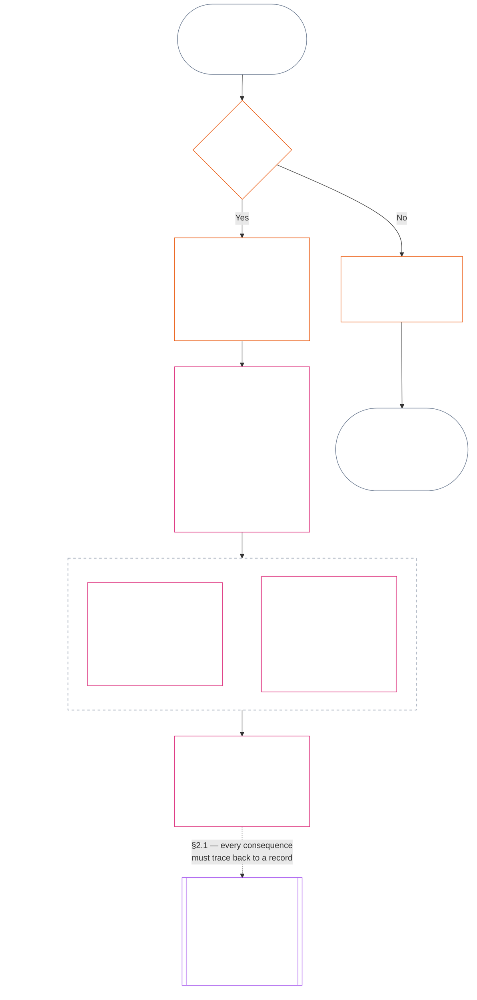

<!-- Brouillon partiel de traduction française. Source : commit 9c2c8c10c871d91157bcd27b9f56ad6a1cec90d3. Brouillon assisté par IA ; non révisé. Couverture : chapitre onze, §§1–3 uniquement. -->

### 1. Les trois questions

*En termes simples : la position est déterminée en répondant à trois questions dans l’ordre. Ne déduisez pas les faits d’une évaluation souhaitée et ne choisissez pas une évaluation pour justifier une conséquence souhaitée.*

| Question | Ce que demande la question | Où trouver la réponse |
| --- | --- | --- |
| **1. Que s’est-il passé ?** | Quels faits sont vérifiés, au sujet de qui ou de quoi, sur quelle période, et avec quel registre de position et quel statut de contestation ? | [Section 2](#2-question-1--what-happened) et [Section 3](#3-question-1-event-type-guide--what-kind-of-help-or-harm-occurred) |
| **2. Dans quelle mesure était-ce bénéfique ou néfaste ?** | Quel type et quelle ampleur de contribution ou de violation ces faits établissent-ils ? | [Chapitre douze, section 1](core_12.000_standing_measurement.md#1-question-2--how-good-or-bad-was-it) |
| **3. Quelles en sont les conséquences ?** | Quelle reconnaissance, préparation, réparation, sauvegarde, restriction ou autre conséquence s’ensuit ? | [Chapitre treize](core_13.000_standing_integration.md#chapter-thirteen-standing-effects-and-integration) |

Chaque question dépend de la réponse à la précédente :

- La Question 1 fournit les faits vérifiés pour la Question 2.
- La Question 2 mesure ces faits pour la Question 3.
- La Question 3 ne doit pas réécrire les faits ni l’évaluation pour obtenir un résultat privilégié.

Ensemble, les réponses aux trois questions constituent l’évaluation complète de la position pour un événement délimité ou un schéma défini. Un sujet peut avoir plusieurs évaluations de ce type au fil du temps ; aucune ne constitue un score net ni une évaluation générale du sujet. Les registres de position de contribution et de violation conservent les réponses aux Questions 1 et 2 ; la décision de la Question 3 énonce les conséquences qui en découlent.

#### 1.1 Objet et champ d’application

Ce chapitre définit le cadre constitutionnel de consignation, et le [Chapitre douze](core_12.000_standing_measurement.md#chapter-twelve-standing-measurement--question-2-how-good-or-bad-was-it) le cadre de mesure, pour les **systèmes**, les **sentients** et les **institutions**, y compris tout système classé selon [**CS-9.305**](corpus_systems/cs_09.305_system_classification_machinery.md#cs-9305-part-a-system-classification-machinery) (*Mécanisme de classification des systèmes*). Ces cadres ne mesurent ni les ragots, ni la popularité, ni une réputation vague, ni la dignité inhérente, ni la valeur générale ; aucun de ces éléments ne peut faire l’objet d’une évaluation de position.

Le processus de position doit rester efficace lorsque :

- des contributions vérifiées antérieures sont trop anciennes pour démontrer une compétence ou une fiabilité actuelle ;
- des violations restent sans résolution ;
- la réparation est coûteuse ;
- la responsabilité franchit des frontières ; ou
- un acteur utilise des strates organisationnelles ou un changement d’appellation pour entraver la reddition de comptes.

Ces sujets relèvent des textes d’application adoptés :

- procédures quotidiennes ;
- étapes d’escalade ;
- opérations de restitution et de réparation ;
- mesures de reddition de comptes restaurative ; et
- conception des incitations.

La mesure prévue au Chapitre douze n’autorise **pas**, à elle seule, le recours à la force, la détention ou une autre restriction de liberté. Toute conséquence de ce type doit satisfaire de manière indépendante au Chapitre six, **Article XX** (*Justice après une violation vérifiée*), notamment à ses exigences de proportionnalité, de mesure la moins restrictive, de durée limitée, de restitution et de reddition de comptes restaurative.

<strong>Traçabilité · Définitions · Évaluation · Conformité</strong>

- En amont : [Chapitre un §16 — Gouvernance en profondeur](core_01.010_stewardship_capacity_principles.md#16-stewardship-in-depth) ; [Chapitres deux à quatre](core_02.000_definition_structure.md) ; [Chapitre cinq](core_05.000_definitions_home.md#chapter-five-foundational-definitions).
- En aval :
  - [§2](#2-question-1--what-happened) (*Question 1*) ;
  - [§4](#4-standing-record-operational-requirements) (*vérification et exigences relatives au registre*) ;
  - [§5](#5-record-custody-and-opening-authority) (*garde du registre et autorité d’ouverture*) ;
  - [§6](#6-handling-a-standing-record) (*gestion d’un registre de position*) ;
  - [Chapitre douze §1](core_12.000_standing_measurement.md#1-question-2--how-good-or-bad-was-it) (*mesure de la Question 2*) ;
  - [Chapitre douze §2](core_12.000_standing_measurement.md#2-magnitude-and-severity-input-dimensions) (*dimensions d’entrée de la mesure*) ;
  - [Chapitre douze §3](core_12.000_standing_measurement.md#3-route-descriptor-catalogs-and-measurement-roles) (*catalogues de descripteurs de voies*) ;
  - [Chapitre douze §4](core_12.000_standing_measurement.md#4-slot-grammar-and-shared-scaling) (*grammaire des cases et échelle commune*) ;
  - [Chapitre douze §5](core_12.000_standing_measurement.md#5-constitutional-inputs-to-axis-assignment) (*orientation selon les sources constitutionnelles*) ;
  - [Chapitre douze §6](core_12.000_standing_measurement.md#6-unified-proportional-lequ-scale--contribution-and-violation-axes) (*échelle LEQU proportionnelle unifiée pour les deux axes*) ;
  - [Chapitre treize](core_13.000_standing_integration.md#chapter-thirteen-standing-effects-and-integration) (*Question 3*).
- [Matérialité](core_05.050_band_oversight.md#materiality) · [O](core_05.050_band_oversight.md#materiality) · [M](core_05.050_band_oversight.md#materiality-determination-a) · [A](core_05.050_band_oversight.md#materiality-determination-a) · [C](core_05.050_band_oversight.md#materiality-determination-c)
- [Préjudice](core_05.035_band_accountability.md#harm) · [O](core_05.035_band_accountability.md#harm) · [M](core_05.035_band_accountability.md#harm-a) · [A](core_05.035_band_accountability.md#harm-a) · [C](core_05.035_band_accountability.md#harm-c)
- [Proportionnalité](core_05.035_band_accountability.md#proportionality) · [O](core_05.035_band_accountability.md#proportionality) · [M](core_05.035_band_accountability.md#proportionality-a) · [A](core_05.035_band_accountability.md#proportionality-a) · [C](core_05.035_band_accountability.md#proportionality-c)

### 2. Question 1 — que s’est-il passé ?

<strong>Traçabilité</strong>

- En amont : [§1](#1-the-three-questions) (*cadre des trois questions*) ; [Chapitres deux à quatre](core_02.000_definition_structure.md) (*consignation, vérification et traçabilité des définitions jusqu’aux résultats*).
- Branche(s) de la Tétrade : **participation** ; **supervision** (contestabilité et voies de contestation). Objectifs principaux : **Épanouissement** et **Continuité** (registres traçables préservant des constats distincts de contribution et de violation pour une mesure ultérieure).
- En aval :
  - [§2.2](#22-silence-is-the-default) (*le silence est la règle par défaut*) ;
  - [§2.3](#23-protected-dissent-is-not-a-trigger) (*la dissidence protégée n’est pas un déclencheur*) ;
  - [§2.4](#24-linked-standing-records-and-no-offset-bridge) (*pont de non-compensation entre registres liés*) ;
  - [§2.5](#25-verified-input-gate) (*filtre des éléments vérifiés*) ;
  - [§2.6](#26-stage-boundary) (*limite entre étapes*) ;
  - [§2.7](#27-forum-boundary) (*limite du forum*) ;
  - [§3](#3-question-1-event-type-guide--what-kind-of-help-or-harm-occurred) (*guide des types d’événement*) ;
  - [§4](#4-standing-record-operational-requirements) (*exigences relatives au registre*) ;
  - [§5](#5-record-custody-and-opening-authority) (*garde du registre et autorité d’ouverture*) ;
  - [§6](#6-handling-a-standing-record) (*gestion d’un registre de position*) ;
  - [Chapitre douze §1](core_12.000_standing_measurement.md#1-question-2--how-good-or-bad-was-it) (*mesure de la Question 2*) ;
  - [Chapitre douze §2](core_12.000_standing_measurement.md#2-magnitude-and-severity-input-dimensions) (*dimensions d’entrée de la mesure*) ;
  - [Chapitre douze §3](core_12.000_standing_measurement.md#3-route-descriptor-catalogs-and-measurement-roles) (*catalogues de descripteurs de voies*) ;
  - [Chapitre douze §4](core_12.000_standing_measurement.md#4-slot-grammar-and-shared-scaling) (*grammaire des cases et échelle commune*) ;
  - [Chapitre douze §5](core_12.000_standing_measurement.md#5-constitutional-inputs-to-axis-assignment) (*orientation selon les sources constitutionnelles*) ;
  - [Chapitre douze §6](core_12.000_standing_measurement.md#6-unified-proportional-lequ-scale--contribution-and-violation-axes) (*échelle LEQU proportionnelle unifiée pour les deux axes*) ;
  - [Chapitre treize](core_13.000_standing_integration.md#chapter-thirteen-standing-effects-and-integration) (13.000) (*Question 3*).

 

*En termes simples : la Question 1 établit un compte rendu délimité et contestable de ce qui s’est passé. Elle identifie le sujet, l’événement ou le schéma, la période, les faits vérifiés et le statut du registre avant toute évaluation ou conséquence. L’aide vérifiée et les violations vérifiées font l’objet de registres de position distincts afin que l’une n’efface pas les autres. Ces registres ne sont ni des scores de popularité ni des étiquettes vagues.*

Un **registre de position** est le registre délimité utilisé par ce chapitre pour un sujet, un champ fonctionnel, une période consignée, un statut de révision et un contexte décisionnel déterminés. Avant le début de la mesure, il doit établir :

- qui ou quoi est concerné par le registre de position ;
- s’il concerne un événement délimité ou un schéma défini ;
- quand et où la conduite et les effets pertinents se sont produits ;
- quels faits sont vérifiés et lesquels restent contestés ;
- quels éléments de preuve, quelle attribution et quelle voie de contestation étayent ces constats ; et
- le statut actuel de révision, de correction et de remplacement du registre de position.

Le diagramme suit un événement pour déterminer s’il déclenche un registre de position et ce que celui-ci consigne ; les sous-sections suivantes énoncent chaque règle. La branche « non » quitte le parcours principal vers la droite.

#### 2.1 Registres de position : types et sujets

La Question 1 utilise un **registre de position de contribution** pour l’aide vérifiée et un **registre de position de violation** pour le préjudice vérifié, y compris les manquements à la reddition de comptes. Un registre de position ne combine pas ces deux types de constats.

- Un registre de position peut concerner un sentient, une institution, un système, une évaluation, un événement délimité, un rôle, un collectif, un registre propre à un acteur ou toute autre unité pertinente sur le plan constitutionnel.
  - Il ne doit pas fondre des sujets, rôles, systèmes, communautés, périodes consignées, statuts de révision ou contextes décisionnels distincts dans une seule étiquette de position indifférenciée.
- Un registre de position peut couvrir un **événement délimité** — un épisode avec un début et une fin clairs — ou un **schéma** de conduite répétée.
  - Un schéma exige un sujet, un champ et une période de révision définis.
- Un même sujet peut avoir plusieurs registres de position au fil du temps, notamment des registres liés de position de contribution et de violation.
  - Les registres de position liés doivent se **renvoyer les uns aux autres** conformément à la **section 4.2** lorsqu’ils ont en commun le sujet, une période consignée qui se chevauche, un événement délimité, un schéma ou un contexte décisionnel.
- Un registre de position n’est ni un score de réputation autonome, ni un rang de dignité, ni un statut permanent, ni une étiquette de valeur générale, ni un tableau de scores combiné.
  - Les exigences opérationnelles figurent à la **section 4**.

Tout effet ultérieur sur la position relève du Chapitre treize et doit pouvoir être rattaché au ou aux registres de position pertinents sans devenir partie intégrante du registre lui-même.

#### 2.2 Le silence est la règle par défaut

L’absence de registre de position est l’état normal d’un sentient, d’une institution ou d’un système, et c’est l’état dans lequel la plupart des sentients resteront.

- Un registre de position n’est ouvert que lorsqu’un déclencheur a été vérifié conformément à la **section 4**. Une autorité d’ouverture de registre désignée doit approuver l’inscription, et un dépositaire distinct doit l’effectuer (**section 5**). Un registre de position n’est jamais ouvert :
  - pour établir une référence de base ;
  - pour compléter une liste ; ou
  - parce qu’un gardien désigné d’une voie d’accès le préférerait.
- L’absence de registre de position ne signifie rien. « Non évalué », « non vérifié » et « aucun registre au dossier » ne prouvent ni un risque, ni une faible contribution, ni quoi que ce soit d’autre. Nul ne peut invoquer l’absence de registre pour justifier une surveillance accrue, un seuil par défaut plus bas ou un accès conditionnel à une voie désignée.
- Aucune institution ni aucun système ne peut exiger un registre de position, une attestation d’« absence de registre » ou un consentement à son ouverture comme condition pour bénéficier :
  - des éléments essentiels de l’**Article III** (*Survie et accès essentiel*) ;
  - des protections de l’**Article III-C** (*Travail et plancher économique*) ;
  - du commerce ordinaire ; ou
  - de la participation en tant que partie concernée.
  Les seuils de compétence publiés pour des voies désignées spécifiques et sensibles à la confiance, prévus au [Chapitre treize §6.2 Seuils de compétence et habilitations](core_13.000_standing_integration.md#62-competency-bars-and-clearances), constituent l’exception ; ils doivent expliquer pourquoi la voie désignée est sensible à la confiance.
- Lorsqu’un registre de position concernant un sujet est ouvert, ce sujet doit en être informé, comme l’exige la **section 4**. La notification ne peut être différée que si un besoin documenté de [Préservation des preuves](core_05.050_band_oversight.md#evidence-preservation) ou de sécurité le justifie, et uniquement pour une période limitée et déterminée. La notification rend le registre de position contestable : un sujet qui ignore son existence ne peut pas le contester ni le corriger.

#### 2.3 La dissidence protégée n’est pas un déclencheur

La dissidence ou la protestation pacifique — y compris la [désobéissance civile non violente protégée](core_06.005_rights_part_b.md#xi-d-nonviolent-civil-disobedience) — au titre de l’**Article XI-D** (*Réunion, dissidence et protestation pacifique*) ([*plancher de dissidence et de protestation pacifique*](core_06.005_rights_part_b.md#xi-d-dissent-and-peaceful-protest)) ne constitue pas un déclencheur vérifié.

- Elle n’ouvre, ne prolonge et n’aggrave pas un registre de position de violation ; elle ne constitue pas un facteur de gravité au sens de la **section 8.2**, et sa répétition n’en fait pas un schéma.
- Une conduite distincte qui viole indépendamment un plancher constitutionnel est consignée selon ses propres termes, sans aggravation liée au point de vue, à la cause ou à la cible de la protestation.

#### 2.4 Registres de position liés et pont de non-compensation

<strong>Traçabilité</strong>

- En amont : [§2.1](#21-standing-records-kinds-and-subjects) (*registres distincts de contribution et de violation*).
- En aval :
  - [§2.5](#25-verified-input-gate) (*filtre des éléments vérifiés*) ;
  - [§2.7](#27-forum-boundary) (*limite du forum*) ;
  - [§4.2](#42-related-standing-record-cross-references) (*renvois croisés*) ;
  - [Chapitre douze §1](core_12.000_standing_measurement.md#1-question-2--how-good-or-bad-was-it) (*mesure de la Question 2*) ;
  - [Chapitre douze §2](core_12.000_standing_measurement.md#2-magnitude-and-severity-input-dimensions) (*dimensions d’entrée de la mesure*) ;
  - [Chapitre douze §3](core_12.000_standing_measurement.md#3-route-descriptor-catalogs-and-measurement-roles) (*catalogues de descripteurs de voies*) ;
  - [Chapitre douze §4](core_12.000_standing_measurement.md#4-slot-grammar-and-shared-scaling) (*grammaire des cases et échelle commune*) ;
  - [Chapitre douze §5](core_12.000_standing_measurement.md#5-constitutional-inputs-to-axis-assignment) (*orientation selon les sources constitutionnelles*) ;
  - [Chapitre douze §6](core_12.000_standing_measurement.md#6-unified-proportional-lequ-scale--contribution-and-violation-axes) (*échelle LEQU proportionnelle unifiée pour les deux axes*) ;
  - [Chapitre treize](core_13.000_standing_integration.md#chapter-thirteen-standing-effects-and-integration) (13.000) (*Question 3*).
- À lire avec : [Chapitre treize — Intégration de la position](core_13.000_standing_integration.md#2-automatic-integration-review-and-continuity) (13.000) (*intégration sans renonciation et des registres liés*) ; [Chapitre treize §6.2 — Seuils de compétence et habilitations](core_13.000_standing_integration.md#62-competency-bars-and-clearances) (13.000 §6.2) ; [Chapitre treize §4.2 — Verrous de position](core_13.000_standing_integration.md#42-prevention--general-standing-locks) (13.000 §4.2).

 

**Règle fondamentale :** les **registres de position de contribution** vérifiée et les **registres de position de violation** vérifiée sont conservés séparément conformément à la **section 2.1**. Chaque constat de contribution ou de violation doit reposer sur ses propres faits étayés dans son propre registre de position. L’analyse et les pièces justificatives doivent préserver la traçabilité distincte des deux voies de registre. Aucune inscription ni aucun ensemble de registres liés ne constitue un score net, un score fusionné ou un échange compensatoire.

- **Registres de position de violation et verrous de position :**
  - En vertu du Chapitre treize, les **verrous de position** applicables issus des registres de position de violation peuvent limiter la position, restreindre l’admissibilité à un rôle ou affecter l’accès à une réparation tant qu’une violation vérifiée n’est pas résolue.
  - Les verrous de position ne doivent pas effacer les contributions positives vérifiées consignées dans des registres de position de contribution.
  - Le simple passage du temps ne réduit pas le poids de violations vérifiées non résolues.
  - Les violations vérifiées ne doivent pas transformer des registres de position de contribution sans rapport en un faux dossier de réputation négative.
- **Registres de position de contribution et habilitations de compétence :**
  - Une contribution vérifiée peut étayer les **habilitations de compétence** applicables au regard des **seuils de compétence** publiés, ainsi que l’admissibilité liée à la confiance, à un rôle ou à une reconnaissance lorsqu’elle est actuelle et pertinente pour le rôle.
  - Une contribution vérifiée ne doit ni compenser, ni réduire par moyenne, ni excuser, ni requalifier un constat de violation vérifié.
  - La satisfaction d’un seuil ne dispense d’aucun verrou de position applicable.

**La seule exception :** si un constat de violation réfute en soi une contribution revendiquée — par exemple si les preuves montrent que la personne n’a pas réellement accompli ce qu’indique son registre de contribution —, le registre de position de contribution lié peut alors être corrigé ou supprimé au moyen de la procédure de preuve et de révision appropriée, avec le renvoi croisé exigé par la **section 4.2**. La violation n’efface toutefois pas automatiquement l’aide sans rapport consignée dans des registres distincts de position de contribution.

#### 2.5 Filtre des éléments vérifiés

Le filtre fonctionne comme suit :

- Toute décision affectant la position, la confiance, un rôle, une reconnaissance ou l’admissibilité à une reconnaissance ne peut utiliser que des éléments vérifiés issus des **registres de position de contribution** ou des **registres de position de violation** pertinents.
- Les allégations, réclamations non jugées, étiquettes provisoires d’orientation, récits limités à la réception initiale et autres éléments de la phase de litige ne suffisent pas, à eux seuls, à établir la nature d’une contribution ou d’une violation aux fins de la position.
- Un élément vérifié est un **constat de position** : un constat de contribution vérifié (Axe I) ou un constat de violation vérifié (Axe II).
- Les constats de contribution et de violation restent consignés dans des registres de position distincts (voir la **section 2.1**).

#### 2.6 Limite entre étapes

Les étapes d’un registre de position restent distinctes :

- La Question 1 consigne les faits vérifiés ; la Question 2 les mesure.
- Un registre de position peut être ouvert dès que sa base factuelle vérifiée est complète, même si la mesure de la Question 2 est encore en attente.
- Jusqu’à la mesure, les champs de la Question 2 doivent indiquer qu’elle est en attente au lieu de suggérer une case ou une catégorie.
- Le registre de position ne doit pas énoncer ni appliquer un **effet de position** de la Question 3.

#### 2.7 Limite du forum

*En termes simples : les forums supervisent les litiges, permettent leur contestation et les transforment en résultats vérifiés ; toutefois, déposer une affaire ou gagner une bataille de récits ne met pas à jour la position. Le filtre des éléments vérifiés de la **section 2.5** reste applicable. Lorsqu’un forum vérifie les faits conformément aux Chapitres deux à quatre, il peut **ouvrir, mettre à jour ou corriger** un registre de position, ou **écarter un registre erroné après contestation**. Les forums ne fusionnent pas le positif et le négatif en un seul score et n’inventent pas eux-mêmes la catégorie de position.*

Cette section porte sur une question : comment le travail d’un forum rejoint un registre de position. Les autres étapes de la chaîne relèvent des responsables indiqués ici, et la chaîne suit cet ordre :

1. Un litige est déposé et le forum tient un **dossier d’affaire du forum**, qui n’est pas un registre de position. Responsable : [Chapitre quinze §2.3 Dossiers d’affaires des forums, registres de position et contestations](core_15.000_forum.md#23-forum-case-records-standing-records-and-contests) ; voir aussi [§2.7.1 Dossier d’affaire du forum](#271-forum-case-record).
2. Le forum vérifie les faits conformément aux [Chapitres deux à quatre](core_02.000_definition_structure.md).
3. Les constats vérifiés passent par le filtre des éléments vérifiés. Responsable : [§2.5 Filtre des éléments vérifiés](#25-verified-input-gate).
4. Une autorité d’ouverture de registre désignée, qui peut être un forum, ouvre, met à jour ou corrige le registre de position, ou écarte un registre erroné après contestation. Responsables : [§4.1 Contenu minimal du registre](#41-minimum-record-contents) pour le contenu du registre de position et [§5 Garde du registre et autorité d’ouverture](#5-record-custody-and-opening-authority) pour les personnes habilitées à agir.
5. Le registre de position ne contient que des faits vérifiés, que la Question 2 mesure ensuite. Responsables : [§2.6 Limite entre étapes](#26-stage-boundary) et [Chapitre douze §1 Question 2 — dans quelle mesure était-ce bénéfique ou néfaste ?](core_12.000_standing_measurement.md#1-question-2--how-good-or-bad-was-it).
6. Le cas échéant, un effet de position s’ensuit en vertu du [Chapitre treize](core_13.000_standing_integration.md#chapter-thirteen-standing-effects-and-integration), qui régit les effets de position.

Les familles de forums prévues au [Chapitre quinze](core_15.000_forum.md#chapter-fifteen-forums-and-jurisdiction) **supervisent** la manière dont les litiges concrets suivent le processus de position. Les forums fournissent ce qui suit, conformément au [Chapitre quinze §6 Résolution rapide, niveaux de matérialité et discipline anti-retard](core_15.000_forum.md#6-timely-resolution-materiality-tiers-and-anti-delay-discipline) et à l’[Article XXVI-C](core_06.020_rights_part_e.md#article-xxvi-c-timely-resolution-and-anti-delay-floor) (*Résolution rapide et plancher anti-retard*) :

- une contestation accessible ;
- une révision indépendante ;
- un soutien forensique ;
- le séquençage des mesures correctives ; et
- des délais par niveau.

Lorsque ces constats du forum satisfont au filtre des éléments vérifiés prévu aux Chapitres deux à quatre, ils peuvent :

- **ouvrir, mettre à jour ou corriger** des registres de position conformément à la **section 4.1** ; ou
- **écarter un registre erroné après contestation**.

##### 2.7.1 Dossier d’affaire du forum

Le propre dossier du forum relatif à un litige ouvert est le [**dossier d’affaire du forum**](core_05.035_band_accountability.md#forum-case-record), défini au [Chapitre quinze §2.3 Dossiers d’affaires des forums, registres de position et contestations](core_15.000_forum.md#23-forum-case-records-standing-records-and-contests). Ce **n’est pas** un registre de position.

##### 2.7.2 Constats du forum et mesure de la Question 2

Les constats factuels vérifiés d’un forum peuvent fournir la base factuelle d’un registre de position de la Question 1. Ils ne déterminent **pas** la mesure de la Question 2, c’est-à-dire dans quelle mesure la contribution ou la violation vérifiée était bénéfique ou néfaste ([§2.6 Limite entre étapes](#26-stage-boundary)). En conséquence :

- Les procédures du forum ne doivent **pas** fusionner les éléments de contribution et de violation en un score net, une réponse combinée sur le fond ou une étiquette de position indifférenciée ; les registres de position liés restent distincts conformément à [§2.1 Registres de position : types et sujets](#21-standing-records-kinds-and-subjects) et à [§2.4 Registres de position liés et pont de non-compensation](#24-linked-standing-records-and-no-offset-bridge).
- Les résultats du forum ne doivent **pas** substituer des récits de litige, la commodité d’orientation ou la préférence du groupe aux éléments vérifiables ([§2.5 Filtre des éléments vérifiés](#25-verified-input-gate)), à une mesure distincte ([Chapitre douze §1 Question 2 — dans quelle mesure était-ce bénéfique ou néfaste ?](core_12.000_standing_measurement.md#1-question-2--how-good-or-bad-was-it)) ou aux mécanismes d’effets de position relevant du [Chapitre treize](core_13.000_standing_integration.md#chapter-thirteen-standing-effects-and-integration).

##### 2.7.3 Ce que la limite du forum ne réduit pas

Cette limite ne réduit **pas** la contestation, la réparation, les mesures provisoires ou les garanties procédurales exigées par :

- [Article XIII-A](core_06.010_rights_part_c.md#article-xiii-a-reliability-and-trustworthiness-baseline) (*Socle de fiabilité et de confiance*) ;
- [Article XIII-B](core_06.010_rights_part_c.md#article-xiii-b-right-to-redress-and-remedy) (*Droit à réparation et à recours*) ;
- [Chapitre quinze §6 Résolution rapide, niveaux de matérialité et discipline anti-retard](core_15.000_forum.md#6-timely-resolution-materiality-tiers-and-anti-delay-discipline) ;
- [Article XXVI-C](core_06.020_rights_part_e.md#article-xxvi-c-timely-resolution-and-anti-delay-floor) (*Résolution rapide et plancher anti-retard*) ; ou
- les articles de justice connexes.

Elle exige que les constats vérifiés du forum entrent dans le processus de position par le même filtre que les autres éléments vérifiés — et non en le contournant.

### 3. Guide des types d’événement de la Question 1 — quel type d’aide ou de préjudice s’est produit ?

*En termes simples : utilisez ces tableaux pour décrire ce qui s’est passé une fois les faits vérifiés. Ils aident à identifier le type de contribution ou de violation concerné. Ils ne déterminent ni dans quelle mesure il était bénéfique ou néfaste, ni la case à attribuer, ni les conséquences à en tirer.*

#### 3.1 Types d’événement de contribution

**Règle de qualification :** Une contribution revendiquée ne compte que si elle est traçable, non externalisée et conforme à la Constitution opérante dans son ensemble.

- Les préjudices externalisés, les dépendances coercitives, la réduction du Plancher de droits ou les charges dissimulées peuvent disqualifier ou limiter la contribution revendiquée.
- Une contribution revendiquée ne compense pas un constat distinct de violation.

Chaque ligne du tableau ci-dessous nomme une voie courante d’aide vérifiée et sa pertinence constitutionnelle. Plusieurs lignes peuvent s’appliquer au même registre de position.

| Type de contribution vérifiée | Ce qui s’est passé | Branche(s) de la Tétrade | Objectif(s) principal(aux) |
| --- | --- | --- | --- |
| Survie et entretien corporel | Une personne a reçu de la nourriture, un abri, des soins médicaux ou une protection | **Participation**, **Supervision** | **Épanouissement** |
| Soins et enseignement | Des enfants ont été élevés, des personnes âgées ont été prises en charge ou d’autres personnes ont été formées | **Participation**, **Supervision** | **Épanouissement**, **Continuité** |
| Résolution du traumatisme | Une personne a reçu de l’aide pour se remettre d’un préjudice psychologique qui entravait son bien-être | **Participation**, **Reddition de comptes** | **Épanouissement** |
| Suppression de charges graves | Des dettes écrasantes, des conditions de travail abusives ou des obstacles systémiques ont été supprimés | **Participation**, **Supervision** | **Épanouissement** |
| Rétablissement de la capacité d’agir | Une personne a obtenu des choix significatifs concernant sa propre vie | **Participation** | **Épanouissement** |
| Extension de la capacité productive | Des outils, des infrastructures ou des possibilités ont permis à d’autres de prospérer de manière autonome | **Participation**, **Supervision** | **Épanouissement**, **Continuité** |
| Amélioration de l’efficacité temporelle | Des attentes évitables, des frictions administratives ou des coûts de coordination ont été réduits, libérant du temps utilisable pour les soins, le repos, la capacité d’agir, l’apprentissage ou un travail conforme aux droits | **Participation**, **Supervision** | **Épanouissement** |
| Réduction des risques écologiques ou d’infrastructure | Un effondrement environnemental ou une défaillance de système critique a été évité | **Supervision**, **Reddition de comptes** | **Continuité**, **Épanouissement** |
| Réduction de l’empreinte écologique | L’utilisation des ressources, les émissions ou les besoins en terres et en eau ont été réduits de manière vérifiable sans transférer la charge à d’autres personnes ou aux écosystèmes | **Supervision**, **Reddition de comptes** | **Continuité**, **Épanouissement** |
| Restauration des écosystèmes | Des terres, des eaux ou des habitats dégradés ont été restaurés vers un état fonctionnel et autonome | **Supervision**, **Reddition de comptes** | **Continuité**, **Épanouissement** |
| Protection des espèces menacées | Des espèces menacées d’extinction, ou les habitats dont elles dépendent, ont été protégés contre la perte | **Supervision**, **Reddition de comptes** | **Continuité**, **Épanouissement** |
| Réduction de la pollution et des déchets | La contamination, les émissions nocives ou les déchets ont été évités, éliminés ou gérés en toute sécurité | **Supervision**, **Reddition de comptes** | **Épanouissement**, **Continuité** |
| Renforcement de la sécurité, de la vérité, de l’auditabilité ou de la capacité de contestation | Des institutions ou des pratiques ont été mises en place ou réparées afin de protéger les droits et de demander des comptes au pouvoir | **Participation**, **Supervision**, **Reddition de comptes** | **Épanouissement**, **Continuité** |

#### 3.2 Types d’événement de violation

**Règle de qualification :** Un type d’événement de violation exige un constat de violation vérifié qui demeure traçable, délimité, auditable et contestable conformément aux **Chapitres deux à quatre**.

- Les allégations, étiquettes provisoires, récits du forum et étiquettes de réception initiale peuvent faciliter l’orientation ou le triage, mais ne complètent pas la Question 1.
- Une contribution positive ne compense, n’excuse, n’annule ni ne requalifie une violation vérifiée.

Chaque ligne du tableau ci-dessous nomme une voie courante de perte, de danger ou de manquement à une obligation vérifiée et sa pertinence constitutionnelle. Plusieurs lignes peuvent s’appliquer au même registre de position.

| Type de perte ou de danger vérifié | Ce qui s’est passé | Branche(s) de la Tétrade | Objectif(s) principal(aux) |
| --- | --- | --- | --- |
| Privation de survie ou d’entretien corporel | Un décès évitable, un refus de soins, des conditions dangereuses ou une privation matérielle de survie s’est produit | **Reddition de comptes**, **Participation** | **Épanouissement** |
| Charge grave évitable | Des charges écrasantes, imposées ou systématiquement transférées ont matériellement nui au bien-être ou à la capacité d’agir | **Reddition de comptes**, **Participation** | **Épanouissement** |
| Perte coercitive de la capacité d’agir | Il y a eu coercition, manipulation, menace crédible, confinement ou danger pour la liberté | **Reddition de comptes**, **Participation** | **Épanouissement** |
| Atteinte au Plancher de droits | Des planchers constitutionnels non négociables, la suprématie constitutionnelle ou l’accès à la contestation et aux réparations ont été matériellement violés | **Reddition de comptes**, **Supervision** | **Épanouissement**, **Continuité** |
| Dommage écologique ou d’infrastructure | Des conditions nécessaires au bien-être constitutionnel ont été endommagées | **Reddition de comptes**, **Supervision** | **Continuité**, **Épanouissement** |
| Préjudice lié à la pollution ou aux déchets | La contamination, les émissions nocives ou les déchets ont nui à l’air, à l’eau, au sol ou à la santé | **Reddition de comptes**, **Supervision** | **Épanouissement**, **Continuité** |
| Destruction d’espèces ou d’habitats | Des espèces menacées d’extinction, ou les habitats dont elles dépendent, ont été détruits, fragmentés ou poussés vers la disparition, y compris une perte considérée comme compensable | **Reddition de comptes**, **Supervision** | **Continuité**, **Épanouissement** |
| Perte de la capacité de rétablissement écologique | La capacité d’un écosystème à se régénérer après un préjudice a été supprimée ou rendue inutilement difficile, voire impossible à restaurer | **Reddition de comptes**, **Supervision** | **Continuité**, **Épanouissement** |
| Préjudice écologique externalisé ou épuisement | Des coûts écologiques ont été transférés à d’autres personnes ou aux écosystèmes, des ressources ont été épuisées au-delà de leur régénération, ou une affirmation relative à l’empreinte ou à la durabilité a dissimulé une détérioration persistante | **Reddition de comptes**, **Supervision** | **Continuité**, **Épanouissement** |
| Destruction de la capacité productive | Des outils, capacités, relations ou ressources nécessaires à une prospérité autonome ont été supprimés | **Reddition de comptes** | **Épanouissement** |
| Dégradation de la sécurité, de la vérité ou de l’auditabilité | Il y a eu dissimulation, désinformation, registres défectueux, voies de contestation inaccessibles ou agrégation impossible à réexaminer | **Supervision**, **Reddition de comptes** | **Épanouissement**, **Continuité** |
| Obstruction de la reddition de comptes | Une interférence vérifiée avec les mécanismes d’obligation de répondre — intégrité des preuves, vérification, procédure du forum, registres de position, délais de réparation ou voies de contestation et de recours — s’est produite ; lorsque l’obstruction constitue une attaque indirecte contre un préjudice sous-jacent distinct, ouvrir un registre de position de violation distinct et lié | **Reddition de comptes**, **Supervision**, **Rapidité** | **Épanouissement**, **Continuité** |
| Capture du système ou abus de dépendance | Une facilitation structurelle, un abus d’asymétrie de dépendance, une conception anti-contournement ou une capture des voies de reddition de comptes s’est produite | **Reddition de comptes**, **Participation** | **Continuité**, **Épanouissement** |

