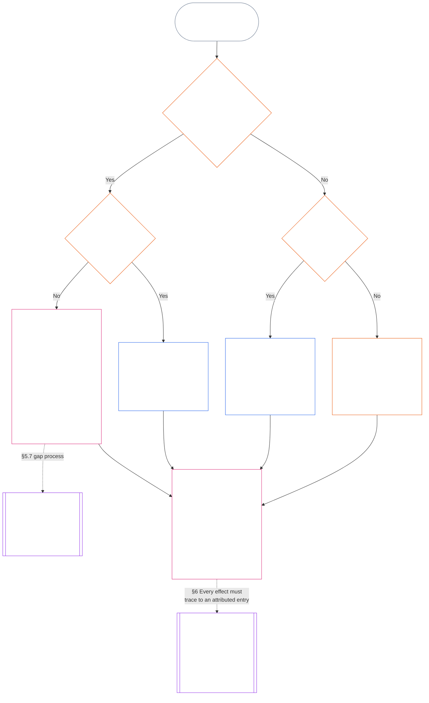

<!-- Brouillon partiel de traduction française. Source : commit 9c2c8c10c871d91157bcd27b9f56ad6a1cec90d3. Brouillon assisté par IA ; non révisé. Couverture : chapitre onze, §§5.7–5.9 uniquement. -->

#### 5.7 Lorsqu’une Charte du système ou une Charte institutionnelle ne désigne pas un siège

La destination d’un registre de position lorsque la voie désignée habituelle n’est pas disponible dépend de trois questions, posées dans l’ordre dans le diagramme ci-dessous. Cette section traite le cas où une Charte du système ou une Charte institutionnelle ne désigne pas un siège ; la [§5.8 Solution de repli lorsqu’aucune Charte du système ou Charte institutionnelle ne couvre le registre de position](#58-fallback-when-no-system-charter-or-institutional-charter-reaches-the-standing-record) traite le cas où aucune ne le couvre.

<strong>Guide de lecture (non opératoire) : comment lire le diagramme</strong>

> En termes simples : les registres de position sont traités par les services désignés dans la Charte du système ou la Charte institutionnelle. Si celle-ci ne désigne pas un siège, la Charte est invalide jusqu’à ce que la lacune soit comblée ; le registre de position revient alors à l’Autorité suppléante d’ouverture des registres et au Dépositaire suppléant des registres, ou à un forum, et non au plan de voies. Si aucune Charte du système ni Charte institutionnelle ne couvre le registre de position, c’est le plan de voies publié par l’institution qui s’applique ; s’il n’en existe pas, le registre revient à une vérification indépendante ou, pour les travaux informels et de faible portée, à l’organe qui s’y fie.
>
> Toutes les voies aboutissent au même encadré : un service vérifie les faits et un autre inscrit et conserve le registre de position ; la [§6 Gestion d’un registre de position](#6-handling-a-standing-record) régit ensuite les actes des dépositaires. Les flèches pleines indiquent le parcours principal. Les flèches pointillées indiquent les transmissions, étiquetées avec la section qui les prévoit. Les encadrés à doubles barres latérales relèvent d’un autre chapitre ; le dernier montre que les effets sur la position découlent du registre sans le réécrire. Le diagramme n’ajoute aucun devoir, siège ni champ.

 

Lorsqu’une Charte du système ou une Charte institutionnelle ne désigne pas un siège de registre obligatoire ou la voie indépendante :

- **Conséquence :** La Charte du système ou la Charte institutionnelle est invalide, et toute modification qui la rendrait invalide est interdite ([Chapitre sept §4.7.1 Lorsqu’une lacune existe et comment elle est consignée](core_07.000_charters.md#471-when-a-gap-exists-and-how-it-is-logged)).
- **Le Chapitre sept régit le processus de traitement des lacunes :** la [§4.7 Lacunes dans le plan pour les registres de position d’opérateur](core_07.000_charters.md#47-gaps-in-the-map-for-operator-standing-records) du Chapitre sept régit également :
  - la consignation d’une lacune ;
  - les délais de réponse et de résolution, y compris le remplacement d’urgence ; et
  - le retour de la garde aux titulaires désignés.

Pour les registres de position, la présente section ajoute ce qui suit :

- **Qui ne peut pas agir :** Tant qu’un siège obligatoire est vacant et que la Charte du système ou la Charte institutionnelle ne désigne aucun remplaçant valide, nul ne peut exercer la fonction de ce siège, sauf par la voie décrite au point suivant.
- **Destination du registre de position :** Le registre de position revient à l’Autorité suppléante d’ouverture des registres et au Dépositaire suppléant des registres, ou à un forum conformément à la **section 2.7**, comme le prévoit la [§5.4 Interdiction de l’autogarde](#54-no-self-custody) ; le plan de voies ne les remplace pas. Chaque registre de position reste entier et sous la garde d’un seul dépositaire.
- **Registres de position déjà détenus :**
  - Le jour où un forum, un greffier ou l’Autorité suppléante d’ouverture des registres est informé de la lacune, tout registre de position d’opérateur conservé par un service situé dans la Ligne de contrôle matériel de la Partie charterisée est transféré au Dépositaire suppléant des registres, avec sa piste complète.
  - Jusque-là, ce service conserve le registre en lecture seule, n’inscrit aucune version et remet immédiatement au Dépositaire suppléant des registres une copie complète accompagnée de sa piste intégrale.
  - Un dépositaire situé hors de cette ligne conserve le registre de position et, pendant la lacune, inscrit chaque version autorisée par l’Autorité suppléante d’ouverture des registres ou par un forum. Si un forum conclut que le dépositaire se trouve dans la ligne, le registre de position est transféré au Dépositaire suppléant des registres avec sa piste complète, comme pour un service situé dans la ligne.
- **Responsables :** Si l’on demande à un responsable d’occuper un siège que la Charte du système ou la Charte institutionnelle ne lui attribue pas :
  - **Il refuse le siège :** L’accès ou la capacité technique d’inscrire le registre de position ne lui confère aucune autorité à cet effet.
  - **Il consigne la demande et la lacune :** Il consigne les deux dans le registre.
  - **Il transmet le registre de position :** Il le transmet par la voie indiquée ci-dessus sous *Destination du registre de position*.
  - **Il conserve ses autres devoirs :** Les devoirs déjà prévus à la [§5.4 Interdiction de l’autogarde](#54-no-self-custody) (*Responsables au sein du sujet*) restent applicables : interrompre ce qu’il contrôle, consigner l’ensemble reconstructible, préserver les preuves qu’il détient, notifier et transmettre aux échelons supérieurs. Aucun de ces actes ne vérifie les faits ni n’inscrit le registre de position. Le registre et les preuves préservées accompagnent le registre de position comme éléments d’entrée pour l’autorité qui le vérifie ; ils ne constituent pas une inscription et ne tranchent pas les faits.

#### 5.8 Solution de repli lorsqu’aucune Charte du système ou Charte institutionnelle ne couvre le registre de position

Lorsqu’aucune Charte du système ni Charte institutionnelle ne couvre le système, l’institution ou l’entreprise concerné par le registre de position — par exemple un organe situé sous le seuil de classe L qui n’en a publié aucune —, le plan de voies publié par l’institution au titre de **CI-8.205 §2** (*Voies de séparation fonctionnelle*) s’applique :

- **Autorité d’ouverture du registre :** Le service que le plan de voies place dans la voie d’assurance et d’audit pour le système, l’institution ou l’entreprise concerné. Ce service vérifie le fondement factuel et autorise l’inscription ([§5.2 Autorité d’ouverture du registre désignée](#52-named-record-opening-authority)) ; il n’inscrit ni ne conserve le registre de position.
- **Dépositaire :** Le service qui détient la voie de publication et de preuves.
- **Exclusion de la voie d’exécution :** Aucun des deux ne peut être le service qui détient la voie d’exécution du système concerné.
- **Aucun plan de voies non plus :** Le registre de position est orienté vers une vérification indépendante conformément à l’*Interdiction de l’autogarde* ci-dessus ou, pour les registres informels et de faible portée, vers l’organe qui s’y fie au titre des *Registres informels et de faible portée* ci-dessous.
- **Responsables :** Si l’on demande à un responsable d’occuper un siège que le plan de voies ne lui attribue pas, la règle *Responsables* de la [§5.7 Lorsqu’une Charte du système ou une Charte institutionnelle ne désigne pas un siège](#57-when-a-system-charter-or-institutional-charter-leaves-a-seat-unnamed) s’applique : il refuse le siège, consigne la demande et la lacune, et conserve ses autres devoirs. Il transmet le registre au service nommé dans le plan de voies ou, si aucun n’y figure, par la voie indiquée ci-dessus sous *Aucun plan de voies non plus*.

#### 5.9 Registres informels et de faible portée

La séparation des fonctions est proportionnée à l’importance matérielle, et non au degré de formalité ([Chapitre huit §2 Exigence constitutionnelle des quatre sièges](core_08.000_functional_independence_separation_of_duties.md#2-four-seat-constitutional-requirement)).

- **Travaux concernés :** Les communautés locales reposent sur de nombreuses formes de contribution, souvent informelles et non rémunérées. Cela concerne les travaux non rémunérés, organisés entre pairs, d’entraide, de soins, d’entretien, de réparation, d’enseignement et de gestion communautaire ; le [Chapitre treize §6 Les conséquences des contributions en premier](core_13.000_standing_integration.md#6-contribution-consequences-second) exige qu’ils soient reconnus selon des critères équivalents.
  - **Exemples locaux :** Des voisins partagent nourriture et outils (entraide), prennent soin d’un voisin malade ou âgé (soins), entretiennent un jardin partagé ou un ruisseau (entretien et gestion communautaire), réparent les canalisations d’un voisin (réparation), donnent des cours particuliers ou transmettent une compétence (enseignement). Chacune constitue un type de contribution distinct.
- **Titulaire du siège de vérification :** Pour ces travaux, le siège de vérification peut être occupé par **tout organe indépendant ayant une autorité publiée pour se fonder sur le registre de position** ; cet organe agit alors comme autorité de vérification.
  - **Titulaire habituel :** Souvent, il s’agit de l’organe qui se fondera sur le registre : un groupe local, tel qu’un conseil de bassin versant ; une organisation qui finance ou soutient les travaux ; l’autorité de reconnaissance des registres **CI-6.255** (*Biens communs, coopératives, entraide et gouvernance communautaire non marchande*), qui reconnaît les registres de ce type de travaux communautaires ; ou un forum au titre de la **section 2.7**.
- **Ce qui ne suffit pas :** Le caractère formel de l’autorité de vérification ne suffit pas à remplir le siège de vérification.

Pour un registre de position de ce type :

- un sentient agissant seul n’a besoin ni d’un groupe, ni d’une institution, ni d’une [Charte du système](core_05.040_band_continuity.md#system-charter), ni d’une [Charte institutionnelle](core_05.040_band_continuity.md#institutional-charter) pour demander un registre concernant sa propre contribution. Dans ce cas :
  - **Qui demande :** Le sentient détient le siège d’initiative pour sa propre demande, à la fois comme sujet et réclamant.
  - **Ses propres pièces :** Son récit, ses journaux et ses photos sont des éléments d’entrée, jamais une vérification.
  - **Siège de vérification :** Un organe indépendant doté d’une autorité publiée pour se fonder sur le registre (l’autorité de vérification).
  - **Inscription et garde :** Un dépositaire distinct inscrit et conserve le registre de position.
  - **En cas de contestation :** La contestation est transmise à la voie de contestation ou à un forum au titre de la **section 2.7**.
  - **Aucun organe susceptible de s’y fier :** En l’absence d’un tel organe, le registre de position est transmis à un forum au titre de la **section 2.7**.
  - **Exemple, un plombier à la retraite :** Un plombier à la retraite qui a réparé bénévolement les canalisations de ses voisins pendant des années, sans appartenir à un groupe, peut demander à l’autorité de reconnaissance des registres **CI-6.255** (*Biens communs, coopératives, entraide et gouvernance communautaire non marchande*) d’ouvrir un registre de position :
    - **Demande et revendication :** Le plombier.
    - **Vérification :** L’autorité, à partir des journaux des travaux et des attestations des voisins.
    - **Inscription et garde :** Un dépositaire distinct.
    - **En cas de contestation :** La contestation est transmise à un forum, et non à l’autorité de vérification.
- les participants sont des sujets et, lorsqu’ils demandent une reconnaissance, des réclamants. Dans un registre collectif au titre de la **section 4.3** :
  - **Coparticipants :** Chacun est réclamant.
  - **Déclaration d’un membre concernant la part d’un autre membre :** C’est un élément d’entrée, jamais une vérification.
- les pièces à l’appui du registre de position proviennent de deux sources :
  - **Non-participants :** Les bénéficiaires, voisins et autres non-participants fournissent des attestations comme éléments de vérification au titre de la **section 4.1**.
  - **Journal du groupe :** Le sentient qui le tient est rapporteur et témoin au titre de *Les déclarations du rapporteur sont des éléments d’entrée* ci-dessous.
- le dépositaire de l’organe qui se fonde sur le registre inscrit et conserve ce qu’une autorité de vérification distincte a vérifié :
  - **Qui ne peut occuper aucun des deux sièges :** Ni le dépositaire ni l’autorité de vérification ne peut être réclamant ou appartenir à la [Ligne de contrôle matériel](core_05.035_band_accountability.md#material-control-line) d’un réclamant.
  - **Un organe, deux sièges :** Le même organe qui se fonde sur le registre peut héberger les deux sièges au titre d’un plan de voies publié assorti de garanties d’indépendance auditables et contestables.
  - **Jamais la même personne :** Aucune autorité, aucun dépositaire ni aucun sentient ne peut exercer les deux fonctions pour un même registre de position.
- le statut d’un groupe ne conditionne pas la réclamation d’un de ses membres :
  - **Groupes informels :** L’absence de [Charte du système](core_05.040_band_continuity.md#system-charter) ou de [Charte institutionnelle](core_05.040_band_continuity.md#institutional-charter), ou le fait qu’un groupe ne soit pas du tout une Institution, ne fait pas obstacle à ses membres.
  - **Chaque participant :** Peut demander une reconnaissance en qualité de réclamant individuel pour le travail accompli au sein du groupe ou en dehors.
  - **Objet du registre de position :** Le registre concerne la contribution du participant et non la position du groupe.
  - **Exemple, un cercle de quilting :** Un cercle qui offre des quilts à des personnes réfugiées récemment arrivées illustre le modèle : chaque personne qui coud peut demander un registre de position vérifié par un organe indépendant qui s’y fie, par exemple l’organisme qui reçoit les quilts ; le cercle n’a besoin d’aucune Charte du système ou Charte institutionnelle.
- un registre de position de violation peut aussi découler des mêmes cadres informels, où les sièges restent distincts :
  - **Exemple, incident dans un bar :** Quelqu’un filme dans un bar un autre sentient qui devient ivre, perturbe l’ordre et se montre violent, sans qu’aucune blessure physique ne soit infligée.
    - **Aucune blessure nécessaire :** Une menace crédible et vérifiée de violence peut justifier un registre de position de violation même si personne n’est blessé (**section 3.2**, perte coercitive de la capacité d’agir).
    - **La vidéo est un élément d’entrée :** Le sentient qui filme est témoin. La vidéo est un élément d’entrée, jamais une vérification à elle seule ; son existence ne déclenche rien à elle seule (**section 2.2**).
    - **Le sentient filmé :** Il est le sujet. Il est informé de l’ouverture d’un registre de position et ne peut occuper aucun siège ([§5.4 Interdiction de l’autogarde](#54-no-self-custody)).
    - **Siège de vérification :** Un organe indépendant ayant une autorité publiée pour se fonder sur le registre de position, tel qu’un organisme local de délivrance de permis ou de sécurité, ou un forum au titre de la **section 2.7**. La personne qui a filmé et le propriétaire du bar en sont exclus si l’un d’eux est réclamant ou appartient à la [Ligne de contrôle matériel](core_05.035_band_accountability.md#material-control-line) d’un réclamant.
    - **Inscription, garde et contestation :** Un dépositaire distinct inscrit et conserve le registre de position ; toute contestation est transmise à la voie de contestation ou à un forum au titre de la **section 2.7**, et non à l’organe de vérification.
- une règle ou une procédure exigeant la vérification par une institution formelle inaccessible à un groupe informel, alors qu’un organe indépendant pouvant se fonder sur le registre est disponible, relève du schéma de contrôle arbitraire d’accès visé au [Chapitre treize §6.2 Seuils de compétence et habilitations](core_13.000_standing_integration.md#62-competency-bars-and-clearances), et non de la séparation des fonctions.

Rien de tout cela n’exige qu’un registre de position existe. La **section 2.2**, *Le silence est la règle par défaut*, prévaut : les travaux informels ne sont pas consignés au seul motif qu’ils pourraient l’être, et la séparation des fonctions ne s’applique qu’une fois qu’un registre de position est demandé.

