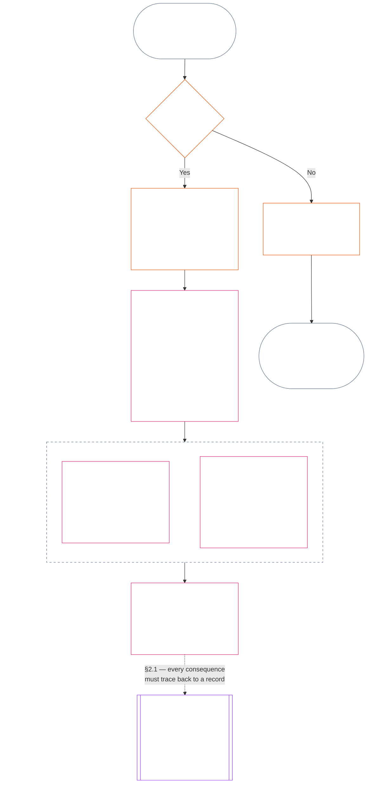
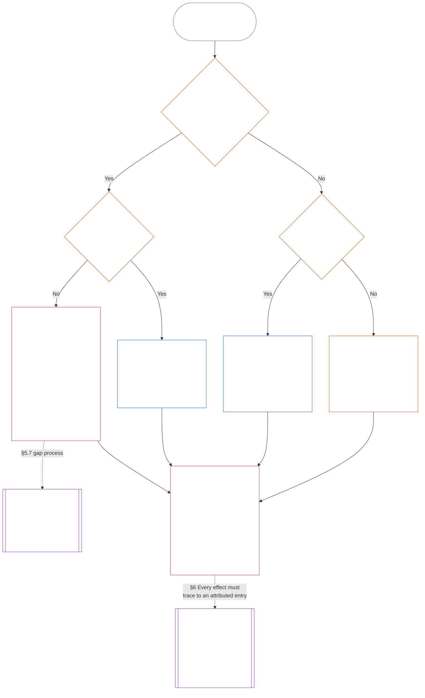

<!-- Brouillon intégral de traduction française du chapitre onze. Instantané source : commit 9c2c8c10c871d91157bcd27b9f56ad6a1cec90d3. Rédigé par IA, non révisé, brouillon non contraignant. -->

# CHAPITRE ONZE : DOSSIERS DE STATUT — QUESTION 1, QUE S’EST-IL PASSÉ ?

<strong>Place dans le corpus (non opératoire) : structure du fichier et règles de lecture</strong>

> Ce fichier fait **partie de la Constitution sentiente** et n’est **contraignant qu’avec** les autres fichiers `core_*` numérotés, lus comme un seul texte. Il contient le **chapitre onze** : les trois questions de la chaîne de statut et la **Question 1** (*que s’est-il passé ?*), dans les **§§1–6**. La **Question 2** (*quelle était l’ampleur du bien ou du mal ?*) reçoit sa réponse au [chapitre douze](core_12.000_standing_measurement.md#chapter-twelve-standing-measurement--question-2-how-good-or-bad-was-it). La Question 3 (*que se passe-t-il en conséquence ?*) se poursuit au [chapitre treize](core_13.000_standing_integration.md#chapter-thirteen-standing-effects-and-integration). L’examen au [chapitre quatorze](core_14.000_misconduct_designation.md#chapter-fourteen-anti-constitutional-misconduct) se limite à la désignation d’inconduite anticonstitutionnelle pour les constats admissibles de Violation Axis `s` = 7–9. L’ordre de lecture, la distinction entre textes contraignants et documents d’appui ainsi que les métadonnées de l’édition du corpus sont tenus à jour dans [README.md](README.md).

<strong>Guide de lecture (non opératoire) : place du chapitre onze et contenu traité ici</strong>

> | Question | Responsable et rôle |
> | --- | --- |
> | **1. Que s’est-il passé ?** | Chapitre onze (ce fichier) : établir les faits vérifiés dans un dossier de statut délimité et contestable. |
> | **2. Quelle était l’ampleur du bien ou du mal ?** | [Chapitre douze](core_12.000_standing_measurement.md#chapter-twelve-standing-measurement--question-2-how-good-or-bad-was-it) : mesurer les faits vérifiés sans fusionner aide et préjudice. |
> | **3. Que se passe-t-il en conséquence ?** | Poursuivre au [chapitre treize](core_13.000_standing_integration.md#chapter-thirteen-standing-effects-and-integration). |
>
> Les allégations, la popularité et les récits de différend ne répondent pas à la Question 1. Une évaluation souhaitée ne fournit pas les faits de la Question 1, et une conséquence souhaitée ne fournit pas l’évaluation de la Question 2.

<strong>Traçabilité</strong>

- En amont :
  - [Tétrade constitutionnelle](core_00.000_preamble.md#constitutional-tetrad) ;
  - [Deux fins constitutionnelles](core_00.000_preamble.md#two-constitutional-aims) ;
  - [enjeu matériel](core_00.000_preamble.md#material-stake) ;
  - [Préambule §6 Chaînes pratiques de processus clés](core_00.000_preamble.md#6-key-practical-process-pipelines) (*chaîne des chapitres neuf à quinze*).
- En amont :
  - [Chapitre un](core_01.010_stewardship_capacity_principles.md#chapter-01-principles-and-constraints) (1.010) (*administration responsable en matière d’accessibilité en langage clair, reflétée dans le glossaire de chaque section*) ;
  - [Chapitre un §16 — Administration responsable approfondie](core_01.010_stewardship_capacity_principles.md#16-stewardship-in-depth) (1.010 §16) (*fondement principiel du statut lié aux compétences et traçable — confiance, rôles et reconnaissance*) ;
  - [Chapitres deux à quatre](core_02.000_definition_structure.md) (*intégrité, dossiers et vérification*) ;
  - [Chapitre cinq](core_05.000_definitions_home.md#chapter-five-foundational-definitions) (5.000) (*définitions et primauté à lire avec les chapitres deux à quatre*).
- En amont : [Chapitre neuf](core_09.000_system_alignment_certification_evaluation.md#chapter-nine-system-alignment-certification) (9.000) (*certification de l’alignement du système*) ; [chapitre neuf, partie C §11](core_09.010_system_alignment_certification_record_recertification.md#11-relationship-to-standing) (9.010 §11) (*lien avec le statut — uniquement des données potentiellement vérifiées*).
- Chaîne de statut :
  - [Préambule §6.2 Fonctionnement de la chaîne complète](core_00.000_preamble.md#62-how-the-full-chain-fits-together) ;
  - [Chapitre onze — Dossiers de statut](core_11.000_standing_assessment.md#chapter-eleven-standing-records--question-1-what-happened) (11.000) (*cadre des trois questions et dossiers de la Question 1*) ;
  - [Chapitre douze — Mesure du statut](core_12.000_standing_measurement.md#chapter-twelve-standing-measurement--question-2-how-good-or-bad-was-it) (12.000) (*mesure de la Question 2*) ;
  - [Chapitre treize — Effets et intégration du statut](core_13.000_standing_integration.md#chapter-thirteen-standing-effects-and-integration) (13.000) (*effets et intégration de la Question 3*) ;
  - [Chapitre quatorze](core_14.000_misconduct_designation.md#chapter-fourteen-anti-constitutional-misconduct) (14.000) (*désignation uniquement pour les constats admissibles de Violation Axis s = 7–9*).
- Sous-sections de ce fichier :
  - [§1](#1-the-three-questions) (*cadre et portée des trois questions*) ;
  - [§2](#2-question-1--what-happened) (*Question 1 — faits et dossiers vérifiés*) ;
  - [§3](#3-question-1-event-type-guide--what-kind-of-help-or-harm-occurred) (*guide des types d’événements de la Question 1 — formes d’aide et de préjudice*) ;
  - [§4](#4-standing-record-operational-requirements) (*exigences de vérification et relatives aux dossiers*) ;
  - [§5](#5-record-custody-and-opening-authority) (*garde des dossiers et autorité d’ouverture*) ;
  - [§6](#6-handling-a-standing-record) (*traitement d’un dossier de statut*).
- En aval :
  - [Chapitre douze](core_12.000_standing_measurement.md#chapter-twelve-standing-measurement--question-2-how-good-or-bad-was-it) (12.000) (*Question 2 — référence LEQU, dimensions de mesure, descripteurs de voie, grammaire des positions, données constitutionnelles, échelle LEQU, mesures standard de contribution, exemples et passage à la Question 3*) ;
  - [Chapitre quatorze](core_14.000_misconduct_designation.md#chapter-fourteen-part-a-anti-constitutional-misconduct-designation) (14.000) (*désignation uniquement — ne rouvre pas la mesure de la Question 2*) ;
  - [Chapitre quinze](core_15.000_forum.md#chapter-fifteen-forums-and-jurisdiction) (15.000) (*supervision et orientation vers un forum*) ;
  - [Article XXVI-C](core_06.020_rights_part_e.md#article-xxvi-c-timely-resolution-and-anti-delay-floor) (*résolution en temps utile*) ;
  - [Article XX](core_06.015_rights_part_d.md#article-xx-a-justice-objective-and-scope) (*contraintes de justice*).
- À lire avec : [Chapitre cinq *État de statut, contribution et violation*](core_05.035_band_accountability.md#defa3-standing-state-contribution-and-violation) (5.035) (*orientation vers les définitions canoniques*).
- À lire avec : [README.md](README.md) (*ordre de lecture*) ; [doc_architecture.md](doc_architecture.md) (*cartes éditoriales non contraignantes sauf adoption*).

 

Le chapitre onze est le détenteur constitutionnel du **dossier factuel vérifié (Question 1)**. Il va du [§1 Les trois questions](#1-the-three-questions) au [§6 Traitement d’un dossier de statut](#6-handling-a-standing-record). Le [chapitre douze](core_12.000_standing_measurement.md#chapter-twelve-standing-measurement--question-2-how-good-or-bad-was-it) est responsable de la Question 2, de la [section 1 du chapitre douze Question 2 — quelle était l’ampleur du bien ou du mal ?](core_12.000_standing_measurement.md#1-question-2--how-good-or-bad-was-it) à la [section 9 du chapitre douze Passage à la Question 3 — liens de mesure entre les questions](core_12.000_standing_measurement.md#9-hand-off-to-question-3--cross-question-measurement-hooks). La Question 3 se poursuit au chapitre treize.

*En termes simples : ce chapitre consigne ce qui s’est passé et conserve le dossier de statut. Le chapitre douze mesure à quel point cela a été bénéfique ou préjudiciable, selon deux axes distincts, jamais selon un score net unique. Le simple dépôt d’une affaire ne constitue pas un statut.*

### 1. Les trois questions

*En termes simples : la position est déterminée en répondant à trois questions dans l’ordre. Ne déduisez pas les faits d’une évaluation souhaitée et ne choisissez pas une évaluation pour justifier une conséquence souhaitée.*

| Question | Ce que demande la question | Où trouver la réponse |
| --- | --- | --- |
| **1. Que s’est-il passé ?** | Quels faits sont vérifiés, au sujet de qui ou de quoi, sur quelle période, et avec quel registre de position et quel statut de contestation ? | [Section 2](#2-question-1--what-happened) et [Section 3](#3-question-1-event-type-guide--what-kind-of-help-or-harm-occurred) |
| **2. Dans quelle mesure était-ce bénéfique ou néfaste ?** | Quel type et quelle ampleur de contribution ou de violation ces faits établissent-ils ? | [Chapitre douze, section 1](core_12.000_standing_measurement.md#1-question-2--how-good-or-bad-was-it) |
| **3. Quelles en sont les conséquences ?** | Quelle reconnaissance, préparation, réparation, sauvegarde, restriction ou autre conséquence s’ensuit ? | [Chapitre treize](core_13.000_standing_integration.md#chapter-thirteen-standing-effects-and-integration) |

Chaque question dépend de la réponse à la précédente :

- La Question 1 fournit les faits vérifiés pour la Question 2.
- La Question 2 mesure ces faits pour la Question 3.
- La Question 3 ne doit pas réécrire les faits ni l’évaluation pour obtenir un résultat privilégié.

Ensemble, les réponses aux trois questions constituent l’évaluation complète de la position pour un événement délimité ou un schéma défini. Un sujet peut avoir plusieurs évaluations de ce type au fil du temps ; aucune ne constitue un score net ni une évaluation générale du sujet. Les registres de position de contribution et de violation conservent les réponses aux Questions 1 et 2 ; la décision de la Question 3 énonce les conséquences qui en découlent.

#### 1.1 Objet et champ d’application

Ce chapitre définit le cadre constitutionnel de consignation, et le [Chapitre douze](core_12.000_standing_measurement.md#chapter-twelve-standing-measurement--question-2-how-good-or-bad-was-it) le cadre de mesure, pour les **systèmes**, les **sentients** et les **institutions**, y compris tout système classé selon [**CS-9.305**](corpus_systems/cs_09.305_system_classification_machinery.md#cs-9305-part-a-system-classification-machinery) (*Mécanisme de classification des systèmes*). Ces cadres ne mesurent ni les ragots, ni la popularité, ni une réputation vague, ni la dignité inhérente, ni la valeur générale ; aucun de ces éléments ne peut faire l’objet d’une évaluation de position.

Le processus de position doit rester efficace lorsque :

- des contributions vérifiées antérieures sont trop anciennes pour démontrer une compétence ou une fiabilité actuelle ;
- des violations restent sans résolution ;
- la réparation est coûteuse ;
- la responsabilité franchit des frontières ; ou
- un acteur utilise des strates organisationnelles ou un changement d’appellation pour entraver la reddition de comptes.

Ces sujets relèvent des textes d’application adoptés :

- procédures quotidiennes ;
- étapes d’escalade ;
- opérations de restitution et de réparation ;
- mesures de reddition de comptes restaurative ; et
- conception des incitations.

La mesure prévue au Chapitre douze n’autorise **pas**, à elle seule, le recours à la force, la détention ou une autre restriction de liberté. Toute conséquence de ce type doit satisfaire de manière indépendante au Chapitre six, **Article XX** (*Justice après une violation vérifiée*), notamment à ses exigences de proportionnalité, de mesure la moins restrictive, de durée limitée, de restitution et de reddition de comptes restaurative.

<strong>Traçabilité · Définitions · Évaluation · Conformité</strong>

- En amont : [Chapitre un §16 — Gouvernance en profondeur](core_01.010_stewardship_capacity_principles.md#16-stewardship-in-depth) ; [Chapitres deux à quatre](core_02.000_definition_structure.md) ; [Chapitre cinq](core_05.000_definitions_home.md#chapter-five-foundational-definitions).
- En aval :
  - [§2](#2-question-1--what-happened) (*Question 1*) ;
  - [§4](#4-standing-record-operational-requirements) (*vérification et exigences relatives au registre*) ;
  - [§5](#5-record-custody-and-opening-authority) (*garde du registre et autorité d’ouverture*) ;
  - [§6](#6-handling-a-standing-record) (*gestion d’un registre de position*) ;
  - [Chapitre douze §1](core_12.000_standing_measurement.md#1-question-2--how-good-or-bad-was-it) (*mesure de la Question 2*) ;
  - [Chapitre douze §2](core_12.000_standing_measurement.md#2-magnitude-and-severity-input-dimensions) (*dimensions d’entrée de la mesure*) ;
  - [Chapitre douze §3](core_12.000_standing_measurement.md#3-route-descriptor-catalogs-and-measurement-roles) (*catalogues de descripteurs de voies*) ;
  - [Chapitre douze §4](core_12.000_standing_measurement.md#4-slot-grammar-and-shared-scaling) (*grammaire des cases et échelle commune*) ;
  - [Chapitre douze §5](core_12.000_standing_measurement.md#5-constitutional-inputs-to-axis-assignment) (*orientation selon les sources constitutionnelles*) ;
  - [Chapitre douze §6](core_12.000_standing_measurement.md#6-unified-proportional-lequ-scale--contribution-and-violation-axes) (*échelle LEQU proportionnelle unifiée pour les deux axes*) ;
  - [Chapitre treize](core_13.000_standing_integration.md#chapter-thirteen-standing-effects-and-integration) (*Question 3*).
- [Matérialité](core_05.050_band_oversight.md#materiality) · [O](core_05.050_band_oversight.md#materiality) · [M](core_05.050_band_oversight.md#materiality-determination-a) · [A](core_05.050_band_oversight.md#materiality-determination-a) · [C](core_05.050_band_oversight.md#materiality-determination-c)
- [Préjudice](core_05.035_band_accountability.md#harm) · [O](core_05.035_band_accountability.md#harm) · [M](core_05.035_band_accountability.md#harm-a) · [A](core_05.035_band_accountability.md#harm-a) · [C](core_05.035_band_accountability.md#harm-c)
- [Proportionnalité](core_05.035_band_accountability.md#proportionality) · [O](core_05.035_band_accountability.md#proportionality) · [M](core_05.035_band_accountability.md#proportionality-a) · [A](core_05.035_band_accountability.md#proportionality-a) · [C](core_05.035_band_accountability.md#proportionality-c)

### 2. Question 1 — que s’est-il passé ?

<strong>Traçabilité</strong>

- En amont : [§1](#1-the-three-questions) (*cadre des trois questions*) ; [Chapitres deux à quatre](core_02.000_definition_structure.md) (*consignation, vérification et traçabilité des définitions jusqu’aux résultats*).
- Branche(s) de la Tétrade : **participation** ; **supervision** (contestabilité et voies de contestation). Objectifs principaux : **Épanouissement** et **Continuité** (registres traçables préservant des constats distincts de contribution et de violation pour une mesure ultérieure).
- En aval :
  - [§2.2](#22-silence-is-the-default) (*le silence est la règle par défaut*) ;
  - [§2.3](#23-protected-dissent-is-not-a-trigger) (*la dissidence protégée n’est pas un déclencheur*) ;
  - [§2.4](#24-linked-standing-records-and-no-offset-bridge) (*pont de non-compensation entre registres liés*) ;
  - [§2.5](#25-verified-input-gate) (*filtre des éléments vérifiés*) ;
  - [§2.6](#26-stage-boundary) (*limite entre étapes*) ;
  - [§2.7](#27-forum-boundary) (*limite du forum*) ;
  - [§3](#3-question-1-event-type-guide--what-kind-of-help-or-harm-occurred) (*guide des types d’événement*) ;
  - [§4](#4-standing-record-operational-requirements) (*exigences relatives au registre*) ;
  - [§5](#5-record-custody-and-opening-authority) (*garde du registre et autorité d’ouverture*) ;
  - [§6](#6-handling-a-standing-record) (*gestion d’un registre de position*) ;
  - [Chapitre douze §1](core_12.000_standing_measurement.md#1-question-2--how-good-or-bad-was-it) (*mesure de la Question 2*) ;
  - [Chapitre douze §2](core_12.000_standing_measurement.md#2-magnitude-and-severity-input-dimensions) (*dimensions d’entrée de la mesure*) ;
  - [Chapitre douze §3](core_12.000_standing_measurement.md#3-route-descriptor-catalogs-and-measurement-roles) (*catalogues de descripteurs de voies*) ;
  - [Chapitre douze §4](core_12.000_standing_measurement.md#4-slot-grammar-and-shared-scaling) (*grammaire des cases et échelle commune*) ;
  - [Chapitre douze §5](core_12.000_standing_measurement.md#5-constitutional-inputs-to-axis-assignment) (*orientation selon les sources constitutionnelles*) ;
  - [Chapitre douze §6](core_12.000_standing_measurement.md#6-unified-proportional-lequ-scale--contribution-and-violation-axes) (*échelle LEQU proportionnelle unifiée pour les deux axes*) ;
  - [Chapitre treize](core_13.000_standing_integration.md#chapter-thirteen-standing-effects-and-integration) (13.000) (*Question 3*).

 

*En termes simples : la Question 1 établit un compte rendu délimité et contestable de ce qui s’est passé. Elle identifie le sujet, l’événement ou le schéma, la période, les faits vérifiés et le statut du registre avant toute évaluation ou conséquence. L’aide vérifiée et les violations vérifiées font l’objet de registres de position distincts afin que l’une n’efface pas les autres. Ces registres ne sont ni des scores de popularité ni des étiquettes vagues.*

Un **registre de position** est le registre délimité utilisé par ce chapitre pour un sujet, un champ fonctionnel, une période consignée, un statut de révision et un contexte décisionnel déterminés. Avant le début de la mesure, il doit établir :

- qui ou quoi est concerné par le registre de position ;
- s’il concerne un événement délimité ou un schéma défini ;
- quand et où la conduite et les effets pertinents se sont produits ;
- quels faits sont vérifiés et lesquels restent contestés ;
- quels éléments de preuve, quelle attribution et quelle voie de contestation étayent ces constats ; et
- le statut actuel de révision, de correction et de remplacement du registre de position.

Le diagramme suit un événement pour déterminer s’il déclenche un registre de position et ce que celui-ci consigne ; les sous-sections suivantes énoncent chaque règle. La branche « non » quitte le parcours principal vers la droite.

#### 2.1 Registres de position : types et sujets

La Question 1 utilise un **registre de position de contribution** pour l’aide vérifiée et un **registre de position de violation** pour le préjudice vérifié, y compris les manquements à la reddition de comptes. Un registre de position ne combine pas ces deux types de constats.

- Un registre de position peut concerner un sentient, une institution, un système, une évaluation, un événement délimité, un rôle, un collectif, un registre propre à un acteur ou toute autre unité pertinente sur le plan constitutionnel.
  - Il ne doit pas fondre des sujets, rôles, systèmes, communautés, périodes consignées, statuts de révision ou contextes décisionnels distincts dans une seule étiquette de position indifférenciée.
- Un registre de position peut couvrir un **événement délimité** — un épisode avec un début et une fin clairs — ou un **schéma** de conduite répétée.
  - Un schéma exige un sujet, un champ et une période de révision définis.
- Un même sujet peut avoir plusieurs registres de position au fil du temps, notamment des registres liés de position de contribution et de violation.
  - Les registres de position liés doivent se **renvoyer les uns aux autres** conformément à la **section 4.2** lorsqu’ils ont en commun le sujet, une période consignée qui se chevauche, un événement délimité, un schéma ou un contexte décisionnel.
- Un registre de position n’est ni un score de réputation autonome, ni un rang de dignité, ni un statut permanent, ni une étiquette de valeur générale, ni un tableau de scores combiné.
  - Les exigences opérationnelles figurent à la **section 4**.

Tout effet ultérieur sur la position relève du Chapitre treize et doit pouvoir être rattaché au ou aux registres de position pertinents sans devenir partie intégrante du registre lui-même.

#### 2.2 Le silence est la règle par défaut

L’absence de registre de position est l’état normal d’un sentient, d’une institution ou d’un système, et c’est l’état dans lequel la plupart des sentients resteront.

- Un registre de position n’est ouvert que lorsqu’un déclencheur a été vérifié conformément à la **section 4**. Une autorité d’ouverture de registre désignée doit approuver l’inscription, et un dépositaire distinct doit l’effectuer (**section 5**). Un registre de position n’est jamais ouvert :
  - pour établir une référence de base ;
  - pour compléter une liste ; ou
  - parce qu’un gardien désigné d’une voie d’accès le préférerait.
- L’absence de registre de position ne signifie rien. « Non évalué », « non vérifié » et « aucun registre au dossier » ne prouvent ni un risque, ni une faible contribution, ni quoi que ce soit d’autre. Nul ne peut invoquer l’absence de registre pour justifier une surveillance accrue, un seuil par défaut plus bas ou un accès conditionnel à une voie désignée.
- Aucune institution ni aucun système ne peut exiger un registre de position, une attestation d’« absence de registre » ou un consentement à son ouverture comme condition pour bénéficier :
  - des éléments essentiels de l’**Article III** (*Survie et accès essentiel*) ;
  - des protections de l’**Article III-C** (*Travail et plancher économique*) ;
  - du commerce ordinaire ; ou
  - de la participation en tant que partie concernée.
  Les seuils de compétence publiés pour des voies désignées spécifiques et sensibles à la confiance, prévus au [Chapitre treize §6.2 Seuils de compétence et habilitations](core_13.000_standing_integration.md#62-competency-bars-and-clearances), constituent l’exception ; ils doivent expliquer pourquoi la voie désignée est sensible à la confiance.
- Lorsqu’un registre de position concernant un sujet est ouvert, ce sujet doit en être informé, comme l’exige la **section 4**. La notification ne peut être différée que si un besoin documenté de [Préservation des preuves](core_05.050_band_oversight.md#evidence-preservation) ou de sécurité le justifie, et uniquement pour une période limitée et déterminée. La notification rend le registre de position contestable : un sujet qui ignore son existence ne peut pas le contester ni le corriger.

#### 2.3 La dissidence protégée n’est pas un déclencheur

La dissidence ou la protestation pacifique — y compris la [désobéissance civile non violente protégée](core_06.005_rights_part_b.md#xi-d-nonviolent-civil-disobedience) — au titre de l’**Article XI-D** (*Réunion, dissidence et protestation pacifique*) ([*plancher de dissidence et de protestation pacifique*](core_06.005_rights_part_b.md#xi-d-dissent-and-peaceful-protest)) ne constitue pas un déclencheur vérifié.

- Elle n’ouvre, ne prolonge et n’aggrave pas un registre de position de violation ; elle ne constitue pas un facteur de gravité au sens de la **section 8.2**, et sa répétition n’en fait pas un schéma.
- Une conduite distincte qui viole indépendamment un plancher constitutionnel est consignée selon ses propres termes, sans aggravation liée au point de vue, à la cause ou à la cible de la protestation.

#### 2.4 Registres de position liés et pont de non-compensation

<strong>Traçabilité</strong>

- En amont : [§2.1](#21-standing-records-kinds-and-subjects) (*registres distincts de contribution et de violation*).
- En aval :
  - [§2.5](#25-verified-input-gate) (*filtre des éléments vérifiés*) ;
  - [§2.7](#27-forum-boundary) (*limite du forum*) ;
  - [§4.2](#42-related-standing-record-cross-references) (*renvois croisés*) ;
  - [Chapitre douze §1](core_12.000_standing_measurement.md#1-question-2--how-good-or-bad-was-it) (*mesure de la Question 2*) ;
  - [Chapitre douze §2](core_12.000_standing_measurement.md#2-magnitude-and-severity-input-dimensions) (*dimensions d’entrée de la mesure*) ;
  - [Chapitre douze §3](core_12.000_standing_measurement.md#3-route-descriptor-catalogs-and-measurement-roles) (*catalogues de descripteurs de voies*) ;
  - [Chapitre douze §4](core_12.000_standing_measurement.md#4-slot-grammar-and-shared-scaling) (*grammaire des cases et échelle commune*) ;
  - [Chapitre douze §5](core_12.000_standing_measurement.md#5-constitutional-inputs-to-axis-assignment) (*orientation selon les sources constitutionnelles*) ;
  - [Chapitre douze §6](core_12.000_standing_measurement.md#6-unified-proportional-lequ-scale--contribution-and-violation-axes) (*échelle LEQU proportionnelle unifiée pour les deux axes*) ;
  - [Chapitre treize](core_13.000_standing_integration.md#chapter-thirteen-standing-effects-and-integration) (13.000) (*Question 3*).
- À lire avec : [Chapitre treize — Intégration de la position](core_13.000_standing_integration.md#2-automatic-integration-review-and-continuity) (13.000) (*intégration sans renonciation et des registres liés*) ; [Chapitre treize §6.2 — Seuils de compétence et habilitations](core_13.000_standing_integration.md#62-competency-bars-and-clearances) (13.000 §6.2) ; [Chapitre treize §4.2 — Verrous de position](core_13.000_standing_integration.md#42-prevention--general-standing-locks) (13.000 §4.2).

 

**Règle fondamentale :** les **registres de position de contribution** vérifiée et les **registres de position de violation** vérifiée sont conservés séparément conformément à la **section 2.1**. Chaque constat de contribution ou de violation doit reposer sur ses propres faits étayés dans son propre registre de position. L’analyse et les pièces justificatives doivent préserver la traçabilité distincte des deux voies de registre. Aucune inscription ni aucun ensemble de registres liés ne constitue un score net, un score fusionné ou un échange compensatoire.

- **Registres de position de violation et verrous de position :**
  - En vertu du Chapitre treize, les **verrous de position** applicables issus des registres de position de violation peuvent limiter la position, restreindre l’admissibilité à un rôle ou affecter l’accès à une réparation tant qu’une violation vérifiée n’est pas résolue.
  - Les verrous de position ne doivent pas effacer les contributions positives vérifiées consignées dans des registres de position de contribution.
  - Le simple passage du temps ne réduit pas le poids de violations vérifiées non résolues.
  - Les violations vérifiées ne doivent pas transformer des registres de position de contribution sans rapport en un faux dossier de réputation négative.
- **Registres de position de contribution et habilitations de compétence :**
  - Une contribution vérifiée peut étayer les **habilitations de compétence** applicables au regard des **seuils de compétence** publiés, ainsi que l’admissibilité liée à la confiance, à un rôle ou à une reconnaissance lorsqu’elle est actuelle et pertinente pour le rôle.
  - Une contribution vérifiée ne doit ni compenser, ni réduire par moyenne, ni excuser, ni requalifier un constat de violation vérifié.
  - La satisfaction d’un seuil ne dispense d’aucun verrou de position applicable.

**La seule exception :** si un constat de violation réfute en soi une contribution revendiquée — par exemple si les preuves montrent que la personne n’a pas réellement accompli ce qu’indique son registre de contribution —, le registre de position de contribution lié peut alors être corrigé ou supprimé au moyen de la procédure de preuve et de révision appropriée, avec le renvoi croisé exigé par la **section 4.2**. La violation n’efface toutefois pas automatiquement l’aide sans rapport consignée dans des registres distincts de position de contribution.

#### 2.5 Filtre des éléments vérifiés

Le filtre fonctionne comme suit :

- Toute décision affectant la position, la confiance, un rôle, une reconnaissance ou l’admissibilité à une reconnaissance ne peut utiliser que des éléments vérifiés issus des **registres de position de contribution** ou des **registres de position de violation** pertinents.
- Les allégations, réclamations non jugées, étiquettes provisoires d’orientation, récits limités à la réception initiale et autres éléments de la phase de litige ne suffisent pas, à eux seuls, à établir la nature d’une contribution ou d’une violation aux fins de la position.
- Un élément vérifié est un **constat de position** : un constat de contribution vérifié (Axe I) ou un constat de violation vérifié (Axe II).
- Les constats de contribution et de violation restent consignés dans des registres de position distincts (voir la **section 2.1**).

#### 2.6 Limite entre étapes

Les étapes d’un registre de position restent distinctes :

- La Question 1 consigne les faits vérifiés ; la Question 2 les mesure.
- Un registre de position peut être ouvert dès que sa base factuelle vérifiée est complète, même si la mesure de la Question 2 est encore en attente.
- Jusqu’à la mesure, les champs de la Question 2 doivent indiquer qu’elle est en attente au lieu de suggérer une case ou une catégorie.
- Le registre de position ne doit pas énoncer ni appliquer un **effet de position** de la Question 3.

#### 2.7 Limite du forum

*En termes simples : les forums supervisent les litiges, permettent leur contestation et les transforment en résultats vérifiés ; toutefois, déposer une affaire ou gagner une bataille de récits ne met pas à jour la position. Le filtre des éléments vérifiés de la **section 2.5** reste applicable. Lorsqu’un forum vérifie les faits conformément aux Chapitres deux à quatre, il peut **ouvrir, mettre à jour ou corriger** un registre de position, ou **écarter un registre erroné après contestation**. Les forums ne fusionnent pas le positif et le négatif en un seul score et n’inventent pas eux-mêmes la catégorie de position.*

Cette section porte sur une question : comment le travail d’un forum rejoint un registre de position. Les autres étapes de la chaîne relèvent des responsables indiqués ici, et la chaîne suit cet ordre :

1. Un litige est déposé et le forum tient un **dossier d’affaire du forum**, qui n’est pas un registre de position. Responsable : [Chapitre quinze §2.3 Dossiers d’affaires des forums, registres de position et contestations](core_15.000_forum.md#23-forum-case-records-standing-records-and-contests) ; voir aussi [§2.7.1 Dossier d’affaire du forum](#271-forum-case-record).
2. Le forum vérifie les faits conformément aux [Chapitres deux à quatre](core_02.000_definition_structure.md).
3. Les constats vérifiés passent par le filtre des éléments vérifiés. Responsable : [§2.5 Filtre des éléments vérifiés](#25-verified-input-gate).
4. Une autorité d’ouverture de registre désignée, qui peut être un forum, ouvre, met à jour ou corrige le registre de position, ou écarte un registre erroné après contestation. Responsables : [§4.1 Contenu minimal du registre](#41-minimum-record-contents) pour le contenu du registre de position et [§5 Garde du registre et autorité d’ouverture](#5-record-custody-and-opening-authority) pour les personnes habilitées à agir.
5. Le registre de position ne contient que des faits vérifiés, que la Question 2 mesure ensuite. Responsables : [§2.6 Limite entre étapes](#26-stage-boundary) et [Chapitre douze §1 Question 2 — dans quelle mesure était-ce bénéfique ou néfaste ?](core_12.000_standing_measurement.md#1-question-2--how-good-or-bad-was-it).
6. Le cas échéant, un effet de position s’ensuit en vertu du [Chapitre treize](core_13.000_standing_integration.md#chapter-thirteen-standing-effects-and-integration), qui régit les effets de position.

Les familles de forums prévues au [Chapitre quinze](core_15.000_forum.md#chapter-fifteen-forums-and-jurisdiction) **supervisent** la manière dont les litiges concrets suivent le processus de position. Les forums fournissent ce qui suit, conformément au [Chapitre quinze §6 Résolution rapide, niveaux de matérialité et discipline anti-retard](core_15.000_forum.md#6-timely-resolution-materiality-tiers-and-anti-delay-discipline) et à l’[Article XXVI-C](core_06.020_rights_part_e.md#article-xxvi-c-timely-resolution-and-anti-delay-floor) (*Résolution rapide et plancher anti-retard*) :

- une contestation accessible ;
- une révision indépendante ;
- un soutien forensique ;
- le séquençage des mesures correctives ; et
- des délais par niveau.

Lorsque ces constats du forum satisfont au filtre des éléments vérifiés prévu aux Chapitres deux à quatre, ils peuvent :

- **ouvrir, mettre à jour ou corriger** des registres de position conformément à la **section 4.1** ; ou
- **écarter un registre erroné après contestation**.

##### 2.7.1 Dossier d’affaire du forum

Le propre dossier du forum relatif à un litige ouvert est le [**dossier d’affaire du forum**](core_05.035_band_accountability.md#forum-case-record), défini au [Chapitre quinze §2.3 Dossiers d’affaires des forums, registres de position et contestations](core_15.000_forum.md#23-forum-case-records-standing-records-and-contests). Ce **n’est pas** un registre de position.

##### 2.7.2 Constats du forum et mesure de la Question 2

Les constats factuels vérifiés d’un forum peuvent fournir la base factuelle d’un registre de position de la Question 1. Ils ne déterminent **pas** la mesure de la Question 2, c’est-à-dire dans quelle mesure la contribution ou la violation vérifiée était bénéfique ou néfaste ([§2.6 Limite entre étapes](#26-stage-boundary)). En conséquence :

- Les procédures du forum ne doivent **pas** fusionner les éléments de contribution et de violation en un score net, une réponse combinée sur le fond ou une étiquette de position indifférenciée ; les registres de position liés restent distincts conformément à [§2.1 Registres de position : types et sujets](#21-standing-records-kinds-and-subjects) et à [§2.4 Registres de position liés et pont de non-compensation](#24-linked-standing-records-and-no-offset-bridge).
- Les résultats du forum ne doivent **pas** substituer des récits de litige, la commodité d’orientation ou la préférence du groupe aux éléments vérifiables ([§2.5 Filtre des éléments vérifiés](#25-verified-input-gate)), à une mesure distincte ([Chapitre douze §1 Question 2 — dans quelle mesure était-ce bénéfique ou néfaste ?](core_12.000_standing_measurement.md#1-question-2--how-good-or-bad-was-it)) ou aux mécanismes d’effets de position relevant du [Chapitre treize](core_13.000_standing_integration.md#chapter-thirteen-standing-effects-and-integration).

##### 2.7.3 Ce que la limite du forum ne réduit pas

Cette limite ne réduit **pas** la contestation, la réparation, les mesures provisoires ou les garanties procédurales exigées par :

- [Article XIII-A](core_06.010_rights_part_c.md#article-xiii-a-reliability-and-trustworthiness-baseline) (*Socle de fiabilité et de confiance*) ;
- [Article XIII-B](core_06.010_rights_part_c.md#article-xiii-b-right-to-redress-and-remedy) (*Droit à réparation et à recours*) ;
- [Chapitre quinze §6 Résolution rapide, niveaux de matérialité et discipline anti-retard](core_15.000_forum.md#6-timely-resolution-materiality-tiers-and-anti-delay-discipline) ;
- [Article XXVI-C](core_06.020_rights_part_e.md#article-xxvi-c-timely-resolution-and-anti-delay-floor) (*Résolution rapide et plancher anti-retard*) ; ou
- les articles de justice connexes.

Elle exige que les constats vérifiés du forum entrent dans le processus de position par le même filtre que les autres éléments vérifiés — et non en le contournant.

### 3. Guide des types d’événement de la Question 1 — quel type d’aide ou de préjudice s’est produit ?

*En termes simples : utilisez ces tableaux pour décrire ce qui s’est passé une fois les faits vérifiés. Ils aident à identifier le type de contribution ou de violation concerné. Ils ne déterminent ni dans quelle mesure il était bénéfique ou néfaste, ni la case à attribuer, ni les conséquences à en tirer.*

#### 3.1 Types d’événement de contribution

**Règle de qualification :** Une contribution revendiquée ne compte que si elle est traçable, non externalisée et conforme à la Constitution opérante dans son ensemble.

- Les préjudices externalisés, les dépendances coercitives, la réduction du Plancher de droits ou les charges dissimulées peuvent disqualifier ou limiter la contribution revendiquée.
- Une contribution revendiquée ne compense pas un constat distinct de violation.

Chaque ligne du tableau ci-dessous nomme une voie courante d’aide vérifiée et sa pertinence constitutionnelle. Plusieurs lignes peuvent s’appliquer au même registre de position.

| Type de contribution vérifiée | Ce qui s’est passé | Branche(s) de la Tétrade | Objectif(s) principal(aux) |
| --- | --- | --- | --- |
| Survie et entretien corporel | Une personne a reçu de la nourriture, un abri, des soins médicaux ou une protection | **Participation**, **Supervision** | **Épanouissement** |
| Soins et enseignement | Des enfants ont été élevés, des personnes âgées ont été prises en charge ou d’autres personnes ont été formées | **Participation**, **Supervision** | **Épanouissement**, **Continuité** |
| Résolution du traumatisme | Une personne a reçu de l’aide pour se remettre d’un préjudice psychologique qui entravait son bien-être | **Participation**, **Reddition de comptes** | **Épanouissement** |
| Suppression de charges graves | Des dettes écrasantes, des conditions de travail abusives ou des obstacles systémiques ont été supprimés | **Participation**, **Supervision** | **Épanouissement** |
| Rétablissement de la capacité d’agir | Une personne a obtenu des choix significatifs concernant sa propre vie | **Participation** | **Épanouissement** |
| Extension de la capacité productive | Des outils, des infrastructures ou des possibilités ont permis à d’autres de prospérer de manière autonome | **Participation**, **Supervision** | **Épanouissement**, **Continuité** |
| Amélioration de l’efficacité temporelle | Des attentes évitables, des frictions administratives ou des coûts de coordination ont été réduits, libérant du temps utilisable pour les soins, le repos, la capacité d’agir, l’apprentissage ou un travail conforme aux droits | **Participation**, **Supervision** | **Épanouissement** |
| Réduction des risques écologiques ou d’infrastructure | Un effondrement environnemental ou une défaillance de système critique a été évité | **Supervision**, **Reddition de comptes** | **Continuité**, **Épanouissement** |
| Réduction de l’empreinte écologique | L’utilisation des ressources, les émissions ou les besoins en terres et en eau ont été réduits de manière vérifiable sans transférer la charge à d’autres personnes ou aux écosystèmes | **Supervision**, **Reddition de comptes** | **Continuité**, **Épanouissement** |
| Restauration des écosystèmes | Des terres, des eaux ou des habitats dégradés ont été restaurés vers un état fonctionnel et autonome | **Supervision**, **Reddition de comptes** | **Continuité**, **Épanouissement** |
| Protection des espèces menacées | Des espèces menacées d’extinction, ou les habitats dont elles dépendent, ont été protégés contre la perte | **Supervision**, **Reddition de comptes** | **Continuité**, **Épanouissement** |
| Réduction de la pollution et des déchets | La contamination, les émissions nocives ou les déchets ont été évités, éliminés ou gérés en toute sécurité | **Supervision**, **Reddition de comptes** | **Épanouissement**, **Continuité** |
| Renforcement de la sécurité, de la vérité, de l’auditabilité ou de la capacité de contestation | Des institutions ou des pratiques ont été mises en place ou réparées afin de protéger les droits et de demander des comptes au pouvoir | **Participation**, **Supervision**, **Reddition de comptes** | **Épanouissement**, **Continuité** |

#### 3.2 Types d’événement de violation

**Règle de qualification :** Un type d’événement de violation exige un constat de violation vérifié qui demeure traçable, délimité, auditable et contestable conformément aux **Chapitres deux à quatre**.

- Les allégations, étiquettes provisoires, récits du forum et étiquettes de réception initiale peuvent faciliter l’orientation ou le triage, mais ne complètent pas la Question 1.
- Une contribution positive ne compense, n’excuse, n’annule ni ne requalifie une violation vérifiée.

Chaque ligne du tableau ci-dessous nomme une voie courante de perte, de danger ou de manquement à une obligation vérifiée et sa pertinence constitutionnelle. Plusieurs lignes peuvent s’appliquer au même registre de position.

| Type de perte ou de danger vérifié | Ce qui s’est passé | Branche(s) de la Tétrade | Objectif(s) principal(aux) |
| --- | --- | --- | --- |
| Privation de survie ou d’entretien corporel | Un décès évitable, un refus de soins, des conditions dangereuses ou une privation matérielle de survie s’est produit | **Reddition de comptes**, **Participation** | **Épanouissement** |
| Charge grave évitable | Des charges écrasantes, imposées ou systématiquement transférées ont matériellement nui au bien-être ou à la capacité d’agir | **Reddition de comptes**, **Participation** | **Épanouissement** |
| Perte coercitive de la capacité d’agir | Il y a eu coercition, manipulation, menace crédible, confinement ou danger pour la liberté | **Reddition de comptes**, **Participation** | **Épanouissement** |
| Atteinte au Plancher de droits | Des planchers constitutionnels non négociables, la suprématie constitutionnelle ou l’accès à la contestation et aux réparations ont été matériellement violés | **Reddition de comptes**, **Supervision** | **Épanouissement**, **Continuité** |
| Dommage écologique ou d’infrastructure | Des conditions nécessaires au bien-être constitutionnel ont été endommagées | **Reddition de comptes**, **Supervision** | **Continuité**, **Épanouissement** |
| Préjudice lié à la pollution ou aux déchets | La contamination, les émissions nocives ou les déchets ont nui à l’air, à l’eau, au sol ou à la santé | **Reddition de comptes**, **Supervision** | **Épanouissement**, **Continuité** |
| Destruction d’espèces ou d’habitats | Des espèces menacées d’extinction, ou les habitats dont elles dépendent, ont été détruits, fragmentés ou poussés vers la disparition, y compris une perte considérée comme compensable | **Reddition de comptes**, **Supervision** | **Continuité**, **Épanouissement** |
| Perte de la capacité de rétablissement écologique | La capacité d’un écosystème à se régénérer après un préjudice a été supprimée ou rendue inutilement difficile, voire impossible à restaurer | **Reddition de comptes**, **Supervision** | **Continuité**, **Épanouissement** |
| Préjudice écologique externalisé ou épuisement | Des coûts écologiques ont été transférés à d’autres personnes ou aux écosystèmes, des ressources ont été épuisées au-delà de leur régénération, ou une affirmation relative à l’empreinte ou à la durabilité a dissimulé une détérioration persistante | **Reddition de comptes**, **Supervision** | **Continuité**, **Épanouissement** |
| Destruction de la capacité productive | Des outils, capacités, relations ou ressources nécessaires à une prospérité autonome ont été supprimés | **Reddition de comptes** | **Épanouissement** |
| Dégradation de la sécurité, de la vérité ou de l’auditabilité | Il y a eu dissimulation, désinformation, registres défectueux, voies de contestation inaccessibles ou agrégation impossible à réexaminer | **Supervision**, **Reddition de comptes** | **Épanouissement**, **Continuité** |
| Obstruction de la reddition de comptes | Une interférence vérifiée avec les mécanismes d’obligation de répondre — intégrité des preuves, vérification, procédure du forum, registres de position, délais de réparation ou voies de contestation et de recours — s’est produite ; lorsque l’obstruction constitue une attaque indirecte contre un préjudice sous-jacent distinct, ouvrir un registre de position de violation distinct et lié | **Reddition de comptes**, **Supervision**, **Rapidité** | **Épanouissement**, **Continuité** |
| Capture du système ou abus de dépendance | Une facilitation structurelle, un abus d’asymétrie de dépendance, une conception anti-contournement ou une capture des voies de reddition de comptes s’est produite | **Reddition de comptes**, **Participation** | **Continuité**, **Épanouissement** |

### 4. Exigences de vérification et de consignation

<strong>Traçabilité</strong>

- En amont : [§2](#2-question-1--what-happened) (*registres de la Question 1 et guide des types d’événement*) ; [Chapitres deux à quatre](core_02.000_definition_structure.md) (*consignation, vérification et traçabilité des définitions jusqu’aux résultats*).
- En aval :
  - [§4.1](#41-minimum-record-contents) (*contenu minimal*) ;
  - [§4.2](#42-related-standing-record-cross-references) (*renvois croisés*) ;
  - [§5](#5-record-custody-and-opening-authority) (*garde du registre et autorité d’ouverture*) ;
  - [§6](#6-handling-a-standing-record) (*gestion d’un registre de position*) ;
  - [Chapitre douze §1](core_12.000_standing_measurement.md#1-question-2--how-good-or-bad-was-it) (*Question 2*).
- À lire avec : [CF-15.415 §8 Autorité en matière d’informations restreintes](corpus_forum/cf_15.415_routing_operations_transfer_certification_representative_treatment.md#cf-15415-8-restricted-information-authority) (*premier recours en cas de différend sur une limite de divulgation énoncée au titre de [§4.1](#41-minimum-record-contents)*).

 

*En termes simples : cette section précise ce que chaque registre de position doit contenir, comment les registres liés se renvoient les uns aux autres et comment ils sont versionnés. La [§5 Garde du registre et autorité d’ouverture](#5-record-custody-and-opening-authority) indique qui peut ouvrir et conserver un registre de position, ainsi que la manière de le contester ou de le corriger. Les mesures de la Question 2 ne peuvent être ajoutées qu’après consignation du fondement factuel vérifié.*

Le niveau de détail requis pour les preuves et les registres peut augmenter selon l’importance matérielle et la classe du système. Cette adaptation n’exclut aucun sentient, aucune institution ni aucun système couvert du processus de position.

#### 4.1 Contenu minimal du registre

Un registre de position contient les champs ci-dessous, et les deux dernières sous-sections ajoutent des champs propres à chaque axe. Le filtre des éléments vérifiés, qui détermine ce qui peut alimenter un registre de position, est énoncé à la [§2.5 Filtre des éléments vérifiés](#25-verified-input-gate). La règle séparant les faits de la Question 1 de la mesure de la Question 2 est énoncée à la [§2.6 Limite entre étapes](#26-stage-boundary).

##### 4.1.1 Champs obligatoires de tout registre de position

Tout registre de position doit comprendre au minimum :

- le type de registre de position — **registre de position de contribution** ou **registre de position de violation** ;
- qui ou quoi est évalué et le champ de l’évaluation, y compris les limites pertinentes du système, les limites de rôle, les communautés concernées et les relations de dépendance ;
- la conduite ou le constat évalué, notamment les actes, omissions, devoirs, effets, événement délimité, schéma compris dans le champ, registre de contribution ou constat de violation sur lequel repose le registre de position ;
- la période consignée et le statut actuel de révision — par exemple provisoire, définitif pour un objectif indiqué, contesté, remplacé ou en attente d’une réévaluation programmée ;
- tout registre de position lié auquel il est renvoyé conformément à la **section 4.2** ;
- les dossiers officiels, témoignages, mesures, audits, décisions de forum ou autres éléments de vérification qui rendent le registre de position démontrable, révisable et contestable selon les Chapitres deux à quatre ;
- l’**autorité d’ouverture du registre** qui a vérifié le fondement factuel et autorisé l’inscription, et le **dépositaire du registre** distinct qui a consigné et conserve le registre de position, chacun étant nommé conformément à la **section 5** ;
- les modalités de contestation du registre de position, notamment :
  - le forum ou l’autorité chargé de l’examiner ;
  - les limites de divulgation éventuelles ; et
  - les conditions de :
    - correction ;
    - rétablissement ;
    - expiration ; ou
    - révision programmée ;
- les champs de mesure de la Question 2 propres à chaque axe, exigés ci-dessous, une fois la mesure effectuée.

##### 4.1.2 Action attribuable et inspectable

Les preuves d’actions attribuables se rapportent au registre de position comme suit :

- Pour le personnel ou les agents exerçant une Administration de systèmes critiques ou une autorité opérationnelle importante, [CS-16.305 §10 Action attribuable et inspectable](corpus_systems/cs_16.305_critical_system_stewardship.md#cs-16305-103-inspectable-attributable-action) définit des preuves reconstructibles d’actions attribuables comme contrat d’enregistrement par défaut pour les équipes mixtes.
- Ces preuves peuvent alimenter le présent registre de position.
- Elles ne remplacent pas le présent registre de position.
- Un registre de position ne comprend ni les poids d’un modèle d’IA (les nombres internes du modèle) ni son raisonnement privé. L’unique exception est le cas où il ne reste aucun autre moyen d’établir qui ou quoi était responsable.
- Une question ne sort pas du champ de la mesure de position simplement parce qu’elle concerne la vie privée d’une personne ou l’état interne protégé d’un système. Elle reste mesurée lorsqu’elle est pertinente pour une question de position.

##### 4.1.3 Aucune exception au titre de la vie privée ou de l’opacité

La vie privée, la confidentialité ou l’opacité des éléments internes d’un système ne dispense pas une question de la mesure de position. Lorsque ces considérations entrent en conflit avec l’exigence d’un registre vérifié, le conflit est résolu conformément aux [Principes fondamentaux d’arbitrage du Chapitre un §13.1](core_01.005_interaction_interpretation.md#131-core-tradeoff-principles) et à sa discipline de consignation des décisions, tout en préservant l’accès des réviseurs indépendants.

##### 4.1.4 Champs supplémentaires des registres de position de contribution

Les **registres de position de contribution** doivent également indiquer :

- la mesure de contribution de la Question 2, notamment :
  - la bande principale ;
  - la case `s`, lorsqu’elle est attribuée (voir [Chapitre douze §4 Grammaire des cases et échelle commune](core_12.000_standing_measurement.md#4-slot-grammar-and-shared-scaling)) ;
  - le fondement probatoire ;
  - le raisonnement relatif à la matérialité ; et
  - toute calibration LEQU ou comparable adoptée et utilisée pour apporter un appui transparent ;
- lorsque la contribution est partagée, la répartition du crédit, en tenant compte :
  - du temps ;
  - des efforts ;
  - de la coordination ;
  - de la maintenance ;
  - de la contribution causale ; et
  - du travail de soutien moins visible ;
- la mesure de contribution consignée ici, sur laquelle doit reposer tout effet de position ultérieur au titre du Chapitre treize.

##### 4.1.5 Champs supplémentaires des registres de position de violation

Les **registres de position de violation** doivent également indiquer :

- la mesure de violation de la Question 2, notamment :
  - l’autorité ayant établi le constat ou le fondement du registre ;
  - l’impact LEQU ;
  - la case `s`, lorsqu’elle est attribuée (voir [Chapitre douze §4 Grammaire des cases et échelle commune](core_12.000_standing_measurement.md#4-slot-grammar-and-shared-scaling)) ;
  - le caractère du processus ou de la réponse, le cas échéant ; et
  - tout statut de désignation au titre du Chapitre quatorze ;
- lorsque plusieurs acteurs partagent ou se répartissent la responsabilité d’une violation, les motifs vérifiés de toute position défavorable consignée à l’encontre d’un acteur précis, notamment :
  - le rôle causal ;
  - le devoir ;
  - l’autorité ;
  - le contrôle ;
  - la prévisibilité ;
  - le bénéfice ;
  - la dissimulation ; ou
  - la capacité de prévention réalisable ;
- lorsque le constat de violation concerne une omission de divulgation devant un forum ou un manquement intentionnel au processus de récusation (pour les règles de mesure, lire la **§8.2.2** (*Consignation de la manière dont un préjudice a été causé*)) :
  - le fondement vérifié de l’omission ou du manquement ;
  - le devoir de divulgation ou de récusation non respecté ;
  - la connaissance, l’imprudence ou l’intention de l’acteur, lorsqu’elles ont été établies ; et
  - si la conduite a matériellement affecté :
    - la légalité du panel ;
    - l’indépendance ;
    - la contestation de la récusation ;
    - l’intégrité des preuves ;
    - le délai de réparation ;
    - l’orientation de remplacement ; ou
    - la possibilité pratique de contester ;
- la mesure de violation consignée ici, sur laquelle doit reposer tout effet de position ultérieur au titre du Chapitre treize.

#### 4.2 Renvois croisés entre registres de position liés

Si un registre de position de contribution et un registre de position de violation concernent le même sujet, se chevauchent dans le temps ou portent sur le même événement, schéma ou décision, chacun doit renvoyer à l’autre.

Chaque renvoi croisé doit identifier au minimum :

- le registre de position lié et s’il s’agit d’un registre de contribution ou de violation ;
- la raison du lien entre les deux registres de position, notamment lorsqu’un constat de violation réfute, corrige ou limite une contribution revendiquée conformément à la **section 2.4** ;
- leur élément commun : le sujet, l’événement, le schéma ou la décision ; et
- le chevauchement de leurs périodes ou des questions qu’ils couvrent.

Les renvois croisés :

- doivent rester auditables et contestables ;
- ne doivent pas remplacer une mesure distincte ;
- ne doivent pas créer de score fusionné ; et
- ne doivent pas laisser croire que les deux registres de position couvrent les mêmes questions ou périodes lorsque ce n’est pas le cas.

#### 4.3 Registres collectifs et propres à chaque acteur

Lorsque plusieurs sentients ou entités partagent le même bénéfice ou la même violation, le système peut conserver à la fois un registre de position collectif et des registres distincts propres à chaque acteur. Les règles suivantes s’appliquent :

- Les constats de contribution et de violation doivent rester dans des registres de position distincts conformément à la **section 2.1**.
- Pour un crédit partagé, la reconnaissance devrait correspondre à la contribution réelle de chaque sentient, en tenant compte :
  - du rôle ;
  - du temps ;
  - des efforts ;
  - du risque ;
  - de la compétence ;
  - de la coordination ;
  - de la maintenance ; et
  - de l’impact causal.
- Lorsque de nombreux sentients ont apporté leur aide et que les parts individuelles ne peuvent être nettement séparées, une large répartition est privilégiée.
- En cas de violations partagées, la culpabilité ne doit pas être attribuée sur le seul fondement de l’appartenance à un groupe.
- Toute position défavorable propre à un acteur exige un lien vérifié avec :
  - le rôle causal ;
  - le devoir ;
  - l’autorité ;
  - le contrôle ;
  - la prévisibilité ;
  - le bénéfice ;
  - la dissimulation ; ou
  - la capacité de prévention réalisable.

#### 4.4 Gestion des versions

Les registres de position doivent être versionnés lorsque l’un des éléments suivants change :

- faits importants ;
- constats ;
- résultats de révision ;
- état des mesures correctives ;
- preuves de contribution ;
- calibration de mise en œuvre ; ou
- règles constitutionnelles.

Une version ultérieure peut :

- mettre à jour le registre de position pour l’avenir ;
- le corriger rétroactivement s’il était erroné ;
- le faire expirer pour un contexte décisionnel terminé ; ou
- le remplacer pour un nouveau contexte décisionnel.

La version ultérieure doit conserver la piste d’audit antérieure et expliquer ce qui a changé, qui a effectué le changement, sous quelle autorité d’ouverture ou de garde conformément à la **section 5**, sur la base de quels éléments de vérification et à la demande de qui.

#### 4.5 Outils de mise en œuvre

Les équipes peuvent élaborer des outils pratiques pour les registres de position, notamment :

- champs de données ;
- balises ;
- seuils ;
- formulaires ;
- tableaux de bord ;
- étapes de révision ; et
- **mesures standard de contribution** publiées pour les tâches récurrentes conformément à la **section 13**.

Ces outils doivent rendre distincts, visibles et contestables les champs exigés par la **section 4.1**. Ils ne doivent pas dissimuler ces champs dans un score opaque ou une étiquette cachée.

### 5. Garde des dossiers et autorité d’ouverture

<strong>Traçabilité</strong>

- En amont :
  - [Chapitre huit §2 *Exigence constitutionnelle de quatre sièges*](core_08.000_functional_independence_separation_of_duties.md#2-four-seat-constitutional-requirement) (8.000 §2) (*exigence de niveau principiel que cette section applique aux dossiers de statut et ne peut restreindre*) ;
  - [Chapitre un §19.3 *Détection pluraliste et examen*](core_01.010_stewardship_capacity_principles.md#193-misalignment-detection) (1.010 §19.3) ;
  - [§2.2](#22-silence-is-the-default) (*déclencheur vérifié ; notification au sujet*) ;
  - [§4.1](#41-minimum-record-contents) (*contenu minimal*) ;
  - [§4.4](#44-versioning) (*gestion des versions*) ;
  - [§2.7](#27-forum-boundary) (*les forums peuvent ouvrir, actualiser, corriger ou annuler*) ;
  - [Chapitres deux à quatre](core_02.000_definition_structure.md) (*dossier, vérification et traçabilité*) ;
  - [Préservation des éléments de preuve](core_05.050_band_oversight.md#evidence-preservation) (*chaîne de garde des éléments de preuve*).
- Pilier(s) de la Tétrade : **reddition de comptes** (un acteur nommé répond de chaque inscription) ; **supervision** (aucune partie ne vérifie sa propre affirmation). Fins principales : **Épanouissement** et **Continuité**.
- À lire avec :
  - [Chapitre cinq *Charte de système*](core_05.040_band_continuity.md#system-charter) (5.040) et
  - [*Charte institutionnelle*](core_05.040_band_continuity.md#institutional-charter) (*documents de portée publiés dont la Carte des rôles de la Charte désigne l’autorité d’ouverture et le gardien du dossier pour une portée sous charte*) ;
  - [Chapitre sept §4 *Carte des rôles de la Charte et garde du dossier de statut*](core_07.000_charters.md#4-the-charter-role-map-and-standing-record-custody) (7.000 §4) ;
  - **CI-8.205 §6** (*Contenu des chartes de système et institutionnelles, examen et modèle de formation*) — champ relatif à la garde du dossier de statut ;
  - [**CJS-5.125 §11** *Voie constitutionnelle et séparation fonctionnelle*](corpus_joint_structure/cjs_05.125_accountability_operations.md#constitutional-lane-and-functional-separation) (*les cinq voies auxquelles les tâches relatives aux dossiers sont affectées ; séparation des tâches*) ;
  - **CI-8.205 §2** (*Voies de séparation fonctionnelle — carte publiée des voies, règle de repli lorsqu’une Charte de système ou institutionnelle est muette*) ;
  - **CI-8.205 §3** (*chaîne d’autorité et contrôles de délégation*) ;
  - **CI-16.205 §6** (*Catalogue des sièges — archétypes de rôle procédural et limites opérationnelles*) — les quatre sièges du dossier comme types de sièges 1–4, avec la règle du siège inapproprié ;
  - **CF-15.435 §6** (*absence d’auto-enquête*) et
  - **CF-15.435 §8** (*Dossiers, renvois et voies de secours*) pour le transfert des constats vérifiés ;
  - [Chapitre quinze §2.1](core_15.000_forum.md#21-lead-default-limits) (15.000 §2.1) (*voie de secours contre l’auto-jugement*) ;
  - [CS-16.305 §10 action inspectable et attribuable](corpus_systems/cs_16.305_critical_system_stewardship.md#cs-16305-103-inspectable-attributable-action) (*qui a autorisé ; le journal n’est pas le dossier de statut*) ;
  - [Chapitre un §17.5](core_01.010_stewardship_capacity_principles.md#175-duty-to-resist) (1.010 §17.5) (*arrêter, refuser, documenter, signaler à un échelon supérieur*).
- En aval : [§6](#6-handling-a-standing-record) (*ce que font les détenteurs d’un dossier de statut une fois la garde réglée*) ; [chapitre douze §1](core_12.000_standing_measurement.md#1-question-2--how-good-or-bad-was-it) (*la Question 2 mesure uniquement les dossiers de statut inscrits en vertu de la présente section et du §6*) ; [chapitre treize](core_13.000_standing_integration.md#chapter-thirteen-standing-effects-and-integration) (13.000) (*les effets de la Question 3 sont rattachés à une inscription attribuée*).

 

*En termes simples : cette section applique aux dossiers de statut la règle des quatre sièges du [chapitre huit §2 Exigence constitutionnelle de quatre sièges](core_08.000_functional_independence_separation_of_duties.md#2-four-seat-constitutional-requirement). Demander une modification, vérifier les faits, rédiger et détenir le dossier de statut, puis entendre une contestation sont des tâches distinctes. Le service qui vérifie un dossier de statut ne l’inscrit jamais et n’en entend jamais la contestation ([§5.1 Séparation des tâches](#51-separation-of-duties)). La Charte de système ou la Charte institutionnelle désigne les titulaires de chaque siège au moyen de la Carte des rôles de la Charte figurant au [chapitre sept §4 Carte des rôles de la Charte et garde du dossier de statut](core_07.000_charters.md#4-the-charter-role-map-and-standing-record-custody). La présente section ajoute les règles propres aux dossiers de statut : les personnes exclues de la garde ([§5.4 Absence d’auto-garde](#54-no-self-custody)) ; la différence de cette exclusion pour les dossiers de statut de l’exploitant et de la partie prenante ([§5.5 Deux types de dossiers de statut selon le sujet](#55-two-kinds-of-standing-record-by-subject)) et pour un gardien unique en conflit ([§5.6 Gardien en conflit pour un dossier de statut unique](#56-conflicted-custodian-on-a-single-standing-record)) ; l’orientation du dossier lorsqu’un siège n’est pas nommé ([§5.7 Si une Charte de système ou institutionnelle laisse un siège sans titulaire](#57-when-a-system-charter-or-institutional-charter-leaves-a-seat-unnamed)) ou qu’aucune Charte de système ou institutionnelle ne s’applique ([§5.8 Règle de repli en l’absence de Charte de système ou institutionnelle couvrant le dossier de statut](#58-fallback-when-no-system-charter-or-institutional-charter-reaches-the-standing-record)) ; et la manière d’adapter les règles aux activités informelles et de faible portée ([§5.9 Dossiers informels et de faible portée](#59-informal-and-small-scope-records)). [§6 Traitement d’un dossier de statut](#6-handling-a-standing-record) précise ensuite ce que font les détenteurs après règlement de la garde.*

#### 5.1 Séparation des fonctions

Cette section applique [Chapitre huit §2 *Exigence constitutionnelle des quatre sièges*](core_08.000_functional_independence_separation_of_duties.md#2-four-seat-constitutional-requirement) aux registres de position. Quatre fonctions concernent chaque registre de position ; chacune constitue un siège distinct pour ce même registre :

| Fonction | Description | Voie selon [CJS-5.125 §11 *Voie constitutionnelle et séparation fonctionnelle*](corpus_joint_structure/cjs_05.125_accountability_operations.md#constitutional-lane-and-functional-separation) |
| --- | --- | --- |
| **Demander** | demander l’ouverture, la correction, l’expiration ou le remplacement d’un registre de position, y compris à la demande du sujet ou d’un réclamant | exécution, ou partie requérante, qui détient le siège d’initiative pour sa propre demande sans avoir besoin d’une institution à cette fin |
| **Vérifier** | établir le fondement factuel au titre des Chapitres deux à quatre pour le filtre de la **section 2.5** — acte de l’autorité d’ouverture du registre | assurance et audit |
| **Inscrire et conserver** | rédiger la version conformément à la **section 4.4**, conserver le registre de position et publier la voie de contestation — actes du dépositaire du registre | publication et preuves |
| **Examiner la contestation** | entendre une contestation du registre de position et l’écarter, le corriger ou le confirmer conformément à la **section 2.7** | contestation et révision |

Le cumul des fonctions est limité comme suit (voir [Chapitre huit §6 Échelonnement proportionnel et cumul des fonctions](core_08.000_functional_independence_separation_of_duties.md#6-proportional-scaling-and-merged-hosting)) :

- **Partage d’un siège :** Aucun service ne détient deux de ces sièges pour le même registre de position, sauf si l’institution a publié une garantie de cumul pour cette combinaison en vertu de **CJS-5.125 §11** (*Reddition de comptes : modalités d’autorité répartie et proportionnelle*) et de **CI-8.205 §2** (*Voies de séparation fonctionnelle*), garantie qui doit être auditable et contestable.
- **Jamais cumulées :** Un service ne vérifie jamais et n’inscrit jamais le même registre de position, ni ne le vérifie et n’entend sa contestation.
- **L’opérateur ne vérifie jamais :** Le service qui exploite le système concerné par un registre de position détient la voie d’exécution de ce système ; il ne vérifie donc jamais les registres de position qui le concernent.
- **Le cumul est l’exception :** Le cumul des fonctions au titre d’une garantie publiée est une exception, adaptée à la classe, pour les petits adoptants ; il ne constitue pas la règle par défaut.
- **Enjeux élevés :** Lorsque l’importance matérielle ou la classe du système est élevée, les sièges sont attribués à des services distincts.

#### 5.2 Autorité d’ouverture du registre désignée

Toute ouverture, correction, expiration ou substitution d’un registre de position est autorisée par une [**autorité d’ouverture du registre**](core_05.035_band_accountability.md#record-opening-authority) : un rôle, un service, un forum ou un organe dont l’autorité de vérifier le fondement factuel au titre des Chapitres deux à quatre et d’autoriser la modification a été publiée avant son intervention.

- **Désignation dans la Charte du système ou la Charte institutionnelle :** Lorsque le registre de position concerne un système, une institution ou une entreprise dotés d’une [Charte du système](core_05.040_band_continuity.md#system-charter) ou d’une [Charte institutionnelle](core_05.040_band_continuity.md#institutional-charter), cette Charte désigne l’autorité d’ouverture du registre et le dépositaire des registres de position relevant de son champ charterisé, ou renvoie au document publié qui les désigne ([Chapitre sept §4.6 Garde des registres de position](core_07.000_charters.md#46-standing-record-custody) ; **CI-8.205 §6** (*Contenu, révision et modèle de formation des Chartes du système et institutionnelles*)).
- **Forums :** Les forums agissent comme autorités d’ouverture du registre selon les modalités de la **section 2.7**. Un forum qui a vérifié un registre de position n’en entend pas la contestation ; celle-ci relève d’une révision secondaire au titre du [Chapitre quinze](core_15.000_forum.md#chapter-fifteen-forums-and-jurisdiction) et de **CF-15.420** (*Appel, révision secondaire et voies d’épuisement*).
- **Aucune autorité désignée :** Lorsqu’une Charte du système ou une Charte institutionnelle couvre le registre de position mais laisse un siège obligatoire sans titulaire désigné, la [§5.7 Situation où une Charte du système ou une Charte institutionnelle ne désigne pas un siège](#57-when-a-system-charter-or-institutional-charter-leaves-a-seat-unnamed) s’applique. Lorsqu’aucune Charte du système, Charte institutionnelle ni désignation de forum ne couvre le registre de position, la [§5.8 Solution de repli en l’absence de Charte du système ou institutionnelle couvrant le registre](#58-fallback-when-no-system-charter-or-institutional-charter-reaches-the-standing-record) s’applique ; le document d’adoption prévu au [Chapitre dix-neuf](core_19.000_amendment_ratification.md) ou les règles publiées de l’organe qui exploite le processus de position doit alors en désigner une.
- **Inscriptions provisoires :** Une inscription effectuée sans autorité désignée est marquée **provisoire** : elle préserve les preuves et la notification conformément à la **section 2.2**, mais ne fournit aucun élément vérifié au titre de la **section 4.1** et ne produit aucun effet au titre du Chapitre treize tant qu’une autorité désignée ne l’a pas confirmée, corrigée ou écartée.

#### 5.3 Dépositaire du registre

Chaque registre de position a un [**dépositaire du registre**](core_05.035_band_accountability.md#record-custodian) désigné, qui conserve le registre de position, gère ses versions conformément à la **section 4.4**, publie la voie de contestation conformément à la **section 4.1** et répond de la continuité du registre. Ce siège est distinct de celui de l’autorité d’ouverture du registre ([§5.1 Séparation des fonctions](#51-separation-of-duties)).

- **La garde ne doit pas être interrompue :** Lorsqu’un dépositaire est dissous, se trouve en conflit d’intérêts ou est remplacé, la garde est transférée, avec la piste d’audit complète et conformément à la [Préservation des preuves](core_05.050_band_oversight.md#evidence-preservation), à son successeur désigné par la Charte du système, la Charte institutionnelle ou la désignation de secours ; si aucun successeur n’est désigné, elle revient au Dépositaire suppléant des registres (**CF-15.415 §9** (*Dépositaire suppléant des registres*)).
- **Si le Dépositaire suppléant des registres ne peut pas agir :** Le forum de supervision au titre de la **section 2.7** conserve le registre de position ou désigne un dépositaire satisfaisant aux critères du champ 10 de **CI-8.205 §6** (*Contenu, révision et modèle de formation des Chartes du système et institutionnelles*). Le sujet, un réclamant ou une personne contestant peut saisir immédiatement ce forum du registre de position ; un forum qui conserve le registre ou en désigne le dépositaire n’entend pas la contestation de ce registre.
- **Un registre ou l’ensemble du dépôt :** Si un seul registre de position est concerné par le conflit, seul ce registre est transféré (voir *Dépositaire en conflit pour un registre de position unique* ci-dessous) ; si le dépositaire lui-même cesse ses activités ou ne peut poursuivre, tous les registres qu’il conservait sont transférés avec leur historique.

#### 5.4 Interdiction de l’autogarde

Les personnes ou services suivants ne peuvent agir en qualité d’autorité d’ouverture du registre ni de dépositaire d’un registre de position :

- le sujet du registre de position ;
- la partie qui revendique la contribution ou allègue la violation concernée par le registre de position ; et
- tout service de la [Ligne de contrôle matériel](core_05.035_band_accountability.md#material-control-line) qui contrôle matériellement ces parties ou est matériellement contrôlé par elles.

Au-delà de cette exclusion :

- **Responsables au sein du sujet :** Un responsable qui fait partie du sujet du registre de position (c’est-à-dire qui travaille au sein de la partie, du champ charterisé ou du système concerné) et exerce une Administration de systèmes critiques ou une autorité opérationnelle importante conserve l’ensemble de ses devoirs au titre du [Chapitre un §17.5 Devoir de résistance](core_01.010_stewardship_capacity_principles.md#175-duty-to-resist) et de [CS-16.305 §10 Action attribuable et inspectable](corpus_systems/cs_16.305_critical_system_stewardship.md#cs-16305-103-inspectable-attributable-action) : interrompre ce qu’il contrôle, consigner l’ensemble reconstructible, préserver les preuves qu’il détient, notifier et transmettre aux échelons supérieurs. Aucun de ces actes ne constitue une vérification des faits ni une inscription au registre de position.
  - **Vérification indépendante :** Lorsque l’autorité ordinaire d’ouverture du registre est elle-même le sujet ou se situe dans cette ligne, le registre de position est orienté vers une vérification indépendante : un forum au titre de la **section 2.7**, le service d’enquête indépendant au titre de **CF-15.435 §6** (*Interdiction de l’auto-enquête*) ou un organisme suppléant désigné à l’avance et doté d’une autorité publiée, selon celui que la Charte du système, la Charte institutionnelle ou la désignation de secours nomme en premier.
- **Règles par défaut :** Si aucun n’est désigné, l’Autorité suppléante d’ouverture des registres (**CF-15.415 §7** (*Autorité suppléante d’ouverture des registres*)) est l’autorité d’ouverture par défaut et le Dépositaire suppléant des registres (**CF-15.415 §9** (*Dépositaire suppléant des registres*)) est le dépositaire par défaut.
- **Aucune voie désignée :** L’absence de toute voie désignée constitue une lacune que le responsable doit consigner dans le registre, et non un motif pour inscrire lui-même le registre de position.
- **Application conjointe des deux règles :** Cette règle exclut les parties en raison de leur intérêt dans le registre de position ; la [§5.1 Séparation des fonctions](#51-separation-of-duties) sépare les sièges en fonction des rôles. Les deux s’appliquent et la réponse la plus restrictive prévaut.

#### 5.5 Deux types de registres de position selon le sujet

Les conflits d’intérêts varient selon le sujet ; les règles de garde varient donc aussi. Un registre de position dont le sujet est une Partie charterisée, son champ charterisé ou un système qu’elle administre est un **registre de position d’opérateur**. Un registre de position dont le sujet est un sentient ou une institution qui utilise ces systèmes, en dépend ou en subit les effets est un **registre de position de partie prenante**. Un registre de position qui ne relève d’aucun de ces deux types suit les règles *Séparation des fonctions* et *Interdiction de l’autogarde* ci-dessus, sans règle supplémentaire. Les deux types sont soumis à ces deux règles et la réponse la plus restrictive prévaut. Si le sujet d’un registre de position comprend à la fois le côté d’une Partie charterisée et une partie prenante, les règles relatives aux registres de position d’opérateur s’appliquent.

- **Registre de position d’opérateur :** Le conflit est permanent, car la Partie charterisée se jugerait elle-même. Tous les services de sa [Ligne de contrôle matériel](core_05.035_band_accountability.md#material-control-line) sont donc exclus de chacun de ces registres de position, selon une règle applicable à tout le champ charterisé et non au cas par cas.
  - La Carte des rôles de la Charte désigne l’autorité d’ouverture du registre, le dépositaire du registre, le siège chargé des contestations et une voie indépendante ; tous se trouvent hors de cette ligne ([Chapitre sept §4 Carte des rôles de la Charte et garde des registres de position](core_07.000_charters.md#4-the-charter-role-map-and-standing-record-custody)).
  - La Partie charterisée ne peut les choisir, les nommer, les financer par l’intermédiaire d’un canal qu’elle contrôle ni les révoquer ; elle ne peut pas non plus modifier seule ces désignations.
  - Aucun service de cette ligne ne peut occuper l’un de ces sièges, seul ou dans le cadre d’une garantie de cumul des fonctions.
- **Registre de position de partie prenante :** Le conflit tient à l’intérêt de la Partie charterisée dans le registre de position et varie selon le registre. La Partie charterisée est souvent le réclamant, la partie allégante ou la partie affectée par le sujet du registre ; elle exerce aussi un pouvoir sur ce sujet par les services, l’accès ou les paiements. L’exclusion est donc déterminée registre par registre.
  - Un service de la Partie charterisée ou de sa ligne ne peut occuper un siège que si ni la Partie charterisée ni aucun service de sa ligne n’est le réclamant, la partie allégante ou une partie dont l’intérêt est tranché par le registre de position. Sinon, le registre est orienté vers les services du plan de voies situés hors de cette ligne ou vers une vérification indépendante, conformément à *Interdiction de l’autogarde*.
  - Les propres journaux, plaintes et rapports de la Partie charterisée concernant le sujet sont des éléments d’entrée au titre de *Les déclarations du rapporteur sont des éléments d’entrée* ; ils ne constituent jamais une vérification.
  - La Partie charterisée ne doit pas conditionner les services ou l’accès du sujet à sa coopération avec le registre de position. Le sujet conserve le droit à une notification au titre de la **section 2.2** et à la voie de contestation publiée.

#### 5.6 Dépositaire en conflit pour un registre de position unique

Il arrive que l’*Interdiction de l’autogarde* exclue le dépositaire désigné d’un registre de position, alors qu’il reste dépositaire des autres registres de position du même champ charterisé. La cause habituelle est que le réclamant, le sujet ou la personne contestant relève du dépositaire. L’exclusion ne porte que sur ce registre de position et ne dure que tant que le conflit existe. La solution consiste à désigner un dépositaire suppléant pour ce registre. Le dépositaire ne peut pas simplement se retirer et laisser le registre de position en attente ; ses autres registres de position ne sont pas transférés.

- **Dépositaire exclu :** Le dépositaire exclu :
  - **Consigne :** la demande et le conflit dans le registre de position conformément à *Inscription attribuée* ci-dessous.
  - **Préserve :** le registre de position et ses preuves, sans les modifier, conformément à la [Préservation des preuves](core_05.050_band_oversight.md#evidence-preservation).
  - **Maintient ouverte :** la voie de contestation publiée.
  - **N’inscrit pas :** de nouvelle version du registre de position pendant la durée du conflit.
- **Transfert de la garde :** La garde de ce registre de position est transférée, avec sa piste d’audit complète, à :
  - **Suppléant désigné :** le dépositaire suppléant désigné pour le système concerné par la Charte du système, la Charte institutionnelle ou le plan de voies (**CI-8.205 §6** (*Contenu, révision et modèle de formation des Chartes du système et institutionnelles*), champ 10 ; la voie de publication et de preuves hors de la ligne de contrôle prévue par **CI-8.205 §2** (*Voies de séparation fonctionnelle*)).
  - **Aucun suppléant désigné :** le Dépositaire suppléant des registres (**CF-15.415 §9** (*Dépositaire suppléant des registres*)).
  - **Le Dépositaire suppléant des registres ne peut pas agir :** le forum de supervision au titre de la **section 2.7**. Le forum conserve lui-même le registre de position ou désigne un dépositaire satisfaisant aux critères du champ 10 de **CI-8.205 §6** (*Contenu, révision et modèle de formation des Chartes du système et institutionnelles*).
- **Désignation :** Toute personne qui prend en charge la garde — suppléant désigné, Dépositaire suppléant des registres ou forum — est inscrite dans le registre de position comme dépositaire suppléant.
- **Fin du conflit :** La partie intéressée quitte la ligne de contrôle ou le registre de position est clos pour son contexte décisionnel. La garde peut alors être réattribuée au moyen d’un transfert consigné, conformément à *Dépositaire du registre* ci-dessus.
- **Inscription malgré le conflit :** Un dépositaire qui continue d’inscrire des versions parce qu’il estime que le conflit n’est qu’une formalité commet un manquement à l’*Interdiction de l’autogarde*. Il ne lui appartient pas de décider qu’un conflit est trop mineur pour compter.
- **Défaut du plan de voies :** Si le plan de voies d’une institution place tous les dépositaires d’un système dans la ligne hiérarchique du service qui exploite ce système, le plan présente un défaut au titre de **CI-8.205 §2** (*Voies de séparation fonctionnelle*) que l’institution doit corriger. Dans l’intervalle, les registres de position de cette institution concernant le système sont transmis à un forum.

#### 5.7 Lorsqu’une Charte du système ou une Charte institutionnelle ne désigne pas un siège

La destination d’un registre de position lorsque la voie désignée habituelle n’est pas disponible dépend de trois questions, posées dans l’ordre dans le diagramme ci-dessous. Cette section traite le cas où une Charte du système ou une Charte institutionnelle ne désigne pas un siège ; la [§5.8 Solution de repli lorsqu’aucune Charte du système ou Charte institutionnelle ne couvre le registre de position](#58-fallback-when-no-system-charter-or-institutional-charter-reaches-the-standing-record) traite le cas où aucune ne le couvre.

<strong>Guide de lecture (non opératoire) : comment lire le diagramme</strong>

> En termes simples : les registres de position sont traités par les services désignés dans la Charte du système ou la Charte institutionnelle. Si celle-ci ne désigne pas un siège, la Charte est invalide jusqu’à ce que la lacune soit comblée ; le registre de position revient alors à l’Autorité suppléante d’ouverture des registres et au Dépositaire suppléant des registres, ou à un forum, et non au plan de voies. Si aucune Charte du système ni Charte institutionnelle ne couvre le registre de position, c’est le plan de voies publié par l’institution qui s’applique ; s’il n’en existe pas, le registre revient à une vérification indépendante ou, pour les travaux informels et de faible portée, à l’organe qui s’y fie.
>
> Toutes les voies aboutissent au même encadré : un service vérifie les faits et un autre inscrit et conserve le registre de position ; la [§6 Gestion d’un registre de position](#6-handling-a-standing-record) régit ensuite les actes des dépositaires. Les flèches pleines indiquent le parcours principal. Les flèches pointillées indiquent les transmissions, étiquetées avec la section qui les prévoit. Les encadrés à doubles barres latérales relèvent d’un autre chapitre ; le dernier montre que les effets sur la position découlent du registre sans le réécrire. Le diagramme n’ajoute aucun devoir, siège ni champ.

 

Lorsqu’une Charte du système ou une Charte institutionnelle ne désigne pas un siège de registre obligatoire ou la voie indépendante :

- **Conséquence :** La Charte du système ou la Charte institutionnelle est invalide, et toute modification qui la rendrait invalide est interdite ([Chapitre sept §4.7.1 Lorsqu’une lacune existe et comment elle est consignée](core_07.000_charters.md#471-when-a-gap-exists-and-how-it-is-logged)).
- **Le Chapitre sept régit le processus de traitement des lacunes :** la [§4.7 Lacunes dans le plan pour les registres de position d’opérateur](core_07.000_charters.md#47-gaps-in-the-map-for-operator-standing-records) du Chapitre sept régit également :
  - la consignation d’une lacune ;
  - les délais de réponse et de résolution, y compris le remplacement d’urgence ; et
  - le retour de la garde aux titulaires désignés.

Pour les registres de position, la présente section ajoute ce qui suit :

- **Qui ne peut pas agir :** Tant qu’un siège obligatoire est vacant et que la Charte du système ou la Charte institutionnelle ne désigne aucun remplaçant valide, nul ne peut exercer la fonction de ce siège, sauf par la voie décrite au point suivant.
- **Destination du registre de position :** Le registre de position revient à l’Autorité suppléante d’ouverture des registres et au Dépositaire suppléant des registres, ou à un forum conformément à la **section 2.7**, comme le prévoit la [§5.4 Interdiction de l’autogarde](#54-no-self-custody) ; le plan de voies ne les remplace pas. Chaque registre de position reste entier et sous la garde d’un seul dépositaire.
- **Registres de position déjà détenus :**
  - Le jour où un forum, un greffier ou l’Autorité suppléante d’ouverture des registres est informé de la lacune, tout registre de position d’opérateur conservé par un service situé dans la Ligne de contrôle matériel de la Partie charterisée est transféré au Dépositaire suppléant des registres, avec sa piste complète.
  - Jusque-là, ce service conserve le registre en lecture seule, n’inscrit aucune version et remet immédiatement au Dépositaire suppléant des registres une copie complète accompagnée de sa piste intégrale.
  - Un dépositaire situé hors de cette ligne conserve le registre de position et, pendant la lacune, inscrit chaque version autorisée par l’Autorité suppléante d’ouverture des registres ou par un forum. Si un forum conclut que le dépositaire se trouve dans la ligne, le registre de position est transféré au Dépositaire suppléant des registres avec sa piste complète, comme pour un service situé dans la ligne.
- **Responsables :** Si l’on demande à un responsable d’occuper un siège que la Charte du système ou la Charte institutionnelle ne lui attribue pas :
  - **Il refuse le siège :** L’accès ou la capacité technique d’inscrire le registre de position ne lui confère aucune autorité à cet effet.
  - **Il consigne la demande et la lacune :** Il consigne les deux dans le registre.
  - **Il transmet le registre de position :** Il le transmet par la voie indiquée ci-dessus sous *Destination du registre de position*.
  - **Il conserve ses autres devoirs :** Les devoirs déjà prévus à la [§5.4 Interdiction de l’autogarde](#54-no-self-custody) (*Responsables au sein du sujet*) restent applicables : interrompre ce qu’il contrôle, consigner l’ensemble reconstructible, préserver les preuves qu’il détient, notifier et transmettre aux échelons supérieurs. Aucun de ces actes ne vérifie les faits ni n’inscrit le registre de position. Le registre et les preuves préservées accompagnent le registre de position comme éléments d’entrée pour l’autorité qui le vérifie ; ils ne constituent pas une inscription et ne tranchent pas les faits.

#### 5.8 Solution de repli lorsqu’aucune Charte du système ou Charte institutionnelle ne couvre le registre de position

Lorsqu’aucune Charte du système ni Charte institutionnelle ne couvre le système, l’institution ou l’entreprise concerné par le registre de position — par exemple un organe situé sous le seuil de classe L qui n’en a publié aucune —, le plan de voies publié par l’institution au titre de **CI-8.205 §2** (*Voies de séparation fonctionnelle*) s’applique :

- **Autorité d’ouverture du registre :** Le service que le plan de voies place dans la voie d’assurance et d’audit pour le système, l’institution ou l’entreprise concerné. Ce service vérifie le fondement factuel et autorise l’inscription ([§5.2 Autorité d’ouverture du registre désignée](#52-named-record-opening-authority)) ; il n’inscrit ni ne conserve le registre de position.
- **Dépositaire :** Le service qui détient la voie de publication et de preuves.
- **Exclusion de la voie d’exécution :** Aucun des deux ne peut être le service qui détient la voie d’exécution du système concerné.
- **Aucun plan de voies non plus :** Le registre de position est orienté vers une vérification indépendante conformément à l’*Interdiction de l’autogarde* ci-dessus ou, pour les registres informels et de faible portée, vers l’organe qui s’y fie au titre des *Registres informels et de faible portée* ci-dessous.
- **Responsables :** Si l’on demande à un responsable d’occuper un siège que le plan de voies ne lui attribue pas, la règle *Responsables* de la [§5.7 Lorsqu’une Charte du système ou une Charte institutionnelle ne désigne pas un siège](#57-when-a-system-charter-or-institutional-charter-leaves-a-seat-unnamed) s’applique : il refuse le siège, consigne la demande et la lacune, et conserve ses autres devoirs. Il transmet le registre au service nommé dans le plan de voies ou, si aucun n’y figure, par la voie indiquée ci-dessus sous *Aucun plan de voies non plus*.

#### 5.9 Registres informels et de faible portée

La séparation des fonctions est proportionnée à l’importance matérielle, et non au degré de formalité ([Chapitre huit §2 Exigence constitutionnelle des quatre sièges](core_08.000_functional_independence_separation_of_duties.md#2-four-seat-constitutional-requirement)).

- **Travaux concernés :** Les communautés locales reposent sur de nombreuses formes de contribution, souvent informelles et non rémunérées. Cela concerne les travaux non rémunérés, organisés entre pairs, d’entraide, de soins, d’entretien, de réparation, d’enseignement et de gestion communautaire ; le [Chapitre treize §6 Les conséquences des contributions en premier](core_13.000_standing_integration.md#6-contribution-consequences-second) exige qu’ils soient reconnus selon des critères équivalents.
  - **Exemples locaux :** Des voisins partagent nourriture et outils (entraide), prennent soin d’un voisin malade ou âgé (soins), entretiennent un jardin partagé ou un ruisseau (entretien et gestion communautaire), réparent les canalisations d’un voisin (réparation), donnent des cours particuliers ou transmettent une compétence (enseignement). Chacune constitue un type de contribution distinct.
- **Titulaire du siège de vérification :** Pour ces travaux, le siège de vérification peut être occupé par **tout organe indépendant ayant une autorité publiée pour se fonder sur le registre de position** ; cet organe agit alors comme autorité de vérification.
  - **Titulaire habituel :** Souvent, il s’agit de l’organe qui se fondera sur le registre : un groupe local, tel qu’un conseil de bassin versant ; une organisation qui finance ou soutient les travaux ; l’autorité de reconnaissance des registres **CI-6.255** (*Biens communs, coopératives, entraide et gouvernance communautaire non marchande*), qui reconnaît les registres de ce type de travaux communautaires ; ou un forum au titre de la **section 2.7**.
- **Ce qui ne suffit pas :** Le caractère formel de l’autorité de vérification ne suffit pas à remplir le siège de vérification.

Pour un registre de position de ce type :

- un sentient agissant seul n’a besoin ni d’un groupe, ni d’une institution, ni d’une [Charte du système](core_05.040_band_continuity.md#system-charter), ni d’une [Charte institutionnelle](core_05.040_band_continuity.md#institutional-charter) pour demander un registre concernant sa propre contribution. Dans ce cas :
  - **Qui demande :** Le sentient détient le siège d’initiative pour sa propre demande, à la fois comme sujet et réclamant.
  - **Ses propres pièces :** Son récit, ses journaux et ses photos sont des éléments d’entrée, jamais une vérification.
  - **Siège de vérification :** Un organe indépendant doté d’une autorité publiée pour se fonder sur le registre (l’autorité de vérification).
  - **Inscription et garde :** Un dépositaire distinct inscrit et conserve le registre de position.
  - **En cas de contestation :** La contestation est transmise à la voie de contestation ou à un forum au titre de la **section 2.7**.
  - **Aucun organe susceptible de s’y fier :** En l’absence d’un tel organe, le registre de position est transmis à un forum au titre de la **section 2.7**.
  - **Exemple, un plombier à la retraite :** Un plombier à la retraite qui a réparé bénévolement les canalisations de ses voisins pendant des années, sans appartenir à un groupe, peut demander à l’autorité de reconnaissance des registres **CI-6.255** (*Biens communs, coopératives, entraide et gouvernance communautaire non marchande*) d’ouvrir un registre de position :
    - **Demande et revendication :** Le plombier.
    - **Vérification :** L’autorité, à partir des journaux des travaux et des attestations des voisins.
    - **Inscription et garde :** Un dépositaire distinct.
    - **En cas de contestation :** La contestation est transmise à un forum, et non à l’autorité de vérification.
- les participants sont des sujets et, lorsqu’ils demandent une reconnaissance, des réclamants. Dans un registre collectif au titre de la **section 4.3** :
  - **Coparticipants :** Chacun est réclamant.
  - **Déclaration d’un membre concernant la part d’un autre membre :** C’est un élément d’entrée, jamais une vérification.
- les pièces à l’appui du registre de position proviennent de deux sources :
  - **Non-participants :** Les bénéficiaires, voisins et autres non-participants fournissent des attestations comme éléments de vérification au titre de la **section 4.1**.
  - **Journal du groupe :** Le sentient qui le tient est rapporteur et témoin au titre de *Les déclarations du rapporteur sont des éléments d’entrée* ci-dessous.
- le dépositaire de l’organe qui se fonde sur le registre inscrit et conserve ce qu’une autorité de vérification distincte a vérifié :
  - **Qui ne peut occuper aucun des deux sièges :** Ni le dépositaire ni l’autorité de vérification ne peut être réclamant ou appartenir à la [Ligne de contrôle matériel](core_05.035_band_accountability.md#material-control-line) d’un réclamant.
  - **Un organe, deux sièges :** Le même organe qui se fonde sur le registre peut héberger les deux sièges au titre d’un plan de voies publié assorti de garanties d’indépendance auditables et contestables.
  - **Jamais la même personne :** Aucune autorité, aucun dépositaire ni aucun sentient ne peut exercer les deux fonctions pour un même registre de position.
- le statut d’un groupe ne conditionne pas la réclamation d’un de ses membres :
  - **Groupes informels :** L’absence de [Charte du système](core_05.040_band_continuity.md#system-charter) ou de [Charte institutionnelle](core_05.040_band_continuity.md#institutional-charter), ou le fait qu’un groupe ne soit pas du tout une Institution, ne fait pas obstacle à ses membres.
  - **Chaque participant :** Peut demander une reconnaissance en qualité de réclamant individuel pour le travail accompli au sein du groupe ou en dehors.
  - **Objet du registre de position :** Le registre concerne la contribution du participant et non la position du groupe.
  - **Exemple, un cercle de quilting :** Un cercle qui offre des quilts à des personnes réfugiées récemment arrivées illustre le modèle : chaque personne qui coud peut demander un registre de position vérifié par un organe indépendant qui s’y fie, par exemple l’organisme qui reçoit les quilts ; le cercle n’a besoin d’aucune Charte du système ou Charte institutionnelle.
- un registre de position de violation peut aussi découler des mêmes cadres informels, où les sièges restent distincts :
  - **Exemple, incident dans un bar :** Quelqu’un filme dans un bar un autre sentient qui devient ivre, perturbe l’ordre et se montre violent, sans qu’aucune blessure physique ne soit infligée.
    - **Aucune blessure nécessaire :** Une menace crédible et vérifiée de violence peut justifier un registre de position de violation même si personne n’est blessé (**section 3.2**, perte coercitive de la capacité d’agir).
    - **La vidéo est un élément d’entrée :** Le sentient qui filme est témoin. La vidéo est un élément d’entrée, jamais une vérification à elle seule ; son existence ne déclenche rien à elle seule (**section 2.2**).
    - **Le sentient filmé :** Il est le sujet. Il est informé de l’ouverture d’un registre de position et ne peut occuper aucun siège ([§5.4 Interdiction de l’autogarde](#54-no-self-custody)).
    - **Siège de vérification :** Un organe indépendant ayant une autorité publiée pour se fonder sur le registre de position, tel qu’un organisme local de délivrance de permis ou de sécurité, ou un forum au titre de la **section 2.7**. La personne qui a filmé et le propriétaire du bar en sont exclus si l’un d’eux est réclamant ou appartient à la [Ligne de contrôle matériel](core_05.035_band_accountability.md#material-control-line) d’un réclamant.
    - **Inscription, garde et contestation :** Un dépositaire distinct inscrit et conserve le registre de position ; toute contestation est transmise à la voie de contestation ou à un forum au titre de la **section 2.7**, et non à l’organe de vérification.
- une règle ou une procédure exigeant la vérification par une institution formelle inaccessible à un groupe informel, alors qu’un organe indépendant pouvant se fonder sur le registre est disponible, relève du schéma de contrôle arbitraire d’accès visé au [Chapitre treize §6.2 Seuils de compétence et habilitations](core_13.000_standing_integration.md#62-competency-bars-and-clearances), et non de la séparation des fonctions.

Rien de tout cela n’exige qu’un registre de position existe. La **section 2.2**, *Le silence est la règle par défaut*, prévaut : les travaux informels ne sont pas consignés au seul motif qu’ils pourraient l’être, et la séparation des fonctions ne s’applique qu’une fois qu’un registre de position est demandé.

### 6. Traitement d’un dossier de statut

<strong>Traçabilité</strong>

- En amont :
  - [§5](#5-record-custody-and-opening-authority) (*qui occupe chaque siège et qui en est exclu*) ;
  - [§2.2](#22-silence-is-the-default) (*déclencheur vérifié ; notification au sujet*) ;
  - [§4.1](#41-minimum-record-contents) (*contenu minimal ; état de l’examen*) ;
  - [§4.4](#44-versioning) (*gestion des versions*) ;
  - [Préservation des éléments de preuve](core_05.050_band_oversight.md#evidence-preservation) (*chaîne de garde des éléments de preuve*).
- Pilier(s) de la Tétrade : **reddition de comptes** (un acteur nommé répond de chaque inscription) ; **supervision** (aucune partie ne vérifie sa propre affirmation). Fins principales : **Épanouissement** et **Continuité**.
- À lire avec :
  - [Chapitre quatre §5](core_04.000_burden_traceability_verification.md#5-compliance-evidence-standard) (4.000 §5) (*norme de preuve appliquée par le siège de vérification aux déclarations du consignateur et des parties*) ;
  - [Bonne foi](core_05.035_band_accountability.md#good-faith) (*présomption de franchise, et non d’exactitude*) ;
  - [Contestabilité](core_05.035_band_accountability.md#contestability) et
  - [Article XIII-A](core_06.010_rights_part_c.md#article-xiii-a-reliability-and-trustworthiness-baseline) (*une contestation inscrite au dossier de statut est consignée et acheminée avant tout dépôt*) ;
  - [Chapitre quinze §2.3](core_15.000_forum.md#23-forum-case-records-standing-records-and-contests) (15.000 §2.3) (*contestation de dossiers de statut une fois parvenus à un forum*) ;
  - [Chapitre quinze §6](core_15.000_forum.md#6-timely-resolution-materiality-tiers-and-anti-delay-discipline) (15.000 §6) (*délais par niveau que la garde ne peut prolonger*) et
  - [Article XXVI-C](core_06.020_rights_part_e.md#article-xxvi-c-timely-resolution-and-anti-delay-floor) (*Résolution en temps utile et Plancher contre les retards*).
- En aval : [chapitre douze §1](core_12.000_standing_measurement.md#1-question-2--how-good-or-bad-was-it) (*la Question 2 mesure uniquement les dossiers de statut inscrits au titre du §5 et de la présente section*) ; [chapitre treize](core_13.000_standing_integration.md#chapter-thirteen-standing-effects-and-integration) (13.000) (*les effets de la Question 3 sont rattachés à une inscription attribuée*).

 

*En termes simples : une fois la garde établie, quatre règles régissent la façon dont les êtres sentients et les services détenant un dossier de statut le traitent. Les propos d’un consignateur antérieur sont des éléments à évaluer, et non une décision ([§6.1 Les déclarations du consignateur sont des éléments d’entrée](#61-recorder-statements-are-inputs)). Chaque modification précise qui l’a faite, sous quelle autorité et à la demande de qui ([§6.2 Inscription attribuée](#62-attributed-entry)). Toute contestation est consignée et acheminée le jour de sa réception ([§6.3 Contestation reçue au dossier de statut](#63-challenge-received-on-the-standing-record)). Enfin, une question de garde ne justifie jamais d’attendre, et détenir un dossier de statut n’en confère pas la propriété ([§6.4 La garde ne justifie ni retard ni appropriation](#64-custody-is-not-delay-and-custody-is-not-ownership)).*

#### 6.1 Les déclarations du consignateur sont des éléments d’entrée

Les propos formulés après coup par un consignateur antérieur sont évalués selon les règles suivantes :

- **Le consignateur antérieur est un témoin :** toute déclaration ultérieure de l’être sentient ou du service qui a ouvert, vérifié ou détenu auparavant un dossier de statut — à l’appui ou à l’encontre d’une contribution revendiquée, d’une omission alléguée ou d’une contestation — est versée au dossier comme élément de vérification conformément au **§4.1** et passe par le même contrôle des éléments d’entrée vérifiés que toute autre pièce. Le consignateur antérieur témoigne au sujet du dossier de statut ; il n’en est pas le juge.
- **Appui, réfutation, accord :** l’appui du consignateur antérieur ne vérifie pas à lui seul une contribution ; sa réfutation ne la réfute pas à elle seule ; son accord avec le sujet ou avec une partie contestante ne tranche rien à lui seul.
- **Disponibilité :** la disponibilité ou l’indisponibilité du consignateur antérieur ne suspend ni ne termine le dossier de statut. S’il est impossible de le joindre, le dossier le signale et se poursuit à partir des autres éléments vérifiés.
- **Qui apprécie le poids :** le poids accordé à une déclaration de consignateur relève des chapitres deux à quatre et du siège de vérification, et non d’une question de garde.
- **Bonne foi et exactitude :** en l’absence d’indice contraire, l’autorité de vérification reçoit une déclaration du consignateur comme présentée de [bonne foi](core_05.035_band_accountability.md#good-faith), mais la bonne foi concerne la franchise, non l’exactitude ; celle-ci s’établit par corroboration conformément à la [Norme de preuve de conformité du chapitre quatre §5](core_04.000_burden_traceability_verification.md#5-compliance-evidence-standard).
- **Déclarations corroborées :** une déclaration concordant avec les journaux contemporains, les versions antérieures, les audits ou une validation indépendante a le poids de ces éléments.
- **Déclarations isolées :** une déclaration isolée constitue une attestation et ne satisfait pas à elle seule la charge de la preuve. À cette fin, la déclaration d’un demandeur, d’un sujet, d’une partie contestante ou d’un service situé dans sa ligne de contrôle est une auto-attestation.
- **Déclarations expliquant une omission :** si une déclaration explique *pourquoi* le dossier de statut est resté inchangé — par exemple si le consignateur antérieur indique qu’un élément a été omis faute de vérification — elle constitue une preuve de l’état du dossier à l’époque et de ce qui n’était pas vérifié alors. Elle ne décide pas si le fait omis a été vérifié depuis ; le siège de vérification tranche cette question à partir des pièces actuelles.

#### 6.2 Inscription attribuée

Chaque modification d’un dossier de statut laisse une trace selon les modalités suivantes :

- **Informations indiquées pour chaque modification :** toute ouverture, correction, correction rétroactive, expiration, remplacement ou transfert de garde précise, dans le dossier de statut lui-même :
  - **Auteur :** qui a effectué la modification ;
  - **Source d’autorité :** au titre de quelle autorité publiée ;
  - **Éléments de preuve :** sur la base de quels éléments de vérification ; et
  - **Demandeur :** à la demande de qui.
- **Demandes de parties intéressées :** toute demande d’une partie intéressée — le sujet, un demandeur, une partie contestante ou un service situé dans sa ligne de contrôle — est traitée en deux temps :
  - **Consignation à réception :** elle est consignée comme demande dès sa réception, qu’elle soit suivie d’effet ou non ; et
  - **Suite donnée uniquement après vérification :** il n’y est donné suite qu’au moyen de la vérification propre à l’autorité chargée de l’ouverture du dossier.
- **Aucun refus de consignation :** ni le gardien ni l’autorité ne peuvent refuser de consigner une demande ou un refus d’y donner suite.

#### 6.3 Contestation reçue au dossier de statut

Dès sa réception, une contestation est traitée comme suit :

- **Un état, pas une suspension :** l’état [*contesté*](core_05.035_band_accountability.md#under-challenge) n’est pas une suspension : le dossier de statut reste consultable et ses versions antérieures restent en place. Le recours à la version contestée pour produire un effet relevant du chapitre treize n’est suspendu que si le siège de contestation ou un forum l’ordonne.
- **Consigner, définir l’état, notifier, acheminer :** la [contestabilité](core_05.035_band_accountability.md#contestability) ne commence pas devant un forum. Lorsqu’une partie affectée conteste un dossier de statut, une version ou un effet qui en découlerait — auprès du gardien, de l’autorité chargée de l’ouverture du dossier ou de tout service de l’institution — le gardien, dès réception :
  - **Consigne :** consigne la contestation au dossier de statut selon la règle *Inscription attribuée* ci-dessus ;
  - **Définit l’état :** définit l’état de révision comme *contesté* conformément au **§4.1** ;
  - **Notifie :** avise le sujet et tout demandeur ; et
  - **Achemine :** transmet la contestation au siège de contestation désigné par la voie de contestation publiée du dossier, qui est l’un des suivants :
    - **Voie de contestation et d’examen :** le service chargé de cette voie conformément à **CI-8.205 §2** (*Voies de séparation fonctionnelle*) ; ou
    - **Forum :** un forum compétent au titre du **§2.7** et du [chapitre quinze §2.3 Dossiers de forum, dossiers de statut et contestations](core_15.000_forum.md#23-forum-case-records-standing-records-and-contests) (*Contestations des dossiers de statut*).
- **Voie publiée en premier :** suivre la voie de contestation publiée du dossier est l’étape initiale ordinaire conformément à l’[ordre de traitement des différends](core_15.000_forum.md#dispute-sequencing) ; un forum compétent reste accessible si cette voie est elle-même contestée, inexistante, captée ou incapable d’accorder le redressement nécessaire.
- **Qui décide :** le gardien et l’autorité ne tranchent pas la contestation, qu’elle suive la voie publiée ou soit portée devant un forum. C’est le siège de contestation qui la tranche : le service chargé de la voie de contestation et d’examen ou, comme indiqué ci-dessus, le forum.
- **Une contestation n’est pas une demande de correction :** une contestation n’est pas une demande de correction et n’en suspend pas le traitement. Le récit de la partie contestante, comme celui du demandeur, constitue un élément d’entrée pour la vérification au titre de *Les déclarations du consignateur sont des éléments d’entrée* et du **§4.1**, jamais une vérification. Aucune partie ne peut invoquer la contestation en cours pour inscrire, ou refuser d’inscrire, une version que l’autorité chargée de l’ouverture du dossier a par ailleurs vérifiée.
- **Délai :** les délais par niveau prévus au [chapitre quinze §6 Résolution en temps utile, niveaux de matérialité et discipline contre les retards](core_15.000_forum.md#6-timely-resolution-materiality-tiers-and-anti-delay-discipline) (*Résolution en temps utile, niveaux de matérialité et discipline contre les retards*) et à l’[article XXVI-C](core_06.020_rights_part_e.md#article-xxvi-c-timely-resolution-and-anti-delay-floor) (*Résolution en temps utile et Plancher contre les retards*) commencent à courir dès réception.
- **Aucun siège de contestation désigné :** si aucun siège de contestation (service chargé d’entendre les contestations) n’a été désigné, la contestation n’est pas abandonnée. L’absence de siège constitue un défaut de la Charte de système ou de la Charte institutionnelle : champ 10 de **CI-8.205 §6** (*Contenu, examen et modèle de formation des chartes de système et institutionnelles*). Le défaut est inscrit au dossier de statut et la contestation est transmise au forum de supervision conformément au **§2.7**. Clore une contestation faute de voie de transmission constitue une entrave au titre de l’[article XIII-A](core_06.010_rights_part_c.md#article-xiii-a-reliability-and-trustworthiness-baseline) (*Référence de fiabilité et de confiance*) et du **§3.2** (*Entrave à la reddition de comptes*).

#### 6.4 La garde ne justifie ni retard ni appropriation

La garde d’un dossier de statut et toute contestation à ce sujet sont régies par les règles suivantes :

- **Transmettre sans attendre :** si l’on ne sait pas clairement qui doit détenir ou traiter le dossier, transmettre l’affaire à l’autorité désignée ou à une autorité indépendante. Ne pas attendre que la question soit réglée.
- **Aucune temporisation :** personne ne peut invoquer l’un des trois éléments suivants pour maintenir le dossier ouvert ou fermé, ou le laisser sans correction au-delà des délais (fenêtres par niveau) prévus au [chapitre quinze §6 Résolution en temps utile, niveaux de matérialité et discipline contre les retards](core_15.000_forum.md#6-timely-resolution-materiality-tiers-and-anti-delay-discipline) et à l’[article XXVI-C](core_06.020_rights_part_e.md#article-xxvi-c-timely-resolution-and-anti-delay-floor) (*Résolution en temps utile et Plancher contre les retards*) :
  - **Un différend de garde :** désaccord sur la personne ou l’entité qui détient le dossier de statut ;
  - **Un consignateur introuvable :** consignateur antérieur qu’il est impossible de joindre ; ou
  - **Un siège non désigné :** l’autorité chargée de l’ouverture, le gardien du dossier ou le siège de contestation n’a pas été désigné, soit parce qu’une Charte de système ou une Charte institutionnelle ne le nomme pas ([§5.7 Si une Charte de système ou institutionnelle laisse un siège sans titulaire](#57-when-a-system-charter-or-institutional-charter-leaves-a-seat-unnamed)), soit parce qu’aucune ne couvre le dossier de statut ([§5.8 Règle de repli en l’absence de Charte de système ou institutionnelle couvrant le dossier](#58-fallback-when-no-system-charter-or-institutional-charter-reaches-the-standing-record)).
- **Détenir n’est pas posséder :** la détention d’un dossier de statut ne confère aucun pouvoir sur :
  - le calibrage de la mesure de la Question 2 ;
  - les effets de statut du chapitre treize ; ou
  - le sujet du dossier de statut.
- **L’abus constitue une violation distincte :** un gardien qui accomplit l’un des actes suivants devient le sujet d’un dossier de violation distinct au titre du **§3.2** (*Entrave à la reddition de comptes*) :
  - appliquer un effet ;
  - dissimuler la voie de contestation ; ou
  - subordonner l’inscription à la coopération du sujet.

**Suite.** La mesure de la Question 2 se poursuit au [chapitre douze](core_12.000_standing_measurement.md#chapter-twelve-standing-measurement--question-2-how-good-or-bad-was-it), à partir de la [section 1 du chapitre douze — Question 2 : quelle était l’ampleur du bien ou du mal ?](core_12.000_standing_measurement.md#1-question-2--how-good-or-bad-was-it).

---

**Fichier précédent :** [core_10.000_institutional_alignment_certification.md](core_10.000_institutional_alignment_certification.md#chapter-ten-institutional-alignment-certification)

**Fichier suivant :** [core_12.000_standing_measurement.md](core_12.000_standing_measurement.md)
