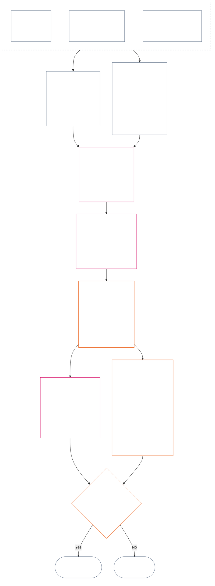

<!-- Langue : français (fr) | Source : 9c2c8c10c871d91157bcd27b9f56ad6a1cec90d3 | Brouillon rédigé par IA, non révisé ; couverture partielle : chapitre 12, §§4–6 -->

### 4. Grammaire des positions et mise à l’échelle commune

*En termes simples : cette section donne des noms cohérents aux neuf positions possibles sur chacun des deux axes distincts et explique comment l’impact s’y met à l’échelle. Un axe consigne les contributions vérifiées ; l’autre consigne les violations vérifiées dans le dossier de statut. Le partage d’un numéro de position ne fusionne pas les axes et ne compense pas un préjudice par une aide. L’échelle unifiée de la **section 6** attribue les deux axes selon l’impact LEQU proportionnel.*

La grammaire des positions utilise un numéro de position, `s`, de **1** à **9**. Chaque axe a sa propre position :

- l’**Axe de contribution** consigne la nature positive d’une contribution ; et
- l’**Axe de violation** consigne les constatations de violation vérifiées.

Le même numéro de position peut figurer sur les deux axes, mais ceux-ci restent distincts. Une position de contribution n’est pas une position de violation, et inversement.

#### 4.1 Tableau 1 — étiquettes d’affichage des positions

Le **Tableau 1** nomme les neuf positions et présente côte à côte les étiquettes d’affichage de l’Axe de contribution et de l’Axe de violation. Il ne fournit que le libellé d’affichage ; l’attribution d’une position suit l’échelle unifiée de la **section 6**.

| `s` | Étiquette d’affichage de l’Axe de contribution | Étiquette d’affichage de l’Axe de violation |
| ---: | --- | --- |
| 1 | **Contribution de base mineure** | **Impact constitutionnel mineur** |
| 2 | **Contribution de base limitée** | **Impact constitutionnel limité** |
| 3 | **Contribution positive substantielle** | **Impact constitutionnel substantiel** |
| 4 | **Contribution positive importante** | **Impact constitutionnel important** |
| 5 | **Contribution sérieuse à l’administration responsable** | **Impact constitutionnel sérieux** |
| 6 | **Contribution majeure à l’administration responsable** | **Impact constitutionnel majeur** |
| 7 | **Champion reconnu** | **Impact constitutionnel grave** |
| 8 | **Champion distingué** | **Impact constitutionnel très grave** |
| 9 | **Champion exemplaire** | **Impact constitutionnel catastrophique** |

L’Axe de contribution emploie les qualificatifs de base, positif, positif en matière d’administration responsable et champion. L’Axe de violation emploie des étiquettes d’impact neutres à chaque position. Les axes restent distincts : ils ne créent pas de score net et n’autorisent aucune compensation entre les dossiers de contribution et de violation. Une position sur l’Axe de violation ne classe pas à elle seule une faute anticonstitutionnelle ; [le chapitre quatorze](core_14.000_misconduct_designation.md#chapter-fourteen-anti-constitutional-misconduct) détermine indépendamment si la désignation pour faute anticonstitutionnelle (ACMD) s’applique à une violation vérifiée de `s` = 7–9.

Les mises en œuvre peuvent publier des unités de mesure, des méthodes de preuve et des exemples pour faciliter l’estimation d’un bénéfice ou d’une perte équivalant à une vie entière. Ces éléments sont fournis à titre indicatif uniquement et ne peuvent primer sur la **section 6**, le **chapitre premier** ou le **Plancher des droits du chapitre six**.

#### 4.2 Règles communes de mise à l’échelle de l’impact

*En termes simples : l’impact ne se mesure pas au seul nombre de personnes touchées. Un bénéfice ou une perte profond touchant un seul être sentient peut avoir davantage d’importance qu’un effet superficiel touchant de nombreuses personnes. Le nombre, la profondeur, la vulnérabilité, la durée, la durabilité, la portée et le caractère constitutionnel doivent être évalués ensemble.*

Appliquez les règles suivantes pour interpréter les deux axes de la **section 6** :

| Dimension de mise à l’échelle | Règle commune | Application propre à l’axe |
| --- | --- | --- |
| **Ampleur du résultat constitutionnel (LEQU)** | Évaluez le bénéfice ou la perte vérifié intégral. Le LEQU est le principal repère d’ampleur ; le nombre brut de personnes, l’argent, la production ou la taille institutionnelle ne le sont pas. | La contribution compte le bénéfice conforme aux droits ; la violation compte la perte constitutionnelle vérifiée, le préjudice, le gaspillage, la privation de possibilités ou le danger. |
| **Portée sentiente** | Tenez compte **ensemble du nombre, de la profondeur et de la vulnérabilité**. Aucune position ne fait du nombre de personnes un critère autonome. Un impact suffisamment profond sur un seul être sentient peut justifier la même position qu’un impact plus étendu mais moins profond, lorsque l’ampleur intégrée et les autres critères de la ligne sont égaux ; tout critère explicite de LEQU agrégé ou de vaste portée doit néanmoins être satisfait. | La dépendance, une capacité réduite ou une vulnérabilité inhabituelle peuvent accroître la matérialité. La taille d’un groupe ne démontre à elle seule ni une contribution ni une gravité. |
| **Portée temporelle** | Tenez compte de la durée, de la récurrence, de la durabilité et, pour une perte, de l’irréversibilité. Un événement bref mais transformateur peut l’emporter sur un effet trivial prolongé ; la durée ne décide pas à elle seule. | Un bénéfice durable justifie une magnitude de contribution plus élevée. Une perte persistante ou irréversible justifie une gravité de violation plus élevée. |
| **Portée spatiale ou institutionnelle** | Une portée plus large peut accroître l’ampleur, mais une portée entre communautés ou institutions n’est pas exigée si la profondeur, la durée, la vulnérabilité ou la criticité constitutionnelle justifie indépendamment la position. | La réparation institutionnelle peut accroître la magnitude de la contribution ; un dommage structurel ou systémique peut accroître la gravité de la violation. |
| **Qualité ou caractère constitutionnel** | Mesurez séparément la manière dont le résultat a été produit et l’étendue de sa propagation. Ne comptez pas deux fois le même fait. | Un préjudice externalisé, une charge dissimulée, une captation ou une dépendance peut plafonner ou disqualifier une contribution alléguée. Le devoir, la négligence, la tromperie, la coercition, la violence ou la facilitation structurelle restent consignés séparément comme caractère du comportement de violation et ne déplacent pas la position d’impact. |
| **Planchers des droits et garanties essentielles** | Le respect du Plancher des droits ne se compense pas par un bénéfice ou une perte agrégé. | Le respect d’un plancher n’établit pas à lui seul une contribution élevée. Une violation matérielle du Plancher des droits ou une défaillance d’une garantie essentielle peut justifier une gravité de violation accrue même si peu d’êtres sentients sont directement touchés. |

Ces dimensions ne constituent pas une liste de contrôle exigeant d’utiliser toutes les formes d’échelle. Expliquez quelles dimensions ont déterminé l’évaluation, lesquelles ne l’ont pas fait et pourquoi.

- **Méthode commune d’attribution d’une position :**
  - Estimez le bénéfice ou la perte vérifié intégral en LEQU conformément à la proportionnalité, puis attribuez l’unique position dont la bande numérique contient cette magnitude.
  - Les mêmes seuils s’appliquent aux deux axes.
  - Les positions de contribution restent soumises aux exigences de référence applicable et d’alignement constitutionnel ; atteindre un seuil numérique ne peut faire compter comme contribution un résultat externalisé ou contraire à la Constitution.
- **Séparation du caractère :** conservez dans le dossier de statut, sous forme cumulée, les descripteurs applicables de voie de bénéfice, de voie de préjudice, de qualité de conduite et de caractère de conduite. Le devoir, la négligence, la tromperie, l’aggravation, la coercition, la violence, l’intention ou la facilitation structurelle peuvent influer sur l’attribution, les garanties ou les conséquences de la Question 3, mais aucun ne relève ni n’abaisse la position d’impact LEQU.
- **Limite de l’examen des fautes anticonstitutionnelles :** une perte vérifiée sur l’Axe de violation peut atteindre `s` = 7–9 en raison de son impact, qu’une faute anticonstitutionnelle soit établie ou non. Le chapitre quatorze ne remplace pas l’attribution de l’impact ; il détermine séparément si l’ACMD correspondante s’applique.

Si un danger ne s’est pas encore matérialisé, consignez séparément les éléments suivants :

- sa probabilité ;
- la durée d’exposition des êtres sentients ;
- sa portée possible ;
- le degré d’incertitude de l’estimation ; et
- la pire issue qui reste plausible.

Ne comptez pas cette pire issue comme un préjudice déjà survenu (perte LEQU), sauf si la mise en œuvre adoptée a établi un étalonnage du risque (méthode de conversion du risque en LEQU) que chacun peut examiner.

### 5. Sources constitutionnelles pour l’attribution aux axes

*En termes simples : avant de choisir une position, identifiez les sources constitutionnelles qui définissent la référence, le bénéfice, le devoir, le préjudice ou la violation mesurés. Utilisez les liens ci-dessous pour appliquer ces sources à leur emplacement canonique ; ne transformez pas cette étape d’acheminement en un autre score ou en une définition de remplacement.*

Avant d’attribuer une position conformément à la **section 6**, le dossier de statut doit identifier :

- la référence constitutionnelle, le devoir, la contrainte ou l’intérêt protégé applicable ;
- les dispositions établissant le bénéfice vérifié, le résultat défavorable, le préjudice ou la violation mesurés ;
- les définitions, principes et Articles du Plancher des droits qui ont un effet matériel sur la magnitude ou le caractère du comportement ; et
- les raisons pour lesquelles chaque source identifiée s’applique et la manière dont elle influe sur l’attribution à l’axe.

Les tableaux d’acheminement ci-dessous ne sont pas exhaustifs. Toute définition, tout principe ou tout Article supplémentaire déclenché par les faits vérifiés demeure applicable et doit être identifié dans le dossier de statut. Chaque source canonique liée fait autorité ; ces tableaux ne la reformulent ni ne la restreignent.

#### 5.1 Sources définitionnelles

| Source canonique | Rôle pour l’Axe de contribution | Rôle pour l’Axe de violation |
| --- | --- | --- |
| [État de statut, contribution et violation](core_05.035_band_accountability.md#defa3-standing-state-contribution-and-violation) | Explique ce qui compte comme contribution et quels faits vérifiés peuvent servir à la mesurer. Garantit aussi qu’un dossier de statut de contribution ne suit que le versant positif, sans le mélanger au versant négatif. | Explique ce qui compte comme violation et comment la consigner. Transmet aussi les cas les plus graves à l’examen des fautes anticonstitutionnelles, examen distinct des comportements qui sapent la Constitution elle-même. |
| [Reddition de comptes](core_05.005_apex_accountability_leg.md#accountability) | Vérifie qu’une prétention de bonne administration responsable ou de réparation permet réellement de demander des comptes. Il faut toujours montrer qui a fait quoi, qui doit en répondre et comment le résultat peut être révisé, réparé et corrigé en proportion de son impact. | Repère les cas où l’on ne sait pas clairement qui a fait quoi ou qui doit en répondre. Cela comprend les cas où la responsabilité cesse de fonctionner après une modification de l’organisation ou de sa structure. |
| [Préjudice](core_05.035_band_accountability.md#harm) | Un préjudice transféré à autrui ou dissimulé peut limiter ou annuler un bénéfice allégué. La réparation d’un préjudice peut compter comme bénéfice, mais uniquement si elle est vérifiée et démontrée de manière indépendante. | Énonce les types de dommages comptant pour la mesure de la perte et de la gravité : directs, indirects, différés, cumulatifs, répartis entre plusieurs systèmes, ainsi que les préjudices causés à l’esprit ou au bien-être émotionnel d’un être sentient. |
| [Matérialité](core_05.050_band_oversight.md#materiality) et [Unité équivalente à une durée de vie (LEQU)](core_05.055_band_participation.md#lifespan-equivalent-unit-lequ) | Déterminent la part comptabilisée d’un bénéfice vérifié selon sa portée, la vulnérabilité des personnes touchées et sa durée. Le résultat est mesuré en LEQU, l’unité commune d’un bénéfice équivalant à une vie entière. | Déterminent la part comptabilisée d’une perte ou d’un danger vérifié selon sa portée, la vulnérabilité des personnes touchées, sa durée et la difficulté à l’inverser. Le résultat est mesuré en LEQU, la même unité pour une perte équivalant à une vie entière. |
| [Nature de la contribution](core_05.035_band_accountability.md#contribution-nature) | Détermine si un résultat compte comme contribution. Il doit être uniquement bénéfique, jamais mêlé à un préjudice, et étayé par un dossier de contribution vérifié qui peut être présenté. Sans ces deux éléments, aucune attribution à l’Axe de contribution n’est possible. | N’a aucun rôle ici. Elle ne détermine pas ce qui compte comme préjudice et ne réduit jamais la gravité d’une violation. |
| [Nature de la violation](core_05.035_band_accountability.md#violation-nature) | N’a aucun rôle ici. Une violation n’est jamais comptée comme contribution négative et n’efface pas un bénéfice vérifié sans rapport avec elle. | Détermine si un fait compte comme violation. Il doit être classé comme préjudiciable et étayé par une constatation vérifiée de la survenue d’une violation. Sans ces deux éléments, aucune attribution à l’Axe de violation n’est possible. |
| [Contrainte constitutionnelle](core_05.045_band_integrative.md#constitutional-constraint), [Hiérarchie des autorités et ordre interne](core_05.045_band_integrative.md#authority-stack-and-internal-hierarchy) et [Auditabilité](core_05.050_band_oversight.md#auditability) | Empêchent de compter un bénéfice allégué s’il dépend de la défaite de la Constitution, du contournement de ses règles, du rétrécissement du Plancher des droits (protections minimales garanties par la Constitution) ou d’une conformité purement formelle. | Signalent les facteurs qui déterminent la gravité réelle d’une violation : enfreindre une limite constitutionnelle importante, placer une autorité au-dessus de celle de la Constitution, contourner les règles ou rendre leur application impossible. |
| [Auditabilité](core_05.050_band_oversight.md#auditability) et [Contestabilité](core_05.035_band_accountability.md#contestability) | Exigent qu’un bénéfice allégué puisse être démontré et vérifié et que toute personne en désaccord dispose d’un moyen effectif de le contester. | Exigent des constatations vérifiables et contestables. Une accusation ou une étiquette dépourvue d’explication ne peut déterminer la gravité d’une violation. |

#### 5.2 Sources de principes

| Source de principe | Rôle dans l’attribution aux axes |
| --- | --- |
| [Tétrade constitutionnelle](core_00.000_preamble.md#constitutional-tetrad), [Deux fins constitutionnelles](core_00.000_preamble.md#two-constitutional-aims) et [enjeu matériel](core_00.000_preamble.md#material-stake) | Définissent les quatre disciplines opérationnelles (participation, supervision, reddition de comptes et action en temps), les deux résultats visés par la Constitution (Épanouissement et Continuité) et le cadre qui dimensionne chaque attribution selon l’enjeu. |
| [Bien-être](core_01.000_values_principles.md#3-foundational-objective-wellbeing-flourishing-aim) et [Reconnaissance, renforcement et aspiration](core_01.000_values_principles.md#32-recognition-reinforcement-and-aspiration) | Ancrent sur l’Axe de contribution le bénéfice conforme aux droits et la reconnaissance qui lui correspond. Le prestige ou les récompenses ne sont jamais considérés comme preuve d’une contribution. |
| [Sécurité](core_01.000_values_principles.md#4-safety-harm-constraint) et [Vérité](core_01.000_values_principles.md#5-truth-epistemic-integrity-constraint) | Fixent des limites contraignantes sur les deux axes. Un bénéfice obtenu par le préjudice ou la tromperie n’est pas compté intégralement ; un manquement vérifié à la sécurité ou à la vérité peut indiquer l’ampleur ou la nature de la violation. |
| [Administration responsable en profondeur](core_01.010_stewardship_capacity_principles.md#16-stewardship-in-depth) et [Gouvernance sous discipline d’administration responsable](core_01.010_stewardship_capacity_principles.md#18-governance-under-stewardship-discipline) | Guident l’évaluation d’une contribution durable, des devoirs liés à un rôle, de la réparation institutionnelle, de la supervision et de la responsabilité lorsque les faits vérifiés le justifient. |
| [Principes fondamentaux d’arbitrage](core_01.005_interaction_interpretation.md#131-core-tradeoff-principles) et [Planchers constitutionnels, sécurité et procédure non dégradante](core_01.005_interaction_interpretation.md#1314-constitutional-floors-safety-and-anti-degrading-process) | S’appliquent lorsque le comportement mesuré met en jeu la nécessité, la réduction maximale du préjudice, la proportionnalité, un conflit de droits ou une restriction. Ils n’autorisent jamais une conséquence à eux seuls. |

#### 5.3 Sources relatives au Plancher des droits et aux Articles

| Source de l’Article | Rôle ou limite dans l’attribution aux axes |
| --- | --- |
| Le [Plancher des droits du chapitre six](core_06.000_rights_part_a.md#chapter-six-foundational-rights) applicable aux faits, y compris chaque Article matériellement concerné par le dossier de statut vérifié | Définit les protections, intérêts, devoirs, bénéfices ou violations fondamentaux en jeu. Aucun Article n’est omis simplement parce qu’il ne figure pas dans la liste ci-dessous. |
| [Article XIX — Statut de statut et de participation](core_06.015_rights_part_d.md#article-xix-standing-and-participation-status) | Maintient distincts le statut d’un être sentient, sa dignité, les protections minimales du Plancher des droits, le statut de partie affectée, la réputation et toute modification ultérieure du statut de participation. |
| [Article XIII-A — Référence de fiabilité et de confiance](core_06.010_rights_part_c.md#article-xiii-a-reliability-and-trustworthiness-baseline), [Article XIII-B — Droit à la réparation et au recours](core_06.010_rights_part_c.md#article-xiii-b-right-to-redress-and-remedy), [Article XV-B — Transparence, auditabilité et contestabilité](core_06.010_rights_part_c.md#article-xv-b-transparency-auditability-and-contestability) et [Article XVI — Audit, transparence et vérification indépendante](core_06.010_rights_part_c.md#article-xvi-audit-transparency-and-independent-verification) | S’appliquent lorsque le bénéfice ou la violation vérifié implique la tenue de dossiers sincères, le partage d’informations, la vérification des faits, la possibilité de contester une décision ou la correction d’erreurs. |
| [Article XXIV — Analyse des causes profondes et réponse adaptative](core_06.015_rights_part_d.md#article-xxiv-root-cause-analysis-and-adaptive-response) | S’applique lorsque la cause du comportement, sa correction, sa répétition éventuelle ou l’adaptation de la réponse importe, car cela montre la position du comportement au regard de la Constitution. |
| [Article XX — Justice après une violation vérifiée](core_06.015_rights_part_d.md#article-xx-justice-after-verified-violation) et [Article XXVI-C — Résolution en temps utile et Plancher anti-retard](core_06.020_rights_part_e.md#article-xxvi-c-timely-resolution-and-anti-delay-floor) | S’appliquent à toute procédure ou à tout retard effectivement présent dans les faits. L’**Article XX** (*Justice après une violation vérifiée*) limite principalement ce qui se passe après la mesure d’une violation (Question 3). Il ne doit pas servir à relever ou abaisser la position de la Question 2 simplement pour justifier une réponse déjà privilégiée. |

**Limites d’application.** Cette étape renvoie uniquement aux sources pertinentes.

- Elle ne :
  - rouvre pas la Question 1 ;
  - n’admet pas des faits non vérifiés ;
  - n’ajoute pas de nouvelle mesure ou de nouveau score ;
  - ne compte pas deux fois un fait au moyen de sources différentes ;
  - ne fusionne pas les deux axes ; ni
  - ne rend pas chaque source répertoriée applicable à tous les dossiers de statut.
- Les contributions et les violations restent mesurées séparément.
- Les conséquences de l’**Article XX** (*Justice après une violation vérifiée*) restent extérieures à la Question 2.
- L’examen de désignation du chapitre quatorze reste distinct de la position d’impact attribuée ici.

### 6. Échelle LEQU proportionnelle unifiée — Axes de contribution et de violation

<strong>Guide du lecteur (non opératoire) : fonctionnement de la progression par cinq</strong>

> L’échelle suit une progression par cinq, ancrée à `s` = 7 = un LEQU. Pour chacun des axes, la magnitude minimale de la position `s` est de `5^(s−7)` LEQU pour les positions 2 à 9 ; la position 1 commence à zéro. Une mise en œuvre adoptée peut publier les seuils numériques obtenus et des exemples d’étalonnage. La position 1 comprend le respect vérifié de la référence constitutionnelle sur l’Axe de contribution et une perte vérifiée inférieure au premier seuil positif sur l’Axe de violation ; l’absence de contribution ou l’absence de violation ne constitue pas en soi un dossier `s` = 1.
>
> **Repère intelligible.** En prenant une durée de vie humaine de 80 ans comme exemple d’étalonnage, lisez la colonne du milieu vers le haut comme un bénéfice équivalant à une vie entière, du temps utilisable ou des ressources et capacités conformes aux droits qui sont ajoutés ; lisez-la vers le bas comme une perte équivalente, une privation, un gaspillage ou une privation de possibilités. La quantité de ressources ne compte pas à elle seule : c’est le résultat constitutionnel qu’elle produit ou empêche qui détermine l’évaluation.

 

*En termes simples : le **Tableau 2** place les contributions vérifiées et les violations vérifiées sur la même échelle proportionnelle d’impact. Les positions supérieures correspondent à un bénéfice ou à une perte constitutionnels intégrés plus importants. Les dossiers de statut et les axes restent distincts : l’échelle commune compare les magnitudes, pas la valeur morale, et ne permet jamais à l’aide d’annuler un préjudice.*

Le diagramme suit l’attribution d’une position du début à la fin. Il montre l’ordre de déroulement des étapes, qui diffère de celui des puces ci-dessous ; les puces énoncent chacune des règles.

Appliquez la **proportionnalité** afin d’estimer l’impact LEQU intégré selon la profondeur, la portée sentiente, la vulnérabilité, la durée, la durabilité ou l’irréversibilité, l’étendue et la criticité constitutionnelle. Ces dimensions façonnent l’estimation LEQU ; elles ne donnent pas chacune droit à un bonus indépendant de position.

- Utilisez le **Tableau 2** après que la Question 1 a confirmé ce qui s’est passé, que la Question 2 a mesuré le bénéfice ou la perte vérifiés, que les **sections 1–3 et 4.2** ont été appliquées et que les sources constitutionnelles exigées par la **section 5** ont été identifiées.
- Attribuez une position à partir de l’estimation LEQU intégrée.
  - Expliquez comment chaque dimension matérielle de mise à l’échelle a influé sur l’estimation et pourquoi les dimensions omises ne l’ont pas déterminée.
  - Toute attribution doit satisfaire aux exigences suivantes :
    - traçabilité ;
    - auditabilité ;
    - contestabilité ; et
    - Plancher des droits applicable.
  - Une contribution doit aussi respecter la non-externalisation et l’alignement constitutionnel.
- Consignez les faits relatifs au caractère de la conduite comme des descripteurs distincts et traçables. Ils peuvent déterminer l’attribution, l’intensité de la révision, les garanties, la réparation ou une désignation au chapitre quatorze ; ils n’affectent la position que dans la mesure où les conséquences vérifiées modifient l’impact LEQU intégré.
- Évaluez intégralement les conséquences vérifiées de l’action ou de la conduite au regard des dimensions matérielles de mise à l’échelle, y compris :
  - les atteintes physiques ;
  - les traumatismes psychologiques ;
  - les effets coercitifs ;
  - la privation de liberté ou le danger qui la menace ;
  - les préjudices cumulatifs ; et
  - tout autre bénéfice ou perte reconnu par la Constitution.
- Ne faites pas ce qui suit :
  - Ne relevez ni n’abaissez la position au seul motif qu’un événement ou une conduite est qualifié de :
    - devoir ;
    - négligence ;
    - intention ;
    - dissimulation ;
    - répétition ;
    - aggravation ;
    - coercition ;
    - violence ;
    - danger pour la liberté ;
    - possibilité de correction ; ou
    - conséquence privilégiée.
  - Ne déduisez pas le caractère d’une conduite de sa magnitude et ne remplacez pas la magnitude vérifiée par ce caractère.

Le **Tableau 2** énumère les neuf positions dans l’ordre. Chaque ligne indique le numéro de position `s`, le volume de bénéfice ajouté ou de perte imposée correspondant à cette position (avec une durée de vie humaine de 80 ans comme exemple d’étalonnage) et le nom de la position sur chaque axe. Les mêmes seuils s’appliquent aux deux axes, mais les deux noms restent distincts : une position de l’Axe de contribution et une position de l’Axe de violation correspondent à des dossiers différents et ne se compensent jamais.

| `s` | Étalonnage sur 80 ans de vie humaine — bénéfice ajouté / perte imposée | Axe de contribution | Axe de violation |
| ---: | --- | --- | --- |
| 1 | Moins d’environ **9 jours** | **Contribution de base mineure** — respect vérifié du seuil constitutionnel pour le périmètre évalué ; toute amélioration mesurable reste sous `s` = 2. | **Impact constitutionnel mineur** — perte ou altération opérationnelle vérifiée sous `s` = 2, y compris un défaut formel sans préjudice substantiel démontré. |
| 2 | Environ **9–47 jours** | **Contribution de base limitée** — performance fiable et circonscrite au-dessus du seuil minimal à ce niveau d’impact. | **Impact constitutionnel limité** — perte vérifiée et circonscrite à ce niveau d’impact. |
| 3 | Environ **47 jours à 8 mois** | **Contribution positive substantielle** — bénéfice démontrable dépassant la référence à ce niveau d’impact. | **Impact constitutionnel substantiel** — perte substantielle vérifiée à ce niveau d’impact. |
| 4 | Environ **8 mois à 3,2 ans** | **Contribution positive importante** — bénéfice vérifié plus profond, durable, répété, adapté à la vulnérabilité ou plus étendu. | **Impact constitutionnel important** — perte constitutionnelle importante vérifiée. |
| 5 | Environ **3,2–16 ans** | **Contribution sérieuse à l’administration responsable** — administration responsable durable, coordination, maintenance, réparation ou bénéfice soutenu comparable. | **Impact constitutionnel sérieux** — perte constitutionnelle sérieuse vérifiée. |
| 6 | Environ **16–80 ans** | **Contribution majeure à l’administration responsable** — bénéfice majeur vérifié approchant un LEQU. | **Impact constitutionnel majeur** — perte majeure vérifiée approchant un LEQU. |
| 7 | Environ **1–5 vies** (**80–400 ans**) | **Champion reconnu** — au moins un LEQU de bénéfice vérifié et conforme à la Constitution. | **Impact constitutionnel grave** — au moins un LEQU de perte constitutionnelle vérifiée. |
| 8 | Environ **5–25 vies** (**400–2 000 ans**) | **Champion distingué** — bénéfice vérifié dépassant matériellement `s` = 7. | **Impact constitutionnel très grave** — perte vérifiée dépassant matériellement `s` = 7. |
| 9 | Au moins **25 vies** (**2 000 ans et plus**) | **Champion exemplaire** — bénéfice vérifié dépassant matériellement `s` = 8. | **Impact constitutionnel catastrophique** — perte vérifiée dépassant matériellement `s` = 8. |

<strong>Note d’interopérabilité de mise en œuvre</strong>

> Ce widget contient des éléments d’interopérabilité destinés à la mise en œuvre. Il facilite l’application des catégories opérationnelles du chapitre ; il ne crée pas de système de catégories parallèle.

Les champs lisibles par machine pour l’affichage des positions (`sub_tier`, `sub_tier_display` et les champs d’affichage associés) sont définis dans [CH06_NINE_SLOT_STANDING_SCALE.md](implementation/CH06_NINE_SLOT_STANDING_SCALE.md) et [ch06_nine_slot_constants.json](implementation/ch06_nine_slot_constants.json). La carte des quatre bandes utilisée dans la mise en œuvre demeure une aide à l’interopérabilité et n’ajoute pas de colonne de bande principale au **Tableau 2** opérationnel.

Une méthode de référence et des attributions de positions détaillées, y compris pour les êtres sentients avec pondérations, points de contrôle d’état sauvegardé et sans mortalité fixe, figurent dans [LEQU_CALIBRATION_REFERENCE.md](implementation/LEQU_CALIBRATION_REFERENCE.md). Ces calculs ne peuvent remplacer les seuils communs et la règle d’attribution proportionnelle de la **section 6**, attribuer une position à un dossier actif ou décider qui compte.

Une mise en œuvre adoptée peut publier des estimations LEQU et des libellés d’affichage indexés. Sauf modification par un **document conforme**, ces aides ne peuvent remplacer les seuils communs et la règle d’attribution proportionnelle de la **section 6**, ni les garanties de désignation du chapitre quatorze.

