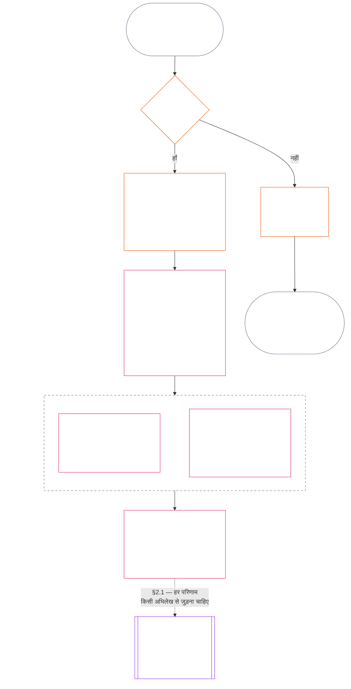

<!-- Locale: Hindi (hi) | Source: 9c2c8c10c871d91157bcd27b9f56ad6a1cec90d3 | AI-drafted, unreviewed | PARTIAL: Chapter Eleven §§1–3 only -->

### 1. तीन प्रश्न

*साधारण शब्दों में: प्रस्थिति का निर्धारण क्रम से तीन प्रश्नों के उत्तर देकर होता है। वांछित रेटिंग से तथ्यों का अनुमान न लगाएँ और मनचाहा परिणाम उचित ठहराने के लिए रेटिंग न चुनें।*

| प्रश्न | प्रश्न क्या पूछता है | उत्तर कहाँ दिया जाता है |
| --- | --- | --- |
| **1. क्या हुआ?** | कौन-से तथ्य सत्यापित हैं, किसके या किस चीज़ के बारे में, किस अवधि में, और किस प्रस्थिति अभिलेख तथा चुनौती स्थिति के साथ? | [खंड 2](#2-question-1--what-happened) और [खंड 3](#3-question-1-event-type-guide--what-kind-of-help-or-harm-occurred) |
| **2. कितना अच्छा या बुरा था?** | वे तथ्य किस प्रकार और कितनी मात्रा का योगदान या उल्लंघन स्थापित करते हैं? | [अध्याय बारह खंड 1](core_12.000_standing_measurement.md#1-question-2--how-good-or-bad-was-it) |
| **3. इसके कारण क्या होता है?** | उनसे कौन-सी मान्यता, तैयारी, उपचार, सुरक्षा, पाबंदी या अन्य परिणाम निकलता है? | [अध्याय तेरह](core_13.000_standing_integration.md#chapter-thirteen-standing-effects-and-integration) |

हर प्रश्न का उत्तर उससे पहले वाले उत्तर पर निर्भर है:

- प्रश्न 1, प्रश्न 2 के लिए सत्यापित तथ्य देता है।
- प्रश्न 2, प्रश्न 3 के लिए उन तथ्यों का मापन करता है।
- प्रश्न 3 को किसी पसंदीदा नतीजे के अनुरूप तथ्य या रेटिंग दोबारा नहीं लिखनी चाहिए।

तीनों प्रश्नों के उत्तर मिलकर एक सीमाबद्ध घटना या एक परिभाषित प्रतिरूप के लिए पूरा प्रस्थिति-मूल्यांकन बनाते हैं। किसी विषय के समय के साथ ऐसे कई मूल्यांकन हो सकते हैं; इनमें से कोई भी उस विषय का शुद्ध अंक या समग्र रेटिंग नहीं है। योगदान और उल्लंघन के प्रस्थिति अभिलेख प्रश्न 1 और 2 के उत्तर सुरक्षित रखते हैं; प्रश्न 3 का निर्णय बताता है कि उनसे आगे क्या होता है।

#### 1.1 उद्देश्य और दायरा

यह अध्याय **प्रणालियों**, **संज्ञ प्राणियों** और **संस्थाओं** के लिए संवैधानिक अभिलेख-रूपरेखा बताता है; [अध्याय बारह](core_12.000_standing_measurement.md#chapter-twelve-standing-measurement--question-2-how-good-or-bad-was-it) मापन-रूपरेखा बताता है। इसमें [**CS-9.305**](corpus_systems/cs_09.305_system_classification_machinery.md#cs-9305-part-a-system-classification-machinery) (*प्रणाली वर्गीकरण यंत्रणा*) के अंतर्गत वर्गीकृत हर प्रणाली शामिल है। ये रूपरेखाएँ गपशप, लोकप्रियता, अस्पष्ट प्रतिष्ठा, अंतर्निहित गरिमा या सामान्य मूल्य का मापन नहीं करतीं; इनमें से कोई भी प्रस्थिति-मूल्यांकन का अनुमत विषय नहीं है।

प्रस्थिति-प्रक्रिया तब भी प्रभावी रहनी चाहिए जब:

- पहले सत्यापित योगदान इतने पुराने हो जाएँ कि वे वर्तमान क्षमता या विश्वसनीयता न दिखा सकें;
- उल्लंघन अनसुलझे रहें;
- सुधार महँगा हो;
- जिम्मेदारी सीमाओं के पार जाती हो; या
- कोई कर्ता जवाबदेही में बाधा डालने के लिए संगठन की परतों या पुनर्नामकरण का उपयोग करे।

ये विषय अपनाए गए कार्यान्वयन पाठ में आते हैं:

- रोज़मर्रा की प्रक्रियाएँ;
- उन्नयन के चरण;
- प्रतिपूर्ति और सुधार की कार्रवाइयाँ;
- पुनर्स्थापनात्मक-जवाबदेही के उपाय; और
- प्रोत्साहन की रचना।

अध्याय बारह का मापन अपने-आप बल-प्रयोग, हिरासत या स्वतंत्रता पर किसी अन्य पाबंदी की अनुमति **नहीं** देता। ऐसे हर परिणाम को अध्याय छह, **अनुच्छेद XX** (*सत्यापित उल्लंघन के बाद न्याय*) की आनुपातिकता, न्यूनतम-प्रतिबंध, समय-सीमा, प्रतिपूर्ति और पुनर्स्थापनात्मक-जवाबदेही की आवश्यकताओं समेत, स्वतंत्र रूप से पूरा करना होगा।

<strong>अनुसरण · परिभाषाएँ · मूल्यांकन · अनुपालन</strong>

- ऊपर की ओर: [अध्याय एक §16 — उत्तरदायी प्रबंधन का विस्तार](core_01.010_stewardship_capacity_principles.md#16-stewardship-in-depth); [अध्याय दो से चार](core_02.000_definition_structure.md); [अध्याय पाँच](core_05.000_definitions_home.md#chapter-five-foundational-definitions)।
- आगे: [§2](#2-question-1--what-happened) (*प्रश्न 1*); [§4](#4-standing-record-operational-requirements) (*सत्यापन और अभिलेख आवश्यकताएँ*); [§5](#5-record-custody-and-opening-authority) (*अभिलेख अभिरक्षा और खोलने का प्राधिकार*); [§6](#6-handling-a-standing-record) (*प्रस्थिति अभिलेख का संचालन*); [अध्याय बारह §1](core_12.000_standing_measurement.md#1-question-2--how-good-or-bad-was-it) (*प्रश्न 2 का मापन*); [अध्याय बारह §2](core_12.000_standing_measurement.md#2-magnitude-and-severity-input-dimensions) (*मापन निवेश के आयाम*); [अध्याय बारह §3](core_12.000_standing_measurement.md#3-route-descriptor-catalogs-and-measurement-roles) (*मार्ग-वर्णनकर्ता सूची*); [अध्याय बारह §4](core_12.000_standing_measurement.md#4-slot-grammar-and-shared-scaling) (*स्लॉट व्याकरण और साझा स्केलिंग*); [अध्याय बारह §5](core_12.000_standing_measurement.md#5-constitutional-inputs-to-axis-assignment) (*संवैधानिक स्रोत-मार्ग निर्धारण*); [अध्याय बारह §6](core_12.000_standing_measurement.md#6-unified-proportional-lequ-scale--contribution-and-violation-axes) (*दोनों अक्षों के लिए एकीकृत आनुपातिक LEQU पैमाना*); [अध्याय तेरह](core_13.000_standing_integration.md#chapter-thirteen-standing-effects-and-integration) (*प्रश्न 3*)।
- [भौतिक महत्त्व](core_05.050_band_oversight.md#materiality) · [O](core_05.050_band_oversight.md#materiality) · [M](core_05.050_band_oversight.md#materiality-determination-a) · [A](core_05.050_band_oversight.md#materiality-determination-a) · [C](core_05.050_band_oversight.md#materiality-determination-c)
- [हानि](core_05.035_band_accountability.md#harm) · [O](core_05.035_band_accountability.md#harm) · [M](core_05.035_band_accountability.md#harm-a) · [A](core_05.035_band_accountability.md#harm-a) · [C](core_05.035_band_accountability.md#harm-c)
- [आनुपातिकता](core_05.035_band_accountability.md#proportionality) · [O](core_05.035_band_accountability.md#proportionality) · [M](core_05.035_band_accountability.md#proportionality-a) · [A](core_05.035_band_accountability.md#proportionality-a) · [C](core_05.035_band_accountability.md#proportionality-c)

### 2. प्रश्न 1 — क्या हुआ?

<strong>अनुसरण</strong>

- ऊपर की ओर: [§1](#1-the-three-questions) (*तीन-प्रश्न रूपरेखा*); [अध्याय दो से चार](core_02.000_definition_structure.md) (*अभिलेख, सत्यापन, और परिभाषाओं से परिणामों तक अनुरेखणीयता*)।
- चतुष्क के अंग: **सहभागिता**; **निगरानी** (चुनौती-योग्यता और चुनौती मार्ग)। प्राथमिक उद्देश्य: **समुन्नति** और **सातत्य** (अनुरेखणीय अभिलेख जो बाद के मापन के लिए अलग-अलग योगदान और उल्लंघन निष्कर्ष सुरक्षित रखते हैं)।
- आगे:
  - [§2.2](#22-silence-is-the-default) (*मौन ही सामान्य स्थिति है*);
  - [§2.3](#23-protected-dissent-is-not-a-trigger) (*संरक्षित असहमति कोई ट्रिगर नहीं है*);
  - [§2.4](#24-linked-standing-records-and-no-offset-bridge) (*जुड़े अभिलेख और बिना-समंजन सेतु*);
  - [§2.5](#25-verified-input-gate) (*सत्यापित-निवेश द्वार*);
  - [§2.6](#26-stage-boundary) (*चरण सीमा*);
  - [§2.7](#27-forum-boundary) (*मंच सीमा*);
  - [§3](#3-question-1-event-type-guide--what-kind-of-help-or-harm-occurred) (*घटना-प्रकार मार्गदर्शिका*);
  - [§4](#4-standing-record-operational-requirements) (*अभिलेख आवश्यकताएँ*);
  - [§5](#5-record-custody-and-opening-authority) (*अभिलेख अभिरक्षा और खोलने का प्राधिकार*);
  - [§6](#6-handling-a-standing-record) (*प्रस्थिति अभिलेख का संचालन*);
  - [अध्याय बारह §1](core_12.000_standing_measurement.md#1-question-2--how-good-or-bad-was-it) (*प्रश्न 2 का मापन*);
  - [अध्याय बारह §2](core_12.000_standing_measurement.md#2-magnitude-and-severity-input-dimensions) (*मापन निवेश के आयाम*);
  - [अध्याय बारह §3](core_12.000_standing_measurement.md#3-route-descriptor-catalogs-and-measurement-roles) (*मार्ग-वर्णनकर्ता सूची*);
  - [अध्याय बारह §4](core_12.000_standing_measurement.md#4-slot-grammar-and-shared-scaling) (*स्लॉट व्याकरण और साझा स्केलिंग*);
  - [अध्याय बारह §5](core_12.000_standing_measurement.md#5-constitutional-inputs-to-axis-assignment) (*संवैधानिक स्रोत-मार्ग निर्धारण*);
  - [अध्याय बारह §6](core_12.000_standing_measurement.md#6-unified-proportional-lequ-scale--contribution-and-violation-axes) (*दोनों अक्षों के लिए एकीकृत आनुपातिक LEQU पैमाना*);
  - [अध्याय तेरह](core_13.000_standing_integration.md#chapter-thirteen-standing-effects-and-integration) (13.000) (*प्रश्न 3*)।

 

*साधारण शब्दों में: प्रश्न 1, जो हुआ उसका सीमाबद्ध और चुनौती-योग्य विवरण स्थापित करता है। किसी रेटिंग या परिणाम पर विचार करने से पहले यह विषय, घटना या प्रतिरूप, समयावधि, सत्यापित तथ्य और अभिलेख की स्थिति पहचानता है। सत्यापित सहायता और सत्यापित उल्लंघन अलग प्रस्थिति अभिलेखों में रखे जाते हैं, ताकि एक दूसरे को मिटा न सके। ये प्रस्थिति अभिलेख लोकप्रियता के अंक या अस्पष्ट लेबल नहीं हैं।*

**प्रस्थिति अभिलेख** इस अध्याय में किसी खास विषय, कार्यगत दायरे, अभिलेख अवधि, समीक्षा स्थिति और निर्णय संदर्भ के लिए प्रयुक्त सीमाबद्ध अभिलेख है। मापन शुरू होने से पहले इसमें स्थापित होना चाहिए:

- प्रस्थिति अभिलेख किसके या किस चीज़ के बारे में है;
- क्या वह सीमाबद्ध घटना या परिभाषित प्रतिरूप से संबंधित है;
- संबंधित आचरण और प्रभाव कब और कहाँ हुए;
- कौन-से तथ्य सत्यापित हैं और कौन-से विवादित हैं;
- निष्कर्षों का समर्थन करने वाले साक्ष्य, आरोपण और चुनौती मार्ग क्या हैं; और
- प्रस्थिति अभिलेख की वर्तमान समीक्षा, सुधार और प्रतिस्थापन स्थिति क्या है।

आरेख एक घटना का अनुसरण करता है: क्या वह प्रस्थिति अभिलेख खोलने का ट्रिगर है और फिर अभिलेख में क्या दर्ज होता है। आगे के उपखंड हर नियम बताते हैं। "नहीं" वाला मार्ग मुख्य पथ से दाईं ओर निकलता है।

#### 2.1 प्रस्थिति अभिलेख: प्रकार और विषय

प्रश्न 1 सत्यापित सहायता के लिए **योगदान प्रस्थिति अभिलेख** और सत्यापित हानि के लिए **उल्लंघन प्रस्थिति अभिलेख** का उपयोग करता है; इसमें जवाबदेही की विफलताएँ भी शामिल हैं। एक प्रस्थिति अभिलेख दोनों प्रकार के निष्कर्षों को नहीं मिलाता।

- प्रस्थिति अभिलेख किसी संज्ञ प्राणी, संस्था, प्रणाली, मूल्यांकन, सीमाबद्ध घटना, भूमिका, सामूहिक निकाय, कर्ता-विशिष्ट अभिलेख या अन्य संवैधानिक रूप से प्रासंगिक इकाई से संबंधित हो सकता है।
  - उसे अलग-अलग विषयों, भूमिकाओं, प्रणालियों, समुदायों, अभिलेख-अवधियों, समीक्षा स्थितियों या निर्णय संदर्भों को एक अविभेदित प्रस्थिति लेबल में समेटना नहीं चाहिए।
- प्रस्थिति अभिलेख किसी **सीमाबद्ध घटना** — स्पष्ट आरंभ और अंत वाले एक प्रसंग — या बार-बार के आचरण के **प्रतिरूप** को कवर कर सकता है।
  - प्रतिरूप के लिए परिभाषित विषय, दायरा और समीक्षा अवधि चाहिए।
- एक ही विषय के समय के साथ अनेक प्रस्थिति अभिलेख हो सकते हैं, जिनमें परस्पर जुड़े योगदान और उल्लंघन प्रस्थिति अभिलेख भी शामिल हैं।
  - जब संबंधित प्रस्थिति अभिलेखों का विषय, ओवरलैप करती अभिलेख-अवधि, सीमाबद्ध घटना, प्रतिरूप या निर्णय संदर्भ साझा हो, तो **खंड 4.2** के तहत उन्हें एक-दूसरे का **परस्पर संदर्भ** देना होगा।
- प्रस्थिति अभिलेख अलग-थलग प्रतिष्ठा अंक, गरिमा-क्रम, स्थायी स्थिति, सामान्य मूल्य का लेबल या मिला-जुला स्कोरकार्ड नहीं है।
  - कार्यगत आवश्यकताएँ **खंड 4** में हैं।

बाद का कोई भी प्रस्थिति प्रभाव अध्याय तेरह का विषय है। उसे संबंधित प्रस्थिति अभिलेख या अभिलेखों तक अनुरेखणीय रहना चाहिए, पर स्वयं अभिलेख का हिस्सा नहीं बनना चाहिए।

#### 2.2 मौन ही सामान्य स्थिति है

किसी संज्ञ प्राणी, संस्था या प्रणाली का कोई प्रस्थिति अभिलेख न होना सामान्य स्थिति है; अधिकांश संज्ञ प्राणी इसी स्थिति में रहेंगे।

- प्रस्थिति अभिलेख तभी खुलता है जब **खंड 4** के अनुसार कोई ट्रिगर सत्यापित हो। नामित अभिलेख-खोलने वाले प्राधिकारी को प्रविष्टि अनुमोदित करनी होगी और अलग अभिलेख अभिरक्षक को उसे दर्ज करना होगा (**खंड 5**)। प्रस्थिति अभिलेख कभी भी इन कारणों से नहीं खोला जाता:
  - आधाररेखा स्थापित करने के लिए;
  - सूची पूरी करने के लिए; या
  - क्योंकि कोई नामित मार्ग-द्वारपाल ऐसा चाहे।
- अभिलेख का न होना कुछ नहीं बताता। "रेटिंग नहीं", "असत्यापित" और "कोई अभिलेख दर्ज नहीं" जोखिम, कम योगदान या किसी अन्य बात का साक्ष्य नहीं हैं। कोई भी अनुपस्थित अभिलेख को अधिक जाँच, कम डिफ़ॉल्ट स्तर या नामित मार्ग तक सशर्त पहुँच का कारण नहीं मान सकता।
- कोई संस्था या प्रणाली निम्नलिखित की शर्त के रूप में प्रस्थिति अभिलेख, "कोई अभिलेख नहीं" का प्रमाणन, या अभिलेख खोलने की सहमति नहीं माँग सकती:
  - **अनुच्छेद III** (*जीवन-रक्षा और आवश्यक पहुँच*) की अनिवार्यताएँ;
  - **अनुच्छेद III-C** (*श्रम और आर्थिक न्यूनतम*) के संरक्षण;
  - सामान्य वाणिज्य; या
  - प्रभावित पक्ष के रूप में सहभागिता।
  [अध्याय तेरह §6.2 क्षमता-सीमाएँ और मंजूरियाँ](core_13.000_standing_integration.md#62-competency-bars-and-clearances) के तहत विशिष्ट विश्वास-संवेदी नामित मार्गों के लिए प्रकाशित क्षमता-सीमाएँ अपवाद हैं; उनमें यह बताना होगा कि नामित मार्ग विश्वास-संवेदी क्यों है।
- जब किसी विषय के बारे में प्रस्थिति अभिलेख खोला जाए, तो **खंड 4** के अनुसार उसे सूचना दी जानी चाहिए। सूचना केवल तभी टाली जा सकती है जब दस्तावेजीकृत [साक्ष्य संरक्षण](core_05.050_band_oversight.md#evidence-preservation) या सुरक्षा की आवश्यकता इसका औचित्य दे, और केवल एक सीमित, निर्धारित अवधि के लिए। सूचना से प्रस्थिति अभिलेख चुनौती-योग्य बनता है: जिस विषय को अभिलेख के अस्तित्व का पता ही न हो, वह उसे चुनौती या सुधार नहीं सकता।

#### 2.3 संरक्षित असहमति कोई ट्रिगर नहीं है

असहमति या शांतिपूर्ण विरोध — जिसमें [संरक्षित अहिंसक सविनय अवज्ञा](core_06.005_rights_part_b.md#xi-d-nonviolent-civil-disobedience) भी शामिल है — **अनुच्छेद XI-D** (*सभा, असहमति और शांतिपूर्ण विरोध*) ([*असहमति और शांतिपूर्ण विरोध का न्यूनतम*](core_06.005_rights_part_b.md#xi-d-dissent-and-peaceful-protest)) के तहत, कोई सत्यापित ट्रिगर नहीं है।

- इससे उल्लंघन प्रस्थिति अभिलेख नहीं खुलता, न वह बढ़ता या गंभीर होता है; यह **खंड 8.2** के तहत गंभीरता का निवेश नहीं है, और दोहराने से वह प्रतिरूप नहीं बन जाता।
- ऐसा अलग किया जा सकने वाला आचरण जो स्वतंत्र रूप से किसी संवैधानिक न्यूनतम का उल्लंघन करता हो, अपने ही आधार पर दर्ज होगा; विरोध के दृष्टिकोण, कारण या लक्ष्य के लिए उसकी गंभीरता नहीं बढ़ाई जाएगी।

#### 2.4 जुड़े प्रस्थिति अभिलेख और बिना-समंजन सेतु

<strong>अनुसरण</strong>

- ऊपर की ओर: [§2.1](#21-standing-records-kinds-and-subjects) (*अलग योगदान और उल्लंघन अभिलेख*)।
- आगे:
  - [§2.5](#25-verified-input-gate) (*सत्यापित-निवेश द्वार*);
  - [§2.7](#27-forum-boundary) (*मंच सीमा*);
  - [§4.2](#42-related-standing-record-cross-references) (*परस्पर संदर्भ*);
  - [अध्याय बारह §1](core_12.000_standing_measurement.md#1-question-2--how-good-or-bad-was-it) (*प्रश्न 2 का मापन*);
  - [अध्याय बारह §2](core_12.000_standing_measurement.md#2-magnitude-and-severity-input-dimensions) (*मापन निवेश के आयाम*);
  - [अध्याय बारह §3](core_12.000_standing_measurement.md#3-route-descriptor-catalogs-and-measurement-roles) (*मार्ग-वर्णनकर्ता सूचियाँ*);
  - [अध्याय बारह §4](core_12.000_standing_measurement.md#4-slot-grammar-and-shared-scaling) (*स्लॉट व्याकरण और साझा स्केलिंग*);
  - [अध्याय बारह §5](core_12.000_standing_measurement.md#5-constitutional-inputs-to-axis-assignment) (*संवैधानिक स्रोत-मार्ग निर्धारण*);
  - [अध्याय बारह §6](core_12.000_standing_measurement.md#6-unified-proportional-lequ-scale--contribution-and-violation-axes) (*दोनों अक्षों के लिए एकीकृत आनुपातिक LEQU पैमाना*);
  - [अध्याय तेरह](core_13.000_standing_integration.md#chapter-thirteen-standing-effects-and-integration) (13.000) (*प्रश्न 3*)।
- साथ पढ़ें: [अध्याय तेरह — प्रस्थिति एकीकरण](core_13.000_standing_integration.md#2-automatic-integration-review-and-continuity) (13.000) (*अधिकार-त्याग न होना और जुड़े अभिलेखों का एकीकरण*); [अध्याय तेरह §6.2 — क्षमता-सीमाएँ और मंजूरियाँ](core_13.000_standing_integration.md#62-competency-bars-and-clearances) (13.000 §6.2); [अध्याय तेरह §4.2 — प्रस्थिति ताले](core_13.000_standing_integration.md#42-prevention--general-standing-locks) (13.000 §4.2)।

 

**मूल नियम:** सत्यापित **योगदान प्रस्थिति अभिलेख** और सत्यापित **उल्लंघन प्रस्थिति अभिलेख** को **खंड 2.1** के तहत अलग रखा जाता है। योगदान या उल्लंघन का हर निष्कर्ष अपने प्रस्थिति अभिलेख में अपने समर्थित तथ्यों पर आधारित होना चाहिए। विश्लेषण और सहायक सामग्री में दोनों अभिलेख-पथ अलग-अलग अनुरेखणीय रहने चाहिए। कोई एक प्रविष्टि या जुड़े अभिलेखों का समूह शुद्ध अंक, मिला-जुला अंक या लेन-देन नहीं है।

- **उल्लंघन प्रस्थिति अभिलेख और प्रस्थिति ताले:**
  - अध्याय तेरह के तहत उल्लंघन प्रस्थिति अभिलेखों से निकले लागू **प्रस्थिति ताले**, किसी सत्यापित उल्लंघन के अनसुलझे रहने तक प्रस्थिति सीमित कर सकते हैं, भूमिका-पात्रता रोक सकते हैं या उपचार तक पहुँच को प्रभावित कर सकते हैं।
  - प्रस्थिति ताले योगदान प्रस्थिति अभिलेखों में दर्ज सत्यापित सकारात्मक योगदान को मिटा नहीं सकते।
  - अनसुलझे सत्यापित उल्लंघनों को केवल समय बीतने से छूट नहीं मिलती।
  - सत्यापित उल्लंघनों को असंबंधित योगदान प्रस्थिति अभिलेखों को झूठी नकारात्मक प्रतिष्ठा-फ़ाइल में बदलना नहीं चाहिए।
- **योगदान प्रस्थिति अभिलेख और क्षमता-मंजूरियाँ:**
  - सत्यापित योगदान प्रकाशित **क्षमता-सीमाओं** के विरुद्ध लागू **क्षमता-मंजूरियों** का समर्थन कर सकता है और वर्तमान तथा भूमिका-संबंधी होने पर विश्वास, भूमिका या मान्यता से जुड़ी पात्रता में सहायक हो सकता है।
  - सत्यापित योगदान किसी सत्यापित उल्लंघन निष्कर्ष का समंजन, औसत घटाना, बहाना या पुनःलेबल नहीं कर सकता।
  - द्वार की शर्त पूरी होने से लागू प्रस्थिति ताला नहीं हटता।

**एकमात्र अपवाद:** यदि उल्लंघन निष्कर्ष स्वयं किसी दावा किए गए योगदान को गलत साबित करता है — उदाहरण के लिए, साक्ष्य दिखाएँ कि आपने वास्तव में वह काम नहीं किया जिसका दावा योगदान अभिलेख में है — तो उचित साक्ष्य और समीक्षा प्रक्रिया के जरिए जुड़े योगदान प्रस्थिति अभिलेख को सुधारा या हटाया जा सकता है। इसके लिए **खंड 4.2** के अनुसार आवश्यक परस्पर संदर्भ देना होगा। लेकिन उल्लंघन अलग योगदान प्रस्थिति अभिलेखों में दर्ज असंबंधित सहायता अपने-आप नहीं मिटाता।

#### 2.5 सत्यापित-निवेश द्वार

यह द्वार इस प्रकार काम करता है:

- प्रस्थिति, विश्वास, भूमिका, मान्यता या मान्यता की पात्रता को प्रभावित करने वाला कोई भी निर्णय केवल संबंधित **योगदान प्रस्थिति अभिलेखों** या **उल्लंघन प्रस्थिति अभिलेखों** के सत्यापित निवेश का उपयोग कर सकता है।
- आरोप, निर्णय न पाए दावे, अस्थायी मार्ग-टैग, केवल प्रवेश-चरण के विवरण और विवाद-चरण की अन्य सामग्री अपने-आप प्रस्थिति के लिए योगदान का स्वरूप या उल्लंघन का स्वरूप नहीं देती।
- सत्यापित निवेश एक **प्रस्थिति निष्कर्ष** है: सत्यापित योगदान निष्कर्ष (अक्ष I) या सत्यापित उल्लंघन निष्कर्ष (अक्ष II)।
- योगदान और उल्लंघन के निष्कर्ष अलग-अलग प्रस्थिति अभिलेखों में रहते हैं (देखें **खंड 2.1**)।

#### 2.6 चरण सीमा

प्रस्थिति अभिलेख के चरण अलग रहते हैं:

- प्रश्न 1 सत्यापित तथ्यों को दर्ज करता है; प्रश्न 2 उनका मापन करता है।
- प्रश्न 2 का मापन लंबित हो तब भी, सत्यापित तथ्यात्मक आधार पूरा होते ही प्रस्थिति अभिलेख खोला जा सकता है।
- मापन होने तक प्रश्न 2 के खानों में लंबित स्थिति बतानी चाहिए; किसी स्लॉट या श्रेणी का संकेत नहीं देना चाहिए।
- प्रस्थिति अभिलेख को प्रश्न 3 का कोई **प्रस्थिति प्रभाव** बताना या लागू करना नहीं चाहिए।

#### 2.7 मंच सीमा

*साधारण शब्दों में: मंच वह जगह है जहाँ विवादों की निगरानी होती है, उन्हें चुनौती दी जाती है और सत्यापित परिणामों तक लाया जाता है — लेकिन मामला दायर करना या किसी विवरण पर जीतना प्रस्थिति को अद्यतन नहीं करता। **खंड 2.5** का सत्यापित-निवेश द्वार अब भी लागू है। जब मंच अध्याय दो से चार के तहत तथ्य सत्यापित करता है, तो वह प्रस्थिति अभिलेख खोल, अद्यतन या सुधार सकता है — या चुनौती पर खराब अभिलेख को अलग रख सकता है। मंच अच्छे और बुरे को एक अंक में नहीं मिलाते और स्वयं प्रस्थिति श्रेणी नहीं गढ़ते।*

इस खंड का एक ही प्रश्न पर अधिकार है: मंच का काम प्रस्थिति अभिलेख तक कैसे पहुँचता है। शृंखला के अन्य चरण यहाँ नामित स्वामियों के हैं, और क्रम यह है:

1. विवाद दायर होता है और मंच **मंच मामला अभिलेख** रखता है, जो प्रस्थिति अभिलेख नहीं है। स्वामी: [अध्याय पंद्रह §2.3 मंच मामला अभिलेख, प्रस्थिति अभिलेख और विवाद](core_15.000_forum.md#23-forum-case-records-standing-records-and-contests); [§2.7.1 मंच मामला अभिलेख](#271-forum-case-record) भी देखें।
2. मंच [अध्याय दो से चार](core_02.000_definition_structure.md) के तहत तथ्य सत्यापित करता है।
3. सत्यापित निष्कर्ष सत्यापित-निवेश द्वार से गुजरते हैं। स्वामी: [§2.5 सत्यापित-निवेश द्वार](#25-verified-input-gate)।
4. नामित अभिलेख-खोलने वाला प्राधिकारी, जो मंच भी हो सकता है, प्रस्थिति अभिलेख खोलता, अद्यतन या सुधार करता है, अथवा चुनौती पर खराब अभिलेख अलग रखता है। प्रस्थिति अभिलेख में क्या होगा, इसका स्वामी [§4.1 न्यूनतम अभिलेख सामग्री](#41-minimum-record-contents) है; कौन कार्रवाई कर सकता है, इसका स्वामी [§5 अभिलेख अभिरक्षा और खोलने का प्राधिकार](#5-record-custody-and-opening-authority) है।
5. प्रस्थिति अभिलेख में केवल सत्यापित तथ्य रहते हैं; उसके बाद प्रश्न 2 उनका मापन करता है। स्वामी: [§2.6 चरण सीमा](#26-stage-boundary) और [अध्याय बारह §1 प्रश्न 2 — कितना अच्छा या बुरा था?](core_12.000_standing_measurement.md#1-question-2--how-good-or-bad-was-it)।
6. कोई प्रस्थिति प्रभाव हो तो वह [अध्याय तेरह](core_13.000_standing_integration.md#chapter-thirteen-standing-effects-and-integration) के तहत आता है; प्रस्थिति प्रभावों का स्वामी वही है।

[अध्याय पंद्रह](core_15.000_forum.md#chapter-fifteen-forums-and-jurisdiction) के तहत मंच-परिवार निगरानी करते हैं कि ठोस विवाद प्रस्थिति-प्रक्रिया से कैसे गुजरते हैं। [अध्याय पंद्रह §6 समयबद्ध समाधान, भौतिकता स्तर और विलंब-विरोधी अनुशासन](core_15.000_forum.md#6-timely-resolution-materiality-tiers-and-anti-delay-discipline) और [अनुच्छेद XXVI-C](core_06.020_rights_part_e.md#article-xxvi-c-timely-resolution-and-anti-delay-floor) (*समयबद्ध समाधान और विलंब-विरोधी न्यूनतम*) के तहत मंच ये उपलब्ध कराते हैं:

- सुलभ चुनौती;
- स्वतंत्र समीक्षा;
- फॉरेंसिक सहायता;
- उपचार का क्रम; और
- स्तर-आधारित समय-सीमाएँ।

जब मंच के निष्कर्ष अध्याय दो से चार के तहत सत्यापित-निवेश द्वार पूरा करते हैं, तो वे:

- **खंड 4.1** के तहत प्रस्थिति अभिलेख **खोल, अद्यतन या सुधार** सकते हैं; या
- **चुनौती पर खराब अभिलेख को अलग रख** सकते हैं।

##### 2.7.1 मंच मामला अभिलेख

खुले विवाद पर मंच की अपनी फ़ाइल [**मंच मामला अभिलेख**](core_05.035_band_accountability.md#forum-case-record) है, जिसे [अध्याय पंद्रह §2.3 मंच मामला अभिलेख, प्रस्थिति अभिलेख और विवाद](core_15.000_forum.md#23-forum-case-records-standing-records-and-contests) में परिभाषित किया गया है। यह **प्रस्थिति अभिलेख नहीं** है।

##### 2.7.2 मंच निष्कर्ष और प्रश्न 2 का मापन

मंच के सत्यापित तथ्यात्मक निष्कर्ष प्रश्न 1 के प्रस्थिति अभिलेख का तथ्यात्मक आधार दे सकते हैं। वे सत्यापित योगदान या उल्लंघन का प्रश्न 2 मापन — कितना अच्छा या बुरा था — **निर्धारित नहीं** करते ([§2.6 चरण सीमा](#26-stage-boundary))। इसलिए:

- मंच की कार्यवाहियों को योगदान और उल्लंघन सामग्री को एक शुद्ध अंक, मिला-जुला गुण-दोष उत्तर या अविभेदित प्रस्थिति लेबल में **नहीं** मिलाना चाहिए; जुड़े प्रस्थिति अभिलेख [§2.1 प्रस्थिति अभिलेख: प्रकार और विषय](#21-standing-records-kinds-and-subjects) और [§2.4 जुड़े प्रस्थिति अभिलेख और बिना-समंजन सेतु](#24-linked-standing-records-and-no-offset-bridge) के तहत अलग रहते हैं।
- मंच के परिणामों को विवाद-कथाओं, मार्ग-निर्धारण की सुविधा या पैनल की पसंद को प्रदर्शित सत्यापित निवेश ([§2.5 सत्यापित-निवेश द्वार](#25-verified-input-gate)), अलग मापन ([अध्याय बारह §1 प्रश्न 2 — कितना अच्छा या बुरा था?](core_12.000_standing_measurement.md#1-question-2--how-good-or-bad-was-it)) या [अध्याय तेरह](core_13.000_standing_integration.md#chapter-thirteen-standing-effects-and-integration) के स्वामित्व वाली प्रस्थिति-प्रभाव प्रक्रिया के स्थान पर **नहीं** रखना चाहिए।

##### 2.7.3 मंच सीमा किन चीज़ों को कम नहीं करती

यह सीमा निम्नलिखित के तहत आवश्यक चुनौती, उपचार, अंतरिम राहत या प्रक्रियात्मक संरक्षण को **कम नहीं** करती:

- [अनुच्छेद XIII-A](core_06.010_rights_part_c.md#article-xiii-a-reliability-and-trustworthiness-baseline) (*विश्वसनीयता और भरोसेमंद होने की आधाररेखा*);
- [अनुच्छेद XIII-B](core_06.010_rights_part_c.md#article-xiii-b-right-to-redress-and-remedy) (*प्रतिशोध और उपचार का अधिकार*);
- [अध्याय पंद्रह §6 समयबद्ध समाधान, भौतिकता स्तर और विलंब-विरोधी अनुशासन](core_15.000_forum.md#6-timely-resolution-materiality-tiers-and-anti-delay-discipline);
- [अनुच्छेद XXVI-C](core_06.020_rights_part_e.md#article-xxvi-c-timely-resolution-and-anti-delay-floor) (*समयबद्ध समाधान और विलंब-विरोधी न्यूनतम*); या
- संबंधित न्याय-अनुच्छेद।

इसका अपेक्षित काम यह है कि मंच के सत्यापित निष्कर्ष अन्य सत्यापित निवेशों की तरह उसी द्वार से प्रस्थिति तक पहुँचें — उसके आसपास से नहीं।

### 3. प्रश्न 1 की घटना-प्रकार मार्गदर्शिका — किस प्रकार की सहायता या हानि हुई?

*साधारण शब्दों में: तथ्य सत्यापित होने के बाद क्या हुआ, यह बताने के लिए इन तालिकाओं का उपयोग करें। ये शामिल योगदान या उल्लंघन का प्रकार पहचानने में मदद करती हैं। वे यह तय नहीं करतीं कि वह कितना अच्छा या बुरा था, स्लॉट नहीं देतीं और यह निर्धारित नहीं करतीं कि उसके कारण क्या होगा।*

#### 3.1 योगदान घटना-प्रकार

**अर्हता नियम:** दावा किया गया योगदान तभी गिना जाता है जब उसका अनुरेखण किया जा सके, उसकी लागत दूसरों पर न डाली गई हो, और वह पूरी प्रभावी संविधान के अनुरूप हो।

- दूसरों पर डाली गई हानि, दबावकारी निर्भरताएँ, अधिकार-न्यूनतम को संकीर्ण करना या छिपे हुए बोझ दावा किए गए योगदान को अयोग्य या सीमित कर सकते हैं।
- दावा किया गया योगदान किसी अलग उल्लंघन निष्कर्ष का समंजन नहीं करता।

नीचे की तालिका की हर पंक्ति सत्यापित सहायता के एक सामान्य मार्ग और उसकी संवैधानिक प्रासंगिकता का नाम बताती है। एक ही प्रस्थिति अभिलेख पर एक से अधिक पंक्तियाँ लागू हो सकती हैं।

| सत्यापित योगदान का प्रकार | क्या हुआ | चतुष्क के अंग | प्राथमिक उद्देश्य |
| --- | --- | --- | --- |
| जीवन-रक्षा और शारीरिक देखभाल | किसी को भोजन, आश्रय, चिकित्सा देखभाल या सुरक्षा मिली | **सहभागिता**, **निगरानी** | **समुन्नति** |
| देखभाल और शिक्षण | बच्चों का पालन-पोषण हुआ, बुज़ुर्गों की देखभाल हुई या दूसरों को शिक्षा मिली | **सहभागिता**, **निगरानी** | **समुन्नति**, **सातत्य** |
| आघात का समाधान | किसी को उस मनोवैज्ञानिक हानि से उबरने में सहायता मिली जिसने कुशलता में बाधा डाली थी | **सहभागिता**, **जवाबदेही** | **समुन्नति** |
| गंभीर बोझ हटाना | कुचलने वाला ऋण, शोषणकारी काम की स्थितियाँ या व्यवस्थागत बाधाएँ हटाई गईं | **सहभागिता**, **निगरानी** | **समुन्नति** |
| स्वायत्तता बहाल करना | किसी को अपने जीवन के बारे में सार्थक विकल्प मिले | **सहभागिता** | **समुन्नति** |
| उत्पादक क्षमता बढ़ाना | औज़ारों, अवसंरचना या अवसरों ने दूसरों को स्वतंत्र रूप से फलने-फूलने में सक्षम बनाया | **सहभागिता**, **निगरानी** | **समुन्नति**, **सातत्य** |
| समय-कुशलता सुधारना | टाली जा सकने वाली प्रतीक्षा, प्रशासनिक अड़चन या समन्वय का अतिरिक्त बोझ घटा, जिससे देखभाल, विश्राम, स्वायत्तता, सीखने या अधिकार-संगत काम के लिए उपयोगी समय लौटा | **सहभागिता**, **निगरानी** | **समुन्नति** |
| पारिस्थितिकी या अवसंरचना का जोखिम घटाना | पर्यावरणीय पतन या महत्वपूर्ण प्रणाली की विफलता रोकी गई | **निगरानी**, **जवाबदेही** | **सातत्य**, **समुन्नति** |
| पारिस्थितिक पदचिह्न घटाना | दूसरों या पारिस्थितिक तंत्रों पर बोझ डाले बिना संसाधन-उपयोग, उत्सर्जन या भूमि और पानी की माँग सत्यापित रूप से घटाई गई | **निगरानी**, **जवाबदेही** | **सातत्य**, **समुन्नति** |
| पारिस्थितिक तंत्रों का पुनर्वास | क्षतिग्रस्त भूमि, पानी या आवास को कार्यशील, आत्मनिर्भर स्थिति की ओर बहाल किया गया | **निगरानी**, **जवाबदेही** | **सातत्य**, **समुन्नति** |
| संकटग्रस्त प्रजातियों की रक्षा | विलुप्ति के जोखिम वाली प्रजातियों या उन पर निर्भर आवासों को नष्ट होने से बचाया गया | **निगरानी**, **जवाबदेही** | **सातत्य**, **समुन्नति** |
| प्रदूषण और कचरा घटाना | संदूषण, हानिकारक उत्सर्जन या कचरे को रोका, हटाया या सुरक्षित रूप से संभाला गया | **निगरानी**, **जवाबदेही** | **समुन्नति**, **सातत्य** |
| सुरक्षा, सत्य, लेखापरीक्षण-योग्यता या चुनौती-क्षमता मज़बूत करना | अधिकारों की रक्षा और शक्ति को जवाबदेह रखने के लिए संस्थाएँ या कार्य-पद्धतियाँ बनाई या सुधारी गईं | **सहभागिता**, **निगरानी**, **जवाबदेही** | **समुन्नति**, **सातत्य** |

#### 3.2 उल्लंघन घटना-प्रकार

**अर्हता नियम:** उल्लंघन घटना-प्रकार के लिए **अध्याय दो से चार** के तहत सत्यापित उल्लंघन निष्कर्ष चाहिए, जो अनुरेखणीय, सीमाबद्ध, लेखापरीक्षण-योग्य और चुनौती-योग्य बना रहे।

- आरोप, अस्थायी टैग, मंच-कथाएँ और प्रवेश-चरण के लेबल मार्ग-निर्धारण या प्रारंभिक छँटाई में मदद कर सकते हैं, पर वे अपने-आप प्रश्न 1 पूरा नहीं करते।
- सकारात्मक योगदान किसी सत्यापित उल्लंघन का समंजन, बहाना, निरसन या पुनःलेबल नहीं करता।

नीचे की तालिका की हर पंक्ति सत्यापित क्षति, खतरे या कर्तव्य-विफलता के एक सामान्य मार्ग और उसकी संवैधानिक प्रासंगिकता का नाम बताती है। एक ही प्रस्थिति अभिलेख पर एक से अधिक पंक्तियाँ लागू हो सकती हैं।

| सत्यापित क्षति या खतरे का प्रकार | क्या हुआ | चतुष्क के अंग | प्राथमिक उद्देश्य |
| --- | --- | --- | --- |
| जीवन-रक्षा या शारीरिक देखभाल से वंचित करना | टाली जा सकने वाली मृत्यु, देखभाल से इनकार, असुरक्षित स्थितियाँ या जीवन-रक्षा के साधनों से भौतिक वंचना हुई | **जवाबदेही**, **सहभागिता** | **समुन्नति** |
| गंभीर टाला जा सकने वाला बोझ | कुचलने वाले, थोपे गए या व्यवस्थागत रूप से दूसरों पर डाले गए बोझ ने कुशलता या स्वायत्तता को भौतिक रूप से क्षति पहुँचाई | **जवाबदेही**, **सहभागिता** | **समुन्नति** |
| दबाव से स्वायत्तता का ह्रास | दबाव, चालाकी, विश्वसनीय धमकी, बंदीकरण या स्वतंत्रता को खतरा हुआ | **जवाबदेही**, **सहभागिता** | **समुन्नति** |
| अधिकार-न्यूनतम को निष्फल करना | अपरक्राम्य संवैधानिक न्यूनतम, सर्वोच्चता या चुनौती और उपचार तक पहुँच का भौतिक उल्लंघन हुआ | **जवाबदेही**, **निगरानी** | **समुन्नति**, **सातत्य** |
| पारिस्थितिकी या अवसंरचना को क्षति | संवैधानिक कुशलता के लिए आवश्यक स्थितियों को नुकसान पहुँचा | **जवाबदेही**, **निगरानी** | **सातत्य**, **समुन्नति** |
| प्रदूषण या कचरे से हानि | संदूषण, हानिकारक उत्सर्जन या कचरे ने हवा, पानी, मिट्टी या स्वास्थ्य को नुकसान पहुँचाया | **जवाबदेही**, **निगरानी** | **समुन्नति**, **सातत्य** |
| प्रजातियों या आवासों का विनाश | विलुप्ति के जोखिम वाली प्रजातियों या उन पर निर्भर आवास नष्ट किए गए, खंडित हुए या क्षय की ओर धकेले गए; इसमें ऐसी हानि भी शामिल है जिसे समंजन-योग्य माना गया | **जवाबदेही**, **निगरानी** | **सातत्य**, **समुन्नति** |
| पारिस्थितिक पुनर्प्राप्ति क्षमता का ह्रास | हानि के बाद पुनर्जीवित होने की पारिस्थितिक तंत्र की क्षमता बंद कर दी गई या उलटना टाले जा सकने योग्य रूप से कठिन या असंभव बनाया गया | **जवाबदेही**, **निगरानी** | **सातत्य**, **समुन्नति** |
| दूसरों पर डाली गई पारिस्थितिक हानि या क्षय | पारिस्थितिक लागत दूसरों या पारिस्थितिक तंत्रों पर डाल दी गई, संसाधन पुनर्जनन से आगे तक क्षय किए गए, या पदचिह्न अथवा स्थिरता के दावे ने जारी गिरावट छिपाई | **जवाबदेही**, **निगरानी** | **सातत्य**, **समुन्नति** |
| उत्पादक क्षमता नष्ट करना | स्वतंत्र रूप से फलने-फूलने के लिए आवश्यक औज़ार, क्षमताएँ, संबंध या संसाधन छीन लिए गए | **जवाबदेही** | **समुन्नति** |
| सुरक्षा, सत्य या लेखापरीक्षण-योग्यता का क्षरण | छिपाव, दुष्प्रचार, टूटे अभिलेख, पहुँच से बाहर चुनौती मार्ग या समीक्षा न हो सकने वाला एकत्रीकरण हुआ | **निगरानी**, **जवाबदेही** | **समुन्नति**, **सातत्य** |
| जवाबदेही में बाधा | जवाबदेही की व्यवस्था — साक्ष्य की अखंडता, सत्यापन, मंच प्रक्रिया, प्रस्थिति अभिलेख, उपचार की समय-सीमाएँ या चुनौती और प्रतिकार के मार्ग — में सत्यापित हस्तक्षेप हुआ; जब बाधा किसी अलग मूल हानि पर किया गया मेटा-हमला हो, तो उससे जुड़ा अलग उल्लंघन प्रस्थिति अभिलेख खोलें | **जवाबदेही**, **निगरानी**, **समयबद्धता** | **समुन्नति**, **सातत्य** |
| प्रणाली पर कब्ज़ा या निर्भरता का दुरुपयोग | संरचनात्मक सक्षमकरण, निर्भरता-असममिति का दुरुपयोग, बच निकलने-विरोधी रचना या जवाबदेही मार्गों पर कब्ज़ा हुआ | **जवाबदेही**, **सहभागिता** | **सातत्य**, **समुन्नति** |

---

*कवरेज: यह आंशिक मसौदा केवल अध्याय ग्यारह §§1–3 को कवर करता है। §§4–6 और अध्याय बारह इसमें शामिल नहीं हैं।*
