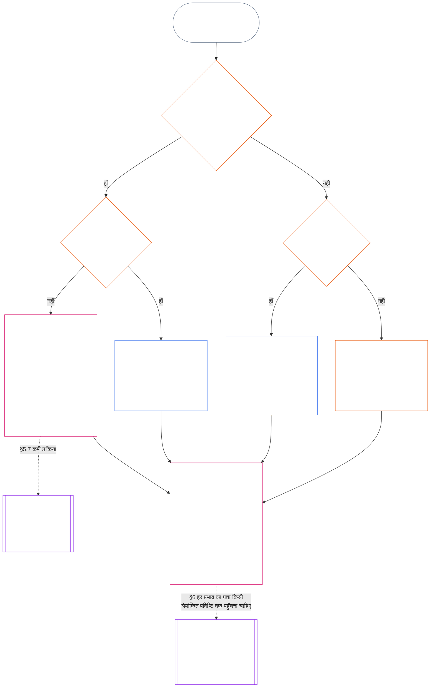

<!-- हिंदी आंशिक अनुवाद मसौदा — §§5.7–5.9। स्रोत: core_11.000_standing_assessment.md; स्रोत स्नैपशॉट: 9c2c8c10c871d91157bcd27b9f56ad6a1cec90d3। AI-द्वारा मसौदा; अप्रतिसमीक्षित; गैर-बाध्यकारी। -->

#### 5.7 जब कोई प्रणाली चार्टर या संस्थागत चार्टर किसी पद को अनाम छोड़ता है

जब सामान्य नामित मार्ग उपलब्ध न हो, तो प्रस्थिति अभिलेख कहाँ जाता है, यह तीन प्रश्नों पर निर्भर करता है, जिन्हें नीचे दिया गया चार्ट क्रम से लेता है। यह खंड उस प्रणाली चार्टर या संस्थागत चार्टर को समेटता है जो किसी पद को अनाम छोड़ता है; [§5.8 जब कोई प्रणाली चार्टर या संस्थागत चार्टर प्रस्थिति अभिलेख तक नहीं पहुँचता तब वैकल्पिक मार्ग](#58-fallback-when-no-system-charter-or-institutional-charter-reaches-the-standing-record) उस स्थिति को समेटता है जहाँ कोई भी ऐसा चार्टर प्रस्थिति अभिलेख तक नहीं पहुँचता।

<strong>पाठक मार्गदर्शन (असंक्रियात्मक): चार्ट कैसे पढ़ें</strong>

> साधारण शब्दों में: प्रस्थिति अभिलेख उन कार्यालयों द्वारा संभाला जाता है जिन्हें प्रणाली चार्टर या संस्थागत चार्टर नामित करता है। यदि प्रणाली चार्टर या संस्थागत चार्टर कोई पद अनाम छोड़ता है, तो कमी ठीक होने तक वह अमान्य है, और प्रस्थिति अभिलेख बैकअप अभिलेख प्राधिकरण तथा बैकअप अभिलेख संरक्षक के पास, या किसी मंच के पास जाता है—मार्ग-मानचित्र के पास नहीं। यदि कोई प्रणाली चार्टर या संस्थागत चार्टर प्रस्थिति अभिलेख तक पहुँचता ही नहीं है, तो संस्था का प्रकाशित मार्ग-मानचित्र निर्णय करता है; और जहाँ ऐसा कोई मानचित्र नहीं है, वहाँ प्रस्थिति अभिलेख स्वतंत्र सत्यापन के पास जाता है या, अनौपचारिक और छोटे-दायरे के काम के लिए, उस निकाय के पास जाता है जो उस पर निर्भर है।
>
> हर मार्ग उसी डिब्बे पर समाप्त होता है: एक कार्यालय तथ्यों का सत्यापन करता है और उससे अलग कार्यालय प्रस्थिति अभिलेख दर्ज करके अपने पास रखता है; फिर [§6 प्रस्थिति अभिलेख संभालना](#6-handling-a-standing-record) यह नियंत्रित करता है कि धारक उसके साथ क्या करते हैं। ठोस तीर मुख्य मार्ग हैं। बिंदीदार तीर हस्तांतरण हैं, जिन पर उन्हें अधिकृत करने वाला खंड लिखा है। दोहरी पार्श्व पट्टियों वाले डिब्बे किसी अन्य अध्याय के हैं, और अंतिम डिब्बा वह है जहाँ प्रस्थिति पर प्रभाव प्रस्थिति अभिलेख से निकाले जाते हैं, उसे दोबारा लिखे बिना। चार्ट कोई कर्तव्य, पद या फ़ील्ड नहीं जोड़ता।

 

ऐसा प्रणाली चार्टर या संस्थागत चार्टर जो आवश्यक अभिलेख-पद या स्वतंत्र मार्ग को अनाम छोड़ता है:

- **परिणाम:** प्रणाली चार्टर या संस्थागत चार्टर अमान्य है, और ऐसा करने वाला बदलाव अनुमत नहीं है ([अध्याय सात §4.7.1 कमी कब होती है और इसे कैसे दर्ज किया जाता है](core_07.000_charters.md#471-when-a-gap-exists-and-how-it-is-logged)).
- **कमी-प्रक्रिया अध्याय सात के अधीन है:** [अध्याय सात §4.7 संचालक प्रस्थिति अभिलेखों के मानचित्र में कमियाँ](core_07.000_charters.md#47-gaps-in-the-map-for-operator-standing-records) इन बातों का भी अधिप्रबंधन करता है:
  - कमी कैसे दर्ज होती है;
  - प्रतिक्रिया और समाधान की अवधियाँ (आपातकालीन प्रतिस्थापन सहित); और
  - अभिरक्षा नामित धारकों को कब लौटती है।

प्रस्थिति अभिलेखों के लिए, यह खंड आगे कहता है:

- **कौन कार्य नहीं कर सकता:** जब तक कोई आवश्यक पद रिक्त है और प्रणाली चार्टर या संस्थागत चार्टर कोई वैध प्रतिस्थापक नामित नहीं करता, कोई भी उस पद का कार्य नहीं कर सकता, सिवाय अगले बिंदु में दिए मार्ग के।
- **प्रस्थिति अभिलेख कहाँ जाता है:** जैसा कि [§5.4 स्वयं अभिरक्षा नहीं](#54-no-self-custody) बताता है, प्रस्थिति अभिलेख बैकअप अभिलेख प्राधिकरण तथा बैकअप अभिलेख संरक्षक के पास, या **खंड 2.7** के तहत किसी मंच के पास जाता है; मार्ग-मानचित्र उसका स्थान नहीं लेता। हर प्रस्थिति अभिलेख एक संरक्षक के पास अखंड रहता है।
- **पहले से अभिरक्षा में रखे प्रस्थिति अभिलेख:**
  - जिस दिन कमी की सूचना किसी मंच, रजिस्ट्रार या बैकअप अभिलेख प्राधिकरण तक पहुँचती है, उस दिन चार्टर्ड पक्ष की तात्विक नियंत्रण रेखा के भीतर किसी कार्यालय के पास रखा कोई भी संचालक प्रस्थिति अभिलेख अपनी पूरी अनुरेखिका सहित बैकअप अभिलेख संरक्षक के पास चला जाता है।
  - तब तक वह कार्यालय उसे केवल-पठन रूप में रखता है, कोई संस्करण दर्ज नहीं करता और उसकी पूरी अनुरेखिका सहित संपूर्ण प्रति तुरंत बैकअप अभिलेख संरक्षक को देता है।
  - रेखा के बाहर का संरक्षक प्रस्थिति अभिलेख अपने पास रखता है और कमी के दौरान हर उस संस्करण को दर्ज करता है जिसे बैकअप अभिलेख प्राधिकरण या मंच अधिकृत करे। यदि कोई मंच तय करता है कि संरक्षक रेखा के भीतर है, तो प्रस्थिति अभिलेख अपनी पूरी अनुरेखिका सहित बैकअप अभिलेख संरक्षक के पास चला जाता है, ठीक वैसे ही जैसे रेखा के भीतर के कार्यालय के मामले में।
- **प्रबंधक:** यदि किसी प्रबंधक से ऐसा पद भरने को कहा जाता है जो प्रणाली चार्टर या संस्थागत चार्टर ने उसे नहीं दिया:
  - **पद अस्वीकार करता है:** प्रस्थिति अभिलेख दर्ज करने की पहुँच या तकनीकी क्षमता होने से उसे दर्ज करने का कोई प्राधिकार नहीं मिलता।
  - **अनुरोध और कमी का नाम देता है:** वह लॉग में दोनों का नाम दर्ज करता है।
  - **प्रस्थिति अभिलेख आगे भेजता है:** ऊपर *प्रस्थिति अभिलेख कहाँ जाता है* में दिए मार्ग से उसे भेजता है।
  - **अपने अन्य कर्तव्य जारी रखता है:** [§5.4 स्वयं अभिरक्षा नहीं](#54-no-self-custody) (*विषय के भीतर के प्रबंधक*) के तहत उसके पहले से मौजूद कर्तव्य जारी रहते हैं: वह अपने नियंत्रण वाली गतिविधि रोकता है, पुनर्निर्मित किए जा सकने वाले समुच्चय को लॉग करता है, अपने पास के साक्ष्य सुरक्षित रखता है, सूचना देता है और मामला आगे बढ़ाता है। इनमें से कोई भी कार्य तथ्यों का सत्यापन या प्रस्थिति अभिलेख दर्ज नहीं करता। लॉग और सुरक्षित साक्ष्य प्रस्थिति अभिलेख के साथ उस प्राधिकरण के लिए इनपुट के रूप में जाते हैं जो उसका सत्यापन करता है; वे प्रविष्टि नहीं हैं और तथ्यों का निर्णय नहीं करते।

#### 5.8 जब कोई प्रणाली चार्टर या संस्थागत चार्टर प्रस्थिति अभिलेख तक नहीं पहुँचता तब वैकल्पिक मार्ग

जहाँ कोई प्रणाली चार्टर या संस्थागत चार्टर उस प्रणाली, संस्था या व्यवसाय को समेटता नहीं है जिससे प्रस्थिति अभिलेख संबंधित है—जैसे Class L रेखा से नीचे का निकाय जिसने कोई चार्टर प्रकाशित नहीं किया—वहाँ **CI-8.205 §2** (*कार्यात्मक पृथक्करण मार्ग*) के तहत संस्था का प्रकाशित मार्ग-मानचित्र लागू होता है:

- **अभिलेख खोलने वाला प्राधिकरण:** वह कार्यालय जिसे मार्ग-मानचित्र उस प्रणाली, संस्था या व्यवसाय के लिए आश्वासन और लेखापरीक्षा मार्ग में रखता है जिससे प्रस्थिति अभिलेख संबंधित है। वह कार्यालय तथ्यात्मक आधार का सत्यापन करता है और प्रविष्टि को अधिकृत करता है ([§5.2 नामित अभिलेख-खोलने वाला प्राधिकरण](#52-named-record-opening-authority)); वह प्रस्थिति अभिलेख दर्ज या अभिरक्षित नहीं करता।
- **संरक्षक:** प्रकाशन और साक्ष्य मार्ग रखने वाला कार्यालय।
- **निष्पादन मार्ग अपवर्जित:** इनमें से कोई भी संबंधित प्रणाली का निष्पादन मार्ग रखने वाला कार्यालय नहीं हो सकता।
- **यहाँ भी कोई मार्ग-मानचित्र नहीं:** ऊपर *स्वयं अभिरक्षा नहीं* के तहत प्रस्थिति अभिलेख स्वतंत्र सत्यापन के पास जाता है या, अनौपचारिक और छोटे-दायरे के अभिलेखों के लिए, आगे दिए *अनौपचारिक और छोटे-दायरे के अभिलेख* के तहत निर्भर निकाय के पास जाता है।
- **प्रबंधक:** यदि किसी प्रबंधक से ऐसा पद भरने को कहा जाता है जो मार्ग-मानचित्र ने उसे नहीं दिया, तो वह [§5.7 जब कोई प्रणाली चार्टर या संस्थागत चार्टर किसी पद को अनाम छोड़ता है](#57-when-a-system-charter-or-institutional-charter-leaves-a-seat-unnamed) का *प्रबंधक* नियम अपनाता है: वह पद अस्वीकार करता है, अनुरोध और कमी को लॉग में नाम देता है और अपने अन्य कर्तव्य जारी रखता है। वह प्रस्थिति अभिलेख को मार्ग-मानचित्र द्वारा नामित कार्यालय के पास भेजता है; और यदि कोई कार्यालय नामित नहीं है, तो ऊपर *यहाँ भी कोई मार्ग-मानचित्र नहीं* में दिया मार्ग अपनाता है।

#### 5.9 अनौपचारिक और छोटे-दायरे के अभिलेख

कर्तव्यों का पृथक्करण औपचारिकता के आधार पर नहीं, बल्कि भौतिक दाँव के अनुपात में होता है ([अध्याय आठ §2 चार सीटों वाली संवैधानिक आवश्यकता](core_08.000_functional_independence_separation_of_duties.md#2-four-seat-constitutional-requirement)).

- **समाहित काम:** स्थानीय समुदाय कई प्रकार के योगदान से चलते हैं, जिनमें से बहुत-सा अवैतनिक और अनौपचारिक होता है। यह अवैतनिक, सहकर्मी-संगठित, पारस्परिक सहायता, देखभाल, रखरखाव, मरम्मत, शिक्षण और सामुदायिक प्रबंधन के काम पर लागू होता है; [अध्याय तेरह §6 योगदान के परिणाम—दूसरा](core_13.000_standing_integration.md#6-contribution-consequences-second) ऐसे काम को समान मानकों पर मान्यता देना आवश्यक करता है।
  - **स्थानीय रूप में उदाहरण:** पड़ोसियों का भोजन और औज़ार साझा करना (पारस्परिक सहायता); बीमार या वृद्ध पड़ोसी की देखभाल करना (देखभाल); साझा बगीचे या नाले को अच्छी हालत में रखना (रखरखाव और सामुदायिक प्रबंधन); पड़ोसी के पाइप ठीक करना (मरम्मत); किसी को पढ़ाना या कौशल दिखाना (शिक्षण)। हर एक अपने आप में योगदान का अलग प्रकार है।
- **सत्यापन-पद कौन भरता है:** ऐसे काम के लिए सत्यापन-पद **प्रस्थिति अभिलेख पर निर्भर होने का प्रकाशित प्राधिकार रखने वाला कोई भी स्वतंत्र निकाय** पूरा कर सकता है; वही सत्यापन प्राधिकरण बनता है।
  - **आमतौर पर कौन:** अक्सर वही निकाय जो प्रस्थिति अभिलेख पर निर्भर करेगा: कोई स्थानीय समूह, जैसे जलग्रहण परिषद; काम को धन देने या जारी रखने वाला संगठन; **CI-6.255** (*साझा संसाधन, सहकारी संस्थाएँ, पारस्परिक सहायता और गैर-बाज़ार सामुदायिक शासन*) अभिलेख-मान्यता प्राधिकरण (ऐसा निकाय जो इस तरह के सामुदायिक काम के अभिलेखों को मान्यता देता है); या **खंड 2.7** के तहत कोई मंच।
- **क्या पर्याप्त नहीं है:** सत्यापन प्राधिकरण की औपचारिकता से सत्यापन-पद पूरा नहीं होता।

ऐसे प्रस्थिति अभिलेख पर:

- अकेले कार्य करने वाले किसी संज्ञ को अपने योगदान का अभिलेख माँगने के लिए किसी समूह, संस्था, [प्रणाली चार्टर](core_05.040_band_continuity.md#system-charter) या [संस्थागत चार्टर](core_05.040_band_continuity.md#institutional-charter) की आवश्यकता नहीं है। उस स्थिति में:
  - **कौन अनुरोध करता है:** अपने अनुरोध पर वह विषय और दावेदार के रूप में आरंभकर्ता-पद रखता है।
  - **उसकी अपनी सामग्री:** उसका अपना विवरण, लॉग और तस्वीरें इनपुट हैं, सत्यापन कभी नहीं।
  - **सत्यापन-पद:** प्रस्थिति अभिलेख पर निर्भर होने का प्रकाशित प्राधिकार रखने वाला कोई भी स्वतंत्र निकाय (सत्यापन प्राधिकरण)।
  - **प्रविष्टि और अभिरक्षा:** अलग अभिलेख संरक्षक प्रस्थिति अभिलेख दर्ज करके अपने पास रखता है।
  - **यदि कोई चुनौती देता है:** चुनौती, चुनौती मार्ग या **खंड 2.7** के तहत किसी मंच के पास जाती है।
  - **निर्भर निकाय उपलब्ध न हो:** जहाँ ऐसा कोई निर्भर निकाय उपलब्ध नहीं है, वहाँ प्रस्थिति अभिलेख **खंड 2.7** के तहत किसी मंच के पास जाता है।
  - **उदाहरण, सेवानिवृत्त प्लंबर:** एक सेवानिवृत्त प्लंबर जिसने वर्षों तक बिना भुगतान पड़ोसियों के पाइप ठीक किए हैं और जिसके पीछे कोई समूह नहीं है, वह प्रस्थिति अभिलेख खोलने के लिए **CI-6.255** (*साझा संसाधन, सहकारी संस्थाएँ, पारस्परिक सहायता और गैर-बाज़ार सामुदायिक शासन*) अभिलेख-मान्यता प्राधिकरण से अनुरोध कर सकता है:
    - **अनुरोध और दावा:** प्लंबर।
    - **सत्यापन:** प्राधिकरण, काम के लॉग और पड़ोसियों के पुष्टिकरण के आधार पर।
    - **दर्ज और अभिरक्षित:** अलग अभिलेख संरक्षक।
    - **यदि कोई चुनौती देता है:** चुनौती मंच के पास जाती है, वापस सत्यापन प्राधिकरण के पास नहीं।
- प्रतिभागी विषय होते हैं और जहाँ वे मान्यता चाहते हैं, वहाँ दावेदार भी। **खंड 4.3** के सामूहिक अभिलेख में:
  - **सह-प्रतिभागी:** प्रत्येक दावेदार है।
  - **किसी सदस्य का दूसरे सदस्य के हिस्से के बारे में कथन:** यह इनपुट है, सत्यापन कभी नहीं।
- प्रस्थिति अभिलेख को सहारा देने वाली सामग्री दो जगहों से आती है:
  - **गैर-प्रतिभागी:** लाभार्थी, पड़ोसी और अन्य गैर-प्रतिभागी **खंड 4.1** के तहत सत्यापन सामग्री के रूप में पुष्टिकरण देते हैं।
  - **समूह का अपना लॉग:** उसे रखने वाला संज्ञ नीचे *अभिलेखक के कथन इनपुट हैं* के तहत अभिलेखक और साक्षी है।
- निर्भर निकाय का अभिलेख संरक्षक वह सामग्री दर्ज करके अभिरक्षित करता है जिसका सत्यापन अलग सत्यापन प्राधिकरण ने किया है:
  - **कौन कोई भी पद नहीं रख सकता:** न अभिलेख संरक्षक, न सत्यापन प्राधिकरण दावेदार या दावेदार की [तात्विक नियंत्रण रेखा](core_05.035_band_accountability.md#material-control-line) में हो सकता है।
  - **एक निकाय, दो पद:** वही निर्भर निकाय ऐसे प्रकाशित मार्ग-मानचित्र के तहत दोनों पदों की मेजबानी कर सकता है जिसमें लेखापरीक्षा-योग्य और चुनौती-योग्य स्वतंत्रता-सुरक्षाएँ हों।
  - **कभी एक ही नहीं:** कोई प्राधिकरण, संरक्षक या संज्ञ एक ही प्रस्थिति अभिलेख पर दोनों कर्तव्य नहीं निभा सकता।
- किसी समूह की अपनी स्थिति उसके सदस्य के दावे की शर्त नहीं है:
  - **अनौपचारिक समूह:** ऐसा समूह जिसके पास [प्रणाली चार्टर](core_05.040_band_continuity.md#system-charter) या [संस्थागत चार्टर](core_05.040_band_continuity.md#institutional-charter) नहीं है, या जो स्वयं संस्था ही नहीं है, अपने सदस्यों को नहीं रोकता।
  - **हर प्रतिभागी:** समूह के भीतर या बाहर किए गए काम के लिए व्यक्तिगत दावेदार के रूप में मान्यता माँग सकता है।
  - **प्रस्थिति अभिलेख किस बारे में है:** यह प्रतिभागी के योगदान के बारे में है, समूह की प्रस्थिति के बारे में नहीं।
  - **उदाहरण, रजाई बनाने वाला समूह:** नए आए शरणार्थियों को रजाइयाँ देने वाला समूह इसका उदाहरण है: हर रजाई बनाने वाला स्वतंत्र निर्भर निकाय, जैसे रजाइयाँ पाने वाली एजेंसी, से सत्यापित प्रस्थिति अभिलेख माँग सकता है; इसके लिए समूह को प्रणाली चार्टर या संस्थागत चार्टर की आवश्यकता नहीं है।
- उल्लंघन का प्रस्थिति अभिलेख इन्हीं अनौपचारिक परिस्थितियों में बन सकता है, और वहाँ भी पद अलग-अलग रहते हैं:
  - **उदाहरण, बार में घटना:** कोई व्यक्ति बार में एक अन्य संज्ञ का वीडियो बनाता है जो नशे में, उच्छृंखल और हिंसक हो जाता है, हालाँकि किसी को शारीरिक चोट नहीं लगती।
    - **चोट आवश्यक नहीं:** हिंसा की सत्यापित विश्वसनीय धमकी उल्लंघन का प्रस्थिति अभिलेख समर्थित कर सकती है, भले किसी को चोट न लगी हो (**खंड 3.2**, दबावकारी कर्तृत्व-हानि)।
    - **वीडियो एक इनपुट है:** वीडियो बनाने वाला संज्ञ साक्षी है। फुटेज इनपुट है, अपने आप कभी सत्यापन नहीं; और उसका मौजूद होना अपने आप कुछ आरंभ नहीं करता (**खंड 2.2**)।
    - **वीडियो में दिख रहा संज्ञ:** वह विषय है। प्रस्थिति अभिलेख खुलने पर उसे सूचित किया जाता है और वह कोई पद नहीं भर सकता ([§5.4 स्वयं अभिरक्षा नहीं](#54-no-self-custody)).
    - **सत्यापन-पद:** प्रस्थिति अभिलेख पर निर्भर होने का प्रकाशित प्राधिकार रखने वाला स्वतंत्र निकाय, जैसे स्थानीय लाइसेंसिंग या सुरक्षा निकाय, या **खंड 2.7** के तहत कोई मंच। यदि वीडियो बनाने वाला संज्ञ या बार का मालिक दावेदार है या किसी दावेदार की [तात्विक नियंत्रण रेखा](core_05.035_band_accountability.md#material-control-line) में है, तो उसे इससे बाहर रखा जाता है।
    - **प्रविष्टि, अभिरक्षा और चुनौती:** अलग अभिलेख संरक्षक प्रस्थिति अभिलेख दर्ज करके अपने पास रखता है, और चुनौती चुनौती मार्ग या **खंड 2.7** के तहत किसी मंच के पास जाती है, सत्यापन निकाय के पास वापस नहीं।
- कोई बार या प्रक्रिया जो ऐसे औपचारिक संस्थान से सत्यापन माँगती है जहाँ अनौपचारिक समूह पहुँच नहीं सकता, जबकि स्वतंत्र निर्भर निकाय उपलब्ध है, वह [अध्याय तेरह §6.2 योग्यता-अवरोध और मंज़ूरियाँ](core_13.000_standing_integration.md#62-competency-bars-and-clearances) वाला मनमाना द्वारपालन पैटर्न है, कर्तव्यों का पृथक्करण नहीं।

इनमें से किसी बात के लिए प्रस्थिति अभिलेख का अस्तित्व आवश्यक नहीं है। **खंड 2.2** *मौन डिफ़ॉल्ट है* लागू होता है: अनौपचारिक काम को सिर्फ इसलिए दर्ज नहीं किया जाता कि ऐसा किया जा सकता है, और कर्तव्यों का पृथक्करण तभी बाध्य करता है जब प्रस्थिति अभिलेख माँगा गया हो।
