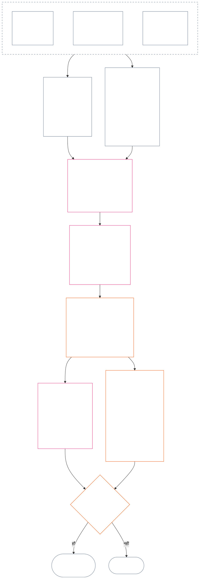

<!-- हिंदी आंशिक अनुवाद मसौदा — अध्याय बारह §§4–6। स्रोत: core_12.000_standing_measurement.md; स्रोत स्नैपशॉट: 9c2c8c10c871d91157bcd27b9f56ad6a1cec90d3। AI-द्वारा मसौदा; अप्रतिसमीक्षित; गैर-बाध्यकारी। -->

### 4. स्लॉट व्याकरण और साझा मापन

*साधारण शब्दों में: यह खंड दो अलग-अलग अक्षों में से प्रत्येक पर नौ संभावित स्थानों के लिए एकसमान नाम देता है और बताता है कि प्रभाव का पैमाना कैसे बढ़ता है। एक अक्ष सत्यापित योगदान दर्ज करता है; दूसरा अक्ष सत्यापित उल्लंघनों के प्रस्थिति अभिलेख दर्ज करता है। स्लॉट संख्या समान होने से अक्ष एक नहीं होते, न ही हानि के बदले सहायता घटाई जा सकती है। **खंड 6** का एकीकृत पैमाना आनुपातिक LEQU प्रभाव के आधार पर दोनों अक्षों का निर्धारण करता है।*

स्लॉट व्याकरण में स्लॉट संख्या `s` का उपयोग **1** से **9** तक होता है। प्रत्येक अक्ष का अपना स्लॉट स्थान है:

- **योगदान अक्ष** सकारात्मक योगदान का स्वरूप दर्ज करता है; और
- **उल्लंघन अक्ष** सत्यापित उल्लंघन निष्कर्ष दर्ज करता है।

दोनों अक्षों पर समान स्लॉट संख्या आ सकती है, लेकिन अक्ष अलग रहते हैं। योगदान स्लॉट, उल्लंघन स्लॉट नहीं है और उल्लंघन स्लॉट, योगदान स्लॉट नहीं है।

#### 4.1 तालिका 1 — स्लॉट प्रदर्शन लेबल

**तालिका 1** नौ स्लॉटों के नाम देती है और योगदान अक्ष तथा उल्लंघन अक्ष के प्रदर्शन लेबल साथ-साथ दिखाती है। यह केवल प्रदर्शन भाषा देती है; स्लॉट का निर्धारण **खंड 6** के एकीकृत पैमाने के तहत होता है।

|  `s` | योगदान अक्ष प्रदर्शन लेबल | उल्लंघन अक्ष प्रदर्शन लेबल |
| ---: | --- | --- |
|    1 | **लघु आधारभूत योगदान** | **लघु संवैधानिक प्रभाव** |
|    2 | **छोटा आधारभूत योगदान** | **छोटा संवैधानिक प्रभाव** |
|    3 | **पर्याप्त सकारात्मक योगदान** | **पर्याप्त संवैधानिक प्रभाव** |
|    4 | **महत्त्वपूर्ण सकारात्मक योगदान** | **महत्त्वपूर्ण संवैधानिक प्रभाव** |
|    5 | **गंभीर उत्तरदायी-प्रबंधन-सकारात्मक योगदान** | **गंभीर संवैधानिक प्रभाव** |
|    6 | **प्रमुख उत्तरदायी-प्रबंधन-सकारात्मक योगदान** | **प्रमुख संवैधानिक प्रभाव** |
|    7 | **मान्य चैंपियन** | **गंभीर संवैधानिक प्रभाव** |
|    8 | **विशिष्ट चैंपियन** | **अति-गंभीर संवैधानिक प्रभाव** |
|    9 | **अनुकरणीय चैंपियन** | **विनाशकारी संवैधानिक प्रभाव** |

योगदान अक्ष आधारभूत, सकारात्मक, उत्तरदायी-प्रबंधन-सकारात्मक और चैंपियन लेबलों का उपयोग करता है। उल्लंघन अक्ष हर स्लॉट पर तटस्थ प्रभाव लेबलों का उपयोग करता है। अक्ष अलग रहते हैं और शुद्ध अंक नहीं बनाते या योगदान और उल्लंघन अभिलेखों के बीच परस्पर समायोजन की अनुमति नहीं देते। उल्लंघन अक्ष का स्लॉट अपने आप संविधान-विरोधी दुराचार को वर्गीकृत नहीं करता; [अध्याय चौदह](core_14.000_misconduct_designation.md#chapter-fourteen-anti-constitutional-misconduct) स्वतंत्र रूप से तय करता है कि सत्यापित `s` = 7–9 उल्लंघन पर संविधान-विरोधी दुराचार निर्धारण (ACMD) लागू होता है या नहीं।

कार्यान्वयन पूरे जीवन के समतुल्य लाभ या हानि का अनुमान लगाने में मदद के लिए मापन इकाइयाँ, साक्ष्य विधियाँ और उदाहरण प्रकाशित कर सकते हैं। ये सामग्री केवल मार्गदर्शन हैं और **खंड 6**, **अध्याय एक** या **अध्याय छह** के अधिकार तल को अधिरोहित नहीं कर सकतीं।

#### 4.2 साझा प्रभाव-मापन नियम

*साधारण शब्दों में: प्रभाव केवल व्यक्तियों की संख्या से नहीं मापा जाता। एक संज्ञ को प्रभावित करने वाला गहरा लाभ या नुकसान, बहुतों को प्रभावित करने वाले सतही प्रभाव से अधिक महत्त्वपूर्ण हो सकता है। संख्या, गहराई, संवेदनशीलता, अवधि, टिकाऊपन, पहुँच और संवैधानिक चरित्र का साथ-साथ आकलन होना चाहिए।*

**खंड 6** में दोनों अक्षों की व्याख्या के लिए ये नियम अपनाएँ:

| मापन आयाम | साझा नियम | अक्ष-विशिष्ट प्रयोग |
| --- | --- | --- |
| **संवैधानिक परिणाम का परिमाण (LEQU)** | एकीकृत सत्यापित लाभ या हानि का आकलन करें। LEQU प्राथमिक परिमाण आधार है; कच्ची व्यक्ति-संख्या, धन, उत्पादन या संस्थागत आकार नहीं। | योगदान अधिकार-अनुरूप लाभ गिनता है; उल्लंघन सत्यापित संवैधानिक हानि, नुकसान, अपव्यय, अवसर-निषेध या खतरा गिनता है। |
| **संज्ञ दायरा** | **संख्या, गहराई और संवेदनशीलता** पर साथ-साथ विचार करें। कोई स्लॉट व्यक्ति-संख्या को स्वतंत्र आवश्यकता नहीं बनाता। एक संज्ञ पर पर्याप्त गहरा प्रभाव उसी स्लॉट का समर्थन कर सकता है जो व्यापक लेकिन कम गहरे प्रभाव को मिलता, यदि एकीकृत परिमाण और पंक्ति के अन्य मानदंड समान हों; फिर भी स्पष्ट समग्र-LEQU या व्यापक-दायरा मानदंड पूरा होना चाहिए। | निर्भरता, कम हुई क्षमता या असामान्य संवेदनशीलता भौतिकता बढ़ा सकती है। केवल समूह का आकार योगदान या गंभीरता स्थापित नहीं करता। |
| **कालिक दायरा** | अवधि, पुनरावृत्ति, टिकाऊपन और हानि के लिए अपरिवर्तनीयता पर विचार करें। छोटा लेकिन रूपांतरकारी घटनाक्रम लंबे मामूली प्रभाव से अधिक हो सकता है; केवल अवधि निर्णायक नहीं। | टिकाऊ लाभ अधिक योगदान-परिमाण का समर्थन करता है। स्थायी या अपरिवर्तनीय हानि अधिक उल्लंघन-गंभीरता का समर्थन करती है। |
| **स्थानिक या संस्थागत दायरा** | व्यापक पहुँच परिमाण बढ़ा सकती है, लेकिन जहाँ गहराई, अवधि, संवेदनशीलता या संवैधानिक महत्त्व अपने आप स्लॉट का समर्थन करते हों, वहाँ समुदायों या संस्थानों के पार पहुँच आवश्यक नहीं। | संस्थागत सुधार योगदान-परिमाण बढ़ा सकता है; संरचनात्मक या प्रणालीगत क्षति उल्लंघन-गंभीरता बढ़ा सकती है। |
| **संवैधानिक गुणवत्ता या चरित्र** | परिणाम कैसे उत्पन्न हुआ, इसे उससे अलग मापें कि वह कितनी दूर तक फैला। एक ही तथ्य को दो बार न गिनें। | बाहरी पक्षों पर डाली गई हानि, छिपा हुआ बोझ, कब्ज़ा या निर्भरता दावा किए गए योगदान को सीमित या अयोग्य कर सकते हैं। कर्तव्य, लापरवाही, छल, दबाव, हिंसा या संरचनात्मक सक्षमकरण उल्लंघन आचरण का चरित्र अलग से दर्ज रहता है और प्रभाव स्लॉट नहीं बदलता। |
| **अधिकार तल और महत्त्वपूर्ण सुरक्षा उपाय** | अधिकार-तल अनुपालन का समग्र लाभ या हानि के बदले लेन-देन नहीं होता। | अधिकार-तल का पालन अपने आप उच्च योगदान स्थापित नहीं करता। अधिकार-तल की भौतिक पराजय या महत्त्वपूर्ण सुरक्षा उपाय की विफलता, भले सीधे प्रभावित संज्ञ कम हों, उच्च उल्लंघन-गंभीरता का समर्थन कर सकती है। |

ये आयाम ऐसी जाँच-सूची नहीं हैं जिसमें हर तरह का पैमाना आवश्यक हो। बताएँ कि किन आयामों ने निर्णय नियंत्रित किया, किनने नहीं, और क्यों।

- **साझा स्लॉट विधि:**
  - आनुपातिकता के तहत LEQU में एकीकृत सत्यापित लाभ या हानि का अनुमान लगाएँ, फिर उसी एक स्लॉट का निर्धारण करें जिसकी संख्यात्मक सीमा में वह परिमाण आता है।
  - दोनों अक्षों पर समान सीमाएँ लागू होती हैं।
  - योगदान स्लॉट लागू आधारभूत और संवैधानिक-संरेखण आवश्यकताएँ बनाए रखते हैं; संख्यात्मक सीमा पूरी करने से बाहरी पक्षों पर डाला गया या संवैधानिक रूप से पराजित उत्पादन योगदान नहीं बन जाता।
- **चरित्र का पृथक्करण:** लागू लाभ-मार्ग, हानि-मार्ग, आचरण-गुणवत्ता और आचरण-चरित्र वर्णकों को प्रस्थिति अभिलेख में अलग-अलग अनुरेखणीय रूप से साथ रखें। कर्तव्य, लापरवाही, छल, गंभीरता-वर्धन, दबाव, हिंसा, आशय या संरचनात्मक सक्षमकरण श्रेय-निर्धारण, सुरक्षा उपायों या प्रश्न 3 के परिणामों को प्रभावित कर सकते हैं, लेकिन इनमें से कोई भी LEQU प्रभाव स्लॉट को ऊपर या नीचे नहीं करता।
- **संविधान-विरोधी दुराचार समीक्षा की सीमा:** सत्यापित उल्लंघन-अक्ष हानि प्रभाव के आधार पर `s` = 7–9 तक पहुँच सकती है, चाहे संविधान-विरोधी दुराचार स्थापित हो या नहीं। अध्याय चौदह प्रभाव-निर्धारण को प्रतिस्थापित नहीं करता; वह स्वतंत्र रूप से तय करता है कि संबंधित ACMD लागू होता है या नहीं।

यदि कोई खतरा अभी घटित नहीं हुआ है, तो निम्न प्रत्येक बात को अलग-अलग दर्ज करें:

- इसकी संभावना कितनी है;
- संज्ञ कितने समय तक इसके सामने होंगे;
- यह कितनी दूर तक फैल सकता है;
- अनुमान कितना अनिश्चित है; और
- सबसे बुरा कौन-सा परिणाम अब भी विश्वसनीय है।

उस सबसे बुरे परिणाम को पहले से घटित हानि (LEQU हानि) न गिनें, जब तक अंगीकृत कार्यान्वयन ने जोखिम-मापन (जोखिम को LEQU में बदलने की विधि) तय न किया हो जिसे कोई भी देख सके।

### 5. अक्ष-निर्धारण के संवैधानिक इनपुट

*साधारण शब्दों में: स्लॉट चुनने से पहले उन संवैधानिक स्रोतों की पहचान करें जो बताते हैं कि कौन-सा आधार, लाभ, कर्तव्य, हानि या उल्लंघन मापा जा रहा है। नीचे दिए लिंक उन स्रोतों के मानक स्थान पर लागू करने के लिए उपयोग करें; इस मार्गन चरण को दूसरा अंक या वैकल्पिक परिभाषा न बनाएँ।*

**खंड 6** के तहत स्लॉट निर्धारित करने से पहले प्रस्थिति अभिलेख में निम्नलिखित की पहचान आवश्यक है:

- लागू संवैधानिक आधार, कर्तव्य, बाध्यता या संरक्षित हित;
- वे प्रावधान जो मापे जा रहे सत्यापित लाभ, प्रतिकूल परिणाम, हानि या उल्लंघन को स्थापित करते हैं;
- वे परिभाषाएँ, सिद्धांत और अधिकार-तल अनुच्छेद जो परिमाण या आचरण-चरित्र को भौतिक रूप से प्रभावित करते हैं; और
- हर पहचाने गए स्रोत के लागू होने का कारण तथा अक्ष-निर्धारण पर उसका प्रभाव।

नीचे की मार्गन तालिकाएँ पूरी सूची नहीं हैं। सत्यापित तथ्यों से सक्रिय होने वाली हर अतिरिक्त परिभाषा, सिद्धांत या अनुच्छेद लागू रहता है और प्रस्थिति अभिलेख में उसकी पहचान आवश्यक है। प्रत्येक लिंक किया गया मानक स्थान निर्णायक है; ये तालिकाएँ उसे दोहराती या संकीर्ण नहीं करतीं।

#### 5.1 परिभाषा संबंधी इनपुट

| मानक स्रोत | योगदान अक्ष की भूमिका | उल्लंघन अक्ष की भूमिका |
| --- | --- | --- |
| [प्रस्थिति अवस्था, योगदान और उल्लंघन](core_05.035_band_accountability.md#defa3-standing-state-contribution-and-violation) | बताता है कि क्या योगदान माना जाता है और कौन-से जाँचे हुए तथ्य इसे मापने के लिए उपयोग हो सकते हैं। यह भी सुनिश्चित करता है कि योगदान प्रस्थिति अभिलेख केवल अच्छे पक्ष को दर्ज करे, कभी बुरे पक्ष के साथ मिश्रित न हो। | बताता है कि क्या उल्लंघन माना जाता है और उसे कैसे दर्ज किया जाता है। यह सबसे गंभीर मामलों को संविधान-विरोधी दुराचार समीक्षा की ओर भी भेजता है—ऐसे आचरण की अलग समीक्षा जो स्वयं संविधान को कमजोर करता है। |
| [जवाबदेही](core_05.005_apex_accountability_leg.md#accountability) | जाँचता है कि उत्तरदायी प्रबंधन या सुधार का दावा वास्तव में किसी को जवाबदेह रखता है या नहीं। यह फिर भी दिखाना होगा कि किसने क्या किया, किसे उसका जवाब देना है और प्रभाव के अनुपात में उसकी समीक्षा, सुधार और संशोधन कैसे हो सकता है। | ऐसे मामले पहचानता है जिनमें यह अस्पष्ट है कि कुछ किसने किया या किसे जवाब देना है। इसमें वे मामले शामिल हैं जहाँ संगठन या उसकी संरचना बदलने के बाद जिम्मेदारी काम करना बंद कर देती है। |
| [हानि](core_05.035_band_accountability.md#harm) | दूसरों पर डाली गई या छिपाई गई हानि दावा किए गए लाभ को सीमित या रद्द कर सकती है। हानि की मरम्मत लाभ गिनी जा सकती है, लेकिन तभी जब मरम्मत सत्यापित हो और स्वतंत्र रूप से प्रदर्शित की गई हो। | हानि और गंभीरता मापते समय गिने जाने वाले नुकसान के प्रकार स्पष्ट करता है: प्रत्यक्ष, अप्रत्यक्ष, विलंबित, संचयी, प्रणालियों में फैला हुआ, और संज्ञ के मन या भावनात्मक कल्याण को नुकसान। |
| [भौतिकता](core_05.050_band_oversight.md#materiality) और [जीवनकाल समतुल्य इकाई (LEQU)](core_05.055_band_participation.md#lifespan-equivalent-unit-lequ) | सत्यापित लाभ का परिमाण तय करते हैं—यह देखकर कि वह कितनी दूर तक पहुँचता है, प्रभावित लोग कितने संवेदनशील हैं और लाभ कितने समय रहता है। परिणाम LEQU में मापा जाता है, जो पूरे जीवन के लाभ का साझा माप है। | सत्यापित हानि या खतरे का परिमाण तय करते हैं—यह देखकर कि वह कितनी दूर तक पहुँचता है, प्रभावित संज्ञ कितने संवेदनशील हैं, कितने समय रहता है और उसे पलटना कितना कठिन है। परिणाम LEQU में मापा जाता है, जो पूरे जीवन की हानि का वही साझा माप है। |
| [योगदान का स्वरूप](core_05.035_band_accountability.md#contribution-nature) | तय करता है कि क्या चीज़ योगदान मानी जाती है। वह केवल अच्छी होनी चाहिए, हानि के साथ मिश्रित नहीं, और प्रदर्शित किए जा सकने वाले सत्यापित योगदान अभिलेख से समर्थित होनी चाहिए। दोनों के बिना योगदान अक्ष निर्धारण नहीं हो सकता। | यहाँ कोई भूमिका नहीं। यह तय नहीं करता कि हानि क्या है और उल्लंघन की गंभीरता कभी कम नहीं करता। |
| [उल्लंघन का स्वरूप](core_05.035_band_accountability.md#violation-nature) | यहाँ कोई भूमिका नहीं। उल्लंघन को कभी नकारात्मक योगदान नहीं गिना जाता और असंबंधित सत्यापित लाभ मिटाया नहीं जाता। | तय करता है कि क्या चीज़ उल्लंघन मानी जाती है। उसे हानिकारक वर्गीकृत किया जाना चाहिए और उल्लंघन होने के सत्यापित निष्कर्ष से समर्थित होना चाहिए। दोनों के बिना उल्लंघन अक्ष निर्धारण नहीं हो सकता। |
| [संवैधानिक बाध्यता](core_05.045_band_integrative.md#constitutional-constraint), [प्राधिकार-क्रम और आंतरिक पदानुक्रम](core_05.045_band_integrative.md#authority-stack-and-internal-hierarchy), और [लेखापरीक्षा-योग्यता](core_05.050_band_oversight.md#auditability) | किसी दावे किए गए लाभ को गिनने से रोकते हैं जब वह संविधान को पराजित करने, उसके नियमों से बचने, अधिकार तल (संविधान द्वारा सुनिश्चित न्यूनतम संरक्षण) को घटाने या केवल कागज़ पर अनुपालन पर निर्भर हो। | उल्लंघन की वास्तविक गंभीरता प्रभावित करने वाली बातें सामने लाते हैं: महत्त्वपूर्ण संवैधानिक सीमा तोड़ना, किसी चीज़ को संविधान के प्राधिकार से ऊपर रखना, नियमों से बचना या उन्हें लागू करना असंभव बनाना। |
| [लेखापरीक्षा-योग्यता](core_05.050_band_oversight.md#auditability) और [चुनौती-योग्यता](core_05.035_band_accountability.md#contestability) | आवश्यक करते हैं कि दावा किया गया लाभ दिखाया और जाँचा जा सके तथा असहमत व्यक्ति के पास उसे चुनौती देने का कारगर तरीका हो। | ऐसे निष्कर्ष आवश्यक करते हैं जिन्हें जाँचा और चुनौती दी जा सके। आरोप या बिना व्याख्या वाला लेबल उल्लंघन की गंभीरता तय नहीं कर सकता। |

#### 5.2 सिद्धांत संबंधी इनपुट

| सिद्धांत स्रोत | अक्ष-निर्धारण में भूमिका |
| --- | --- |
| [संवैधानिक चतुष्क](core_00.000_preamble.md#constitutional-tetrad), [दो संवैधानिक उद्देश्य](core_00.000_preamble.md#two-constitutional-aims), और [भौतिक दाँव](core_00.000_preamble.md#material-stake) | चार कार्य-अनुशासन (सहभागिता, निगरानी, जवाबदेही और समयबद्धता), संविधान के दो लक्षित परिणाम (समुन्नति और सातत्य) और हर निर्धारण को दाँव पर लगी बात के अनुरूप आकार देने वाला ढाँचा तय करते हैं। |
| [कल्याण](core_01.000_values_principles.md#3-foundational-objective-wellbeing-flourishing-aim) और [मान्यता, सुदृढ़ीकरण और आकांक्षा](core_01.000_values_principles.md#32-recognition-reinforcement-and-aspiration) | अधिकारों का सम्मान करने वाले योगदान लाभ को और उसके अनुरूप मान्यता को योगदान अक्ष पर आधार देते हैं। प्रतिष्ठा या पुरस्कार को कभी योगदान का प्रमाण नहीं माना जाता। |
| [सुरक्षा](core_01.000_values_principles.md#4-safety-harm-constraint) और [सत्य](core_01.000_values_principles.md#5-truth-epistemic-integrity-constraint) | दोनों अक्षों पर बाध्यकारी सीमाएँ तय करते हैं। हानि या छल से मिला लाभ पूर्ण रूप से नहीं गिना जाता, और सुरक्षा या सत्य की सत्यापित विफलता यह दिखा सकती है कि उल्लंघन कितना बड़ा या किस प्रकार का था। |
| [उत्तरदायी प्रबंधन का गहन विवेचन](core_01.010_stewardship_capacity_principles.md#16-stewardship-in-depth) और [उत्तरदायी प्रबंधन अनुशासन के तहत शासन](core_01.010_stewardship_capacity_principles.md#18-governance-under-stewardship-discipline) | जब सत्यापित तथ्य इसकी माँग करें, तब टिकाऊ योगदान, भूमिका से जुड़े कर्तव्य, संस्थागत सुधार, पर्यवेक्षण और जिम्मेदारी को तौलने का मार्गदर्शन करते हैं। |
| [मूल व्यापार-विनिमय सिद्धांत](core_01.005_interaction_interpretation.md#131-core-tradeoff-principles) और [संवैधानिक तल, सुरक्षा और अपमान-निरोधी प्रक्रिया](core_01.005_interaction_interpretation.md#1314-constitutional-floors-safety-and-anti-degrading-process) | तब लागू होते हैं जब मापा गया आचरण आवश्यकता, हानि को न्यूनतम रखने, आनुपातिकता, अधिकारों के टकराव या प्रतिबंध से जुड़ा हो। वे अपने आप कभी परिणाम अधिकृत नहीं करते। |

#### 5.3 अधिकार-तल और अनुच्छेद संबंधी इनपुट

| अनुच्छेद स्रोत | अक्ष-निर्धारण की भूमिका या सीमा |
| --- | --- |
| तथ्यात्मक रूप से लागू [अध्याय छह अधिकार तल](core_06.000_rights_part_a.md#chapter-six-foundational-rights), जिसमें सत्यापित प्रस्थिति अभिलेख से भौतिक रूप से प्रभावित हर अनुच्छेद शामिल है | दाँव पर लगे मूल संरक्षण, हित, कर्तव्य, लाभ या उल्लंघन स्थापित करता है। नीचे सूचीबद्ध न होने के कारण कोई अनुच्छेद छोड़ा नहीं जाता। |
| [अनुच्छेद XIX — प्रस्थिति और सहभागिता स्थिति](core_06.015_rights_part_d.md#article-xix-standing-and-participation-status) | संज्ञ की प्रस्थिति, गरिमा, अधिकार तल के न्यूनतम संरक्षण, हितधारक स्थिति, प्रतिष्ठा और सहभागिता स्थिति में बाद के किसी बदलाव को अलग रखता है। |
| [अनुच्छेद XIII-A — विश्वसनीयता और भरोसेमंदी का आधार](core_06.010_rights_part_c.md#article-xiii-a-reliability-and-trustworthiness-baseline) और [अनुच्छेद XIII-B — प्रतितोष और उपाय का अधिकार](core_06.010_rights_part_c.md#article-xiii-b-right-to-redress-and-remedy), [अनुच्छेद XV-B — पारदर्शिता, लेखापरीक्षा-योग्यता और चुनौती-योग्यता](core_06.010_rights_part_c.md#article-xv-b-transparency-auditability-and-contestability), तथा [अनुच्छेद XVI — लेखापरीक्षा, पारदर्शिता और स्वतंत्र सत्यापन](core_06.010_rights_part_c.md#article-xvi-audit-transparency-and-independent-verification) | तब लागू होते हैं जब सत्यापित लाभ या उल्लंघन ईमानदार अभिलेख रखने, जानकारी साझा करने, तथ्य जाँचने, निर्णय को चुनौती दे सकने या गलतियाँ सुधारने से जुड़ा हो। |
| [अनुच्छेद XXIV — मूल कारण विश्लेषण और अनुकूलनशील प्रतिक्रिया](core_06.015_rights_part_d.md#article-xxiv-root-cause-analysis-and-adaptive-response) | तब लागू होता है जब आचरण का कारण, उसका सुधार, पुनरावृत्ति या प्रतिक्रिया का अनुकूलन महत्त्वपूर्ण हो, क्योंकि इससे पता चलता है कि संविधान के तहत आचरण की स्थिति क्या है। |
| [अनुच्छेद XX — सत्यापित उल्लंघन के बाद न्याय](core_06.015_rights_part_d.md#article-xx-justice-after-verified-violation) और [अनुच्छेद XXVI-C — समयबद्ध समाधान और विलंब-विरोधी तल](core_06.020_rights_part_e.md#article-xxvi-c-timely-resolution-and-anti-delay-floor) | तथ्यों में वास्तव में शामिल किसी भी प्रक्रिया या विलंब पर लागू होते हैं। **अनुच्छेद XX** (*सत्यापित उल्लंघन के बाद न्याय*) मुख्यतः उल्लंघन मापे जाने के बाद (प्रश्न 3) क्या होता है, उसे सीमित करता है। इसका उपयोग प्रश्न 2 स्लॉट को सिर्फ इसलिए ऊपर या नीचे करने के लिए नहीं होना चाहिए कि किसी को पहले से पसंद परिणाम उचित ठहराना है। |

**प्रयोग की सीमाएँ।** यह चरण केवल सही स्रोतों की ओर संकेत करता है।

- यह:
  - प्रश्न 1 को फिर से नहीं खोलता;
  - असत्यापित तथ्यों को स्वीकार नहीं करता;
  - नया माप या अंक नहीं जोड़ता;
  - अलग-अलग स्रोतों से एक तथ्य को दो बार नहीं गिनता;
  - दोनों अक्षों को एक नहीं करता; या
  - सूचीबद्ध हर स्रोत को हर प्रस्थिति अभिलेख पर लागू नहीं करता।
- योगदान और उल्लंघन का मापन अलग-अलग जारी रहता है।
- **अनुच्छेद XX** (*सत्यापित उल्लंघन के बाद न्याय*) के परिणाम प्रश्न 2 के बाहर रहते हैं।
- अध्याय चौदह का निर्धारण-समीक्षा यहाँ दिए प्रभाव-स्लॉट से अलग रहती है।

### 6. एकीकृत आनुपातिक LEQU पैमाना — योगदान और उल्लंघन अक्ष

<strong>पाठक मार्गदर्शन (असंक्रियात्मक): पाँच-गुना प्रगति कैसे काम करती है</strong>

> पैमाना `s` = 7 = एक LEQU पर आधारित पाँच-गुना प्रगति का उपयोग करता है। दोनों में से किसी भी अक्ष के लिए, स्लॉट 2 से 9 तक स्लॉट `s` का न्यूनतम परिमाण `5^(s−7)` LEQU है; स्लॉट 1 शून्य से शुरू होता है। अंगीकृत कार्यान्वयन परिणामी संख्यात्मक सीमाएँ और अंशांकन उदाहरण प्रकाशित कर सकता है। स्लॉट 1 में योगदान अक्ष पर सत्यापित संवैधानिक आधार पूरा होना और उल्लंघन अक्ष पर पहली सकारात्मक सीमा से नीचे की सत्यापित हानि शामिल है; योगदान का न होना या उल्लंघन का न होना अपने आप `s` = 1 अभिलेख नहीं है।
>
> **मानव-पठनीय आधार।** अंशांकन उदाहरण के रूप में 80 वर्ष का मानव जीवनकाल लेकर, मध्य स्तंभ को ऊपर पढ़ें तो वह पूर्ण-जीवन-समतुल्य लाभ, उपयोगी समय या जोड़े गए अधिकार-अनुरूप संसाधन और क्षमता बताता है; नीचे पढ़ें तो वह समतुल्य हानि, वंचना, अपव्यय या अवसर-निषेध बताता है। संसाधन की मात्रा अपने आप नहीं गिनी जाती—उससे उत्पन्न या रोका गया संवैधानिक परिणाम निर्णायक है।

 

*साधारण शब्दों में: **तालिका 2** सत्यापित योगदान और सत्यापित उल्लंघन को एक ही आनुपातिक प्रभाव-पैमाने पर रखती है। उच्च स्लॉट का अर्थ अधिक एकीकृत संवैधानिक लाभ या हानि है। प्रस्थिति अभिलेख और अक्ष अलग रहते हैं: साझा पैमाना परिमाण की तुलना करता है, नैतिक मूल्य की नहीं, और सहायता को हानि रद्द करने की अनुमति कभी नहीं देता।*

यह चार्ट एक स्लॉट निर्धारण को आरंभ से अंत तक दिखाता है। इसमें चरणों के काम करने का क्रम दिखाया गया है, जो नीचे दिए बिंदुओं का क्रम नहीं है; नीचे के बिंदु प्रत्येक नियम बताते हैं।

LEQU के एकीकृत प्रभाव का अनुमान लगाने के लिए गहराई, संज्ञ दायरा, संवेदनशीलता, अवधि, टिकाऊपन या अपरिवर्तनीयता, पहुँच और संवैधानिक महत्त्व पर **आनुपातिकता** लागू करें। ये आयाम LEQU अनुमान को आकार देते हैं; वे स्वतंत्र स्लॉट बोनस नहीं हैं।

- **तालिका 2** का उपयोग तब करें जब प्रश्न 1 ने पुष्टि कर दी हो कि क्या हुआ, प्रश्न 2 ने सत्यापित लाभ या हानि का मापन कर लिया हो, **खंड 1–3 और 4.2** लागू हो चुके हों, और **खंड 5** द्वारा आवश्यक संवैधानिक स्रोतों की पहचान हो चुकी हो।
- एकीकृत LEQU अनुमान से एक स्लॉट निर्धारित करें।
  - बताएँ कि हर भौतिक मापन आयाम ने अनुमान को कैसे प्रभावित किया और छोड़े गए आयाम निर्णायक क्यों नहीं थे।
  - हर निर्धारण में निम्न आवश्यक हैं:
    - अनुरेखणीयता;
    - लेखापरीक्षा-योग्यता;
    - चुनौती-योग्यता; और
    - लागू अधिकार तल।
  - योगदान के लिए बाहरीकरण-निषेध और संवैधानिक संरेखण भी आवश्यक हैं।
- आचरण-चरित्र से जुड़े तथ्यों को अलग-अलग अनुरेखणीय वर्णकों के रूप में दर्ज करें। वे श्रेय-निर्धारण, समीक्षा की तीव्रता, सुरक्षा उपाय, उपाय या अध्याय चौदह के निर्धारण को नियंत्रित कर सकते हैं; वे स्लॉट को केवल उतनी सीमा तक प्रभावित करते हैं जितनी सत्यापित परिणाम एकीकृत LEQU प्रभाव को बदलते हैं।
- कार्रवाई या आचरण-क्रम के सत्यापित परिणामों का भौतिक मापन आयामों के माध्यम से पूरा आकलन करें, जिनमें शामिल हैं:
  - शारीरिक चोट;
  - मनोवैज्ञानिक आघात;
  - दबावकारी प्रभाव;
  - स्वतंत्रता से वंचना या उसका खतरा;
  - संचयी हानि; और
  - अन्य संवैधानिक रूप से संज्ञेय लाभ या हानि।
- ऐसा न करें:
  - किसी घटना या आचरण-क्रम के निम्न में से किसी रूप में वर्णित होने मात्र से स्लॉट ऊपर या नीचे न करें:
    - कर्तव्य;
    - लापरवाही;
    - आशय;
    - छिपाव;
    - पुनरावृत्ति;
    - गंभीरता-वर्धन;
    - दबाव;
    - हिंसा;
    - स्वतंत्रता का खतरा;
    - सुधार-क्षमता; या
    - पसंदीदा परिणाम।
  - परिमाण से आचरण-चरित्र का अनुमान न लगाएँ, न ही सत्यापित परिमाण के स्थान पर आचरण-चरित्र रखें।

**तालिका 2** नौ स्लॉट क्रम से सूचीबद्ध करती है। हर पंक्ति में स्लॉट संख्या `s`, उस स्लॉट तक पहुँचने वाला जोड़ा गया लाभ या थोपी गई हानि (अंशांकन उदाहरण के रूप में 80 वर्ष का मानव जीवनकाल लेकर) और प्रत्येक अक्ष पर स्लॉट का नाम दिया गया है। दोनों अक्षों पर समान सीमाएँ लागू होती हैं, लेकिन नाम अलग रहते हैं: योगदान अक्ष का स्लॉट और उल्लंघन अक्ष का स्लॉट अलग अभिलेख हैं और कभी परस्पर समायोजित नहीं होते।

| `s` | 80-वर्षीय मानव अंशांकन — जोड़ा गया लाभ / थोपी गई हानि | योगदान अक्ष | उल्लंघन अक्ष |
| ---: | --- | --- | --- |
| 1 | लगभग **9 दिनों** से कम | **लघु आधारभूत योगदान** — आकलित दायरे के लिए संवैधानिक न्यूनतम का सत्यापित पूरा होना; कोई भी मापनीय वृद्धि `s` = 2 से नीचे रहती है। | **लघु संवैधानिक प्रभाव** — `s` = 2 से नीचे सत्यापित हानि या संचालनगत बाधा, जिसमें ठोस हानि सिद्ध न होने वाली औपचारिक त्रुटि भी शामिल है। |
| 2 | लगभग **9–47 दिन** | **छोटा आधारभूत योगदान** — इस प्रभाव स्तर के भीतर न्यूनतम आधार से आगे विश्वसनीय, सीमित निष्पादन। | **छोटा संवैधानिक प्रभाव** — इस प्रभाव स्तर पर सत्यापित सीमित हानि। |
| 3 | लगभग **47 दिन–8 महीने** | **पर्याप्त सकारात्मक योगदान** — इस प्रभाव स्तर पर आधाररेखा से आगे प्रदर्शनीय लाभ। | **पर्याप्त संवैधानिक प्रभाव** — इस प्रभाव स्तर पर सत्यापित पर्याप्त हानि। |
| 4 | लगभग **8 महीने–3.2 वर्ष** | **महत्त्वपूर्ण सकारात्मक योगदान** — अधिक गहरा, टिकाऊ, बार-बार हुआ, संवेदनशीलता के अनुरूप या व्यापक सत्यापित लाभ। | **महत्त्वपूर्ण संवैधानिक प्रभाव** — सत्यापित महत्त्वपूर्ण संवैधानिक हानि। |
| 5 | लगभग **3.2–16 वर्ष** | **गंभीर उत्तरदायी-प्रबंधन-सकारात्मक योगदान** — टिकाऊ उत्तरदायी प्रबंधन, समन्वय, रखरखाव, मरम्मत या तुलनीय सतत लाभ। | **गंभीर संवैधानिक प्रभाव** — सत्यापित गंभीर संवैधानिक हानि। |
| 6 | लगभग **16–80 वर्ष** | **प्रमुख उत्तरदायी-प्रबंधन-सकारात्मक योगदान** — एक LEQU के निकट पहुँचता प्रमुख सत्यापित लाभ। | **प्रमुख संवैधानिक प्रभाव** — एक LEQU के निकट पहुँचती प्रमुख सत्यापित हानि। |
| 7 | लगभग **1–5 जीवनकाल** (**80–400 वर्ष**) | **मान्य चैंपियन** — कम-से-कम एक LEQU का सत्यापित, संवैधानिक रूप से संरेखित लाभ। | **गंभीर संवैधानिक प्रभाव** — कम-से-कम एक LEQU की सत्यापित संवैधानिक हानि। |
| 8 | लगभग **5–25 जीवनकाल** (**400–2,000 वर्ष**) | **विशिष्ट चैंपियन** — सत्यापित लाभ जो `s` = 7 से भौतिक रूप से अधिक हो। | **अति-गंभीर संवैधानिक प्रभाव** — सत्यापित हानि जो `s` = 7 से भौतिक रूप से अधिक हो। |
| 9 | कम-से-कम **25 जीवनकाल** (**2,000+ वर्ष**) | **अनुकरणीय चैंपियन** — सत्यापित लाभ जो `s` = 8 से भौतिक रूप से अधिक हो। | **विनाशकारी संवैधानिक प्रभाव** — सत्यापित हानि जो `s` = 8 से भौतिक रूप से अधिक हो। |

<strong>कार्यान्वयन अंतरसंचालनीयता टिप्पणी</strong>

> इस विजेट में कार्यान्वयन-उन्मुख अंतरसंचालनीयता सामग्री है। यह अध्याय की क्रियात्मक श्रेणियों का समर्थन करता है; यह समानांतर श्रेणी-प्रणाली नहीं बनाता।

स्लॉट प्रदर्शन के मशीन-पठनीय फ़ील्ड (`sub_tier`, `sub_tier_display` और संबंधित प्रदर्शन फ़ील्ड) [CH06_NINE_SLOT_STANDING_SCALE.md](implementation/CH06_NINE_SLOT_STANDING_SCALE.md) और [ch06_nine_slot_constants.json](implementation/ch06_nine_slot_constants.json) में परिभाषित हैं। कार्यान्वयन का चार-बैंड मानचित्र अंतरसंचालनीयता सहायता बना रहता है और क्रियात्मक **तालिका 2** में प्राथमिक-बैंड स्तंभ नहीं जोड़ता।

एक संदर्भ विधि और काम किए हुए स्लॉट निर्धारण, जिनमें भार वाले संज्ञ, सहेजे गए-अवस्था चेकपॉइंट और कोई निश्चित मृत्यु-सीमा न होने के मामले शामिल हैं, [LEQU_CALIBRATION_REFERENCE.md](implementation/LEQU_CALIBRATION_REFERENCE.md) में हैं। ये गणनाएँ **खंड 6** के साझा सीमाओं और आनुपातिक निर्धारण नियम को प्रतिस्थापित नहीं कर सकतीं, किसी सक्रिय अभिलेख का निर्धारण नहीं कर सकतीं और यह तय नहीं कर सकतीं कि कौन गिना जाएगा।

अंगीकार किया गया कार्यान्वयन LEQU अनुमान और कुंजीबद्ध प्रदर्शन लेबल प्रकाशित कर सकता है। **अनुरूप दस्तावेज़** में बदलाव के अलावा, ऐसे सहायक **खंड 6** के साझा सीमाओं और आनुपातिक निर्धारण नियम या अध्याय चौदह के निर्धारण सुरक्षा उपायों को प्रतिस्थापित नहीं कर सकते।

