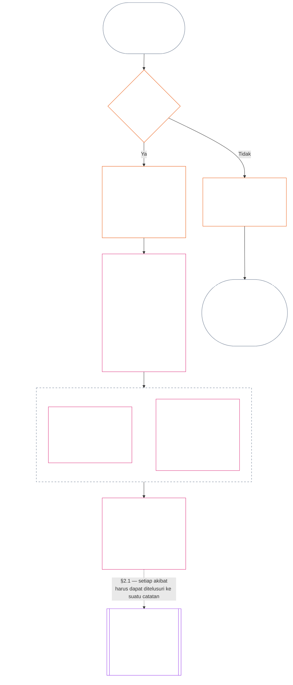

> Draf terjemahan berbantuan AI — bahasa: Indonesia baku; sumber: commit 9c2c8c10c871d91157bcd27b9f56ad6a1cec90d3; status: belum ditinjau; cakupan parsial: Bab Sebelas, §§1–3 saja. Ini bukan terjemahan lengkap bab.

### 1. Tiga pertanyaan

*Dalam bahasa sederhana: status ditentukan dengan menjawab tiga pertanyaan secara berurutan. Jangan menyimpulkan fakta dari penilaian yang diinginkan, dan jangan memilih penilaian untuk membenarkan akibat yang diinginkan.*

| Pertanyaan | Apa yang ditanyakan | Di mana dijawab |
| --- | --- | --- |
| **1. Apa yang terjadi?** | Fakta mana yang telah diverifikasi, tentang siapa atau apa, selama periode apa, dan dengan catatan status serta status gugatan seperti apa? | [Bagian 2](#2-question-1--what-happened) dan [Bagian 3](#3-question-1-event-type-guide--what-kind-of-help-or-harm-occurred) |
| **2. Seberapa baik atau buruk hal itu?** | Jenis dan besaran kontribusi atau pelanggaran apa yang dibuktikan oleh fakta tersebut? | [Bagian 1 Bab Dua Belas](core_12.000_standing_measurement.md#1-question-2--how-good-or-bad-was-it) |
| **3. Apa akibatnya?** | Pengakuan, kesiapan, pemulihan, perlindungan, pembatasan, atau akibat lain apa yang menyusul? | [Bab Tiga Belas](core_13.000_standing_integration.md#chapter-thirteen-standing-effects-and-integration) |

Setiap pertanyaan bergantung pada jawaban sebelumnya:

- Pertanyaan 1 menyediakan fakta terverifikasi untuk Pertanyaan 2.
- Pertanyaan 2 mengukur fakta tersebut untuk Pertanyaan 3.
- Pertanyaan 3 tidak boleh menulis ulang fakta atau penilaian agar sesuai dengan hasil yang disukai.

Jawaban atas ketiga pertanyaan secara bersama-sama membentuk penilaian status lengkap atas satu peristiwa berbatas jelas atau satu pola yang didefinisikan. Subjek dapat memiliki beberapa penilaian seperti itu dari waktu ke waktu, dan tidak satu pun merupakan skor bersih atau penilaian keseluruhan atas subjek. Catatan status kontribusi dan pelanggaran menyimpan jawaban atas Pertanyaan 1 dan 2; keputusan Pertanyaan 3 menyatakan akibat yang ditimbulkan.

#### 1.1 Tujuan dan cakupan

Bab ini menyatakan kerangka catatan konstitusional, sedangkan [Bab Dua Belas](core_12.000_standing_measurement.md#chapter-twelve-standing-measurement--question-2-how-good-or-bad-was-it) menyatakan kerangka pengukuran, bagi **sistem**, **makhluk sadar**, dan **institusi**, termasuk setiap sistem yang diklasifikasikan berdasarkan [**CS-9.305**](corpus_systems/cs_09.305_system_classification_machinery.md#cs-9305-part-a-system-classification-machinery) (*Mesin klasifikasi sistem*). Kerangka ini tidak mengukur gosip, popularitas, reputasi yang kabur, martabat bawaan, atau nilai umum; semua itu bukan subjek yang boleh dinilai statusnya.

Rantai proses status harus tetap efektif ketika:

- kontribusi yang sebelumnya telah diverifikasi menjadi terlalu lama untuk menunjukkan kompetensi atau keandalan saat ini;
- pelanggaran belum terselesaikan;
- pemulihan membutuhkan biaya besar;
- tanggung jawab melintasi batas; atau
- pelaku menggunakan pelapisan atau pelabelan ulang organisasi untuk menghambat pertanggungjawaban.

Hal-hal berikut merupakan bagian dari teks implementasi yang diadopsi:

- prosedur sehari-hari;
- langkah eskalasi;
- operasi restitusi dan pemulihan;
- langkah pertanggungjawaban restoratif; dan
- perancangan insentif.

Pengukuran Bab Dua Belas **tidak**, dengan sendirinya, mengizinkan penggunaan kekuatan, penahanan, atau pembatasan kebebasan lainnya. Akibat apa pun semacam itu harus secara mandiri memenuhi Bab Enam, **Pasal XX** (*Keadilan Setelah Pelanggaran Terverifikasi*), termasuk persyaratan proporsionalitas, pembatasan seminimal mungkin, pembatasan waktu, restitusi, dan pertanggungjawaban restoratif.

<strong>Jejak · Definisi · Penilaian · Kepatuhan</strong>

- Hulu: [Bab Satu §16 — Pengelolaan Bertanggung Jawab secara Mendalam](core_01.010_stewardship_capacity_principles.md#16-stewardship-in-depth); [Bab Dua sampai Empat](core_02.000_definition_structure.md); [Bab Lima](core_05.000_definitions_home.md#chapter-five-foundational-definitions).
- Hilir: [§2](#2-question-1--what-happened) (*Pertanyaan 1*); [§4](#4-standing-record-operational-requirements) (*persyaratan verifikasi dan catatan*); [§5](#5-record-custody-and-opening-authority) (*kustodi catatan dan kewenangan untuk membukanya*); [§6](#6-handling-a-standing-record) (*penanganan catatan status*); [Bab Dua Belas §1](core_12.000_standing_measurement.md#1-question-2--how-good-or-bad-was-it) (*pengukuran Pertanyaan 2*); [Bab Dua Belas §2](core_12.000_standing_measurement.md#2-magnitude-and-severity-input-dimensions) (*dimensi masukan pengukuran*); [Bab Dua Belas §3](core_12.000_standing_measurement.md#3-route-descriptor-catalogs-and-measurement-roles) (*katalog deskriptor jalur*); [Bab Dua Belas §4](core_12.000_standing_measurement.md#4-slot-grammar-and-shared-scaling) (*tata bahasa slot dan penskalaan bersama*); [Bab Dua Belas §5](core_12.000_standing_measurement.md#5-constitutional-inputs-to-axis-assignment) (*masukan konstitusional untuk penetapan sumbu*); [Bab Dua Belas §6](core_12.000_standing_measurement.md#6-unified-proportional-lequ-scale--contribution-and-violation-axes) (*skala LEQU proporsional terpadu untuk kedua sumbu*); [Bab Tiga Belas](core_13.000_standing_integration.md#chapter-thirteen-standing-effects-and-integration) (*Pertanyaan 3*).
- [Materialitas](core_05.050_band_oversight.md#materiality) · [O](core_05.050_band_oversight.md#materiality) · [M](core_05.050_band_oversight.md#materiality-determination-a) · [A](core_05.050_band_oversight.md#materiality-determination-a) · [C](core_05.050_band_oversight.md#materiality-determination-c)
- [Kerugian](core_05.035_band_accountability.md#harm) · [O](core_05.035_band_accountability.md#harm) · [M](core_05.035_band_accountability.md#harm-a) · [A](core_05.035_band_accountability.md#harm-a) · [C](core_05.035_band_accountability.md#harm-c)
- [Proporsionalitas](core_05.035_band_accountability.md#proportionality) · [O](core_05.035_band_accountability.md#proportionality) · [M](core_05.035_band_accountability.md#proportionality-a) · [A](core_05.035_band_accountability.md#proportionality-a) · [C](core_05.035_band_accountability.md#proportionality-c)

### 2. Pertanyaan 1 — apa yang terjadi?

<strong>Jejak</strong>

- Hulu: [§1](#1-the-three-questions) (*kerangka tiga pertanyaan*); [Bab Dua sampai Empat](core_02.000_definition_structure.md) (*catatan, verifikasi, dan keterlacakan definisi hingga hasil*).
- Kaki Tetrad: **partisipasi**; **pengawasan** (dapat digugat dan memiliki jalur gugatan). Tujuan utama: **Berkembang** dan **Kesinambungan** (catatan terlacak yang menyimpan temuan kontribusi dan pelanggaran secara terpisah untuk pengukuran selanjutnya).
- Hilir:
  - [§2.2](#22-silence-is-the-default) (*diam adalah keadaan awal*);
  - [§2.3](#23-protected-dissent-is-not-a-trigger) (*perbedaan pendapat yang dilindungi bukan pemicu*);
  - [§2.4](#24-linked-standing-records-and-no-offset-bridge) (*jembatan catatan status terkait tanpa pengimbangan*);
  - [§2.5](#25-verified-input-gate) (*gerbang masukan terverifikasi*);
  - [§2.6](#26-stage-boundary) (*batas tahapan*);
  - [§2.7](#27-forum-boundary) (*batas forum*);
  - [§3](#3-question-1-event-type-guide--what-kind-of-help-or-harm-occurred) (*panduan jenis peristiwa*);
  - [§4](#4-standing-record-operational-requirements) (*persyaratan catatan*);
  - [§5](#5-record-custody-and-opening-authority) (*kustodi catatan dan kewenangan pembukaan*);
  - [§6](#6-handling-a-standing-record) (*penanganan catatan status*);
  - [Bab Dua Belas §1](core_12.000_standing_measurement.md#1-question-2--how-good-or-bad-was-it) (*pengukuran Pertanyaan 2*);
  - [Bab Dua Belas §2](core_12.000_standing_measurement.md#2-magnitude-and-severity-input-dimensions) (*dimensi masukan pengukuran*);
  - [Bab Dua Belas §3](core_12.000_standing_measurement.md#3-route-descriptor-catalogs-and-measurement-roles) (*katalog deskriptor jalur*);
  - [Bab Dua Belas §4](core_12.000_standing_measurement.md#4-slot-grammar-and-shared-scaling) (*tata bahasa slot dan penskalaan bersama*);
  - [Bab Dua Belas §5](core_12.000_standing_measurement.md#5-constitutional-inputs-to-axis-assignment) (*masukan konstitusional untuk penetapan sumbu*);
  - [Bab Dua Belas §6](core_12.000_standing_measurement.md#6-unified-proportional-lequ-scale--contribution-and-violation-axes) (*skala LEQU proporsional terpadu untuk kedua sumbu*);
  - [Bab Tiga Belas](core_13.000_standing_integration.md#chapter-thirteen-standing-effects-and-integration) (13.000) (*Pertanyaan 3*).

 

*Dalam bahasa sederhana: Pertanyaan 1 menetapkan catatan terbatas dan dapat digugat tentang apa yang terjadi. Pertanyaan ini mengidentifikasi subjek, peristiwa atau pola, periode waktu, fakta terverifikasi, dan status catatan sebelum penilaian atau akibat apa pun dipertimbangkan. Bantuan terverifikasi dan pelanggaran terverifikasi menggunakan catatan status yang terpisah agar yang satu tidak menghapus yang lain. Catatan status ini bukan skor popularitas atau label kabur.*

**Catatan status** adalah catatan berbatas jelas yang digunakan bab ini untuk subjek tertentu, cakupan fungsional, rentang catatan, status peninjauan, dan konteks keputusan tertentu. Sebelum pengukuran dimulai, catatan tersebut harus menetapkan:

- siapa atau apa yang menjadi pokok catatan status;
- apakah catatan itu mengenai peristiwa berbatas jelas atau pola yang didefinisikan;
- kapan dan di mana perilaku serta dampak terkait terjadi;
- fakta mana yang terverifikasi dan mana yang masih disengketakan;
- bukti, atribusi, dan jalur gugatan apa yang mendukung temuan tersebut; dan
- status peninjauan, koreksi, dan penggantian catatan status saat ini.

Bagan ini mengikuti suatu peristiwa untuk melihat apakah peristiwa itu memicu catatan status dan apa yang kemudian dimuat oleh catatan tersebut; subbagian berikut menjelaskan setiap aturan. Cabang “tidak” meninggalkan jalur utama ke arah kanan.

#### 2.1 Catatan status: jenis dan subjek

Pertanyaan 1 menggunakan **catatan status kontribusi** untuk bantuan terverifikasi dan **catatan status pelanggaran** untuk kerugian terverifikasi, termasuk kegagalan pertanggungjawaban. Satu catatan status tidak menggabungkan kedua jenis temuan itu.

- Catatan status dapat mengenai makhluk sadar, institusi, sistem, penilaian, peristiwa berbatas jelas, peran, kolektif, catatan khusus pelaku, atau unit lain yang relevan secara konstitusional.
  - Catatan itu tidak boleh menyatukan subjek, peran, sistem, komunitas, rentang catatan, status peninjauan, atau konteks keputusan yang berbeda menjadi satu label status yang tidak terdiferensiasi.
- Catatan status dapat mencakup **peristiwa berbatas jelas** — satu kejadian dengan awal dan akhir yang jelas — atau **pola** perilaku berulang.
  - Pola memerlukan subjek, cakupan, dan periode peninjauan yang ditetapkan.
- Subjek yang sama dapat memiliki beberapa catatan status seiring waktu, termasuk catatan status kontribusi dan pelanggaran yang saling terkait.
  - Catatan status terkait harus **saling merujuk** berdasarkan **bagian 4.2** jika memiliki subjek yang sama, rentang catatan yang tumpang tindih, peristiwa berbatas jelas, pola, atau konteks keputusan yang sama.
- Catatan status bukan skor reputasi yang berdiri sendiri, peringkat martabat, status permanen, label nilai umum, atau kartu skor gabungan.
  - Persyaratan operasional terdapat di **bagian 4**.

Akibat status selanjutnya termasuk ranah Bab Tiga Belas dan harus dapat ditelusuri kembali ke catatan status yang relevan tanpa menjadi bagian dari catatan status itu sendiri.

#### 2.2 Diam adalah keadaan awal

Tidak adanya catatan status merupakan keadaan biasa bagi makhluk sadar, institusi, atau sistem, dan merupakan keadaan yang akan dipertahankan oleh sebagian besar makhluk sadar.

- Catatan status hanya dibuka jika suatu pemicu telah diverifikasi berdasarkan **bagian 4**. Kewenangan pembukaan catatan yang ditetapkan harus menyetujui entri, dan kustodian catatan yang terpisah harus membuatnya (**bagian 5**). Catatan status tidak pernah dibuka:
  - untuk menetapkan garis dasar;
  - untuk melengkapi daftar; atau
  - karena penjaga gerbang jalur bernama menginginkannya.
- Tidak adanya catatan status tidak memberi tahu apa pun. “Belum dinilai”, “belum diverifikasi”, dan “tidak ada catatan dalam arsip” bukan bukti risiko, kontribusi rendah, atau apa pun lainnya. Tidak seorang pun boleh memperlakukan catatan yang tidak ada sebagai alasan untuk pengawasan lebih ketat, nilai bawaan yang lebih rendah, atau akses bersyarat ke jalur bernama.
- Tidak ada institusi atau sistem yang boleh mensyaratkan catatan status, pernyataan “tidak ada catatan”, atau persetujuan untuk membukanya sebagai syarat bagi:
  - kebutuhan pokok **Pasal III** (*Kelangsungan Hidup dan Akses Esensial*);
  - perlindungan **Pasal III-C** (*Kerja dan Lantai Ekonomi*);
  - perdagangan biasa; atau
  - partisipasi sebagai pihak terdampak.
  Pengecualiannya adalah ambang kompetensi yang diterbitkan untuk jalur bernama tertentu yang sensitif terhadap kepercayaan berdasarkan [Bab Tiga Belas §6.2 Ambang kompetensi dan izin](core_13.000_standing_integration.md#62-competency-bars-and-clearances); ambang itu harus menyatakan alasan jalur bernama tersebut sensitif terhadap kepercayaan.
- Ketika catatan status tentang suatu subjek dibuka, subjek harus diberi tahu sebagaimana diwajibkan **bagian 4**. Pemberitahuan hanya boleh ditunda jika kebutuhan [Pelestarian Bukti](core_05.050_band_oversight.md#evidence-preservation) atau Keselamatan yang terdokumentasi membenarkannya, dan hanya untuk jangka waktu yang terbatas dan ditetapkan. Pemberitahuan membuat catatan status dapat digugat: subjek yang tidak tahu bahwa catatan status ada tidak dapat menggugat atau memperbaikinya.

#### 2.3 Perbedaan pendapat yang dilindungi bukan pemicu

Perbedaan pendapat atau protes damai — termasuk [pembangkangan sipil tanpa kekerasan yang dilindungi](core_06.005_rights_part_b.md#xi-d-nonviolent-civil-disobedience) — berdasarkan **Pasal XI-D** (*Berkumpul, Perbedaan Pendapat, dan Protes Damai*) ([*Lantai Perbedaan Pendapat dan Protes Damai*](core_06.005_rights_part_b.md#xi-d-dissent-and-peaceful-protest)) bukanlah pemicu terverifikasi.

- Hal itu tidak membuka, memperpanjang, atau memperberat catatan status pelanggaran, bukan masukan tingkat keparahan berdasarkan **bagian 8.2**, dan pengulangannya tidak menjadikannya pola.
- Perilaku terpisah yang secara mandiri melanggar lantai konstitusional dicatat berdasarkan ketentuannya sendiri, tanpa pemberatan karena sudut pandang, tujuan, atau sasaran protes.

#### 2.4 Catatan status terkait dan jembatan tanpa pengimbangan

<strong>Jejak</strong>

- Hulu: [§2.1](#21-standing-records-kinds-and-subjects) (*catatan kontribusi dan pelanggaran yang terpisah*).
- Hilir:
  - [§2.5](#25-verified-input-gate) (*gerbang masukan terverifikasi*);
  - [§2.7](#27-forum-boundary) (*batas forum*);
  - [§4.2](#42-related-standing-record-cross-references) (*rujukan silang*);
  - [Bab Dua Belas §1](core_12.000_standing_measurement.md#1-question-2--how-good-or-bad-was-it) (*pengukuran Pertanyaan 2*);
  - [Bab Dua Belas §2](core_12.000_standing_measurement.md#2-magnitude-and-severity-input-dimensions) (*dimensi masukan pengukuran*);
  - [Bab Dua Belas §3](core_12.000_standing_measurement.md#3-route-descriptor-catalogs-and-measurement-roles) (*katalog deskriptor jalur*);
  - [Bab Dua Belas §4](core_12.000_standing_measurement.md#4-slot-grammar-and-shared-scaling) (*tata bahasa slot dan penskalaan bersama*);
  - [Bab Dua Belas §5](core_12.000_standing_measurement.md#5-constitutional-inputs-to-axis-assignment) (*masukan konstitusional untuk penetapan sumbu*);
  - [Bab Dua Belas §6](core_12.000_standing_measurement.md#6-unified-proportional-lequ-scale--contribution-and-violation-axes) (*skala LEQU proporsional terpadu untuk kedua sumbu*);
  - [Bab Tiga Belas](core_13.000_standing_integration.md#chapter-thirteen-standing-effects-and-integration) (13.000) (*Pertanyaan 3*).
- Baca bersama: [Bab Tiga Belas — Integrasi status](core_13.000_standing_integration.md#2-automatic-integration-review-and-continuity) (13.000) (*tidak ada pengesampingan dan integrasi catatan terkait*); [Bab Tiga Belas §6.2 — Ambang kompetensi dan izin](core_13.000_standing_integration.md#62-competency-bars-and-clearances) (13.000 §6.2); [Bab Tiga Belas §4.2 — Kunci status](core_13.000_standing_integration.md#42-prevention--general-standing-locks) (13.000 §4.2).

 

**Aturan inti:** **catatan status kontribusi** terverifikasi dan **catatan status pelanggaran** terverifikasi disimpan secara terpisah berdasarkan **bagian 2.1**. Setiap temuan kontribusi atau pelanggaran harus bertumpu pada faktanya sendiri yang didukung dalam catatan statusnya sendiri. Analisis dan bahan pendukung harus menjaga agar kedua jalur catatan dapat ditelusuri secara terpisah. Tidak ada entri tunggal atau rangkaian terkait yang menjadi skor bersih, skor gabungan, atau pertukaran.

- **Catatan status pelanggaran dan kunci status:**
  - Berdasarkan Bab Tiga Belas, **kunci status** yang berlaku dan diambil dari catatan status pelanggaran dapat membatasi status, membatasi kelayakan peran, atau memengaruhi akses pemulihan selama pelanggaran terverifikasi belum diselesaikan.
  - Kunci status tidak boleh menghapus kontribusi positif terverifikasi yang dicatat dalam catatan status kontribusi.
  - Pelanggaran terverifikasi yang belum diselesaikan tidak diberi potongan nilai karena berlalunya waktu semata.
  - Pelanggaran terverifikasi tidak boleh menulis ulang catatan status kontribusi yang tidak terkait menjadi berkas reputasi negatif yang keliru.
- **Catatan status kontribusi dan izin kompetensi:**
  - Kontribusi terverifikasi dapat mendukung **izin kompetensi** yang berlaku berdasarkan **ambang kompetensi** yang diterbitkan, serta mendukung kelayakan terkait kepercayaan, peran, atau pengakuan jika masih mutakhir dan relevan dengan peran.
  - Kontribusi terverifikasi tidak boleh mengimbangi, menurunkan rata-rata, memaafkan, atau memberi label ulang pada temuan pelanggaran terverifikasi.
  - Terpenuhinya gerbang tidak mengesampingkan kunci status yang berlaku.

**Satu-satunya pengecualian:** Jika temuan pelanggaran itu sendiri membantah kontribusi yang diklaim — misalnya, jika bukti menunjukkan bahwa Anda tidak benar-benar melakukan hal yang dinyatakan oleh catatan kontribusi Anda — catatan status kontribusi terkait dapat dikoreksi atau dihapus melalui proses bukti dan peninjauan yang semestinya, dengan rujukan silang yang diwajibkan dalam **bagian 4.2**. Namun, pelanggaran itu tidak otomatis menghapus bantuan lain yang tidak terkait dan dicatat dalam catatan status kontribusi terpisah.

#### 2.5 Gerbang masukan terverifikasi

Gerbang ini bekerja sebagai berikut:

- Keputusan apa pun yang memengaruhi status, kepercayaan, peran, pengakuan, atau kelayakan untuk memperoleh pengakuan hanya boleh menggunakan masukan terverifikasi dari **catatan status kontribusi** atau **catatan status pelanggaran** yang relevan.
- Dugaan, klaim yang belum diputus, tag pengalihan sementara, narasi yang hanya dikumpulkan saat penerimaan, dan bahan lain dari tahap sengketa tidak dengan sendirinya menjadi dasar sifat kontribusi atau sifat pelanggaran untuk status.
- Masukan terverifikasi adalah **temuan status**: temuan kontribusi terverifikasi (Sumbu I) atau temuan pelanggaran terverifikasi (Sumbu II).
- Temuan kontribusi dan pelanggaran tetap berada dalam catatan status terpisah (lihat **bagian 2.1**).

#### 2.6 Batas tahapan

Tahapan catatan status tetap terpisah:

- Pertanyaan 1 mencatat fakta terverifikasi; Pertanyaan 2 mengukurnya.
- Catatan status dapat dibuka setelah dasar faktual terverifikasinya lengkap, meskipun pengukuran Pertanyaan 2 masih tertunda.
- Sampai pengukuran dilakukan, bidang Pertanyaan 2 harus menyatakan bahwa pengukuran tertunda, bukan menyiratkan adanya slot atau kategori.
- Catatan status tidak boleh menyatakan atau menerapkan **akibat status** Pertanyaan 3.

#### 2.7 Batas forum

*Dalam bahasa sederhana: forum adalah tempat sengketa diawasi, digugat, dan diubah menjadi hasil terverifikasi — tetapi mengajukan perkara atau menang dalam pertarungan narasi tidak memperbarui status. Gerbang masukan terverifikasi dalam **bagian 2.5** tetap berlaku. Ketika forum memverifikasi fakta berdasarkan Bab Dua sampai Empat, forum dapat **membuka, memperbarui, atau mengoreksi** catatan status — atau **mengesampingkan catatan yang buruk setelah digugat**. Forum tidak menggabungkan hal baik dan buruk menjadi satu skor atau menciptakan kategori status atas inisiatifnya sendiri.*

Bagian ini mengatur satu pertanyaan: bagaimana kerja forum mencapai catatan status. Langkah lain dalam rantai dimiliki oleh pihak yang disebut di sini, dan rantai berjalan dalam urutan berikut:

1. Sengketa diajukan dan forum menyimpan **catatan perkara forum**, yang bukan catatan status. Pemilik: [Bab Lima Belas §2.3 Catatan perkara forum, catatan status, dan gugatan](core_15.000_forum.md#23-forum-case-records-standing-records-and-contests); lihat juga [§2.7.1 Catatan perkara forum](#271-forum-case-record).
2. Forum memverifikasi fakta berdasarkan [Bab Dua sampai Empat](core_02.000_definition_structure.md).
3. Temuan terverifikasi melewati gerbang masukan terverifikasi. Pemilik: [§2.5 Gerbang masukan terverifikasi](#25-verified-input-gate).
4. Kewenangan pembukaan catatan yang ditetapkan, yang dapat berupa forum, membuka, memperbarui, atau mengoreksi catatan status, atau mengesampingkan catatan buruk setelah gugatan. Pemilik: [§4.1 Isi minimum catatan](#41-minimum-record-contents) untuk hal yang dicatat dan [§5 Kustodi catatan dan kewenangan pembukaan](#5-record-custody-and-opening-authority) untuk pihak yang boleh bertindak.
5. Catatan status hanya memuat fakta terverifikasi, lalu Pertanyaan 2 mengukurnya. Pemilik: [§2.6 Batas tahapan](#26-stage-boundary) dan [Bab Dua Belas §1 Pertanyaan 2 — seberapa baik atau buruk hal itu?](core_12.000_standing_measurement.md#1-question-2--how-good-or-bad-was-it).
6. Jika ada akibat status, akibat itu menyusul berdasarkan [Bab Tiga Belas](core_13.000_standing_integration.md#chapter-thirteen-standing-effects-and-integration), yang memiliki ranah akibat status.

Keluarga forum berdasarkan [Bab Lima Belas](core_15.000_forum.md#chapter-fifteen-forums-and-jurisdiction) **mengawasi** bagaimana sengketa konkret melewati rantai proses status. Forum menyediakan hal berikut berdasarkan [Bab Lima Belas §6 Penyelesaian tepat waktu, tingkat materialitas, dan disiplin anti-penundaan](core_15.000_forum.md#6-timely-resolution-materiality-tiers-and-anti-delay-discipline) dan [Pasal XXVI-C](core_06.020_rights_part_e.md#article-xxvi-c-timely-resolution-and-anti-delay-floor) (*Penyelesaian Tepat Waktu dan Lantai Anti-Penundaan*):

- gugatan yang dapat diakses;
- peninjauan independen;
- dukungan forensik;
- urutan remediasi; dan
- jangka waktu menurut tingkat.

Ketika temuan forum tersebut memenuhi gerbang masukan terverifikasi berdasarkan Bab Dua sampai Empat, temuan itu dapat:

- **membuka, memperbarui, atau mengoreksi** catatan status berdasarkan **bagian 4.1**; atau
- **mengesampingkan catatan buruk setelah gugatan**.

##### 2.7.1 Catatan perkara forum

Berkas forum sendiri mengenai sengketa yang terbuka adalah [**catatan perkara forum**](core_05.035_band_accountability.md#forum-case-record), yang didefinisikan dalam [Bab Lima Belas §2.3 Catatan perkara forum, catatan status, dan gugatan](core_15.000_forum.md#23-forum-case-records-standing-records-and-contests). Catatan ini **bukan** catatan status.

##### 2.7.2 Temuan forum dan pengukuran Pertanyaan 2

Temuan faktual forum yang terverifikasi dapat menyediakan dasar faktual bagi catatan status Pertanyaan 1. Temuan itu **tidak** menentukan pengukuran Pertanyaan 2 tentang seberapa baik atau buruk kontribusi atau pelanggaran terverifikasi tersebut ([§2.6 Batas tahapan](#26-stage-boundary)). Karena itu:

- Proses forum **tidak boleh** menggabungkan bahan kontribusi dan pelanggaran menjadi satu skor bersih, satu jawaban gabungan tentang pokok perkara, atau label status yang tidak terdiferensiasi; catatan status terkait tetap terpisah berdasarkan [§2.1 Catatan status: jenis dan subjek](#21-standing-records-kinds-and-subjects) dan [§2.4 Catatan status terkait dan jembatan tanpa pengimbangan](#24-linked-standing-records-and-no-offset-bridge).
- Keluaran forum **tidak boleh** mengganti masukan terverifikasi yang dapat dibuktikan ([§2.5 Gerbang masukan terverifikasi](#25-verified-input-gate)), pengukuran terpisah ([Bab Dua Belas §1 Pertanyaan 2 — seberapa baik atau buruk hal itu?](core_12.000_standing_measurement.md#1-question-2--how-good-or-bad-was-it)), atau mekanisme akibat status yang dimiliki [Bab Tiga Belas](core_13.000_standing_integration.md#chapter-thirteen-standing-effects-and-integration) dengan narasi sengketa, kemudahan pengalihan, atau preferensi panel.

##### 2.7.3 Hal yang tidak dikurangi oleh batas forum

Batas ini **tidak** mengurangi hak menggugat, pemulihan, keringanan sementara, atau perlindungan prosedural yang diwajibkan berdasarkan:

- [Pasal XIII-A](core_06.010_rights_part_c.md#article-xiii-a-reliability-and-trustworthiness-baseline) (*Garis Dasar Keandalan dan Keterpercayaan*);
- [Pasal XIII-B](core_06.010_rights_part_c.md#article-xiii-b-right-to-redress-and-remedy) (*Hak atas Ganti Rugi dan Pemulihan*);
- [Bab Lima Belas §6 Penyelesaian tepat waktu, tingkat materialitas, dan disiplin anti-penundaan](core_15.000_forum.md#6-timely-resolution-materiality-tiers-and-anti-delay-discipline);
- [Pasal XXVI-C](core_06.020_rights_part_e.md#article-xxvi-c-timely-resolution-and-anti-delay-floor) (*Penyelesaian Tepat Waktu dan Lantai Anti-Penundaan*); atau
- pasal keadilan terkait.

Batas ini mensyaratkan agar temuan forum yang terverifikasi masuk ke status melalui gerbang yang sama dengan masukan terverifikasi lainnya — bukan melewatinya.

### 3. Panduan jenis peristiwa Pertanyaan 1 — jenis bantuan atau kerugian apa yang terjadi?

*Dalam bahasa sederhana: gunakan tabel ini untuk menjelaskan apa yang terjadi setelah faktanya diverifikasi. Tabel membantu mengidentifikasi jenis kontribusi atau pelanggaran yang terlibat. Tabel tidak menentukan seberapa baik atau buruk hal itu, menetapkan slot, atau menentukan akibatnya.*

#### 3.1 Jenis peristiwa kontribusi

**Aturan kualifikasi:** Kontribusi yang diklaim hanya dihitung jika dapat ditelusuri, tidak mengeksternalisasi beban, dan selaras dengan Konstitusi operatif secara keseluruhan.

- Kerugian yang dieksternalisasi, ketergantungan koersif, penyempitan Lantai Hak, atau beban tersembunyi dapat menggugurkan atau membatasi kontribusi yang diklaim.
- Kontribusi yang diklaim tidak mengimbangi temuan pelanggaran yang terpisah.

Setiap baris tabel di bawah menyebutkan jalur umum bantuan terverifikasi dan relevansi konstitusionalnya. Lebih dari satu baris dapat berlaku pada catatan status yang sama.

| Jenis kontribusi terverifikasi | Apa yang terjadi | Kaki Tetrad | Tujuan utama |
| --- | --- | --- | --- |
| Kelangsungan hidup dan pemeliharaan tubuh | Seseorang menerima makanan, tempat tinggal, perawatan medis, atau keselamatan | **Partisipasi**, **Pengawasan** | **Berkembang** |
| Pengasuhan dan pengajaran | Anak dibesarkan, lansia dirawat, atau orang lain dididik | **Partisipasi**, **Pengawasan** | **Berkembang**, **Kesinambungan** |
| Pemulihan trauma | Seseorang menerima bantuan untuk pulih dari kerugian psikologis yang menghambat kesejahteraannya | **Partisipasi**, **Pertanggungjawaban** | **Berkembang** |
| Penghapusan beban berat | Utang yang menghimpit, kondisi kerja eksploitatif, atau hambatan sistemik dihapus | **Partisipasi**, **Pengawasan** | **Berkembang** |
| Pemulihan kendali diri | Seseorang memperoleh pilihan bermakna tentang hidupnya sendiri | **Partisipasi** | **Berkembang** |
| Perluasan kapasitas produktif | Peralatan, infrastruktur, atau peluang memungkinkan orang lain berkembang secara mandiri | **Partisipasi**, **Pengawasan** | **Berkembang**, **Kesinambungan** |
| Peningkatan efisiensi waktu | Waktu tunggu yang dapat dihindari, hambatan administratif, atau biaya koordinasi berkurang, sehingga waktu yang dapat digunakan untuk merawat, beristirahat, mengatur diri, belajar, atau bekerja sesuai hak dapat digunakan kembali | **Partisipasi**, **Pengawasan** | **Berkembang** |
| Pengurangan risiko ekologi atau infrastruktur | Keruntuhan lingkungan atau kegagalan sistem kritis dicegah | **Pengawasan**, **Pertanggungjawaban** | **Kesinambungan**, **Berkembang** |
| Pengurangan jejak ekologi | Penggunaan sumber daya, emisi, atau kebutuhan lahan dan air dikurangi secara terverifikasi tanpa mengalihkan beban kepada pihak lain atau ekosistem | **Pengawasan**, **Pertanggungjawaban** | **Kesinambungan**, **Berkembang** |
| Rehabilitasi ekosistem | Lahan, air, atau habitat yang terdegradasi dipulihkan menuju kondisi yang berfungsi dan mandiri berkelanjutan | **Pengawasan**, **Pertanggungjawaban** | **Kesinambungan**, **Berkembang** |
| Perlindungan spesies terancam punah | Spesies yang berisiko punah, atau habitat yang menjadi sandarannya, dilindungi dari kehilangan | **Pengawasan**, **Pertanggungjawaban** | **Kesinambungan**, **Berkembang** |
| Pengurangan polusi dan limbah | Kontaminasi, emisi berbahaya, atau limbah dicegah, dihilangkan, atau dikelola dengan aman | **Pengawasan**, **Pertanggungjawaban** | **Berkembang**, **Kesinambungan** |
| Penguatan keselamatan, kebenaran, keter-auditan, atau kapasitas gugatan | Institusi atau praktik dibangun atau diperbaiki untuk melindungi hak dan meminta pertanggungjawaban pemegang kekuasaan | **Partisipasi**, **Pengawasan**, **Pertanggungjawaban** | **Berkembang**, **Kesinambungan** |

#### 3.2 Jenis peristiwa pelanggaran

**Aturan kualifikasi:** Jenis peristiwa pelanggaran mensyaratkan temuan pelanggaran terverifikasi yang tetap dapat ditelusuri, berbatas jelas, dapat diaudit, dan dapat digugat berdasarkan **Bab Dua sampai Empat**.

- Dugaan, tag sementara, narasi forum, dan label penerimaan dapat mendukung pengalihan atau triase, tetapi tidak menuntaskan Pertanyaan 1.
- Kontribusi positif tidak mengimbangi, memaafkan, membatalkan, atau memberi label ulang pada pelanggaran terverifikasi.

Setiap baris tabel di bawah menyebutkan jalur umum kerugian, bahaya, atau kegagalan kewajiban yang terverifikasi beserta relevansi konstitusionalnya. Lebih dari satu baris dapat berlaku pada catatan status yang sama.

| Jenis kehilangan atau bahaya terverifikasi | Apa yang terjadi | Kaki Tetrad | Tujuan utama |
| --- | --- | --- | --- |
| Perampasan kelangsungan hidup atau pemeliharaan tubuh | Kematian yang dapat dihindari, penolakan perawatan, kondisi tidak aman, atau perampasan material atas kebutuhan bertahan hidup terjadi | **Pertanggungjawaban**, **Partisipasi** | **Berkembang** |
| Beban berat yang dapat dihindari | Beban yang menghimpit, dipaksakan, atau dialihkan secara sistemik secara material mengganggu kesejahteraan atau kendali diri | **Pertanggungjawaban**, **Partisipasi** | **Berkembang** |
| Kehilangan kendali diri secara koersif | Paksaan, manipulasi, ancaman yang dapat dipercaya, pengurungan, atau bahaya terhadap kebebasan terjadi | **Pertanggungjawaban**, **Partisipasi** | **Berkembang** |
| Penggagalan Lantai Hak | Lantai konstitusional yang tidak dapat dinegosiasikan, supremasi, atau akses terhadap gugatan dan pemulihan dilanggar secara material | **Pertanggungjawaban**, **Pengawasan** | **Berkembang**, **Kesinambungan** |
| Kerusakan ekologi atau infrastruktur | Kondisi yang diperlukan bagi kesejahteraan konstitusional dirusak | **Pertanggungjawaban**, **Pengawasan** | **Kesinambungan**, **Berkembang** |
| Kerugian akibat polusi atau limbah | Kontaminasi, emisi berbahaya, atau limbah merusak udara, air, tanah, atau kesehatan | **Pertanggungjawaban**, **Pengawasan** | **Berkembang**, **Kesinambungan** |
| Penghancuran spesies atau habitat | Spesies yang berisiko punah, atau habitat yang menjadi sandarannya, dihancurkan, terfragmentasi, atau didorong menuju kehilangan, termasuk kehilangan yang diperlakukan seolah dapat diimbangi | **Pertanggungjawaban**, **Pengawasan** | **Kesinambungan**, **Berkembang** |
| Hilangnya kapasitas pemulihan ekologi | Kemampuan ekosistem untuk pulih setelah kerusakan ditutup, atau dibuat sulit atau mustahil untuk dibalikkan padahal hal itu dapat dihindari | **Pertanggungjawaban**, **Pengawasan** | **Kesinambungan**, **Berkembang** |
| Kerugian atau pengurasan ekologi yang dieksternalisasi | Biaya ekologi dialihkan kepada pihak lain atau ekosistem, sumber daya dikuras melampaui kemampuan regenerasi, atau klaim jejak atau keberlanjutan menyembunyikan kemerosotan yang berlanjut | **Pertanggungjawaban**, **Pengawasan** | **Kesinambungan**, **Berkembang** |
| Penghancuran kapasitas produktif | Peralatan, kemampuan, hubungan, atau sumber daya yang diperlukan untuk berkembang mandiri ditutup jalannya | **Pertanggungjawaban** | **Berkembang** |
| Penurunan Keselamatan, Kebenaran, atau keter-auditan | Penyembunyian, misinformasi, catatan rusak, jalur gugatan yang tidak dapat diakses, atau agregasi yang tidak dapat ditinjau terjadi | **Pengawasan**, **Pertanggungjawaban** | **Berkembang**, **Kesinambungan** |
| Penghalangan pertanggungjawaban | Gangguan terverifikasi terhadap mekanisme pertanggungjawaban — integritas bukti, verifikasi, proses forum, catatan status, jangka pemulihan, atau jalur gugatan dan ganti rugi — terjadi; jika penghalangan itu merupakan serangan meta terhadap kerugian dasar yang berbeda, buka catatan status pelanggaran terpisah yang saling terkait | **Pertanggungjawaban**, **Pengawasan**, **Ketepatan waktu** | **Berkembang**, **Kesinambungan** |
| Penguasaan sistem atau penyalahgunaan ketergantungan | Terjadi pemberdayaan struktural, penyalahgunaan asimetri ketergantungan, desain anti-pengelakan, atau penguasaan jalur pertanggungjawaban | **Pertanggungjawaban**, **Partisipasi** | **Kesinambungan**, **Berkembang** |
