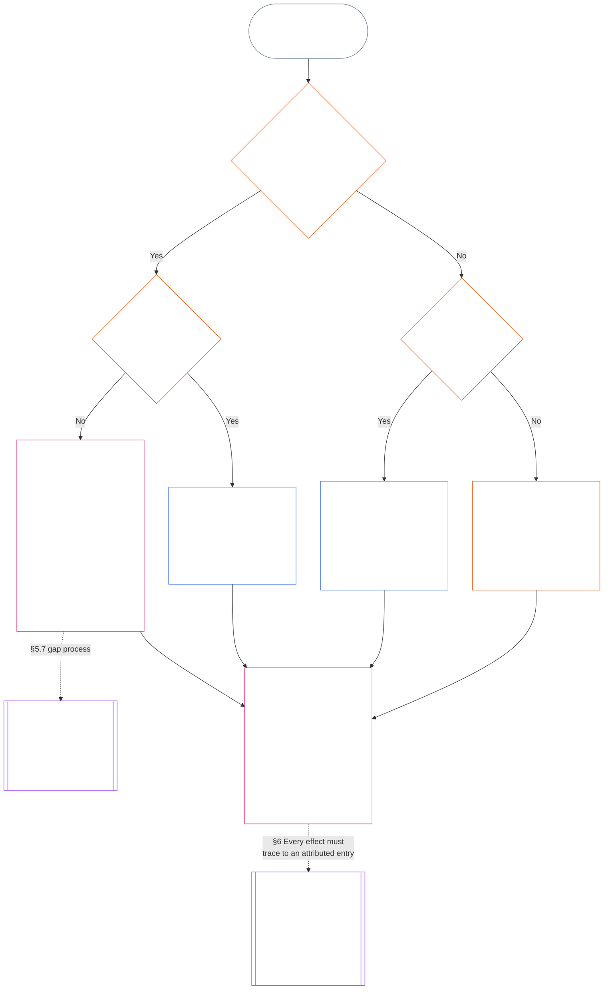

<!-- Locale: Indonesian (id) | Source: 9c2c8c10c871d91157bcd27b9f56ad6a1cec90d3 | AI-drafted, unreviewed | PARTIAL: Chapter Eleven §§5.7–5.9 only -->

#### 5.7 Jika Piagam Sistem atau Piagam Institusi tidak menyebut suatu kursi

Ke mana Catatan Status dialihkan saat jalur bernama yang biasa tidak tersedia bergantung pada tiga pertanyaan, yang dijawab bagan di bawah secara berurutan. Bagian ini membahas Piagam Sistem atau Piagam Institusi yang tidak menyebut suatu kursi; [§5.8 Ketentuan cadangan jika tidak ada Piagam Sistem atau Piagam Institusi yang mencakup Catatan Status](#58-fallback-when-no-system-charter-or-institutional-charter-reaches-the-standing-record) membahas keadaan ketika tak satu pun piagam mencakup Catatan Status.

<strong>Panduan pembaca (non-operatif): cara membaca bagan</strong>

> Dalam bahasa sederhana: Catatan Status ditangani oleh kantor yang disebutkan dalam Piagam Sistem atau Piagam Institusi. Jika piagam tidak menyebut suatu kursi, piagam itu tidak sah sampai kekosongan diperbaiki, dan Catatan Status dialihkan ke Kewenangan Catatan Cadangan dan Kustodian Catatan Cadangan, atau ke forum, bukan ke peta jalur. Jika tidak ada Piagam Sistem atau Piagam Institusi yang mencakup Catatan Status, peta jalur terbitan institusi yang menentukan; jika peta itu tidak ada, Catatan Status dialihkan ke verifikasi independen atau, untuk pekerjaan informal dan berskala kecil, ke badan yang mengandalkannya.
>
> Semua jalur berakhir di kotak yang sama: satu kantor memverifikasi fakta dan kantor lain memasukkan serta memegang Catatan Status, lalu [§6 Penanganan Catatan Status](#6-handling-a-standing-record) mengatur tindakan para pemegangnya. Panah utuh adalah jalur utama. Panah bertitik adalah pengalihan, dengan label bagian yang mengaturnya. Kotak dengan garis ganda di sisi milik bab lain, dan kotak terakhir adalah tempat akibat terhadap status ditarik dari Catatan Status tanpa menulis ulang isinya. Bagan ini tidak menambahkan kewajiban, kursi, atau kolom.

 

Piagam Sistem atau Piagam Institusi yang tidak menyebut kursi catatan wajib atau jalur independen:

- **Akibat:** Piagam Sistem atau Piagam Institusi tidak sah, dan perubahan yang menimbulkan keadaan itu tidak diizinkan ([Bab Tujuh §4.7.1 Jika terdapat kekosongan dan cara mencatatnya](core_07.000_charters.md#471-when-a-gap-exists-and-how-it-is-logged)).
- **Bab Tujuh mengatur proses kekosongan:** [Bab Tujuh §4.7 Kekosongan dalam peta Catatan Status operator](core_07.000_charters.md#47-gaps-in-the-map-for-operator-standing-records) juga mengatur:
  - cara mencatat kekosongan;
  - jangka waktu tanggapan dan penyelesaian (termasuk penggantian darurat); dan
  - kapan kustodi dikembalikan kepada pemegang yang disebutkan.

Untuk Catatan Status, bagian ini menambahkan:

- **Siapa yang tidak boleh bertindak:** Selama kursi wajib kosong dan Piagam Sistem atau Piagam Institusi tidak menyebut pengganti yang sah, tak seorang pun boleh menjalankan fungsi kursi itu, kecuali melalui jalur dalam butir berikutnya.
- **Ke mana Catatan Status dialihkan:** Catatan Status dialihkan kepada Kewenangan Catatan Cadangan dan Kustodian Catatan Cadangan, atau ke forum berdasarkan **bagian 2.7**, sebagaimana diatur dalam [§5.4 Tidak ada kustodi sendiri](#54-no-self-custody), dan peta jalur tidak menggantikannya. Setiap Catatan Status tetap utuh dengan satu kustodian.
- **Catatan Status yang sudah dipegang:**
  - Pada hari pemberitahuan tentang kekosongan diterima forum, registrar, atau Kewenangan Catatan Cadangan, setiap Catatan Status operator yang dipegang kantor di dalam Garis Kendali Material Pihak Berpiagam dialihkan ke Kustodian Catatan Cadangan beserta seluruh jejaknya.
  - Sampai saat itu, kantor tersebut memegangnya dalam mode hanya-baca, tidak memasukkan versi apa pun, dan segera memberi Kustodian Catatan Cadangan salinan lengkap beserta seluruh jejaknya.
  - Kustodian di luar garis tersebut tetap memegang Catatan Status dan, selama kekosongan, memasukkan setiap versi yang diizinkan Kewenangan Catatan Cadangan atau forum. Jika forum menetapkan bahwa kustodian berada di dalam garis, Catatan Status dialihkan ke Kustodian Catatan Cadangan beserta seluruh jejaknya, sebagaimana berlaku bagi kantor di dalam garis.
- **Pengelola:** Pengelola yang diminta mengisi kursi yang tidak diberikan kepadanya oleh Piagam Sistem atau Piagam Institusi:
  - **Menolak kursi:** Memiliki akses atau kemampuan teknis untuk memasukkan Catatan Status tidak memberinya kewenangan untuk memasukkannya.
  - **Menyebut permintaan dan kekosongan:** Menyebutkan keduanya dalam log.
  - **Meneruskan Catatan Status:** Mengirimkannya melalui jalur dalam butir *Ke mana Catatan Status dialihkan* di atas.
  - **Tetap menjalankan kewajiban lainnya:** Kewajiban yang sudah dimiliki berdasarkan [§5.4 Tidak ada kustodi sendiri](#54-no-self-custody) (*Pengelola di dalam subjek*) tetap berlaku: menghentikan hal yang berada dalam kendalinya, mencatat rangkaian yang dapat direkonstruksi, menjaga bukti yang dipegangnya, memberi tahu, dan mengeskalasi. Tidak satu pun tindakan tersebut memverifikasi fakta atau memasukkan Catatan Status. Log dan bukti yang dijaga ikut disertakan bersama Catatan Status sebagai input bagi kewenangan yang memverifikasinya; keduanya bukan entri dan tidak menentukan fakta.

#### 5.8 Ketentuan cadangan jika tidak ada Piagam Sistem atau Piagam Institusi yang mencakup Catatan Status

Jika tidak ada Piagam Sistem atau Piagam Institusi yang mencakup sistem, institusi, atau usaha yang dibahas Catatan Status, seperti badan di bawah garis Kelas L yang tidak menerbitkan piagam semacam itu, peta jalur terbitan institusi berdasarkan **CI-8.205 §2** (*Jalur pemisahan fungsional*) yang berlaku:

- **Kewenangan pembukaan catatan:** Kantor yang ditempatkan peta jalur pada jalur penjaminan dan audit untuk sistem, institusi, atau usaha yang dibahas Catatan Status. Kantor itu memverifikasi dasar faktual dan mengizinkan entri ([§5.2 Kewenangan pembukaan catatan yang disebutkan](#52-named-record-opening-authority)); kantor itu tidak memasukkan atau memegang Catatan Status.
- **Kustodian:** Kantor yang memegang jalur publikasi dan bukti.
- **Jalur pelaksanaan dikecualikan:** Keduanya tidak boleh merupakan kantor yang memegang jalur pelaksanaan untuk sistem terkait.
- **Peta jalur juga tidak ada:** Catatan Status dialihkan untuk verifikasi independen berdasarkan *Tidak ada kustodi sendiri* di atas, atau, untuk catatan informal dan berskala kecil, ke badan yang mengandalkannya berdasarkan *Catatan informal dan berskala kecil* berikutnya.
- **Pengelola:** Pengelola yang diminta mengisi kursi yang tidak diberikan peta jalur kepadanya mengikuti aturan *Pengelola* dalam [§5.7 Jika Piagam Sistem atau Piagam Institusi tidak menyebut suatu kursi](#57-when-a-system-charter-or-institutional-charter-leaves-a-seat-unnamed): menolak kursi, menyebut permintaan dan kekosongan dalam log, serta tetap menjalankan kewajiban lainnya. Mereka mengirim Catatan Status ke kantor yang disebutkan peta jalur atau, jika tidak ada yang disebutkan, melalui jalur dalam *Peta jalur juga tidak ada* di atas.

#### 5.9 Catatan informal dan berskala kecil

Pemisahan tugas diskalakan menurut taruhan material, bukan formalitas ([Bab Delapan §2 Persyaratan Konstitusional Empat Kursi](core_08.000_functional_independence_separation_of_duties.md#2-four-seat-constitutional-requirement)).

- **Pekerjaan yang tercakup:** Komunitas lokal berjalan dengan beragam jenis kontribusi, dan banyak di antaranya tidak dibayar serta bersifat informal. Ini berlaku untuk pekerjaan tanpa bayaran, yang diorganisasi rekan sebaya, bantuan timbal balik, perawatan, pemeliharaan, perbaikan, pengajaran, dan pengelolaan komunitas, yang menurut [Bab Tiga Belas §6 Akibat kontribusi didahulukan](core_13.000_standing_integration.md#6-contribution-consequences-second) wajib diakui dengan standar setara.
  - **Contoh dalam konteks lokal:** Tetangga berbagi makanan dan perkakas (bantuan timbal balik); merawat tetangga yang sakit atau lanjut usia (perawatan); menjaga kebun bersama atau sungai tetap baik (pemeliharaan dan pengelolaan komunitas); memperbaiki pipa tetangga (perbaikan); membimbing belajar atau mengajarkan keterampilan (pengajaran). Masing-masing merupakan jenis kontribusi tersendiri.
- **Siapa yang mengisi kursi verifikasi:** Untuk pekerjaan tersebut, kursi verifikasi dipenuhi oleh **badan independen mana pun yang memiliki kewenangan terbitan untuk mengandalkan Catatan Status**, yang kemudian bertindak sebagai kewenangan verifikasi.
  - **Siapa biasanya:** Sering kali badan yang akan mengandalkan Catatan Status: kelompok lokal seperti dewan daerah aliran sungai, organisasi yang mendanai atau mendukung keberlanjutan pekerjaan, kewenangan pengakuan catatan **CI-6.255** (*Tata kelola komunitas milik bersama, koperasi, bantuan timbal balik, dan nonpasar*) (badan yang mengakui catatan pekerjaan komunitas semacam ini), atau forum berdasarkan **bagian 2.7**.
- **Yang tidak memenuhi syarat:** Formalitas kewenangan verifikasi tidak memenuhi kursi verifikasi.

Pada Catatan Status semacam itu:

- makhluk sadar yang bertindak sendiri tidak memerlukan kelompok, institusi, [Piagam Sistem](core_05.040_band_continuity.md#system-charter), atau [Piagam Institusi](core_05.040_band_continuity.md#institutional-charter) untuk meminta catatan atas kontribusinya sendiri. Dalam hal ini:
  - **Siapa yang meminta:** Makhluk sadar tersebut memegang kursi pemrakarsa atas permintaannya sendiri, sebagai subjek dan pihak pengklaim.
  - **Bahannya sendiri:** Uraian, log, dan fotonya sendiri adalah input dan tidak pernah menjadi verifikasi.
  - **Kursi verifikasi:** Badan independen mana pun yang memiliki kewenangan terbitan untuk mengandalkan Catatan Status (kewenangan verifikasi).
  - **Entri dan kustodi:** Kustodian catatan yang terpisah memasukkan dan memegang Catatan Status.
  - **Jika ada yang menggugatnya:** Gugatan dialihkan ke jalur gugatan atau forum berdasarkan **bagian 2.7**.
  - **Tidak tersedia badan yang mengandalkan:** Jika tidak ada badan semacam itu, Catatan Status dialihkan ke forum berdasarkan **bagian 2.7**.
  - **Contoh, tukang leding pensiunan:** Tukang leding pensiunan yang selama bertahun-tahun memperbaiki pipa tetangga tanpa bayaran dan tidak bernaung di kelompok mana pun dapat meminta kewenangan pengakuan catatan **CI-6.255** (*Tata kelola komunitas milik bersama, koperasi, bantuan timbal balik, dan nonpasar*) untuk membuka Catatan Status:
    - **Meminta dan mengklaim:** Tukang leding tersebut.
    - **Memverifikasi:** Kewenangan itu, berdasarkan log pekerjaan dan kesaksian tetangga.
    - **Memasukkan dan memegang:** Kustodian catatan yang terpisah.
    - **Jika ada yang menggugatnya:** Gugatan dialihkan ke forum, bukan kembali ke kewenangan verifikasi.
- para peserta menjadi subjek dan, jika meminta pengakuan, pihak pengklaim. Dalam catatan kolektif berdasarkan **bagian 4.3**:
  - **Rekan peserta:** Masing-masing adalah pihak pengklaim.
  - **Pernyataan seorang anggota tentang bagian anggota lain:** Pernyataan itu merupakan input, bukan verifikasi.
- bahan yang mendukung Catatan Status berasal dari dua tempat:
  - **Bukan peserta:** Penerima manfaat, tetangga, dan pihak lain yang bukan peserta memberikan kesaksian sebagai bahan verifikasi berdasarkan **bagian 4.1**.
  - **Log kelompok sendiri:** Makhluk sadar yang menyimpannya adalah pencatat dan saksi berdasarkan *Pernyataan pencatat adalah input* di bawah.
- kustodian catatan badan yang mengandalkannya memasukkan dan memegang hal yang telah diverifikasi kewenangan verifikasi terpisah:
  - **Siapa yang tidak boleh memegang kedua kursi:** Kustodian catatan maupun kewenangan verifikasi tidak boleh menjadi pihak pengklaim atau berada dalam [Garis Kendali Material](core_05.035_band_accountability.md#material-control-line) pihak pengklaim.
  - **Satu badan, dua kursi:** Badan yang sama dan mengandalkan catatan boleh menjadi tuan rumah bagi kedua kursi berdasarkan peta jalur terbitan dengan perlindungan independensi yang dapat diaudit dan digugat.
  - **Tidak pernah orang yang sama:** Tidak ada kewenangan, kustodian, atau makhluk sadar yang boleh menjalankan kedua tugas pada Catatan Status yang sama.
- status kelompok tidak menjadi syarat bagi klaim anggota:
  - **Kelompok informal:** Kelompok tanpa [Piagam Sistem](core_05.040_band_continuity.md#system-charter) atau [Piagam Institusi](core_05.040_band_continuity.md#institutional-charter), atau yang sama sekali bukan Institusi, tidak menghalangi anggotanya.
  - **Setiap peserta:** Boleh meminta pengakuan sebagai pihak pengklaim perseorangan atas pekerjaan yang dilakukan di dalam atau di luar kelompok.
  - **Cakupan Catatan Status:** Catatan itu menyangkut kontribusi peserta, bukan status kelompok.
  - **Contoh, kelompok menjahit selimut:** Kelompok menjahit selimut yang memberikan selimut kepada pengungsi yang baru tiba menjadi contoh: setiap penjahit dapat meminta Catatan Status, diverifikasi badan independen yang mengandalkannya seperti lembaga penerima selimut, dan kelompok tersebut tidak memerlukan Piagam Sistem atau Piagam Institusi.
- Catatan Status pelanggaran juga dapat muncul dalam lingkungan informal yang sama, dan kursi-kursinya tetap terpisah:
  - **Contoh, insiden di bar:** Seseorang merekam makhluk sadar lain di bar yang menjadi mabuk, mengganggu ketertiban, dan melakukan kekerasan, meskipun tidak ada yang terluka secara fisik.
    - **Tidak perlu ada cedera:** Ancaman kekerasan yang kredibel dan terverifikasi dapat mendukung Catatan Status pelanggaran meski tidak ada yang terluka (**bagian 3.2**, hilangnya agensi akibat pemaksaan).
    - **Video adalah input:** Makhluk sadar yang merekam menjadi saksi. Rekaman adalah input dan tidak pernah dengan sendirinya menjadi verifikasi; keberadaannya juga tidak membuka apa pun dengan sendirinya (**bagian 2.2**).
    - **Makhluk sadar dalam video:** Ia adalah subjek. Ia diberi tahu saat Catatan Status dibuka, dan tidak boleh mengisi kursi mana pun ([§5.4 Tidak ada kustodi sendiri](#54-no-self-custody)).
    - **Kursi verifikasi:** Badan independen yang memiliki kewenangan terbitan untuk mengandalkan Catatan Status, seperti badan perizinan atau keselamatan setempat, atau forum berdasarkan **bagian 2.7**. Makhluk sadar yang merekam dan pemilik bar dikecualikan jika salah satunya merupakan pihak pengklaim atau berada dalam [Garis Kendali Material](core_05.035_band_accountability.md#material-control-line) pihak pengklaim.
    - **Entri, kustodi, dan gugatan:** Kustodian catatan yang terpisah memasukkan dan memegang Catatan Status, dan gugatan dialihkan ke jalur gugatan atau forum berdasarkan **bagian 2.7**, bukan kembali ke badan verifikasi.
- bar atau proses yang mensyaratkan verifikasi oleh institusi formal yang tidak dapat dijangkau kelompok informal, padahal badan independen yang mengandalkannya tersedia, merupakan pola penghalangan sewenang-wenang berdasarkan [Bab Tiga Belas §6.2 Kriteria kompetensi dan izin](core_13.000_standing_integration.md#62-competency-bars-and-clearances), bukan pemisahan tugas.

Semua ini tidak mewajibkan adanya Catatan Status. **Bagian 2.2** *Keheningan adalah ketentuan bawaan* yang berlaku: pekerjaan informal tidak dicatat hanya karena bisa dicatat, dan pemisahan tugas mengikat hanya setelah Catatan Status diminta.
