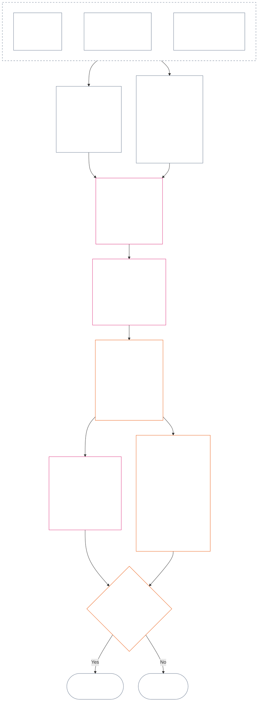

<!-- Locale: Indonesian (id) | Source: 9c2c8c10c871d91157bcd27b9f56ad6a1cec90d3 | AI-drafted, unreviewed | PARTIAL: Chapter Twelve §§4–6 only -->

### 4. Tata bahasa slot dan penskalaan bersama

*Dalam bahasa sederhana: bagian ini memberi nama yang konsisten untuk sembilan kemungkinan posisi pada masing-masing dari dua sumbu terpisah dan menjelaskan penskalaan dampak di antaranya. Satu sumbu mencatat kontribusi terverifikasi; sumbu lain mencatat pelanggaran terverifikasi. Nomor slot yang sama tidak menggabungkan sumbu ataupun mengimbangi bahaya dengan bantuan. Skala terpadu dalam **bagian 6** menetapkan kedua sumbu berdasarkan dampak LEQU yang proporsional.*

Tata bahasa slot menggunakan nomor slot `s`, dari **1** sampai **9**. Setiap sumbu memiliki posisi slotnya sendiri:

- **Sumbu Kontribusi** mencatat sifat kontribusi positif; dan
- **Sumbu Pelanggaran** mencatat temuan pelanggaran terverifikasi.

Nomor slot yang sama dapat muncul pada kedua sumbu, tetapi keduanya tetap terpisah. Slot kontribusi bukan slot pelanggaran, dan slot pelanggaran bukan slot kontribusi.

#### 4.1 Tabel 1 — label tampilan slot

**Tabel 1** menamai sembilan slot dan menampilkan label Sumbu Kontribusi dan Sumbu Pelanggaran berdampingan. Tabel ini hanya menyediakan bahasa tampilan; penetapan slot dilakukan menurut skala terpadu dalam **bagian 6**.

| `s` | Label tampilan Sumbu Kontribusi | Label tampilan Sumbu Pelanggaran |
| ---: | --- | --- |
| 1 | **Kontribusi Dasar Minor** | **Dampak Konstitusional Minor** |
| 2 | **Kontribusi Dasar Kecil** | **Dampak Konstitusional Kecil** |
| 3 | **Kontribusi Positif Substansial** | **Dampak Konstitusional Substansial** |
| 4 | **Kontribusi Positif Signifikan** | **Dampak Konstitusional Signifikan** |
| 5 | **Kontribusi Positif Pengelolaan yang Serius** | **Dampak Konstitusional Serius** |
| 6 | **Kontribusi Positif Pengelolaan yang Besar** | **Dampak Konstitusional Besar** |
| 7 | **Juara yang Diakui** | **Dampak Konstitusional Berat** |
| 8 | **Juara Terhormat** | **Dampak Konstitusional Parah** |
| 9 | **Juara Teladan** | **Dampak Konstitusional Katastrofik** |

Sumbu Kontribusi menggunakan label dasar, positif, positif-pengelolaan, dan juara. Sumbu Pelanggaran menggunakan label dampak netral pada setiap slot. Kedua sumbu tetap terpisah dan tidak membentuk skor bersih atau mengizinkan pengimbangan antara Catatan Status kontribusi dan pelanggaran. Slot Sumbu Pelanggaran tidak dengan sendirinya mengklasifikasikan pelanggaran anti-konstitusional; [Bab Empat Belas](core_14.000_misconduct_designation.md#chapter-fourteen-anti-constitutional-misconduct) secara independen menentukan apakah penetapan pelanggaran anti-konstitusional (ACMD) melekat pada pelanggaran terverifikasi dengan `s` = 7–9.

Pelaksanaan boleh menerbitkan satuan pengukuran, metode bukti, dan contoh untuk membantu memperkirakan manfaat atau kerugian ekuivalen satu masa hidup penuh. Bahan tersebut hanya panduan dan tidak boleh mengesampingkan **bagian 6**, **Bab Satu**, atau **Lantai Hak** dalam **Bab Enam**.

#### 4.2 Aturan penskalaan dampak bersama

*Dalam bahasa sederhana: dampak tidak diukur hanya dengan menghitung orang. Manfaat atau kerugian mendalam yang memengaruhi satu makhluk sadar dapat lebih signifikan daripada dampak dangkal yang memengaruhi banyak orang. Jumlah, kedalaman, kerentanan, durasi, daya tahan, jangkauan, dan karakter konstitusional harus dinilai bersama.*

Gunakan aturan berikut untuk menafsirkan kedua sumbu dalam **bagian 6**:

| Dimensi penskalaan | Aturan bersama | Penerapan khusus sumbu |
| --- | --- | --- |
| **Besaran hasil konstitusional (LEQU)** | Nilai manfaat atau kerugian terverifikasi secara terpadu. LEQU adalah jangkar utama besaran; jumlah orang mentah, uang, hasil produksi, atau ukuran institusi bukanlah ukuran utama. | Kontribusi menghitung manfaat yang selaras dengan hak; pelanggaran menghitung kerugian konstitusional, bahaya, pemborosan, penutupan pilihan, atau bahaya terverifikasi. |
| **Cakupan makhluk sadar** | Pertimbangkan **jumlah, kedalaman, dan kerentanan secara bersama**. Tidak ada slot yang menjadikan jumlah orang sebagai persyaratan mandiri. Dampak yang cukup mendalam pada satu makhluk sadar dapat mendukung slot yang sama dengan dampak lebih luas tetapi lebih dangkal jika besaran terpadu dan kriteria lain pada baris itu setara; setiap kriteria LEQU agregat atau cakupan luas yang dinyatakan tetap wajib dipenuhi. | Ketergantungan, kapasitas yang berkurang, atau kerentanan yang tidak biasa dapat meningkatkan materialitas. Besar kelompok saja tidak menetapkan kontribusi atau tingkat keparahan. |
| **Cakupan temporal** | Pertimbangkan durasi, pengulangan, daya tahan, dan, untuk kerugian, ketakterbalikan. Peristiwa singkat tetapi transformatif dapat lebih berbobot daripada dampak kecil yang berlangsung lama; durasi saja bukan penentu. | Manfaat yang tahan lama mendukung besaran kontribusi lebih tinggi. Kerugian menetap atau tidak dapat dipulihkan mendukung tingkat keparahan pelanggaran yang lebih tinggi. |
| **Cakupan geografis atau institusional** | Jangkauan yang lebih luas dapat meningkatkan besaran, tetapi jangkauan lintas komunitas atau institusi tidak diwajibkan jika kedalaman, durasi, kerentanan, atau kekritisan konstitusional secara mandiri mendukung slot tersebut. | Perbaikan institusional dapat meningkatkan besaran kontribusi; kerusakan struktural atau sistemik dapat meningkatkan tingkat keparahan pelanggaran. |
| **Mutu atau karakter konstitusional** | Ukur cara hasil diproduksi secara terpisah dari luas penyebarannya. Jangan menghitung fakta yang sama dua kali. | Bahaya yang dialihkan kepada pihak lain, beban tersembunyi, penguasaan, atau ketergantungan dapat membatasi atau menggugurkan kontribusi yang diklaim. Kewajiban, kelalaian, penipuan, pemaksaan, kekerasan, atau faktor pendukung struktural tetap dicatat terpisah sebagai karakter tindakan pelanggaran dan tidak mengubah slot dampak. |
| **Lantai Hak dan perlindungan kritis** | Kepatuhan pada Lantai Hak tidak dipertukarkan dengan manfaat atau kerugian agregat. | Kepatuhan terhadap suatu lantai tidak dengan sendirinya menetapkan kontribusi tinggi. Kekalahan material terhadap Lantai Hak atau kegagalan perlindungan kritis dapat mendukung tingkat keparahan pelanggaran yang lebih tinggi meski hanya sedikit makhluk sadar terdampak langsung. |

Dimensi ini bukan daftar periksa yang mewajibkan setiap jenis skala. Jelaskan dimensi mana yang menentukan, mana yang tidak, dan alasannya.

- **Metode slot bersama:**
  - Perkirakan manfaat atau kerugian terverifikasi terpadu dalam LEQU berdasarkan Proporsionalitas, lalu tetapkan satu slot dengan band numerik yang mencakup besaran itu.
  - Ambang yang sama berlaku pada kedua sumbu.
  - Slot kontribusi tetap mensyaratkan dasar dan keselarasan konstitusional yang berlaku; terpenuhinya ambang numerik tidak menjadikan hasil yang membebankan biaya kepada pihak lain atau dikalahkan secara konstitusional sebagai kontribusi.
- **Pemisahan karakter:** Tumpuk deskriptor rute manfaat, rute bahaya, mutu tindakan, dan karakter tindakan yang berlaku dalam Catatan Status. Kewajiban, kelalaian, penipuan, faktor pemberat, pemaksaan, kekerasan, niat, atau faktor pendukung struktural dapat memengaruhi atribusi, perlindungan, atau akibat Pertanyaan 3, tetapi tidak satu pun menaikkan atau menurunkan slot dampak LEQU.
- **Batas Peninjauan Pelanggaran Anti-Konstitusional:** Kerugian terverifikasi pada Sumbu Pelanggaran dapat mencapai `s` = 7–9 berdasarkan dampaknya, baik pelanggaran anti-konstitusional terbukti maupun tidak. Bab Empat Belas tidak menggantikan penetapan dampak; bab itu secara independen menentukan apakah ACMD terkait melekat.

Jika bahaya belum benar-benar terjadi, catat setiap hal berikut secara terpisah:

- seberapa mungkin hal itu terjadi;
- berapa lama makhluk sadar akan terpapar;
- seberapa luas jangkauannya;
- seberapa tidak pasti perkiraannya; dan
- hasil terburuk yang masih masuk akal.

Jangan menghitung hasil terburuk itu sebagai bahaya yang sudah terjadi (kerugian LEQU), kecuali pelaksanaan yang diadopsi telah menetapkan kalibrasi risiko (metode mengubah risiko menjadi LEQU) yang dapat diperiksa siapa pun.

### 5. Input konstitusional untuk penetapan sumbu

*Dalam bahasa sederhana: sebelum memilih slot, identifikasi sumber konstitusional yang menetapkan dasar, manfaat, kewajiban, bahaya, atau pelanggaran yang diukur. Gunakan tautan di bawah untuk menerapkan sumber tersebut di lokasi kanonisnya; jangan jadikan tahap pengarahan ini skor tambahan atau pengganti definisi.*

Sebelum menetapkan slot berdasarkan **bagian 6**, Catatan Status wajib mengidentifikasi:

- dasar, kewajiban, batasan, atau kepentingan terlindungi konstitusional yang berlaku;
- ketentuan yang menetapkan manfaat terverifikasi, hasil merugikan, bahaya, atau pelanggaran yang diukur;
- definisi, prinsip, dan Pasal Lantai Hak yang secara material memengaruhi besaran atau karakter tindakan; dan
- alasan setiap sumber yang disebut berlaku serta dampaknya terhadap penetapan sumbu.

Tabel pengarahan di bawah ini tidak lengkap. Definisi, prinsip, atau Pasal tambahan yang terpicu oleh fakta terverifikasi tetap berlaku dan wajib disebutkan dalam Catatan Status. Lokasi kanonis yang ditautkan tetap mengendalikan; tabel ini tidak menyatakan ulang atau mempersempitnya.

#### 5.1 Input definisi

| Sumber kanonis | Peran pada Sumbu Kontribusi | Peran pada Sumbu Pelanggaran |
| --- | --- | --- |
| [Status, Kontribusi, dan Pelanggaran](core_05.035_band_accountability.md#defa3-standing-state-contribution-and-violation) | Menjelaskan apa yang dihitung sebagai kontribusi dan fakta terverifikasi mana yang dapat digunakan untuk mengukurnya. Juga memastikan Catatan Status kontribusi hanya mencatat sisi baik, tidak pernah bercampur dengan sisi buruk. | Menjelaskan apa yang dihitung sebagai pelanggaran dan cara mencatatnya. Juga mengirim perkara paling serius ke Peninjauan Pelanggaran Anti-Konstitusional, peninjauan terpisah atas tindakan yang merusak Konstitusi itu sendiri. |
| [Pertanggungjawaban](core_05.005_apex_accountability_leg.md#accountability) | Memeriksa apakah klaim pengelolaan atau perbaikan yang baik benar-benar membuat seseorang tetap dapat dimintai pertanggungjawaban. Tetap harus menunjukkan siapa melakukan apa, siapa yang harus menjawab, dan bagaimana hal itu dapat ditinjau, diperbaiki, serta dikoreksi sebanding dengan dampaknya. | Menemukan keadaan ketika tidak jelas siapa melakukan sesuatu atau siapa yang harus menjawab. Ini mencakup keadaan ketika tanggung jawab berhenti berfungsi setelah organisasi atau strukturnya berubah. |
| [Bahaya](core_05.035_band_accountability.md#harm) | Bahaya yang dialihkan kepada pihak lain atau disembunyikan dapat membatasi atau membatalkan manfaat yang diklaim. Memperbaiki bahaya dapat dihitung sebagai manfaat, tetapi hanya jika perbaikannya terverifikasi dan dibuktikan secara independen. | Merinci jenis kerusakan yang dihitung dalam pengukuran kerugian dan tingkat keparahan: langsung, tidak langsung, tertunda, kumulatif, tersebar lintas sistem, serta bahaya terhadap pikiran atau kesejahteraan emosional makhluk sadar. |
| [Materialitas](core_05.050_band_oversight.md#materiality) dan [Satuan Ekuivalen Masa Hidup (LEQU)](core_05.055_band_participation.md#lifespan-equivalent-unit-lequ) | Menetapkan besaran manfaat terverifikasi berdasarkan jangkauan, kerentanan pihak terdampak, dan durasinya. Hasilnya diukur dalam LEQU, tolok ukur bersama untuk manfaat senilai satu masa hidup penuh. | Menetapkan besaran kerugian atau bahaya terverifikasi berdasarkan jangkauan, kerentanan pihak terdampak, durasi, dan sulitnya memulihkan. Hasilnya diukur dalam LEQU, tolok ukur yang sama untuk kerugian senilai satu masa hidup penuh. |
| [Sifat Kontribusi](core_05.035_band_accountability.md#contribution-nature) | Menentukan apakah sesuatu dihitung sebagai kontribusi. Kontribusi harus hanya bersifat baik, tidak bercampur dengan bahaya, dan didukung Catatan Status kontribusi terverifikasi yang dapat ditunjukkan. Tanpa keduanya, penetapan Sumbu Kontribusi tidak dapat diberikan. | Tidak berperan di sini. Sifat ini tidak menentukan apa yang dihitung sebagai bahaya dan tidak pernah mengurangi keseriusan pelanggaran. |
| [Sifat Pelanggaran](core_05.035_band_accountability.md#violation-nature) | Tidak berperan di sini. Pelanggaran tidak pernah dihitung sebagai kontribusi negatif dan tidak menghapus manfaat terverifikasi yang tidak terkait dengannya. | Menentukan apakah sesuatu dihitung sebagai pelanggaran. Hal itu harus diklasifikasikan sebagai berbahaya dan didukung temuan terverifikasi bahwa pelanggaran terjadi. Tanpa keduanya, penetapan Sumbu Pelanggaran tidak dapat diberikan. |
| [Batasan Konstitusional](core_05.045_band_integrative.md#constitutional-constraint), [Tumpukan Kewenangan dan Hierarki Internal](core_05.045_band_integrative.md#authority-stack-and-internal-hierarchy), dan [Dapat Diaudit](core_05.050_band_oversight.md#auditability) | Mencegah manfaat yang diklaim dihitung jika bergantung pada pengalahkan Konstitusi, penghindaran aturannya, penyempitan Lantai Hak (perlindungan minimum yang dijamin Konstitusi), atau kepatuhan di atas kertas saja. | Menandai hal yang memengaruhi keseriusan pelanggaran: pelanggaran batas konstitusional yang penting, penempatan sesuatu di atas kewenangan Konstitusi, pengelakan aturan, atau membuat aturan mustahil ditegakkan. |
| [Dapat Diaudit](core_05.050_band_oversight.md#auditability) dan [Dapat Digugat](core_05.035_band_accountability.md#contestability) | Mensyaratkan manfaat yang diklaim dapat ditunjukkan dan diperiksa, serta tersedianya cara yang berfungsi untuk menggugatnya. | Mensyaratkan temuan yang dapat diperiksa dan digugat. Tuduhan atau label tanpa penjelasan tidak dapat menetapkan tingkat keseriusan pelanggaran. |

#### 5.2 Input prinsip

| Sumber prinsip | Peran dalam penetapan sumbu |
| --- | --- |
| [Tetrad Konstitusional](core_00.000_preamble.md#constitutional-tetrad), [Dua Tujuan Konstitusional](core_00.000_preamble.md#two-constitutional-aims), dan [taruhan material](core_00.000_preamble.md#material-stake) | Menetapkan empat disiplin kerja (partisipasi, pengawasan, pertanggungjawaban, dan ketepatan waktu), dua hasil tujuan Konstitusi (Berkembang dan Kesinambungan), serta kerangka untuk menyesuaikan tiap penetapan dengan hal yang dipertaruhkan. |
| [Kesejahteraan](core_01.000_values_principles.md#3-foundational-objective-wellbeing-flourishing-aim) dan [Pengakuan, Penguatan, dan Aspirasi](core_01.000_values_principles.md#32-recognition-reinforcement-and-aspiration) | Menjadi dasar manfaat yang menghormati hak dan pengakuan yang sesuai dengannya pada Sumbu Kontribusi. Prestise atau imbalan tidak pernah dianggap sebagai bukti kontribusi. |
| [Keselamatan](core_01.000_values_principles.md#4-safety-harm-constraint) dan [Kebenaran](core_01.000_values_principles.md#5-truth-epistemic-integrity-constraint) | Menetapkan batas mengikat pada kedua sumbu. Manfaat yang diperoleh melalui bahaya atau penipuan tidak dihitung sepenuhnya, dan kegagalan keselamatan atau kebenaran yang terverifikasi dapat menunjukkan besaran atau jenis pelanggaran. |
| [Pengelolaan Secara Mendalam](core_01.010_stewardship_capacity_principles.md#16-stewardship-in-depth) dan [Tata Kelola di Bawah Disiplin Pengelolaan](core_01.010_stewardship_capacity_principles.md#18-governance-under-stewardship-discipline) | Memandu penilaian kontribusi yang bertahan, kewajiban yang melekat pada peran, perbaikan institusional, pengawasan, dan tanggung jawab, setiap kali fakta terverifikasi mengharuskannya. |
| [Prinsip Pertukaran Inti](core_01.005_interaction_interpretation.md#131-core-tradeoff-principles) dan [Lantai Konstitusional, Keselamatan, dan Proses Anti-Penghinaan](core_01.005_interaction_interpretation.md#1314-constitutional-floors-safety-and-anti-degrading-process) | Berlaku ketika tindakan yang diukur menyangkut kebutuhan, pengurangan bahaya semaksimal mungkin, proporsionalitas, pertentangan antarhak, atau pembatasan. Prinsip-prinsip ini tidak pernah mengizinkan akibat dengan sendirinya. |

#### 5.3 Input Lantai Hak dan Pasal

| Sumber Pasal | Peran atau batas dalam penetapan sumbu |
| --- | --- |
| [Lantai Hak Bab Enam](core_06.000_rights_part_a.md#chapter-six-foundational-rights) yang berlaku secara faktual, termasuk setiap Pasal yang secara material terkait Catatan Status terverifikasi | Menetapkan perlindungan dasar, kepentingan, kewajiban, manfaat, atau pelanggaran yang dipertaruhkan. Tidak ada Pasal yang diabaikan hanya karena tidak tercantum di bawah. |
| [Pasal XIX — Status Status dan Partisipasi](core_06.015_rights_part_d.md#article-xix-standing-and-participation-status) | Menjaga agar hal-hal ini tetap terpisah: status makhluk sadar, martabat, perlindungan minimum Lantai Hak, status pemangku kepentingan, reputasi, dan perubahan status partisipasi selanjutnya. |
| [Pasal XIII-A — Dasar Keandalan dan Keterpercayaan](core_06.010_rights_part_c.md#article-xiii-a-reliability-and-trustworthiness-baseline) dan [Pasal XIII-B — Hak atas Ganti Rugi dan Pemulihan](core_06.010_rights_part_c.md#article-xiii-b-right-to-redress-and-remedy), [Pasal XV-B — Transparansi, Kemampuan Audit, dan Kemampuan untuk Menggugat](core_06.010_rights_part_c.md#article-xv-b-transparency-auditability-and-contestability), serta [Pasal XVI — Audit, Transparansi, dan Verifikasi Independen](core_06.010_rights_part_c.md#article-xvi-audit-transparency-and-independent-verification) | Berlaku jika manfaat atau pelanggaran terverifikasi menyangkut pencatatan yang jujur, pembagian informasi, pemeriksaan fakta, kemampuan menggugat keputusan, atau perbaikan kesalahan. |
| [Pasal XXIV — Analisis Akar Penyebab dan Respons Adaptif](core_06.015_rights_part_d.md#article-xxiv-root-cause-analysis-and-adaptive-response) | Berlaku jika penyebab tindakan, perbaikannya, pengulangannya, atau adaptasi respons menjadi relevan karena hal tersebut menunjukkan kedudukan tindakan menurut Konstitusi. |
| [Pasal XX — Keadilan setelah Pelanggaran Terverifikasi](core_06.015_rights_part_d.md#article-xx-justice-after-verified-violation) dan [Pasal XXVI-C — Penyelesaian Tepat Waktu dan Batas Anti-Penundaan](core_06.020_rights_part_e.md#article-xxvi-c-timely-resolution-and-anti-delay-floor) | Berlaku pada proses atau penundaan yang benar-benar melibatkan fakta. **Pasal XX** (*Keadilan setelah Pelanggaran Terverifikasi*) terutama membatasi hal yang terjadi setelah pelanggaran diukur (Pertanyaan 3). Pasal itu tidak boleh digunakan untuk menaikkan atau menurunkan slot Pertanyaan 2 demi membenarkan respons yang sudah diinginkan seseorang. |

**Batas penerapan.** Tahap ini hanya menunjukkan sumber yang tepat.

- Tahap ini tidak:
  - membuka kembali Pertanyaan 1;
  - memasukkan fakta yang belum diverifikasi;
  - menambahkan ukuran atau skor baru;
  - menghitung fakta yang sama dua kali melalui sumber berbeda;
  - menggabungkan kedua sumbu; atau
  - menjadikan setiap sumber yang tercantum berlaku bagi setiap Catatan Status.
- Kontribusi dan pelanggaran tetap diukur secara terpisah.
- Akibat berdasarkan **Pasal XX** (*Keadilan setelah Pelanggaran Terverifikasi*) berada di luar Pertanyaan 2.
- Peninjauan penetapan Bab Empat Belas tetap terpisah dari slot dampak yang ditetapkan di sini.

### 6. Skala LEQU proporsional terpadu — Sumbu Kontribusi dan Pelanggaran

<strong>Panduan pembaca (non-operatif): cara kerja progresi lima kali lipat</strong>

> Skala menggunakan progresi lima kali lipat dengan jangkar `s` = 7 = satu LEQU. Untuk kedua sumbu, besaran minimum untuk slot `s` adalah `5^(s−7)` LEQU bagi slot 2 sampai 9; slot 1 dimulai dari nol. Pelaksanaan yang diadopsi boleh menerbitkan ambang numerik dan contoh kalibrasi yang dihasilkan. Slot 1 mencakup dasar konstitusional terverifikasi pada Sumbu Kontribusi dan kerugian terverifikasi di bawah ambang positif pertama pada Sumbu Pelanggaran; tidak adanya kontribusi atau pelanggaran bukan dengan sendirinya catatan `s` = 1.
>
> **Jangkar yang dapat dipahami manusia.** Dengan masa hidup manusia 80 tahun sebagai contoh kalibrasi, baca kolom tengah ke atas sebagai manfaat ekuivalen masa hidup penuh, waktu yang dapat digunakan, atau sumber daya dan kapasitas yang selaras dengan hak yang ditambahkan; baca ke bawah sebagai kerugian, perampasan, pemborosan, atau penutupan pilihan yang ekuivalen. Jumlah sumber daya tidak dihitung dengan sendirinya — hasil konstitusional yang ditimbulkan atau dicegahnyalah yang menentukan.

 

*Dalam bahasa sederhana: **Tabel 2** menempatkan kontribusi dan pelanggaran terverifikasi pada skala dampak proporsional yang sama. Slot lebih tinggi berarti manfaat atau kerugian konstitusional terpadu yang lebih besar. Catatan Status dan sumbunya tetap terpisah: skala bersama membandingkan besaran, bukan nilai moral, dan tidak pernah mengizinkan bantuan membatalkan bahaya.*

Diagram mengikuti satu penetapan slot dari awal hingga akhir. Diagram menunjukkan urutan pengerjaan langkah, bukan urutan butir di bawah; butir tersebut menyatakan setiap aturan.

Terapkan **Proporsionalitas** untuk memperkirakan dampak LEQU terpadu berdasarkan kedalaman, cakupan makhluk sadar, kerentanan, durasi, daya tahan atau ketakterbalikan, jangkauan, dan kekritisan konstitusional. Dimensi ini membentuk perkiraan LEQU; bukan bonus slot yang berdiri sendiri.

- Gunakan **Tabel 2** setelah Pertanyaan 1 memastikan apa yang terjadi, Pertanyaan 2 mengukur manfaat atau kerugian terverifikasi, **bagian 1–3 dan 4.2** diterapkan, dan sumber konstitusional yang diwajibkan oleh **bagian 5** diidentifikasi.
- Tetapkan satu slot dari perkiraan LEQU terpadu.
  - Jelaskan pengaruh setiap dimensi penskalaan material terhadap perkiraan dan mengapa dimensi yang tidak dicantumkan tidak menentukan.
  - Setiap penetapan wajib memenuhi:
    - keterlacakan;
    - kemampuan diaudit;
    - kemampuan untuk digugat; dan
    - Lantai Hak yang berlaku.
  - Kontribusi juga wajib memenuhi persyaratan tanpa pengalihan beban kepada pihak lain dan keselarasan konstitusional.
- Catat fakta karakter tindakan sebagai deskriptor terpisah yang dapat ditelusuri. Fakta tersebut dapat menentukan atribusi, intensitas peninjauan, perlindungan, pemulihan, atau penetapan Bab Empat Belas; fakta itu hanya memengaruhi slot sejauh konsekuensi terverifikasi mengubah dampak LEQU terpadu.
- Nilai sepenuhnya konsekuensi tindakan atau rangkaian tindakan yang terverifikasi melalui dimensi penskalaan material, termasuk:
  - cedera fisik;
  - trauma psikologis;
  - dampak pemaksaan;
  - perampasan atau bahaya terhadap kebebasan;
  - bahaya kumulatif; dan
  - manfaat atau kerugian lain yang diakui secara konstitusional.
- Jangan:
  - menaikkan atau menurunkan slot hanya karena suatu peristiwa atau rangkaian tindakan dicirikan oleh:
    - kewajiban;
    - kelalaian;
    - niat;
    - penyembunyian;
    - pengulangan;
    - faktor pemberat;
    - pemaksaan;
    - kekerasan;
    - bahaya terhadap kebebasan;
    - kemampuan untuk dikoreksi; atau
    - konsekuensi yang diinginkan;
  - menyimpulkan karakter tindakan dari besaran atau menggantikan besaran terverifikasi dengan karakter tindakan.

**Tabel 2** mencantumkan sembilan slot secara berurutan. Setiap baris memberikan nomor slot `s`, besaran manfaat yang ditambahkan atau kerugian yang ditimbulkan untuk mencapai slot tersebut (dengan masa hidup manusia 80 tahun sebagai contoh kalibrasi), serta nama slot pada masing-masing sumbu. Ambang pada kedua sumbu sama, tetapi nama keduanya tetap terpisah: slot Sumbu Kontribusi dan slot Sumbu Pelanggaran adalah catatan berbeda dan tidak pernah saling mengimbangi.

| `s` | Kalibrasi manusia 80 tahun — manfaat ditambahkan / kerugian ditimbulkan | Sumbu Kontribusi | Sumbu Pelanggaran |
| ---: | --- | --- | --- |
| 1 | Kurang dari sekitar **9 hari** | **Kontribusi Dasar Minor** — pemenuhan dasar konstitusional terverifikasi untuk cakupan yang dinilai; peningkatan terukur apa pun tetap di bawah `s` = 2. | **Dampak Konstitusional Minor** — kerugian atau gangguan operasional terverifikasi di bawah `s` = 2, termasuk cacat formal tanpa bahaya substantif terbukti. |
| 2 | Sekitar **9–47 hari** | **Kontribusi Dasar Kecil** — kinerja andal dan terbatas di atas minimum dasar pada tingkat dampak ini. | **Dampak Konstitusional Kecil** — kerugian terbatas terverifikasi pada tingkat dampak ini. |
| 3 | Sekitar **47 hari–8 bulan** | **Kontribusi Positif Substansial** — manfaat yang dapat dibuktikan melampaui dasar pada tingkat dampak ini. | **Dampak Konstitusional Substansial** — kerugian substansial terverifikasi pada tingkat dampak ini. |
| 4 | Sekitar **8 bulan–3,2 tahun** | **Kontribusi Positif Signifikan** — manfaat terverifikasi yang lebih mendalam, bertahan lama, berulang, tanggap terhadap kerentanan, atau lebih luas. | **Dampak Konstitusional Signifikan** — kerugian konstitusional signifikan terverifikasi. |
| 5 | Sekitar **3,2–16 tahun** | **Kontribusi Positif Pengelolaan yang Serius** — pengelolaan, koordinasi, pemeliharaan, perbaikan, atau manfaat berkelanjutan sebanding yang tahan lama. | **Dampak Konstitusional Serius** — kerugian konstitusional serius terverifikasi. |
| 6 | Sekitar **16–80 tahun** | **Kontribusi Positif Pengelolaan yang Besar** — manfaat terverifikasi besar yang mendekati satu LEQU. | **Dampak Konstitusional Besar** — kerugian terverifikasi besar yang mendekati satu LEQU. |
| 7 | Sekitar **1–5 masa hidup** (**80–400 tahun**) | **Juara yang Diakui** — manfaat terverifikasi yang selaras dengan Konstitusi sekurang-kurangnya satu LEQU. | **Dampak Konstitusional Berat** — kerugian konstitusional terverifikasi sekurang-kurangnya satu LEQU. |
| 8 | Sekitar **5–25 masa hidup** (**400–2.000 tahun**) | **Juara Terhormat** — manfaat terverifikasi yang secara material melebihi `s` = 7. | **Dampak Konstitusional Parah** — kerugian terverifikasi yang secara material melebihi `s` = 7. |
| 9 | Sekurang-kurangnya **25 masa hidup** (**2.000+ tahun**) | **Juara Teladan** — manfaat terverifikasi yang secara material melebihi `s` = 8. | **Dampak Konstitusional Katastrofik** — kerugian terverifikasi yang secara material melebihi `s` = 8. |

<strong>Catatan interoperabilitas pelaksanaan</strong>

> Widget ini berisi materi interoperabilitas yang ditujukan bagi pelaksanaan. Materi ini mendukung kategori operatif bab tersebut; tidak membentuk sistem kategori paralel.

Kolom yang dapat dibaca mesin untuk tampilan slot (`sub_tier`, `sub_tier_display`, dan kolom tampilan terkait) ditetapkan dalam [CH06_NINE_SLOT_STANDING_SCALE.md](implementation/CH06_NINE_SLOT_STANDING_SCALE.md) dan [ch06_nine_slot_constants.json](implementation/ch06_nine_slot_constants.json). Peta empat band untuk pelaksanaan tetap merupakan alat interoperabilitas dan tidak menambahkan kolom band utama pada **Tabel 2** operatif.

Metode acuan dan contoh penetapan slot, termasuk bagi makhluk sadar yang memiliki bobot, titik pemeriksaan keadaan tersimpan, dan mortalitas yang tidak tetap, tersedia dalam [LEQU_CALIBRATION_REFERENCE.md](implementation/LEQU_CALIBRATION_REFERENCE.md). Contoh tersebut tidak dapat menggantikan ambang bersama dan aturan penetapan proporsional dalam **bagian 6**, tidak dapat menetapkan catatan aktif, dan tidak dapat menentukan siapa yang diperhitungkan.

Pelaksanaan yang diadopsi boleh menerbitkan perkiraan LEQU dan label tampilan berkunci. Alat bantu tersebut tidak boleh menggantikan ambang bersama dan aturan penetapan proporsional dalam **bagian 6** atau perlindungan penetapan Bab Empat Belas, kecuali melalui perubahan **dokumen yang sesuai**.

