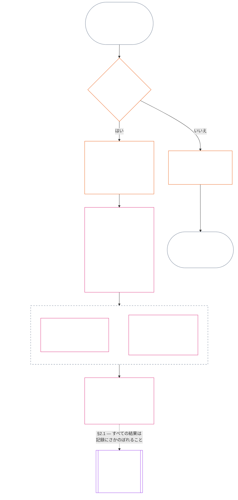

> AI支援翻訳草稿 — 言語：標準的な書き言葉の日本語；出典：commit 9c2c8c10c871d91157bcd27b9f56ad6a1cec90d3；状態：未レビュー；部分範囲：第十一章 §1–§3のみ。本草稿は章全体の翻訳ではない。

### 1. 三つの問い

*平たい言葉で言えば：軌跡は三つの問いに順に答えて判断する。望む評定から事実を推測してはならず、望む結果を正当化するために評定を選んではならない。*

| 問い | 問いが尋ねること | 回答箇所 |
| --- | --- | --- |
| **1. 何が起きたか。** | どの事実が確認されているか、それは誰または何についてか、どの期間のことか、軌跡記録と異議申立ての状態はどうか。 | [第2節](#2-question-1--what-happened)および[第3節](#3-question-1-event-type-guide--what-kind-of-help-or-harm-occurred) |
| **2. どれほど良かったか、悪かったか。** | その事実が立証する貢献または違反の種類と大きさは何か。 | [第十二章第1節](core_12.000_standing_measurement.md#1-question-2--how-good-or-bad-was-it) |
| **3. その結果、何が起きるか。** | どのような承認、準備態勢、救済、保護措置、制限その他の結果が続くか。 | [第十三章](core_13.000_standing_integration.md#chapter-thirteen-standing-effects-and-integration) |

各問いはその前の答えに依存する。

- 問い1は問い2に必要な確認済み事実を示す。
- 問い2は問い3のためにその事実を測定する。
- 問い3は、望ましい結果に合わせて事実や評定を書き換えてはならない。

三つの問いへの答えを合わせると、一つの範囲を限定した出来事、または一つの定義済みパターンについて、軌跡の完全な評価となる。対象は時間の経過とともに複数の評価を受けることがあり、そのどれもが純得点や対象全体の評定ではない。貢献と違反の軌跡記録は問い1と問い2への答えを保持し、問い3の決定はそこから生じることを述べる。

#### 1.1 目的と範囲

本章は**システム**、**感知者**、**機関**について憲法上の記録枠組みを定め、[第十二章](core_12.000_standing_measurement.md#chapter-twelve-standing-measurement--question-2-how-good-or-bad-was-it)は測定枠組みを定める。これには、[**CS-9.305**](corpus_systems/cs_09.305_system_classification_machinery.md#cs-9305-part-a-system-classification-machinery)（*システム分類機構*）に基づいて分類されるすべてのシステムが含まれる。これらの枠組みは、うわさ、人気、曖昧な評判、内在的尊厳、一般的な価値を測定しない。いずれも軌跡評価の対象として認められない。

軌跡プロセスの流れは、次の場合にも有効であり続けなければならない。

- 以前に確認された貢献が古くなり、現在の能力や信頼性を示せなくなるとき。
- 違反が未解決のままであるとき。
- 修復に大きな費用がかかるとき。
- 責任が境界を越えるとき。または
- 行為者が組織の階層化や再命名を使って説明責任を妨げるとき。

以下は採択済みの実施文書に属する。

- 日常的な手順。
- エスカレーションの段階。
- 返還と修復の運用。
- 修復的説明責任の措置。
- インセンティブの設計。

第十二章の測定は、それ自体では、**武力行使**、拘束、その他の自由の制限を認めない。そのような結果は、比例性、最も制限の少ない手段、期間の限定、返還、修復的説明責任の要件を含め、第六章の**第XX条**（*確認済み違反後の正義*）を独立して満たさなければならない。

<strong>追跡 · 定義 · 評価 · 遵守</strong>

- 上流：[第1章§16 — 責務ある管理の詳細](core_01.010_stewardship_capacity_principles.md#16-stewardship-in-depth)；[第2章から第4章](core_02.000_definition_structure.md)；[第5章](core_05.000_definitions_home.md#chapter-five-foundational-definitions)。
- 下流：[§2](#2-question-1--what-happened)（*問い1*）；[§4](#4-standing-record-operational-requirements)（*確認と記録の要件*）；[§5](#5-record-custody-and-opening-authority)（*記録の保管と開設権限*）；[§6](#6-handling-a-standing-record)（*軌跡記録の取扱い*）；[第十二章§1](core_12.000_standing_measurement.md#1-question-2--how-good-or-bad-was-it)（*問い2の測定*）；[第十二章§2](core_12.000_standing_measurement.md#2-magnitude-and-severity-input-dimensions)（*測定入力の次元*）；[第十二章§3](core_12.000_standing_measurement.md#3-route-descriptor-catalogs-and-measurement-roles)（*経路記述子カタログ*）；[第十二章§4](core_12.000_standing_measurement.md#4-slot-grammar-and-shared-scaling)（*スロット文法と共通尺度*）；[第十二章§5](core_12.000_standing_measurement.md#5-constitutional-inputs-to-axis-assignment)（*憲法上の入力に基づく軸の割当て*）；[第十二章§6](core_12.000_standing_measurement.md#6-unified-proportional-lequ-scale--contribution-and-violation-axes)（*両軸の統一比例LEQU尺度*）；[第十三章](core_13.000_standing_integration.md#chapter-thirteen-standing-effects-and-integration)（*問い3*）。
- [重要性](core_05.050_band_oversight.md#materiality) · [O](core_05.050_band_oversight.md#materiality) · [M](core_05.050_band_oversight.md#materiality-determination-a) · [A](core_05.050_band_oversight.md#materiality-determination-a) · [C](core_05.050_band_oversight.md#materiality-determination-c)
- [害](core_05.035_band_accountability.md#harm) · [O](core_05.035_band_accountability.md#harm) · [M](core_05.035_band_accountability.md#harm-a) · [A](core_05.035_band_accountability.md#harm-a) · [C](core_05.035_band_accountability.md#harm-c)
- [比例性](core_05.035_band_accountability.md#proportionality) · [O](core_05.035_band_accountability.md#proportionality) · [M](core_05.035_band_accountability.md#proportionality-a) · [A](core_05.035_band_accountability.md#proportionality-a) · [C](core_05.035_band_accountability.md#proportionality-c)

### 2. 問い1 — 何が起きたか。

<strong>追跡</strong>

- 上流：[§1](#1-the-three-questions)（*三つの問いの枠組み*）；[第2章から第4章](core_02.000_definition_structure.md)（*記録、確認、定義から結果への追跡可能性*）。
- 四元の要素：**参加**；**監督**（異議を唱えられることとチャレンジの経路）。主な目的：**繁栄**と**継続**（後の測定に向け、貢献と違反の所見を分けて保持する追跡可能な記録）。
- 下流：
  - [§2.2](#22-silence-is-the-default)（*沈黙がデフォルト*）。
  - [§2.3](#23-protected-dissent-is-not-a-trigger)（*保護された異議は引き金ではない*）。
  - [§2.4](#24-linked-standing-records-and-no-offset-bridge)（*連結された軌跡記録と相殺しない仕組み*）。
  - [§2.5](#25-verified-input-gate)（*確認済み入力ゲート*）。
  - [§2.6](#26-stage-boundary)（*段階の境界*）。
  - [§2.7](#27-forum-boundary)（*フォーラムの境界*）。
  - [§3](#3-question-1-event-type-guide--what-kind-of-help-or-harm-occurred)（*出来事の種類の案内*）。
  - [§4](#4-standing-record-operational-requirements)（*記録の要件*）。
  - [§5](#5-record-custody-and-opening-authority)（*記録の保管と開設権限*）。
  - [§6](#6-handling-a-standing-record)（*軌跡記録の取扱い*）。
  - [第十二章§1](core_12.000_standing_measurement.md#1-question-2--how-good-or-bad-was-it)（*問い2の測定*）。
  - [第十二章§2](core_12.000_standing_measurement.md#2-magnitude-and-severity-input-dimensions)（*測定入力の次元*）。
  - [第十二章§3](core_12.000_standing_measurement.md#3-route-descriptor-catalogs-and-measurement-roles)（*経路記述子カタログ*）。
  - [第十二章§4](core_12.000_standing_measurement.md#4-slot-grammar-and-shared-scaling)（*スロット文法と共通尺度*）。
  - [第十二章§5](core_12.000_standing_measurement.md#5-constitutional-inputs-to-axis-assignment)（*憲法上の入力に基づく軸の割当て*）。
  - [第十二章§6](core_12.000_standing_measurement.md#6-unified-proportional-lequ-scale--contribution-and-violation-axes)（*両軸の統一比例LEQU尺度*）。
  - [第十三章](core_13.000_standing_integration.md#chapter-thirteen-standing-effects-and-integration) (13.000)（*問い3*）。

 

*平たい言葉で言えば：問い1は、何が起きたかについて、範囲を限定し異議を申し立てられる記録を確立する。評定や結果を考える前に、対象、出来事またはパターン、期間、確認済み事実、記録の状態を特定する。確認済みの助けと確認済みの違反には別々の軌跡記録を用い、一方が他方を消せないようにする。これらの軌跡記録は人気の点数でも曖昧なラベルでもない。*

**軌跡記録**とは、特定の対象、機能上の範囲、記録期間、審査状況、決定の文脈について、本章が用いる範囲を限定した記録である。測定を始める前に、以下を明らかにしなければならない。

- 軌跡記録が誰または何を対象とするか。
- 範囲を限定した出来事か、定義されたパターンか。
- 関連する行為と影響がいつ、どこで起きたか。
- どの事実が確認済みで、どの事実が未解決の争いにあるか。
- どの証拠、帰属、異議申立て経路が所見を裏付けるか。
- 軌跡記録の現在の審査、訂正、置換の状態。

図は出来事をたどり、軌跡記録を開始する引き金となるか、開始した記録が何を保持するかを示す。後続の小節は各ルールを述べる。「いいえ」の枝は主経路から右へ分かれる。

#### 2.1 軌跡記録：種類と対象

問い1では、確認済みの助けに**貢献の軌跡記録**を、説明責任の失敗を含む確認済みの害に**違反の軌跡記録**を用いる。一つの軌跡記録に両種類の所見をまとめてはならない。

- 軌跡記録は、感知者、機関、システム、評価、範囲を限定した出来事、役割、集合体、特定の行為者に関する記録、その他憲法上関連する単位を対象にできる。
  - 異なる対象、役割、システム、コミュニティ、記録期間、審査状況、決定の文脈を、一つの区別のない軌跡ラベルにまとめてはならない。
- 軌跡記録は、明確な始まりと終わりを持つ一つの出来事である**範囲を限定した出来事**、または反復行為の**パターン**を対象にできる。
  - パターンには定義された対象、範囲、審査期間が必要である。
- 同じ対象は、貢献と違反の軌跡記録を連結したものを含め、時間の経過とともに複数の軌跡記録を持ち得る。
  - 対象、重なり合う記録期間、範囲を限定した出来事、パターンまたは決定の文脈が共通する場合、関連する軌跡記録は**第4.2節**に従い、相互に**参照**しなければならない。
- 軌跡記録は独立した評判スコア、尊厳の順位、恒久的な状態、全般的な価値ラベル、統合されたスコアカードではない。
  - 運用上の要件は**第4節**に記載する。

後続の軌跡への効果はすべて第十三章に属する。それが軌跡記録自体の一部にならない形で、関連する軌跡記録にさかのぼれるようにしなければならない。

#### 2.2 沈黙がデフォルト

軌跡記録がないことは、感知者、機関またはシステムの通常の状態であり、ほとんどの感知者はその状態にとどまる。

- **第4節**に基づき引き金が確認された場合に限り、軌跡記録を開設する。指定された記録開設権限者が記入を承認し、別の記録保管者が記入しなければならない（**第5節**）。軌跡記録を次の目的で開設してはならない。
  - 基準値を設定するため。
  - 名簿を完成させるため。または
  - 指定経路のゲートキーパーが望むため。
- 軌跡記録がないことは何も示さない。「評定なし」「未確認」「ファイルに記録なし」は、リスク、貢献の低さ、その他の何かの証拠ではない。記録の欠如を、より厳しい監視、低いデフォルト、指定経路への条件付きアクセスの理由として扱ってはならない。
- いかなる機関またはシステムも、次の条件として軌跡記録、「記録なし」の証明、または記録開設への同意を求めてはならない。
  - **第III条**（*生存と不可欠なアクセス*）の必需品。
  - **第III-C条**（*労働と経済的な床*）の保護。
  - 通常の商取引。または
  - 影響を受ける当事者としての参加。
  例外は、[第十三章§6.2 能力の基準と許可](core_13.000_standing_integration.md#62-competency-bars-and-clearances)に基づく、信頼に敏感な特定の指定経路について公表された能力基準である。その指定経路がなぜ信頼に敏感なのかを、その基準に明記しなければならない。
- 対象について軌跡記録を開設したときは、**第4節**に従って対象に通知しなければならない。文書化された[証拠保全](core_05.050_band_oversight.md#evidence-preservation)または安全上の必要が正当化する場合に限り、かつ定められた限られた期間に限り、通知を遅らせてよい。通知によって軌跡記録は異議申立て可能になる。軌跡記録の存在を知らない対象は、それに異議を申し立てたり訂正したりできない。

#### 2.3 保護された異議は引き金ではない

**第XI-D条**（*集会、異議、平和的抗議*）に基づく異議または平和的抗議は、[保護された非暴力の市民的不服従](core_06.005_rights_part_b.md#xi-d-nonviolent-civil-disobedience)を含め、確認済みの引き金ではない（[*異議と平和的抗議の床*](core_06.005_rights_part_b.md#xi-d-dissent-and-peaceful-protest)）。

- それによって違反の軌跡記録を開設、延長、加重してはならない。**第8.2節**の深刻度の入力でもなく、繰り返したからといってパターンになるわけでもない。
- 憲法上の床に独立して違反する、切り分け可能な行為は、それ自体の条件に基づいて記録する。抗議の見解、目的、対象を理由に加重してはならない。

#### 2.4 連結された軌跡記録と相殺しない仕組み

<strong>追跡</strong>

- 上流：[§2.1](#21-standing-records-kinds-and-subjects)（*貢献と違反の記録を分けること*）。
- 下流：
  - [§2.5](#25-verified-input-gate)（*確認済み入力ゲート*）。
  - [§2.7](#27-forum-boundary)（*フォーラムの境界*）。
  - [§4.2](#42-related-standing-record-cross-references)（*相互参照*）。
  - [第十二章§1](core_12.000_standing_measurement.md#1-question-2--how-good-or-bad-was-it)（*問い2の測定*）。
  - [第十二章§2](core_12.000_standing_measurement.md#2-magnitude-and-severity-input-dimensions)（*測定入力の次元*）。
  - [第十二章§3](core_12.000_standing_measurement.md#3-route-descriptor-catalogs-and-measurement-roles)（*経路記述子カタログ*）。
  - [第十二章§4](core_12.000_standing_measurement.md#4-slot-grammar-and-shared-scaling)（*スロット文法と共通尺度*）。
  - [第十二章§5](core_12.000_standing_measurement.md#5-constitutional-inputs-to-axis-assignment)（*憲法上の入力に基づく軸の割当て*）。
  - [第十二章§6](core_12.000_standing_measurement.md#6-unified-proportional-lequ-scale--contribution-and-violation-axes)（*両軸の統一比例LEQU尺度*）。
  - [第十三章](core_13.000_standing_integration.md#chapter-thirteen-standing-effects-and-integration) (13.000)（*問い3*）。
- あわせて読む：[第十三章 — 軌跡の統合](core_13.000_standing_integration.md#2-automatic-integration-review-and-continuity) (13.000)（*放棄しないことと連結記録の統合*）；[第十三章§6.2 — 能力の基準と許可](core_13.000_standing_integration.md#62-competency-bars-and-clearances) (13.000 §6.2)；[第十三章§4.2 — 軌跡ロック](core_13.000_standing_integration.md#42-prevention--general-standing-locks) (13.000 §4.2)。

 

**中核ルール：**確認済みの**貢献の軌跡記録**と確認済みの**違反の軌跡記録**は、**第2.1節**に従い別々に保持する。貢献または違反の各所見は、それぞれ独自の軌跡記録にある、裏付けられた事実に基づかなければならない。分析と裏付け資料では、二つの記録経路を別々に追跡可能に保たなければならない。単独の記入も連結された一式も、純得点、混合得点、取引ではない。

- **違反の軌跡記録と軌跡ロック：**
  - 第十三章に基づき、違反の軌跡記録から導かれる該当する**軌跡ロック**は、軌跡を制限し、役割適格性を制約し、または確認済み違反が未解決の間に救済へのアクセスに影響することがある。
  - 軌跡ロックによって、貢献の軌跡記録に記録された確認済みの肯定的貢献を消してはならない。
  - 未解決の確認済み違反は、時間の経過だけを理由に割り引かない。
  - 確認済み違反によって、無関係な貢献の軌跡記録を偽の否定的な評判ファイルに書き換えてはならない。
- **貢献の軌跡記録と能力許可：**
  - 確認済みの貢献は、公表された**能力基準**に照らして該当する**能力許可**を支えることがある。現在のもので役割に関連する場合、信頼、役割、承認に関係する適格性も支え得る。
  - 確認済みの貢献を、確認済み違反の所見と相殺したり、平均化して低くしたり、言い訳にしたり、別のラベルに置き換えたりしてはならない。
  - ゲートを満たしても該当する軌跡ロックは放棄されない。

**唯一の例外：**違反の所見自体が主張された貢献を否定する場合 — たとえば、貢献記録が主張することを実際には行っていないと証拠が示す場合 — **第4.2節**に従う必要な相互参照を付し、適切な証拠・審査手続を通じて連結された貢献の軌跡記録を訂正または削除できる。ただし、その違反によって、別の貢献の軌跡記録に記録された無関係な助けが自動的に消されることはない。

#### 2.5 確認済み入力ゲート

ゲートは次のように機能する。

- 軌跡、信頼、役割、承認、または承認を受ける適格性に影響する決定には、該当する**貢献の軌跡記録**または**違反の軌跡記録**からの確認済み入力のみを使える。
- 申し立て、未裁定の主張、暫定的なルーティングタグ、受付時だけの説明その他の紛争段階の資料だけでは、軌跡に関する貢献の性質または違反の性質を示せない。
- 確認済み入力は**軌跡所見**である。すなわち、確認済み貢献の所見（軸I）または確認済み違反の所見（軸II）である。
- 貢献と違反の所見は別々の軌跡記録に置く（**第2.1節**参照）。

#### 2.6 段階の境界

軌跡記録の段階は分けておく。

- 問い1は確認済み事実を記録し、問い2はそれを測定する。
- 確認済みの事実的根拠が完成した時点で、問い2の測定がまだ保留中であっても軌跡記録を開設できる。
- 測定が行われるまで、問い2の欄にはスロットやカテゴリを示唆せず、保留中であると記載する。
- 軌跡記録に問い3の**軌跡効果**を記載または適用してはならない。

#### 2.7 フォーラムの境界

*平たい言葉で言えば：フォーラムは、紛争が監督され、異議を申し立てられ、確認済みの結果に変わる場所である。しかし、事件を申し立てたり物語上の争いに勝ったりしても、軌跡は更新されない。**第2.5節**の確認済み入力ゲートは引き続き適用される。フォーラムが第2章から第4章に基づいて事実を確認した場合、軌跡記録を**開設、更新、訂正**できる — または異議申立てにより**不適切な記録を退ける**ことができる。フォーラムは良いことと悪いことを一つの得点にまとめたり、独自に軌跡カテゴリを作ったりしない。*

本節が所管する問いは一つ、フォーラムの作業がどのように軌跡記録に届くかである。連鎖のその他の段階はここで示す所管者に属し、次の順で進む。

1. 紛争が申し立てられ、フォーラムは**フォーラム事件記録**を保持する。これは軌跡記録ではない。所管：[第十五章§2.3 フォーラム事件記録、軌跡記録、異議](core_15.000_forum.md#23-forum-case-records-standing-records-and-contests)；[§2.7.1 フォーラム事件記録](#271-forum-case-record)も参照。
2. フォーラムは[第2章から第4章](core_02.000_definition_structure.md)に基づいて事実を確認する。
3. 確認済みの所見は確認済み入力ゲートを通る。所管：[§2.5 確認済み入力ゲート](#25-verified-input-gate)。
4. 指定された記録開設権限者は、フォーラムであってもよく、軌跡記録を開設、更新、訂正するか、異議申立てにより不適切な記録を退ける。記録に含める事項は[§4.1 記録の最低限の内容](#41-minimum-record-contents)、行為できる者は[§5 記録の保管と開設権限](#5-record-custody-and-opening-authority)が所管する。
5. 軌跡記録には確認済み事実のみを保持し、その後に問い2がそれを測定する。所管：[§2.6 段階の境界](#26-stage-boundary)および[第十二章§1 問い2 — どれほど良かったか、悪かったか](core_12.000_standing_measurement.md#1-question-2--how-good-or-bad-was-it)。
6. 軌跡への効果がある場合は、軌跡効果を所管する[第十三章](core_13.000_standing_integration.md#chapter-thirteen-standing-effects-and-integration)に基づいて続く。

[第十五章](core_15.000_forum.md#chapter-fifteen-forums-and-jurisdiction)に基づくフォーラム群は、具体的な紛争が軌跡プロセスの流れをたどる方法を**監督する**。フォーラムは、[第十五章§6 適時の解決、重要性の階層、遅延防止の規律](core_15.000_forum.md#6-timely-resolution-materiality-tiers-and-anti-delay-discipline)および[第XXVI-C条](core_06.020_rights_part_e.md#article-xxvi-c-timely-resolution-and-anti-delay-floor)（*適時解決と遅延防止の床*）に基づき、以下を提供する。

- 利用しやすい異議申立て。
- 独立審査。
- フォレンジック支援。
- 是正措置の順序付け。
- 階層別の期間。

第2章から第4章に基づくフォーラムの所見が確認済み入力ゲートを満たす場合、それらは次のことができる。

- **第4.1節**に基づき、軌跡記録を**開設、更新、訂正する**。
- または、異議申立てにより**不適切な記録を退ける**。

##### 2.7.1 フォーラム事件記録

係属中の紛争についてフォーラムが持つ独自のファイルが[**フォーラム事件記録**](core_05.035_band_accountability.md#forum-case-record)であり、[第十五章§2.3 フォーラム事件記録、軌跡記録、異議](core_15.000_forum.md#23-forum-case-records-standing-records-and-contests)に定義されている。これは**軌跡記録ではない**。

##### 2.7.2 フォーラムの所見と問い2の測定

フォーラムの確認済み事実所見は、問い1の軌跡記録に関する事実的根拠となり得る。しかし、確認済みの貢献または違反がどれほど良かったか、悪かったかという問い2の測定を**決定しない**（[§2.6 段階の境界](#26-stage-boundary)）。したがって：

- フォーラム手続で貢献と違反の資料を、一つの純得点、混合された本案の答え、または区別のない軌跡ラベルに**まとめてはならない**。連結された軌跡記録は[§2.1 軌跡記録：種類と対象](#21-standing-records-kinds-and-subjects)および[§2.4 連結された軌跡記録と相殺しない仕組み](#24-linked-standing-records-and-no-offset-bridge)に基づき別々に保つ。
- フォーラムの成果は、紛争の物語、ルーティング上の便宜、合議体の好みを、立証可能な確認済み入力（[§2.5 確認済み入力ゲート](#25-verified-input-gate)）、別個の測定（[第十二章§1 問い2 — どれほど良かったか、悪かったか](core_12.000_standing_measurement.md#1-question-2--how-good-or-bad-was-it)）、または[第十三章](core_13.000_standing_integration.md#chapter-thirteen-standing-effects-and-integration)が所管する軌跡効果の仕組みの代わりに**してはならない**。

##### 2.7.3 フォーラムの境界によって減じられないもの

この境界は、次に基づき求められる異議申立て、救済、暫定的救済、手続上の保護を**減じない**。

- [第XIII-A条](core_06.010_rights_part_c.md#article-xiii-a-reliability-and-trustworthiness-baseline)（*信頼性と信用性の基準線*）。
- [第XIII-B条](core_06.010_rights_part_c.md#article-xiii-b-right-to-redress-and-remedy)（*救済と是正を受ける権利*）。
- [第十五章§6 適時の解決、重要性の階層、遅延防止の規律](core_15.000_forum.md#6-timely-resolution-materiality-tiers-and-anti-delay-discipline)。
- [第XXVI-C条](core_06.020_rights_part_e.md#article-xxvi-c-timely-resolution-and-anti-delay-floor)（*適時解決と遅延防止の床*）。または
- 関連する正義の各条。

確認済みのフォーラム所見は、他の確認済み入力と同じゲートを通じて軌跡に入る必要がある。その周囲を迂回してはならない。

### 3. 問い1の出来事の種類の案内 — どのような助けまたは害が起きたか。

*平たい言葉で言えば：事実の確認後に何が起きたかを説明するには、この表を使う。関係する貢献または違反の種類を特定する助けとなる。どれほど良かったか、悪かったかを決めたり、スロットを割り当てたり、その結果を決定したりするものではない。*

#### 3.1 貢献の出来事の種類

**適格性ルール：**主張された貢献は、追跡可能で、害を外部化せず、全体として現行の憲法に沿う場合に限り数える。

- 外部化された害、強制的な依存関係、権利の床の縮小、または隠された負担は、主張された貢献を失格にしたり制限したりし得る。
- 主張された貢献は、別個の違反所見を相殺しない。

以下の表の各行は、確認済みの助けがもたらす一般的な経路と、その憲法上の関連性を示す。同じ軌跡記録に複数の行が当てはまることがある。

| 確認済み貢献の種類 | 何が起きたか | 四元の要素 | 主な目的 |
| --- | --- | --- | --- |
| 生存と身体の維持 | 食料、住居、医療または安全が誰かに提供された | **参加**、**監督** | **繁栄** |
| 養育と教育 | 子どもが育てられ、高齢者が介護され、または他者が教育された | **参加**、**監督** | **繁栄**、**継続** |
| トラウマの解消 | 幸福を妨げる心理的損傷から回復するための支援が誰かに提供された | **参加**、**説明責任** | **繁栄** |
| 深刻な負担の除去 | 重い債務、搾取的な労働条件、または構造的障壁が取り除かれた | **参加**、**監督** | **繁栄** |
| 自律性の回復 | 誰かが自分の生活について意味のある選択肢を得た | **参加** | **繁栄** |
| 生産能力の拡大 | 道具、インフラ、機会によって他者が独立して繁栄できるようになった | **参加**、**監督** | **繁栄**、**継続** |
| 時間効率の向上 | 避けられる待機、事務上の摩擦、調整の間接負担が減り、ケア、休息、自律性、学習、権利に沿った仕事に使える時間が戻った | **参加**、**監督** | **繁栄** |
| 生態系またはインフラのリスク低減 | 環境の崩壊または重要システムの機能不全が防がれた | **監督**、**説明責任** | **継続**、**繁栄** |
| 生態系フットプリントの低減 | 他者や生態系に負担を移さず、資源利用、排出、土地・水の需要が確認可能な形で減った | **監督**、**説明責任** | **継続**、**繁栄** |
| 生態系の再生 | 劣化した土地、水域、生息地が機能し自律的に維持される状態へ回復された | **監督**、**説明責任** | **継続**、**繁栄** |
| 絶滅危惧種の保護 | 絶滅の危険がある種、またはその種が依存する生息地が喪失から保護された | **監督**、**説明責任** | **継続**、**繁栄** |
| 汚染と廃棄物の削減 | 汚染、有害排出、廃棄物が防止、除去、または安全に管理された | **監督**、**説明責任** | **繁栄**、**継続** |
| 安全、真実、監査可能性、異議申立て能力の強化 | 権利を守り権力に説明責任を負わせるため、機関や慣行が構築または修復された | **参加**、**監督**、**説明責任** | **繁栄**、**継続** |

#### 3.2 違反の出来事の種類

**適格性ルール：**違反の出来事の種類には、第2章から第4章に基づき、追跡可能で、範囲が限定され、監査可能で、異議申立て可能な状態にある確認済み違反の所見が必要である。

- 申し立て、暫定タグ、フォーラムの物語、受付ラベルはルーティングやトリアージを助けることがあるが、問い1を完了しない。
- 肯定的な貢献は確認済み違反を相殺、免責、解消、または再ラベルしない。

以下の表の各行は、確認済みの損失、危険、義務不履行がもたらす一般的な経路と、その憲法上の関連性を示す。同じ軌跡記録に複数の行が当てはまることがある。

| 確認済みの損失または危険の種類 | 何が起きたか | 四元の要素 | 主な目的 |
| --- | --- | --- | --- |
| 生存または身体維持の剥奪 | 避けられた死亡、ケアの拒否、安全でない状況、または生存に必要な物質的条件の剥奪が起きた | **説明責任**、**参加** | **繁栄** |
| 避けられる深刻な負担 | 圧倒的、強制的、または体系的に転嫁された負担が、幸福または自律性を実質的に損なった | **説明責任**、**参加** | **繁栄** |
| 強制による自律性の喪失 | 強制、操作、信頼できる脅威、拘束、自由への危険が生じた | **説明責任**、**参加** | **繁栄** |
| 権利の床の破壊 | 交渉不能な憲法上の床、最高性、または異議申立て・救済へのアクセスが実質的に侵害された | **説明責任**、**監督** | **繁栄**、**継続** |
| 生態系またはインフラの損傷 | 憲法上の幸福に必要な条件が損なわれた | **説明責任**、**監督** | **継続**、**繁栄** |
| 汚染または廃棄物による害 | 汚染、有害排出または廃棄物が空気、水、土壌または健康を損なった | **説明責任**、**監督** | **繁栄**、**継続** |
| 種または生息地の破壊 | 絶滅の危険がある種、またはその種が依存する生息地が破壊、分断、喪失への誘導を受けた。相殺可能と扱われた喪失も含む | **説明責任**、**監督** | **継続**、**繁栄** |
| 生態系の回復能力の喪失 | 損傷後に生態系が再生する能力が閉ざされた、または避けられたはずの形で回復が困難もしくは不可能になった | **説明責任**、**監督** | **継続**、**繁栄** |
| 外部化された生態系損害または枯渇 | 生態系の費用が他者や生態系に転嫁された、資源が再生能力を超えて枯渇した、またはフットプリントや持続可能性の主張が続く劣化を隠した | **説明責任**、**監督** | **継続**、**繁栄** |
| 生産能力の破壊 | 独立して繁栄するために必要な道具、能力、関係、資源が閉ざされた | **説明責任** | **繁栄** |
| 安全、真実、監査可能性の劣化 | 隠蔽、誤情報、壊れた記録、アクセスできない異議申立て経路、または審査できない集計が起きた | **監督**、**説明責任** | **繁栄**、**継続** |
| 説明責任の妨害 | 回答責任の仕組み — 証拠の完全性、確認、フォーラム手続、軌跡記録、救済期間、異議申立て・救済経路 — への確認済みの干渉が起きた。妨害が別個の根本的損害に対するメタ攻撃である場合は、連結された別個の違反軌跡記録を開設する | **説明責任**、**監督**、**適時性** | **繁栄**、**継続** |
| システムの掌握または依存の悪用 | 構造的な可能化、依存の非対称性の悪用、回避防止設計、または説明責任経路の掌握が起きた | **説明責任**、**参加** | **継続**、**繁栄** |
