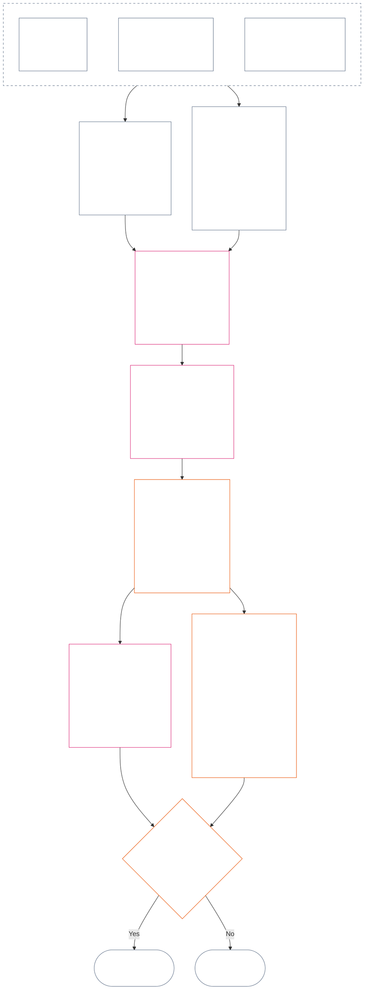

<!-- 第十二章 §§4–6 日本語部分翻訳草稿。出典ファイル: core_12.000_standing_measurement.md; 出典コミット: 9c2c8c10c871d91157bcd27b9f56ad6a1cec90d3; AI草稿、未レビュー、部分訳、非拘束。 -->

### 4. スロット規則と共通の尺度

*平たい言葉で言えば、本節は二つの別々の軸それぞれにある九つの可能な位置へ一貫した名称を与え、影響の尺度がどう広がるかを説明する。一方の軸は検証済み貢献を記録し、もう一方は検証済み違反の認定を記録する。スロット番号が同じでも二つの軸は一つにならず、害を助けで相殺することもない。**section 6**の統一尺度は比例的LEQU影響に基づき、両軸を割り当てる。*

スロット規則は**1**から**9**までのスロット番号 `s` を使う。各軸にはそれぞれ別のスロット位置がある:

- **貢献軸**は肯定的な貢献の性質を記録する; および
- **違反軸**は検証済み違反の認定を記録する。

同じスロット番号が両方の軸に現れることはあるが、軸は分離されたままである。貢献スロットは違反スロットではなく、違反スロットは貢献スロットではない。

#### 4.1 表1 — スロット表示ラベル

**表1**は九つのスロットに名称を付け、貢献軸と違反軸の表示ラベルを並べて示す。これは表示用の文言のみを示す; スロットの割当ては**section 6**の統一尺度に基づく。

|  `s` | 貢献軸の表示ラベル | 違反軸の表示ラベル |
| ---: | --- | --- |
|    1 | **軽微な基準貢献** | **軽微な憲法上の影響** |
|    2 | **小さな基準貢献** | **小さな憲法上の影響** |
|    3 | **相当な肯定的貢献** | **相当な憲法上の影響** |
|    4 | **顕著な肯定的貢献** | **顕著な憲法上の影響** |
|    5 | **重大な責務ある管理に資する貢献** | **重大な憲法上の影響** |
|    6 | **大きな責務ある管理に資する貢献** | **大きな憲法上の影響** |
|    7 | **認定されたチャンピオン** | **深刻な憲法上の影響** |
|    8 | **顕彰されたチャンピオン** | **重大極まりない憲法上の影響** |
|    9 | **模範的なチャンピオン** | **壊滅的な憲法上の影響** |

貢献軸は基準、肯定的、責務ある管理に資する、チャンピオンというラベルを使う。違反軸はすべてのスロットで中立的な影響ラベルを使う。軸は分離されたままであり、差し引きスコアを作らず、貢献記録と違反記録の相殺も認めない。違反軸のスロットだけで反憲法的不正行為が分類されるわけではない。[第十四章](core_14.000_misconduct_designation.md#chapter-fourteen-anti-constitutional-misconduct)は、検証済み `s` = 7–9 の違反に反憲法的不正行為指定（ACMD）が付されるかを独立に決定する。

実装は、全生涯相当の便益または損失を推定する助けとして、測定単位、証拠の方法、例を公表してよい。これらの資料は案内に限られ、**section 6**、**第一章**、または**第六章**の権利の床を覆してはならない。

#### 4.2 共通の影響尺度ルール

*平たい言葉で言えば、影響は人数だけでは測らない。一人の感知者に及ぶ深い便益や損失は、多数に及ぶ浅い影響より重要な場合がある。人数、深さ、脆弱性、期間、持続性、到達範囲、憲法上の性質を合わせて評価する。*

**section 6**で両軸を解釈する際、次のルールを使う:

| 尺度の次元 | 共通ルール | 軸ごとの適用 |
| --- | --- | --- |
| **憲法上の結果の大きさ（LEQU）** | 統合された検証済み便益または損失を評価する。LEQUが主要な大きさの基準であり、単純な人数、金銭、産出、機関の規模ではない。 | 貢献は権利と整合する便益を数える。違反は検証済みの憲法上の損失、害、浪費、選択肢の閉鎖、危険を数える。 |
| **感知者への範囲** | **人数、深さ、脆弱性**を合わせて考える。人数を独立した要件にするスロットはない。他の条件が同じなら、一人の感知者への十分に深い影響が、多数へのより浅い影響と同じスロットを支持することもある。ただし、明示された総計LEQUまたは広範囲の基準は満たさなければならない。 | 依存、能力の低下、特異な脆弱性は実質性を増すことがある。集団の規模だけでは貢献も深刻さも確立しない。 |
| **時間的な範囲** | 期間、反復、持続性、損失については不可逆性を考慮する。短期間でも変革的な出来事が長期の些細な影響を上回ることがある; 期間だけでは決まらない。 | 持続的便益は、より大きな貢献を支持する。継続または不可逆の損失は、より深刻な違反を支持する。 |
| **地理的または制度的な範囲** | 広い到達範囲は大きさを増すことがある。しかし深さ、期間、脆弱性、憲法上の重要性が独立してスロットを支持する場合、複数の地域社会または機関にまたがる必要はない。 | 制度の修復は貢献の大きさを増すことがある; 構造的またはシステム上の損傷は違反の深刻さを増すことがある。 |
| **憲法上の質または性質** | 結果がどのように生み出されたかを、その広がりとは別に測る。同じ事実を二重に数えない。 | 外部化された害、隠された負担、支配、依存は、主張された貢献に上限を設け、または貢献から除外することがある。義務、過失、欺瞞、強制、暴力、構造的助長は違反行為の性質として別に記録し、影響スロットを動かさない。 |
| **権利の床と重要な保護措置** | 権利の床の順守を総計便益または損失と交換してはならない。 | 権利の床を守っただけで高い貢献が確立するわけではない。権利の床が実質的に破られたこと、または重要な保護措置が失敗したことは、直接影響を受ける感知者が少なくても、より深刻な違反を支持する場合がある。 |

これらの次元は、あらゆる尺度要素を必ず要求するチェックリストではない。どの次元が判断を左右し、どれが左右しなかったか、その理由を説明する。

- **共通のスロット方法:**
  - 比例性に基づいて統合された検証済み便益または損失をLEQUで推定し、その大きさを含む数値帯に対応する一つのスロットを割り当てる。
  - 両軸に同じ閾値が適用される。
  - 貢献スロットには適用される基準および憲法整合の要件が残る。数値閾値を満たしても、外部化された、または憲法上否定された産出が貢献になるわけではない。
- **性質の分離:** 適用される便益経路、害の経路、行為の質、行為の性質の記述子を、軌跡記録に別々に積み重ねて記録する。義務、過失、欺瞞、加重要因、強制、暴力、意図、構造的助長は帰属、安全策、質問3の結果に影響することがあるが、LEQU影響スロットを上げ下げしない。
- **反憲法的不正行為審査の境界:** 検証済みの違反軸の損失は、反憲法的不正行為が認定されるかどうかにかかわらず、影響に応じて `s` = 7–9 に達し得る。第十四章は影響スロットの割当てを置き換えず、対応するACMDが付されるかを独立に決める。

危険がまだ実際に起きていない場合、次をそれぞれ分けて記録する:

- その発生可能性;
- 感知者がさらされる期間;
- 到達し得る範囲;
- 推定の不確実性; および
- なお信頼できる最悪の結果。

採択済みの実装が、誰でも確認できるリスク較正（リスクをLEQUに変換する方法）を設定していない限り、最悪の結果をすでに起きた損害（LEQU損失）として数えない。

### 5. 軸の割当てに関する憲法上の入力

*平たい言葉で言えば、スロットを選ぶ前に、どの基準、便益、義務、害、違反を測定するのかを定める憲法上の出典を特定する。以下のリンクから各出典の正本を参照する。この経路案内の段階を新たなスコアや定義の代用にしてはならない。*

**section 6**に基づいてスロットを割り当てる前に、軌跡記録では次を特定しなければならない:

- 適用される憲法上の基準、義務、制約、または保護される利益;
- 測定対象である検証済み便益、悪影響、害、違反を確立する条項;
- 大きさまたは行為の性質に実質的な影響を与える定義、原則、権利の床に関する条項; および
- 特定した各出典が適用される理由と、軸の割当てへの影響。

以下の案内表は網羅的ではない。検証済み事実によって発動する追加の定義、原則、条項はすべて適用され、軌跡記録で特定されなければならない。リンク先の各正本が優先し、表はそれを言い換えたり狭めたりしない。

#### 5.1 定義に関する入力

| 正本の出典 | 貢献軸での役割 | 違反軸での役割 |
| --- | --- | --- |
| [軌跡状態、貢献、違反](core_05.035_band_accountability.md#defa3-standing-state-contribution-and-violation) | 何が貢献に当たり、検証済みのどの事実を測定に使えるかを説明する。貢献軌跡記録が良い側だけを追跡し、悪い側と混在させないようにする。 | 何が違反に当たり、どう記録するかを説明する。最も深刻な事案を、憲法自体を損なう行為に関する別個の審査である反憲法的不正行為審査へ送る。 |
| [説明責任](core_05.005_apex_accountability_leg.md#accountability) | 責務ある管理または修復という主張が、実際に誰かを説明責任の下に置くかを確かめる。誰が何をし、誰が説明し、影響に比例してどう審査・是正・訂正できるかを示さなければならない。 | 誰が行為したか、誰が責任を負うか不明な事案を見つける。組織またはその構造の変更後に責任が機能しなくなる事案も含む。 |
| [害](core_05.035_band_accountability.md#harm) | 他者へ転嫁または隠された害は、主張された便益を制限または相殺し得る。害の修復は便益となり得るが、検証され独立に示された場合に限る。 | 損失および深刻さの測定で数える損害の種類を示す。直接、間接、遅延、累積、システム間に及ぶ害、感知者の精神や情緒的な健康への害を含む。 |
| [実質性](core_05.050_band_oversight.md#materiality)および[生涯相当単位（LEQU）](core_05.055_band_participation.md#lifespan-equivalent-unit-lequ) | 到達範囲、影響を受ける者の脆弱性、継続期間に基づき、検証済み便益をどれだけ数えるかを定める。結果はLEQUで測定し、全生涯相当の便益に対する共通尺度とする。 | 到達範囲、影響を受ける感知者の脆弱性、継続期間、元に戻す難しさに基づき、検証済み損失または危険をどれだけ数えるかを定める。結果は、全生涯相当の損失を測る同じ尺度LEQUで測定する。 |
| [貢献の性質](core_05.035_band_accountability.md#contribution-nature) | 何が貢献に当たるかを決める。害と混在しない良い行為だけであり、提示可能な検証済み貢献記録に裏付けられなければならない。両方がなければ貢献軸の割当てはできない。 | ここでは役割を持たない。害の内容を決めず、違反の深刻さを低下させない。 |
| [違反の性質](core_05.035_band_accountability.md#violation-nature) | ここでは役割を持たない。違反を負の貢献として数えることはなく、無関係な検証済み便益を消去することもない。 | 何が違反に当たるかを決める。害を伴うものとして分類され、違反が起きたとの検証済み認定に裏付けられなければならない。両方がなければ違反軸の割当てはできない。 |
| [憲法上の制約](core_05.045_band_integrative.md#constitutional-constraint)、[権限の積層と内部階層](core_05.045_band_integrative.md#authority-stack-and-internal-hierarchy)、[監査可能性](core_05.050_band_oversight.md#auditability) | 憲法を否定する、その規則を回避する、権利の床（憲法が保障する最低限の保護）を狭める、または形式上のみ順守することに依存する便益を数えるのを妨げる。 | 違反の実際の深刻さを左右する事項を明らかにする。重要な憲法上の限界を破ること、憲法の権限より何かを上位に置くこと、規則を回避すること、規則の執行を不可能にすること。 |
| [監査可能性](core_05.050_band_oversight.md#auditability)および[争訟可能性](core_05.035_band_accountability.md#contestability) | 主張された便益を提示・検証でき、異議を持つ者が実効性ある異議申立て手段を持つよう求める。 | 検証および異議申立てが可能な認定を求める。説明のない告発やラベルでは違反の深刻さを決められない。 |

#### 5.2 原則に関する入力

| 原則の出典 | 軸割当てでの役割 |
| --- | --- |
| [憲法四元](core_00.000_preamble.md#constitutional-tetrad)、[二つの憲法上の目的](core_00.000_preamble.md#two-constitutional-aims)、[実質的利害](core_00.000_preamble.md#material-stake) | 四つの実務規律（参加、監督、説明責任、適時性）、憲法が目指す二つの結果（繁栄と継続）、各割当てを利害の大きさに合わせる枠組みを定める。 |
| [ウェルビーイング](core_01.000_values_principles.md#3-foundational-objective-wellbeing-flourishing-aim)および[認識、強化、志向](core_01.000_values_principles.md#32-recognition-reinforcement-and-aspiration) | 権利を尊重する便益と、それに見合う認識を貢献軸上で基礎付ける。名声や報酬を貢献の証明として扱わない。 |
| [安全](core_01.000_values_principles.md#4-safety-harm-constraint)および[真実](core_01.000_values_principles.md#5-truth-epistemic-integrity-constraint) | 両軸に拘束力ある限界を設ける。害や欺瞞から得た便益は全額を数えず、安全または真実の検証済み不履行は、違反の大きさや種類を示し得る。 |
| [責務ある管理の詳論](core_01.010_stewardship_capacity_principles.md#16-stewardship-in-depth)および[責務ある管理規律下の統治](core_01.010_stewardship_capacity_principles.md#18-governance-under-stewardship-discipline) | 検証済み事実が求める場合、持続的貢献、役割に伴う義務、制度の修復、監督、責任の評価を導く。 |
| [中核的トレードオフ原則](core_01.005_interaction_interpretation.md#131-core-tradeoff-principles)および[憲法上の床、安全、品位を損なわない手続](core_01.005_interaction_interpretation.md#1314-constitutional-floors-safety-and-anti-degrading-process) | 測定対象の行為に必要性、害の最小化、比例性、権利の衝突、制限が関係する場合に適用する。これらだけで結果を許可することはない。 |

#### 5.3 権利の床および条項に関する入力

| 条項の出典 | 軸割当てでの役割または境界 |
| --- | --- |
| 検証済み軌跡記録が実質的に関係する条項すべてを含む、事実上適用される[第六章の権利の床](core_06.000_rights_part_a.md#chapter-six-foundational-rights) | 利害の対象となる基本的保護、利益、義務、便益、違反を定める。以下に列挙されていないことを理由に、条項を省いてはならない。 |
| [第XIX条 — 軌跡および参加状態](core_06.015_rights_part_d.md#article-xix-standing-and-participation-status) | 感知者の軌跡、尊厳、権利の床の最低限の保護、利害関係者の状態、評判、参加状態の後日の変更を、それぞれ区別する。 |
| [第XIII-A条 — 信頼性と信頼に値することの基準](core_06.010_rights_part_c.md#article-xiii-a-reliability-and-trustworthiness-baseline)、[第XIII-B条 — 救済および是正を受ける権利](core_06.010_rights_part_c.md#article-xiii-b-right-to-redress-and-remedy)、[第XV-B条 — 透明性、監査可能性、争訟可能性](core_06.010_rights_part_c.md#article-xv-b-transparency-auditability-and-contestability)、[第XVI条 — 監査、透明性、独立検証](core_06.010_rights_part_c.md#article-xvi-audit-transparency-and-independent-verification) | 検証済み便益または違反に、誠実な記録、情報共有、事実確認、決定への異議申立て、誤りの訂正が関係する場合に適用する。 |
| [第XXIV条 — 根本原因分析と適応的対応](core_06.015_rights_part_d.md#article-xxiv-root-cause-analysis-and-adaptive-response) | 行為の原因、訂正の有無、反復の有無、対応の適応が重要な場合に適用する。それらが憲法上の行為の位置付けを示すためである。 |
| [第XX条 — 検証済み違反後の正義](core_06.015_rights_part_d.md#article-xx-justice-after-verified-violation)および[第XXVI-C条 — 適時解決と遅延防止の床](core_06.020_rights_part_e.md#article-xxvi-c-timely-resolution-and-anti-delay-floor) | 事実が実際に含むあらゆる手続または遅延に適用する。**第XX条**（*検証済み違反後の正義*）は主として違反測定後（質問3）の結果を制約する。望ましい対応を正当化するために、質問2のスロットを上げ下げする目的で用いてはならない。 |

**適用の限界。** この段階は適切な出典を案内するだけである。

- 次のことはしない:
  - 質問1を再開する;
  - 未検証の事実を取り込む;
  - 新しい尺度またはスコアを加える;
  - 異なる出典を通じて同じ事実を二度数える;
  - 二つの軸を統合する; または
  - 列挙されたすべての出典をすべての軌跡記録に適用する。
- 貢献と違反は引き続き別々に測定する。
- **第XX条**（*検証済み違反後の正義*）の結果は質問2の範囲外に留まる。
- 第十四章の指定審査は、ここで割り当てる影響スロットとは別である。

### 6. 統一された比例的LEQU尺度 — 貢献軸と違反軸

<strong>読者向け案内（非操作的）：5倍の進行の仕組み</strong>

> 尺度は `s` = 7 = 1 LEQUを基点とする5倍の進行を使う。いずれの軸でも、スロット2から9のスロット `s` の最小の大きさは `5^(s−7)` LEQUであり、スロット1はゼロから始まる。採択済みの実装は、そこから得られる数値閾値や較正例を公表してよい。スロット1は、貢献軸では検証済みの憲法上の基準達成、違反軸では最初の正の閾値に満たない検証済み損失を含む。貢献がないこと、違反がないこと自体は `s` = 1 の記録ではない。
>
> **人に読みやすい基準点。** 較正例として人間の寿命を80年とすると、中列を上向きに読めば、全生涯相当の便益、利用可能時間、追加された権利と整合する資源や能力を表す。下向きに読めば、同等の損失、剥奪、浪費、選択肢の閉鎖を表す。資源の量だけでは数えない。生じさせた、または防いだ憲法上の結果が決定要因である。

 

*平たい言葉で言えば、**表2**は検証済み貢献と検証済み違反を同じ比例的影響尺度に置く。スロットが高いほど、統合された憲法上の便益または損失が大きい。軌跡記録と軸は別々のままである。共通尺度は大きさを比較するのであって道徳的価値を比べず、助けで害を相殺することは決して認めない。*

この図は、一つのスロット割当てを最初から最後まで示す。段階を進める順を示しており、下の箇条書きの順とは異なる。箇条書きは各規則を述べる。

**比例性**を適用し、深さ、感知者への範囲、脆弱性、期間、持続性または不可逆性、到達範囲、憲法上の重要性に基づき、統合されたLEQU影響を推定する。これらの次元はLEQU推定を形作るものであり、独立したスロット加点ではない。

- 質問1が何が起きたかを確認し、質問2が検証済み便益または損失を測定し、**section 1–3と4.2**を適用し、**section 5**で求められる憲法上の出典を特定した後に、**表2**を使う。
- 統合されたLEQU推定から一つのスロットを割り当てる。
  - 重要な測定次元ごとに推定へどう影響したか、除外した次元が判断を左右しなかった理由を説明する。
  - 各割当ては次を満たさなければならない:
    - 追跡可能性;
    - 監査可能性;
    - 争訟可能性; および
    - 適用される権利の床。
  - 貢献はさらに、外部化を行わないことと憲法との整合を満たす。
- 行為の性質に関する事実は、別個の追跡可能な記述子として記録する。それらは帰属、審査の強度、安全策、救済、第十四章の指定を左右する場合がある。検証済み結果が統合LEQU影響を変える範囲でのみスロットに影響する。
- 行為または一連の行為が生んだ検証済み結果を、重要な測定次元を通じて全面的に評価する。次を含む:
  - 身体的負傷;
  - 心理的トラウマ;
  - 強制的効果;
  - 自由の剥奪または危険;
  - 累積的な害; および
  - その他、憲法上認識可能な便益または損失。
- 次のことをしてはならない:
  - 出来事または一連の行為が次の性質を持つと表現されるだけで、スロットを上げ下げする:
    - 義務;
    - 過失;
    - 意図;
    - 隠蔽;
    - 反復;
    - 加重要因;
    - 強制;
    - 暴力;
    - 自由への危険;
    - 訂正可能性; または
    - 望ましい結果。
  - 大きさから行為の性質を推測したり、検証済みの大きさの代わりに性質を用いたりする。

**表2**は九つのスロットを順番に示す。各行には、スロット番号 `s`、そのスロットに達する追加便益または課された損失（較正例は人間の寿命80年）、各軸でのスロット名を記載する。両軸に同じ閾値が適用されるが、名称は別々である。貢献軸スロットと違反軸スロットは異なる記録であり、決して相殺しない。

| `s` | 人間の寿命80年での較正 — 追加便益 / 課された損失 | 貢献軸 | 違反軸 |
| ---: | --- | --- | --- |
| 1 | 約**9日**未満 | **軽微な基準貢献** — 評価対象範囲における憲法上の床を満たした検証済みの達成。測定可能な上積みがあっても `s` = 2 に満たない。 | **軽微な憲法上の影響** — 実質的な害が立証されない形式的欠陥を含む、`s` = 2 未満の検証済み損失または運用上の機能低下。 |
| 2 | 約**9–47日** | **小さな基準貢献** — この影響水準で、最低基準を上回る信頼でき限定的な実行。 | **小さな憲法上の影響** — この影響水準での検証済み限定損失。 |
| 3 | 約**47日–8か月** | **相当な肯定的貢献** — この影響水準で基準を超える実証可能な便益。 | **相当な憲法上の影響** — この影響水準での検証済み相当損失。 |
| 4 | 約**8か月–3.2年** | **顕著な肯定的貢献** — より深く、長続きし、反復され、脆弱性に応じ、または広範な検証済み便益。 | **顕著な憲法上の影響** — 検証済みの顕著な憲法上の損失。 |
| 5 | 約**3.2–16年** | **重大な責務ある管理に資する貢献** — 持続的な管理、調整、保守、修復、または同程度に継続した便益。 | **重大な憲法上の影響** — 検証済みの重大な憲法上の損失。 |
| 6 | 約**16–80年** | **大きな責務ある管理に資する貢献** — 1 LEQUに近づく大きな検証済み便益。 | **大きな憲法上の影響** — 1 LEQUに近づく大きな検証済み損失。 |
| 7 | 約**1–5寿命分**（**80–400年**） | **認定されたチャンピオン** — 少なくとも1 LEQUの、検証済みで憲法に整合する便益。 | **深刻な憲法上の影響** — 少なくとも1 LEQUの検証済み憲法上の損失。 |
| 8 | 約**5–25寿命分**（**400–2,000年**） | **顕彰されたチャンピオン** — `s` = 7を実質的に超える検証済み便益。 | **重大極まりない憲法上の影響** — `s` = 7を実質的に超える検証済み損失。 |
| 9 | 少なくとも**25寿命分**（**2,000年以上**） | **模範的なチャンピオン** — `s` = 8を実質的に超える検証済み便益。 | **壊滅的な憲法上の影響** — `s` = 8を実質的に超える検証済み損失。 |

<strong>実装の相互運用性に関する注記</strong>

> このウィジェットには実装向けの相互運用資料が含まれる。本章の運用上の分類を支援するものであり、並列の分類体系を作るものではない。

スロット表示用の機械可読フィールド（`sub_tier`、`sub_tier_display`、その他関連する表示フィールド）は[CH06_NINE_SLOT_STANDING_SCALE.md](implementation/CH06_NINE_SLOT_STANDING_SCALE.md)と[ch06_nine_slot_constants.json](implementation/ch06_nine_slot_constants.json)に定義されている。実装の四帯域マップは相互運用の補助手段であり、運用上の**表2**に主要帯域列を追加しない。

感知者の重み、保存状態のチェックポイント、固定された死亡がない場合も含む参照方法と作業済みスロット割当ては[LEQU_CALIBRATION_REFERENCE.md](implementation/LEQU_CALIBRATION_REFERENCE.md)にある。これらの作業は**section 6**の共通閾値と比例的割当て規則を置き換えられず、稼働中の記録を割り当てず、誰を数えるかも決めない。

採択済みの実装はLEQU推定とキー付き表示ラベルを公表してよい。**適合文書**の変更による場合を除き、補助機能は**section 6**の共通閾値と比例的割当て規則、または第十四章の指定に関する保護策を置き換えてはならない。

