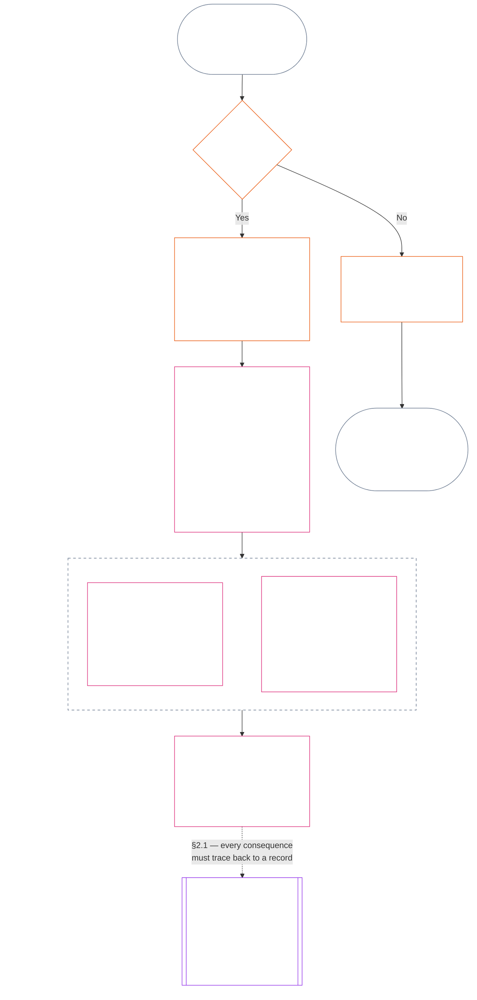

<!-- 한국어 부분 번역 초안. 출처: commit 9c2c8c10c871d91157bcd27b9f56ad6a1cec90d3. AI 지원 초안, 미검토. 범위: 제11장 §§1–3만. -->

### 1. 세 가지 질문

*쉽게 말해: 지위는 세 가지 질문에 차례로 답해 판단합니다. 원하는 평가에서 사실을 추론하지 말고, 원하는 결과를 정당화하려고 평가를 선택하지 마십시오.*

| 질문 | 질문이 묻는 내용 | 답하는 곳 |
| --- | --- | --- |
| **1. 무슨 일이 있었는가?** | 어떤 사실이 누구 또는 무엇에 관해, 어느 기간에, 어떤 지위 기록과 이의 제기 상태로 확인되었는가? | [§2](#2-question-1--what-happened) 및 [§3](#3-question-1-event-type-guide--what-kind-of-help-or-harm-occurred) |
| **2. 얼마나 좋거나 나빴는가?** | 그 사실은 어떤 종류와 규모의 기여 또는 위반을 입증하는가? | [제12장 §1](core_12.000_standing_measurement.md#1-question-2--how-good-or-bad-was-it) |
| **3. 그 결과 무엇이 일어나는가?** | 어떤 인정, 준비도, 구제, 보호조치, 제한 또는 다른 결과가 따르는가? | [제13장](core_13.000_standing_integration.md#chapter-thirteen-standing-effects-and-integration) |

각 질문은 그 앞의 답에 의존합니다.

- 질문 1은 질문 2에 필요한 확인된 사실을 제공합니다.
- 질문 2는 질문 3을 위해 그 사실을 측정합니다.
- 질문 3은 선호하는 결과에 맞추려고 사실이나 평가를 다시 써서는 안 됩니다.

세 질문의 답을 합쳐, 범위가 한정된 사건 하나 또는 정의된 패턴 하나에 대한 완전한 지위 평가를 구성합니다. 대상은 시간에 따라 이런 평가를 여러 개 받을 수 있지만, 어느 것도 순점수나 대상에 대한 종합 평가가 아닙니다. 기여 지위 기록과 위반 지위 기록은 질문 1과 2의 답을 보존하고, 질문 3 결정은 그 답에서 무엇이 뒤따르는지 밝힙니다.

#### 1.1 목적과 범위

이 장은 기록에 관한 헌법적 틀을, [제12장](core_12.000_standing_measurement.md#chapter-twelve-standing-measurement--question-2-how-good-or-bad-was-it)은 측정 틀을 **시스템**, **감지자**, **기관**에 대해 정합니다. 여기에는 [**CS-9.305**](corpus_systems/cs_09.305_system_classification_machinery.md#cs-9305-part-a-system-classification-machinery) (*시스템 분류 체계*)에 따라 분류되는 모든 시스템이 포함됩니다. 이 틀은 소문, 인기, 막연한 평판, 본래의 존엄 또는 일반적 가치를 측정하지 않습니다. 어느 것도 지위 평가의 허용 가능한 대상이 아닙니다.

다음 상황에서도 지위 절차는 효과적으로 작동해야 합니다.

- 과거에 확인된 기여가 현재의 역량이나 신뢰성을 보여주기에는 너무 오래된 경우;
- 위반이 해결되지 않은 채 남아 있는 경우;
- 복구에 비용이 많이 드는 경우;
- 책임이 국경을 넘는 경우; 또는
- 행위자가 조직 계층이나 명칭 변경을 이용해 책임 추궁을 방해하는 경우.

이 사항은 채택된 이행 문서에 속합니다.

- 일상 절차;
- 상향 보고 단계;
- 배상 및 복구 운영;
- 회복적 책임 조치; 그리고
- 인센티브 설계.

제12장의 측정만으로는 무력 사용, 구금 또는 다른 자유 제한을 허가하지 **않습니다**. 그러한 결과는 제6장 **제XX조** (*확인된 위반 이후의 정의*)의 비례성, 최소 제한, 기간 제한, 배상 및 회복적 책임 요건을 각각 독립적으로 충족해야 합니다.

<strong>추적 · 정의 · 평가 · 준수</strong>

- 상류 문서: [제1장 §16 — 심층 관리](core_01.010_stewardship_capacity_principles.md#16-stewardship-in-depth); [제2장부터 제4장](core_02.000_definition_structure.md); [제5장](core_05.000_definitions_home.md#chapter-five-foundational-definitions).
- 하류 문서:
  - [§2](#2-question-1--what-happened) (*질문 1*);
  - [§4](#4-standing-record-operational-requirements) (*검증 및 기록 요건*);
  - [§5](#5-record-custody-and-opening-authority) (*기록 보관 및 개시 권한*);
  - [§6](#6-handling-a-standing-record) (*지위 기록 처리*);
  - [제12장 §1](core_12.000_standing_measurement.md#1-question-2--how-good-or-bad-was-it) (*질문 2 측정*);
  - [제12장 §2](core_12.000_standing_measurement.md#2-magnitude-and-severity-input-dimensions) (*측정 입력 차원*);
  - [제12장 §3](core_12.000_standing_measurement.md#3-route-descriptor-catalogs-and-measurement-roles) (*경로 설명자 목록*);
  - [제12장 §4](core_12.000_standing_measurement.md#4-slot-grammar-and-shared-scaling) (*슬롯 문법과 공통 척도*);
  - [제12장 §5](core_12.000_standing_measurement.md#5-constitutional-inputs-to-axis-assignment) (*헌법 출처에 따른 분류*);
  - [제12장 §6](core_12.000_standing_measurement.md#6-unified-proportional-lequ-scale--contribution-and-violation-axes) (*두 축에 적용되는 통합 비례 LEQU 척도*);
  - [제13장](core_13.000_standing_integration.md#chapter-thirteen-standing-effects-and-integration) (*질문 3*).
- [중대성](core_05.050_band_oversight.md#materiality) · [O](core_05.050_band_oversight.md#materiality) · [M](core_05.050_band_oversight.md#materiality-determination-a) · [A](core_05.050_band_oversight.md#materiality-determination-a) · [C](core_05.050_band_oversight.md#materiality-determination-c)
- [피해](core_05.035_band_accountability.md#harm) · [O](core_05.035_band_accountability.md#harm) · [M](core_05.035_band_accountability.md#harm-a) · [A](core_05.035_band_accountability.md#harm-a) · [C](core_05.035_band_accountability.md#harm-c)
- [비례성](core_05.035_band_accountability.md#proportionality) · [O](core_05.035_band_accountability.md#proportionality) · [M](core_05.035_band_accountability.md#proportionality-a) · [A](core_05.035_band_accountability.md#proportionality-a) · [C](core_05.035_band_accountability.md#proportionality-c)

### 2. 질문 1 — 무슨 일이 있었는가?

<strong>추적</strong>

- 상류 문서: [§1](#1-the-three-questions) (*세 질문의 틀*); [제2장부터 제4장](core_02.000_definition_structure.md) (*기록, 검증, 정의에서 결과까지의 추적성*).
- 테트라드 축: **참여**; **감독** (다툴 수 있음 및 이의 제기 경로). 주요 목표: **번영** 및 **지속성** (후속 측정을 위해 기여와 위반에 관한 별도 판단을 보존하는 추적 가능한 기록).
- 하류 문서:
  - [§2.2](#22-silence-is-the-default) (*침묵이 기본값*);
  - [§2.3](#23-protected-dissent-is-not-a-trigger) (*보호되는 반대는 촉발 요인이 아님*);
  - [§2.4](#24-linked-standing-records-and-no-offset-bridge) (*연결 기록의 상쇄 금지 연결고리*);
  - [§2.5](#25-verified-input-gate) (*검증된 입력 관문*);
  - [§2.6](#26-stage-boundary) (*단계 경계*);
  - [§2.7](#27-forum-boundary) (*포럼 경계*);
  - [§3](#3-question-1-event-type-guide--what-kind-of-help-or-harm-occurred) (*사건 유형 안내*);
  - [§4](#4-standing-record-operational-requirements) (*기록 요건*);
  - [§5](#5-record-custody-and-opening-authority) (*기록 보관 및 개시 권한*);
  - [§6](#6-handling-a-standing-record) (*지위 기록 처리*);
  - [제12장 §1](core_12.000_standing_measurement.md#1-question-2--how-good-or-bad-was-it) (*질문 2 측정*);
  - [제12장 §2](core_12.000_standing_measurement.md#2-magnitude-and-severity-input-dimensions) (*측정 입력 차원*);
  - [제12장 §3](core_12.000_standing_measurement.md#3-route-descriptor-catalogs-and-measurement-roles) (*경로 설명자 목록*);
  - [제12장 §4](core_12.000_standing_measurement.md#4-slot-grammar-and-shared-scaling) (*슬롯 문법과 공통 척도*);
  - [제12장 §5](core_12.000_standing_measurement.md#5-constitutional-inputs-to-axis-assignment) (*헌법 출처에 따른 분류*);
  - [제12장 §6](core_12.000_standing_measurement.md#6-unified-proportional-lequ-scale--contribution-and-violation-axes) (*두 축에 적용되는 통합 비례 LEQU 척도*);
  - [제13장](core_13.000_standing_integration.md#chapter-thirteen-standing-effects-and-integration) (13.000) (*질문 3*).

 

*쉽게 말해: 질문 1은 무슨 일이 있었는지에 관한 범위가 한정되고 다툴 수 있는 설명을 확립합니다. 평가나 결과를 고려하기 전에 대상, 사건 또는 패턴, 기간, 확인된 사실과 기록 상태를 식별합니다. 확인된 도움과 확인된 위반은 서로 지우지 못하도록 별도의 지위 기록을 사용합니다. 이 기록은 인기 점수나 모호한 꼬리표가 아닙니다.*

**지위 기록**은 특정 대상, 기능 범위, 기록 기간, 검토 상태 및 의사결정 맥락을 위해 이 장에서 사용하는 범위가 한정된 기록입니다. 측정을 시작하기 전에 다음을 확립해야 합니다.

- 지위 기록이 누구 또는 무엇에 관한 것인지;
- 범위가 한정된 사건인지 정의된 패턴인지;
- 관련 행위와 효과가 언제 어디서 발생했는지;
- 어떤 사실이 확인되었고 어떤 사실이 여전히 다투어지는지;
- 어떤 증거, 귀속 및 이의 제기 경로가 판단을 뒷받침하는지; 그리고
- 지위 기록의 현재 검토, 수정 및 대체 상태.

이 도표는 사건이 지위 기록을 촉발하는지, 기록이 무엇을 담는지 따라갑니다. 이어지는 하위 절은 각 규칙을 설명합니다. “아니요” 분기는 주요 경로에서 오른쪽으로 나갑니다.

#### 2.1 지위 기록: 종류와 대상

질문 1은 확인된 도움을 위해 **기여 지위 기록**을, 책임 추궁 실패를 포함한 확인된 피해를 위해 **위반 지위 기록**을 사용합니다. 하나의 지위 기록은 두 종류의 판단을 결합하지 않습니다.

- 지위 기록은 감지자, 기관, 시스템, 평가, 범위가 한정된 사건, 역할, 집단, 행위자별 기록 또는 헌법상 관련 있는 다른 단위에 관한 것일 수 있습니다.
  - 서로 다른 대상, 역할, 시스템, 공동체, 기록 기간, 검토 상태 또는 의사결정 맥락을 하나의 구별 없는 지위 표지로 뭉뚱그려서는 안 됩니다.
- 지위 기록은 시작과 종료가 분명한 하나의 사건인 **범위가 한정된 사건** 또는 반복 행위의 **패턴**을 다룰 수 있습니다.
  - 패턴에는 정의된 대상, 범위 및 검토 기간이 필요합니다.
- 같은 대상은 시간이 지나며 여러 지위 기록을 보유할 수 있으며, 연결된 기여 및 위반 지위 기록도 포함됩니다.
  - 대상, 겹치는 기록 기간, 범위가 한정된 사건, 패턴 또는 의사결정 맥락이 같으면 관련 지위 기록은 **§4.2**에 따라 서로 **교차 참조**해야 합니다.
- 지위 기록은 독립적인 평판 점수, 존엄성 순위, 영구적 지위, 일반적 가치 표지 또는 결합된 점수표가 아닙니다.
  - 운영 요건은 **§4**에 있습니다.

이후의 지위 효과는 제13장에 속하며, 지위 기록 자체의 일부가 되지 않으면서 관련 지위 기록을 추적할 수 있어야 합니다.

#### 2.2 침묵이 기본값

지위 기록이 없는 것은 감지자, 기관 또는 시스템의 통상적인 상태이며, 대부분의 감지자는 계속 이 상태로 남습니다.

- **§4**에 따라 촉발 요인이 확인된 경우에만 지위 기록을 엽니다. 지정된 기록 개시 권한자가 기입을 승인해야 하고, 별도의 기록 관리자가 이를 기입해야 합니다(**§5**). 다음을 위해 지위 기록을 열어서는 안 됩니다.
  - 기준선을 설정하기 위해;
  - 명부를 완성하기 위해; 또는
  - 지정 경로의 명명된 관문 관리자가 원하기 때문에.
- 지위 기록이 없다는 것은 아무것도 뜻하지 않습니다. “미평가”, “미확인”, “파일에 기록 없음”은 위험, 낮은 기여 또는 그 밖의 어떤 것에 대한 증거가 아닙니다. 누구도 기록 부재를 더 면밀히 조사하거나, 더 낮은 기본값을 적용하거나, 지정 경로에 조건부로 접근하게 하는 이유로 삼아서는 안 됩니다.
- 어떤 기관이나 시스템도 다음의 조건으로 지위 기록, “기록 없음” 확인서 또는 기록 개설 동의를 요구할 수 없습니다.
  - **제III조** (*생존 및 필수 접근*)의 필수 요소;
  - **제III-C조** (*노동 및 경제적 바닥*)의 보호;
  - 통상적 상거래; 또는
  - 영향을 받는 당사자로서의 참여.
  [제13장 §6.2 역량 기준과 허가](core_13.000_standing_integration.md#62-competency-bars-and-clearances)에 따라 신뢰에 민감한 특정 지정 경로에 대해 공표된 역량 기준은 예외이며, 해당 지정 경로가 왜 신뢰에 민감한지 밝혀야 합니다.
- 대상에 관한 지위 기록을 열면 **§4**에 따라 그 대상에게 알려야 합니다. 문서화된 [증거 보존](core_05.050_band_oversight.md#evidence-preservation) 또는 안전상 필요가 정당화하는 경우에만, 그리고 제한된 특정 기간 동안에만 통지를 미룰 수 있습니다. 통지가 있어야 지위 기록에 이의를 제기할 수 있습니다. 기록이 존재한다는 사실을 모르는 대상은 기록에 이의를 제기하거나 수정할 수 없습니다.

#### 2.3 보호되는 반대는 촉발 요인이 아님

**제XI-D조** (*집회, 반대 및 평화적 시위*)에 따른 반대 또는 평화적 시위 — [보호되는 비폭력 시민 불복종](core_06.005_rights_part_b.md#xi-d-nonviolent-civil-disobedience)을 포함 — ([*반대 및 평화적 시위 바닥*](core_06.005_rights_part_b.md#xi-d-dissent-and-peaceful-protest))는 확인된 촉발 요인이 아닙니다.

- 반대는 위반 지위 기록을 열거나 연장하거나 가중하지 않으며, **§8.2**에 따른 심각도 입력이 아니고, 반복된다고 해서 패턴이 되지 않습니다.
- 헌법상 바닥을 독립적으로 위반하는 분리 가능한 행위는 그 자체의 조건으로 기록하며, 시위의 관점, 대의 또는 대상 때문에 가중하지 않습니다.

#### 2.4 연결된 지위 기록과 상쇄 금지 연결고리

<strong>추적</strong>

- 상류 문서: [§2.1](#21-standing-records-kinds-and-subjects) (*분리된 기여 및 위반 기록*).
- 하류 문서:
  - [§2.5](#25-verified-input-gate) (*검증된 입력 관문*);
  - [§2.7](#27-forum-boundary) (*포럼 경계*);
  - [§4.2](#42-related-standing-record-cross-references) (*교차 참조*);
  - [제12장 §1](core_12.000_standing_measurement.md#1-question-2--how-good-or-bad-was-it) (*질문 2 측정*);
  - [제12장 §2](core_12.000_standing_measurement.md#2-magnitude-and-severity-input-dimensions) (*측정 입력 차원*);
  - [제12장 §3](core_12.000_standing_measurement.md#3-route-descriptor-catalogs-and-measurement-roles) (*경로 설명자 목록*);
  - [제12장 §4](core_12.000_standing_measurement.md#4-slot-grammar-and-shared-scaling) (*슬롯 문법과 공통 척도*);
  - [제12장 §5](core_12.000_standing_measurement.md#5-constitutional-inputs-to-axis-assignment) (*헌법 출처에 따른 분류*);
  - [제12장 §6](core_12.000_standing_measurement.md#6-unified-proportional-lequ-scale--contribution-and-violation-axes) (*두 축에 적용되는 통합 비례 LEQU 척도*);
  - [제13장](core_13.000_standing_integration.md#chapter-thirteen-standing-effects-and-integration) (13.000) (*질문 3*).
- 함께 읽기: [제13장 — 지위 통합](core_13.000_standing_integration.md#2-automatic-integration-review-and-continuity) (13.000) (*포기 없이 통합 및 연결 기록 통합*); [제13장 §6.2 — 역량 기준과 허가](core_13.000_standing_integration.md#62-competency-bars-and-clearances) (13.000 §6.2); [제13장 §4.2 — 지위 잠금](core_13.000_standing_integration.md#42-prevention--general-standing-locks) (13.000 §4.2).

 

**핵심 규칙:** 확인된 **기여 지위 기록**과 확인된 **위반 지위 기록**은 **§2.1**에 따라 분리해 보관합니다. 각 기여 또는 위반 판단은 자체 지위 기록에 담긴 독립적이고 뒷받침되는 사실에 근거해야 합니다. 분석과 증빙 자료는 두 기록 경로를 각각 추적할 수 있도록 유지해야 합니다. 단일 기입이나 연결 기록 집합은 순점수, 혼합 점수 또는 상계가 아닙니다.

- **위반 지위 기록과 지위 잠금:**
  - 제13장에 따라 위반 지위 기록에서 비롯된 적용 가능한 **지위 잠금**은 확인된 위반이 해결되지 않은 동안 지위를 제한하거나, 역할 자격을 제한하거나, 구제 접근에 영향을 줄 수 있습니다.
  - 지위 잠금은 기여 지위 기록에 기록된 확인된 긍정적 기여를 지워서는 안 됩니다.
  - 해결되지 않은 확인된 위반은 시간이 흐른다는 이유만으로 할인되지 않습니다.
  - 확인된 위반은 관련 없는 기여 지위 기록을 허위의 부정적 평판 기록으로 바꾸어서는 안 됩니다.
- **기여 지위 기록과 역량 허가:**
  - 현재 유효하고 역할과 관련된 확인된 기여는 공표된 **역량 기준**에 따른 해당 **역량 허가**와 신뢰·역할·인정에 연계된 자격을 뒷받침할 수 있습니다.
  - 확인된 기여는 확인된 위반 판단을 상쇄하거나, 평균으로 낮추거나, 변명하거나, 이름을 바꾸어서는 안 됩니다.
  - 기준을 충족해도 적용 가능한 지위 잠금이 면제되지 않습니다.

**유일한 예외:** 위반 판단 자체가 주장된 기여를 반증하는 경우 — 예를 들어 증거가 기여 기록에 적힌 일을 실제로 하지 않았음을 보여주는 경우 — 적절한 증거 및 검토 절차를 통해 **§4.2**에서 요구하는 교차 참조와 함께 연결된 기여 지위 기록을 수정하거나 제거할 수 있습니다. 그러나 위반이 별도의 기여 지위 기록에 기록된 무관한 도움까지 자동으로 지우지는 않습니다.

#### 2.5 검증된 입력 관문

관문은 다음과 같이 작동합니다.

- 지위, 신뢰, 역할, 인정 또는 인정 자격에 영향을 미치는 결정은 관련 **기여 지위 기록**이나 **위반 지위 기록**에서 나온 확인된 입력만 사용할 수 있습니다.
- 주장, 판결 전 청구, 잠정 경로 태그, 접수 단계 전용 서술 및 그 밖의 분쟁 단계 자료만으로는 지위상 기여나 위반의 성격을 정할 수 없습니다.
- 검증된 입력은 **지위 판단**입니다. 확인된 기여 판단(축 I) 또는 확인된 위반 판단(축 II)을 뜻합니다.
- 기여 및 위반 판단은 별도의 지위 기록에 남습니다(**§2.1** 참조).

#### 2.6 단계 경계

지위 기록의 단계는 서로 분리됩니다.

- 질문 1은 확인된 사실을 기록하고, 질문 2는 그 사실을 측정합니다.
- 확인된 사실 기반이 완성되면 질문 2 측정이 아직 진행 중이어도 지위 기록을 열 수 있습니다.
- 측정 전까지 질문 2 필드는 슬롯이나 범주를 암시하지 말고 대기 중이라고 밝혀야 합니다.
- 지위 기록은 질문 3의 **지위 효과**를 명시하거나 적용해서는 안 됩니다.

#### 2.7 포럼 경계

*쉽게 말해: 포럼은 분쟁을 감독하고, 이의를 제기할 수 있게 하며, 확인된 결과로 전환하는 곳입니다. 하지만 사건을 접수하거나 서사 다툼에서 이겨도 지위가 갱신되지는 않습니다. **§2.5**의 검증된 입력 관문은 계속 적용됩니다. 포럼이 제2장부터 제4장에 따라 사실을 확인하면 지위 기록을 **열거나, 갱신하거나, 수정**할 수 있고, **이의 제기에 따라 잘못된 기록을 배제**할 수도 있습니다. 포럼은 긍정과 부정을 하나의 점수로 합치거나 지위 범주를 독자적으로 만들어내지 않습니다.*

이 절은 한 가지 질문, 즉 포럼의 작업이 지위 기록에 어떻게 반영되는지를 다룹니다. 연쇄의 나머지 단계는 여기서 명시한 담당자에게 속하며, 순서는 다음과 같습니다.

1. 분쟁이 접수되고 포럼은 지위 기록이 아닌 **포럼 사건 기록**을 보유합니다. 담당: [제15장 §2.3 포럼 사건 기록, 지위 기록 및 이의 제기](core_15.000_forum.md#23-forum-case-records-standing-records-and-contests); [§2.7.1 포럼 사건 기록](#271-forum-case-record)도 참조.
2. 포럼은 [제2장부터 제4장](core_02.000_definition_structure.md)에 따라 사실을 확인합니다.
3. 확인된 판단은 검증된 입력 관문을 통과합니다. 담당: [§2.5 검증된 입력 관문](#25-verified-input-gate).
4. 포럼일 수도 있는 지정된 기록 개시 권한자가 지위 기록을 열거나, 갱신하거나, 수정하거나, 이의 제기에 따라 잘못된 기록을 배제합니다. 기록이 무엇을 담는지는 [§4.1 최소 기록 내용](#41-minimum-record-contents)이, 누가 조치할 수 있는지는 [§5 기록 보관 및 개시 권한](#5-record-custody-and-opening-authority)이 담당합니다.
5. 지위 기록은 확인된 사실만 담고, 이후 질문 2가 이를 측정합니다. 담당: [§2.6 단계 경계](#26-stage-boundary) 및 [제12장 §1 질문 2 — 얼마나 좋거나 나빴는가?](core_12.000_standing_measurement.md#1-question-2--how-good-or-bad-was-it).
6. 지위 효과가 있다면 지위 효과를 담당하는 [제13장](core_13.000_standing_integration.md#chapter-thirteen-standing-effects-and-integration)에 따라 발생합니다.

[제15장](core_15.000_forum.md#chapter-fifteen-forums-and-jurisdiction)에 따른 포럼 계열은 구체적 분쟁이 지위 절차를 거치는 방식을 **감독**합니다. [제15장 §6 적시 해결, 중대성 단계 및 지연 방지 원칙](core_15.000_forum.md#6-timely-resolution-materiality-tiers-and-anti-delay-discipline) 및 [제XXVI-C조](core_06.020_rights_part_e.md#article-xxvi-c-timely-resolution-and-anti-delay-floor) (*적시 해결 및 지연 방지 바닥*)에 따라 포럼은 다음을 제공합니다.

- 접근 가능한 이의 제기;
- 독립적 검토;
- 법의학적 지원;
- 시정 순서 설정; 그리고
- 단계별 기한.

그 포럼의 판단이 제2장부터 제4장에 따른 검증된 입력 관문을 충족하면 다음을 할 수 있습니다.

- **§4.1**에 따라 지위 기록을 **열거나, 갱신하거나, 수정**; 또는
- **이의 제기에 따라 잘못된 기록 배제**.

##### 2.7.1 포럼 사건 기록

진행 중인 분쟁에 관한 포럼 자체의 파일이 [**포럼 사건 기록**](core_05.035_band_accountability.md#forum-case-record)이며, [제15장 §2.3 포럼 사건 기록, 지위 기록 및 이의 제기](core_15.000_forum.md#23-forum-case-records-standing-records-and-contests)에 정의되어 있습니다. 이는 지위 기록이 **아닙니다**.

##### 2.7.2 포럼 판단과 질문 2 측정

포럼의 확인된 사실 판단은 질문 1 지위 기록의 사실 기반이 될 수 있습니다. 그러나 확인된 기여나 위반이 얼마나 좋거나 나빴는지에 관한 질문 2 측정을 결정하지는 **않습니다** ([§2.6 단계 경계](#26-stage-boundary)). 따라서:

- 포럼 절차는 기여 및 위반 자료를 순점수, 혼합된 본안 답변 또는 구별 없는 지위 표지로 **합쳐서는 안 됩니다**. 연결 지위 기록은 [§2.1 지위 기록: 종류와 대상](#21-standing-records-kinds-and-subjects) 및 [§2.4 연결된 지위 기록과 상쇄 금지 연결고리](#24-linked-standing-records-and-no-offset-bridge)에 따라 별도로 유지됩니다.
- 포럼 결과는 분쟁 서사, 경로 지정의 편의 또는 패널 선호를 입증 가능한 입력([§2.5 검증된 입력 관문](#25-verified-input-gate)), 별도 측정([제12장 §1 질문 2 — 얼마나 좋거나 나빴는가?](core_12.000_standing_measurement.md#1-question-2--how-good-or-bad-was-it)) 또는 [제13장](core_13.000_standing_integration.md#chapter-thirteen-standing-effects-and-integration)이 담당하는 지위 효과 기제로 **대체해서는 안 됩니다**.

##### 2.7.3 포럼 경계가 축소하지 않는 것

이 경계는 다음에 따라 요구되는 이의 제기, 구제, 잠정 구제 또는 절차적 보호를 **축소하지 않습니다**.

- [제XIII-A조](core_06.010_rights_part_c.md#article-xiii-a-reliability-and-trustworthiness-baseline) (*신뢰성과 신빙성의 기준선*);
- [제XIII-B조](core_06.010_rights_part_c.md#article-xiii-b-right-to-redress-and-remedy) (*배상 및 구제를 받을 권리*);
- [제15장 §6 적시 해결, 중대성 단계 및 지연 방지 원칙](core_15.000_forum.md#6-timely-resolution-materiality-tiers-and-anti-delay-discipline);
- [제XXVI-C조](core_06.020_rights_part_e.md#article-xxvi-c-timely-resolution-and-anti-delay-floor) (*적시 해결 및 지연 방지 바닥*); 또는
- 관련 사법 조항.

확인된 포럼 판단이 다른 확인된 입력과 같은 관문을 통해 지위 절차에 들어가도록 요구하며, 관문을 우회할 수는 없습니다.

### 3. 질문 1 사건 유형 안내 — 어떤 종류의 도움이나 피해가 발생했는가?

*쉽게 말해: 사실이 확인된 후 무슨 일이 있었는지 설명하려면 이 표를 사용하십시오. 관련된 기여 또는 위반 유형을 식별하는 데 도움이 됩니다. 얼마나 좋거나 나빴는지, 어떤 슬롯을 부여할지, 그 결과 무엇이 일어날지는 결정하지 않습니다.*

#### 3.1 기여 사건 유형

**자격 규칙:** 주장된 기여는 추적 가능하고, 비용을 외부화하지 않으며, 시행 중인 헌법 전체와 부합할 때만 인정됩니다.

- 외부화된 피해, 강압적 의존, 권리 바닥의 축소 또는 숨겨진 부담은 주장된 기여의 자격을 박탈하거나 범위를 제한할 수 있습니다.
- 주장된 기여는 별도의 위반 판단을 상쇄하지 않습니다.

아래 표의 각 행은 확인된 도움의 일반적 경로와 헌법상 관련성을 나타냅니다. 하나의 지위 기록에 여러 행이 적용될 수 있습니다.

| 확인된 기여 유형 | 일어난 일 | 테트라드 축 | 주요 목표 |
| --- | --- | --- | --- |
| 생존 및 신체 유지 | 누군가가 음식, 주거, 의료 또는 안전을 제공받음 | **참여**, **감독** | **번영** |
| 돌봄 및 교육 | 아동을 양육하거나, 노인을 돌보거나, 다른 사람을 교육함 | **참여**, **감독** | **번영**, **지속성** |
| 트라우마 해결 | 누군가가 웰빙을 가로막던 심리적 피해에서 회복하도록 도움을 받음 | **참여**, **책임 추궁** | **번영** |
| 심각한 부담 제거 | 감당하기 힘든 부채, 착취적 노동 조건 또는 시스템 장벽을 제거함 | **참여**, **감독** | **번영** |
| 자기결정권 회복 | 누군가가 자신의 삶에 관해 의미 있는 선택권을 얻음 | **참여** | **번영** |
| 생산 능력 확대 | 도구, 인프라 또는 기회가 다른 사람들의 독립적인 번영을 가능하게 함 | **참여**, **감독** | **번영**, **지속성** |
| 시간 효율 개선 | 피할 수 있는 대기, 행정 마찰 또는 조정 부담을 줄여 돌봄, 휴식, 자기결정, 학습 또는 권리에 부합하는 업무에 쓸 수 있는 시간을 돌려줌 | **참여**, **감독** | **번영** |
| 생태 또는 인프라 위험 감소 | 환경 붕괴 또는 핵심 시스템의 실패를 예방함 | **감독**, **책임 추궁** | **지속성**, **번영** |
| 생태 발자국 감소 | 자원 사용, 배출량 또는 토지·물 수요를 타인이나 생태계에 부담을 전가하지 않고 확인 가능하게 줄임 | **감독**, **책임 추궁** | **지속성**, **번영** |
| 생태계 복원 | 훼손된 토지, 물 또는 서식지를 기능적이고 자립적인 상태에 가깝게 복원함 | **감독**, **책임 추궁** | **지속성**, **번영** |
| 멸종 위기종 보호 | 멸종 위험에 처한 종 또는 그 종이 의존하는 서식지를 손실로부터 보호함 | **감독**, **책임 추궁** | **지속성**, **번영** |
| 오염 및 폐기물 감소 | 오염, 유해 배출 또는 폐기물을 예방하거나 제거하거나 안전하게 관리함 | **감독**, **책임 추궁** | **번영**, **지속성** |
| 안전, 진실, 감사 가능성 또는 이의 제기 역량 강화 | 권리를 보호하고 권력에 책임을 묻기 위해 기관이나 관행을 구축하거나 복구함 | **참여**, **감독**, **책임 추궁** | **번영**, **지속성** |

#### 3.2 위반 사건 유형

**자격 규칙:** 위반 사건 유형에는 **제2장부터 제4장**에 따라 추적 가능하고, 범위가 한정되며, 감사 가능하고, 다툴 수 있는 확인된 위반 판단이 필요합니다.

- 혐의, 잠정 태그, 포럼 서사 및 접수 단계 표지는 경로 지정이나 초기 분류를 도울 수 있지만 질문 1을 완료하지는 않습니다.
- 긍정적 기여는 확인된 위반을 상쇄하거나, 변명하거나, 되돌리거나, 재명명하지 않습니다.

아래 표의 각 행은 확인된 손실, 위험 또는 의무 실패의 일반적 경로와 그 헌법상 관련성을 나타냅니다. 한 지위 기록에 여러 행이 적용될 수 있습니다.

| 확인된 손실 또는 위험의 유형 | 일어난 일 | 테트라드 축 | 주요 목표 |
| --- | --- | --- | --- |
| 생존 또는 신체 유지의 박탈 | 피할 수 있었던 사망, 진료 거부, 안전하지 않은 조건 또는 생존을 위한 물질적 결핍이 발생함 | **책임 추궁**, **참여** | **번영** |
| 피할 수 있었던 심각한 부담 | 과중하거나 강제로 부과되거나 체계적으로 전가된 부담이 웰빙 또는 자기결정권을 실질적으로 해침 | **책임 추궁**, **참여** | **번영** |
| 강압적 자기결정권 상실 | 강압, 조종, 신빙성 있는 위협, 감금 또는 자유에 대한 위험이 발생함 | **책임 추궁**, **참여** | **번영** |
| 권리 바닥 훼손 | 협상할 수 없는 헌법적 바닥, 헌법의 최고성 또는 이의 제기·구제 접근성이 실질적으로 침해됨 | **책임 추궁**, **감독** | **번영**, **지속성** |
| 생태 또는 인프라 피해 | 헌법상 웰빙에 필요한 조건이 훼손됨 | **책임 추궁**, **감독** | **지속성**, **번영** |
| 오염 또는 폐기물 피해 | 오염, 유해 배출 또는 폐기물이 공기, 물, 토양 또는 건강에 해를 끼침 | **책임 추궁**, **감독** | **번영**, **지속성** |
| 종 또는 서식지 파괴 | 멸종 위험에 처한 종 또는 그 종이 의존하는 서식지가 파괴·분절되거나 손실로 내몰림. 상쇄 가능한 것으로 취급된 손실도 포함 | **책임 추궁**, **감독** | **지속성**, **번영** |
| 생태 복구 역량 상실 | 피해 후 생태계가 재생할 능력을 차단하거나, 피할 수 있었는데도 회복하기 매우 어렵거나 불가능하게 만듦 | **책임 추궁**, **감독** | **지속성**, **번영** |
| 외부화된 생태 피해 또는 고갈 | 생태 비용을 타인이나 생태계에 전가하거나, 자원을 재생 한계 이상으로 고갈하거나, 발자국·지속 가능성 주장이 지속되는 악화를 숨김 | **책임 추궁**, **감독** | **지속성**, **번영** |
| 생산 능력 파괴 | 독립적으로 번영하는 데 필요한 도구, 역량, 관계 또는 자원을 차단함 | **책임 추궁** | **번영** |
| 안전, 진실 또는 감사 가능성 저하 | 은폐, 허위 정보, 훼손된 기록, 접근 불가능한 이의 제기 경로 또는 검토 불가능한 집계가 발생함 | **감독**, **책임 추궁** | **번영**, **지속성** |
| 책임 추궁 방해 | 답변 의무의 기반 — 증거 무결성, 검증, 포럼 절차, 지위 기록, 구제 기한 또는 이의 제기·시정 경로 — 에 대한 검증된 간섭이 발생함. 방해가 별개의 기저 피해에 대한 메타 공격이면 연결된 별도 위반 지위 기록을 열 것 | **책임 추궁**, **감독**, **적시성** | **번영**, **지속성** |
| 시스템 포획 또는 의존성 남용 | 구조적 조장, 의존성 비대칭 남용, 회피 방지 설계 또는 책임 추궁 경로 포획이 발생함 | **책임 추궁**, **참여** | **지속성**, **번영** |

