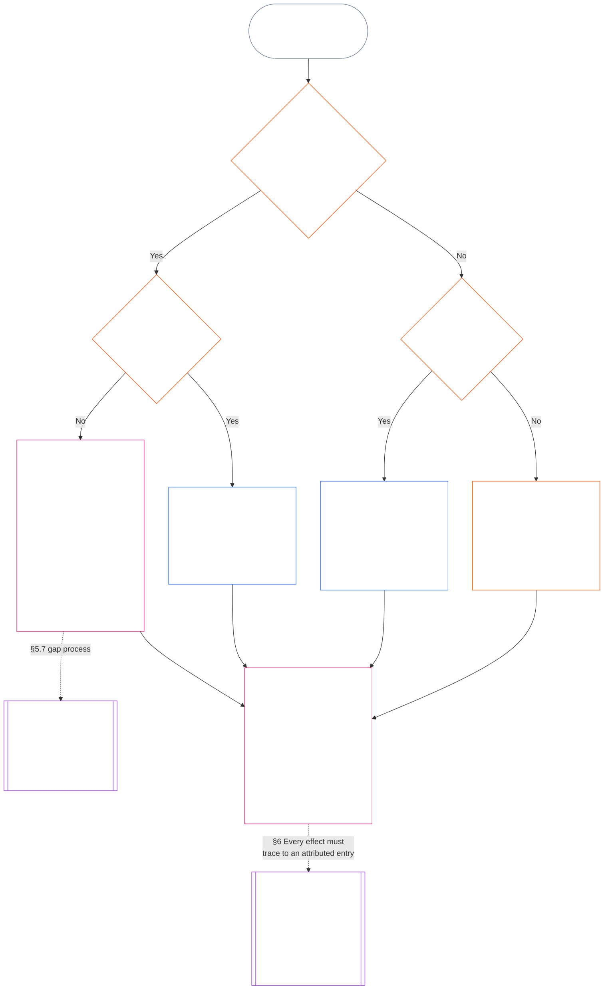

<!-- 언어: 한국어 (ko) | 출처 스냅샷: 9c2c8c10c871d91157bcd27b9f56ad6a1cec90d3 | AI 작성 초안, 미검토; 부분 범위: 제11장 §§5.7–5.9 -->

#### 5.7 시스템 헌장 또는 기관 헌장에서 자리를 명시하지 않은 경우

통상 명명 경로를 이용할 수 없을 때 궤적 기록이 어디로 가는지는 세 가지 질문에 달려 있으며, 아래 도표는 그 순서대로 답합니다. 이 절은 시스템 헌장 또는 기관 헌장이 자리를 명시하지 않은 경우를 다룹니다. 어느 헌장도 궤적 기록에 적용되지 않는 경우는 [§5.8 시스템 헌장 또는 기관 헌장이 궤적 기록에 적용되지 않는 경우의 대체 경로](#58-fallback-when-no-system-charter-or-institutional-charter-reaches-the-standing-record)에서 다룹니다.

<strong>독자 안내(비운영): 도표 읽는 법</strong>

> 쉬운 말로: 궤적 기록은 시스템 헌장 또는 기관 헌장이 지정하는 사무소에서 처리합니다. 시스템 헌장 또는 기관 헌장에서 자리를 명시하지 않으면 공백을 메울 때까지 그 헌장은 유효하지 않습니다. 궤적 기록은 경로 지도가 아니라 백업 기록 권한자와 백업 기록 보관자 또는 포럼으로 갑니다. 시스템 헌장이나 기관 헌장이 궤적 기록에 전혀 적용되지 않으면 기관이 공표한 경로 지도가 결정합니다. 경로 지도도 없다면 궤적 기록은 독립 검증으로 가거나, 비공식적이고 범위가 작은 작업의 경우 그 기록에 의존하는 기구로 갑니다.
>
> 모든 경로는 같은 상자로 끝납니다. 한 사무소가 사실을 검증하고 별도의 사무소가 궤적 기록을 기재·보관합니다. 그다음에는 [§6 궤적 기록의 처리](#6-handling-a-standing-record)에 따라 보관자가 취할 조치를 정합니다. 실선 화살표는 기본 경로입니다. 점선 화살표는 이를 허용하는 절이 표시된 인계 경로입니다. 양쪽에 이중선이 있는 상자는 다른 장에 속하며, 마지막 상자에서는 궤적 기록을 다시 쓰지 않고 그 기록에서 궤적 효과를 도출합니다. 이 도표는 의무, 자리 또는 필드를 추가하지 않습니다.

 

필수 기록 자리를 지정하지 않거나 독립 경로를 명시하지 않은 시스템 헌장 또는 기관 헌장에는 다음이 적용됩니다.

- **결과:** 시스템 헌장 또는 기관 헌장은 유효하지 않으며, 이를 유발하는 변경은 허용되지 않습니다 ([제7장 §4.7.1 공백이 존재하는 경우와 기록 방법](core_07.000_charters.md#471-when-a-gap-exists-and-how-it-is-logged)).
- **공백 절차는 제7장의 소관:** [제7장 §4.7 운영자 궤적 기록 경로 지도의 공백](core_07.000_charters.md#47-gaps-in-the-map-for-operator-standing-records)도 다음을 규율합니다:
  - 공백 기록 방법;
  - 대응 및 해결 기간(긴급 대체 포함); 그리고
  - 보관을 지정된 보관자에게 돌려보내는 시점.

궤적 기록에 관하여 이 절은 다음을 추가합니다.

- **누가 행동할 수 없는가:** 필수 자리가 비어 있고 시스템 헌장 또는 기관 헌장이 유효한 대체자를 지정하지 않았다면, 다음 항목의 경로에 따르는 경우를 제외하고 누구도 그 자리의 기능을 수행할 수 없습니다.
- **궤적 기록이 가는 곳:** [§5.4 자기 보관 금지](#54-no-self-custody)에 따라 궤적 기록은 백업 기록 권한자와 백업 기록 보관자 또는 **section 2.7**에 따른 포럼으로 갑니다. 경로 지도는 그들을 대신하지 않습니다. 각 궤적 기록은 보관자 한 명이 온전하게 보관합니다.
- **이미 보관 중인 궤적 기록:**
  - 포럼, 등록관 또는 백업 기록 권한자가 공백 통지를 받은 날, 헌장 당사자의 실질 통제선 안에 있는 사무소가 보관하던 운영자 궤적 기록은 전체 이력과 함께 백업 기록 보관자에게 이동합니다.
  - 그때까지 해당 사무소는 기록을 읽기 전용으로 보관하고, 새 버전을 기재하지 않으며, 전체 이력이 포함된 완전한 사본을 즉시 백업 기록 보관자에게 제공합니다.
  - 통제선 밖의 보관자는 궤적 기록을 계속 보관하며 공백 기간에는 백업 기록 권한자 또는 포럼이 승인한 버전을 기재합니다. 포럼이 보관자가 통제선 안에 있다고 판단하면, 통제선 안의 사무소와 마찬가지로 궤적 기록을 전체 이력과 함께 백업 기록 보관자에게 옮깁니다.
- **책임 관리자:** 시스템 헌장 또는 기관 헌장이 맡기지 않은 자리를 채워 달라는 요청을 받은 책임 관리자는:
  - **자리를 맡지 않음:** 궤적 기록을 기재할 수 있는 접근 권한이나 기술적 능력이 있어도 기재 권한이 생기지는 않습니다.
  - **요청과 공백을 명시함:** 로그에 둘 다 명시합니다.
  - **궤적 기록을 넘김:** 위의 *궤적 기록이 가는 곳*에 따른 경로로 보냅니다.
  - **다른 의무를 계속 이행함:** [§5.4 자기 보관 금지](#54-no-self-custody) (*대상 내부의 책임 관리자*)에 따른 기존 의무를 계속 이행합니다. 자신이 통제하는 것을 중단하고, 재구성 가능한 범위를 기록하며, 보유한 증거를 보존하고, 통지하고, 상위로 보고합니다. 이 중 어느 행위도 사실을 검증하거나 궤적 기록을 기재하지 않습니다. 로그와 보존 증거는 검증 권한자에게 입력 자료로 궤적 기록과 함께 전달됩니다. 이는 기재가 아니며 사실을 결정하지도 않습니다.

#### 5.8 시스템 헌장 또는 기관 헌장이 궤적 기록에 적용되지 않는 경우의 대체 경로

궤적 기록이 다루는 시스템, 기관 또는 사업체에 시스템 헌장이나 기관 헌장이 적용되지 않을 때 — 예를 들어 헌장을 공표하지 않은 Class L 경계 이하의 기구 — 기관이 **CI-8.205 §2** (*기능 분리 경로*)에 따라 공표한 경로 지도가 적용됩니다.

- **기록 개시 권한자:** 궤적 기록이 다루는 시스템, 기관 또는 사업체의 보증 및 감사 경로에 경로 지도가 배치한 사무소입니다. 그 사무소는 사실 기반을 검증하고 기재를 승인합니다 ([§5.2 이름이 명시된 기록 개시 권한자](#52-named-record-opening-authority)). 궤적 기록을 기재하거나 보관하지는 않습니다.
- **보관자:** 공표 및 증거 경로를 맡은 사무소입니다.
- **실행 경로 제외:** 두 역할 모두 해당 시스템의 실행 경로를 맡은 사무소가 맡을 수 없습니다.
- **경로 지도도 없는 경우:** 위의 *자기 보관 금지*에 따른 독립 검증으로 궤적 기록을 보내거나, 비공식적이고 범위가 작은 기록은 아래의 *비공식 기록 및 소규모 기록*에 따라 그 기록에 의존하는 기구로 보냅니다.
- **책임 관리자:** 경로 지도가 부여하지 않은 자리를 채워 달라는 요청을 받은 책임 관리자는 [§5.7 시스템 헌장 또는 기관 헌장에서 자리를 명시하지 않은 경우](#57-when-a-system-charter-or-institutional-charter-leaves-a-seat-unnamed)의 *책임 관리자* 규칙을 따릅니다. 자리를 맡지 않고, 요청과 공백을 로그에 명시하며, 다른 의무를 계속 이행합니다. 궤적 기록을 경로 지도가 명시한 사무소로 보냅니다. 아무도 명시하지 않았다면 위의 *경로 지도도 없는 경우*에 따른 경로로 보냅니다.

#### 5.9 비공식 기록 및 소규모 기록

직무 분리는 형식성이 아니라 실질 이해관계에 따라 조정됩니다 ([제8장 §2 4석 헌법적 요건](core_08.000_functional_independence_separation_of_duties.md#2-four-seat-constitutional-requirement)).

- **포괄되는 작업:** 지역 공동체는 다양한 기여로 운영되며, 그중 상당수는 무급이고 비공식적입니다. 여기에는 무급 작업, 동료 주도 조직 활동, 상호부조, 돌봄, 유지 관리, 수리, 교육 및 공동체 책임 관리가 포함됩니다. [제13장 §6 기여 결과는 두 번째](core_13.000_standing_integration.md#6-contribution-consequences-second)는 이 작업을 동등한 기준으로 인정하도록 요구합니다.
  - **지역에서 보이는 모습:** 이웃끼리 음식과 도구 나누기(상호부조); 아프거나 나이 든 이웃 돌보기(돌봄); 공동 정원이나 개울을 잘 관리하기(유지 관리 및 공동체 책임 관리); 이웃집 배관 수리하기(수리); 개인 교습 또는 기술 알려 주기(교육). 각각은 그 자체로 별도의 기여 유형입니다.
- **검증 자리를 맡는 주체:** 해당 작업에서는 **궤적 기록에 의존할 권한이 공표된 독립 기구라면 무엇이든** 검증 자리를 충족하며, 그 기구가 검증 권한자로 활동합니다.
  - **통상적인 주체:** 흔히 궤적 기록에 의존할 기구입니다. 예를 들면 유역 협의회 같은 지역 단체, 작업에 자금을 대거나 계속 운영하는 조직, **CI-6.255** (*공유지, 협동조합, 상호부조 및 비시장 공동체 거버넌스*)에 따른 기록 인정 권한자(이런 공동체 작업의 기록을 인정하는 기구) 또는 **section 2.7**에 따른 포럼이 있습니다.
- **해당하지 않는 것:** 검증 권한자의 형식성만으로 검증 자리가 충족되지는 않습니다.

이러한 궤적 기록에는 다음이 적용됩니다.

- 혼자 활동하는 감지자는 자기 기여 기록을 요청하기 위해 단체, 기관, [시스템 헌장](core_05.040_band_continuity.md#system-charter) 또는 [기관 헌장](core_05.040_band_continuity.md#institutional-charter)이 필요하지 않습니다. 이 경우:
  - **누가 요청하는가:** 감지자는 대상이자 청구인으로서 자신의 요청에 대한 개시 자리를 맡습니다.
  - **자신의 자료:** 본인의 설명, 로그 및 사진은 입력 자료이지 검증 자료가 아닙니다.
  - **검증 자리:** 궤적 기록에 의존할 권한이 공표된 독립 기구(검증 권한자)라면 무엇이든 맡을 수 있습니다.
  - **기재 및 보관:** 별도의 기록 보관자가 궤적 기록을 기재하고 보관합니다.
  - **이의를 제기하는 사람이 있는 경우:** 이의 제기 경로 또는 **section 2.7**에 따른 포럼으로 갑니다.
  - **의존하는 기구를 이용할 수 없는 경우:** 그러한 기구를 이용할 수 없다면 **section 2.7**에 따른 포럼으로 갑니다.
  - **예: 은퇴한 배관공:** 여러 해 동안 무급으로 이웃집 배관을 수리했고 뒤에 단체가 없는 은퇴한 배관공은 **CI-6.255** (*공유지, 협동조합, 상호부조 및 비시장 공동체 거버넌스*)의 기록 인정 권한자에게 궤적 기록 개설을 요청할 수 있습니다.
    - **요청 및 청구:** 배관공.
    - **검증:** 작업 로그와 이웃들의 진술을 바탕으로 권한자가 검증합니다.
    - **기재 및 보관:** 별도의 기록 보관자가 맡습니다.
    - **이의를 제기하는 사람이 있는 경우:** 이의는 검증 권한자가 아니라 포럼으로 갑니다.
- 참여자들은 대상이며, 인정받기를 원할 경우 청구인이기도 합니다. **section 4.3**에 따른 집단 기록에서는:
  - **공동 참여자:** 각자가 청구인입니다.
  - **다른 구성원의 몫에 관한 한 구성원의 진술:** 입력 자료이지 검증이 아닙니다.
- 궤적 기록을 뒷받침하는 자료는 두 곳에서 나옵니다.
  - **비참여자:** 수혜자, 이웃 및 다른 비참여자는 **section 4.1**에 따른 검증 자료로 진술을 제공합니다.
  - **집단 자체의 로그:** 그 로그를 작성한 감지자는 아래 *기록자의 진술은 입력 자료* 규칙에 따라 기록자이자 증인입니다.
- 의존 기구의 기록 보관자는 별도의 검증 권한자가 검증한 내용을 기재하고 보관합니다.
  - **어느 자리도 맡을 수 없는 자:** 기록 보관자나 검증 권한자는 청구인이거나 청구인의 [실질 통제선](core_05.035_band_accountability.md#material-control-line) 안에 있어서는 안 됩니다.
  - **한 기구가 두 자리를 맡는 경우:** 같은 의존 기구가 감사 가능하고 다툴 수 있는 독립성 안전장치를 갖춘 공표된 경로 지도에 따라 두 자리를 모두 맡을 수 있습니다.
  - **동일 주체가 둘 다 맡을 수 없음:** 어떤 권한자, 보관자 또는 감지자도 같은 궤적 기록에서 두 의무를 함께 수행할 수 없습니다.
- 집단의 지위가 구성원의 청구를 좌우하지 않습니다.
  - **비공식 단체:** [시스템 헌장](core_05.040_band_continuity.md#system-charter) 또는 [기관 헌장](core_05.040_band_continuity.md#institutional-charter)이 없거나 기관 자체가 아닌 단체도 구성원을 막지 않습니다.
  - **각 참여자:** 단체 안이나 밖에서 수행한 작업을 두고 개인 청구인으로 인정받기를 요청할 수 있습니다.
  - **궤적 기록의 범위:** 집단의 궤적이 아니라 참여자의 기여를 다룹니다.
  - **예: 퀼트 모임:** 새로 도착한 난민에게 퀼트를 제공하는 모임이 예입니다. 각 퀼트 제작자는 퀼트를 받는 기관처럼 의존하는 독립 기구의 검증을 거쳐 궤적 기록을 요청할 수 있으며, 이때 모임에 시스템 헌장이나 기관 헌장은 필요하지 않습니다.
- 같은 비공식 환경에서도 위반 궤적 기록이 생길 수 있으며, 이 경우에도 자리는 분리됩니다.
  - **예: 술집 사건:** 누군가 술집에서 취해 난동을 부리고 폭력을 행사하는 다른 감지자를 촬영하지만, 신체적으로 다친 사람은 없습니다.
    - **부상이 없어도 됨:** 다친 사람이 없어도 폭력에 대한 신빙성 있는 위협이 검증되면 위반 궤적 기록의 근거가 될 수 있습니다 (**section 3.2**, 강압적 행위능력 상실).
    - **영상은 입력 자료:** 촬영한 감지자는 증인입니다. 영상은 입력 자료이지 그 자체로 검증이 아니며, 영상이 존재한다고 해서 저절로 기록이 개시되지는 않습니다 (**section 2.2**).
    - **영상에 나온 감지자:** 그 감지자는 대상입니다. 궤적 기록이 개시될 때 통지를 받고, 어느 자리도 맡을 수 없습니다 ([§5.4 자기 보관 금지](#54-no-self-custody)).
    - **검증 자리:** 지역 면허 또는 안전 기구처럼 궤적 기록에 의존할 권한이 공표된 독립 기구나 **section 2.7**에 따른 포럼이 맡습니다. 촬영한 감지자나 술집 소유자가 청구인이거나 청구인의 [실질 통제선](core_05.035_band_accountability.md#material-control-line) 안에 있으면 검증 자리에서 제외됩니다.
    - **기재, 보관 및 이의 심리:** 별도의 기록 보관자가 궤적 기록을 기재·보관하고, 이의는 검증 기구가 아니라 이의 제기 경로나 **section 2.7**에 따른 포럼으로 갑니다.
- 비공식 단체가 접근할 수 없는 공식 기관의 검증을 요구하는 술집이나 절차가 있고 독립적인 의존 기구를 이용할 수 있다면, 이는 직무 분리가 아니라 [제13장 §6.2 역량 장벽 및 승인](core_13.000_standing_integration.md#62-competency-bars-and-clearances)에 따른 자의적 문지기 행태입니다.

이 중 어느 것도 궤적 기록을 반드시 만들도록 요구하지 않습니다. **Section 2.2** *침묵이 기본값* 규칙이 적용됩니다. 기록할 수 있다는 이유만으로 비공식 작업을 기록하지 않으며, 궤적 기록이 요청된 뒤에만 직무 분리가 구속력을 가집니다.
