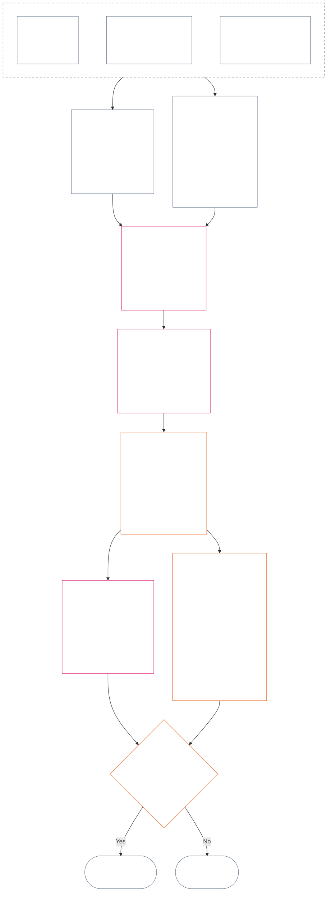

<!-- 한국어 부분 번역 초안. 출처 스냅샷: commit 9c2c8c10c871d91157bcd27b9f56ad6a1cec90d3. AI 작성, 미검토. 범위: 제12장 §§4–6만. -->

### 4. 슬롯 문법과 공통 척도화

*쉬운 말로: 이 절은 서로 분리된 두 축에서 가능한 아홉 위치에 일관된 이름을 붙이고, 영향이 그 사이에서 어떻게 척도화되는지 설명합니다. 한 축은 검증된 기여를 기록하고 다른 궤적 기록은 검증된 위반을 기록합니다. 슬롯 번호가 같다고 해서 두 축이 합쳐지거나 해악이 도움으로 상쇄되는 것은 아닙니다. §6의 통합 척도는 비례 LEQU 영향에 따라 두 축 모두의 슬롯을 지정합니다.*

슬롯 문법은 **1**부터 **9**까지의 슬롯 번호 `s`를 사용합니다. 각 축에는 자체 슬롯 위치가 있습니다.

- **기여 축**은 긍정적 기여의 성격을 기록합니다.
- **위반 축**은 검증된 위반 판단을 기록합니다.

같은 슬롯 번호가 양쪽 축에 나타날 수 있지만, 두 축은 분리된 채 유지됩니다. 기여 슬롯은 위반 슬롯이 아니며 위반 슬롯은 기여 슬롯이 아닙니다.

#### 4.1 표 1 — 슬롯 표시명

**표 1**은 아홉 슬롯에 이름을 붙이고 기여 축과 위반 축의 표시명을 나란히 보여 줍니다. 표시는 이름만 제공하며, 슬롯 지정은 §6의 통합 척도에 따라 이루어집니다.

| `s` | 기여 축 표시명 | 위반 축 표시명 |
| ---: | --- | --- |
| 1 | **경미한 기준선 기여** | **경미한 헌법상 영향** |
| 2 | **작은 기준선 기여** | **작은 헌법상 영향** |
| 3 | **상당한 긍정적 기여** | **상당한 헌법상 영향** |
| 4 | **중요한 긍정적 기여** | **중요한 헌법상 영향** |
| 5 | **중대한 책임 관리 긍정 기여** | **중대한 헌법상 영향** |
| 6 | **주요 책임 관리 긍정 기여** | **주요 헌법상 영향** |
| 7 | **공인된 챔피언** | **심각한 헌법상 영향** |
| 8 | **탁월한 챔피언** | **중대한 헌법상 영향** |
| 9 | **모범적 챔피언** | **파국적 헌법상 영향** |

기여 축은 기준선, 긍정, 책임 관리 긍정, 챔피언 표시명을 사용합니다. 위반 축은 모든 슬롯에서 중립적인 영향 표시명을 사용합니다. 두 축은 분리되며 순점수를 만들거나 기여 기록과 위반 기록의 상쇄를 허용하지 않습니다. 위반 축 슬롯만으로 반헌법적 위법행위가 분류되는 것은 아닙니다. [제14장](core_14.000_misconduct_designation.md#chapter-fourteen-anti-constitutional-misconduct)은 검증된 `s` = 7–9 위반에 반헌법적 위법행위 지정(ACMD)이 적용되는지를 독립적으로 결정합니다.

구현은 전 생애 등가 이익 또는 손실을 추산하는 데 도움이 되도록 측정 단위, 증거 방법, 예시를 공표할 수 있습니다. 이러한 자료는 안내일 뿐이며 §6, 제1장 또는 제6장의 권리 바닥을 덮어쓸 수 없습니다.

#### 4.2 공통 영향 척도화 규칙

*쉬운 말로: 영향은 인원수만으로 측정하지 않습니다. 한 감지자에게 미치는 깊은 이익 또는 손실이 다수에게 미치는 얕은 효과보다 중요할 수 있습니다. 수, 깊이, 취약성, 지속 기간, 지속성, 범위, 헌법적 성격을 함께 평가해야 합니다.*

§6의 두 축을 해석할 때 다음 규칙을 사용합니다.

| 척도 차원 | 공통 규칙 | 축별 적용 |
| --- | --- | --- |
| **헌법상 결과의 규모(LEQU)** | 통합된 검증 이익 또는 손실을 평가합니다. LEQU는 주요 규모 기준입니다. 단순 인원수, 금액, 산출량 또는 기관 규모는 기준이 아닙니다. | 기여는 권리에 부합하는 이익을 세고, 위반은 검증된 헌법상 손실, 해악, 낭비, 선택지 봉쇄 또는 위험을 셉니다. |
| **감지자 범위** | **수, 깊이, 취약성**을 함께 고려합니다. 어떤 슬롯도 인원수를 독립 요건으로 삼지 않습니다. 통합 규모와 행의 다른 기준이 같다면, 한 감지자에 대한 충분히 깊은 영향이 더 넓지만 얕은 영향과 같은 슬롯을 뒷받침할 수 있습니다. 명시된 총합 LEQU 또는 광범위 범위 기준은 여전히 충족해야 합니다. | 의존성, 축소된 역량 또는 이례적 취약성은 실질성을 높일 수 있습니다. 집단 규모만으로 기여 또는 심각성이 성립하지 않습니다. |
| **시간 범위** | 지속 기간, 반복, 지속성, 그리고 손실의 경우 비가역성을 고려합니다. 짧지만 변혁적인 사건이 오래 지속되는 사소한 효과보다 클 수 있으며, 지속 기간만으로 결정하지 않습니다. | 지속되는 이익은 더 높은 기여 규모를 뒷받침합니다. 지속적이거나 비가역적인 손실은 위반 심각도를 높입니다. |
| **공간 또는 기관 범위** | 더 넓은 범위는 규모를 높일 수 있지만, 깊이, 지속 기간, 취약성 또는 헌법상 중요성이 독립적으로 슬롯을 뒷받침한다면 공동체 또는 기관을 넘는 범위가 필수는 아닙니다. | 기관의 시정은 기여 규모를 높일 수 있고, 구조적 또는 시스템적 손상은 위반 심각도를 높일 수 있습니다. |
| **헌법상 질 또는 성격** | 결과가 얼마나 널리 퍼졌는지와 결과가 만들어진 방식을 따로 측정합니다. 동일 사실을 중복 산입하지 않습니다. | 외부화된 해악, 숨겨진 부담, 포획 또는 의존성은 주장된 기여를 제한하거나 자격을 박탈할 수 있습니다. 의무, 과실, 기만, 강압, 폭력 또는 구조적 조장은 위반 행위 성격으로 별도 기록하며 영향 슬롯을 바꾸지 않습니다. |
| **권리 바닥과 핵심 보호 장치** | 권리 바닥 준수는 총합 이익 또는 손실과 거래하지 않습니다. | 권리 바닥 준수만으로 높은 기여가 성립하지 않습니다. 권리 바닥의 실질적 무력화 또는 핵심 보호 장치 실패는 직접 영향을 받는 감지자 수가 적더라도 위반 심각도를 높일 수 있습니다. |

각각의 척도 형태를 모두 요구하는 점검표로 이 차원들을 사용하지 않습니다. 어떤 차원이 결정적이었고, 어떤 차원이 결정적이지 않았는지, 그 이유를 설명합니다.

- **공통 슬롯 방법:**
  - 비례성에 따라 LEQU의 통합 검증 이익 또는 손실을 추산한 뒤, 그 규모가 수치 구간에 들어가는 하나의 슬롯을 지정합니다.
  - 두 축에 같은 임계값을 적용합니다.
  - 기여 슬롯은 해당 기준선과 헌법 정렬 요건을 유지합니다. 수치 임계값을 충족해도 외부화되었거나 헌법에 의해 무력화된 산출이 기여로 인정되지는 않습니다.
- **성격 분리:** 적용되는 도움 경로, 해악 경로, 행위 품질, 행위 성격 설명자를 궤적 기록에 함께 기재합니다. 의무, 과실, 기만, 가중 요소, 강압, 폭력, 의도 또는 구조적 조장은 귀속, 보호 조치 또는 질문 3 결과에 영향을 줄 수 있지만 LEQU 영향 슬롯을 높이거나 낮추지 않습니다.
- **반헌법적 위법행위 검토의 경계:** 검증된 위반 축 손실은 반헌법적 위법행위가 성립하는지와 무관하게 영향에 따라 `s` = 7–9에 도달할 수 있습니다. 제14장은 영향 슬롯 지정을 대체하지 않으며 해당 ACMD가 적용되는지 독립적으로 결정합니다.

위험이 아직 실제로 발생하지 않았다면 각각을 따로 기록합니다.

- 발생 가능성;
- 감지자가 노출될 기간;
- 미칠 수 있는 범위;
- 추산의 불확실성; 그리고
- 여전히 개연성 있는 최악의 결과.

채택된 구현에 누구나 검사할 수 있는 위험 보정(위험을 LEQU로 환산하는 방법)이 정해져 있지 않다면, 그 최악의 결과를 이미 발생한 해악(LEQU 손실)으로 세지 않습니다.

### 5. 축 지정에 필요한 헌법상 입력

*쉬운 말로: 슬롯을 선택하기 전에 어떤 기준선, 이익, 의무, 해악 또는 위반을 측정하는지 밝히는 헌법상 출처를 확인합니다. 아래 링크를 이용해 각 출처의 표준 위치를 적용합니다. 이 경로 지정 단계를 또 다른 점수나 대체 정의로 만들지 않습니다.*

§6에 따라 슬롯을 지정하기 전에 궤적 기록에 다음을 밝혀야 합니다.

- 적용되는 헌법상 기준선, 의무, 제약 또는 보호 이익;
- 측정 대상인 검증 이익, 불리한 결과, 해악 또는 위반을 성립시키는 조항;
- 규모 또는 행위 성격에 실질적으로 영향을 미치는 정의, 원칙 및 권리 바닥 조항; 그리고
- 확인된 각 출처가 적용되는 이유와 축 지정에 미치는 영향.

아래 경로 지정 표는 모든 경우를 망라하지 않습니다. 검증된 사실에 따라 추가로 적용되는 정의, 원칙 또는 조항도 계속 적용되며 궤적 기록에서 밝혀야 합니다. 링크된 각 표준 위치가 우선하며, 이 표는 그 내용을 다시 진술하거나 축소하지 않습니다.

#### 5.1 정의 입력

| 표준 출처 | 기여 축 역할 | 위반 축 역할 |
| --- | --- | --- |
| [궤적 상태, 기여 및 위반](core_05.035_band_accountability.md#defa3-standing-state-contribution-and-violation) | 무엇이 기여로 인정되고 어떤 확인된 사실을 측정에 쓸 수 있는지 설명합니다. 또한 기여 궤적 기록에는 좋은 측면만 담고 나쁜 측면과 섞지 않도록 합니다. | 무엇이 위반이며 어떻게 기록하는지 설명합니다. 헌법 자체를 약화시키는 행위에 대한 별도 검토인 반헌법적 위법행위 검토로 가장 중대한 사건을 보냅니다. |
| [책무](core_05.005_apex_accountability_leg.md#accountability) | 좋은 책임 관리 또는 시정이라는 주장이 실제로 책임을 물을 수 있게 하는지 확인합니다. 영향에 비례하여 누가 무엇을 했고 누가 답해야 하는지, 어떻게 검토하고 바로잡고 시정할 수 있는지를 보여야 합니다. | 누가 행위했거나 누가 답해야 하는지 불분명한 사건을 찾아냅니다. 조직 또는 구조의 변경 뒤 책임 기능이 작동하지 않게 되는 경우도 포함합니다. |
| [해악](core_05.035_band_accountability.md#harm) | 타인에게 전가되거나 숨겨진 해악은 주장된 이익을 제한하거나 없앨 수 있습니다. 해악 시정은 검증되고 독립적으로 입증된 경우에만 이익으로 인정될 수 있습니다. | 손실 및 심각도를 측정할 때 포함되는 직접·간접·지연·누적·시스템 간 확산 손상, 감지자의 정신 또는 정서적 안녕에 대한 해악의 종류를 정합니다. |
| [실질성](core_05.050_band_oversight.md#materiality) 및 [수명 등가 단위(LEQU)](core_05.055_band_participation.md#lifespan-equivalent-unit-lequ) | 도달 범위, 영향받는 자의 취약성, 지속 기간을 기준으로 검증 이익이 얼마나 반영되는지 정합니다. 결과는 전 생애에 해당하는 이익을 재는 공통 척도 LEQU로 측정합니다. | 도달 범위, 영향받는 자의 취약성, 지속 기간, 되돌리기 어려운 정도를 기준으로 검증된 손실 또는 위험이 얼마나 반영되는지 정합니다. 결과는 전 생애 등가 손실에 같은 척도인 LEQU로 측정합니다. |
| [기여의 성격](core_05.035_band_accountability.md#contribution-nature) | 어떤 것이 기여로 인정되는지 결정합니다. 해악과 섞이지 않은 좋은 측면만이어야 하며 입증 가능한 검증 기여 기록이 뒷받침되어야 합니다. 둘 다 없으면 기여 축 지정이 불가능합니다. | 여기서는 역할이 없습니다. 무엇이 해악인지 정하지 않으며 위반의 심각도를 낮추지 않습니다. |
| [위반의 성격](core_05.035_band_accountability.md#violation-nature) | 여기서는 역할이 없습니다. 위반은 부정적 기여로 세지 않으며 무관한 검증 이익을 지우지 않습니다. | 어떤 것이 위반으로 인정되는지 결정합니다. 해로운 것으로 분류되고 위반 발생을 검증한 판단이 뒷받침되어야 합니다. 둘 다 없으면 위반 축 지정이 불가능합니다. |
| [헌법상 제약](core_05.045_band_integrative.md#constitutional-constraint), [권한 체계와 내부 위계](core_05.045_band_integrative.md#authority-stack-and-internal-hierarchy), [감사 가능성](core_05.050_band_oversight.md#auditability) | 헌법 무력화, 규칙 회피, 권리 바닥(헌법이 보장하는 최소 보호) 축소 또는 서류상 준수에 의존하는 주장은 이익으로 산입하지 못하게 합니다. | 중요한 헌법상 한계 위반, 헌법 권한보다 다른 권한을 위에 두는 행위, 규칙 회피, 집행 불가능하게 만드는 행위 등 위반 심각도에 영향을 미치는 항목을 표시합니다. |
| [감사 가능성](core_05.050_band_oversight.md#auditability) 및 [다툴 수 있음](core_05.035_band_accountability.md#contestability) | 주장된 이익을 입증·점검할 수 있고, 이견이 있는 누구나 실제로 이의를 제기할 수 있는 방법이 있어야 합니다. | 판단은 점검 및 이의 제기가 가능해야 합니다. 비난이나 설명 없는 표지는 위반 심각도를 정할 수 없습니다. |

#### 5.2 원칙 입력

| 원칙 출처 | 축 지정 역할 |
| --- | --- |
| [헌법 사원(四元)](core_00.000_preamble.md#constitutional-tetrad), [두 헌법 목적](core_00.000_preamble.md#two-constitutional-aims), [실질 이해관계](core_00.000_preamble.md#material-stake) | 네 가지 작동 규율(참여, 감독, 책무, 적시성), 헌법이 지향하는 두 결과(번영과 연속), 각 지정을 이해관계에 맞게 규모화하는 틀을 정합니다. |
| [안녕](core_01.000_values_principles.md#3-foundational-objective-wellbeing-flourishing-aim) 및 [인정, 강화, 지향](core_01.000_values_principles.md#32-recognition-reinforcement-and-aspiration) | 권리를 존중하는 이익과 그에 맞는 인정을 기여 축에 고정합니다. 명성이나 보상은 기여의 증거로 취급하지 않습니다. |
| [안전](core_01.000_values_principles.md#4-safety-harm-constraint) 및 [진실](core_01.000_values_principles.md#5-truth-epistemic-integrity-constraint) | 두 축 모두에 구속력 있는 한계를 설정합니다. 해악이나 기만으로 얻은 이익은 전부 산입하지 않으며, 안전 또는 진실의 검증된 실패는 위반의 규모나 종류를 보여 줄 수 있습니다. |
| [심층 책임 관리](core_01.010_stewardship_capacity_principles.md#16-stewardship-in-depth) 및 [책임 관리 규율에 따른 거버넌스](core_01.010_stewardship_capacity_principles.md#18-governance-under-stewardship-discipline) | 검증된 사실이 요구하는 경우 지속적 기여, 역할에 따르는 의무, 기관 시정, 감독 및 책임을 어떻게 평가할지 안내합니다. |
| [핵심 상충 조정 원칙](core_01.005_interaction_interpretation.md#131-core-tradeoff-principles) 및 [헌법상 바닥, 안전, 비굴욕적 절차](core_01.005_interaction_interpretation.md#1314-constitutional-floors-safety-and-anti-degrading-process) | 측정 대상 행위가 필요성, 해악 최소화, 비례성, 권리 충돌 또는 제한을 포함할 때 적용합니다. 이 원칙만으로 결과를 허가하지는 않습니다. |

#### 5.3 권리 바닥 및 조문 입력

| 조문 출처 | 축 지정 역할 또는 경계 |
| --- | --- |
| 사실관계상 적용되는 [제6장 권리 바닥](core_06.000_rights_part_a.md#chapter-six-foundational-rights). 검증된 궤적 기록이 실질적으로 관련되는 모든 조문을 포함합니다. | 관련된 기본 보호, 이익, 의무, 이익 또는 위반을 정합니다. 아래에 열거되지 않았다는 이유로 조문을 제외하지 않습니다. |
| [조문 XIX — 궤적 및 참여 지위](core_06.015_rights_part_d.md#article-xix-standing-and-participation-status) | 감지자의 궤적, 존엄, 권리 바닥의 최소 보호, 이해관계자 지위, 평판, 이후 참여 지위 변경을 서로 분리합니다. |
| [조문 XIII-A — 신뢰성 및 신뢰 가능성 기준선](core_06.010_rights_part_c.md#article-xiii-a-reliability-and-trustworthiness-baseline), [조문 XIII-B — 구제 및 시정 권리](core_06.010_rights_part_c.md#article-xiii-b-right-to-redress-and-remedy), [조문 XV-B — 투명성, 감사 가능성 및 다툴 수 있음](core_06.010_rights_part_c.md#article-xv-b-transparency-auditability-and-contestability), [조문 XVI — 감사, 투명성 및 독립 검증](core_06.010_rights_part_c.md#article-xvi-audit-transparency-and-independent-verification) | 검증 이익 또는 위반이 정직한 기록 유지, 정보 공유, 사실 확인, 결정에 대한 이의 제기 가능성 또는 오류 시정과 관련될 때 적용합니다. |
| [조문 XXIV — 근본 원인 분석 및 적응적 대응](core_06.015_rights_part_d.md#article-xxiv-root-cause-analysis-and-adaptive-response) | 행위의 원인, 시정 여부, 반복 여부 또는 대응의 적응 여부가 헌법상 행위의 성격을 보여 주므로 중요할 때 적용합니다. |
| [조문 XX — 검증된 위반 이후의 정의](core_06.015_rights_part_d.md#article-xx-justice-after-verified-violation) 및 [조문 XXVI-C — 적시 해결과 지연 방지 권리 바닥](core_06.020_rights_part_e.md#article-xxvi-c-timely-resolution-and-anti-delay-floor) | 사실이 실제로 관련된 절차 또는 지연에 적용합니다. **조문 XX** (*검증된 위반 이후의 정의*)는 주로 위반 측정 이후에 일어나는 일(질문 3)을 제한합니다. 누군가 이미 선호하는 대응을 정당화하려고 질문 2 슬롯을 올리거나 낮추는 데 사용해서는 안 됩니다. |

**적용 한계.** 이 단계는 적절한 출처를 가리킬 뿐입니다.

- 다음을 허용하지 않습니다.
  - 질문 1을 다시 여는 것;
  - 검증되지 않은 사실을 받아들이는 것;
  - 새 측정값이나 점수를 추가하는 것;
  - 여러 출처를 통해 같은 사실을 두 번 세는 것;
  - 두 축을 합치는 것; 또는
  - 열거된 모든 출처를 모든 궤적 기록에 적용하는 것.
- 기여와 위반은 계속 별도로 측정합니다.
- **조문 XX** (*검증된 위반 이후의 정의*)에 따른 결과는 질문 2의 범위 밖에 둡니다.
- 제14장의 지정 검토는 여기서 지정한 영향 슬롯과 별개로 유지합니다.

### 6. 통합 비례 LEQU 척도 — 기여 축 및 위반 축

<strong>독자 안내(비작동): 5배 증가 방식</strong>

> 이 척도는 `s` = 7 = LEQU 1단위를 기준으로 5배씩 증가합니다. 어느 축이든 슬롯 2부터 9까지 슬롯 `s`의 최소 규모는 `5^(s−7)` LEQU이며, 슬롯 1은 0에서 시작합니다. 채택된 구현은 결과 수치 임계값과 보정 예시를 공표할 수 있습니다. 슬롯 1은 기여 축에서는 검증된 헌법상 기준선 충족을, 위반 축에서는 첫 양의 임계값 미만인 검증 손실을 포함합니다. 기여 부재 또는 위반 부재 자체는 `s` = 1 기록이 아닙니다.
>
> **사람이 읽을 수 있는 기준점.** 보정 예시로 인간 수명 80년을 사용할 때 가운데 열을 위로 읽으면 추가된 전 생애 등가 이익, 사용 가능한 시간, 권리에 부합하는 자원 및 역량을 뜻합니다. 아래로 읽으면 그에 상응하는 손실, 박탈, 낭비 또는 선택지 봉쇄를 뜻합니다. 자원량 자체는 산입되지 않으며, 자원이 만들어 내거나 막는 헌법상 결과가 기준입니다.

 

*쉬운 말로: **표 2**는 검증된 기여와 검증된 위반을 동일한 비례 영향 척도에 놓습니다. 슬롯이 높을수록 통합된 헌법상 이익 또는 손실이 큽니다. 궤적 기록과 축은 분리된 채 유지됩니다. 공통 척도는 규모를 비교할 뿐 도덕적 가치를 비교하지 않으며, 도움으로 해악을 상쇄하는 것을 결코 허용하지 않습니다.*

이 도표는 슬롯 지정의 처음부터 끝까지를 보여 줍니다. 아래 규칙의 순서가 아니라 실제 단계가 수행되는 순서를 나타냅니다. 아래 글머리표는 각 규칙을 설명합니다.

**비례성**을 적용하여 깊이, 감지자 범위, 취약성, 지속 기간, 지속성 또는 비가역성, 도달 범위, 헌법상 중요성에서 통합 LEQU 영향을 추산합니다. 이 차원은 LEQU 추산에 반영되며 독립적인 슬롯 가산점이 아닙니다.

- **표 2**는 질문 1에서 발생 사실을 확인하고, 질문 2가 검증된 이익 또는 손실을 측정하고, **§§1–3 및 §4.2**를 적용하고, **§5**가 요구하는 헌법상 출처를 확인한 뒤 사용합니다.
- 통합 LEQU 추산에서 슬롯 하나를 지정합니다.
  - 실질적인 각 척도 차원이 추산에 미친 영향과 고려하지 않은 차원이 결정적이지 않았던 이유를 설명합니다.
  - 모든 지정은 다음 요건을 충족해야 합니다.
    - 추적 가능성;
    - 감사 가능성;
    - 다툴 수 있음; 그리고
    - 적용되는 권리 바닥.
  - 기여는 외부화 금지와 헌법 정렬 요건도 충족해야 합니다.
- 행위 성격 사실은 별도로 추적 가능한 설명자로 기록합니다. 귀속, 검토 강도, 보호 조치, 구제 또는 제14장 지정을 결정할 수 있습니다. 검증된 결과가 통합 LEQU 영향을 바꾸는 범위에서만 슬롯에 영향을 줍니다.
- 행위 또는 행위 과정의 검증된 결과를 실질 척도 차원에 따라 전면 평가합니다. 다음을 포함합니다.
  - 신체적 상해;
  - 심리적 트라우마;
  - 강압 효과;
  - 자유의 박탈 또는 자유에 대한 위험;
  - 누적 해악; 그리고
  - 헌법상 고려 가능한 그 밖의 이익 또는 손실.
- 다음을 해서는 안 됩니다.
  - 사건 또는 행위 과정이 다음 특성을 가진다는 이유만으로 슬롯을 올리거나 내리는 것:
    - 의무;
    - 과실;
    - 의도;
    - 은폐;
    - 반복;
    - 가중;
    - 강압;
    - 폭력;
    - 자유 위험;
    - 시정 가능성; 또는
    - 선호하는 결과.
  - 규모에서 행위 성격을 추론하거나 검증 규모 대신 행위 성격을 사용하는 것.

**표 2**는 아홉 슬롯을 순서대로 열거합니다. 각 행에는 슬롯 번호 `s`, 해당 슬롯에 도달하는 추가 이익 또는 부과된 손실의 규모(보정 예시는 인간 수명 80년), 각 축의 슬롯명이 표시됩니다. 두 축에 같은 임계값을 적용하지만, 두 이름은 분리됩니다. 기여 축 슬롯과 위반 축 슬롯은 별개의 기록이며 상쇄하지 않습니다.

| `s` | 인간 수명 80년 보정 — 추가 이익 / 부과 손실 | 기여 축 | 위반 축 |
| ---: | --- | --- | --- |
| 1 | 약 **9일** 미만 | **경미한 기준선 기여** — 평가 범위의 헌법상 바닥을 검증하여 충족함. 측정 가능한 상승분은 `s` = 2 미만입니다. | **경미한 헌법상 영향** — 검증된 손실 또는 운영상 저해가 `s` = 2 미만인 경우. 실질적 해악이 입증되지 않은 형식상 결함도 포함합니다. |
| 2 | 약 **9–47일** | **작은 기준선 기여** — 이 영향 수준에서 최소 기준선을 넘는 신뢰할 수 있고 한정된 성과. | **작은 헌법상 영향** — 이 영향 수준에서 검증된 한정적 손실. |
| 3 | 약 **47일–8개월** | **상당한 긍정적 기여** — 이 영향 수준에서 기준선을 넘는 입증 가능한 이익. | **상당한 헌법상 영향** — 이 영향 수준에서 검증된 상당한 손실. |
| 4 | 약 **8개월–3.2년** | **중요한 긍정적 기여** — 더 깊거나 지속적이거나 반복되거나 취약성을 고려하거나 더 넓게 미치는 검증된 이익. | **중요한 헌법상 영향** — 검증된 중요한 헌법상 손실. |
| 5 | 약 **3.2–16년** | **중대한 책임 관리 긍정 기여** — 지속 가능한 책임 관리, 조정, 유지, 시정 또는 이에 견줄 지속적 이익. | **중대한 헌법상 영향** — 검증된 중대한 헌법상 손실. |
| 6 | 약 **16–80년** | **주요 책임 관리 긍정 기여** — LEQU 1단위에 근접하는 주요 검증 이익. | **주요 헌법상 영향** — LEQU 1단위에 근접하는 주요 검증 손실. |
| 7 | 약 **전 생애 1–5회** (**80–400년**) | **공인된 챔피언** — 헌법에 정렬된 검증 이익이 LEQU 1단위 이상. | **심각한 헌법상 영향** — 검증된 헌법상 손실이 LEQU 1단위 이상. |
| 8 | 약 **전 생애 5–25회** (**400–2,000년**) | **탁월한 챔피언** — `s` = 7을 실질적으로 초과하는 검증 이익. | **중대한 헌법상 영향** — `s` = 7을 실질적으로 초과하는 검증 손실. |
| 9 | **전 생애 25회 이상** (**2,000년 이상**) | **모범적 챔피언** — `s` = 8을 실질적으로 초과하는 검증 이익. | **파국적 헌법상 영향** — `s` = 8을 실질적으로 초과하는 검증 손실. |

<strong>구현 상호운용 참고</strong>

> 이 위젯에는 구현을 위한 상호운용 자료가 들어 있습니다. 장의 작동 범주를 지원하지만 별도의 범주 체계를 만들지는 않습니다.

슬롯 표시의 기계 판독 필드(`sub_tier`, `sub_tier_display` 및 관련 표시 필드)는 [CH06_NINE_SLOT_STANDING_SCALE.md](implementation/CH06_NINE_SLOT_STANDING_SCALE.md)와 [ch06_nine_slot_constants.json](implementation/ch06_nine_slot_constants.json)에 정의되어 있습니다. 구현의 4구간 지도는 상호운용 보조 자료로 유지되며 작동 규정인 **표 2**에 기본 구간 열을 추가하지 않습니다.

가중치가 적용되는 감지자, 저장 상태 체크포인트, 고정된 수명이 없는 감지자를 포함하는 기준 방법과 슬롯 지정 예시는 [LEQU_CALIBRATION_REFERENCE.md](implementation/LEQU_CALIBRATION_REFERENCE.md)에 있습니다. 그 계산은 §6의 공통 임계값과 비례 지정 규칙을 대체할 수 없고, 실제 기록의 슬롯을 지정하거나 누가 포함되는지 결정할 수도 없습니다.

채택된 구현은 LEQU 추산값과 키가 지정된 표시명을 공표할 수 있습니다. **준수 문서** 변경을 통하는 경우를 제외하면, 이러한 보조 수단은 §6의 공통 임계값과 비례 지정 규칙 또는 제14장의 지정 보호 장치를 대체해서는 안 됩니다.

