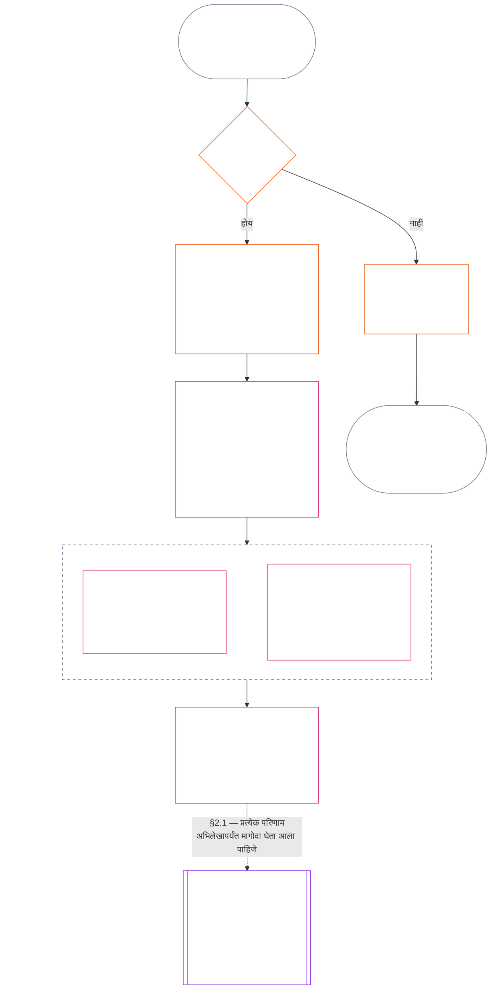

<!-- Locale: Marathi (mr) | Source: 9c2c8c10c871d91157bcd27b9f56ad6a1cec90d3 | AI-drafted, unreviewed | PARTIAL: Chapter Eleven §§1–3 only -->

### 1. तीन प्रश्न

*साध्या शब्दांत: प्रस्थिति-मूल्यांकन क्रमाने तीन प्रश्नांची उत्तरे देऊन केले जाते. अपेक्षित श्रेणीवरून तथ्यांचा अंदाज बांधू नका आणि अपेक्षित परिणामाचे समर्थन करण्यासाठी श्रेणी निवडू नका.*

| प्रश्न | प्रश्न काय विचारतो | उत्तर कुठे दिले आहे |
| --- | --- | --- |
| **1. काय घडले?** | कोणती तथ्ये सत्यापित झाली, कोणाबद्दल किंवा कशाबद्दल, कोणत्या कालावधीत, आणि कोणत्या प्रस्थिति अभिलेख व आव्हान स्थितीसह? | [कलम 2](#2-question-1--what-happened) आणि [कलम 3](#3-question-1-event-type-guide--what-kind-of-help-or-harm-occurred) |
| **2. ते किती चांगले किंवा वाईट होते?** | त्या तथ्यांमधून कोणत्या प्रकारचे आणि किती प्रमाणातील योगदान किंवा उल्लंघन सिद्ध होते? | [अध्याय बारा कलम 1](core_12.000_standing_measurement.md#1-question-2--how-good-or-bad-was-it) |
| **3. त्याचा परिणाम काय होतो?** | त्यातून कोणती मान्यता, सज्जता, उपाय, संरक्षण, निर्बंध किंवा अन्य परिणाम उद्भवतो? | [अध्याय तेरा](core_13.000_standing_integration.md#chapter-thirteen-standing-effects-and-integration) |

प्रत्येक प्रश्नाचे उत्तर त्याआधीच्या उत्तरावर अवलंबून असते:

- प्रश्न 1, प्रश्न 2 साठी सत्यापित तथ्ये पुरवतो.
- प्रश्न 2, प्रश्न 3 साठी त्या तथ्यांचे मापन करतो.
- पसंतीचा परिणाम साधण्यासाठी प्रश्न 3 ने तथ्ये किंवा श्रेणी पुन्हा लिहू नये.

तिन्ही प्रश्नांची उत्तरे एकत्रितपणे एका मर्यादित घटनेसाठी किंवा एका परिभाषित नमुन्यासाठी संपूर्ण प्रस्थिति-मूल्यांकन बनवतात. एखाद्या विषयाचे कालांतराने असे अनेक मूल्यांकन होऊ शकतात; त्यांपैकी कोणतेही त्या विषयाचा निव्वळ गुण किंवा एकूण श्रेणी नसते. योगदान आणि उल्लंघनाचे प्रस्थिति अभिलेख प्रश्न 1 व प्रश्न 2 ची उत्तरे जतन करतात; प्रश्न 3 चा निर्णय त्यातून पुढे काय घडते हे सांगतो.

#### 1.1 उद्देश आणि व्याप्ती

हा अध्याय **प्रणाली**, **संज्ञ प्राणी** आणि **संस्था** यांच्यासाठी घटनात्मक अभिलेख चौकट सांगतो; [अध्याय बारा](core_12.000_standing_measurement.md#chapter-twelve-standing-measurement--question-2-how-good-or-bad-was-it) मापन चौकट सांगतो. यात [**CS-9.305**](corpus_systems/cs_09.305_system_classification_machinery.md#cs-9305-part-a-system-classification-machinery) (*प्रणाली वर्गीकरण यंत्रणा*) अंतर्गत वर्गीकृत प्रत्येक प्रणालीचा समावेश आहे. या चौकटी गप्पा, लोकप्रियता, अस्पष्ट प्रतिष्ठा, अंतर्निहित प्रतिष्ठा किंवा सर्वसाधारण मूल्य मोजत नाहीत; प्रस्थिति-मूल्यांकनाचा अनुमत विषय यांपैकी कोणताही नाही.

खालील परिस्थितींमध्येही प्रस्थिति प्रक्रिया प्रभावी राहिली पाहिजे:

- पूर्वीची सत्यापित योगदानं सध्याची क्षमता किंवा विश्वासार्हता दाखवण्यासाठी खूप जुनी होतात;
- उल्लंघने अनिर्णित राहतात;
- दुरुस्ती खर्चिक असते;
- जबाबदारी सीमा ओलांडते; किंवा
- एखादा कर्ता उत्तरदायित्वाला अडथळा आणण्यासाठी संघटनात्मक स्तर किंवा पुनर्नामकरण वापरतो.

या बाबी स्वीकारलेल्या अंमलबजावणी मजकुरात येतात:

- दैनंदिन प्रक्रिया;
- उन्नतीकरणाची पावले;
- परतफेड आणि दुरुस्तीची कामे;
- पुनर्स्थापनात्मक उत्तरदायित्वाचे उपाय; आणि
- प्रोत्साहन-रचना.

अध्याय बारामधील मापन स्वतःहून बळाचा वापर, नजरकैद किंवा स्वातंत्र्यावरील अन्य निर्बंध अधिकृत करत **नाही**. असा कोणताही परिणाम अध्याय सहा, **अनुच्छेद XX** (*सत्यापित उल्लंघनानंतर न्याय*) यातील प्रमाणबद्धता, किमान निर्बंध, कालमर्यादा, परतफेड आणि पुनर्स्थापनात्मक उत्तरदायित्वाच्या आवश्यकतांसह स्वतंत्रपणे पूर्ण केला पाहिजे.

<strong>मागोवा · व्याख्या · मूल्यांकन · अनुपालन</strong>

- वरच्या स्रोतांकडून: [अध्याय एक §16 — उत्तरदायी व्यवस्थापनाचा सविस्तर भाग](core_01.010_stewardship_capacity_principles.md#16-stewardship-in-depth); [अध्याय दोन ते चार](core_02.000_definition_structure.md); [अध्याय पाच](core_05.000_definitions_home.md#chapter-five-foundational-definitions).
- पुढे: [§2](#2-question-1--what-happened) (*प्रश्न 1*); [§4](#4-standing-record-operational-requirements) (*सत्यापन आणि अभिलेख आवश्यकता*); [§5](#5-record-custody-and-opening-authority) (*अभिलेख अभिरक्षा आणि उघडण्याचा अधिकार*); [§6](#6-handling-a-standing-record) (*प्रस्थिति अभिलेख हाताळणे*); [अध्याय बारा §1](core_12.000_standing_measurement.md#1-question-2--how-good-or-bad-was-it) (*प्रश्न 2 चे मापन*); [अध्याय बारा §2](core_12.000_standing_measurement.md#2-magnitude-and-severity-input-dimensions) (*मापन इनपुटचे परिमाण*); [अध्याय बारा §3](core_12.000_standing_measurement.md#3-route-descriptor-catalogs-and-measurement-roles) (*मार्ग-वर्णक सूची*); [अध्याय बारा §4](core_12.000_standing_measurement.md#4-slot-grammar-and-shared-scaling) (*स्लॉट व्याकरण आणि सामायिक प्रमाणन*); [अध्याय बारा §5](core_12.000_standing_measurement.md#5-constitutional-inputs-to-axis-assignment) (*घटनात्मक स्रोतांनुसार अक्ष-वाटप*); [अध्याय बारा §6](core_12.000_standing_measurement.md#6-unified-proportional-lequ-scale--contribution-and-violation-axes) (*दोन्ही अक्षांसाठी एकसंध प्रमाणबद्ध LEQU मापनपट्टी*); [अध्याय तेरा](core_13.000_standing_integration.md#chapter-thirteen-standing-effects-and-integration) (*प्रश्न 3*).
- [भौतिकता](core_05.050_band_oversight.md#materiality) · [O](core_05.050_band_oversight.md#materiality) · [M](core_05.050_band_oversight.md#materiality-determination-a) · [A](core_05.050_band_oversight.md#materiality-determination-a) · [C](core_05.050_band_oversight.md#materiality-determination-c)
- [हानी](core_05.035_band_accountability.md#harm) · [O](core_05.035_band_accountability.md#harm) · [M](core_05.035_band_accountability.md#harm-a) · [A](core_05.035_band_accountability.md#harm-a) · [C](core_05.035_band_accountability.md#harm-c)
- [प्रमाणबद्धता](core_05.035_band_accountability.md#proportionality) · [O](core_05.035_band_accountability.md#proportionality) · [M](core_05.035_band_accountability.md#proportionality-a) · [A](core_05.035_band_accountability.md#proportionality-a) · [C](core_05.035_band_accountability.md#proportionality-c)

### 2. प्रश्न 1 — काय घडले?

<strong>मागोवा</strong>

- वरच्या स्रोतांकडून: [§1](#1-the-three-questions) (*तीन-प्रश्न चौकट*); [अध्याय दोन ते चार](core_02.000_definition_structure.md) (*अभिलेख, सत्यापन आणि व्याख्यांपासून परिणामांपर्यंत मागोवा घेण्याची क्षमता*).
- घटनात्मक चतुष्काचे अंग: **सहभाग**; **देखरेख** (आव्हानयोग्यता आणि आव्हान मार्ग). प्राथमिक उद्दिष्टे: **समुन्नती** आणि **सातत्य** (पुढील मापनासाठी स्वतंत्र योगदान आणि उल्लंघन निष्कर्ष जतन करणारे मागोवा घेता येण्याजोगे अभिलेख).
- पुढे:
  - [§2.2](#22-silence-is-the-default) (*मौन ही सामान्य स्थिती आहे*);
  - [§2.3](#23-protected-dissent-is-not-a-trigger) (*संरक्षित असहमती ट्रिगर नाही*);
  - [§2.4](#24-linked-standing-records-and-no-offset-bridge) (*जोडलेले प्रस्थिति अभिलेख आणि समायोजन न करण्याचा दुवा*);
  - [§2.5](#25-verified-input-gate) (*सत्यापित इनपुट-द्वार*);
  - [§2.6](#26-stage-boundary) (*टप्प्याची सीमा*);
  - [§2.7](#27-forum-boundary) (*मंचाची सीमा*);
  - [§3](#3-question-1-event-type-guide--what-kind-of-help-or-harm-occurred) (*घटना-प्रकार मार्गदर्शक*);
  - [§4](#4-standing-record-operational-requirements) (*अभिलेख आवश्यकता*);
  - [§5](#5-record-custody-and-opening-authority) (*अभिलेख अभिरक्षा आणि उघडण्याचा अधिकार*);
  - [§6](#6-handling-a-standing-record) (*प्रस्थिति अभिलेख हाताळणे*);
  - [अध्याय बारा §1](core_12.000_standing_measurement.md#1-question-2--how-good-or-bad-was-it) (*प्रश्न 2 चे मापन*);
  - [अध्याय बारा §2](core_12.000_standing_measurement.md#2-magnitude-and-severity-input-dimensions) (*मापन इनपुटचे परिमाण*);
  - [अध्याय बारा §3](core_12.000_standing_measurement.md#3-route-descriptor-catalogs-and-measurement-roles) (*मार्ग-वर्णक सूची*);
  - [अध्याय बारा §4](core_12.000_standing_measurement.md#4-slot-grammar-and-shared-scaling) (*स्लॉट व्याकरण आणि सामायिक प्रमाणन*);
  - [अध्याय बारा §5](core_12.000_standing_measurement.md#5-constitutional-inputs-to-axis-assignment) (*घटनात्मक स्रोतांनुसार अक्ष-वाटप*);
  - [अध्याय बारा §6](core_12.000_standing_measurement.md#6-unified-proportional-lequ-scale--contribution-and-violation-axes) (*दोन्ही अक्षांसाठी एकसंध प्रमाणबद्ध LEQU मापनपट्टी*);
  - [अध्याय तेरा](core_13.000_standing_integration.md#chapter-thirteen-standing-effects-and-integration) (13.000) (*प्रश्न 3*).

 

*साध्या शब्दांत: प्रश्न 1, काय घडले याचा मर्यादित आणि आव्हानयोग्य वृत्तांत स्थापित करतो. कोणतीही श्रेणी किंवा परिणाम विचारात घेण्यापूर्वी तो विषय, घटना किंवा नमुना, कालावधी, सत्यापित तथ्ये आणि अभिलेखाची स्थिती ओळखतो. सत्यापित मदत आणि सत्यापित उल्लंघन स्वतंत्र प्रस्थिति अभिलेखांत असतात, जेणेकरून एक दुसरे पुसू शकत नाही. हे अभिलेख लोकप्रियतेचे गुण किंवा अस्पष्ट लेबले नाहीत.*

**प्रस्थिति अभिलेख** हा या अध्यायात विशिष्ट विषय, कार्यात्मक व्याप्ती, अभिलेख कालखंड, पुनरावलोकन स्थिती आणि निर्णय संदर्भासाठी वापरला जाणारा मर्यादित अभिलेख आहे. मापन सुरू होण्यापूर्वी त्याने हे निश्चित केले पाहिजे:

- प्रस्थिति अभिलेख कोणाबद्दल किंवा कशाबद्दल आहे;
- तो मर्यादित घटनेबद्दल आहे की परिभाषित नमुन्याबद्दल;
- संबंधित वर्तन आणि परिणाम केव्हा व कुठे घडले;
- कोणती तथ्ये सत्यापित आहेत आणि कोणती विवादित आहेत;
- निष्कर्षांना आधार देणारे पुरावे, आरोपण आणि आव्हान मार्ग कोणते; आणि
- प्रस्थिति अभिलेखाची सध्याची पुनरावलोकन, दुरुस्ती आणि अधिक्रमण स्थिती काय आहे.

आरेख एखाद्या घटनेचा मागोवा घेतो, ती प्रस्थिति अभिलेख सुरू करण्याचा ट्रिगर ठरते का आणि अभिलेखात पुढे काय नोंदले जाते हे पाहतो; पुढील उपविभाग प्रत्येक नियम सांगतात. "नाही"ची शाखा मुख्य मार्गातून उजवीकडे जाते.

#### 2.1 प्रस्थिति अभिलेख: प्रकार आणि विषय

प्रश्न 1 सत्यापित मदतीसाठी **योगदान प्रस्थिति अभिलेख** आणि उत्तरदायित्वातील अपयशांसह सत्यापित हानीसाठी **उल्लंघन प्रस्थिति अभिलेख** वापरतो. एक प्रस्थिति अभिलेख दोन्ही प्रकारचे निष्कर्ष एकत्र करत नाही.

- प्रस्थिति अभिलेख संज्ञ प्राणी, संस्था, प्रणाली, मूल्यांकन, मर्यादित घटना, भूमिका, सामूहिक गट, विशिष्ट कर्त्याचा अभिलेख किंवा अन्य घटनात्मकदृष्ट्या संबंधित घटकाबद्दल असू शकतो.
  - वेगळे विषय, भूमिका, प्रणाली, समुदाय, अभिलेख कालखंड, पुनरावलोकन स्थिती किंवा निर्णय संदर्भ एका अविभेदित प्रस्थिति लेबलात मिसळू नयेत.
- प्रस्थिति अभिलेख **मर्यादित घटना** — स्पष्ट सुरुवात व शेवट असलेला एक प्रसंग — किंवा पुनरावृत्त वर्तनाचा **नमुना** समाविष्ट करू शकतो.
  - नमुन्यासाठी परिभाषित विषय, व्याप्ती आणि पुनरावलोकन कालावधी आवश्यक आहे.
- त्याच विषयाचे कालांतराने अनेक प्रस्थिति अभिलेख असू शकतात; त्यात जोडलेले योगदान आणि उल्लंघन प्रस्थिति अभिलेखही येतात.
  - संबंधित प्रस्थिति अभिलेखांत विषय, एकमेकांवर चढणारा अभिलेख कालखंड, मर्यादित घटना, नमुना किंवा निर्णय संदर्भ समान असेल तर **कलम 4.2** नुसार त्यांना एकमेकांचा **परस्पर संदर्भ** द्यावा लागेल.
- प्रस्थिति अभिलेख हा स्वतंत्र प्रतिष्ठा गुण, प्रतिष्ठेचा क्रम, कायमची स्थिती, सर्वसाधारण मूल्य लेबल किंवा एकत्रित गुणपत्रक नाही.
  - कार्यकारी आवश्यकता **कलम 4** मध्ये आहेत.

नंतरचा कोणताही प्रस्थिति परिणाम अध्याय तेराचा विषय आहे आणि तो संबंधित प्रस्थिति अभिलेख किंवा अभिलेखांपर्यंत मागोवा घेता आला पाहिजे; मात्र तो स्वतः अभिलेखाचा भाग होता कामा नये.

#### 2.2 मौन ही सामान्य स्थिती आहे

संज्ञ प्राणी, संस्था किंवा प्रणालीला प्रस्थिति अभिलेख नसणे ही सामान्य स्थिती आहे; बहुतेक संज्ञ प्राणी याच स्थितीत राहतील.

- **कलम 4** नुसार ट्रिगर सत्यापित झाल्यावरच प्रस्थिति अभिलेख उघडला जातो. नामित अभिलेख-उघडण्याच्या अधिकाऱ्याने नोंदीला मंजुरी द्यावी आणि वेगळ्या अभिलेख अभिरक्षकाने ती नोंदवावी (**कलम 5**). प्रस्थिति अभिलेख कधीही पुढील कारणांसाठी उघडला जात नाही:
  - आधाररेषा ठरवण्यासाठी;
  - यादी पूर्ण करण्यासाठी; किंवा
  - नामित मार्गद्वारपालाला तसे हवे आहे म्हणून.
- प्रस्थिति अभिलेख नसल्याने काहीही कळत नाही. "श्रेणी नाही", "असत्यापित" आणि "फाइलमध्ये अभिलेख नाही" हे जोखमीचे, कमी योगदानाचे किंवा अन्य कोणत्याही गोष्टीचे पुरावे नाहीत. अनुपस्थित अभिलेख अधिक छाननी, कमी प्रारंभिक पातळी किंवा नामित मार्गासाठी सशर्त प्रवेश यांचे कारण म्हणून कोणीही वापरू शकत नाही.
- कोणतीही संस्था किंवा प्रणाली पुढील गोष्टींची अट म्हणून प्रस्थिति अभिलेख, "अभिलेख नाही" असे प्रमाणन किंवा अभिलेख उघडण्यास संमती मागू शकत नाही:
  - **अनुच्छेद III** (*जीवनरक्षण आणि आवश्यक प्रवेश*) यांतील मूलभूत बाबी;
  - **अनुच्छेद III-C** (*श्रम आणि आर्थिक तळ*) यांतील संरक्षणे;
  - सामान्य व्यापार; किंवा
  - प्रभावित पक्ष म्हणून सहभाग.
  [अध्याय तेरा §6.2 क्षमता-सीमा आणि मंजुरी](core_13.000_standing_integration.md#62-competency-bars-and-clearances) अंतर्गत विश्वास-संवेदनशील नामित मार्गांसाठी प्रसिद्ध केलेल्या क्षमता-सीमा हा अपवाद आहेत; नामित मार्ग विश्वास-संवेदनशील का आहे हे त्यात सांगितले पाहिजे.
- विषयाबद्दल प्रस्थिति अभिलेख उघडल्यावर **कलम 4** नुसार त्याला सूचना दिली पाहिजे. दस्तऐवजीकृत [पुरावा जतन](core_05.050_band_oversight.md#evidence-preservation) किंवा सुरक्षेची गरज कारणीभूत असेल तरच सूचना पुढे ढकलता येईल, आणि तेही मर्यादित, निश्चित कालावधीसाठी. सूचनेमुळे प्रस्थिति अभिलेख आव्हानयोग्य होतो: अभिलेख अस्तित्वात आहे हे माहीत नसलेला विषय त्याला आव्हान देऊ किंवा दुरुस्त करू शकत नाही.

#### 2.3 संरक्षित असहमती ट्रिगर नाही

**अनुच्छेद XI-D** (*सभा, असहमती आणि शांततापूर्ण निषेध*) अंतर्गत असहमती किंवा शांततापूर्ण निषेध — [संरक्षित अहिंसक नागरी अवज्ञेसह](core_06.005_rights_part_b.md#xi-d-nonviolent-civil-disobedience) — आणि [*असहमती व शांततापूर्ण निषेधाचा अधिकार-तळ*](core_06.005_rights_part_b.md#xi-d-dissent-and-peaceful-protest), हे सत्यापित ट्रिगर नाहीत.

- यामुळे उल्लंघन प्रस्थिति अभिलेख उघडत नाही, वाढत नाही किंवा तीव्र होत नाही; **कलम 8.2** अंतर्गत हा तीव्रतेचा इनपुट नाही आणि त्याची पुनरावृत्ती नमुना बनवत नाही.
- स्वतंत्रपणे घटनात्मक तळाचे उल्लंघन करणारे वेगळे करता येण्याजोगे वर्तन स्वतःच्या अटींवर नोंदवले जाते; निषेधाचा दृष्टिकोन, कारण किंवा लक्ष्य यामुळे तीव्रता वाढवली जात नाही.

#### 2.4 जोडलेले प्रस्थिति अभिलेख आणि समायोजन न करण्याचा दुवा

<strong>मागोवा</strong>

- वरच्या स्रोताकडून: [§2.1](#21-standing-records-kinds-and-subjects) (*स्वतंत्र योगदान आणि उल्लंघन अभिलेख*).
- पुढे:
  - [§2.5](#25-verified-input-gate) (*सत्यापित इनपुट-द्वार*);
  - [§2.7](#27-forum-boundary) (*मंचाची सीमा*);
  - [§4.2](#42-related-standing-record-cross-references) (*परस्पर संदर्भ*);
  - [अध्याय बारा §1](core_12.000_standing_measurement.md#1-question-2--how-good-or-bad-was-it) (*प्रश्न 2 चे मापन*);
  - [अध्याय बारा §2](core_12.000_standing_measurement.md#2-magnitude-and-severity-input-dimensions) (*मापन इनपुटचे परिमाण*);
  - [अध्याय बारा §3](core_12.000_standing_measurement.md#3-route-descriptor-catalogs-and-measurement-roles) (*मार्ग-वर्णक सूची*);
  - [अध्याय बारा §4](core_12.000_standing_measurement.md#4-slot-grammar-and-shared-scaling) (*स्लॉट व्याकरण आणि सामायिक प्रमाणन*);
  - [अध्याय बारा §5](core_12.000_standing_measurement.md#5-constitutional-inputs-to-axis-assignment) (*घटनात्मक स्रोतांनुसार अक्ष-वाटप*);
  - [अध्याय बारा §6](core_12.000_standing_measurement.md#6-unified-proportional-lequ-scale--contribution-and-violation-axes) (*दोन्ही अक्षांसाठी एकसंध प्रमाणबद्ध LEQU मापनपट्टी*);
  - [अध्याय तेरा](core_13.000_standing_integration.md#chapter-thirteen-standing-effects-and-integration) (13.000) (*प्रश्न 3*).
- सोबत वाचा: [अध्याय तेरा — प्रस्थिति एकीकरण](core_13.000_standing_integration.md#2-automatic-integration-review-and-continuity) (13.000) (*हक्कत्याग नसणे आणि जोडलेल्या अभिलेखांचे एकीकरण*); [अध्याय तेरा §6.2 — क्षमता-सीमा आणि मंजुरी](core_13.000_standing_integration.md#62-competency-bars-and-clearances) (13.000 §6.2); [अध्याय तेरा §4.2 — प्रस्थिति कुलपे](core_13.000_standing_integration.md#42-prevention--general-standing-locks) (13.000 §4.2).

 

**मूलभूत नियम:** सत्यापित **योगदान प्रस्थिति अभिलेख** आणि सत्यापित **उल्लंघन प्रस्थिति अभिलेख** **कलम 2.1** अंतर्गत वेगळे ठेवले जातात. प्रत्येक योगदान किंवा उल्लंघन निष्कर्ष स्वतःच्या प्रस्थिति अभिलेखातील स्वतःच्या समर्थित तथ्यांवर आधारित असला पाहिजे. विश्लेषण आणि सहाय्यक सामग्रीत दोन्ही अभिलेख मार्ग वेगवेगळे आणि मागोवा घेण्याजोगे ठेवले पाहिजेत. एकच नोंद किंवा जोडलेल्या नोंदींचा संच निव्वळ गुण, मिश्रित गुण किंवा तडजोड नसतो.

- **उल्लंघन प्रस्थिति अभिलेख आणि प्रस्थिति कुलपे:**
  - अध्याय तेरानुसार, उल्लंघन प्रस्थिति अभिलेखांतून उद्भवणारी लागू **प्रस्थिति कुलपे**, सत्यापित उल्लंघन अनिर्णित असेपर्यंत प्रस्थिति मर्यादित करू शकतात, भूमिका-पात्रतेवर निर्बंध आणू शकतात किंवा उपायांपर्यंत प्रवेशावर परिणाम करू शकतात.
  - प्रस्थिति कुलपांनी योगदान प्रस्थिति अभिलेखांत नोंदवलेले सत्यापित सकारात्मक योगदान पुसू नये.
  - अनिर्णित सत्यापित उल्लंघनांचे वजन केवळ काळ लोटल्याने कमी होत नाही.
  - सत्यापित उल्लंघनांनी असंबंधित योगदान प्रस्थिति अभिलेख खोटी नकारात्मक प्रतिष्ठा-फाइल म्हणून पुन्हा लिहू नयेत.
- **योगदान प्रस्थिति अभिलेख आणि क्षमता मंजुरी:**
  - सत्यापित योगदान प्रसिद्ध **क्षमता-सीमां**च्या तुलनेत लागू **क्षमता मंजुरींना** आधार देऊ शकते आणि सध्याचे व भूमिकेशी संबंधित असल्यास विश्वास, भूमिका किंवा मान्यतेशी जोडलेल्या पात्रतेला आधार देऊ शकते.
  - सत्यापित योगदान सत्यापित उल्लंघन निष्कर्षाची भरपाई, सरासरी कमी करणे, सबब किंवा पुनर्नामकरण करू नये.
  - दाराची अट पूर्ण झाल्याने कोणतेही लागू प्रस्थिति कुलूप माफ होत नाही.

**एकमेव अपवाद:** उल्लंघन निष्कर्ष स्वतःच दावा केलेले योगदान खोटे ठरवत असेल — उदाहरणार्थ, योगदान अभिलेखात दावा केलेले काम तुम्ही प्रत्यक्ष केले नाही असे पुरावे दाखवत असतील — तर योग्य पुरावा आणि पुनरावलोकन प्रक्रियेतून, **कलम 4.2** नुसार आवश्यक परस्पर संदर्भासह, जोडलेला योगदान प्रस्थिति अभिलेख दुरुस्त किंवा हटवता येतो. मात्र, उल्लंघनामुळे स्वतंत्र योगदान प्रस्थिति अभिलेखांत नोंदवलेली असंबंधित मदत आपोआप पुसली जात नाही.

#### 2.5 सत्यापित इनपुट-द्वार

हे द्वार पुढीलप्रमाणे काम करते:

- प्रस्थिति, विश्वास, भूमिका, मान्यता किंवा मान्यतेच्या पात्रतेवर परिणाम करणारा कोणताही निर्णय केवळ संबंधित **योगदान प्रस्थिति अभिलेख** किंवा **उल्लंघन प्रस्थिति अभिलेखांतील** सत्यापित इनपुट वापरू शकतो.
- आरोप, निकाल न लागलेले दावे, तात्पुरते मार्ग-टॅग, केवळ स्वीकार-टप्प्यातील कथन आणि विवाद-टप्प्यातील अन्य सामग्री स्वतःहून प्रस्थितीसाठी योगदानाचे किंवा उल्लंघनाचे स्वरूप पुरवत नाही.
- सत्यापित इनपुट म्हणजे **प्रस्थिति निष्कर्ष**: सत्यापित योगदान निष्कर्ष (अक्ष I) किंवा सत्यापित उल्लंघन निष्कर्ष (अक्ष II).
- योगदान आणि उल्लंघन निष्कर्ष स्वतंत्र प्रस्थिति अभिलेखांत राहतात (पहा **कलम 2.1**).

#### 2.6 टप्प्याची सीमा

प्रस्थिति अभिलेखाचे टप्पे वेगळे राहतात:

- प्रश्न 1 सत्यापित तथ्ये नोंदवतो; प्रश्न 2 त्यांचे मापन करतो.
- प्रश्न 2 चे मापन प्रलंबित असले तरी सत्यापित तथ्यात्मक आधार पूर्ण झाल्यावर प्रस्थिति अभिलेख उघडता येतो.
- मापन होईपर्यंत प्रश्न 2 च्या नोंद-क्षेत्रांत स्लॉट किंवा श्रेणी सूचित करण्याऐवजी ते प्रलंबित असल्याचे नमूद केले पाहिजे.
- प्रस्थिति अभिलेखाने प्रश्न 3 चा कोणताही **प्रस्थिति परिणाम** सांगू किंवा लागू करू नये.

#### 2.7 मंचाची सीमा

*साध्या शब्दांत: मंचांवर विवादांवर देखरेख होते, आव्हान देता येते आणि त्यांचे सत्यापित परिणाम होतात — पण खटला दाखल करणे किंवा कथनाच्या संघर्षात जिंकणे यामुळे प्रस्थिति अद्ययावत होत नाही. **कलम 2.5** मधील सत्यापित इनपुट-द्वार लागू राहते. मंचाने अध्याय दोन ते चारनुसार तथ्ये सत्यापित केल्यास तो प्रस्थिति अभिलेख **उघडू, अद्ययावत किंवा दुरुस्त** करू शकतो — किंवा **आव्हानावर चुकीचा अभिलेख बाजूला ठेवू** शकतो. मंच चांगले आणि वाईट एका गुणात मिसळत नाहीत किंवा स्वतःहून प्रस्थिति श्रेणी तयार करत नाहीत.*

हा विभाग एका प्रश्नाची जबाबदारी घेतो: मंचाचे काम प्रस्थिति अभिलेखापर्यंत कसे पोहोचते. साखळीतील इतर टप्प्यांची जबाबदारी येथे नमूद केलेल्या मालकांची आहे आणि क्रम असा आहे:

1. विवाद दाखल होतो आणि मंच **मंच-प्रकरण अभिलेख** ठेवतो, जो प्रस्थिति अभिलेख नसतो. मालक: [अध्याय पंधरा §2.3 मंच-प्रकरण अभिलेख, प्रस्थिति अभिलेख आणि आक्षेप](core_15.000_forum.md#23-forum-case-records-standing-records-and-contests); [§2.7.1 मंच-प्रकरण अभिलेख](#271-forum-case-record) देखील पहा.
2. मंच [अध्याय दोन ते चार](core_02.000_definition_structure.md) नुसार तथ्ये सत्यापित करतो.
3. सत्यापित निष्कर्ष सत्यापित इनपुट-द्वारातून जातात. मालक: [§2.5 सत्यापित इनपुट-द्वार](#25-verified-input-gate).
4. नामित अभिलेख-उघडण्याचा अधिकारी, जो मंच असू शकतो, प्रस्थिति अभिलेख उघडतो, अद्ययावत किंवा दुरुस्त करतो, अथवा आव्हानावर चुकीचा अभिलेख बाजूला ठेवतो. अभिलेखात काय असावे याचा मालक [§4.1 किमान अभिलेख सामग्री](#41-minimum-record-contents) आहे; कोण कृती करू शकतो याचा मालक [§5 अभिलेख अभिरक्षा आणि उघडण्याचा अधिकार](#5-record-custody-and-opening-authority) आहे.
5. प्रस्थिति अभिलेखात फक्त सत्यापित तथ्ये असतात आणि प्रश्न 2 नंतर त्यांचे मापन करतो. मालक: [§2.6 टप्प्याची सीमा](#26-stage-boundary) आणि [अध्याय बारा §1 प्रश्न 2 — ते किती चांगले किंवा वाईट होते?](core_12.000_standing_measurement.md#1-question-2--how-good-or-bad-was-it).
6. प्रस्थिति परिणाम असल्यास तो [अध्याय तेरा](core_13.000_standing_integration.md#chapter-thirteen-standing-effects-and-integration) अंतर्गत येतो; प्रस्थिति परिणामांची जबाबदारी त्या अध्यायाची आहे.

[अध्याय पंधरा](core_15.000_forum.md#chapter-fifteen-forums-and-jurisdiction) अंतर्गत मंच-कुटुंबे ठोस विवाद प्रस्थिति प्रक्रियेतून कसे जातात यावर **देखरेख** करतात. [अध्याय पंधरा §6 वेळेवर निराकरण, भौतिकतेचे स्तर आणि विलंबविरोधी शिस्त](core_15.000_forum.md#6-timely-resolution-materiality-tiers-and-anti-delay-discipline) आणि [अनुच्छेद XXVI-C](core_06.020_rights_part_e.md#article-xxvi-c-timely-resolution-and-anti-delay-floor) (*वेळेवर निराकरण आणि विलंबविरोधी तळ*) अंतर्गत मंच पुढील गोष्टी पुरवतात:

- सुलभ आव्हान;
- स्वतंत्र पुनरावलोकन;
- फॉरेन्सिक सहाय्य;
- उपायांचा क्रम; आणि
- स्तरांनुसार कालमर्यादा.

अध्याय दोन ते चार अंतर्गत मंचाचे निष्कर्ष सत्यापित इनपुट-द्वार पूर्ण करत असल्यास ते:

- **कलम 4.1** अंतर्गत प्रस्थिति अभिलेख **उघडू, अद्ययावत किंवा दुरुस्त** करू शकतात; किंवा
- **आव्हानावर चुकीचा अभिलेख बाजूला ठेवू** शकतात.

##### 2.7.1 मंच-प्रकरण अभिलेख

खुल्या विवादाबद्दलची मंचाची स्वतःची फाइल म्हणजे [**मंच-प्रकरण अभिलेख**](core_05.035_band_accountability.md#forum-case-record), ज्याची व्याख्या [अध्याय पंधरा §2.3 मंच-प्रकरण अभिलेख, प्रस्थिति अभिलेख आणि आक्षेप](core_15.000_forum.md#23-forum-case-records-standing-records-and-contests) येथे आहे. तो **प्रस्थिति अभिलेख नाही**.

##### 2.7.2 मंचाचे निष्कर्ष आणि प्रश्न 2 चे मापन

मंचाचे सत्यापित तथ्यात्मक निष्कर्ष प्रश्न 1 प्रस्थिति अभिलेखाचा तथ्यात्मक आधार देऊ शकतात. सत्यापित योगदान किंवा उल्लंघन किती चांगले किंवा वाईट होते याचे प्रश्न 2 मापन ते **ठरवत नाहीत** ([§2.6 टप्प्याची सीमा](#26-stage-boundary)). म्हणून:

- मंचाच्या कार्यवाहीने योगदान आणि उल्लंघन सामग्री एका निव्वळ गुणात, संमिश्र गुणदोष उत्तरात किंवा अविभेदित प्रस्थिति लेबलात **मिसळू नये**; जोडलेले प्रस्थिति अभिलेख [§2.1 प्रस्थिति अभिलेख: प्रकार आणि विषय](#21-standing-records-kinds-and-subjects) आणि [§2.4 जोडलेले प्रस्थिति अभिलेख आणि समायोजन न करण्याचा दुवा](#24-linked-standing-records-and-no-offset-bridge) नुसार वेगळे राहतात.
- मंचाच्या निष्पत्तीने विवाद-कथा, मार्गनिवडीची सोय किंवा पॅनेलची पसंती यांची जागा प्रदर्शनीय सत्यापित इनपुट ([§2.5 सत्यापित इनपुट-द्वार](#25-verified-input-gate)), स्वतंत्र मापन ([अध्याय बारा §1 प्रश्न 2 — ते किती चांगले किंवा वाईट होते?](core_12.000_standing_measurement.md#1-question-2--how-good-or-bad-was-it)) किंवा [अध्याय तेरा](core_13.000_standing_integration.md#chapter-thirteen-standing-effects-and-integration) यांच्या मालकीच्या प्रस्थिति-परिणाम यंत्रणेने **घेऊ नये**.

##### 2.7.3 मंचाची सीमा काय कमी करत नाही

ही सीमा पुढील अंतर्गत आवश्यक असलेले आव्हान, उपाय, अंतरिम दिलासा किंवा प्रक्रियात्मक संरक्षण **कमी करत नाही**:

- [अनुच्छेद XIII-A](core_06.010_rights_part_c.md#article-xiii-a-reliability-and-trustworthiness-baseline) (*विश्वसनीयता आणि विश्वासार्हतेची आधाररेषा*);
- [अनुच्छेद XIII-B](core_06.010_rights_part_c.md#article-xiii-b-right-to-redress-and-remedy) (*दाद आणि उपायाचा अधिकार*);
- [अध्याय पंधरा §6 वेळेवर निराकरण, भौतिकतेचे स्तर आणि विलंबविरोधी शिस्त](core_15.000_forum.md#6-timely-resolution-materiality-tiers-and-anti-delay-discipline);
- [अनुच्छेद XXVI-C](core_06.020_rights_part_e.md#article-xxvi-c-timely-resolution-and-anti-delay-floor) (*वेळेवर निराकरण आणि विलंबविरोधी तळ*); किंवा
- संबंधित न्यायविषयक अनुच्छेद.

यासाठी मंचाचे सत्यापित निष्कर्ष इतर सत्यापित इनपुटप्रमाणे त्याच द्वारातून प्रस्थिति अभिलेखात दाखल होणे आवश्यक आहे — द्वाराभोवतीून नव्हे.

### 3. प्रश्न 1 घटना-प्रकार मार्गदर्शक — कोणत्या प्रकारची मदत किंवा हानी झाली?

*साध्या शब्दांत: तथ्ये सत्यापित झाल्यानंतर काय घडले ते सांगण्यासाठी ही तक्ते वापरा. संबंधित योगदान किंवा उल्लंघनाचा प्रकार ओळखण्यात ती मदत करतात. ते किती चांगले किंवा वाईट होते हे ठरवत नाहीत, स्लॉट देत नाहीत किंवा त्यातून काय परिणाम होईल हे ठरवत नाहीत.*

#### 3.1 योगदानाच्या घटना-प्रकार

**पात्रता नियम:** दावा केलेले योगदान तेव्हाच मोजले जाते जेव्हा ते मागोवा घेण्याजोगे, बाह्यीकृत नसलेले आणि संपूर्ण कार्यरत संविधानाशी सुसंगत असते.

- बाह्यीकृत हानी, बळजबरीची अवलंबित्वे, अधिकार-तळ संकुचित करणे किंवा लपवलेले भार दावा केलेले योगदान अपात्र ठरवू किंवा मर्यादित करू शकतात.
- दावा केलेले योगदान स्वतंत्र उल्लंघन निष्कर्षाची भरपाई करत नाही.

खालील तक्त्यातील प्रत्येक ओळ सत्यापित मदतीचा एक सामान्य मार्ग आणि त्याचे घटनात्मक महत्त्व सांगते. एकाच प्रस्थिति अभिलेखाला एकाहून अधिक ओळी लागू होऊ शकतात.

| सत्यापित योगदानाचा प्रकार | काय घडले | चतुष्काचे अंग/अंगे | प्राथमिक उद्दिष्ट/उद्दिष्टे |
| --- | --- | --- | --- |
| जीवनरक्षण आणि शारीरिक देखभाल | कोणाला अन्न, निवारा, वैद्यकीय सेवा किंवा सुरक्षितता मिळाली | **सहभाग**, **देखरेख** | **समुन्नती** |
| संगोपन आणि शिक्षण | मुलांचे संगोपन झाले, ज्येष्ठांची काळजी घेतली गेली किंवा इतरांना शिकवले गेले | **सहभाग**, **देखरेख** | **समुन्नती**, **सातत्य** |
| आघाताचे निराकरण | आरोग्य रोखणाऱ्या मानसिक हानीतून सावरण्यास कोणाला मदत मिळाली | **सहभाग**, **उत्तरदायित्व** | **समुन्नती** |
| गंभीर भार दूर करणे | कर्जाचा असह्य भार, शोषणकारी कामाची परिस्थिती किंवा प्रणालीगत अडथळे दूर केले गेले | **सहभाग**, **देखरेख** | **समुन्नती** |
| स्वायत्तता पुनर्स्थापित करणे | कोणाला स्वतःच्या जीवनाबद्दल अर्थपूर्ण निवडी मिळाल्या | **सहभाग** | **समुन्नती** |
| उत्पादक क्षमता वाढवणे | साधने, पायाभूत सुविधा किंवा संधींमुळे इतरांना स्वतंत्रपणे भरभराट करणे शक्य झाले | **सहभाग**, **देखरेख** | **समुन्नती**, **सातत्य** |
| वेळेची कार्यक्षमता सुधारणे | टाळता येण्याजोगी प्रतीक्षा, प्रशासकीय घर्षण किंवा समन्वयाचा अतिरिक्त भार कमी झाला; काळजी, विश्रांती, स्वायत्तता, शिक्षण किंवा अधिकारांशी सुसंगत कामासाठी वापरता येणारा वेळ परत मिळाला | **सहभाग**, **देखरेख** | **समुन्नती** |
| पर्यावरणीय किंवा पायाभूत सुविधा जोखीम कमी करणे | पर्यावरणीय कोसळणे किंवा महत्त्वपूर्ण प्रणालीचे अपयश रोखले गेले | **देखरेख**, **उत्तरदायित्व** | **सातत्य**, **समुन्नती** |
| पर्यावरणीय ठसा कमी करणे | भार इतरांवर किंवा परिसंस्थांवर न टाकता संसाधन वापर, उत्सर्जन किंवा जमीन व पाण्याची मागणी सत्यापितपणे कमी केली गेली | **देखरेख**, **उत्तरदायित्व** | **सातत्य**, **समुन्नती** |
| परिसंस्था पुनर्स्थापित करणे | खराब झालेली जमीन, पाणी किंवा अधिवास कार्यशील आणि स्वयंपूर्ण स्थितीकडे पुनर्स्थापित केला गेला | **देखरेख**, **उत्तरदायित्व** | **सातत्य**, **समुन्नती** |
| संकटग्रस्त प्रजातींचे संरक्षण | नामशेष होण्याचा धोका असलेल्या प्रजाती किंवा त्यांच्यावर अवलंबून असलेल्या अधिवासांचे नुकसानापासून संरक्षण केले गेले | **देखरेख**, **उत्तरदायित्व** | **सातत्य**, **समुन्नती** |
| प्रदूषण आणि कचरा कमी करणे | दूषितता, हानिकारक उत्सर्जन किंवा कचरा रोखला, काढला किंवा सुरक्षितपणे हाताळला गेला | **देखरेख**, **उत्तरदायित्व** | **समुन्नती**, **सातत्य** |
| सुरक्षितता, सत्य, लेखापरीक्षणयोग्यता किंवा आव्हान क्षमता मजबूत करणे | अधिकारांचे संरक्षण आणि सत्तेला उत्तरदायी ठेवण्यासाठी संस्था किंवा पद्धती उभारल्या किंवा दुरुस्त केल्या गेल्या | **सहभाग**, **देखरेख**, **उत्तरदायित्व** | **समुन्नती**, **सातत्य** |

#### 3.2 उल्लंघनाच्या घटना-प्रकार

**पात्रता नियम:** उल्लंघन घटना-प्रकारासाठी **अध्याय दोन ते चार** नुसार सत्यापित उल्लंघन निष्कर्ष आवश्यक आहे; तो मागोवा घेण्याजोगा, मर्यादित, लेखापरीक्षणयोग्य आणि आव्हानयोग्य राहिला पाहिजे.

- आरोप, तात्पुरते टॅग, मंच-कथन आणि स्वीकार-टप्प्यावरील लेबले मार्गनिवड किंवा प्राथमिक छाननीस मदत करू शकतात, पण ती स्वतःहून प्रश्न 1 पूर्ण करत नाहीत.
- सकारात्मक योगदान सत्यापित उल्लंघनाची भरपाई, सबब, निरसन किंवा पुनर्नामकरण करत नाही.

खालील तक्त्यातील प्रत्येक ओळ सत्यापित हानी, धोका किंवा कर्तव्यभंगाचा एक सामान्य मार्ग आणि त्याचे घटनात्मक महत्त्व सांगते. एकाच प्रस्थिति अभिलेखाला एकाहून अधिक ओळी लागू होऊ शकतात.

| सत्यापित हानी किंवा धोक्याचा प्रकार | काय घडले | चतुष्काचे अंग/अंगे | प्राथमिक उद्दिष्ट/उद्दिष्टे |
| --- | --- | --- | --- |
| जीवनरक्षण किंवा शारीरिक देखभालीपासून वंचित करणे | टाळता येण्याजोगा मृत्यू, काळजी नाकारणे, असुरक्षित परिस्थिती किंवा जीवनावश्यक साधनांची भौतिक वंचना झाली | **उत्तरदायित्व**, **सहभाग** | **समुन्नती** |
| गंभीर टाळता येण्याजोगा भार | असह्य, लादलेले किंवा प्रणालीगतरीत्या दुसऱ्यांवर ढकललेले भार यांनी आरोग्य किंवा स्वायत्ततेला भौतिक हानी केली | **उत्तरदायित्व**, **सहभाग** | **समुन्नती** |
| बळजबरीमुळे स्वायत्ततेचा ऱ्हास | बळजबरी, हातचलाखी, विश्वासार्ह धमकी, बंदिस्त करणे किंवा स्वातंत्र्याला धोका घडला | **उत्तरदायित्व**, **सहभाग** | **समुन्नती** |
| अधिकार-तळ निष्प्रभ करणे | वाटाघाटी न करता येणाऱ्या घटनात्मक तळांचे, सर्वोच्चतेचे किंवा आव्हान व उपायांपर्यंत प्रवेशाचे भौतिक उल्लंघन झाले | **उत्तरदायित्व**, **देखरेख** | **समुन्नती**, **सातत्य** |
| पर्यावरणीय किंवा पायाभूत सुविधांचे नुकसान | घटनात्मक आरोग्यासाठी आवश्यक परिस्थितींना हानी पोहोचली | **उत्तरदायित्व**, **देखरेख** | **सातत्य**, **समुन्नती** |
| प्रदूषण किंवा कचऱ्यामुळे हानी | दूषितता, हानिकारक उत्सर्जन किंवा कचऱ्याने हवा, पाणी, माती किंवा आरोग्यास हानी केली | **उत्तरदायित्व**, **देखरेख** | **समुन्नती**, **सातत्य** |
| प्रजाती किंवा अधिवासाचा नाश | नामशेष होण्याच्या धोक्यातील प्रजाती किंवा त्यांच्यावर अवलंबून असलेले अधिवास नष्ट, खंडित किंवा नाशाकडे ढकलले गेले; समायोजनीय मानलेले नुकसानही यात समाविष्ट आहे | **उत्तरदायित्व**, **देखरेख** | **सातत्य**, **समुन्नती** |
| पर्यावरणीय पुनर्प्राप्ती क्षमतेचा ऱ्हास | हानीनंतर पुनर्जन्म घेण्याची परिसंस्थेची क्षमता रोखली गेली किंवा टाळता येण्याजोग्या रीतीने पूर्ववत करणे कठीण अथवा अशक्य बनवले गेले | **उत्तरदायित्व**, **देखरेख** | **सातत्य**, **समुन्नती** |
| बाह्यीकृत पर्यावरणीय हानी किंवा क्षय | पर्यावरणीय खर्च इतरांवर किंवा परिसंस्थांवर टाकला गेला, संसाधने पुनर्निर्मितीक्षमतेपलीकडे संपवली गेली किंवा ठसा अथवा टिकावाच्या दाव्याने सुरू असलेला ऱ्हास लपवला | **उत्तरदायित्व**, **देखरेख** | **सातत्य**, **समुन्नती** |
| उत्पादक क्षमता नष्ट करणे | स्वतंत्रपणे भरभराटीसाठी आवश्यक साधने, क्षमता, संबंध किंवा संसाधने बंद केली गेली | **उत्तरदायित्व** | **समुन्नती** |
| सुरक्षितता, सत्य किंवा लेखापरीक्षणयोग्यता खालावणे | लपवणे, चुकीची माहिती, तुटलेले अभिलेख, अप्रवेशयोग्य आव्हान मार्ग किंवा तपासता न येणारे एकत्रीकरण घडले | **देखरेख**, **उत्तरदायित्व** | **समुन्नती**, **सातत्य** |
| उत्तरदायित्वात अडथळा | उत्तर देण्याच्या यंत्रणेत — पुराव्याची अखंडता, सत्यापन, मंच प्रक्रिया, प्रस्थिति अभिलेख, उपायांच्या कालमर्यादा किंवा आव्हान व दाद मार्ग — सत्यापित हस्तक्षेप झाला; हा अडथळा वेगळ्या मूलभूत हानीवरील मेटा-हल्ला असल्यास जोडलेला स्वतंत्र उल्लंघन प्रस्थिति अभिलेख उघडा | **उत्तरदायित्व**, **देखरेख**, **समयबद्धता** | **समुन्नती**, **सातत्य** |
| प्रणाली काबीज करणे किंवा अवलंबित्वाचा गैरवापर | संरचनात्मक सहाय्य, अवलंबित्वातील असमानतेचा गैरवापर, चुकवण्याविरोधी रचना किंवा उत्तरदायित्व मार्गांवर कब्जा झाला | **उत्तरदायित्व**, **सहभाग** | **सातत्य**, **समुन्नती** |

---

*व्याप्ती: हा अंशतः मसुदा केवळ अध्याय अकरा §§1–3 समाविष्ट करतो. §§4–6 आणि अध्याय बारा समाविष्ट नाहीत.*
