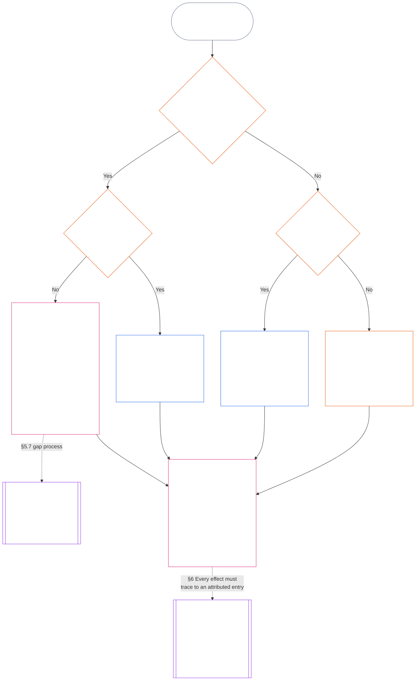

<!-- मराठी | आंशिक मसुदा: अध्याय अकरा §§5.7–5.9 | स्रोत commit: 9c2c8c10c871d91157bcd27b9f56ad6a1cec90d3 | AI-मसुदा, अपुनरावलोकित -->

#### 5.7 प्रणाली सनद किंवा संस्थात्मक सनदेत आसन अनामित राहिल्यास

सामान्य नामित मार्ग उपलब्ध नसताना प्रस्थिति अभिलेख कुठे जाईल हे तीन प्रश्नांवर अवलंबून असते; खालील आकृती त्यांचा क्रम दाखवते. हा विभाग आसन अनामित ठेवणाऱ्या प्रणाली सनद किंवा संस्थात्मक सनदेबद्दल आहे; कोणतीही सनद प्रस्थिति अभिलेखापर्यंत पोहोचत नसेल तर [§5.8 कोणतीही प्रणाली सनद किंवा संस्थात्मक सनद प्रस्थिति अभिलेखापर्यंत पोहोचत नसल्यास पर्यायी व्यवस्था](#58-fallback-when-no-system-charter-or-institutional-charter-reaches-the-standing-record) लागू होते.

<strong>वाचक मार्गदर्शन (अकार्यकारी): आकृती कशी वाचावी</strong>

> सोप्या भाषेत: प्रणाली सनद किंवा संस्थात्मक सनदेत नामित कार्यालये प्रस्थिति अभिलेख हाताळतात. सनदेत एखादे आसन अनामित असेल, तर त्रुटी दुरुस्त होईपर्यंत ती अवैध असते; अभिलेख कार्यमार्ग नकाशाकडे न जाता Backup Record Authority आणि Backup Record Custodian किंवा मंचाकडे जातो. कोणतीही प्रणाली सनद किंवा संस्थात्मक सनद अभिलेखापर्यंत पोहोचत नसेल, तर संस्थेचा प्रकाशित कार्यमार्ग नकाशा निर्णय घेतो; तोही नसेल तर अभिलेख स्वतंत्र पडताळणीकडे किंवा अनौपचारिक व लहान-व्याप्तीच्या कामांसाठी त्यावर अवलंबून असलेल्या संस्थेकडे जातो.
>
> प्रत्येक मार्ग त्याच अंतिम चौकटीत पोहोचतो: एक कार्यालय तथ्ये पडताळते आणि वेगळे कार्यालय प्रस्थिति अभिलेख नोंदवून धारण करते; त्यानंतर [§6 प्रस्थिति अभिलेख हाताळणे](#6-handling-a-standing-record) धारकांनी काय करावे हे ठरवतो. अखंड बाण मुख्य मार्ग दाखवतात. ठिपक्यांचे बाण हस्तांतरण दाखवतात; त्यांच्यावर ते अधिकृत करणारा विभाग लिहिला आहे. दुहेरी बाजूच्या पट्ट्यांच्या चौकटी दुसऱ्या अध्यायाच्या आहेत; शेवटची चौकट अशी आहे जिथे अभिलेख न पुन्हा लिहिता त्यावरून प्रस्थिति परिणाम काढले जातात. आकृती कोणतेही नवीन कर्तव्य, आसन किंवा क्षेत्र जोडत नाही.

 

आवश्यक अभिलेख-आसन किंवा स्वतंत्र मार्ग अनामित ठेवणारी प्रणाली सनद किंवा संस्थात्मक सनद:

- **परिणाम:** प्रणाली सनद किंवा संस्थात्मक सनद अवैध असते; असा परिणाम घडवणारा बदल अनुमत नाही ([अध्याय सात §4.7.1 त्रुटी कधी असते आणि ती कशी नोंदवली जाते](core_07.000_charters.md#471-when-a-gap-exists-and-how-it-is-logged)).
- **त्रुटी-प्रक्रियेची जबाबदारी अध्याय सातची:** [अध्याय सात §4.7 कार्यचालक प्रस्थिति अभिलेखांच्या नकाशातील त्रुटी](core_07.000_charters.md#47-gaps-in-the-map-for-operator-standing-records) पुढील बाबीही ठरवतो:
  - त्रुटी कशी नोंदवायची;
  - प्रतिसाद व निराकरणाच्या मुदती (तातडीच्या पर्यायी नियुक्तीसह); आणि
  - नामित धारकांकडे अभिरक्षण केव्हा परत जाईल.

प्रस्थिति अभिलेखांसाठी हा विभाग पुढील बाबी जोडतो:

- **कोण काम करू शकत नाही:** आवश्यक आसन रिकामे असेल आणि प्रणाली सनद किंवा संस्थात्मक सनद वैध पर्याय नामित करत नसेल, तर पुढील मुद्द्यातील मार्ग वगळता कोणीही त्या आसनाचे कार्य करू शकत नाही.
- **अभिलेख कुठे जातो:** [§5.4 स्वतःकडे अभिरक्षण नाही](#54-no-self-custody) नुसार प्रस्थिति अभिलेख Backup Record Authority आणि Backup Record Custodian कडे किंवा **कलम 2.7** अंतर्गत मंचाकडे जातो; कार्यमार्ग नकाशा त्यांची जागा घेत नाही. प्रत्येक अभिलेख एकाच अभिरक्षकाकडे पूर्ण स्वरूपात राहतो.
- **आधीपासून धारण केलेले प्रस्थिति अभिलेख:**
  - मंच, निबंधक किंवा Backup Record Authority यांच्यापर्यंत त्रुटीची सूचना पोहोचते त्या दिवशी, सनदबद्ध पक्षाच्या भौतिक नियंत्रण साखळीतील कार्यालयाकडे असलेला कोणताही कार्यचालक प्रस्थिति अभिलेख पूर्ण मागोव्यासह Backup Record Custodian कडे जातो.
  - तोपर्यंत ते कार्यालय अभिलेख केवळ-वाचन स्थितीत ठेवते, आवृत्ती नोंदवत नाही आणि पूर्ण मागोव्यासह त्याची संपूर्ण प्रत तत्काळ Backup Record Custodian ला देते.
  - साखळीबाहेरील अभिरक्षक अभिलेख स्वतःकडे ठेवतो आणि त्रुटीच्या काळात Backup Record Authority किंवा मंचाने अधिकृत केलेली प्रत्येक आवृत्ती नोंदवतो. मंचाने अभिरक्षक साखळीच्या आत असल्याचे ठरवल्यास, अभिलेख पूर्ण मागोव्यासह Backup Record Custodian कडे जातो.
- **उत्तरदायी व्यवस्थापक:** प्रणाली सनद किंवा संस्थात्मक सनद ज्या आसनावर बसवत नाही ते आसन भरण्यास सांगितल्यास व्यवस्थापक:
  - **आसन नाकारतो:** प्रस्थिति अभिलेखात प्रवेश किंवा नोंद करण्याची तांत्रिक क्षमता असल्याने त्याला नोंद करण्याचा प्राधिकार मिळत नाही.
  - **विनंती आणि त्रुटी नोंदवतो:** दोन्ही बाबी नोंदीत नमूद करतो.
  - **अभिलेख पुढे पाठवतो:** वरच्या *अभिलेख कुठे जातो* मधील मार्ग वापरतो.
  - **इतर कर्तव्ये चालू ठेवतो:** [§5.4 स्वतःकडे अभिरक्षण नाही](#54-no-self-custody) मधील *विषयाच्या आतले उत्तरदायी व्यवस्थापक* यांची कर्तव्ये कायम असतात: नियंत्रणातील बाब थांबवणे, पुनर्रचित संच नोंदवणे, स्वतःकडील पुरावा जतन करणे, सूचना देणे आणि उच्च स्तरावर पाठवणे. यांपैकी कोणतेही कृत्य तथ्य पडताळत नाही किंवा अभिलेख नोंदवत नाही. पडताळणी करणाऱ्या प्राधिकाऱ्याला इनपुट म्हणून नोंद व जतन केलेला पुरावा अभिलेखासोबत पाठवला जातो; तो नोंद नसतो आणि तथ्ये ठरवत नाही.

#### 5.8 कोणतीही प्रणाली सनद किंवा संस्थात्मक सनद प्रस्थिति अभिलेखापर्यंत पोहोचत नसल्यास पर्यायी व्यवस्था

प्रस्थिति अभिलेख ज्या प्रणाली, संस्था किंवा व्यवसायाशी संबंधित आहे त्याला कोणतीही प्रणाली सनद किंवा संस्थात्मक सनद व्यापत नसेल — उदाहरणार्थ, Class L रेषेखालील संस्थेने अशी सनद प्रकाशित केलेली नसेल — तर **CI-8.205 §2** (*कार्यात्मक पृथक्करण कार्यमार्ग*) अंतर्गत संस्थेचा प्रकाशित कार्यमार्ग नकाशा लागू होतो:

- **अभिलेख-उघडण्याचा प्राधिकारी:** संबंधित प्रणाली, संस्था किंवा व्यवसायासाठी नकाशाने आश्वासन आणि लेखापरीक्षण कार्यमार्गात ठेवलेले कार्यालय. ते तथ्याधार पडताळून नोंदीला मान्यता देते ([§5.2 नामित अभिलेख-उघडण्याचा प्राधिकारी](#52-named-record-opening-authority)); पण अभिलेख नोंदवत किंवा धारण करत नाही.
- **अभिरक्षक:** प्रकाशन आणि पुरावा कार्यमार्ग धारण करणारे कार्यालय.
- **कार्यवाही कार्यमार्ग वगळलेला:** यांपैकी कोणीही संबंधित प्रणालीचा कार्यवाही कार्यमार्ग धारण करणारे कार्यालय असू शकत नाही.
- **कार्यमार्ग नकाशाही नसल्यास:** अभिलेख *स्वतःकडे अभिरक्षण नाही* नुसार स्वतंत्र पडताळणीकडे जातो; अनौपचारिक आणि लहान-व्याप्तीच्या अभिलेखांसाठी तो पुढील *अनौपचारिक आणि लहान-व्याप्तीचे अभिलेख* नुसार त्यावर अवलंबून असलेल्या संस्थेकडे जातो.
- **उत्तरदायी व्यवस्थापक:** कार्यमार्ग नकाशाने न दिलेले आसन भरण्यास सांगितल्यास, व्यवस्थापक [§5.7 प्रणाली सनद किंवा संस्थात्मक सनदेत आसन अनामित राहिल्यास](#57-when-a-system-charter-or-institutional-charter-leaves-a-seat-unnamed) मधील *उत्तरदायी व्यवस्थापक* नियम पाळतो: आसन नाकारतो, विनंती व त्रुटी नोंदवतो आणि इतर कर्तव्ये पार पाडतो. अभिलेख नकाशात नामित कार्यालयाकडे; कोणी नामित नसेल तर वरच्या *कार्यमार्ग नकाशाही नसल्यास* मार्गाने पाठवतो.

#### 5.9 अनौपचारिक आणि लहान-व्याप्तीचे अभिलेख

कर्तव्यांचे पृथक्करण हे औपचारिकतेनुसार नव्हे, तर भौतिक दावानुसार प्रमाणबद्ध होते ([अध्याय आठ §2 चार-आसनांची संवैधानिक आवश्यकता](core_08.000_functional_independence_separation_of_duties.md#2-four-seat-constitutional-requirement)).

- **समाविष्ट काम:** स्थानिक समुदायांत अनेक प्रकारचे योगदान असते आणि त्यातील बरेचसे विनामूल्य व अनौपचारिक असते. यात विनामूल्य, समवयस्कांनी संघटित केलेले, परस्पर-सहाय्य, काळजी, देखभाल, दुरुस्ती, शिकवणे आणि समुदायाचे उत्तरदायी व्यवस्थापन यांसारखे काम येते; [अध्याय तेरा §6 योगदानाचे परिणाम दुसरे](core_13.000_standing_integration.md#6-contribution-consequences-second) नुसार त्यांना समान निकषांवर मान्यता देणे आवश्यक आहे.
  - **स्थानिक उदाहरणे:** शेजाऱ्यांनी अन्न व साधने वाटणे (परस्पर-सहाय्य); आजारी किंवा वृद्ध शेजाऱ्याची काळजी घेणे (काळजी); सामायिक बाग किंवा ओढा चांगल्या स्थितीत राखणे (देखभाल आणि समुदायाचे उत्तरदायी व्यवस्थापन); शेजाऱ्याच्या पाइपची दुरुस्ती (दुरुस्ती); शिकवणी घेणे किंवा कौशल्य दाखवणे (शिकवणे). प्रत्येक हा स्वतंत्र योगदानाचा प्रकार आहे.
- **पडताळणी आसन कोण भरतो:** या कामासाठी प्रस्थिति अभिलेखावर अवलंबून राहण्याचा प्रकाशित अधिकार असलेली **कोणतीही स्वतंत्र संस्था** पडताळणी आसन पूर्ण करते आणि पडताळणी प्राधिकारी म्हणून काम करते.
  - **सामान्यतः कोण:** अनेकदा अभिलेखावर अवलंबून राहणारी संस्था — जलसंधारण परिषदेसारखा स्थानिक गट, कामाला निधी देणारी किंवा ते सुरू ठेवणारी संस्था, **CI-6.255** (*सामायिक संसाधने, सहकारी संस्था, परस्पर-सहाय्य आणि बाजाराबाहेरील समुदाय-शासन*) अंतर्गत अभिलेख-मान्यता प्राधिकारी (अशा समुदायकार्याचे अभिलेख मान्य करणारी संस्था), किंवा **कलम 2.7** अंतर्गत मंच.
- **काय पुरेसे नाही:** पडताळणी प्राधिकारी औपचारिक आहे एवढ्याने पडताळणी आसन पूर्ण होत नाही.

अशा प्रस्थिति अभिलेखासाठी:

- एकट्याने काम करणाऱ्या संज्ञ प्राण्याला स्वतःच्या योगदानाचा अभिलेख मागण्यासाठी गट, संस्था, [प्रणाली सनद](core_05.040_band_continuity.md#system-charter) किंवा [संस्थात्मक सनद](core_05.040_band_continuity.md#institutional-charter) आवश्यक नाही. अशा वेळी:
  - **कोण विनंती करतो:** स्वतःच्या विनंतीवरील आरंभिक आसन तो विषय आणि दावेदार म्हणून धारण करतो.
  - **त्याची स्वतःची सामग्री:** त्याचा स्वतःचा वृत्तांत, नोंदी आणि छायाचित्रे ही इनपुट असतात; पडताळणी कधीच नाहीत.
  - **पडताळणी आसन:** अभिलेखावर अवलंबून राहण्याचा प्रकाशित अधिकार असलेली कोणतीही स्वतंत्र संस्था (पडताळणी प्राधिकारी).
  - **नोंद आणि अभिरक्षण:** स्वतंत्र अभिलेख अभिरक्षक प्रस्थिति अभिलेख नोंदवतो व धारण करतो.
  - **कोणी आव्हान दिल्यास:** आव्हान-कार्यवाहिनीकडे किंवा **कलम 2.7** अंतर्गत मंचाकडे जाते.
  - **अवलंबून राहणारी संस्था उपलब्ध नसल्यास:** अभिलेख **कलम 2.7** अंतर्गत मंचाकडे जातो.
  - **उदाहरण, निवृत्त नळकामगार:** अनेक वर्षे शेजाऱ्यांच्या पाइपची विनामूल्य दुरुस्ती केलेला, मागे कोणताही गट नसलेला निवृत्त नळकामगार **CI-6.255** (*सामायिक संसाधने, सहकारी संस्था, परस्पर-सहाय्य आणि बाजाराबाहेरील समुदाय-शासन*) अंतर्गत अभिलेख-मान्यता प्राधिकाऱ्याकडे प्रस्थिति अभिलेख उघडण्याची विनंती करू शकतो:
    - **विनंती आणि दावा:** नळकामगार.
    - **पडताळणी:** कामाच्या नोंदी आणि शेजाऱ्यांच्या साक्षींवरून प्राधिकारी.
    - **नोंद आणि अभिरक्षण:** स्वतंत्र अभिलेख अभिरक्षक.
    - **कोणी आव्हान दिल्यास:** आव्हान पडताळणी प्राधिकाऱ्याकडे परत न जाता मंचाकडे जाते.
- सहभागी हे विषय असतात; मान्यता मागत असल्यास दावेदारही असतात. **कलम 4.3** अंतर्गत सामूहिक अभिलेखात:
  - **सहभागी:** प्रत्येकजण दावेदार असतो.
  - **दुसऱ्या सदस्याच्या वाट्याबाबत सदस्याचे विधान:** ते इनपुट असते; पडताळणी नव्हे.
- प्रस्थिति अभिलेखाला आधार देणारी सामग्री दोन ठिकाणांहून येते:
  - **असहभागी:** लाभार्थी, शेजारी आणि इतर असहभागी **कलम 4.1** अंतर्गत पडताळणी-सामग्री म्हणून साक्षी देतात.
  - **गटाची स्वतःची नोंद:** ती राखणारा संज्ञ प्राणी खालील *अभिलेखकाची विधाने ही इनपुट असतात* नुसार नोंदकर्ता आणि साक्षीदार असतो.
- अवलंबून राहणाऱ्या संस्थेचा अभिलेख अभिरक्षक स्वतंत्र पडताळणी प्राधिकाऱ्याने पडताळलेली बाब नोंदवतो आणि धारण करतो:
  - **दोन्ही आसने कोण धारण करू शकत नाही:** अभिलेख अभिरक्षक किंवा पडताळणी प्राधिकारी दावेदार किंवा दावेदाराच्या [भौतिक नियंत्रण साखळी](core_05.035_band_accountability.md#material-control-line) मध्ये असू शकत नाही.
  - **एक संस्था, दोन आसने:** लेखापरीक्षणयोग्य, आव्हानयोग्य स्वातंत्र्य-संरक्षणांसह प्रकाशित कार्यमार्ग नकाशा असल्यास तीच अवलंबून राहणारी संस्था दोन्ही आसनांचे यजमानपद करू शकते.
  - **एकच कधीही नाही:** एकाच प्रस्थिति अभिलेखावर कोणताही प्राधिकारी, अभिरक्षक किंवा संज्ञ प्राणी दोन्ही कर्तव्ये पार पाडू शकत नाही.
- गटाची स्वतःची स्थिती सदस्याचा दावा ठरवत नाही:
  - **अनौपचारिक गट:** [प्रणाली सनद](core_05.040_band_continuity.md#system-charter) किंवा [संस्थात्मक सनद](core_05.040_band_continuity.md#institutional-charter) नसलेला, किंवा संस्था नसलेलाही गट, सदस्यांना अडवत नाही.
  - **प्रत्येक सहभागी:** गटात किंवा गटाबाहेर केलेल्या कामासाठी वैयक्तिक दावेदार म्हणून मान्यता मागू शकतो.
  - **अभिलेख कशाबद्दल आहे:** तो सहभागीच्या योगदानाबद्दल असतो, गटाच्या प्रस्थितीबद्दल नाही.
  - **उदाहरण, रजई शिवणारा मंडळ:** नव्याने आलेल्या निर्वासितांना रजया देणाऱ्या मंडळातील प्रत्येक शिवणकाम करणारी व्यक्ती रजई स्वीकारणाऱ्या संस्थेसारख्या स्वतंत्र अवलंबून संस्थेकडून पडताळलेला प्रस्थिति अभिलेख मागू शकते. त्या मंडळाला प्रणाली सनद किंवा संस्थात्मक सनद लागत नाही.
- त्याच अनौपचारिक परिस्थितीत उल्लंघन प्रस्थिति अभिलेखही उद्भवू शकतो; तेथेही आसने स्वतंत्र राहतात:
  - **उदाहरण, मद्यालयातील घटना:** मद्यालयात एक संज्ञ प्राणी दुसऱ्याचे चित्रीकरण करतो; तो दुसरा मद्यधुंद, गोंधळ घालणारा आणि हिंसक होतो, पण कोणालाही शारीरिक इजा होत नाही.
    - **इजा आवश्यक नाही:** कोणी जखमी नसतानाही हिंसेची पडताळलेली विश्वासार्ह धमकी उल्लंघन प्रस्थिति अभिलेखाला आधार देऊ शकते (**कलम 3.2**, बळजबरीने कर्तृत्वहानी).
    - **चित्रफीत हे इनपुट:** चित्रीकरण करणारा संज्ञ प्राणी साक्षीदार आहे. चित्रफीत इनपुट आहे; ती स्वतःहून पडताळणी नसते, आणि तिचे अस्तित्व काहीही आपोआप उघडत नाही (**कलम 2.2**).
    - **चित्रफितीतील संज्ञ प्राणी:** तो विषय आहे. अभिलेख उघडल्यावर त्याला कळवले जाते; तो कोणतेही आसन भरू शकत नाही ([§5.4 स्वतःकडे अभिरक्षण नाही](#54-no-self-custody)).
    - **पडताळणी आसन:** अभिलेखावर अवलंबून राहण्याचा प्रकाशित अधिकार असलेली स्वतंत्र संस्था — उदा. स्थानिक परवाना किंवा सुरक्षा संस्था — किंवा **कलम 2.7** अंतर्गत मंच. चित्रीकरण करणारा संज्ञ प्राणी किंवा मद्यालयाचा मालक दावेदार किंवा दावेदाराच्या [भौतिक नियंत्रण साखळी](core_05.035_band_accountability.md#material-control-line) मध्ये असल्यास त्याला त्या आसनातून वगळले जाते.
    - **नोंद, अभिरक्षण आणि आव्हान:** स्वतंत्र अभिलेख अभिरक्षक नोंद करतो व धारण करतो; आव्हान पडताळणी संस्थेकडे परत न जाता आव्हान कार्यवाहिनीकडे किंवा **कलम 2.7** अंतर्गत मंचाकडे जाते.
- स्वतंत्र अवलंबून संस्था उपलब्ध असताना, अनौपचारिक गटाला गाठता न येणाऱ्या औपचारिक संस्थेकडून पडताळणी मागणारे मद्यालय किंवा प्रक्रिया हा पृथक्करणाचा नियम नसून [अध्याय तेरा §6.2 क्षमता अडथळे आणि मंजुरी](core_13.000_standing_integration.md#62-competency-bars-and-clearances) मधील मनमानी प्रवेशबंदीचा नमुना आहे.

यापैकी कशामुळेही प्रस्थिति अभिलेख अस्तित्वात असणे आवश्यक होत नाही. **कलम 2.2** *मौन ही सामान्य स्थिती आहे* हा नियम लागू होतो: नोंद करणे शक्य आहे म्हणून अनौपचारिक काम नोंदवले जात नाही; प्रस्थिति अभिलेख मागितल्यावरच कर्तव्यांचे पृथक्करण बंधनकारक होते.
