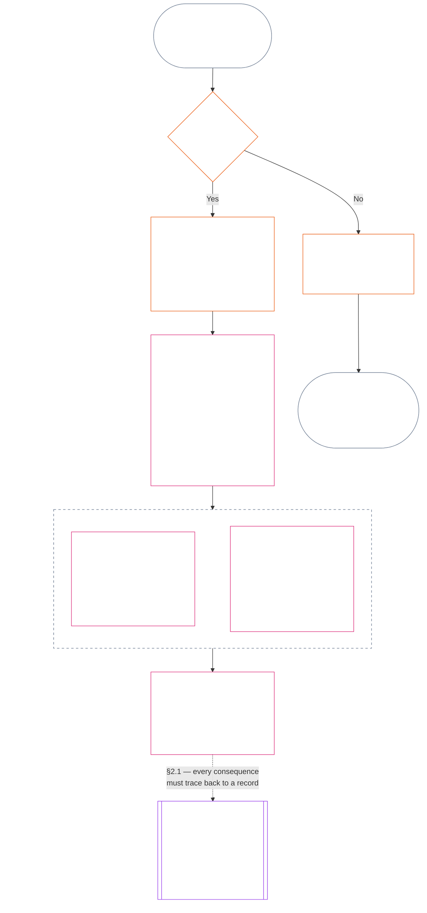
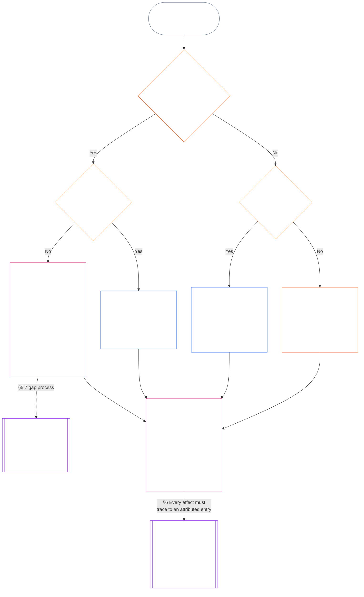

<!-- मराठी | अध्याय अकरा पूर्ण मसुदा | स्रोत commit: 9c2c8c10c871d91157bcd27b9f56ad6a1cec90d3 | AI-मसुदा, अपुनरावलोकित, अबंधनकारक मसुदा -->

# अध्याय अकरा: प्रस्थिति अभिलेख — प्रश्न 1: काय घडले?

<strong>संग्रहातील स्थान (अकार्यकारी): फाइल रचना आणि वाचन नियम</strong>

> ही फाइल **संज्ञ संविधानाचा भाग आहे** आणि एकाच मजकूराप्रमाणे वाचलेल्या इतर क्रमांकित `core_*` फाइल्ससोबतच **बंधनकारक आहे**. यात **अध्याय अकरा** आहे: प्रस्थिति प्रक्रियेतील तीन प्रश्न आणि **प्रश्न 1** (*काय घडले?*), **§1–§6** मध्ये. **प्रश्न 2** (*ते किती चांगले किंवा वाईट होते?*) याचे उत्तर [अध्याय बारा](core_12.000_standing_measurement.md#chapter-twelve-standing-measurement--question-2-how-good-or-bad-was-it) देतो. प्रश्न 3 (*त्यामुळे काय घडते?*) [अध्याय तेरा](core_13.000_standing_integration.md#chapter-thirteen-standing-effects-and-integration) मध्ये पुढे चालू राहतो; पात्र Violation Axis `s` = 7–9 निष्कर्षांसाठी पुनरावलोकन [अध्याय चौदा](core_14.000_misconduct_designation.md#chapter-fourteen-anti-constitutional-misconduct) मधील संविधान-विरोधी गैरवर्तन निर्देशनापुरते मर्यादित आहे. वाचनक्रम, बंधनकारक/समर्थक मजकुरातील फरक आणि संग्रह आवृत्तीची माहिती [README.md](README.md) मध्ये राखली आहे.

<strong>वाचक मार्गदर्शन (अकार्यकारी): अध्याय अकरा कुठे बसतो आणि काय येथेच राहते</strong>

> | प्रश्न | जबाबदार भाग आणि भूमिका |
> | --- | --- |
> | **1. काय घडले?** | अध्याय अकरा (ही फाइल): मर्यादित आणि आव्हानयोग्य प्रस्थिति अभिलेखात पडताळलेली तथ्ये निश्चित करणे. |
> | **2. ते किती चांगले किंवा वाईट होते?** | [अध्याय बारा](core_12.000_standing_measurement.md#chapter-twelve-standing-measurement--question-2-how-good-or-bad-was-it): मदत आणि हानी एकत्र न करता पडताळलेल्या तथ्यांचे मापन. |
> | **3. त्यामुळे काय घडते?** | [अध्याय तेरा](core_13.000_standing_integration.md#chapter-thirteen-standing-effects-and-integration) कडे पुढे जा. |
>
> आरोप, लोकप्रियता आणि विवादाच्या कथा ही प्रश्न 1 ची उत्तरे नाहीत. अपेक्षित गुणांकन प्रश्न 1 साठी तथ्ये पुरवू शकत नाही, तसेच अपेक्षित परिणाम प्रश्न 2 साठी गुणांकन ठरवू शकत नाही.

<strong>मागोवा</strong>

- पूर्वस्रोत:
  - [संवैधानिक चतुष्क](core_00.000_preamble.md#constitutional-tetrad);
  - [दोन संवैधानिक उद्दिष्टे](core_00.000_preamble.md#two-constitutional-aims);
  - [भौतिक दाव](core_00.000_preamble.md#material-stake);
  - [प्रस्तावना §6 मुख्य व्यावहारिक प्रक्रिया शृंखला](core_00.000_preamble.md#6-key-practical-process-pipelines) (*अध्याय नऊ ते पंधरा यांची साखळी*).
- पूर्वस्रोत:
  - [अध्याय एक](core_01.010_stewardship_capacity_principles.md#chapter-01-principles-and-constraints) (1.010) (*विभागनिहाय साध्या-भाषेतील स्पष्टीकरणात प्रतिबिंबित सुगमतेचे उत्तरदायी व्यवस्थापन*);
  - [अध्याय एक §16 — उत्तरदायी व्यवस्थापनाचा सखोल विचार](core_01.010_stewardship_capacity_principles.md#16-stewardship-in-depth) (1.010 §16) (*क्षमता-संबंधित, मागोवा घेता येण्याजोग्या प्रस्थितीचा तत्त्वाधार — विश्वास, भूमिका आणि मान्यता*);
  - [अध्याय दोन ते चार](core_02.000_definition_structure.md) (*अखंडता, अभिलेख आणि पडताळणी*);
  - [अध्याय पाच](core_05.000_definitions_home.md#chapter-five-foundational-definitions) (5.000) (*अध्याय दोन ते चार यांसोबत वाचाव्या अशा व्याख्या आणि सर्वोच्चता*).
- पूर्वस्रोत: [अध्याय नऊ](core_09.000_system_alignment_certification_evaluation.md#chapter-nine-system-alignment-certification) (9.000) (*प्रणाली-संरेखन प्रमाणन*); [अध्याय नऊ भाग C §11](core_09.010_system_alignment_certification_record_recertification.md#11-relationship-to-standing) (9.010 §11) (*प्रस्थिति-संबंध — संभाव्य पडताळलेले इनपुटच*).
- प्रस्थिति प्रक्रिया:
  - [प्रस्तावना §6.2 संपूर्ण साखळी कशी जुळते](core_00.000_preamble.md#62-how-the-full-chain-fits-together);
  - [अध्याय अकरा — प्रस्थिति अभिलेख](core_11.000_standing_assessment.md#chapter-eleven-standing-records--question-1-what-happened) (11.000) (*तीन-प्रश्न चौकट आणि प्रश्न 1 चे अभिलेख*);
  - [अध्याय बारा — प्रस्थिति मापन](core_12.000_standing_measurement.md#chapter-twelve-standing-measurement--question-2-how-good-or-bad-was-it) (12.000) (*प्रश्न 2 चे मापन*);
  - [अध्याय तेरा — प्रस्थिति परिणाम आणि एकत्रीकरण](core_13.000_standing_integration.md#chapter-thirteen-standing-effects-and-integration) (13.000) (*प्रश्न 3 चे परिणाम आणि एकत्रीकरण*);
  - [अध्याय चौदा](core_14.000_misconduct_designation.md#chapter-fourteen-anti-constitutional-misconduct) (14.000) (*फक्त पात्र Violation Axis s = 7–9 साठी निर्देशन*).
- या फाइलमधील उपविभाग:
  - [§1](#1-the-three-questions) (*तीन-प्रश्न चौकट आणि व्याप्ती*);
  - [§2](#2-question-1--what-happened) (*प्रश्न 1 — पडताळलेली तथ्ये आणि अभिलेख*);
  - [§3](#3-question-1-event-type-guide--what-kind-of-help-or-harm-occurred) (*प्रश्न 1 घटना-प्रकार मार्गदर्शक — मदत व हानीचे प्रकार*);
  - [§4](#4-standing-record-operational-requirements) (*पडताळणी आणि अभिलेखाच्या आवश्यकता*);
  - [§5](#5-record-custody-and-opening-authority) (*अभिलेखाचा अभिरक्षक आणि उघडण्याचा प्राधिकारी*);
  - [§6](#6-handling-a-standing-record) (*प्रस्थिति अभिलेख हाताळणे*).
- पुढील भाग:
  - [अध्याय बारा](core_12.000_standing_measurement.md#chapter-twelve-standing-measurement--question-2-how-good-or-bad-was-it) (12.000) (*प्रश्न 2 — LEQU आधाररेषा, मापन परिमाणे, मार्ग वर्णक, स्लॉट व्याकरण, संवैधानिक इनपुट, LEQU मापपट्टी, मानक योगदान मोजमापे, उदाहरणे आणि प्रश्न 3 कडे हस्तांतरण*);
  - [अध्याय चौदा](core_14.000_misconduct_designation.md#chapter-fourteen-part-a-anti-constitutional-misconduct-designation) (14.000) (*फक्त निर्देशन — प्रश्न 2 चे मापन पुन्हा उघडत नाही*);
  - [अध्याय पंधरा](core_15.000_forum.md#chapter-fifteen-forums-and-jurisdiction) (15.000) (*मंचाचे पर्यवेक्षण आणि मार्गीकरण*);
  - [अनुच्छेद XXVI-C](core_06.020_rights_part_e.md#article-xxvi-c-timely-resolution-and-anti-delay-floor) (*वेळेवर निराकरण*);
  - [अनुच्छेद XX](core_06.015_rights_part_d.md#article-xx-a-justice-objective-and-scope) (*न्यायविषयक बंधने*).
- सोबत वाचा: [अध्याय पाच *प्रस्थिति, योगदान आणि उल्लंघन*](core_05.035_band_accountability.md#defa3-standing-state-contribution-and-violation) (5.035) (*प्रामाणिक व्याख्या मार्गीकरण*).
- सोबत वाचा: [README.md](README.md) (*वाचनक्रम*); [doc_architecture.md](doc_architecture.md) (*स्वीकारले नसतील तर अबंधनकारक संपादकीय नकाशे*).

 

अध्याय अकरा हा **पडताळलेल्या तथ्य-अभिलेखाचा (प्रश्न 1)** घटनात्मक जबाबदार भाग आहे. तो [§1 तीन प्रश्न](#1-the-three-questions) पासून [§6 प्रस्थिति अभिलेख हाताळणे](#6-handling-a-standing-record) पर्यंत आहे. [अध्याय बारा](core_12.000_standing_measurement.md#chapter-twelve-standing-measurement--question-2-how-good-or-bad-was-it) प्रश्न 2 ची जबाबदारी घेतो; [अध्याय बारा §1 प्रश्न 2 — ते किती चांगले किंवा वाईट होते?](core_12.000_standing_measurement.md#1-question-2--how-good-or-bad-was-it) पासून [अध्याय बारा §9 प्रश्न 3 कडे हस्तांतरण — आंतर-प्रश्न मापन दुवे](core_12.000_standing_measurement.md#9-hand-off-to-question-3--cross-question-measurement-hooks) पर्यंत. प्रश्न 3 अध्याय तेरामध्ये पुढे चालू राहतो.

*सोप्या भाषेत: काय घडले ते हा अध्याय नोंदवतो आणि प्रस्थिति अभिलेख धारण करतो. ते किती चांगले किंवा किती हानिकारक होते याचे मापन अध्याय बारामध्ये दोन स्वतंत्र मार्गांवर होते; एकत्रित निव्वळ गुण कधीच नसतो. खटला दाखल केल्याने स्वतःहून प्रस्थिति निर्माण होत नाही.*

### 1. तीन प्रश्न

*साध्या शब्दांत: प्रस्थिति-मूल्यांकन क्रमाने तीन प्रश्नांची उत्तरे देऊन केले जाते. अपेक्षित श्रेणीवरून तथ्यांचा अंदाज बांधू नका आणि अपेक्षित परिणामाचे समर्थन करण्यासाठी श्रेणी निवडू नका.*

| प्रश्न | प्रश्न काय विचारतो | उत्तर कुठे दिले आहे |
| --- | --- | --- |
| **1. काय घडले?** | कोणती तथ्ये सत्यापित झाली, कोणाबद्दल किंवा कशाबद्दल, कोणत्या कालावधीत, आणि कोणत्या प्रस्थिति अभिलेख व आव्हान स्थितीसह? | [कलम 2](#2-question-1--what-happened) आणि [कलम 3](#3-question-1-event-type-guide--what-kind-of-help-or-harm-occurred) |
| **2. ते किती चांगले किंवा वाईट होते?** | त्या तथ्यांमधून कोणत्या प्रकारचे आणि किती प्रमाणातील योगदान किंवा उल्लंघन सिद्ध होते? | [अध्याय बारा कलम 1](core_12.000_standing_measurement.md#1-question-2--how-good-or-bad-was-it) |
| **3. त्याचा परिणाम काय होतो?** | त्यातून कोणती मान्यता, सज्जता, उपाय, संरक्षण, निर्बंध किंवा अन्य परिणाम उद्भवतो? | [अध्याय तेरा](core_13.000_standing_integration.md#chapter-thirteen-standing-effects-and-integration) |

प्रत्येक प्रश्नाचे उत्तर त्याआधीच्या उत्तरावर अवलंबून असते:

- प्रश्न 1, प्रश्न 2 साठी सत्यापित तथ्ये पुरवतो.
- प्रश्न 2, प्रश्न 3 साठी त्या तथ्यांचे मापन करतो.
- पसंतीचा परिणाम साधण्यासाठी प्रश्न 3 ने तथ्ये किंवा श्रेणी पुन्हा लिहू नये.

तिन्ही प्रश्नांची उत्तरे एकत्रितपणे एका मर्यादित घटनेसाठी किंवा एका परिभाषित नमुन्यासाठी संपूर्ण प्रस्थिति-मूल्यांकन बनवतात. एखाद्या विषयाचे कालांतराने असे अनेक मूल्यांकन होऊ शकतात; त्यांपैकी कोणतेही त्या विषयाचा निव्वळ गुण किंवा एकूण श्रेणी नसते. योगदान आणि उल्लंघनाचे प्रस्थिति अभिलेख प्रश्न 1 व प्रश्न 2 ची उत्तरे जतन करतात; प्रश्न 3 चा निर्णय त्यातून पुढे काय घडते हे सांगतो.

#### 1.1 उद्देश आणि व्याप्ती

हा अध्याय **प्रणाली**, **संज्ञ प्राणी** आणि **संस्था** यांच्यासाठी घटनात्मक अभिलेख चौकट सांगतो; [अध्याय बारा](core_12.000_standing_measurement.md#chapter-twelve-standing-measurement--question-2-how-good-or-bad-was-it) मापन चौकट सांगतो. यात [**CS-9.305**](corpus_systems/cs_09.305_system_classification_machinery.md#cs-9305-part-a-system-classification-machinery) (*प्रणाली वर्गीकरण यंत्रणा*) अंतर्गत वर्गीकृत प्रत्येक प्रणालीचा समावेश आहे. या चौकटी गप्पा, लोकप्रियता, अस्पष्ट प्रतिष्ठा, अंतर्निहित प्रतिष्ठा किंवा सर्वसाधारण मूल्य मोजत नाहीत; प्रस्थिति-मूल्यांकनाचा अनुमत विषय यांपैकी कोणताही नाही.

खालील परिस्थितींमध्येही प्रस्थिति प्रक्रिया प्रभावी राहिली पाहिजे:

- पूर्वीची सत्यापित योगदानं सध्याची क्षमता किंवा विश्वासार्हता दाखवण्यासाठी खूप जुनी होतात;
- उल्लंघने अनिर्णित राहतात;
- दुरुस्ती खर्चिक असते;
- जबाबदारी सीमा ओलांडते; किंवा
- एखादा कर्ता उत्तरदायित्वाला अडथळा आणण्यासाठी संघटनात्मक स्तर किंवा पुनर्नामकरण वापरतो.

या बाबी स्वीकारलेल्या अंमलबजावणी मजकुरात येतात:

- दैनंदिन प्रक्रिया;
- उन्नतीकरणाची पावले;
- परतफेड आणि दुरुस्तीची कामे;
- पुनर्स्थापनात्मक उत्तरदायित्वाचे उपाय; आणि
- प्रोत्साहन-रचना.

अध्याय बारामधील मापन स्वतःहून बळाचा वापर, नजरकैद किंवा स्वातंत्र्यावरील अन्य निर्बंध अधिकृत करत **नाही**. असा कोणताही परिणाम अध्याय सहा, **अनुच्छेद XX** (*सत्यापित उल्लंघनानंतर न्याय*) यातील प्रमाणबद्धता, किमान निर्बंध, कालमर्यादा, परतफेड आणि पुनर्स्थापनात्मक उत्तरदायित्वाच्या आवश्यकतांसह स्वतंत्रपणे पूर्ण केला पाहिजे.

<strong>मागोवा · व्याख्या · मूल्यांकन · अनुपालन</strong>

- वरच्या स्रोतांकडून: [अध्याय एक §16 — उत्तरदायी व्यवस्थापनाचा सविस्तर भाग](core_01.010_stewardship_capacity_principles.md#16-stewardship-in-depth); [अध्याय दोन ते चार](core_02.000_definition_structure.md); [अध्याय पाच](core_05.000_definitions_home.md#chapter-five-foundational-definitions).
- पुढे: [§2](#2-question-1--what-happened) (*प्रश्न 1*); [§4](#4-standing-record-operational-requirements) (*सत्यापन आणि अभिलेख आवश्यकता*); [§5](#5-record-custody-and-opening-authority) (*अभिलेख अभिरक्षा आणि उघडण्याचा अधिकार*); [§6](#6-handling-a-standing-record) (*प्रस्थिति अभिलेख हाताळणे*); [अध्याय बारा §1](core_12.000_standing_measurement.md#1-question-2--how-good-or-bad-was-it) (*प्रश्न 2 चे मापन*); [अध्याय बारा §2](core_12.000_standing_measurement.md#2-magnitude-and-severity-input-dimensions) (*मापन इनपुटचे परिमाण*); [अध्याय बारा §3](core_12.000_standing_measurement.md#3-route-descriptor-catalogs-and-measurement-roles) (*मार्ग-वर्णक सूची*); [अध्याय बारा §4](core_12.000_standing_measurement.md#4-slot-grammar-and-shared-scaling) (*स्लॉट व्याकरण आणि सामायिक प्रमाणन*); [अध्याय बारा §5](core_12.000_standing_measurement.md#5-constitutional-inputs-to-axis-assignment) (*घटनात्मक स्रोतांनुसार अक्ष-वाटप*); [अध्याय बारा §6](core_12.000_standing_measurement.md#6-unified-proportional-lequ-scale--contribution-and-violation-axes) (*दोन्ही अक्षांसाठी एकसंध प्रमाणबद्ध LEQU मापनपट्टी*); [अध्याय तेरा](core_13.000_standing_integration.md#chapter-thirteen-standing-effects-and-integration) (*प्रश्न 3*).
- [भौतिकता](core_05.050_band_oversight.md#materiality) · [O](core_05.050_band_oversight.md#materiality) · [M](core_05.050_band_oversight.md#materiality-determination-a) · [A](core_05.050_band_oversight.md#materiality-determination-a) · [C](core_05.050_band_oversight.md#materiality-determination-c)
- [हानी](core_05.035_band_accountability.md#harm) · [O](core_05.035_band_accountability.md#harm) · [M](core_05.035_band_accountability.md#harm-a) · [A](core_05.035_band_accountability.md#harm-a) · [C](core_05.035_band_accountability.md#harm-c)
- [प्रमाणबद्धता](core_05.035_band_accountability.md#proportionality) · [O](core_05.035_band_accountability.md#proportionality) · [M](core_05.035_band_accountability.md#proportionality-a) · [A](core_05.035_band_accountability.md#proportionality-a) · [C](core_05.035_band_accountability.md#proportionality-c)

### 2. प्रश्न 1 — काय घडले?

<strong>मागोवा</strong>

- वरच्या स्रोतांकडून: [§1](#1-the-three-questions) (*तीन-प्रश्न चौकट*); [अध्याय दोन ते चार](core_02.000_definition_structure.md) (*अभिलेख, सत्यापन आणि व्याख्यांपासून परिणामांपर्यंत मागोवा घेण्याची क्षमता*).
- घटनात्मक चतुष्काचे अंग: **सहभाग**; **देखरेख** (आव्हानयोग्यता आणि आव्हान मार्ग). प्राथमिक उद्दिष्टे: **समुन्नती** आणि **सातत्य** (पुढील मापनासाठी स्वतंत्र योगदान आणि उल्लंघन निष्कर्ष जतन करणारे मागोवा घेता येण्याजोगे अभिलेख).
- पुढे:
  - [§2.2](#22-silence-is-the-default) (*मौन ही सामान्य स्थिती आहे*);
  - [§2.3](#23-protected-dissent-is-not-a-trigger) (*संरक्षित असहमती ट्रिगर नाही*);
  - [§2.4](#24-linked-standing-records-and-no-offset-bridge) (*जोडलेले प्रस्थिति अभिलेख आणि समायोजन न करण्याचा दुवा*);
  - [§2.5](#25-verified-input-gate) (*सत्यापित इनपुट-द्वार*);
  - [§2.6](#26-stage-boundary) (*टप्प्याची सीमा*);
  - [§2.7](#27-forum-boundary) (*मंचाची सीमा*);
  - [§3](#3-question-1-event-type-guide--what-kind-of-help-or-harm-occurred) (*घटना-प्रकार मार्गदर्शक*);
  - [§4](#4-standing-record-operational-requirements) (*अभिलेख आवश्यकता*);
  - [§5](#5-record-custody-and-opening-authority) (*अभिलेख अभिरक्षा आणि उघडण्याचा अधिकार*);
  - [§6](#6-handling-a-standing-record) (*प्रस्थिति अभिलेख हाताळणे*);
  - [अध्याय बारा §1](core_12.000_standing_measurement.md#1-question-2--how-good-or-bad-was-it) (*प्रश्न 2 चे मापन*);
  - [अध्याय बारा §2](core_12.000_standing_measurement.md#2-magnitude-and-severity-input-dimensions) (*मापन इनपुटचे परिमाण*);
  - [अध्याय बारा §3](core_12.000_standing_measurement.md#3-route-descriptor-catalogs-and-measurement-roles) (*मार्ग-वर्णक सूची*);
  - [अध्याय बारा §4](core_12.000_standing_measurement.md#4-slot-grammar-and-shared-scaling) (*स्लॉट व्याकरण आणि सामायिक प्रमाणन*);
  - [अध्याय बारा §5](core_12.000_standing_measurement.md#5-constitutional-inputs-to-axis-assignment) (*घटनात्मक स्रोतांनुसार अक्ष-वाटप*);
  - [अध्याय बारा §6](core_12.000_standing_measurement.md#6-unified-proportional-lequ-scale--contribution-and-violation-axes) (*दोन्ही अक्षांसाठी एकसंध प्रमाणबद्ध LEQU मापनपट्टी*);
  - [अध्याय तेरा](core_13.000_standing_integration.md#chapter-thirteen-standing-effects-and-integration) (13.000) (*प्रश्न 3*).

 

*साध्या शब्दांत: प्रश्न 1, काय घडले याचा मर्यादित आणि आव्हानयोग्य वृत्तांत स्थापित करतो. कोणतीही श्रेणी किंवा परिणाम विचारात घेण्यापूर्वी तो विषय, घटना किंवा नमुना, कालावधी, सत्यापित तथ्ये आणि अभिलेखाची स्थिती ओळखतो. सत्यापित मदत आणि सत्यापित उल्लंघन स्वतंत्र प्रस्थिति अभिलेखांत असतात, जेणेकरून एक दुसरे पुसू शकत नाही. हे अभिलेख लोकप्रियतेचे गुण किंवा अस्पष्ट लेबले नाहीत.*

**प्रस्थिति अभिलेख** हा या अध्यायात विशिष्ट विषय, कार्यात्मक व्याप्ती, अभिलेख कालखंड, पुनरावलोकन स्थिती आणि निर्णय संदर्भासाठी वापरला जाणारा मर्यादित अभिलेख आहे. मापन सुरू होण्यापूर्वी त्याने हे निश्चित केले पाहिजे:

- प्रस्थिति अभिलेख कोणाबद्दल किंवा कशाबद्दल आहे;
- तो मर्यादित घटनेबद्दल आहे की परिभाषित नमुन्याबद्दल;
- संबंधित वर्तन आणि परिणाम केव्हा व कुठे घडले;
- कोणती तथ्ये सत्यापित आहेत आणि कोणती विवादित आहेत;
- निष्कर्षांना आधार देणारे पुरावे, आरोपण आणि आव्हान मार्ग कोणते; आणि
- प्रस्थिति अभिलेखाची सध्याची पुनरावलोकन, दुरुस्ती आणि अधिक्रमण स्थिती काय आहे.

आरेख एखाद्या घटनेचा मागोवा घेतो, ती प्रस्थिति अभिलेख सुरू करण्याचा ट्रिगर ठरते का आणि अभिलेखात पुढे काय नोंदले जाते हे पाहतो; पुढील उपविभाग प्रत्येक नियम सांगतात. "नाही"ची शाखा मुख्य मार्गातून उजवीकडे जाते.

#### 2.1 प्रस्थिति अभिलेख: प्रकार आणि विषय

प्रश्न 1 सत्यापित मदतीसाठी **योगदान प्रस्थिति अभिलेख** आणि उत्तरदायित्वातील अपयशांसह सत्यापित हानीसाठी **उल्लंघन प्रस्थिति अभिलेख** वापरतो. एक प्रस्थिति अभिलेख दोन्ही प्रकारचे निष्कर्ष एकत्र करत नाही.

- प्रस्थिति अभिलेख संज्ञ प्राणी, संस्था, प्रणाली, मूल्यांकन, मर्यादित घटना, भूमिका, सामूहिक गट, विशिष्ट कर्त्याचा अभिलेख किंवा अन्य घटनात्मकदृष्ट्या संबंधित घटकाबद्दल असू शकतो.
  - वेगळे विषय, भूमिका, प्रणाली, समुदाय, अभिलेख कालखंड, पुनरावलोकन स्थिती किंवा निर्णय संदर्भ एका अविभेदित प्रस्थिति लेबलात मिसळू नयेत.
- प्रस्थिति अभिलेख **मर्यादित घटना** — स्पष्ट सुरुवात व शेवट असलेला एक प्रसंग — किंवा पुनरावृत्त वर्तनाचा **नमुना** समाविष्ट करू शकतो.
  - नमुन्यासाठी परिभाषित विषय, व्याप्ती आणि पुनरावलोकन कालावधी आवश्यक आहे.
- त्याच विषयाचे कालांतराने अनेक प्रस्थिति अभिलेख असू शकतात; त्यात जोडलेले योगदान आणि उल्लंघन प्रस्थिति अभिलेखही येतात.
  - संबंधित प्रस्थिति अभिलेखांत विषय, एकमेकांवर चढणारा अभिलेख कालखंड, मर्यादित घटना, नमुना किंवा निर्णय संदर्भ समान असेल तर **कलम 4.2** नुसार त्यांना एकमेकांचा **परस्पर संदर्भ** द्यावा लागेल.
- प्रस्थिति अभिलेख हा स्वतंत्र प्रतिष्ठा गुण, प्रतिष्ठेचा क्रम, कायमची स्थिती, सर्वसाधारण मूल्य लेबल किंवा एकत्रित गुणपत्रक नाही.
  - कार्यकारी आवश्यकता **कलम 4** मध्ये आहेत.

नंतरचा कोणताही प्रस्थिति परिणाम अध्याय तेराचा विषय आहे आणि तो संबंधित प्रस्थिति अभिलेख किंवा अभिलेखांपर्यंत मागोवा घेता आला पाहिजे; मात्र तो स्वतः अभिलेखाचा भाग होता कामा नये.

#### 2.2 मौन ही सामान्य स्थिती आहे

संज्ञ प्राणी, संस्था किंवा प्रणालीला प्रस्थिति अभिलेख नसणे ही सामान्य स्थिती आहे; बहुतेक संज्ञ प्राणी याच स्थितीत राहतील.

- **कलम 4** नुसार ट्रिगर सत्यापित झाल्यावरच प्रस्थिति अभिलेख उघडला जातो. नामित अभिलेख-उघडण्याच्या अधिकाऱ्याने नोंदीला मंजुरी द्यावी आणि वेगळ्या अभिलेख अभिरक्षकाने ती नोंदवावी (**कलम 5**). प्रस्थिति अभिलेख कधीही पुढील कारणांसाठी उघडला जात नाही:
  - आधाररेषा ठरवण्यासाठी;
  - यादी पूर्ण करण्यासाठी; किंवा
  - नामित मार्गद्वारपालाला तसे हवे आहे म्हणून.
- प्रस्थिति अभिलेख नसल्याने काहीही कळत नाही. "श्रेणी नाही", "असत्यापित" आणि "फाइलमध्ये अभिलेख नाही" हे जोखमीचे, कमी योगदानाचे किंवा अन्य कोणत्याही गोष्टीचे पुरावे नाहीत. अनुपस्थित अभिलेख अधिक छाननी, कमी प्रारंभिक पातळी किंवा नामित मार्गासाठी सशर्त प्रवेश यांचे कारण म्हणून कोणीही वापरू शकत नाही.
- कोणतीही संस्था किंवा प्रणाली पुढील गोष्टींची अट म्हणून प्रस्थिति अभिलेख, "अभिलेख नाही" असे प्रमाणन किंवा अभिलेख उघडण्यास संमती मागू शकत नाही:
  - **अनुच्छेद III** (*जीवनरक्षण आणि आवश्यक प्रवेश*) यांतील मूलभूत बाबी;
  - **अनुच्छेद III-C** (*श्रम आणि आर्थिक तळ*) यांतील संरक्षणे;
  - सामान्य व्यापार; किंवा
  - प्रभावित पक्ष म्हणून सहभाग.
  [अध्याय तेरा §6.2 क्षमता-सीमा आणि मंजुरी](core_13.000_standing_integration.md#62-competency-bars-and-clearances) अंतर्गत विश्वास-संवेदनशील नामित मार्गांसाठी प्रसिद्ध केलेल्या क्षमता-सीमा हा अपवाद आहेत; नामित मार्ग विश्वास-संवेदनशील का आहे हे त्यात सांगितले पाहिजे.
- विषयाबद्दल प्रस्थिति अभिलेख उघडल्यावर **कलम 4** नुसार त्याला सूचना दिली पाहिजे. दस्तऐवजीकृत [पुरावा जतन](core_05.050_band_oversight.md#evidence-preservation) किंवा सुरक्षेची गरज कारणीभूत असेल तरच सूचना पुढे ढकलता येईल, आणि तेही मर्यादित, निश्चित कालावधीसाठी. सूचनेमुळे प्रस्थिति अभिलेख आव्हानयोग्य होतो: अभिलेख अस्तित्वात आहे हे माहीत नसलेला विषय त्याला आव्हान देऊ किंवा दुरुस्त करू शकत नाही.

#### 2.3 संरक्षित असहमती ट्रिगर नाही

**अनुच्छेद XI-D** (*सभा, असहमती आणि शांततापूर्ण निषेध*) अंतर्गत असहमती किंवा शांततापूर्ण निषेध — [संरक्षित अहिंसक नागरी अवज्ञेसह](core_06.005_rights_part_b.md#xi-d-nonviolent-civil-disobedience) — आणि [*असहमती व शांततापूर्ण निषेधाचा अधिकार-तळ*](core_06.005_rights_part_b.md#xi-d-dissent-and-peaceful-protest), हे सत्यापित ट्रिगर नाहीत.

- यामुळे उल्लंघन प्रस्थिति अभिलेख उघडत नाही, वाढत नाही किंवा तीव्र होत नाही; **कलम 8.2** अंतर्गत हा तीव्रतेचा इनपुट नाही आणि त्याची पुनरावृत्ती नमुना बनवत नाही.
- स्वतंत्रपणे घटनात्मक तळाचे उल्लंघन करणारे वेगळे करता येण्याजोगे वर्तन स्वतःच्या अटींवर नोंदवले जाते; निषेधाचा दृष्टिकोन, कारण किंवा लक्ष्य यामुळे तीव्रता वाढवली जात नाही.

#### 2.4 जोडलेले प्रस्थिति अभिलेख आणि समायोजन न करण्याचा दुवा

<strong>मागोवा</strong>

- वरच्या स्रोताकडून: [§2.1](#21-standing-records-kinds-and-subjects) (*स्वतंत्र योगदान आणि उल्लंघन अभिलेख*).
- पुढे:
  - [§2.5](#25-verified-input-gate) (*सत्यापित इनपुट-द्वार*);
  - [§2.7](#27-forum-boundary) (*मंचाची सीमा*);
  - [§4.2](#42-related-standing-record-cross-references) (*परस्पर संदर्भ*);
  - [अध्याय बारा §1](core_12.000_standing_measurement.md#1-question-2--how-good-or-bad-was-it) (*प्रश्न 2 चे मापन*);
  - [अध्याय बारा §2](core_12.000_standing_measurement.md#2-magnitude-and-severity-input-dimensions) (*मापन इनपुटचे परिमाण*);
  - [अध्याय बारा §3](core_12.000_standing_measurement.md#3-route-descriptor-catalogs-and-measurement-roles) (*मार्ग-वर्णक सूची*);
  - [अध्याय बारा §4](core_12.000_standing_measurement.md#4-slot-grammar-and-shared-scaling) (*स्लॉट व्याकरण आणि सामायिक प्रमाणन*);
  - [अध्याय बारा §5](core_12.000_standing_measurement.md#5-constitutional-inputs-to-axis-assignment) (*घटनात्मक स्रोतांनुसार अक्ष-वाटप*);
  - [अध्याय बारा §6](core_12.000_standing_measurement.md#6-unified-proportional-lequ-scale--contribution-and-violation-axes) (*दोन्ही अक्षांसाठी एकसंध प्रमाणबद्ध LEQU मापनपट्टी*);
  - [अध्याय तेरा](core_13.000_standing_integration.md#chapter-thirteen-standing-effects-and-integration) (13.000) (*प्रश्न 3*).
- सोबत वाचा: [अध्याय तेरा — प्रस्थिति एकीकरण](core_13.000_standing_integration.md#2-automatic-integration-review-and-continuity) (13.000) (*हक्कत्याग नसणे आणि जोडलेल्या अभिलेखांचे एकीकरण*); [अध्याय तेरा §6.2 — क्षमता-सीमा आणि मंजुरी](core_13.000_standing_integration.md#62-competency-bars-and-clearances) (13.000 §6.2); [अध्याय तेरा §4.2 — प्रस्थिति कुलपे](core_13.000_standing_integration.md#42-prevention--general-standing-locks) (13.000 §4.2).

 

**मूलभूत नियम:** सत्यापित **योगदान प्रस्थिति अभिलेख** आणि सत्यापित **उल्लंघन प्रस्थिति अभिलेख** **कलम 2.1** अंतर्गत वेगळे ठेवले जातात. प्रत्येक योगदान किंवा उल्लंघन निष्कर्ष स्वतःच्या प्रस्थिति अभिलेखातील स्वतःच्या समर्थित तथ्यांवर आधारित असला पाहिजे. विश्लेषण आणि सहाय्यक सामग्रीत दोन्ही अभिलेख मार्ग वेगवेगळे आणि मागोवा घेण्याजोगे ठेवले पाहिजेत. एकच नोंद किंवा जोडलेल्या नोंदींचा संच निव्वळ गुण, मिश्रित गुण किंवा तडजोड नसतो.

- **उल्लंघन प्रस्थिति अभिलेख आणि प्रस्थिति कुलपे:**
  - अध्याय तेरानुसार, उल्लंघन प्रस्थिति अभिलेखांतून उद्भवणारी लागू **प्रस्थिति कुलपे**, सत्यापित उल्लंघन अनिर्णित असेपर्यंत प्रस्थिति मर्यादित करू शकतात, भूमिका-पात्रतेवर निर्बंध आणू शकतात किंवा उपायांपर्यंत प्रवेशावर परिणाम करू शकतात.
  - प्रस्थिति कुलपांनी योगदान प्रस्थिति अभिलेखांत नोंदवलेले सत्यापित सकारात्मक योगदान पुसू नये.
  - अनिर्णित सत्यापित उल्लंघनांचे वजन केवळ काळ लोटल्याने कमी होत नाही.
  - सत्यापित उल्लंघनांनी असंबंधित योगदान प्रस्थिति अभिलेख खोटी नकारात्मक प्रतिष्ठा-फाइल म्हणून पुन्हा लिहू नयेत.
- **योगदान प्रस्थिति अभिलेख आणि क्षमता मंजुरी:**
  - सत्यापित योगदान प्रसिद्ध **क्षमता-सीमां**च्या तुलनेत लागू **क्षमता मंजुरींना** आधार देऊ शकते आणि सध्याचे व भूमिकेशी संबंधित असल्यास विश्वास, भूमिका किंवा मान्यतेशी जोडलेल्या पात्रतेला आधार देऊ शकते.
  - सत्यापित योगदान सत्यापित उल्लंघन निष्कर्षाची भरपाई, सरासरी कमी करणे, सबब किंवा पुनर्नामकरण करू नये.
  - दाराची अट पूर्ण झाल्याने कोणतेही लागू प्रस्थिति कुलूप माफ होत नाही.

**एकमेव अपवाद:** उल्लंघन निष्कर्ष स्वतःच दावा केलेले योगदान खोटे ठरवत असेल — उदाहरणार्थ, योगदान अभिलेखात दावा केलेले काम तुम्ही प्रत्यक्ष केले नाही असे पुरावे दाखवत असतील — तर योग्य पुरावा आणि पुनरावलोकन प्रक्रियेतून, **कलम 4.2** नुसार आवश्यक परस्पर संदर्भासह, जोडलेला योगदान प्रस्थिति अभिलेख दुरुस्त किंवा हटवता येतो. मात्र, उल्लंघनामुळे स्वतंत्र योगदान प्रस्थिति अभिलेखांत नोंदवलेली असंबंधित मदत आपोआप पुसली जात नाही.

#### 2.5 सत्यापित इनपुट-द्वार

हे द्वार पुढीलप्रमाणे काम करते:

- प्रस्थिति, विश्वास, भूमिका, मान्यता किंवा मान्यतेच्या पात्रतेवर परिणाम करणारा कोणताही निर्णय केवळ संबंधित **योगदान प्रस्थिति अभिलेख** किंवा **उल्लंघन प्रस्थिति अभिलेखांतील** सत्यापित इनपुट वापरू शकतो.
- आरोप, निकाल न लागलेले दावे, तात्पुरते मार्ग-टॅग, केवळ स्वीकार-टप्प्यातील कथन आणि विवाद-टप्प्यातील अन्य सामग्री स्वतःहून प्रस्थितीसाठी योगदानाचे किंवा उल्लंघनाचे स्वरूप पुरवत नाही.
- सत्यापित इनपुट म्हणजे **प्रस्थिति निष्कर्ष**: सत्यापित योगदान निष्कर्ष (अक्ष I) किंवा सत्यापित उल्लंघन निष्कर्ष (अक्ष II).
- योगदान आणि उल्लंघन निष्कर्ष स्वतंत्र प्रस्थिति अभिलेखांत राहतात (पहा **कलम 2.1**).

#### 2.6 टप्प्याची सीमा

प्रस्थिति अभिलेखाचे टप्पे वेगळे राहतात:

- प्रश्न 1 सत्यापित तथ्ये नोंदवतो; प्रश्न 2 त्यांचे मापन करतो.
- प्रश्न 2 चे मापन प्रलंबित असले तरी सत्यापित तथ्यात्मक आधार पूर्ण झाल्यावर प्रस्थिति अभिलेख उघडता येतो.
- मापन होईपर्यंत प्रश्न 2 च्या नोंद-क्षेत्रांत स्लॉट किंवा श्रेणी सूचित करण्याऐवजी ते प्रलंबित असल्याचे नमूद केले पाहिजे.
- प्रस्थिति अभिलेखाने प्रश्न 3 चा कोणताही **प्रस्थिति परिणाम** सांगू किंवा लागू करू नये.

#### 2.7 मंचाची सीमा

*साध्या शब्दांत: मंचांवर विवादांवर देखरेख होते, आव्हान देता येते आणि त्यांचे सत्यापित परिणाम होतात — पण खटला दाखल करणे किंवा कथनाच्या संघर्षात जिंकणे यामुळे प्रस्थिति अद्ययावत होत नाही. **कलम 2.5** मधील सत्यापित इनपुट-द्वार लागू राहते. मंचाने अध्याय दोन ते चारनुसार तथ्ये सत्यापित केल्यास तो प्रस्थिति अभिलेख **उघडू, अद्ययावत किंवा दुरुस्त** करू शकतो — किंवा **आव्हानावर चुकीचा अभिलेख बाजूला ठेवू** शकतो. मंच चांगले आणि वाईट एका गुणात मिसळत नाहीत किंवा स्वतःहून प्रस्थिति श्रेणी तयार करत नाहीत.*

हा विभाग एका प्रश्नाची जबाबदारी घेतो: मंचाचे काम प्रस्थिति अभिलेखापर्यंत कसे पोहोचते. साखळीतील इतर टप्प्यांची जबाबदारी येथे नमूद केलेल्या मालकांची आहे आणि क्रम असा आहे:

1. विवाद दाखल होतो आणि मंच **मंच-प्रकरण अभिलेख** ठेवतो, जो प्रस्थिति अभिलेख नसतो. मालक: [अध्याय पंधरा §2.3 मंच-प्रकरण अभिलेख, प्रस्थिति अभिलेख आणि आक्षेप](core_15.000_forum.md#23-forum-case-records-standing-records-and-contests); [§2.7.1 मंच-प्रकरण अभिलेख](#271-forum-case-record) देखील पहा.
2. मंच [अध्याय दोन ते चार](core_02.000_definition_structure.md) नुसार तथ्ये सत्यापित करतो.
3. सत्यापित निष्कर्ष सत्यापित इनपुट-द्वारातून जातात. मालक: [§2.5 सत्यापित इनपुट-द्वार](#25-verified-input-gate).
4. नामित अभिलेख-उघडण्याचा अधिकारी, जो मंच असू शकतो, प्रस्थिति अभिलेख उघडतो, अद्ययावत किंवा दुरुस्त करतो, अथवा आव्हानावर चुकीचा अभिलेख बाजूला ठेवतो. अभिलेखात काय असावे याचा मालक [§4.1 किमान अभिलेख सामग्री](#41-minimum-record-contents) आहे; कोण कृती करू शकतो याचा मालक [§5 अभिलेख अभिरक्षा आणि उघडण्याचा अधिकार](#5-record-custody-and-opening-authority) आहे.
5. प्रस्थिति अभिलेखात फक्त सत्यापित तथ्ये असतात आणि प्रश्न 2 नंतर त्यांचे मापन करतो. मालक: [§2.6 टप्प्याची सीमा](#26-stage-boundary) आणि [अध्याय बारा §1 प्रश्न 2 — ते किती चांगले किंवा वाईट होते?](core_12.000_standing_measurement.md#1-question-2--how-good-or-bad-was-it).
6. प्रस्थिति परिणाम असल्यास तो [अध्याय तेरा](core_13.000_standing_integration.md#chapter-thirteen-standing-effects-and-integration) अंतर्गत येतो; प्रस्थिति परिणामांची जबाबदारी त्या अध्यायाची आहे.

[अध्याय पंधरा](core_15.000_forum.md#chapter-fifteen-forums-and-jurisdiction) अंतर्गत मंच-कुटुंबे ठोस विवाद प्रस्थिति प्रक्रियेतून कसे जातात यावर **देखरेख** करतात. [अध्याय पंधरा §6 वेळेवर निराकरण, भौतिकतेचे स्तर आणि विलंबविरोधी शिस्त](core_15.000_forum.md#6-timely-resolution-materiality-tiers-and-anti-delay-discipline) आणि [अनुच्छेद XXVI-C](core_06.020_rights_part_e.md#article-xxvi-c-timely-resolution-and-anti-delay-floor) (*वेळेवर निराकरण आणि विलंबविरोधी तळ*) अंतर्गत मंच पुढील गोष्टी पुरवतात:

- सुलभ आव्हान;
- स्वतंत्र पुनरावलोकन;
- फॉरेन्सिक सहाय्य;
- उपायांचा क्रम; आणि
- स्तरांनुसार कालमर्यादा.

अध्याय दोन ते चार अंतर्गत मंचाचे निष्कर्ष सत्यापित इनपुट-द्वार पूर्ण करत असल्यास ते:

- **कलम 4.1** अंतर्गत प्रस्थिति अभिलेख **उघडू, अद्ययावत किंवा दुरुस्त** करू शकतात; किंवा
- **आव्हानावर चुकीचा अभिलेख बाजूला ठेवू** शकतात.

##### 2.7.1 मंच-प्रकरण अभिलेख

खुल्या विवादाबद्दलची मंचाची स्वतःची फाइल म्हणजे [**मंच-प्रकरण अभिलेख**](core_05.035_band_accountability.md#forum-case-record), ज्याची व्याख्या [अध्याय पंधरा §2.3 मंच-प्रकरण अभिलेख, प्रस्थिति अभिलेख आणि आक्षेप](core_15.000_forum.md#23-forum-case-records-standing-records-and-contests) येथे आहे. तो **प्रस्थिति अभिलेख नाही**.

##### 2.7.2 मंचाचे निष्कर्ष आणि प्रश्न 2 चे मापन

मंचाचे सत्यापित तथ्यात्मक निष्कर्ष प्रश्न 1 प्रस्थिति अभिलेखाचा तथ्यात्मक आधार देऊ शकतात. सत्यापित योगदान किंवा उल्लंघन किती चांगले किंवा वाईट होते याचे प्रश्न 2 मापन ते **ठरवत नाहीत** ([§2.6 टप्प्याची सीमा](#26-stage-boundary)). म्हणून:

- मंचाच्या कार्यवाहीने योगदान आणि उल्लंघन सामग्री एका निव्वळ गुणात, संमिश्र गुणदोष उत्तरात किंवा अविभेदित प्रस्थिति लेबलात **मिसळू नये**; जोडलेले प्रस्थिति अभिलेख [§2.1 प्रस्थिति अभिलेख: प्रकार आणि विषय](#21-standing-records-kinds-and-subjects) आणि [§2.4 जोडलेले प्रस्थिति अभिलेख आणि समायोजन न करण्याचा दुवा](#24-linked-standing-records-and-no-offset-bridge) नुसार वेगळे राहतात.
- मंचाच्या निष्पत्तीने विवाद-कथा, मार्गनिवडीची सोय किंवा पॅनेलची पसंती यांची जागा प्रदर्शनीय सत्यापित इनपुट ([§2.5 सत्यापित इनपुट-द्वार](#25-verified-input-gate)), स्वतंत्र मापन ([अध्याय बारा §1 प्रश्न 2 — ते किती चांगले किंवा वाईट होते?](core_12.000_standing_measurement.md#1-question-2--how-good-or-bad-was-it)) किंवा [अध्याय तेरा](core_13.000_standing_integration.md#chapter-thirteen-standing-effects-and-integration) यांच्या मालकीच्या प्रस्थिति-परिणाम यंत्रणेने **घेऊ नये**.

##### 2.7.3 मंचाची सीमा काय कमी करत नाही

ही सीमा पुढील अंतर्गत आवश्यक असलेले आव्हान, उपाय, अंतरिम दिलासा किंवा प्रक्रियात्मक संरक्षण **कमी करत नाही**:

- [अनुच्छेद XIII-A](core_06.010_rights_part_c.md#article-xiii-a-reliability-and-trustworthiness-baseline) (*विश्वसनीयता आणि विश्वासार्हतेची आधाररेषा*);
- [अनुच्छेद XIII-B](core_06.010_rights_part_c.md#article-xiii-b-right-to-redress-and-remedy) (*दाद आणि उपायाचा अधिकार*);
- [अध्याय पंधरा §6 वेळेवर निराकरण, भौतिकतेचे स्तर आणि विलंबविरोधी शिस्त](core_15.000_forum.md#6-timely-resolution-materiality-tiers-and-anti-delay-discipline);
- [अनुच्छेद XXVI-C](core_06.020_rights_part_e.md#article-xxvi-c-timely-resolution-and-anti-delay-floor) (*वेळेवर निराकरण आणि विलंबविरोधी तळ*); किंवा
- संबंधित न्यायविषयक अनुच्छेद.

यासाठी मंचाचे सत्यापित निष्कर्ष इतर सत्यापित इनपुटप्रमाणे त्याच द्वारातून प्रस्थिति अभिलेखात दाखल होणे आवश्यक आहे — द्वाराभोवतीून नव्हे.

### 3. प्रश्न 1 घटना-प्रकार मार्गदर्शक — कोणत्या प्रकारची मदत किंवा हानी झाली?

*साध्या शब्दांत: तथ्ये सत्यापित झाल्यानंतर काय घडले ते सांगण्यासाठी ही तक्ते वापरा. संबंधित योगदान किंवा उल्लंघनाचा प्रकार ओळखण्यात ती मदत करतात. ते किती चांगले किंवा वाईट होते हे ठरवत नाहीत, स्लॉट देत नाहीत किंवा त्यातून काय परिणाम होईल हे ठरवत नाहीत.*

#### 3.1 योगदानाच्या घटना-प्रकार

**पात्रता नियम:** दावा केलेले योगदान तेव्हाच मोजले जाते जेव्हा ते मागोवा घेण्याजोगे, बाह्यीकृत नसलेले आणि संपूर्ण कार्यरत संविधानाशी सुसंगत असते.

- बाह्यीकृत हानी, बळजबरीची अवलंबित्वे, अधिकार-तळ संकुचित करणे किंवा लपवलेले भार दावा केलेले योगदान अपात्र ठरवू किंवा मर्यादित करू शकतात.
- दावा केलेले योगदान स्वतंत्र उल्लंघन निष्कर्षाची भरपाई करत नाही.

खालील तक्त्यातील प्रत्येक ओळ सत्यापित मदतीचा एक सामान्य मार्ग आणि त्याचे घटनात्मक महत्त्व सांगते. एकाच प्रस्थिति अभिलेखाला एकाहून अधिक ओळी लागू होऊ शकतात.

| सत्यापित योगदानाचा प्रकार | काय घडले | चतुष्काचे अंग/अंगे | प्राथमिक उद्दिष्ट/उद्दिष्टे |
| --- | --- | --- | --- |
| जीवनरक्षण आणि शारीरिक देखभाल | कोणाला अन्न, निवारा, वैद्यकीय सेवा किंवा सुरक्षितता मिळाली | **सहभाग**, **देखरेख** | **समुन्नती** |
| संगोपन आणि शिक्षण | मुलांचे संगोपन झाले, ज्येष्ठांची काळजी घेतली गेली किंवा इतरांना शिकवले गेले | **सहभाग**, **देखरेख** | **समुन्नती**, **सातत्य** |
| आघाताचे निराकरण | आरोग्य रोखणाऱ्या मानसिक हानीतून सावरण्यास कोणाला मदत मिळाली | **सहभाग**, **उत्तरदायित्व** | **समुन्नती** |
| गंभीर भार दूर करणे | कर्जाचा असह्य भार, शोषणकारी कामाची परिस्थिती किंवा प्रणालीगत अडथळे दूर केले गेले | **सहभाग**, **देखरेख** | **समुन्नती** |
| स्वायत्तता पुनर्स्थापित करणे | कोणाला स्वतःच्या जीवनाबद्दल अर्थपूर्ण निवडी मिळाल्या | **सहभाग** | **समुन्नती** |
| उत्पादक क्षमता वाढवणे | साधने, पायाभूत सुविधा किंवा संधींमुळे इतरांना स्वतंत्रपणे भरभराट करणे शक्य झाले | **सहभाग**, **देखरेख** | **समुन्नती**, **सातत्य** |
| वेळेची कार्यक्षमता सुधारणे | टाळता येण्याजोगी प्रतीक्षा, प्रशासकीय घर्षण किंवा समन्वयाचा अतिरिक्त भार कमी झाला; काळजी, विश्रांती, स्वायत्तता, शिक्षण किंवा अधिकारांशी सुसंगत कामासाठी वापरता येणारा वेळ परत मिळाला | **सहभाग**, **देखरेख** | **समुन्नती** |
| पर्यावरणीय किंवा पायाभूत सुविधा जोखीम कमी करणे | पर्यावरणीय कोसळणे किंवा महत्त्वपूर्ण प्रणालीचे अपयश रोखले गेले | **देखरेख**, **उत्तरदायित्व** | **सातत्य**, **समुन्नती** |
| पर्यावरणीय ठसा कमी करणे | भार इतरांवर किंवा परिसंस्थांवर न टाकता संसाधन वापर, उत्सर्जन किंवा जमीन व पाण्याची मागणी सत्यापितपणे कमी केली गेली | **देखरेख**, **उत्तरदायित्व** | **सातत्य**, **समुन्नती** |
| परिसंस्था पुनर्स्थापित करणे | खराब झालेली जमीन, पाणी किंवा अधिवास कार्यशील आणि स्वयंपूर्ण स्थितीकडे पुनर्स्थापित केला गेला | **देखरेख**, **उत्तरदायित्व** | **सातत्य**, **समुन्नती** |
| संकटग्रस्त प्रजातींचे संरक्षण | नामशेष होण्याचा धोका असलेल्या प्रजाती किंवा त्यांच्यावर अवलंबून असलेल्या अधिवासांचे नुकसानापासून संरक्षण केले गेले | **देखरेख**, **उत्तरदायित्व** | **सातत्य**, **समुन्नती** |
| प्रदूषण आणि कचरा कमी करणे | दूषितता, हानिकारक उत्सर्जन किंवा कचरा रोखला, काढला किंवा सुरक्षितपणे हाताळला गेला | **देखरेख**, **उत्तरदायित्व** | **समुन्नती**, **सातत्य** |
| सुरक्षितता, सत्य, लेखापरीक्षणयोग्यता किंवा आव्हान क्षमता मजबूत करणे | अधिकारांचे संरक्षण आणि सत्तेला उत्तरदायी ठेवण्यासाठी संस्था किंवा पद्धती उभारल्या किंवा दुरुस्त केल्या गेल्या | **सहभाग**, **देखरेख**, **उत्तरदायित्व** | **समुन्नती**, **सातत्य** |

#### 3.2 उल्लंघनाच्या घटना-प्रकार

**पात्रता नियम:** उल्लंघन घटना-प्रकारासाठी **अध्याय दोन ते चार** नुसार सत्यापित उल्लंघन निष्कर्ष आवश्यक आहे; तो मागोवा घेण्याजोगा, मर्यादित, लेखापरीक्षणयोग्य आणि आव्हानयोग्य राहिला पाहिजे.

- आरोप, तात्पुरते टॅग, मंच-कथन आणि स्वीकार-टप्प्यावरील लेबले मार्गनिवड किंवा प्राथमिक छाननीस मदत करू शकतात, पण ती स्वतःहून प्रश्न 1 पूर्ण करत नाहीत.
- सकारात्मक योगदान सत्यापित उल्लंघनाची भरपाई, सबब, निरसन किंवा पुनर्नामकरण करत नाही.

खालील तक्त्यातील प्रत्येक ओळ सत्यापित हानी, धोका किंवा कर्तव्यभंगाचा एक सामान्य मार्ग आणि त्याचे घटनात्मक महत्त्व सांगते. एकाच प्रस्थिति अभिलेखाला एकाहून अधिक ओळी लागू होऊ शकतात.

| सत्यापित हानी किंवा धोक्याचा प्रकार | काय घडले | चतुष्काचे अंग/अंगे | प्राथमिक उद्दिष्ट/उद्दिष्टे |
| --- | --- | --- | --- |
| जीवनरक्षण किंवा शारीरिक देखभालीपासून वंचित करणे | टाळता येण्याजोगा मृत्यू, काळजी नाकारणे, असुरक्षित परिस्थिती किंवा जीवनावश्यक साधनांची भौतिक वंचना झाली | **उत्तरदायित्व**, **सहभाग** | **समुन्नती** |
| गंभीर टाळता येण्याजोगा भार | असह्य, लादलेले किंवा प्रणालीगतरीत्या दुसऱ्यांवर ढकललेले भार यांनी आरोग्य किंवा स्वायत्ततेला भौतिक हानी केली | **उत्तरदायित्व**, **सहभाग** | **समुन्नती** |
| बळजबरीमुळे स्वायत्ततेचा ऱ्हास | बळजबरी, हातचलाखी, विश्वासार्ह धमकी, बंदिस्त करणे किंवा स्वातंत्र्याला धोका घडला | **उत्तरदायित्व**, **सहभाग** | **समुन्नती** |
| अधिकार-तळ निष्प्रभ करणे | वाटाघाटी न करता येणाऱ्या घटनात्मक तळांचे, सर्वोच्चतेचे किंवा आव्हान व उपायांपर्यंत प्रवेशाचे भौतिक उल्लंघन झाले | **उत्तरदायित्व**, **देखरेख** | **समुन्नती**, **सातत्य** |
| पर्यावरणीय किंवा पायाभूत सुविधांचे नुकसान | घटनात्मक आरोग्यासाठी आवश्यक परिस्थितींना हानी पोहोचली | **उत्तरदायित्व**, **देखरेख** | **सातत्य**, **समुन्नती** |
| प्रदूषण किंवा कचऱ्यामुळे हानी | दूषितता, हानिकारक उत्सर्जन किंवा कचऱ्याने हवा, पाणी, माती किंवा आरोग्यास हानी केली | **उत्तरदायित्व**, **देखरेख** | **समुन्नती**, **सातत्य** |
| प्रजाती किंवा अधिवासाचा नाश | नामशेष होण्याच्या धोक्यातील प्रजाती किंवा त्यांच्यावर अवलंबून असलेले अधिवास नष्ट, खंडित किंवा नाशाकडे ढकलले गेले; समायोजनीय मानलेले नुकसानही यात समाविष्ट आहे | **उत्तरदायित्व**, **देखरेख** | **सातत्य**, **समुन्नती** |
| पर्यावरणीय पुनर्प्राप्ती क्षमतेचा ऱ्हास | हानीनंतर पुनर्जन्म घेण्याची परिसंस्थेची क्षमता रोखली गेली किंवा टाळता येण्याजोग्या रीतीने पूर्ववत करणे कठीण अथवा अशक्य बनवले गेले | **उत्तरदायित्व**, **देखरेख** | **सातत्य**, **समुन्नती** |
| बाह्यीकृत पर्यावरणीय हानी किंवा क्षय | पर्यावरणीय खर्च इतरांवर किंवा परिसंस्थांवर टाकला गेला, संसाधने पुनर्निर्मितीक्षमतेपलीकडे संपवली गेली किंवा ठसा अथवा टिकावाच्या दाव्याने सुरू असलेला ऱ्हास लपवला | **उत्तरदायित्व**, **देखरेख** | **सातत्य**, **समुन्नती** |
| उत्पादक क्षमता नष्ट करणे | स्वतंत्रपणे भरभराटीसाठी आवश्यक साधने, क्षमता, संबंध किंवा संसाधने बंद केली गेली | **उत्तरदायित्व** | **समुन्नती** |
| सुरक्षितता, सत्य किंवा लेखापरीक्षणयोग्यता खालावणे | लपवणे, चुकीची माहिती, तुटलेले अभिलेख, अप्रवेशयोग्य आव्हान मार्ग किंवा तपासता न येणारे एकत्रीकरण घडले | **देखरेख**, **उत्तरदायित्व** | **समुन्नती**, **सातत्य** |
| उत्तरदायित्वात अडथळा | उत्तर देण्याच्या यंत्रणेत — पुराव्याची अखंडता, सत्यापन, मंच प्रक्रिया, प्रस्थिति अभिलेख, उपायांच्या कालमर्यादा किंवा आव्हान व दाद मार्ग — सत्यापित हस्तक्षेप झाला; हा अडथळा वेगळ्या मूलभूत हानीवरील मेटा-हल्ला असल्यास जोडलेला स्वतंत्र उल्लंघन प्रस्थिति अभिलेख उघडा | **उत्तरदायित्व**, **देखरेख**, **समयबद्धता** | **समुन्नती**, **सातत्य** |
| प्रणाली काबीज करणे किंवा अवलंबित्वाचा गैरवापर | संरचनात्मक सहाय्य, अवलंबित्वातील असमानतेचा गैरवापर, चुकवण्याविरोधी रचना किंवा उत्तरदायित्व मार्गांवर कब्जा झाला | **उत्तरदायित्व**, **सहभाग** | **सातत्य**, **समुन्नती** |

---

*व्याप्ती: हा अंशतः मसुदा केवळ अध्याय अकरा §§1–3 समाविष्ट करतो. §§4–6 आणि अध्याय बारा समाविष्ट नाहीत.*

### 4. पडताळणी आणि अभिलेखाच्या आवश्यकता

<strong>मागोवा</strong>

- पूर्वस्रोत: [§2](#2-question-1--what-happened) (*प्रश्न 1 चे अभिलेख आणि घटना-प्रकार मार्गदर्शक*); [अध्याय दोन ते चार](core_02.000_definition_structure.md) (*परिभाषांपासून परिणामांपर्यंत अभिलेखन, पडताळणी आणि मागोवा-क्षमता*).
- पुढील भाग:
  - [§4.1](#41-minimum-record-contents) (*किमान मजकूर*);
  - [§4.2](#42-related-standing-record-cross-references) (*परस्पर-संदर्भ*);
  - [§5](#5-record-custody-and-opening-authority) (*प्रस्थिति अभिलेखाचा अभिरक्षक आणि उघडण्याचा प्राधिकारी*);
  - [§6](#6-handling-a-standing-record) (*प्रस्थिति अभिलेख हाताळणे*);
  - [अध्याय बारा §1](core_12.000_standing_measurement.md#1-question-2--how-good-or-bad-was-it) (*प्रश्न 2*).
- सोबत वाचा: [CF-15.415 §8 प्रतिबंधित माहिती प्राधिकार](corpus_forum/cf_15.415_routing_operations_transfer_certification_representative_treatment.md#cf-15415-8-restricted-information-authority) (*[§4.1](#41-minimum-record-contents) अंतर्गत नमूद केलेल्या प्रकटीकरण-मर्यादेवरील विवादासाठी पहिला टप्पा*).

 

*सोप्या भाषेत: प्रत्येक प्रस्थिति अभिलेखात काय असले पाहिजे, संबंधित प्रस्थिति अभिलेख एकमेकांचा संदर्भ कसा देतील आणि अभिलेखांच्या आवृत्त्या कशा ठेवल्या जातील हे हा विभाग सांगतो. कोण प्रस्थिति अभिलेख उघडू व धारण करू शकतो आणि त्याला आव्हान किंवा दुरुस्ती कशी करता येते, हे [§5 प्रस्थिति अभिलेखाचा अभिरक्षक आणि उघडण्याचा प्राधिकारी](#5-record-custody-and-opening-authority) मध्ये आहे. प्रश्न 2 चे मापन केवळ पडताळलेला तथ्याधार अभिलेखित झाल्यानंतर जोडता येते.*

भौतिक दाव आणि प्रणालीचा वर्ग यांनुसार आवश्यक पुरावा व अभिलेखाचा तपशील वाढू शकतो. या प्रमाणबद्धतेमुळे व्याप्तीत येणारा कोणताही संज्ञ प्राणी, संस्था किंवा प्रणाली प्रस्थिति प्रक्रियेतून वगळली जात नाही.

#### 4.1 अभिलेखातील किमान मजकूर

प्रस्थिति अभिलेखात खालील क्षेत्रे असतात; शेवटच्या दोन उपविभागांत प्रत्येक अक्षासाठीची क्षेत्रे जोडली आहेत. प्रस्थिति अभिलेखात कोणता मजकूर समाविष्ट होऊ शकतो हे ठरवणारा पडताळलेल्या-इनपुटचा निकष [§2.5 पडताळलेल्या इनपुटची कसोटी](#25-verified-input-gate) मध्ये आहे. प्रश्न 1 ची तथ्ये आणि प्रश्न 2 चे मापन वेगळे ठेवणारा नियम [§2.6 टप्प्यांची सीमा](#26-stage-boundary) मध्ये आहे.

##### 4.1.1 प्रत्येक प्रस्थिति अभिलेखात आवश्यक क्षेत्रे

प्रत्येक प्रस्थिति अभिलेखात किमान पुढील बाबी असणे आवश्यक आहे:

- प्रस्थिति अभिलेखाचा प्रकार — **योगदान प्रस्थिति अभिलेख** किंवा **उल्लंघन प्रस्थिति अभिलेख**;
- कोणाचे किंवा कशाचे मूल्यांकन होत आहे आणि मूल्यांकनाची व्याप्ती, त्यात संबंधित प्रणाली-सीमा, भूमिका-सीमा, प्रभावित समुदाय आणि परावलंबन-संबंध यांचा समावेश;
- कोणत्या आचरणाचे किंवा निष्कर्षाचे मूल्यांकन होत आहे, त्यात अभिलेख ज्या कृती, अकृती, कर्तव्ये, परिणाम, मर्यादित घटना, व्याप्तीतील नमुना, योगदान अभिलेख किंवा उल्लंघन निष्कर्षावर अवलंबून आहे त्यांचा समावेश;
- अभिलेखाचा कालावधी आणि सध्याची पुनरावलोकन स्थिती — उदाहरणार्थ, तात्पुरता, नमूद उद्देशासाठी अंतिम, आव्हानाधीन, प्रतिस्थापित किंवा नियोजित पुनर्मूल्यांकनासाठी देय;
- **कलम 4.2** नुसार परस्पर-संदर्भित संबंधित प्रस्थिति अभिलेख;
- अध्याय दोन ते चारनुसार अभिलेख दाखवता येण्याजोगा, पुनरावलोकनयोग्य आणि आव्हानयोग्य करणारे अधिकृत अभिलेख, साक्षीदार, मोजमापे, लेखापरीक्षणे, मंच-निर्णय किंवा इतर पडताळणी-सामग्री;
- तथ्याधार पडताळून नोंद अधिकृत करणारा **अभिलेख-उघडण्याचा प्राधिकारी**, आणि अभिलेख नोंदवून धारण करणारा स्वतंत्र **अभिलेख अभिरक्षक** — दोघांचीही नावे **कलम 5** अंतर्गत नमूद केलेली;
- प्रस्थिति अभिलेखाला आव्हान देण्याची पद्धत, त्यात:
  - कोणता मंच किंवा प्राधिकारी त्याचे पुनरावलोकन करतो;
  - प्रकटीकरणाच्या कोणत्याही मर्यादा; आणि
  - पुढील बाबींच्या अटी:
    - दुरुस्ती;
    - पुनर्स्थापना;
    - समाप्ती; किंवा
    - नियोजित पुनरावलोकन;
- मापन झाल्यावर खाली आवश्यक असलेली अक्ष-विशिष्ट प्रश्न 2 मापन-क्षेत्रे.

##### 4.1.2 तपासता येण्याजोगी आरोपणीय कृती

आरोपणीय-कृतीचा पुरावा प्रस्थिति अभिलेखाशी पुढीलप्रमाणे संबंधित असतो:

- महत्त्वपूर्ण प्रणाली-व्यवस्थापन किंवा भौतिक कार्यकारी प्राधिकार वापरणाऱ्या कर्मचारी/प्रतिनिधींसाठी, पुनर्रचित करता येण्याजोगा आरोपणीय-कृतीचा पुरावा मिश्र पथकांसाठीचा मुलभूत नोंद-करार म्हणून **[CS-16.305 §10 तपासता येण्याजोगी आरोपणीय कृती](corpus_systems/cs_16.305_critical_system_stewardship.md#cs-16305-103-inspectable-attributable-action)** मध्ये निर्दिष्ट आहे.
- तो पुरावा या प्रस्थिति अभिलेखासाठी इनपुट ठरू शकतो.
- तो या प्रस्थिति अभिलेखाची जागा घेत नाही.
- प्रस्थिति अभिलेखात AI मॉडेलचे weights (मॉडेलमधील संख्या) किंवा त्याचे खाजगी तर्क समाविष्ट नसतात. कोण किंवा काय जबाबदार होते हे दाखवण्यासाठी दुसरे काहीच उरले नसेल तेव्हाच अपवाद लागू होतो.
- एखाद्या बाबीत व्यक्तीची गोपनीयता किंवा प्रणालीची संरक्षित अंतर्गत अवस्था गुंतलेली आहे म्हणून ती प्रस्थिति मापनाबाहेर जात नाही. प्रस्थिति-संबंधित बाब असेल तर तिचे मापन होते.

##### 4.1.3 गोपनीयता किंवा अपारदर्शकतेमुळे सूट नाही

गोपनीयता, गोपनीय स्वरूप किंवा प्रणालीच्या अंतर्गत बाबींची अपारदर्शकता यांमुळे एखादी बाब प्रस्थिति मापनातून सूट पावत नाही. या बाबी पडताळलेल्या-अभिलेखाच्या आवश्यकतेशी विसंगत ठरल्यास, स्वतंत्र पुनरावलोककाचा प्रवेश कायम ठेवून [अध्याय एक §13.1 मुख्य तडजोड तत्त्वे](core_01.005_interaction_interpretation.md#131-core-tradeoff-principles) आणि त्यातील निर्णय-अभिलेख शिस्तीनुसार हा संघर्ष सोडवला जातो.

##### 4.1.4 योगदान प्रस्थिति अभिलेखांसाठी अतिरिक्त क्षेत्रे

**योगदान प्रस्थिति अभिलेखांत** पुढील बाबीही नमूद करणे आवश्यक आहे:

- प्रश्न 2 चे योगदान मापन, त्यात:
  - प्राथमिक पट्टा;
  - लागू केल्यास स्लॉट `s` (पहा [अध्याय बारा §4 स्लॉट व्याकरण आणि सामायिक प्रमाणबद्धता](core_12.000_standing_measurement.md#4-slot-grammar-and-shared-scaling));
  - पुराव्याचा आधार;
  - भौतिकतेचे तर्क; आणि
  - पारदर्शक आधारासाठी वापरलेले स्वीकृत LEQU किंवा तुलनीय अंशांकन;
- योगदान सामायिक असल्यास श्रेय कसे वाटले, यासाठी पुढील बाबींचा विचार:
  - वेळ;
  - प्रयत्न;
  - समन्वय;
  - देखभाल;
  - कारणात्मक योगदान; आणि
  - कमी दिसणारे सहाय्यक काम;
- येथे नोंदवलेले योगदान मापन, ज्यावर अध्याय तेरा अंतर्गत पुढील कोणताही प्रस्थिति परिणाम आधारित असणे आवश्यक आहे.

##### 4.1.5 उल्लंघन प्रस्थिति अभिलेखांसाठी अतिरिक्त क्षेत्रे

**उल्लंघन प्रस्थिति अभिलेखांत** पुढील बाबीही नमूद करणे आवश्यक आहे:

- प्रश्न 2 चे उल्लंघन मापन, त्यात:
  - निष्कर्ष देणारा प्राधिकारी किंवा अभिलेखाचा आधार;
  - LEQU परिणाम;
  - लागू केल्यास स्लॉट `s` (पहा [अध्याय बारा §4 स्लॉट व्याकरण आणि सामायिक प्रमाणबद्धता](core_12.000_standing_measurement.md#4-slot-grammar-and-shared-scaling));
  - लागू असल्यास प्रक्रिया/प्रतिसादाचे स्वरूप; आणि
  - अध्याय चौदा अंतर्गत कोणतीही निर्दिष्ट स्थिती;
- अनेक कर्ते उल्लंघनाची जबाबदारी सामायिक करत किंवा विभागून घेत असतील, तर विशिष्ट कर्त्याविरुद्ध नोंदवलेल्या प्रतिकूल प्रस्थितीची पडताळलेली कारणे, त्यात:
  - कारणात्मक भूमिका;
  - कर्तव्य;
  - प्राधिकार;
  - नियंत्रण;
  - पूर्वानुमेयता;
  - लाभ;
  - लपवाछपवी; किंवा
  - प्रतिबंधाची व्यवहार्य क्षमता;
- उल्लंघन निष्कर्षात मंचाकडून प्रकटीकरण वगळणे किंवा जाणीवपूर्वक recusal-प्रक्रिया अपयशी ठरणे समाविष्ट असल्यास (मापन शिस्तीसाठी **§8.2.2** (*हानी कशी घडली याची नोंद*) वाचा):
  - वगळणे किंवा अपयशाचा पडताळलेला आधार;
  - पूर्ण न केलेले प्रकटीकरण किंवा recusal कर्तव्य;
  - निष्कर्ष निघाल्यास कर्त्याचे ज्ञान, बेपर्वाई किंवा हेतू; आणि
  - त्या आचरणाने पुढील बाबींवर भौतिक परिणाम केला का:
    - पॅनेलची कायदेशीरता;
    - स्वातंत्र्य;
    - recusal ला आव्हान;
    - पुराव्याची अखंडता;
    - उपाययोजनेची वेळ;
    - पर्यायी मार्गाकडे पाठवणे; किंवा
    - व्यवहार्य आव्हानयोग्यता;
- येथे नोंदवलेले उल्लंघन मापन, ज्यावर अध्याय तेरा अंतर्गत पुढील कोणताही प्रस्थिति परिणाम आधारित असणे आवश्यक आहे.

#### 4.2 संबंधित प्रस्थिति अभिलेखांचे परस्पर-संदर्भ

योगदान प्रस्थिति अभिलेख आणि उल्लंघन प्रस्थिति अभिलेख एकाच विषयाशी संबंधित असतील, त्यांचे कालखंड एकमेकांवर येत असतील, किंवा तीच घटना, नमुना अथवा निर्णय हाताळत असतील, तर प्रत्येकाने दुसऱ्याचा संदर्भ देणे आवश्यक आहे.

प्रत्येक परस्पर-संदर्भात किमान पुढील बाबी ओळखल्या पाहिजेत:

- संबंधित प्रस्थिति अभिलेख, आणि तो योगदान अभिलेख आहे की उल्लंघन अभिलेख;
- दोन्ही अभिलेख का जोडलेले आहेत, त्यात **कलम 2.4** अंतर्गत उल्लंघन निष्कर्षाने दावा केलेले योगदान खोटे ठरवणे, दुरुस्त करणे किंवा मर्यादित करणे समाविष्ट;
- दोन्ही प्रस्थिति अभिलेखांत समान काय आहे: विषय, घटना, नमुना किंवा निर्णय; आणि
- त्यांचे कालखंड किंवा त्यांनी व्यापलेल्या बाबी कशा एकमेकांवर येतात.

परस्पर-संदर्भ:

- लेखापरीक्षणयोग्य आणि आव्हानासाठी खुले राहिले पाहिजेत;
- स्वतंत्र मापनाची जागा घेऊ नयेत;
- एकत्रित गुण निर्माण करू नयेत; आणि
- दोन्ही अभिलेखांत समान बाबी किंवा कालखंड समाविष्ट नसताना तसे भासवू नयेत.

#### 4.3 सामूहिक आणि कर्ता-विशिष्ट अभिलेख

अनेक संज्ञ प्राणी किंवा घटकांनी समान लाभ किंवा उल्लंघन सामायिक केले असेल, तर प्रणाली सामूहिक प्रस्थिति अभिलेखासोबत स्वतंत्र कर्ता-विशिष्ट अभिलेख ठेवू शकते. पुढील नियम लागू होतात:

- **कलम 2.1** नुसार योगदान आणि उल्लंघन निष्कर्ष स्वतंत्र प्रस्थिति अभिलेखांतच राहिले पाहिजेत.
- सामायिक श्रेय देताना प्रत्येक संज्ञ प्राण्याने प्रत्यक्ष दिलेल्या योगदानानुसार मान्यता द्यावी:
  - भूमिका;
  - वेळ;
  - प्रयत्न;
  - जोखीम;
  - कौशल्य;
  - समन्वय;
  - देखभाल; आणि
  - कारणात्मक परिणाम.
- अनेक संज्ञ प्राण्यांनी मदत केली असेल आणि वैयक्तिक वाटे स्पष्टपणे वेगळे करता येत नसतील, तर व्यापक वितरणाला प्राधान्य द्यावे.
- सामायिक उल्लंघनांबाबत केवळ गट-सदस्यत्वावरून दोष ठरवू नये.
- कर्ता-विशिष्ट प्रतिकूल प्रस्थितीसाठी पुढील बाबींशी पडताळलेला संबंध आवश्यक आहे:
  - कारणात्मक भूमिका;
  - कर्तव्य;
  - प्राधिकार;
  - नियंत्रण;
  - पूर्वानुमेयता;
  - लाभ;
  - लपवाछपवी; किंवा
  - प्रतिबंधाची व्यवहार्य क्षमता.

#### 4.4 आवृत्तीकरण

पुढीलपैकी कोणतीही बाब बदलल्यास प्रस्थिति अभिलेखाला आवृत्ती देणे आवश्यक आहे:

- महत्त्वाची तथ्ये;
- निष्कर्ष;
- पुनरावलोकनाचे परिणाम;
- सुधारणा-उपायांची स्थिती;
- योगदानाचा पुरावा;
- अंमलबजावणीचे अंशांकन; किंवा
- घटनात्मक नियम.

नंतरची आवृत्ती:

- प्रस्थिति अभिलेख पुढील काळासाठी अद्ययावत करू शकते;
- अभिलेख चुकीचा असल्यास पूर्वलक्षी दुरुस्ती करू शकते;
- पूर्ण झालेल्या निर्णय-संदर्भासाठी त्याची मुदत संपवू शकते; किंवा
- नव्या निर्णय-संदर्भासाठी त्याची जागा घेऊ शकते.

नंतरच्या आवृत्तीने आधीचा लेखापरीक्षण-मागोवा जतन करून काय बदलले, बदल कोणी केला, **कलम 5** अंतर्गत कोणत्या अभिलेख-उघडण्याच्या किंवा अभिरक्षकाच्या प्राधिकाराखाली, कोणत्या पडताळणी-सामग्रीवर आणि कोणाच्या विनंतीवर केला हे स्पष्ट केले पाहिजे.

#### 4.5 अंमलबजावणीची साधने

पथके प्रस्थिति अभिलेखांसाठी व्यावहारिक साधने तयार करू शकतात, त्यात:

- डेटा क्षेत्रे;
- टॅग;
- मर्यादा;
- नमुने;
- डॅशबोर्ड;
- पुनरावलोकनाच्या पायऱ्या; आणि
- **कलम 13** अंतर्गत पुनरावर्ती कामांसाठी प्रकाशित **मानक योगदान मोजमापे**.

अशा साधनांनी **कलम 4.1** अंतर्गत आवश्यक क्षेत्रे स्वतंत्रपणे दिसतील आणि आव्हानयोग्य राहतील याची खात्री केली पाहिजे. ती क्षेत्रे एकाच अपारदर्शक गुणात किंवा लपवलेल्या लेबलमध्ये गाडू नयेत.

### 5. प्रस्थिति अभिलेखाचा अभिरक्षक आणि उघडण्याचा प्राधिकारी

<strong>मागोवा</strong>

- पूर्वस्रोत:
  - [अध्याय आठ §2 *चार-आसनांची संवैधानिक आवश्यकता*](core_08.000_functional_independence_separation_of_duties.md#2-four-seat-constitutional-requirement) (8.000 §2) (*हा विभाग प्रस्थिति अभिलेखांवर लागू करतो ती तत्त्वस्तरीय आवश्यकता; येथे तिची व्याप्ती कमी करता येत नाही*);
  - [अध्याय एक §19.3 *बहुविध शोध आणि पुनरावलोकन*](core_01.010_stewardship_capacity_principles.md#193-misalignment-detection) (1.010 §19.3);
  - [§2.2](#22-silence-is-the-default) (*पडताळलेला ट्रिगर; विषयाला सूचना*);
  - [§4.1](#41-minimum-record-contents) (*किमान मजकूर*);
  - [§4.4](#44-versioning) (*आवृत्तीकरण*);
  - [§2.7](#27-forum-boundary) (*मंच अभिलेख उघडू, अद्ययावत करू, दुरुस्त करू किंवा बाजूला ठेवू शकतात*);
  - [अध्याय दोन ते चार](core_02.000_definition_structure.md) (*अभिलेखन, पडताळणी आणि मागोवा-क्षमता*);
  - [पुरावा जतन](core_05.050_band_oversight.md#evidence-preservation) (*पुराव्याची अभिरक्षा-साखळी*).
- चतुष्काचे पाय: **उत्तरदायित्व** (प्रत्येक नोंदीसाठी नामित कर्ता उत्तर देतो); **देखरेख** (कोणताही पक्ष स्वतःचा दावा पडताळत नाही). प्राथमिक उद्दिष्टे: **समुन्नती** आणि **सातत्य**.
- सोबत वाचा:
  - [अध्याय पाच *प्रणाली सनद*](core_05.040_band_continuity.md#system-charter) (5.040) आणि
  - [*संस्थात्मक सनद*](core_05.040_band_continuity.md#institutional-charter) (*सनदी व्याप्तीसाठी अभिलेख-उघडण्याचा प्राधिकारी आणि अभिरक्षक नामित करणारी प्रकाशित व्याप्ती-दस्तऐवजे*);
  - [अध्याय सात §4 *सनद-भूमिका नकाशा आणि प्रस्थिति अभिलेखाचे अभिरक्षण*](core_07.000_charters.md#4-the-charter-role-map-and-standing-record-custody) (7.000 §4);
  - **CI-8.205 §6** (*प्रणाली व संस्थात्मक सनदांची सामग्री, पुनरावलोकन आणि गठन नमुना*) — प्रस्थिति अभिलेखाच्या अभिरक्षणाचे क्षेत्र;
  - [**CJS-5.125 §11** *संवैधानिक कार्यमार्ग आणि कार्यात्मक पृथक्करण*](corpus_joint_structure/cjs_05.125_accountability_operations.md#constitutional-lane-and-functional-separation) (*अभिलेखविषयक कर्तव्यांसाठीचे पाच कार्यमार्ग; कर्तव्यांचे पृथक्करण*);
  - **CI-8.205 §2** (*कार्यात्मक पृथक्करण कार्यमार्ग — प्रकाशित कार्यमार्ग नकाशा; प्रणाली सनद किंवा संस्थात्मक सनद मौन असेल तेव्हाचा पर्याय*);
  - **CI-8.205 §3** (*प्राधिकार साखळी आणि प्रतिनिधीकरण नियंत्रणे*);
  - **CI-16.205 §6** (*आसन सूची — प्रक्रिया-भूमिका आदिरूपे आणि कार्यकारी सीमा*) — चुकीच्या आसनाचा नियमासह अभिलेखाची चार आसने प्रकार 1–4 म्हणून;
  - **CF-15.435 §6** (*स्वतःची चौकशी निषिद्ध*) आणि
  - **CF-15.435 §8** (*अभिलेख, संदर्भ आणि पर्यायी मार्ग*) पडताळलेल्या निष्कर्षांचे हस्तांतरण यांसाठी;
  - [अध्याय पंधरा §2.1](core_15.000_forum.md#21-lead-default-limits) (15.000 §2.1) (*स्वतःच न्यायनिवाडा टाळणारा पर्याय*);
  - [CS-16.305 §10 तपासता येण्याजोगी आरोपणीय कृती](corpus_systems/cs_16.305_critical_system_stewardship.md#cs-16305-103-inspectable-attributable-action) (*कोणी अधिकृत केले; नोंद ही प्रस्थिति अभिलेख नाही*);
  - [अध्याय एक §17.5](core_01.010_stewardship_capacity_principles.md#175-duty-to-resist) (1.010 §17.5) (*थांबवा, नकार द्या, नोंदवा, उच्च स्तरावर पाठवा*).
- पुढील भाग: [§6](#6-handling-a-standing-record) (*अभिरक्षण निश्चित झाल्यावर धारक प्रस्थिति अभिलेखासोबत काय करतात*); [अध्याय बारा §1](core_12.000_standing_measurement.md#1-question-2--how-good-or-bad-was-it) (*प्रश्न 2 मध्ये या विभागात आणि §6 मध्ये नोंदवलेले अभिलेखच मोजले जातात*); [अध्याय तेरा](core_13.000_standing_integration.md#chapter-thirteen-standing-effects-and-integration) (13.000) (*प्रश्न 3 चे परिणाम आरोपित अभिलेखापर्यंत मागोवा घेतात*).

 

*सोप्या भाषेत: हा विभाग [अध्याय आठ §2 चार-आसनांची संवैधानिक आवश्यकता](core_08.000_functional_independence_separation_of_duties.md#2-four-seat-constitutional-requirement) प्रस्थिति अभिलेखांवर लागू करतो. बदलाची विनंती करणे, तथ्ये पडताळणे, अभिलेख लिहून धारण करणे आणि आव्हान ऐकणे ही स्वतंत्र कामे आहेत; अभिलेख पडताळणारे कार्यालय तो कधीच नोंदवत किंवा त्यावरील आव्हान ऐकत नाही ([§5.1 कर्तव्यांचे पृथक्करण](#51-separation-of-duties)). प्रणाली सनद किंवा संस्थात्मक सनदेतील सनद-भूमिका नकाशा प्रत्येक आसन कोण भरेल हे सांगतो ([अध्याय सात §4 सनद-भूमिका नकाशा आणि प्रस्थिति अभिलेखाचे अभिरक्षण](core_07.000_charters.md#4-the-charter-role-map-and-standing-record-custody)). हा विभाग प्रस्थिति अभिलेखांसाठी विशिष्ट बाबी जोडतो: कोणाला अभिलेखातून वगळले जाते ([§5.4 स्वतःकडे अभिरक्षण नाही](#54-no-self-custody)); कार्यचालक आणि हितधारक प्रस्थिति अभिलेखांत हे वगळणे कसे वेगळे असते ([§5.5 विषयानुसार प्रस्थिति अभिलेखाचे दोन प्रकार](#55-two-kinds-of-standing-record-by-subject)) आणि एकाच हितसंबंध-संघर्षातील अभिरक्षकासाठी ते कसे लागू होते ([§5.6 एका प्रस्थिति अभिलेखावरील हितसंबंध-संघर्षातील अभिरक्षक](#56-conflicted-custodian-on-a-single-standing-record)); आसन अनामित असल्यास अभिलेख कुठे जातो ([§5.7 प्रणाली सनद किंवा संस्थात्मक सनदेत आसन अनामित राहिल्यास](#57-when-a-system-charter-or-institutional-charter-leaves-a-seat-unnamed)) किंवा कोणतीही प्रणाली सनद किंवा संस्थात्मक सनद लागू नसल्यास ([§5.8 कोणतीही प्रणाली सनद किंवा संस्थात्मक सनद प्रस्थिति अभिलेखापर्यंत पोहोचत नसल्यास पर्यायी व्यवस्था](#58-fallback-when-no-system-charter-or-institutional-charter-reaches-the-standing-record)); आणि अनौपचारिक किंवा लहान-व्याप्तीच्या कामात नियम कसे प्रमाणबद्ध होतात ([§5.9 अनौपचारिक आणि लहान-व्याप्तीचे अभिलेख](#59-informal-and-small-scope-records)). [§6 प्रस्थिति अभिलेख हाताळणे](#6-handling-a-standing-record) अभिरक्षण निश्चित झाल्यानंतर धारकांनी काय करायचे ते सांगतो.*

#### 5.1 कर्तव्यांचे पृथक्करण

हा नियम [अध्याय आठ §2 चार-आसनांची संवैधानिक आवश्यकता](core_08.000_functional_independence_separation_of_duties.md#2-four-seat-constitutional-requirement) प्रस्थिति अभिलेखांवर लागू करतो. प्रत्येक प्रस्थिति अभिलेखाशी चार कर्तव्ये संबंधित असतात आणि त्यांपैकी प्रत्येक त्याच अभिलेखावरील स्वतंत्र आसन असते:

| कर्तव्य | त्याचा अर्थ | [CJS-5.125 §11 *संवैधानिक कार्यमार्ग आणि कार्यात्मक पृथक्करण*](corpus_joint_structure/cjs_05.125_accountability_operations.md#constitutional-lane-and-functional-separation) अंतर्गत कार्यमार्ग |
| --- | --- | --- |
| **विनंती** | प्रस्थिति अभिलेख उघडणे, दुरुस्त करणे, समाप्त करणे किंवा प्रतिस्थापित करणे याची मागणी; यात विषयाची किंवा दावेदाराची स्वतःची विनंतीही येते | कार्यवाही, किंवा विनंती करणारा पक्ष; तो स्वतःच्या विनंतीवरील आरंभिक आसन धारण करतो आणि त्यासाठी संस्थेची गरज नसते |
| **पडताळणी** | अध्याय दोन ते चारनुसार तथ्याधार **कलम 2.5** च्या कसोटीपर्यंत स्थापित करणे — अभिलेख-उघडण्याच्या प्राधिकाऱ्याचे कृत्य | आश्वासन आणि लेखापरीक्षण |
| **नोंद आणि धारण** | **कलम 4.4** नुसार आवृत्ती लिहिणे, प्रस्थिति अभिलेख धारण करणे, आव्हानाचा मार्ग प्रकाशित करणे — अभिलेख अभिरक्षकाचे कृत्य | प्रकाशन आणि पुरावा |
| **आव्हान** | **कलम 2.7** नुसार प्रस्थिति अभिलेखावरील आव्हान ऐकून तो बाजूला ठेवणे, दुरुस्त करणे किंवा कायम ठेवणे | आव्हान आणि पुनरावलोकन |

एकत्रित यजमानपदावर पुढील मर्यादा लागू होतात (पहा [अध्याय आठ §6 प्रमाणबद्ध विस्तार आणि एकत्रित यजमानपद](core_08.000_functional_independence_separation_of_duties.md#6-proportional-scaling-and-merged-hosting)):

- **आसन सामायिक करणे:** संस्थेने त्या जोडीसाठी **CJS-5.125 §11** (*उत्तरदायित्व: वितरित आणि प्रमाणबद्ध प्राधिकार अटी*) आणि **CI-8.205 §2** (*कार्यात्मक पृथक्करणाचे कार्यमार्ग*) अंतर्गत लेखापरीक्षणयोग्य आणि आव्हानयोग्य एकत्रित-यजमानपद संरक्षण प्रकाशित केले नसेल, तर कोणतेही कार्यालय त्याच प्रस्थिति अभिलेखावरील यांपैकी दोन आसने धारण करू शकत नाही.
- **कधीही एकत्र नाही:** कोणतेही कार्यालय त्याच प्रस्थिति अभिलेखाची पडताळणी आणि नोंद दोन्ही करत नाही, किंवा पडताळणी करून त्यावरील आव्हान ऐकत नाही.
- **कार्यचालक कधीच पडताळत नाही:** प्रस्थिति अभिलेखाशी संबंधित प्रणाली चालवणारे कार्यालय त्या प्रणालीसाठी कार्यवाहीचा कार्यमार्ग धारण करते; म्हणून ते तिच्याविषयीचे प्रस्थिति अभिलेख कधीच पडताळत नाही.
- **एकत्रीकरण हा अपवाद:** प्रकाशित संरक्षणाखालील एकत्रित यजमानपद हा लहान स्वीकारकर्त्यांसाठी वर्गानुसार मर्यादित अपवाद आहे; तो सामान्य नियम नाही.
- **उच्च दाव:** भौतिक दाव किंवा प्रणालीचा वर्ग उच्च असल्यास आसने वेगवेगळ्या कार्यालयांकडे असतात.

#### 5.2 नामित अभिलेख-उघडण्याचा प्राधिकारी

प्रस्थिति अभिलेख उघडणे, दुरुस्त करणे, समाप्त करणे किंवा प्रतिस्थापित करणे यासाठी [**अभिलेख-उघडण्याचा प्राधिकारी**](core_05.035_band_accountability.md#record-opening-authority) अधिकृत करतो: अध्याय दोन ते चार अंतर्गत तथ्याधार पडताळण्याचा आणि बदलाला मान्यता देण्याचा ज्याचा अधिकार कृतीपूर्वी प्रकाशित केलेला असतो अशी भूमिका, कार्यालय, मंच किंवा संस्था.

- **प्रणाली सनद किंवा संस्थात्मक सनदेत नामनिर्देश:** प्रस्थिति अभिलेख ज्या प्रणाली, संस्था किंवा व्यवसायाशी संबंधित आहे त्याच्याकडे [प्रणाली सनद](core_05.040_band_continuity.md#system-charter) किंवा [संस्थात्मक सनद](core_05.040_band_continuity.md#institutional-charter) असल्यास, त्या सनदेत संबंधित सनदी व्याप्तीतील प्रस्थिति अभिलेखांसाठी अभिलेख-उघडण्याचा प्राधिकारी आणि अभिलेख अभिरक्षक नमूद असतो, किंवा त्यांची नावे असलेल्या प्रकाशित दस्तऐवजाकडे निर्देश असतो ([अध्याय सात §4.6 प्रस्थिति अभिलेखाचा अभिरक्षक](core_07.000_charters.md#46-standing-record-custody); **CI-8.205 §6** (*प्रणाली व संस्थात्मक सनदांची सामग्री, पुनरावलोकन आणि गठन नमुना*)).
- **मंच:** मंच **कलम 2.7** मधील अटींनुसार अभिलेख-उघडण्याचे प्राधिकारी म्हणून काम करतात. प्रस्थिति अभिलेख पडताळणारा मंच त्याच अभिलेखावरील आव्हान ऐकत नाही; ते [अध्याय पंधरा](core_15.000_forum.md#chapter-fifteen-forums-and-jurisdiction) आणि **CF-15.420** (*अपील, दुय्यम पुनरावलोकन आणि उपायमार्ग*) नुसार दुय्यम पुनरावलोकनाकडे जाते.
- **प्राधिकारी नामनिर्दिष्ट नाही:** प्रणाली सनद किंवा संस्थात्मक सनद प्रस्थिति अभिलेखापर्यंत पोहोचते पण आवश्यक आसन अनामित ठेवते, तेव्हा [§5.7 प्रणाली सनद किंवा संस्थात्मक सनदेत आसन अनामित राहिल्यास](#57-when-a-system-charter-or-institutional-charter-leaves-a-seat-unnamed) लागू होते. प्रणाली सनद, संस्थात्मक सनद किंवा मंच-निर्देशन यांपैकी काहीच अभिलेखापर्यंत पोहोचत नसेल, तेव्हा [§5.8 कोणतीही प्रणाली सनद किंवा संस्थात्मक सनद प्रस्थिति अभिलेखापर्यंत पोहोचत नसल्यास पर्यायी व्यवस्था](#58-fallback-when-no-system-charter-or-institutional-charter-reaches-the-standing-record) लागू होते; त्यानंतर [अध्याय एकोणीस](core_19.000_amendment_ratification.md) अंतर्गत स्वीकारणाऱ्या दस्तऐवजाने किंवा प्रस्थिति प्रक्रिया चालवणाऱ्या संस्थेच्या प्रकाशित नियमांनी प्राधिकारी नामित केला पाहिजे.
- **तात्पुरत्या नोंदी:** नामित प्राधिकाऱ्याशिवाय केलेली नोंद **तात्पुरती** म्हणून चिन्हांकित केली जाते. ती **कलम 2.2** नुसार पुरावा आणि सूचना जतन करते, पण **कलम 4.1** साठी पडताळलेले इनपुट पुरवत नाही आणि नामित प्राधिकारी तिची पुष्टी, दुरुस्ती किंवा रद्द करेपर्यंत अध्याय तेराचा कोणताही परिणाम देत नाही.

#### 5.3 अभिलेख अभिरक्षक

प्रत्येक प्रस्थिति अभिलेखासाठी नामित [**अभिलेख अभिरक्षक**](core_05.035_band_accountability.md#record-custodian) असतो. तो अभिलेख धारण करतो, **कलम 4.4** नुसार आवृत्तीकरण नियंत्रित करतो, **कलम 4.1** नुसार आव्हानाचा मार्ग प्रकाशित करतो आणि अभिलेखाच्या सातत्यासाठी उत्तरदायी असतो. हे अभिलेख-उघडण्याच्या प्राधिकाऱ्यापासून स्वतंत्र आसन आहे ([§5.1 कर्तव्यांचे पृथक्करण](#51-separation-of-duties)).

- **अभिरक्षण खंडित होता कामा नये:** अभिरक्षक संस्था-विरहित झाला, हितसंबंध-संघर्षात आला किंवा बदलला, तर [पुरावा जतन](core_05.050_band_oversight.md#evidence-preservation) अंतर्गत पूर्ण लेखापरीक्षण-मागोव्यासह अभिरक्षण प्रणाली सनद, संस्थात्मक सनद किंवा पर्यायी नामनिर्देशनात सांगितलेल्या उत्तराधिकाऱ्याकडे हस्तांतरित होते; असा कोणी नामित नसेल तर Backup Record Custodian (**CF-15.415 §9** (*Backup Record Custodian*)) कडे जाते.
- **Backup Record Custodian काम करू शकत नसल्यास:** **कलम 2.7** अंतर्गत पर्यवेक्षक मंच प्रस्थिति अभिलेख धारण करतो किंवा **CI-8.205 §6** (*प्रणाली व संस्थात्मक सनदांची सामग्री, पुनरावलोकन आणि गठन नमुना*) मधील क्षेत्र 10 च्या कसोट्या पूर्ण करणारा अभिरक्षक नेमतो. विषय, दावेदार किंवा आव्हानकर्ता अभिलेख त्वरित त्या मंचाकडे नेऊ शकतो. अभिलेख धारण करणारा किंवा त्याचा अभिरक्षक नेमणारा मंच त्याच अभिलेखावरील आव्हान ऐकत नाही.
- **एक अभिलेख की संपूर्ण संच:** फक्त एका प्रस्थिति अभिलेखात हितसंबंध-संघर्ष असल्यास केवळ तो अभिलेख हलवला जातो (खाली *एका प्रस्थिति अभिलेखावरील हितसंबंध-संघर्षातील अभिरक्षक* पहा); अभिरक्षकाचे पद संपल्यास किंवा तो पुढे काम करू शकत नसल्यास त्याने धारण केलेले सर्व अभिलेख त्यांच्या मागोव्यासह हलवले जातात.

#### 5.4 स्वतःकडे अभिरक्षण नाही

पुढील व्यक्ती किंवा कार्यालये प्रस्थिति अभिलेखासाठी अभिलेख-उघडण्याचा प्राधिकारी किंवा अभिलेख अभिरक्षक म्हणून काम करू शकत नाहीत:

- प्रस्थिति अभिलेखाचा विषय;
- अभिलेखाशी संबंधित योगदानाचा दावा करणारा पक्ष किंवा उल्लंघनाचा आरोप करणारा पक्ष; आणि
- त्या पक्षांवर भौतिक नियंत्रण ठेवणारी किंवा त्यांच्या भौतिक नियंत्रणाखाली असणारी [भौतिक नियंत्रण साखळी](core_05.035_band_accountability.md#material-control-line) मधील कोणतेही कार्यालय.

या अपवादांव्यतिरिक्त:

- **विषयाच्या आतले उत्तरदायी व्यवस्थापक:** प्रस्थिति अभिलेखाचा विषय असलेल्या पक्षाचा, सनदी व्याप्तीचा किंवा प्रणालीचा भाग असलेला आणि महत्त्वपूर्ण प्रणाली-व्यवस्थापन किंवा भौतिक कार्यकारी प्राधिकार वापरणारा उत्तरदायी व्यवस्थापक [अध्याय एक §17.5 प्रतिकाराचे कर्तव्य](core_01.010_stewardship_capacity_principles.md#175-duty-to-resist) आणि [CS-16.305 §10 तपासता येण्याजोगी आरोपणीय कृती](corpus_systems/cs_16.305_critical_system_stewardship.md#cs-16305-103-inspectable-attributable-action) मधील सर्व कर्तव्ये कायम ठेवतो — स्वतःच्या नियंत्रणातील बाब थांबवणे, पुनर्रचित करता येणारा संच नोंदवणे, स्वतःकडील पुरावा जतन करणे, सूचना देणे आणि उच्च स्तरावर पाठवणे. यांपैकी कोणतेही कृत्य तथ्यांची पडताळणी किंवा प्रस्थिति अभिलेखाची नोंद नसते.
  - **स्वतंत्र पडताळणी:** सामान्य अभिलेख-उघडण्याचा प्राधिकारी स्वतःच विषय असेल किंवा त्या नियंत्रण साखळीत असेल, तर अभिलेख स्वतंत्र पडताळणीकडे पाठवला जातो: **कलम 2.7** अंतर्गत मंच, **CF-15.435 §6** (*स्वतःची चौकशी निषिद्ध*) अंतर्गत स्वतंत्र तपास सेवा, किंवा प्रकाशित प्राधिकार असलेली पूर्वनिर्दिष्ट पर्यायी संस्था — प्रणाली सनद, संस्थात्मक सनद किंवा पर्यायी नामनिर्देशनात ज्याचा प्रथम निर्देश आहे ती.
- **पर्यायी प्राधिकारी:** कोणीही नामनिर्दिष्ट नसेल, तर Backup Record Authority (**CF-15.415 §7** (*Backup Record Authority*)) हा पर्यायी अभिलेख-उघडण्याचा प्राधिकारी आणि Backup Record Custodian (**CF-15.415 §9** (*Backup Record Custodian*)) हा पर्यायी अभिरक्षक असतो.
- **नामित मार्ग नसल्यास:** असा नामित मार्ग नसणे ही व्यवस्थापकाने नोंदीत नमूद करायची त्रुटी आहे; स्वतःच प्रस्थिति अभिलेख नोंदवण्याचे कारण नाही.
- **दोन्ही नियम एकत्र:** हा नियम प्रस्थिति अभिलेखातील हितसंबंधामुळे पक्षांना वगळतो; [§5.1 कर्तव्यांचे पृथक्करण](#51-separation-of-duties) कार्यानुसार आसने वेगळी करतो. दोन्ही लागू होतात आणि अधिक मर्यादित उत्तर निर्णायक ठरते.

#### 5.5 विषयानुसार प्रस्थिति अभिलेखाचे दोन प्रकार

विषयानुसार हितसंबंध-संघर्ष वेगळे असल्यामुळे अभिरक्षणाचे नियमही वेगळे असतात. सनदबद्ध पक्ष, त्याची सनदी व्याप्ती किंवा तो व्यवस्थापित करीत असलेली प्रणाली हा विषय असलेला प्रस्थिति अभिलेख **कार्यचालक प्रस्थिति अभिलेख** असतो. या प्रणाली वापरणाऱ्या, त्यांच्यावर अवलंबून असणाऱ्या किंवा त्यांच्यामुळे प्रभावित होणाऱ्या संज्ञ प्राणी किंवा संस्थेला विषय मानणारा अभिलेख **हितधारक प्रस्थिति अभिलेख** असतो. यांपैकी कोणताही विषय लागू होत नसेल, तर वरील *कर्तव्यांचे पृथक्करण* आणि *स्वतःकडे अभिरक्षण नाही* नियम पुढील विशेष नियमांशिवाय लागू होतात. दोन्ही प्रकारांना हे दोन नियम लागू होतात आणि अधिक मर्यादित उत्तर निर्णायक ठरते. प्रस्थिति अभिलेखाच्या विषयात सनदबद्ध पक्षाची बाजू आणि हितधारक दोन्ही समाविष्ट असतील, तर कार्यचालक प्रस्थिति अभिलेखाचे नियम लागू होतात.

- **कार्यचालक प्रस्थिति अभिलेख:** सनदबद्ध पक्ष स्वतःच स्वतःचा न्यायनिवाडा करेल हा कायमस्वरूपी हितसंबंध-संघर्ष आहे. त्यामुळे त्याच्या [भौतिक नियंत्रण साखळी](core_05.035_band_accountability.md#material-control-line) मधील प्रत्येक कार्यालय अशा प्रत्येक अभिलेखासाठी वगळलेले असते; हा नियम संपूर्ण सनदी व्याप्तीला लागू होतो, स्वतंत्र अभिलेखापुरता नाही.
  - सनद-भूमिका नकाशा अभिलेख-उघडण्याचा प्राधिकारी, अभिलेख अभिरक्षक, आव्हान-आसन आणि स्वतंत्र मार्ग नामित करतो; हे सर्व त्या नियंत्रण साखळीबाहेर असतात ([अध्याय सात §4 सनद-भूमिका नकाशा आणि प्रस्थिति अभिलेखाचे अभिरक्षण](core_07.000_charters.md#4-the-charter-role-map-and-standing-record-custody)).
  - सनदबद्ध पक्ष त्यांची निवड, नियुक्ती, आपल्या नियंत्रणातील माध्यमातून निधीपुरवठा किंवा पदच्युती करू शकत नाही; तसेच स्वतःहून त्या नोंदी बदलू शकत नाही.
  - नियंत्रण साखळीतील कोणतेही कार्यालय ही आसने धारण करू शकत नाही — एकट्याने किंवा एकत्रित-यजमानपद संरक्षणाखालीही नाही.
- **हितधारक प्रस्थिति अभिलेख:** सनदबद्ध पक्षाचा हितसंबंध अभिलेखानुसार बदलतो. सनदबद्ध पक्ष अनेकदा दावेदार, आरोप करणारा पक्ष किंवा अभिलेखातील विषयामुळे प्रभावित पक्ष असतो; सेवा, प्रवेश किंवा देयकाद्वारे विषयावर त्याचे नियंत्रणही असू शकते. म्हणून वगळण्याचा निर्णय प्रत्येक अभिलेखासाठी स्वतंत्रपणे घेतला जातो.
  - सनदबद्ध पक्षाचे किंवा त्याच्या नियंत्रण साखळीतील कार्यालय आसन धारण करू शकते, पण फक्त सनदबद्ध पक्ष किंवा त्या साखळीतील कार्यालय दावेदार, आरोपकर्ता किंवा अभिलेखाने ठरवायच्या हितसंबंधाचा पक्ष नसल्यास. अन्यथा *स्वतःकडे अभिरक्षण नाही* नुसार अभिलेख कार्यमार्ग नकाशातील साखळीबाहेरील कार्यालयांकडे किंवा स्वतंत्र पडताळणीकडे जातो.
  - विषयाविषयीचे सनदबद्ध पक्षाचे स्वतःचे अभिलेख, तक्रारी आणि अहवाल हे *अभिलेखकाची विधाने ही इनपुट असतात* नुसार इनपुट असतात; पडताळणी नव्हे.
  - सनदबद्ध पक्षाने विषयाची सेवा किंवा प्रवेश प्रस्थिति अभिलेखातील सहकार्यावर अवलंबून ठेवू नये. **कलम 2.2** नुसार विषयाला सूचना आणि प्रकाशित आव्हान मार्ग मिळत राहतो.

#### 5.6 एका प्रस्थिति अभिलेखावरील हितसंबंध-संघर्षातील अभिरक्षक

कधी नामित अभिरक्षकाला *स्वतःकडे अभिरक्षण नाही* नुसार एका प्रस्थिति अभिलेखातून वगळले जाते, पण त्याच सनदी व्याप्तीतील इतर अभिलेखांचा तो अभिरक्षक राहतो. दावेदार, विषय किंवा आव्हानकर्ता अभिरक्षकाला अहवाल देतो, हे याचे नेहमीचे कारण असते. वगळणे फक्त त्या एका अभिलेखापुरते आणि संघर्ष अस्तित्वात असेपर्यंतच असते. त्या अभिलेखासाठी पर्यायी अभिरक्षक नेमणे हा उपाय आहे. अभिरक्षकाने बाजूला होऊन अभिलेख प्रलंबित ठेवू नये; त्याचे इतर अभिलेख स्थलांतरित होत नाहीत.

- **वगळलेला अभिरक्षक:**
  - *नोंदवतो:* खालील *आरोपित नोंद* नुसार विनंती आणि हितसंबंध-संघर्ष प्रस्थिति अभिलेखात नोंदवतो.
  - *जतन करतो:* [पुरावा जतन](core_05.050_band_oversight.md#evidence-preservation) नुसार प्रस्थिति अभिलेख आणि त्याचे पुरावे अपरिवर्तित राखतो.
  - *खुला ठेवतो:* प्रकाशित आव्हान मार्ग खुला ठेवतो.
  - *नोंद करत नाही:* संघर्ष असेपर्यंत प्रस्थिति अभिलेखाची कोणतीही नवीन आवृत्ती नोंदवत नाही.
- **अभिरक्षण कुठे जाते:** पूर्ण लेखापरीक्षण-मागोव्यासह त्या प्रस्थिति अभिलेखाचे अभिरक्षण पुढीलकडे जाते:
  - **नामित पर्यायी अभिरक्षक:** संबंधित प्रणालीसाठी प्रणाली सनद, संस्थात्मक सनद किंवा कार्यमार्ग नकाशात नामित पर्यायी धारकाकडे (**CI-8.205 §6** (*प्रणाली व संस्थात्मक सनदांची सामग्री, पुनरावलोकन आणि गठन नमुना*) क्षेत्र 10; नियंत्रण साखळीबाहेरील **CI-8.205 §2** (*कार्यात्मक पृथक्करण कार्यमार्ग*) मधील प्रकाशन-आणि-पुरावा कार्यमार्ग).
  - **कोणी नामित नसल्यास:** Backup Record Custodian (**CF-15.415 §9** (*Backup Record Custodian*)).
  - **Backup Record Custodian काम करू शकत नसल्यास:** **कलम 2.7** अंतर्गत पर्यवेक्षक मंच. मंच स्वतः अभिलेख धारण करतो किंवा **CI-8.205 §6** (*प्रणाली व संस्थात्मक सनदांची सामग्री, पुनरावलोकन आणि गठन नमुना*) क्षेत्र 10 च्या कसोट्या पूर्ण करणारा धारक नेमतो.
- **नामनिर्देश:** नामित पर्याय, Backup Record Custodian किंवा मंच — जो कोणी अभिरक्षण घेतो त्याला प्रस्थिति अभिलेखावर पर्यायी अभिरक्षक म्हणून नामित केले जाते.
- **संघर्ष संपल्यावर:** हितसंबंधी पक्ष नियंत्रण साखळी सोडतो, किंवा निर्णय-संदर्भासाठी अभिलेख बंद होतो. वरच्या *अभिलेख अभिरक्षक* नुसार नोंदवलेल्या हस्तांतरणाने अभिरक्षण परत जाऊ शकते.
- **तरीही नोंद करणे:** संघर्ष केवळ तांत्रिक बाब आहे असे समजून आवृत्त्या नोंदवत राहणारा अभिरक्षक *स्वतःकडे अभिरक्षण नाही* या नियमाचे उल्लंघन करतो. संघर्ष महत्त्वाचा नाही इतका लहान आहे का, हे ठरवणे अभिरक्षकाचे काम नाही.
- **कार्यमार्ग नकाशातील दोष:** प्रणालीसाठीचे सर्व अभिरक्षक त्या प्रणाली चालवणाऱ्या कार्यालयाच्या अहवाल-साखळीत असतील, तर संस्थेच्या नकाशात **CI-8.205 §2** (*कार्यात्मक पृथक्करण कार्यमार्ग*) अंतर्गत दोष आहे आणि तो दुरुस्त करणे आवश्यक आहे. तोपर्यंत त्या प्रणालीचे संस्थेतील प्रस्थिति अभिलेख मंचाकडे जातात.

#### 5.7 प्रणाली सनद किंवा संस्थात्मक सनदेत आसन अनामित राहिल्यास

सामान्य नामित मार्ग उपलब्ध नसताना प्रस्थिति अभिलेख कुठे जाईल हे तीन प्रश्नांवर अवलंबून असते; खालील आकृती त्यांचा क्रम दाखवते. हा विभाग आसन अनामित ठेवणाऱ्या प्रणाली सनद किंवा संस्थात्मक सनदेबद्दल आहे; कोणतीही सनद प्रस्थिति अभिलेखापर्यंत पोहोचत नसेल तर [§5.8 कोणतीही प्रणाली सनद किंवा संस्थात्मक सनद प्रस्थिति अभिलेखापर्यंत पोहोचत नसल्यास पर्यायी व्यवस्था](#58-fallback-when-no-system-charter-or-institutional-charter-reaches-the-standing-record) लागू होते.

<strong>वाचक मार्गदर्शन (अकार्यकारी): आकृती कशी वाचावी</strong>

> सोप्या भाषेत: प्रणाली सनद किंवा संस्थात्मक सनदेत नामित कार्यालये प्रस्थिति अभिलेख हाताळतात. सनदेत एखादे आसन अनामित असेल, तर त्रुटी दुरुस्त होईपर्यंत ती अवैध असते; अभिलेख कार्यमार्ग नकाशाकडे न जाता Backup Record Authority आणि Backup Record Custodian किंवा मंचाकडे जातो. कोणतीही प्रणाली सनद किंवा संस्थात्मक सनद अभिलेखापर्यंत पोहोचत नसेल, तर संस्थेचा प्रकाशित कार्यमार्ग नकाशा निर्णय घेतो; तोही नसेल तर अभिलेख स्वतंत्र पडताळणीकडे किंवा अनौपचारिक व लहान-व्याप्तीच्या कामांसाठी त्यावर अवलंबून असलेल्या संस्थेकडे जातो.
>
> प्रत्येक मार्ग त्याच अंतिम चौकटीत पोहोचतो: एक कार्यालय तथ्ये पडताळते आणि वेगळे कार्यालय प्रस्थिति अभिलेख नोंदवून धारण करते; त्यानंतर [§6 प्रस्थिति अभिलेख हाताळणे](#6-handling-a-standing-record) धारकांनी काय करावे हे ठरवतो. अखंड बाण मुख्य मार्ग दाखवतात. ठिपक्यांचे बाण हस्तांतरण दाखवतात; त्यांच्यावर ते अधिकृत करणारा विभाग लिहिला आहे. दुहेरी बाजूच्या पट्ट्यांच्या चौकटी दुसऱ्या अध्यायाच्या आहेत; शेवटची चौकट अशी आहे जिथे अभिलेख न पुन्हा लिहिता त्यावरून प्रस्थिति परिणाम काढले जातात. आकृती कोणतेही नवीन कर्तव्य, आसन किंवा क्षेत्र जोडत नाही.

 

आवश्यक अभिलेख-आसन किंवा स्वतंत्र मार्ग अनामित ठेवणारी प्रणाली सनद किंवा संस्थात्मक सनद:

- **परिणाम:** प्रणाली सनद किंवा संस्थात्मक सनद अवैध असते; असा परिणाम घडवणारा बदल अनुमत नाही ([अध्याय सात §4.7.1 त्रुटी कधी असते आणि ती कशी नोंदवली जाते](core_07.000_charters.md#471-when-a-gap-exists-and-how-it-is-logged)).
- **त्रुटी-प्रक्रियेची जबाबदारी अध्याय सातची:** [अध्याय सात §4.7 कार्यचालक प्रस्थिति अभिलेखांच्या नकाशातील त्रुटी](core_07.000_charters.md#47-gaps-in-the-map-for-operator-standing-records) पुढील बाबीही ठरवतो:
  - त्रुटी कशी नोंदवायची;
  - प्रतिसाद व निराकरणाच्या मुदती (तातडीच्या पर्यायी नियुक्तीसह); आणि
  - नामित धारकांकडे अभिरक्षण केव्हा परत जाईल.

प्रस्थिति अभिलेखांसाठी हा विभाग पुढील बाबी जोडतो:

- **कोण काम करू शकत नाही:** आवश्यक आसन रिकामे असेल आणि प्रणाली सनद किंवा संस्थात्मक सनद वैध पर्याय नामित करत नसेल, तर पुढील मुद्द्यातील मार्ग वगळता कोणीही त्या आसनाचे कार्य करू शकत नाही.
- **अभिलेख कुठे जातो:** [§5.4 स्वतःकडे अभिरक्षण नाही](#54-no-self-custody) नुसार प्रस्थिति अभिलेख Backup Record Authority आणि Backup Record Custodian कडे किंवा **कलम 2.7** अंतर्गत मंचाकडे जातो; कार्यमार्ग नकाशा त्यांची जागा घेत नाही. प्रत्येक अभिलेख एकाच अभिरक्षकाकडे पूर्ण स्वरूपात राहतो.
- **आधीपासून धारण केलेले प्रस्थिति अभिलेख:**
  - मंच, निबंधक किंवा Backup Record Authority यांच्यापर्यंत त्रुटीची सूचना पोहोचते त्या दिवशी, सनदबद्ध पक्षाच्या भौतिक नियंत्रण साखळीतील कार्यालयाकडे असलेला कोणताही कार्यचालक प्रस्थिति अभिलेख पूर्ण मागोव्यासह Backup Record Custodian कडे जातो.
  - तोपर्यंत ते कार्यालय अभिलेख केवळ-वाचन स्थितीत ठेवते, आवृत्ती नोंदवत नाही आणि पूर्ण मागोव्यासह त्याची संपूर्ण प्रत तत्काळ Backup Record Custodian ला देते.
  - साखळीबाहेरील अभिरक्षक अभिलेख स्वतःकडे ठेवतो आणि त्रुटीच्या काळात Backup Record Authority किंवा मंचाने अधिकृत केलेली प्रत्येक आवृत्ती नोंदवतो. मंचाने अभिरक्षक साखळीच्या आत असल्याचे ठरवल्यास, अभिलेख पूर्ण मागोव्यासह Backup Record Custodian कडे जातो.
- **उत्तरदायी व्यवस्थापक:** प्रणाली सनद किंवा संस्थात्मक सनद ज्या आसनावर बसवत नाही ते आसन भरण्यास सांगितल्यास व्यवस्थापक:
  - **आसन नाकारतो:** प्रस्थिति अभिलेखात प्रवेश किंवा नोंद करण्याची तांत्रिक क्षमता असल्याने त्याला नोंद करण्याचा प्राधिकार मिळत नाही.
  - **विनंती आणि त्रुटी नोंदवतो:** दोन्ही बाबी नोंदीत नमूद करतो.
  - **अभिलेख पुढे पाठवतो:** वरच्या *अभिलेख कुठे जातो* मधील मार्ग वापरतो.
  - **इतर कर्तव्ये चालू ठेवतो:** [§5.4 स्वतःकडे अभिरक्षण नाही](#54-no-self-custody) मधील *विषयाच्या आतले उत्तरदायी व्यवस्थापक* यांची कर्तव्ये कायम असतात: नियंत्रणातील बाब थांबवणे, पुनर्रचित संच नोंदवणे, स्वतःकडील पुरावा जतन करणे, सूचना देणे आणि उच्च स्तरावर पाठवणे. यांपैकी कोणतेही कृत्य तथ्य पडताळत नाही किंवा अभिलेख नोंदवत नाही. पडताळणी करणाऱ्या प्राधिकाऱ्याला इनपुट म्हणून नोंद व जतन केलेला पुरावा अभिलेखासोबत पाठवला जातो; तो नोंद नसतो आणि तथ्ये ठरवत नाही.

#### 5.8 कोणतीही प्रणाली सनद किंवा संस्थात्मक सनद प्रस्थिति अभिलेखापर्यंत पोहोचत नसल्यास पर्यायी व्यवस्था

प्रस्थिति अभिलेख ज्या प्रणाली, संस्था किंवा व्यवसायाशी संबंधित आहे त्याला कोणतीही प्रणाली सनद किंवा संस्थात्मक सनद व्यापत नसेल — उदाहरणार्थ, Class L रेषेखालील संस्थेने अशी सनद प्रकाशित केलेली नसेल — तर **CI-8.205 §2** (*कार्यात्मक पृथक्करण कार्यमार्ग*) अंतर्गत संस्थेचा प्रकाशित कार्यमार्ग नकाशा लागू होतो:

- **अभिलेख-उघडण्याचा प्राधिकारी:** संबंधित प्रणाली, संस्था किंवा व्यवसायासाठी नकाशाने आश्वासन आणि लेखापरीक्षण कार्यमार्गात ठेवलेले कार्यालय. ते तथ्याधार पडताळून नोंदीला मान्यता देते ([§5.2 नामित अभिलेख-उघडण्याचा प्राधिकारी](#52-named-record-opening-authority)); पण अभिलेख नोंदवत किंवा धारण करत नाही.
- **अभिरक्षक:** प्रकाशन आणि पुरावा कार्यमार्ग धारण करणारे कार्यालय.
- **कार्यवाही कार्यमार्ग वगळलेला:** यांपैकी कोणीही संबंधित प्रणालीचा कार्यवाही कार्यमार्ग धारण करणारे कार्यालय असू शकत नाही.
- **कार्यमार्ग नकाशाही नसल्यास:** अभिलेख *स्वतःकडे अभिरक्षण नाही* नुसार स्वतंत्र पडताळणीकडे जातो; अनौपचारिक आणि लहान-व्याप्तीच्या अभिलेखांसाठी तो पुढील *अनौपचारिक आणि लहान-व्याप्तीचे अभिलेख* नुसार त्यावर अवलंबून असलेल्या संस्थेकडे जातो.
- **उत्तरदायी व्यवस्थापक:** कार्यमार्ग नकाशाने न दिलेले आसन भरण्यास सांगितल्यास, व्यवस्थापक [§5.7 प्रणाली सनद किंवा संस्थात्मक सनदेत आसन अनामित राहिल्यास](#57-when-a-system-charter-or-institutional-charter-leaves-a-seat-unnamed) मधील *उत्तरदायी व्यवस्थापक* नियम पाळतो: आसन नाकारतो, विनंती व त्रुटी नोंदवतो आणि इतर कर्तव्ये पार पाडतो. अभिलेख नकाशात नामित कार्यालयाकडे; कोणी नामित नसेल तर वरच्या *कार्यमार्ग नकाशाही नसल्यास* मार्गाने पाठवतो.

#### 5.9 अनौपचारिक आणि लहान-व्याप्तीचे अभिलेख

कर्तव्यांचे पृथक्करण हे औपचारिकतेनुसार नव्हे, तर भौतिक दावानुसार प्रमाणबद्ध होते ([अध्याय आठ §2 चार-आसनांची संवैधानिक आवश्यकता](core_08.000_functional_independence_separation_of_duties.md#2-four-seat-constitutional-requirement)).

- **समाविष्ट काम:** स्थानिक समुदायांत अनेक प्रकारचे योगदान असते आणि त्यातील बरेचसे विनामूल्य व अनौपचारिक असते. यात विनामूल्य, समवयस्कांनी संघटित केलेले, परस्पर-सहाय्य, काळजी, देखभाल, दुरुस्ती, शिकवणे आणि समुदायाचे उत्तरदायी व्यवस्थापन यांसारखे काम येते; [अध्याय तेरा §6 योगदानाचे परिणाम दुसरे](core_13.000_standing_integration.md#6-contribution-consequences-second) नुसार त्यांना समान निकषांवर मान्यता देणे आवश्यक आहे.
  - **स्थानिक उदाहरणे:** शेजाऱ्यांनी अन्न व साधने वाटणे (परस्पर-सहाय्य); आजारी किंवा वृद्ध शेजाऱ्याची काळजी घेणे (काळजी); सामायिक बाग किंवा ओढा चांगल्या स्थितीत राखणे (देखभाल आणि समुदायाचे उत्तरदायी व्यवस्थापन); शेजाऱ्याच्या पाइपची दुरुस्ती (दुरुस्ती); शिकवणी घेणे किंवा कौशल्य दाखवणे (शिकवणे). प्रत्येक हा स्वतंत्र योगदानाचा प्रकार आहे.
- **पडताळणी आसन कोण भरतो:** या कामासाठी प्रस्थिति अभिलेखावर अवलंबून राहण्याचा प्रकाशित अधिकार असलेली **कोणतीही स्वतंत्र संस्था** पडताळणी आसन पूर्ण करते आणि पडताळणी प्राधिकारी म्हणून काम करते.
  - **सामान्यतः कोण:** अनेकदा अभिलेखावर अवलंबून राहणारी संस्था — जलसंधारण परिषदेसारखा स्थानिक गट, कामाला निधी देणारी किंवा ते सुरू ठेवणारी संस्था, **CI-6.255** (*सामायिक संसाधने, सहकारी संस्था, परस्पर-सहाय्य आणि बाजाराबाहेरील समुदाय-शासन*) अंतर्गत अभिलेख-मान्यता प्राधिकारी (अशा समुदायकार्याचे अभिलेख मान्य करणारी संस्था), किंवा **कलम 2.7** अंतर्गत मंच.
- **काय पुरेसे नाही:** पडताळणी प्राधिकारी औपचारिक आहे एवढ्याने पडताळणी आसन पूर्ण होत नाही.

अशा प्रस्थिति अभिलेखासाठी:

- एकट्याने काम करणाऱ्या संज्ञ प्राण्याला स्वतःच्या योगदानाचा अभिलेख मागण्यासाठी गट, संस्था, [प्रणाली सनद](core_05.040_band_continuity.md#system-charter) किंवा [संस्थात्मक सनद](core_05.040_band_continuity.md#institutional-charter) आवश्यक नाही. अशा वेळी:
  - **कोण विनंती करतो:** स्वतःच्या विनंतीवरील आरंभिक आसन तो विषय आणि दावेदार म्हणून धारण करतो.
  - **त्याची स्वतःची सामग्री:** त्याचा स्वतःचा वृत्तांत, नोंदी आणि छायाचित्रे ही इनपुट असतात; पडताळणी कधीच नाहीत.
  - **पडताळणी आसन:** अभिलेखावर अवलंबून राहण्याचा प्रकाशित अधिकार असलेली कोणतीही स्वतंत्र संस्था (पडताळणी प्राधिकारी).
  - **नोंद आणि अभिरक्षण:** स्वतंत्र अभिलेख अभिरक्षक प्रस्थिति अभिलेख नोंदवतो व धारण करतो.
  - **कोणी आव्हान दिल्यास:** आव्हान-कार्यवाहिनीकडे किंवा **कलम 2.7** अंतर्गत मंचाकडे जाते.
  - **अवलंबून राहणारी संस्था उपलब्ध नसल्यास:** अभिलेख **कलम 2.7** अंतर्गत मंचाकडे जातो.
  - **उदाहरण, निवृत्त नळकामगार:** अनेक वर्षे शेजाऱ्यांच्या पाइपची विनामूल्य दुरुस्ती केलेला, मागे कोणताही गट नसलेला निवृत्त नळकामगार **CI-6.255** (*सामायिक संसाधने, सहकारी संस्था, परस्पर-सहाय्य आणि बाजाराबाहेरील समुदाय-शासन*) अंतर्गत अभिलेख-मान्यता प्राधिकाऱ्याकडे प्रस्थिति अभिलेख उघडण्याची विनंती करू शकतो:
    - **विनंती आणि दावा:** नळकामगार.
    - **पडताळणी:** कामाच्या नोंदी आणि शेजाऱ्यांच्या साक्षींवरून प्राधिकारी.
    - **नोंद आणि अभिरक्षण:** स्वतंत्र अभिलेख अभिरक्षक.
    - **कोणी आव्हान दिल्यास:** आव्हान पडताळणी प्राधिकाऱ्याकडे परत न जाता मंचाकडे जाते.
- सहभागी हे विषय असतात; मान्यता मागत असल्यास दावेदारही असतात. **कलम 4.3** अंतर्गत सामूहिक अभिलेखात:
  - **सहभागी:** प्रत्येकजण दावेदार असतो.
  - **दुसऱ्या सदस्याच्या वाट्याबाबत सदस्याचे विधान:** ते इनपुट असते; पडताळणी नव्हे.
- प्रस्थिति अभिलेखाला आधार देणारी सामग्री दोन ठिकाणांहून येते:
  - **असहभागी:** लाभार्थी, शेजारी आणि इतर असहभागी **कलम 4.1** अंतर्गत पडताळणी-सामग्री म्हणून साक्षी देतात.
  - **गटाची स्वतःची नोंद:** ती राखणारा संज्ञ प्राणी खालील *अभिलेखकाची विधाने ही इनपुट असतात* नुसार नोंदकर्ता आणि साक्षीदार असतो.
- अवलंबून राहणाऱ्या संस्थेचा अभिलेख अभिरक्षक स्वतंत्र पडताळणी प्राधिकाऱ्याने पडताळलेली बाब नोंदवतो आणि धारण करतो:
  - **दोन्ही आसने कोण धारण करू शकत नाही:** अभिलेख अभिरक्षक किंवा पडताळणी प्राधिकारी दावेदार किंवा दावेदाराच्या [भौतिक नियंत्रण साखळी](core_05.035_band_accountability.md#material-control-line) मध्ये असू शकत नाही.
  - **एक संस्था, दोन आसने:** लेखापरीक्षणयोग्य, आव्हानयोग्य स्वातंत्र्य-संरक्षणांसह प्रकाशित कार्यमार्ग नकाशा असल्यास तीच अवलंबून राहणारी संस्था दोन्ही आसनांचे यजमानपद करू शकते.
  - **एकच कधीही नाही:** एकाच प्रस्थिति अभिलेखावर कोणताही प्राधिकारी, अभिरक्षक किंवा संज्ञ प्राणी दोन्ही कर्तव्ये पार पाडू शकत नाही.
- गटाची स्वतःची स्थिती सदस्याचा दावा ठरवत नाही:
  - **अनौपचारिक गट:** [प्रणाली सनद](core_05.040_band_continuity.md#system-charter) किंवा [संस्थात्मक सनद](core_05.040_band_continuity.md#institutional-charter) नसलेला, किंवा संस्था नसलेलाही गट, सदस्यांना अडवत नाही.
  - **प्रत्येक सहभागी:** गटात किंवा गटाबाहेर केलेल्या कामासाठी वैयक्तिक दावेदार म्हणून मान्यता मागू शकतो.
  - **अभिलेख कशाबद्दल आहे:** तो सहभागीच्या योगदानाबद्दल असतो, गटाच्या प्रस्थितीबद्दल नाही.
  - **उदाहरण, रजई शिवणारा मंडळ:** नव्याने आलेल्या निर्वासितांना रजया देणाऱ्या मंडळातील प्रत्येक शिवणकाम करणारी व्यक्ती रजई स्वीकारणाऱ्या संस्थेसारख्या स्वतंत्र अवलंबून संस्थेकडून पडताळलेला प्रस्थिति अभिलेख मागू शकते. त्या मंडळाला प्रणाली सनद किंवा संस्थात्मक सनद लागत नाही.
- त्याच अनौपचारिक परिस्थितीत उल्लंघन प्रस्थिति अभिलेखही उद्भवू शकतो; तेथेही आसने स्वतंत्र राहतात:
  - **उदाहरण, मद्यालयातील घटना:** मद्यालयात एक संज्ञ प्राणी दुसऱ्याचे चित्रीकरण करतो; तो दुसरा मद्यधुंद, गोंधळ घालणारा आणि हिंसक होतो, पण कोणालाही शारीरिक इजा होत नाही.
    - **इजा आवश्यक नाही:** कोणी जखमी नसतानाही हिंसेची पडताळलेली विश्वासार्ह धमकी उल्लंघन प्रस्थिति अभिलेखाला आधार देऊ शकते (**कलम 3.2**, बळजबरीने कर्तृत्वहानी).
    - **चित्रफीत हे इनपुट:** चित्रीकरण करणारा संज्ञ प्राणी साक्षीदार आहे. चित्रफीत इनपुट आहे; ती स्वतःहून पडताळणी नसते, आणि तिचे अस्तित्व काहीही आपोआप उघडत नाही (**कलम 2.2**).
    - **चित्रफितीतील संज्ञ प्राणी:** तो विषय आहे. अभिलेख उघडल्यावर त्याला कळवले जाते; तो कोणतेही आसन भरू शकत नाही ([§5.4 स्वतःकडे अभिरक्षण नाही](#54-no-self-custody)).
    - **पडताळणी आसन:** अभिलेखावर अवलंबून राहण्याचा प्रकाशित अधिकार असलेली स्वतंत्र संस्था — उदा. स्थानिक परवाना किंवा सुरक्षा संस्था — किंवा **कलम 2.7** अंतर्गत मंच. चित्रीकरण करणारा संज्ञ प्राणी किंवा मद्यालयाचा मालक दावेदार किंवा दावेदाराच्या [भौतिक नियंत्रण साखळी](core_05.035_band_accountability.md#material-control-line) मध्ये असल्यास त्याला त्या आसनातून वगळले जाते.
    - **नोंद, अभिरक्षण आणि आव्हान:** स्वतंत्र अभिलेख अभिरक्षक नोंद करतो व धारण करतो; आव्हान पडताळणी संस्थेकडे परत न जाता आव्हान कार्यवाहिनीकडे किंवा **कलम 2.7** अंतर्गत मंचाकडे जाते.
- स्वतंत्र अवलंबून संस्था उपलब्ध असताना, अनौपचारिक गटाला गाठता न येणाऱ्या औपचारिक संस्थेकडून पडताळणी मागणारे मद्यालय किंवा प्रक्रिया हा पृथक्करणाचा नियम नसून [अध्याय तेरा §6.2 क्षमता अडथळे आणि मंजुरी](core_13.000_standing_integration.md#62-competency-bars-and-clearances) मधील मनमानी प्रवेशबंदीचा नमुना आहे.

यापैकी कशामुळेही प्रस्थिति अभिलेख अस्तित्वात असणे आवश्यक होत नाही. **कलम 2.2** *मौन ही सामान्य स्थिती आहे* हा नियम लागू होतो: नोंद करणे शक्य आहे म्हणून अनौपचारिक काम नोंदवले जात नाही; प्रस्थिति अभिलेख मागितल्यावरच कर्तव्यांचे पृथक्करण बंधनकारक होते.

### 6. प्रस्थिति अभिलेख हाताळणे

<strong>मागोवा</strong>

- पूर्वस्रोत:
  - [§5](#5-record-custody-and-opening-authority) (*प्रत्येक आसन कोण धारण करतो आणि कोण वगळलेले असते*);
  - [§2.2](#22-silence-is-the-default) (*पडताळलेला ट्रिगर; विषयाला सूचना*);
  - [§4.1](#41-minimum-record-contents) (*किमान मजकूर; पुनरावलोकन स्थिती*);
  - [§4.4](#44-versioning) (*आवृत्तीकरण*);
  - [पुरावा जतन](core_05.050_band_oversight.md#evidence-preservation) (*पुराव्याची अभिरक्षा-साखळी*).
- चतुष्काचे पाय: **उत्तरदायित्व** (प्रत्येक नोंदीसाठी नामित कर्ता उत्तर देतो); **देखरेख** (कोणताही पक्ष स्वतःचा दावा पडताळत नाही). प्राथमिक उद्दिष्टे: **समुन्नती** आणि **सातत्य**.
- सोबत वाचा:
  - [अध्याय चार §5](core_04.000_burden_traceability_verification.md#5-compliance-evidence-standard) (4.000 §5) (*नोंदकर्ता व पक्षाच्या विधानांना पडताळणी आसन लावते तो पुरावा-निकष*);
  - [सद्भावना](core_05.035_band_accountability.md#good-faith) (*प्रामाणिकपणाचे अनुमान, अचूकतेचे नव्हे*);
  - [आव्हानयोग्यता](core_05.035_band_accountability.md#contestability) आणि
  - [अनुच्छेद XIII-A](core_06.010_rights_part_c.md#article-xiii-a-reliability-and-trustworthiness-baseline) (*प्रस्थिति अभिलेखावर उपस्थित केलेले आव्हान कोणतेही दाखलपत्र करण्यापूर्वी नोंदवून मार्गी लावले जाते*);
  - [अध्याय पंधरा §2.3](core_15.000_forum.md#23-forum-case-records-standing-records-and-contests) (15.000 §2.3) (*मंचापर्यंत पोहोचलेल्या प्रस्थिति अभिलेखांची आव्हाने*);
  - [अध्याय पंधरा §6](core_15.000_forum.md#6-timely-resolution-materiality-tiers-and-anti-delay-discipline) (15.000 §6) (*अभिरक्षणाने वाढवता न येणाऱ्या स्तर-मुदती*) आणि
  - [अनुच्छेद XXVI-C](core_06.020_rights_part_e.md#article-xxvi-c-timely-resolution-and-anti-delay-floor) (*वेळेवर निराकरण आणि विलंब-विरोधी अधिकार-तळ*).
- पुढील भाग: [अध्याय बारा §1](core_12.000_standing_measurement.md#1-question-2--how-good-or-bad-was-it) (*प्रश्न 2 मध्ये §5 आणि या विभागानुसार नोंदवलेले प्रस्थिति अभिलेखच मोजले जातात*); [अध्याय तेरा](core_13.000_standing_integration.md#chapter-thirteen-standing-effects-and-integration) (13.000) (*प्रश्न 3 चे परिणाम आरोपित नोंदीपर्यंत मागोवा घेतात*).

 

*सोप्या भाषेत: अभिरक्षण ठरल्यानंतर प्रस्थिति अभिलेख धारण करणारे संज्ञ प्राणी व कार्यालये ते कसे हाताळतील यावर चार नियम लागू होतात. आधीचा नोंदकर्ता जे सांगतो ते विचारात घ्यायचा पुरावा असतो, निर्णय नव्हे ([§6.1 नोंदकर्त्याची विधाने ही इनपुट असतात](#61-recorder-statements-are-inputs)). प्रत्येक बदलात कोणी, कोणत्या प्राधिकाराखाली आणि कोणाच्या विनंतीवर बदल केला हे नमूद असते ([§6.2 आरोपित नोंद](#62-attributed-entry)). आव्हान आले त्याच दिवशी ते नोंदवून मार्गी लावले जाते ([§6.3 प्रस्थिति अभिलेखावर आलेले आव्हान](#63-challenge-received-on-the-standing-record)). अभिरक्षणाचा प्रश्न थांबण्याचे कारण नाही; अभिलेख धारण करणे म्हणजे त्याची मालकी नव्हे ([§6.4 अभिरक्षण म्हणजे विलंब नाही आणि मालकी नाही](#64-custody-is-not-delay-and-custody-is-not-ownership)).*

#### 6.1 नोंदकर्त्याची विधाने ही इनपुट असतात

आधीच्या नोंदकर्त्याने नंतर दिलेले विधान पुढील निकषांवर विचारात घेतले जाते:

- **आधीचा नोंदकर्ता साक्षीदार असतो:** प्रस्थिति अभिलेख उघडणाऱ्या, पडताळणाऱ्या किंवा आधी धारण करणाऱ्या संज्ञ प्राणी किंवा कार्यालयाचे नंतरचे विधान — दावा केलेल्या योगदानाला किंवा कथित अकृतीला समर्थन देणारे, त्याचे खंडन करणारे किंवा आव्हानाशी संबंधित — **कलम 4.1** अंतर्गत पडताळणी-सामग्री म्हणून अभिलेखात येते आणि इतर कोणत्याही इनपुटप्रमाणेच पडताळलेल्या-इनपुटची कसोटी पार करते. आधीचा नोंदकर्ता प्रस्थिति अभिलेखाचा साक्षीदार असतो, न्यायाधीश नाही.
- **समर्थन, खंडन, सहमती:** आधीच्या नोंदकर्त्याचे समर्थन स्वतःहून योगदान पडताळत नाही; त्याचे खंडन स्वतःहून योगदान नाकारत नाही; विषयाशी किंवा आव्हानकर्त्याशी त्याची सहमतीही स्वतःहून काही ठरवत नाही.
- **उपलब्धता:** आधीचा नोंदकर्ता उपलब्ध असणे किंवा नसणे यामुळे प्रस्थिति अभिलेख गोठत किंवा पूर्ण होत नाही. त्याच्याशी संपर्क होत नसेल तर अभिलेखात तसे नमूद करून उरलेल्या पडताळलेल्या सामग्रीवर प्रक्रिया चालू राहते.
- **वजन कोण ठरवतो:** नोंदकर्त्याच्या विधानाला किती वजन द्यायचे हा अध्याय दोन ते चारनुसार पडताळणी आसनाचा प्रश्न आहे; अभिरक्षणाचा नाही.
- **सद्भावना आणि अचूकता:** विरुद्ध संकेत नसेल तर पडताळणी प्राधिकारी [सद्भावना](core_05.035_band_accountability.md#good-faith) गृहीत धरून विधान वाचतो; पण सद्भावना प्रामाणिकपणाशी संबंधित असते, अचूकतेशी नाही. अचूकता [अध्याय चार §5 अनुपालन पुरावा-निकष](core_04.000_burden_traceability_verification.md#5-compliance-evidence-standard) नुसार पुष्टीकरणाने स्थापित होते.
- **पुष्टी झालेली विधाने:** समकालीन नोंदी, आधीच्या आवृत्त्या, लेखापरीक्षणे किंवा स्वतंत्र प्रमाणीकरणाशी जुळणाऱ्या विधानाला त्या सामग्रीइतकेच वजन असते.
- **एकट्याने उभे असलेले विधान:** एकटेच असलेले विधान साक्ष असते; ते स्वतःहून भार पूर्ण करत नाही. दावेदार, विषय, आव्हानकर्ता किंवा त्यांच्या नियंत्रण साखळीतील कार्यालयाचे विधान या हेतूसाठी स्व-साक्ष असते.
- **अकृतीचे कारण स्पष्ट करणारे विधान:** आधीचा नोंदकर्ता एखादी बाब पडताळली नव्हती म्हणून वगळल्याचे सांगतो आणि त्यामुळे अभिलेख तसाच का राहिला हे स्पष्ट करतो, तेव्हा ते त्या वेळच्या अभिलेखस्थितीचा आणि त्या वेळी काय पडताळले नव्हते याचा पुरावा असते. वगळलेले तथ्य नंतर पडताळले गेले आहे का हे ते ठरवत नाही; सध्याच्या सामग्रीवर पडताळणी आसन ते ठरवते.

#### 6.2 आरोपित नोंद

प्रस्थिति अभिलेखातील प्रत्येक बदलाचा मागोवा पुढीलप्रमाणे राहतो:

- **प्रत्येक बदलात काय नमूद होते:** उघडणे, दुरुस्ती, पूर्वलक्षी दुरुस्ती, समाप्ती, प्रतिस्थापन किंवा अभिरक्षण हस्तांतरण — प्रत्येक बदलात प्रस्थिति अभिलेखावरच पुढील बाबी नमूद होतात:
  - **बदलकर्ता:** बदल कोणी केला;
  - **प्राधिकाराचा स्रोत:** कोणत्या प्रकाशित प्राधिकाराखाली;
  - **पुरावा:** कोणत्या पडताळणी-सामग्रीवर; आणि
  - **विनंतीकर्ता:** कोणाच्या विनंतीवर.
- **हितसंबंधी पक्षांच्या विनंत्या:** हितसंबंधी पक्षाची — विषय, दावेदार, आव्हानकर्ता किंवा त्यांच्या नियंत्रण साखळीतील कार्यालयाची — विनंती दोन टप्प्यांत हाताळली जाते:
  - **मिळाल्यावर नोंद:** कृती झाली किंवा नाही तरी मिळताच विनंती म्हणून नोंदवली जाते; आणि
  - **फक्त पडताळणीद्वारे कृती:** अभिलेख-उघडण्याचा प्राधिकारी स्वतः पडताळणी करतो तेव्हाच त्यावर कृती होते.
- **नोंद नाकारता येत नाही:** अभिरक्षक किंवा प्राधिकारी विनंती, किंवा तिच्यावर कृती करण्यास नकार, नोंदवण्यास नकार देऊ शकत नाही.

#### 6.3 प्रस्थिति अभिलेखावर आलेले आव्हान

आव्हान मिळाल्याच्या क्षणापासून पुढील अटींनुसार हाताळले जाते:

- **स्थिती, स्थगिती नव्हे:** [*आव्हानाधीन*](core_05.035_band_accountability.md#under-challenge) ही स्थिती आहे, स्थगिती नाही. प्रस्थिति अभिलेख तपासता येण्याजोगा राहतो, आधीच्या आवृत्त्या कायम राहतात, आणि आव्हानाधीन आवृत्तीवरून अध्याय तेराचा परिणाम काढणे फक्त आव्हान-आसन किंवा मंचाने आदेश दिल्यास थांबते.
- **नोंद, स्थिती, सूचना, मार्गीकरण:** [आव्हानयोग्यता](core_05.035_band_accountability.md#contestability) मंचात आल्यावरच सुरू होत नाही. प्रभावित पक्षाने प्रस्थिति अभिलेख, आवृत्ती किंवा त्यावरून सांगितलेल्या परिणामाला अभिरक्षक, अभिलेख-उघडण्याचा प्राधिकारी किंवा संस्थेच्या कोणत्याही कार्यालयाकडे आव्हान दिल्यावर, मिळताच अभिरक्षक:
  - **नोंद:** वरील *आरोपित नोंद* नुसार अभिलेखावर आव्हान नोंदवतो;
  - **स्थिती निश्चित:** **कलम 4.1** मधील पुनरावलोकन स्थिती *आव्हानाधीन* करतो;
  - **सूचना:** विषय आणि कोणताही दावेदार यांना कळवतो; आणि
  - **मार्गीकरण:** प्रकाशित आव्हान मार्गाने नामित केलेल्या आव्हान-आसनाकडे पाठवतो:
    - **आव्हान व पुनरावलोकन कार्यमार्ग:** **CI-8.205 §2** (*कार्यात्मक पृथक्करण कार्यमार्ग*) नुसार आव्हान व पुनरावलोकन कार्यमार्ग धारण करणारे कार्यालय; किंवा
    - **मंच:** **कलम 2.7** आणि [अध्याय पंधरा §2.3 मंच प्रकरण-अभिलेख, प्रस्थिति अभिलेख आणि आव्हाने](core_15.000_forum.md#23-forum-case-records-standing-records-and-contests) (*प्रस्थिति अभिलेखांची आव्हाने*) अंतर्गत अधिकारक्षेत्र असलेला मंच.
- **आधी प्रकाशित मार्ग:** [विवादांचे क्रमिक निराकरण](core_15.000_forum.md#dispute-sequencing) नुसार प्रकाशित आव्हान मार्ग हा सामान्यतः पहिला टप्पा आहे. तोच मार्ग विवादित, अनुपस्थित, काबीज केलेला किंवा आवश्यक दिलासा देऊ शकत नसल्यास अधिकारक्षेत्र असलेला मंच उपलब्ध राहतो.
- **निर्णय कोण घेतो:** आव्हान प्रकाशित मार्गाने गेले किंवा मंचाकडे गेले तरी अभिरक्षक आणि प्राधिकारी त्याचा निर्णय घेत नाहीत. वर सांगितल्याप्रमाणे आव्हान व पुनरावलोकन कार्यमार्गातील कार्यालय किंवा मंच हे आव्हान-आसन निर्णय घेते.
- **आव्हान म्हणजे दुरुस्ती-विनंती नाही:** आव्हान हे दुरुस्तीचे निवेदन नसते आणि त्यामुळे दुरुस्ती गोठत नाही. आव्हानकर्त्याचा वृत्तांत, दावेदाराच्या वृत्तांताप्रमाणेच, *नोंदकर्त्याची विधाने ही इनपुट असतात* आणि **कलम 4.1** नुसार पडताळणीसाठी इनपुट असतो; पडताळणी नव्हे. अन्यथा पडताळणी झालेली आवृत्ती नोंदवण्याचे किंवा न नोंदवण्याचे कारण म्हणून प्रलंबित आव्हानाचा वापर कोणताही पक्ष करू शकत नाही.
- **कालमर्यादा:** [अध्याय पंधरा §6 वेळेवर निराकरण, भौतिकतेचे स्तर आणि विलंब-विरोधी शिस्त](core_15.000_forum.md#6-timely-resolution-materiality-tiers-and-anti-delay-discipline) (*वेळेवर निराकरण, भौतिकतेचे स्तर आणि विलंब-विरोधी शिस्त*) आणि [अनुच्छेद XXVI-C](core_06.020_rights_part_e.md#article-xxvi-c-timely-resolution-and-anti-delay-floor) (*वेळेवर निराकरण आणि विलंब-विरोधी अधिकार-तळ*) मधील स्तर-मुदती आव्हान मिळाल्यापासून सुरू होतात.
- **आव्हान-आसन नामित नाही:** आव्हान ऐकणारे आसन नामित नसेल, तरी आव्हान टाकून दिले जात नाही. ही प्रणाली सनद किंवा संस्थात्मक सनदेतील त्रुटी आहे: **CI-8.205 §6** (*प्रणाली व संस्थात्मक सनदांची सामग्री, पुनरावलोकन आणि गठन नमुना*) मधील क्षेत्र 10. ती त्रुटी प्रस्थिति अभिलेखावर लिहून **कलम 2.7** अंतर्गत पर्यवेक्षक मंचाकडे आव्हान पाठवले जाते. पाठवण्याची जागा नाही म्हणून आव्हान बंद करणे हा [अनुच्छेद XIII-A](core_06.010_rights_part_c.md#article-xiii-a-reliability-and-trustworthiness-baseline) (*विश्वसनीयता आणि विश्वासार्हतेचा आधार*) व **कलम 3.2** (*उत्तरदायित्वात अडथळा*) अंतर्गत अडथळा आहे.

#### 6.4 अभिरक्षण म्हणजे विलंब नाही आणि मालकी नाही

प्रस्थिति अभिलेख कोण धारण करतो आणि त्याबाबतचा कोणताही विवाद पुढीलप्रमाणे हाताळला जातो:

- **थांबू नका, पुढे पाठवा:** अभिलेख कोणी धारण करावा किंवा त्यावर कृती करावी हे स्पष्ट नसेल तर नामित प्राधिकाऱ्याकडे किंवा स्वतंत्र प्राधिकाऱ्याकडे बाब पाठवा. आधी प्रश्न सुटण्याची वाट पाहू नका.
- **दिरंगाई नाही:** [अध्याय पंधरा §6 वेळेवर निराकरण, भौतिकतेचे स्तर आणि विलंब-विरोधी शिस्त](core_15.000_forum.md#6-timely-resolution-materiality-tiers-and-anti-delay-discipline) आणि [अनुच्छेद XXVI-C](core_06.020_rights_part_e.md#article-xxvi-c-timely-resolution-and-anti-delay-floor) (*वेळेवर निराकरण आणि विलंब-विरोधी अधिकार-तळ*) मधील वेळमर्यादा (स्तर-मुदती) ओलांडून अभिलेख उघडा ठेवणे, बंद ठेवणे किंवा दुरुस्तीविना ठेवणे यासाठी पुढीलपैकी कोणतीही बाब वापरता येत नाही:
  - **अभिरक्षण-विवाद:** प्रस्थिति अभिलेख कोण धारण करतो यावरील विवाद;
  - **अनुपलब्ध नोंदकर्ता:** संपर्क न होऊ शकणारा आधीचा नोंदकर्ता; किंवा
  - **अनामित आसन:** अभिलेख-उघडण्याचा प्राधिकारी, अभिलेख अभिरक्षक किंवा आव्हान-आसन नामित केलेले नाही — प्रणाली सनद किंवा संस्थात्मक सनदेत ते अनामित असल्यामुळे ([§5.7 प्रणाली सनद किंवा संस्थात्मक सनदेत आसन अनामित राहिल्यास](#57-when-a-system-charter-or-institutional-charter-leaves-a-seat-unnamed)) किंवा अशी सनद अभिलेखापर्यंत पोहोचत नसल्यामुळे ([§5.8 कोणतीही प्रणाली सनद किंवा संस्थात्मक सनद प्रस्थिति अभिलेखापर्यंत पोहोचत नसल्यास पर्यायी व्यवस्था](#58-fallback-when-no-system-charter-or-institutional-charter-reaches-the-standing-record)).
- **धारण करणे म्हणजे मालकी नव्हे:** प्रस्थिति अभिलेख धारण केल्याने पुढील बाबींवर अधिकार मिळत नाही:
  - प्रश्न 2 चे मापन कसे अंशांकित होते;
  - अध्याय तेराचे प्रस्थिति परिणाम; किंवा
  - प्रस्थिति अभिलेखाचा विषय.
- **गैरवापर स्वतंत्र उल्लंघन:** अभिरक्षकाने पुढीलपैकी काही केले तर तो **कलम 3.2** (*उत्तरदायित्वात अडथळा*) अंतर्गत स्वतंत्र उल्लंघन प्रस्थिति अभिलेखाचा विषय बनतो:
  - परिणाम लागू करतो;
  - आव्हान मार्ग लपवतो; किंवा
  - विषयाच्या सहकार्यावर नोंद अवलंबून ठेवतो.

**पुढे:** प्रश्न 2 चे मापन [अध्याय बारा](core_12.000_standing_measurement.md#chapter-twelve-standing-measurement--question-2-how-good-or-bad-was-it) मध्ये पुढे चालू राहते; त्याची सुरुवात [अध्याय बारा विभाग 1 — प्रश्न 2: ते किती चांगले किंवा वाईट होते?](core_12.000_standing_measurement.md#1-question-2--how-good-or-bad-was-it) येथे होते.

---

**मागील फाइल:** [core_10.000_institutional_alignment_certification.md](core_10.000_institutional_alignment_certification.md#chapter-ten-institutional-alignment-certification)

**पुढील फाइल:** [core_12.000_standing_measurement.md](core_12.000_standing_measurement.md)
