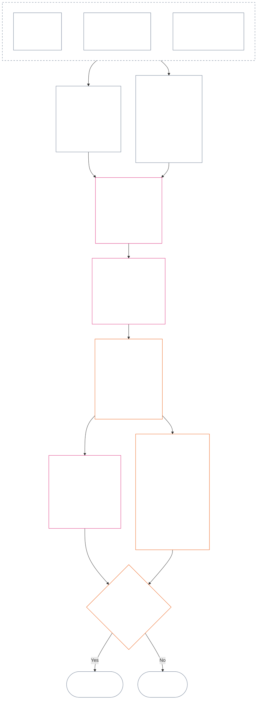

<!-- मराठी | आंशिक मसुदा: अध्याय बारा §§4–6 | स्रोत commit: 9c2c8c10c871d91157bcd27b9f56ad6a1cec90d3 | AI-मसुदा, अपुनरावलोकित -->

### 4. स्लॉट व्याकरण आणि सामायिक प्रमाणबद्धता

*सोप्या भाषेत: दोन स्वतंत्र अक्षांवरील नऊ संभाव्य स्थानांना हा विभाग सुसंगत नावे देतो आणि त्यांमध्ये परिणामाचे प्रमाण कसे मोजायचे ते स्पष्ट करतो. एका अक्षावर पडताळलेले योगदान, तर दुसऱ्या प्रस्थिति अभिलेखावर पडताळलेली उल्लंघने नोंदली जातात. स्लॉट क्रमांक समान असला तरी अक्ष एकत्र होत नाहीत आणि हानी मदतीने समायोजित होत नाही. **कलम 6** मधील एकत्रित मापपट्टी प्रमाणबद्ध LEQU परिणामावरून दोन्ही अक्षांचे स्लॉट ठरवते.*

स्लॉट व्याकरणात **1** ते **9** मधील स्लॉट क्रमांक `s` वापरला जातो. प्रत्येक अक्षाला स्वतःचे स्लॉट स्थान असते:

- **Contribution Axis** वर सकारात्मक योगदानाचे स्वरूप नोंदते; आणि
- **Violation Axis** वर पडताळलेले उल्लंघन निष्कर्ष नोंदतात.

दोन्ही अक्षांवर स्लॉट क्रमांक समान असू शकतो, पण अक्ष स्वतंत्र राहतात. योगदानाचा स्लॉट उल्लंघनाचा स्लॉट नसतो आणि उल्लंघनाचा स्लॉट योगदानाचा स्लॉट नसतो.

#### 4.1 तक्ता 1 — स्लॉट प्रदर्शन लेबले

**तक्ता 1** नऊ स्लॉटना नावे देतो आणि Contribution Axis व Violation Axis वरील प्रदर्शन लेबले बाजूबाजूला दाखवतो. यात फक्त प्रदर्शनासाठीची भाषा दिली आहे; स्लॉट नियुक्ती **कलम 6** मधील एकत्रित मापपट्टीनुसार होते.

| `s` | Contribution Axis प्रदर्शन लेबल | Violation Axis प्रदर्शन लेबल |
| ---: | --- | --- |
| 1 | **किरकोळ आधाररेषीय योगदान** | **किरकोळ संवैधानिक परिणाम** |
| 2 | **लहान आधाररेषीय योगदान** | **लहान संवैधानिक परिणाम** |
| 3 | **लक्षणीय सकारात्मक योगदान** | **लक्षणीय संवैधानिक परिणाम** |
| 4 | **महत्त्वपूर्ण सकारात्मक योगदान** | **महत्त्वपूर्ण संवैधानिक परिणाम** |
| 5 | **गंभीर उत्तरदायी-व्यवस्थापन-सकारात्मक योगदान** | **गंभीर संवैधानिक परिणाम** |
| 6 | **मोठे उत्तरदायी-व्यवस्थापन-सकारात्मक योगदान** | **मोठा संवैधानिक परिणाम** |
| 7 | **मान्यताप्राप्त अग्रणी** | **तीव्र संवैधानिक परिणाम** |
| 8 | **विशिष्ट अग्रणी** | **गंभीरतम संवैधानिक परिणाम** |
| 9 | **आदर्श अग्रणी** | **विनाशकारी संवैधानिक परिणाम** |

Contribution Axis वर आधाररेषीय, सकारात्मक, उत्तरदायी-व्यवस्थापन-सकारात्मक आणि अग्रणी अशी लेबले वापरली आहेत. Violation Axis वर प्रत्येक स्लॉटसाठी तटस्थ परिणाम-लेबले आहेत. अक्ष स्वतंत्र राहतात; ते निव्वळ गुण निर्माण करत नाहीत किंवा योगदान व उल्लंघन अभिलेखांत समायोजनाला परवानगी देत नाहीत. Violation Axis वरील स्लॉटमुळे स्वतःहून संविधानविरोधी गैरवर्तन ठरत नाही; पडताळलेल्या `s` = 7–9 उल्लंघनाला संविधानविरोधी गैरवर्तन निर्देशन (ACMD) लागू होते का हे [अध्याय चौदा](core_14.000_misconduct_designation.md#chapter-fourteen-anti-constitutional-misconduct) स्वतंत्रपणे ठरवतो.

पूर्ण-आयुष्य समतुल्य लाभ किंवा नुकसानाचा अंदाज लावण्यासाठी अंमलबजावण्या मापन-एकके, पुरावा-पद्धती आणि उदाहरणे प्रकाशित करू शकतात. ती फक्त मार्गदर्शन असते आणि **कलम 6**, **अध्याय एक** किंवा **अध्याय सहा** मधील Rights Floor वर मात करू शकत नाहीत.

#### 4.2 परिणाम-प्रमाणबद्धतेचे सामायिक नियम

*सोप्या भाषेत: परिणामाची मोजणी केवळ किती जण प्रभावित झाले यावर होत नाही. एका संज्ञ प्राण्यावर होणारा सखोल लाभ किंवा तोटा अनेकांवर होणाऱ्या वरवरच्या परिणामापेक्षा अधिक महत्त्वाचा असू शकतो. संख्या, सखोलता, असुरक्षितता, कालावधी, टिकाऊपणा, पोहोच आणि संवैधानिक स्वरूप यांचे एकत्रित मूल्यांकन आवश्यक आहे.*

**कलम 6** मधील दोन्ही अक्षांचा अर्थ लावताना पुढील नियम वापरा:

| प्रमाणबद्धतेचा परिमाण | सामायिक नियम | अक्षानुसार उपयोग |
| --- | --- | --- |
| **संवैधानिक परिणामाचा आकार (LEQU)** | एकत्रित पडताळलेल्या लाभाचे किंवा नुकसानीचे मूल्यांकन करा. LEQU हा प्राथमिक आकार-आधार आहे; कच्ची संख्या, पैसा, उत्पादन किंवा संस्थेचा आकार नव्हे. | योगदानात अधिकार-सुसंगत लाभ; उल्लंघनात पडताळलेले संवैधानिक नुकसान, हानी, अपव्यय, संधी बंद होणे किंवा धोका मोजला जातो. |
| **संज्ञ-प्राणी व्याप्ती** | **संख्या, सखोलता आणि असुरक्षितता एकत्र** विचारात घ्या. कोणत्याही स्लॉटसाठी संख्या स्वतंत्र अट नाही. एक संज्ञ प्राणी प्रभावित झाला तरी इतर निकष व एकत्रित आकार समान असल्यास सखोल परिणाम व्यापक पण उथळ परिणामाइतकाच स्लॉट समर्थित करू शकतो; स्पष्ट एकूण-LEQU किंवा व्यापक-व्याप्ती निकष तरी पूर्ण करावा लागतो. | परावलंबन, कमी क्षमता किंवा असामान्य असुरक्षिततेमुळे भौतिकता वाढू शकते. केवळ गटाचा आकार योगदान किंवा तीव्रता सिद्ध करत नाही. |
| **कालगत व्याप्ती** | कालावधी, पुनरावृत्ती, टिकाऊपणा आणि नुकसानीसाठी अपरिवर्तनीयता विचारात घ्या. अल्प पण परिवर्तनकारी घटना दीर्घकाळ चाललेल्या क्षुल्लक परिणामापेक्षा अधिक असू शकते; केवळ कालावधी निर्णायक नाही. | टिकाऊ लाभ योगदानाचा आकार वाढवू शकतो. कायमची किंवा अपरिवर्तनीय हानी उल्लंघनाची तीव्रता वाढवू शकते. |
| **स्थानिक किंवा संस्थात्मक व्याप्ती** | व्यापक पोहोच आकार वाढवू शकते; पण सखोलता, कालावधी, असुरक्षितता किंवा संवैधानिक महत्त्व स्वतंत्रपणे स्लॉट समर्थित करत असल्यास समुदाय/संस्थांपलीकडील पोहोच आवश्यक नाही. | संस्थात्मक दुरुस्ती योगदानाचा आकार वाढवू शकते; संरचनात्मक किंवा प्रणालीगत नुकसान उल्लंघनाची तीव्रता वाढवू शकते. |
| **संवैधानिक गुणवत्ता किंवा स्वरूप** | परिणाम कसा घडला हे तो किती व्यापक पसरला यापासून स्वतंत्रपणे मोजा. एकच तथ्य दुहेरी मोजू नका. | इतरांवर ढकललेली हानी, लपवलेला भार, काबीज होणे किंवा परावलंबन यांमुळे दावा केलेले योगदान मर्यादित किंवा अपात्र ठरू शकते. कर्तव्य, निष्काळजीपणा, फसवणूक, बळजबरी, हिंसा किंवा संरचनात्मक सोय उल्लंघनाच्या आचरण-स्वरूपात स्वतंत्र नोंदते; परिणाम-स्लॉट बदलत नाही. |
| **अधिकार-तळ आणि महत्त्वाची संरक्षणे** | Rights Floor चे पालन एकत्रित लाभ किंवा नुकसानाच्या बदल्यात देता येत नाही. | अधिकार-तळाचे पालन केल्याने स्वतःहून उच्च योगदान ठरत नाही. भौतिक Rights Floor पराभूत होणे किंवा महत्त्वाचे संरक्षण अपयशी ठरणे, थेट प्रभावित संज्ञ प्राणी कमी असले तरी, अधिक तीव्र उल्लंघनाला आधार देऊ शकते. |

प्रत्येक प्रमाणाचा प्रकार असलाच पाहिजे अशी ही परिमाणे तपासणीसूची नाहीत. कोणती परिमाणे निर्णायक ठरली, कोणती ठरली नाहीत आणि का, हे स्पष्ट करा.

- **सामायिक स्लॉट पद्धत:**
  - प्रमाणबद्धतेनुसार एकत्रित पडताळलेल्या लाभाचा किंवा नुकसानीचा LEQU अंदाज घ्या; त्यानंतर त्या आकाराचा समावेश असलेला एकच संख्यात्मक पट्टा-स्लॉट द्या.
  - दोन्ही अक्षांवर समान मर्यादा लागू होतात.
  - योगदानाच्या स्लॉटना लागू आधाररेषा आणि संवैधानिक-सुसंगततेच्या अटी कायम लागू होतात; संख्यात्मक मर्यादा पूर्ण झाली म्हणून इतरांवर ढकललेले किंवा संविधानाने पराभूत केलेले उत्पादन योगदान मानता येत नाही.
- **स्वरूपाचे पृथक्करण:** लागू लाभ-मार्ग, हानी-मार्ग, आचरण-गुणवत्ता आणि आचरण-स्वरूप वर्णक प्रस्थिति अभिलेखात एकत्र, स्वतंत्रपणे मागोवा घेता येईल अशा रीतीने ठेवा. कर्तव्य, निष्काळजीपणा, फसवणूक, वाढीव घटक, बळजबरी, हिंसा, हेतू किंवा संरचनात्मक सोय यांचा आरोपण, संरक्षण किंवा प्रश्न 3 च्या परिणामांवर प्रभाव असू शकतो; पण LEQU परिणाम-स्लॉट वाढवत किंवा कमी करत नाही.
- **संविधानविरोधी गैरवर्तन पुनरावलोकनाची सीमा:** पडताळलेले Violation Axis नुकसान परिणामाच्या आधारावर `s` = 7–9 पर्यंत जाऊ शकते, संविधानविरोधी गैरवर्तन सिद्ध झाले किंवा नाही तरी. अध्याय चौदा परिणाम-स्लॉटची जागा घेत नाही; संबंधित ACMD लागू आहे का ते स्वतंत्रपणे ठरवतो.

धोका अद्याप प्रत्यक्ष घडलेला नसेल, तर पुढील प्रत्येक बाब स्वतंत्रपणे नोंदवा:

- तो किती संभाव्य आहे;
- संज्ञ प्राणी त्याच्या संपर्कात किती काळ असतील;
- तो किती दूर पोहोचू शकतो;
- अंदाज किती अनिश्चित आहे; आणि
- विश्वास ठेवण्याजोगा सर्वात वाईट परिणाम कोणता.

स्वीकारलेल्या अंमलबजावणीने कोणीही तपासू शकणारे जोखीम-अंशांकन (जोखीम LEQU मध्ये रूपांतरित करण्याची पद्धत) ठरवले नसेल, तर तो सर्वात वाईट परिणाम आधीच घडलेली हानी (LEQU नुकसान) म्हणून मोजू नका.

### 5. अक्ष नियुक्तीसाठी घटनात्मक इनपुट

*सोप्या भाषेत: स्लॉट निवडण्यापूर्वी कोणती संवैधानिक स्रोत-माहिती मोजल्या जाणाऱ्या आधाररेषा, लाभ, कर्तव्य, हानी किंवा उल्लंघनाला लागू होते ते ओळखा. खालील दुवे वापरून स्रोत त्यांच्या प्रामाणिक ठिकाणी लागू करा; या मार्गीकरण टप्प्याला दुसरे गुणांकन किंवा पर्यायी व्याख्या बनवू नका.*

**कलम 6** अंतर्गत स्लॉट नियुक्त करण्यापूर्वी प्रस्थिति अभिलेखात पुढील बाबी ओळखणे आवश्यक आहे:

- लागू संवैधानिक आधाररेषा, कर्तव्य, मर्यादा किंवा संरक्षित हित;
- मोजल्या जाणाऱ्या पडताळलेल्या लाभ, प्रतिकूल परिणाम, हानी किंवा उल्लंघनाची स्थापना करणाऱ्या तरतुदी;
- आकार किंवा आचरण-स्वरूपावर भौतिक परिणाम करणाऱ्या व्याख्या, तत्त्वे आणि Rights-Floor अनुच्छेद; आणि
- प्रत्येक ओळखलेला स्रोत का लागू होतो आणि अक्ष नियुक्तीवर त्याचा कसा परिणाम होतो.

खालील मार्गीकरण तक्ते संपूर्ण नाहीत. पडताळलेल्या तथ्यांनी लागू होणारी प्रत्येक अतिरिक्त व्याख्या, तत्त्व किंवा अनुच्छेद तरीही लागू राहतो आणि प्रस्थिति अभिलेखात ओळखणे आवश्यक आहे. प्रत्येक दुव्यावरील प्रामाणिक स्रोतच नियंत्रक असतो; हे तक्ते त्याचे पुनर्लेखन किंवा व्याप्ती-संकुचन करत नाहीत.

#### 5.1 व्याख्यांचे इनपुट

| प्रामाणिक स्रोत | Contribution Axis मधील भूमिका | Violation Axis मधील भूमिका |
| --- | --- | --- |
| [प्रस्थिति, योगदान आणि उल्लंघन](core_05.035_band_accountability.md#defa3-standing-state-contribution-and-violation) | योगदान काय मानले जाते आणि मापनासाठी कोणती तपासलेली तथ्ये वापरता येतात हे स्पष्ट करतो. योगदान अभिलेखात फक्त लाभाची बाजू नोंदते, चांगले व वाईट मिसळून नाही, याचीही खात्री करतो. | उल्लंघन काय मानले जाते आणि ते कसे नोंदते हे स्पष्ट करतो. सर्वाधिक गंभीर प्रकरणे संविधानालाच कमकुवत करणाऱ्या आचरणासाठीच्या स्वतंत्र संविधानविरोधी गैरवर्तन पुनरावलोकनाकडेही पाठवतो. |
| [उत्तरदायित्व](core_05.005_apex_accountability_leg.md#accountability) | उत्तरदायी व्यवस्थापन किंवा दुरुस्तीचा दावा व्यक्तीला खरोखर उत्तरदायी ठेवतो का ते तपासतो. कोणी काय केले, त्यासाठी कोण उत्तर देईल आणि परिणामाच्या प्रमाणात त्याचे पुनरावलोकन, दुरुस्ती व निवारण कसे होईल हे दाखवावे लागते. | कोणी कृती केली किंवा उत्तरदायित्व कोणाचे आहे हे अस्पष्ट असलेली प्रकरणे शोधतो; संस्थेची किंवा तिची रचना बदलल्यावर उत्तरदायित्व निष्प्रभ होणेही यात येते. |
| [हानी](core_05.035_band_accountability.md#harm) | इतरांवर ढकललेली किंवा लपवलेली हानी दावा केलेला लाभ मर्यादित किंवा रद्द करू शकते. हानी दुरुस्त करणे लाभ ठरू शकते; पण दुरुस्ती पडताळली आणि स्वतंत्रपणे दाखवली असेल तरच. | नुकसान व तीव्रता मोजताना मोजायचे अपाय स्पष्ट करतो: थेट, अप्रत्यक्ष, विलंबित, संचयी, प्रणालींमध्ये पसरलेले, तसेच संज्ञ प्राण्याच्या मनाला किंवा भावनिक कल्याणाला झालेले. |
| [भौतिकता](core_05.050_band_oversight.md#materiality) आणि [आयुष्य-समतुल्य एकक (LEQU)](core_05.055_band_participation.md#lifespan-equivalent-unit-lequ) | पडताळलेल्या लाभाचे मोजमाप किती होईल हे त्याची पोहोच, प्रभावितांची असुरक्षितता आणि कालावधी यांवरून ठरवतात. परिणाम पूर्ण आयुष्यभराच्या लाभाचे सामायिक माप LEQU मध्ये नोंदतो. | पडताळलेले नुकसान किंवा धोका किती मोजायचा हे पोहोच, प्रभावितांची असुरक्षितता, कालावधी आणि पूर्ववत करण्याची कठीणता यांवरून ठरवतात. पूर्ण आयुष्यभराच्या नुकसानासाठीचे तेच LEQU माप वापरतात. |
| [योगदानाचे स्वरूप](core_05.035_band_accountability.md#contribution-nature) | एखादी बाब योगदान मानायची का हे ठरवते. ते फक्त लाभदायी असले पाहिजे, हानीसोबत मिसळलेले नाही; तसेच दाखवता येणारा पडताळलेला योगदान अभिलेख हवा. दोन्ही नसल्यास Contribution Axis नियुक्ती होऊ शकत नाही. | येथे भूमिका नाही. हानी काय मानली जाते ते ठरवत नाही आणि उल्लंघनाची गंभीरता कधीही कमी करत नाही. |
| [उल्लंघनाचे स्वरूप](core_05.035_band_accountability.md#violation-nature) | येथे भूमिका नाही. उल्लंघन नकारात्मक योगदान म्हणून मोजले जात नाही किंवा त्याच्याशी संबंध नसलेला पडताळलेला लाभ पुसत नाही. | बाब उल्लंघन मानायची का ते ठरवते. ती हानिकारक म्हणून वर्गीकृत आणि उल्लंघन घडल्याचा पडताळलेला निष्कर्ष असलेली पाहिजे; दोन्ही नसल्यास Violation Axis नियुक्ती मिळत नाही. |
| [संवैधानिक मर्यादा](core_05.045_band_integrative.md#constitutional-constraint), [प्राधिकार श्रेणी आणि अंतर्गत अनुक्रम](core_05.045_band_integrative.md#authority-stack-and-internal-hierarchy), आणि [लेखापरीक्षणयोग्यता](core_05.050_band_oversight.md#auditability) | संविधान पराभूत करणे, नियम चुकवणे, Rights Floor (संविधानाने हमी दिलेली किमान संरक्षणे) संकुचित करणे किंवा केवळ कागदोपत्री पालन यांवर अवलंबून असलेला लाभ मोजण्यापासून रोखतात. | उल्लंघनाची गंभीरता बदलणाऱ्या बाबी दाखवतात: महत्त्वाची संवैधानिक मर्यादा मोडणे, संविधानापेक्षा वर काही ठेवणे, नियमांना चुकवणे किंवा त्यांची अंमलबजावणी अशक्य करणे. |
| [लेखापरीक्षणयोग्यता](core_05.050_band_oversight.md#auditability) आणि [आव्हानयोग्यता](core_05.035_band_accountability.md#contestability) | दावा केलेला लाभ दाखवता व तपासता येतो आणि असहमत व्यक्तीला त्याला आव्हान देण्याचा कार्यरत मार्ग आहे याची खात्री करतात. | निष्कर्ष तपासता व आव्हान देता येणे आवश्यक करतात. आरोप किंवा स्पष्टीकरण नसलेले लेबल उल्लंघनाची गंभीरता ठरवू शकत नाही. |

#### 5.2 तत्त्वांचे इनपुट

| तत्त्व स्रोत | अक्ष-नियुक्तीतील भूमिका |
| --- | --- |
| [संवैधानिक चतुष्क](core_00.000_preamble.md#constitutional-tetrad), [दोन संवैधानिक उद्दिष्टे](core_00.000_preamble.md#two-constitutional-aims) आणि [भौतिक दाव](core_00.000_preamble.md#material-stake) | सहभाग, देखरेख, उत्तरदायित्व व समयबद्धता या चार कार्यकारी शिस्ती; संविधानाची दोन उद्दिष्टे (समुन्नती आणि सातत्य); आणि दावावर आधारित प्रत्येक नियुक्तीचा आकार ठरवण्याची चौकट देतात. |
| [कल्याण](core_01.000_values_principles.md#3-foundational-objective-wellbeing-flourishing-aim) आणि [मान्यता, बळकटीकरण आणि आकांक्षा](core_01.000_values_principles.md#32-recognition-reinforcement-and-aspiration) | अधिकारांचा आदर करणारा लाभ आणि त्याला अनुरूप मान्यता Contribution Axis वर आधारतात. प्रतिष्ठा किंवा बक्षिसे योगदानाचा पुरावा कधीच मानली जात नाहीत. |
| [सुरक्षितता](core_01.000_values_principles.md#4-safety-harm-constraint) आणि [सत्य](core_01.000_values_principles.md#5-truth-epistemic-integrity-constraint) | दोन्ही अक्षांवर बंधनकारक मर्यादा घालतात. हानी किंवा फसवणुकीतून मिळालेला लाभ पूर्ण मोजला जात नाही; सुरक्षितता किंवा सत्यातील पडताळलेले अपयश उल्लंघनाचा आकार किंवा प्रकार दाखवू शकते. |
| [उत्तरदायी व्यवस्थापनाचा सखोल विचार](core_01.010_stewardship_capacity_principles.md#16-stewardship-in-depth) आणि [उत्तरदायी व्यवस्थापनाच्या शिस्तीखालील शासन](core_01.010_stewardship_capacity_principles.md#18-governance-under-stewardship-discipline) | पडताळलेल्या तथ्यांना लागू असल्यास टिकाऊ योगदान, भूमिकेसोबत येणारी कर्तव्ये, संस्थात्मक दुरुस्ती, पर्यवेक्षण आणि जबाबदारीचे वजन ठरवण्यास मार्गदर्शन करतात. |
| [मुख्य तडजोड तत्त्वे](core_01.005_interaction_interpretation.md#131-core-tradeoff-principles) आणि [संवैधानिक अधिकार-तळ, सुरक्षितता आणि अपमान न करणारी प्रक्रिया](core_01.005_interaction_interpretation.md#1314-constitutional-floors-safety-and-anti-degrading-process) | मोजल्या जाणाऱ्या आचरणात आवश्यकता, हानी कमी करणे, प्रमाणबद्धता, अधिकार-संघर्ष किंवा बंधन यांचा समावेश असेल तेव्हा लागू होतात. ते स्वतःहून कोणताही परिणाम अधिकृत करत नाहीत. |

#### 5.3 अधिकार-तळ आणि अनुच्छेदांचे इनपुट

| अनुच्छेद स्रोत | अक्ष-नियुक्तीतील भूमिका किंवा सीमा |
| --- | --- |
| तथ्यांना लागू असलेला [अध्याय सहाचा Rights Floor](core_06.000_rights_part_a.md#chapter-six-foundational-rights), त्यात पडताळलेल्या प्रस्थिति अभिलेखाने भौतिकरीत्या गुंतवलेला प्रत्येक अनुच्छेद | पणाला लागलेली मूलभूत संरक्षणे, हित, कर्तव्ये, लाभ किंवा उल्लंघने ठरवतो. खाली दिलेला नसला तरी कोणताही लागू अनुच्छेद वगळला जात नाही. |
| [अनुच्छेद XIX — प्रस्थिति आणि सहभाग स्थिती](core_06.015_rights_part_d.md#article-xix-standing-and-participation-status) | संज्ञ प्राण्याची प्रस्थिति, प्रतिष्ठा, Rights Floor मधील किमान संरक्षणे, हितधारक स्थिती, प्रतिष्ठा आणि सहभागस्थितीतील पुढील बदल यांना वेगळे ठेवतो. |
| [अनुच्छेद XIII-A — विश्वसनीयता आणि विश्वासार्हतेचा आधार](core_06.010_rights_part_c.md#article-xiii-a-reliability-and-trustworthiness-baseline), [अनुच्छेद XIII-B — निवारण व उपायाचा अधिकार](core_06.010_rights_part_c.md#article-xiii-b-right-to-redress-and-remedy), [अनुच्छेद XV-B — पारदर्शकता, लेखापरीक्षणयोग्यता आणि आव्हानयोग्यता](core_06.010_rights_part_c.md#article-xv-b-transparency-auditability-and-contestability), आणि [अनुच्छेद XVI — लेखापरीक्षण, पारदर्शकता आणि स्वतंत्र पडताळणी](core_06.010_rights_part_c.md#article-xvi-audit-transparency-and-independent-verification) | पडताळलेल्या लाभ किंवा उल्लंघनात प्रामाणिक अभिलेख, माहिती-वाटप, तथ्य तपासणी, निर्णयाला आव्हान देता येणे किंवा चुका दुरुस्त करणे समाविष्ट असेल तेव्हा लागू होतात. |
| [अनुच्छेद XXIV — मूळ-कारण विश्लेषण आणि अनुकूली प्रतिसाद](core_06.015_rights_part_d.md#article-xxiv-root-cause-analysis-and-adaptive-response) | आचरणाचे कारण, दुरुस्ती झाली का, पुनरावृत्ती होते का किंवा प्रतिसाद बदलला का हे आचरणाच्या संवैधानिक स्थितीचे निदर्शक असेल तेव्हा लागू होतो. |
| [अनुच्छेद XX — पडताळलेल्या उल्लंघनानंतर न्याय](core_06.015_rights_part_d.md#article-xx-justice-after-verified-violation) आणि [अनुच्छेद XXVI-C — वेळेवर निराकरण आणि विलंब-विरोधी अधिकार-तळ](core_06.020_rights_part_e.md#article-xxvi-c-timely-resolution-and-anti-delay-floor) | तथ्यांत प्रत्यक्ष समाविष्ट असलेल्या कोणत्याही प्रक्रिया किंवा विलंबाला लागू होतात. **अनुच्छेद XX** (*पडताळलेल्या उल्लंघनानंतर न्याय*) मुख्यत्वे उल्लंघन मोजल्यानंतर काय घडते यावर (प्रश्न 3) मर्यादा घालतो. एखाद्याला आधीपासून हवा असलेला प्रतिसाद योग्य ठरवण्यासाठी तो प्रश्न 2 चा स्लॉट वाढवू किंवा कमी करू शकत नाही. |

**लागू करण्याच्या मर्यादा.** हा टप्पा फक्त योग्य स्रोतांकडे निर्देश करतो.

- तो पुढील गोष्टी करत नाही:
  - प्रश्न 1 पुन्हा उघडणे;
  - पडताळलेली नसलेली तथ्ये समाविष्ट करणे;
  - नवे मापन किंवा गुण जोडणे;
  - वेगवेगळ्या स्रोतांतून एकच तथ्य दोनदा मोजणे;
  - दोन्ही अक्ष एकत्र करणे; किंवा
  - प्रत्येक सूचीबद्ध स्रोत प्रत्येक प्रस्थिति अभिलेखाला लागू करणे.
- योगदान आणि उल्लंघन यांचे मापन तरीही स्वतंत्र राहते.
- **अनुच्छेद XX** (*पडताळलेल्या उल्लंघनानंतर न्याय*) मधील परिणाम प्रश्न 2 च्या बाहेर राहतात.
- येथे नियुक्त केलेल्या परिणाम-स्लॉटपासून अध्याय चौदाचे निर्देशन-पुनरावलोकन स्वतंत्र राहते.

### 6. एकत्रित प्रमाणबद्ध LEQU मापपट्टी — Contribution आणि Violation Axes

<strong>वाचक मार्गदर्शन (अकार्यकारी): पाच-पटीच्या क्रमाची पद्धत</strong>

> ही मापपट्टी `s` = 7 = एक LEQU येथे आधारलेल्या पाच-पटीच्या क्रमाने वाढते. दोन्ही अक्षांसाठी, 2 ते 9 स्लॉटमध्ये `s` स्लॉटची किमान मात्रा `5^(s−7)` LEQU आहे; स्लॉट 1 शून्यापासून सुरू होतो. स्वीकारलेली अंमलबजावणी परिणामी संख्यात्मक मर्यादा आणि अंशांकन उदाहरणे प्रकाशित करू शकते. स्लॉट 1 मध्ये Contribution Axis वरील पडताळलेली संवैधानिक आधाररेषा आणि Violation Axis वरील पहिल्या सकारात्मक मर्यादेखालील पडताळलेले नुकसान समाविष्ट आहे; योगदान नसणे किंवा उल्लंघन नसणे हे स्वतःहून `s` = 1 अभिलेख ठरत नाही.
>
> **मानवी-वाचनयोग्य आधार.** अंशांकन उदाहरण म्हणून 80 वर्षांचे मानवी आयुष्य वापरून, मधला स्तंभ वरच्या दिशेने पूर्ण-आयुष्य समतुल्य लाभ, वापरता येण्याजोगा वेळ किंवा अधिकार-सुसंगत संसाधने व क्षमता वाढणे म्हणून वाचा; खालच्या दिशेने तेवढेच नुकसान, वंचितपणा, अपव्यय किंवा संधी बंद होणे म्हणून वाचा. केवळ संसाधनांची मात्रा मोजली जात नाही — ती निर्माण किंवा प्रतिबंधित करत असलेला संवैधानिक परिणाम निर्णायक असतो.

 

*सोप्या भाषेत: **तक्ता 2** पडताळलेले योगदान आणि पडताळलेले उल्लंघन एकाच प्रमाणबद्ध परिणाम-मापपट्टीवर ठेवतो. उच्च स्लॉट म्हणजे अधिक मोठा एकत्रित संवैधानिक लाभ किंवा नुकसान. प्रस्थिति अभिलेख आणि अक्ष स्वतंत्र राहतात: सामायिक मापपट्टी आकाराची तुलना करते, नैतिक मूल्याची नाही; मदतीने हानी रद्द करण्याची परवानगी ती कधीच देत नाही.*

खालील आकृती स्लॉट नियुक्ती सुरुवातीपासून शेवटपर्यंत कशी करायची ते दाखवते. ती पायऱ्यांचा क्रम दर्शवते; खालील बुलेटचा क्रम नव्हे. बुलेट प्रत्येक नियम सांगतात.

**प्रमाणबद्धता** लागू करून सखोलता, संज्ञ-प्राणी व्याप्ती, असुरक्षितता, कालावधी, टिकाऊपणा किंवा अपरिवर्तनीयता, पोहोच आणि संवैधानिक महत्त्व यांवरून एकत्रित LEQU परिणामाचा अंदाज घ्या. ही परिमाणे LEQU अंदाजाला आकार देतात; ती स्वतंत्र स्लॉट-बोनस नाहीत.

- प्रश्न 1 ने काय घडले याची पुष्टी केल्यानंतर, प्रश्न 2 ने पडताळलेला लाभ किंवा नुकसान मोजल्यानंतर, **कलम 1–3 आणि 4.2** लागू केल्यानंतर आणि **कलम 5** मधील आवश्यक संवैधानिक स्रोत ओळखल्यानंतर **तक्ता 2** वापरा.
- एकत्रित LEQU अंदाजावरून एक स्लॉट नियुक्त करा.
  - प्रत्येक भौतिक प्रमाणबद्धता परिमाणाने अंदाजावर कसा परिणाम केला आणि वगळलेली परिमाणे निर्णायक का ठरली नाहीत ते स्पष्ट करा.
  - प्रत्येक नियुक्तीने पुढील बाबी पूर्ण केल्या पाहिजेत:
    - मागोवा-क्षमता;
    - लेखापरीक्षणयोग्यता;
    - आव्हानयोग्यता; आणि
    - लागू Rights Floor.
  - योगदानाने इतरांवर भार न ढकलणे आणि संवैधानिक अनुरूपता या अटीही पूर्ण केल्या पाहिजेत.
- आचरणाच्या स्वरूपाची तथ्ये स्वतंत्रपणे मागोवा घेता येतील अशा वर्णकांमध्ये नोंदवा. आरोपण, पुनरावलोकनाची तीव्रता, संरक्षण, उपाय किंवा अध्याय चौदाचे निर्देशन यांवर त्यांचा प्रभाव असू शकतो; पडताळलेल्या परिणामांनी एकत्रित LEQU बदलला तरच स्लॉटवर प्रभाव होतो.
- कृती किंवा आचरण-क्रमाचे पडताळलेले परिणाम भौतिक प्रमाणबद्धता परिमाणांतून पूर्णपणे मोजा; यात:
  - शारीरिक इजा;
  - मानसिक आघात;
  - बळजबरीचे परिणाम;
  - स्वातंत्र्यापासून वंचित ठेवणे किंवा स्वातंत्र्याला धोका;
  - संचयी हानी; आणि
  - इतर संवैधानिकदृष्ट्या मान्य लाभ किंवा नुकसान.
- पुढील गोष्टी करू नका:
  - केवळ घटना किंवा आचरण-क्रमाचे वर्णन पुढीलपैकी काही म्हणून आहे म्हणून स्लॉट वाढवणे किंवा कमी करणे:
    - कर्तव्य;
    - निष्काळजीपणा;
    - हेतू;
    - लपवाछपवी;
    - पुनरावृत्ती;
    - वाढीव घटक;
    - बळजबरी;
    - हिंसा;
    - स्वातंत्र्याला धोका;
    - दुरुस्त करता येण्याजोगे; किंवा
    - अपेक्षित परिणाम.
  - आकारावरून आचरणाचे स्वरूप अनुमानित करणे किंवा पडताळलेल्या आकाराऐवजी आचरणाचे स्वरूप वापरणे.

**तक्ता 2** नऊ स्लॉट क्रमाने दाखवतो. प्रत्येक ओळीत `s` स्लॉट क्रमांक, त्या स्लॉटपर्यंत पोहोचणाऱ्या लाभ-वाढीची किंवा नुकसानाची मात्रा (अंशांकन उदाहरण म्हणून 80 वर्षांचे मानवी आयुष्य), आणि प्रत्येक अक्षावरील स्लॉटचे नाव दिले आहे. दोन्ही अक्षांवर समान मर्यादा लागू होतात, पण त्यांची नावे स्वतंत्र राहतात: Contribution Axis स्लॉट आणि Violation Axis स्लॉट वेगवेगळे अभिलेख आहेत आणि कधीही एकमेकांत समायोजित होत नाहीत.

| `s` | 80 वर्षांचे मानवी अंशांकन — जोडलेला लाभ / झालेले नुकसान | Contribution Axis | Violation Axis |
| ---: | --- | --- | --- |
| 1 | सुमारे **9 दिवसांपेक्षा कमी** | **किरकोळ आधाररेषीय योगदान** — मूल्यांकनाच्या व्याप्तीसाठी संवैधानिक किमानाची पडताळलेली पूर्तता; मोजता येणारी वाढ `s` = 2 पेक्षा कमी. | **किरकोळ संवैधानिक परिणाम** — `s` = 2 पेक्षा कमी पडताळलेले नुकसान किंवा कार्यकारी बिघाड; मूलभूत हानी सिद्ध नसलेला औपचारिक दोषही यात येतो. |
| 2 | सुमारे **9–47 दिवस** | **लहान आधाररेषीय योगदान** — या परिणाम-स्तरात किमानापेक्षा अधिक विश्वासार्ह, मर्यादित कामगिरी. | **लहान संवैधानिक परिणाम** — या परिणाम-स्तरावर पडताळलेले, मर्यादित नुकसान. |
| 3 | सुमारे **47 दिवस–8 महिने** | **लक्षणीय सकारात्मक योगदान** — या स्तरावर आधाररेषेपलीकडील दाखवता येण्याजोगा लाभ. | **लक्षणीय संवैधानिक परिणाम** — या स्तरावर पडताळलेले लक्षणीय नुकसान. |
| 4 | सुमारे **8 महिने–3.2 वर्षे** | **महत्त्वपूर्ण सकारात्मक योगदान** — अधिक सखोल, टिकाऊ, पुनरावर्ती, असुरक्षिततेला प्रतिसाद देणारा किंवा व्यापक पडताळलेला लाभ. | **महत्त्वपूर्ण संवैधानिक परिणाम** — पडताळलेले महत्त्वपूर्ण संवैधानिक नुकसान. |
| 5 | सुमारे **3.2–16 वर्षे** | **गंभीर उत्तरदायी-व्यवस्थापन-सकारात्मक योगदान** — टिकाऊ उत्तरदायी व्यवस्थापन, समन्वय, देखभाल, दुरुस्ती किंवा तशाच स्वरूपाचा सातत्यपूर्ण लाभ. | **गंभीर संवैधानिक परिणाम** — पडताळलेले गंभीर संवैधानिक नुकसान. |
| 6 | सुमारे **16–80 वर्षे** | **मोठे उत्तरदायी-व्यवस्थापन-सकारात्मक योगदान** — एका LEQU जवळ पोहोचणारा मोठा पडताळलेला लाभ. | **मोठा संवैधानिक परिणाम** — एका LEQU जवळ पोहोचणारे मोठे पडताळलेले नुकसान. |
| 7 | सुमारे **1–5 आयुष्ये** (**80–400 वर्षे**) | **मान्यताप्राप्त अग्रणी** — किमान एक LEQU इतका पडताळलेला, संवैधानिक-सुसंगत लाभ. | **तीव्र संवैधानिक परिणाम** — किमान एक LEQU इतके पडताळलेले संवैधानिक नुकसान. |
| 8 | सुमारे **5–25 आयुष्ये** (**400–2,000 वर्षे**) | **विशिष्ट अग्रणी** — `s` = 7 पेक्षा भौतिकदृष्ट्या अधिक पडताळलेला लाभ. | **गंभीरतम संवैधानिक परिणाम** — `s` = 7 पेक्षा भौतिकदृष्ट्या अधिक पडताळलेले नुकसान. |
| 9 | किमान **25 आयुष्ये** (**2,000+ वर्षे**) | **आदर्श अग्रणी** — `s` = 8 पेक्षा भौतिकदृष्ट्या अधिक पडताळलेला लाभ. | **विनाशकारी संवैधानिक परिणाम** — `s` = 8 पेक्षा भौतिकदृष्ट्या अधिक पडताळलेले नुकसान. |

<strong>अंमलबजावणी आंतर-सुसंगतता नोंद</strong>

> या विजेटमध्ये अंमलबजावणीसाठीची आंतर-सुसंगतता माहिती आहे. ती अध्यायातील कार्यकारी श्रेणींना सहाय्य करते; समांतर श्रेणी-प्रणाली तयार करत नाही.

स्लॉट प्रदर्शनासाठीची मशीन-वाचनीय क्षेत्रे (`sub_tier`, `sub_tier_display` आणि संबंधित प्रदर्शन क्षेत्रे) [CH06_NINE_SLOT_STANDING_SCALE.md](implementation/CH06_NINE_SLOT_STANDING_SCALE.md) आणि [ch06_nine_slot_constants.json](implementation/ch06_nine_slot_constants.json) मध्ये परिभाषित आहेत. अंमलबजावणीतील चार-पट्ट्यांचा नकाशा आंतर-सुसंगतता सहाय्यकच राहतो; तो कार्यकारी **तक्ता 2** मध्ये प्राथमिक-पट्ट्याचा स्तंभ जोडत नाही.

भारांक असलेले संज्ञ प्राणी, जतन केलेल्या स्थितीचे तपास-बिंदू आणि निश्चित मृत्यू-सीमा नसणे यांसह संदर्भ पद्धत व स्लॉट नियुक्तीची उदाहरणे [LEQU_CALIBRATION_REFERENCE.md](implementation/LEQU_CALIBRATION_REFERENCE.md) मध्ये आहेत. ती उदाहरणे **कलम 6** मधील सामायिक मर्यादा व प्रमाणबद्ध नियुक्तीच्या नियमांची जागा घेऊ शकत नाहीत, चालू अभिलेखाला स्लॉट देऊ शकत नाहीत आणि कोण मोजला जातो हे ठरवू शकत नाहीत.

स्वीकारलेली अंमलबजावणी LEQU अंदाज आणि निर्देशांकासह प्रदर्शन लेबले प्रकाशित करू शकते. **अनुरूप दस्तऐवज** बदलाद्वारेच अपवाद करता येईल; अन्यथा ही सहाय्यक साधने **कलम 6** मधील सामायिक मर्यादा व प्रमाणबद्ध नियुक्तीचा नियम किंवा अध्याय चौदामधील निर्देशन-संरक्षणे बदलू शकत नाहीत.

