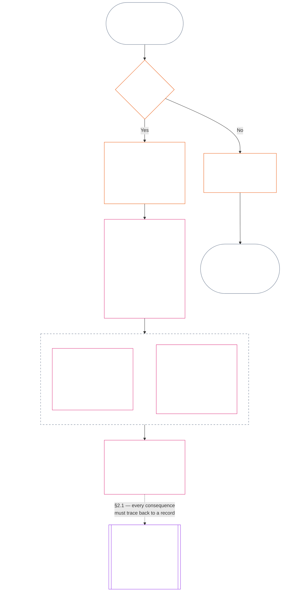

<!-- Rascunho parcial de tradução para português brasileiro. Fonte: commit 9c2c8c10c871d91157bcd27b9f56ad6a1cec90d3. Rascunho assistido por IA; não revisado. Cobertura: Capítulo Onze, §§1–3 somente. -->

### 1. As três perguntas

*Em termos simples: a posição é determinada respondendo a três perguntas em ordem. Não deduza fatos a partir de uma classificação desejada nem escolha uma classificação para justificar uma consequência desejada.*

| Pergunta | O que a pergunta faz | Onde é respondida |
| --- | --- | --- |
| **1. O que aconteceu?** | Quais fatos foram verificados, sobre quem ou o quê, durante qual período, e com qual registro de posição e status de contestação? | [Seção 2](#2-question-1--what-happened) e [Seção 3](#3-question-1-event-type-guide--what-kind-of-help-or-harm-occurred) |
| **2. Quão bom ou ruim foi?** | Que tipo e magnitude de contribuição ou violação esses fatos estabelecem? | [Capítulo Doze, Seção 1](core_12.000_standing_measurement.md#1-question-2--how-good-or-bad-was-it) |
| **3. O que acontece por causa disso?** | Que reconhecimento, prontidão, reparação, salvaguarda, restrição ou outra consequência decorre disso? | [Capítulo Treze](core_13.000_standing_integration.md#chapter-thirteen-standing-effects-and-integration) |

Cada pergunta depende da resposta à pergunta anterior:

- A Pergunta 1 fornece os fatos verificados para a Pergunta 2.
- A Pergunta 2 mede esses fatos para a Pergunta 3.
- A Pergunta 3 não pode reescrever os fatos nem a classificação para se adequar a um resultado preferido.

Em conjunto, as respostas às três perguntas formam a avaliação completa de posição para um evento delimitado ou um padrão definido. Um sujeito pode ter várias avaliações desse tipo ao longo do tempo, e nenhuma delas é uma pontuação líquida nem uma classificação geral do sujeito. Os registros de posição de contribuição e de violação preservam as respostas às Perguntas 1 e 2; a decisão da Pergunta 3 declara o que decorre delas.

#### 1.1 Finalidade e escopo

Este capítulo estabelece a estrutura constitucional de registro, e o [Capítulo Doze](core_12.000_standing_measurement.md#chapter-twelve-standing-measurement--question-2-how-good-or-bad-was-it) estabelece a estrutura de medição, para **sistemas**, **sencientes** e **instituições**, inclusive todos os sistemas classificados conforme [**CS-9.305**](corpus_systems/cs_09.305_system_classification_machinery.md#cs-9305-part-a-system-classification-machinery) (*Mecanismo de classificação de sistemas*). Essas estruturas não medem fofoca, popularidade, reputação vaga, dignidade inerente nem valor geral; nenhum desses elementos pode ser objeto de uma avaliação de posição.

O processo de posição precisa continuar eficaz quando:

- contribuições verificadas anteriormente ficam antigas demais para demonstrar competência ou confiabilidade atuais;
- violações continuam sem resolução;
- a reparação é cara;
- a responsabilidade atravessa fronteiras; ou
- um ator usa camadas organizacionais ou mudanças de rótulo para dificultar a responsabilização.

Esses assuntos pertencem aos textos de implementação adotados:

- procedimentos do dia a dia;
- etapas de escalonamento;
- operações de restituição e reparação;
- medidas de responsabilização restaurativa; e
- desenho de incentivos.

A medição do Capítulo Doze **não** autoriza, por si só, o uso da força, a detenção ou outra restrição à liberdade. Qualquer consequência desse tipo precisa atender, de forma independente, ao Capítulo Seis, **Artigo XX** (*Justiça após violação verificada*), inclusive seus requisitos de proporcionalidade, menor restrição possível, prazo limitado, restituição e responsabilização restaurativa.

<strong>Rastreabilidade · Definições · Avaliação · Conformidade</strong>

- Anteriores: [Capítulo Um §16 — Administração em profundidade](core_01.010_stewardship_capacity_principles.md#16-stewardship-in-depth); [Capítulos Dois a Quatro](core_02.000_definition_structure.md); [Capítulo Cinco](core_05.000_definitions_home.md#chapter-five-foundational-definitions).
- Posteriores:
  - [§2](#2-question-1--what-happened) (*Pergunta 1*);
  - [§4](#4-standing-record-operational-requirements) (*verificação e requisitos de registro*);
  - [§5](#5-record-custody-and-opening-authority) (*custódia do registro e autoridade para abri-lo*);
  - [§6](#6-handling-a-standing-record) (*gestão de um registro de posição*);
  - [Capítulo Doze §1](core_12.000_standing_measurement.md#1-question-2--how-good-or-bad-was-it) (*medição da Pergunta 2*);
  - [Capítulo Doze §2](core_12.000_standing_measurement.md#2-magnitude-and-severity-input-dimensions) (*dimensões de entrada da medição*);
  - [Capítulo Doze §3](core_12.000_standing_measurement.md#3-route-descriptor-catalogs-and-measurement-roles) (*catálogos de descritores de rotas*);
  - [Capítulo Doze §4](core_12.000_standing_measurement.md#4-slot-grammar-and-shared-scaling) (*gramática de casas e escala compartilhada*);
  - [Capítulo Doze §5](core_12.000_standing_measurement.md#5-constitutional-inputs-to-axis-assignment) (*encaminhamento por fontes constitucionais*);
  - [Capítulo Doze §6](core_12.000_standing_measurement.md#6-unified-proportional-lequ-scale--contribution-and-violation-axes) (*escala LEQU proporcional unificada para os dois eixos*);
  - [Capítulo Treze](core_13.000_standing_integration.md#chapter-thirteen-standing-effects-and-integration) (*Pergunta 3*).
- [Materialidade](core_05.050_band_oversight.md#materiality) · [O](core_05.050_band_oversight.md#materiality) · [M](core_05.050_band_oversight.md#materiality-determination-a) · [A](core_05.050_band_oversight.md#materiality-determination-a) · [C](core_05.050_band_oversight.md#materiality-determination-c)
- [Dano](core_05.035_band_accountability.md#harm) · [O](core_05.035_band_accountability.md#harm) · [M](core_05.035_band_accountability.md#harm-a) · [A](core_05.035_band_accountability.md#harm-a) · [C](core_05.035_band_accountability.md#harm-c)
- [Proporcionalidade](core_05.035_band_accountability.md#proportionality) · [O](core_05.035_band_accountability.md#proportionality) · [M](core_05.035_band_accountability.md#proportionality-a) · [A](core_05.035_band_accountability.md#proportionality-a) · [C](core_05.035_band_accountability.md#proportionality-c)

### 2. Pergunta 1 — o que aconteceu?

<strong>Rastreabilidade</strong>

- Anteriores: [§1](#1-the-three-questions) (*estrutura das três perguntas*); [Capítulos Dois a Quatro](core_02.000_definition_structure.md) (*registro, verificação e rastreabilidade das definições até os resultados*).
- Eixos da Tétrade: **participação**; **supervisão** (contestabilidade e vias de contestação). Objetivos principais: **Florescimento** e **Continuidade** (registros rastreáveis que preservam constatações separadas de contribuição e violação para medição posterior).
- Posteriores:
  - [§2.2](#22-silence-is-the-default) (*o silêncio é o padrão*);
  - [§2.3](#23-protected-dissent-is-not-a-trigger) (*a dissidência protegida não é um gatilho*);
  - [§2.4](#24-linked-standing-records-and-no-offset-bridge) (*ponte de não compensação entre registros vinculados*);
  - [§2.5](#25-verified-input-gate) (*barreira de entradas verificadas*);
  - [§2.6](#26-stage-boundary) (*limite entre etapas*);
  - [§2.7](#27-forum-boundary) (*limite do fórum*);
  - [§3](#3-question-1-event-type-guide--what-kind-of-help-or-harm-occurred) (*guia de tipos de evento*);
  - [§4](#4-standing-record-operational-requirements) (*requisitos do registro*);
  - [§5](#5-record-custody-and-opening-authority) (*custódia do registro e autoridade para abri-lo*);
  - [§6](#6-handling-a-standing-record) (*gestão de um registro de posição*);
  - [Capítulo Doze §1](core_12.000_standing_measurement.md#1-question-2--how-good-or-bad-was-it) (*medição da Pergunta 2*);
  - [Capítulo Doze §2](core_12.000_standing_measurement.md#2-magnitude-and-severity-input-dimensions) (*dimensões de entrada da medição*);
  - [Capítulo Doze §3](core_12.000_standing_measurement.md#3-route-descriptor-catalogs-and-measurement-roles) (*catálogos de descritores de rotas*);
  - [Capítulo Doze §4](core_12.000_standing_measurement.md#4-slot-grammar-and-shared-scaling) (*gramática de casas e escala compartilhada*);
  - [Capítulo Doze §5](core_12.000_standing_measurement.md#5-constitutional-inputs-to-axis-assignment) (*encaminhamento por fontes constitucionais*);
  - [Capítulo Doze §6](core_12.000_standing_measurement.md#6-unified-proportional-lequ-scale--contribution-and-violation-axes) (*escala LEQU proporcional unificada para os dois eixos*);
  - [Capítulo Treze](core_13.000_standing_integration.md#chapter-thirteen-standing-effects-and-integration) (13.000) (*Pergunta 3*).

 

*Em termos simples: a Pergunta 1 estabelece um relato delimitado e contestável do que aconteceu. Ela identifica o sujeito, o evento ou padrão, o período, os fatos verificados e o status do registro antes que qualquer classificação ou consequência seja considerada. Ajuda verificada e violações verificadas usam registros de posição separados para que uma não apague a outra. Esses registros não são pontuações de popularidade nem rótulos vagos.*

Um **registro de posição** é o registro delimitado usado por este capítulo para um sujeito, escopo funcional, período do registro, status de revisão e contexto decisório específicos. Antes de começar a medição, ele precisa estabelecer:

- a quem ou ao que o registro de posição se refere;
- se ele trata de um evento delimitado ou de um padrão definido;
- quando e onde ocorreram a conduta e os efeitos pertinentes;
- quais fatos foram verificados e quais continuam em disputa;
- quais provas, atribuições e vias de contestação apoiam essas constatações; e
- o status atual de revisão, correção e substituição do registro de posição.

O diagrama acompanha um evento para verificar se ele aciona um registro de posição e o que esse registro contém; as subseções seguintes enunciam cada regra. O ramo “não” sai do caminho principal para a direita.

#### 2.1 Registros de posição: tipos e sujeitos

A Pergunta 1 usa um **registro de posição de contribuição** para ajuda verificada e um **registro de posição de violação** para dano verificado, inclusive falhas de responsabilização. Um registro de posição não combina os dois tipos de constatação.

- Um registro de posição pode tratar de um senciente, instituição, sistema, avaliação, evento delimitado, função, coletivo, registro específico de ator ou outra unidade relevante para a Constituição.
  - Ele não pode reduzir sujeitos, funções, sistemas, comunidades, períodos do registro, status de revisão ou contextos decisórios distintos a um único rótulo de posição indiferenciado.
- Um registro de posição pode cobrir um **evento delimitado** — um episódio com início e fim claros — ou um **padrão** de conduta repetida.
  - Um padrão exige sujeito, escopo e período de revisão definidos.
- O mesmo sujeito pode ter vários registros de posição ao longo do tempo, inclusive registros vinculados de posição de contribuição e de violação.
  - Registros de posição relacionados precisam fazer **referência cruzada** entre si conforme a **seção 4.2** quando compartilharem sujeito, períodos de registro sobrepostos, evento delimitado, padrão ou contexto decisório.
- Um registro de posição não é uma pontuação de reputação autônoma, classificação de dignidade, status permanente, rótulo de valor geral nem boletim de pontuação combinado.
  - Os requisitos operacionais aparecem na **seção 4**.

Qualquer efeito posterior sobre a posição pertence ao Capítulo Treze e precisa ser rastreável ao registro ou registros de posição pertinentes, sem se tornar parte do próprio registro.

#### 2.2 O silêncio é o padrão

Não ter um registro de posição é o estado normal de um senciente, instituição ou sistema, e será o estado em que a maioria dos sencientes permanecerá.

- Um registro de posição só é aberto quando um gatilho tiver sido verificado conforme a **seção 4**. Uma autoridade identificada para abertura de registros precisa aprovar a entrada, e um custodiante de registros separado precisa inseri-la (**seção 5**). Um registro de posição nunca é aberto:
  - para estabelecer uma referência inicial;
  - para completar uma lista; ou
  - porque quem controla uma etapa de acesso a determinada via preferiria que ele existisse.
- Não ter registro de posição não significa nada. “Sem classificação”, “não verificado” e “nenhum registro arquivado” não são provas de risco, contribuição baixa ou qualquer outra coisa. Ninguém pode tratar a ausência de registro como razão para escrutínio mais rigoroso, um padrão inferior ou acesso condicional a uma via específica.
- Nenhuma instituição ou sistema pode exigir um registro de posição, uma declaração de “sem registro” ou consentimento para abrir um como condição para:
  - itens essenciais do **Artigo III** (*Sobrevivência e acesso essencial*);
  - proteções do **Artigo III-C** (*Trabalho e piso econômico*);
  - comércio comum; ou
  - participação como parte afetada.
  Os limites de competência publicados para vias específicas designadas e sensíveis à confiança, conforme [Capítulo Treze §6.2 Limites de competência e autorizações](core_13.000_standing_integration.md#62-competency-bars-and-clearances), são a exceção e precisam explicar por que a via designada é sensível à confiança.
- Quando um registro de posição sobre um sujeito é aberto, o sujeito precisa ser informado, conforme exige a **seção 4**. A notificação só pode ser adiada se uma necessidade documentada de [Preservação de provas](core_05.050_band_oversight.md#evidence-preservation) ou de segurança justificar o adiamento, e somente por um período limitado e definido. A notificação é o que torna contestável um registro de posição: um sujeito que não sabe que o registro existe não pode contestá-lo nem corrigi-lo.

#### 2.3 A dissidência protegida não é um gatilho

A dissidência ou protesto pacífico — inclusive a [desobediência civil não violenta protegida](core_06.005_rights_part_b.md#xi-d-nonviolent-civil-disobedience) — conforme o **Artigo XI-D** (*Reunião, dissidência e protesto pacífico*) ([*Piso de dissidência e protesto pacífico*](core_06.005_rights_part_b.md#xi-d-dissent-and-peaceful-protest)) não é um gatilho verificado.

- Ela não abre, prolonga nem agrava um registro de posição de violação, não é um fator de gravidade conforme a **seção 8.2**, e sua repetição não a transforma em padrão.
- Conduta separável que viole, de forma independente, um piso constitucional é registrada segundo seus próprios termos, sem agravamento por causa do ponto de vista, causa ou alvo do protesto.

#### 2.4 Registros de posição vinculados e ponte de não compensação

<strong>Rastreabilidade</strong>

- Anteriores: [§2.1](#21-standing-records-kinds-and-subjects) (*registros separados de contribuição e violação*).
- Posteriores:
  - [§2.5](#25-verified-input-gate) (*barreira de entradas verificadas*);
  - [§2.7](#27-forum-boundary) (*limite do fórum*);
  - [§4.2](#42-related-standing-record-cross-references) (*referências cruzadas*);
  - [Capítulo Doze §1](core_12.000_standing_measurement.md#1-question-2--how-good-or-bad-was-it) (*medição da Pergunta 2*);
  - [Capítulo Doze §2](core_12.000_standing_measurement.md#2-magnitude-and-severity-input-dimensions) (*dimensões de entrada da medição*);
  - [Capítulo Doze §3](core_12.000_standing_measurement.md#3-route-descriptor-catalogs-and-measurement-roles) (*catálogos de descritores de rotas*);
  - [Capítulo Doze §4](core_12.000_standing_measurement.md#4-slot-grammar-and-shared-scaling) (*gramática de casas e escala compartilhada*);
  - [Capítulo Doze §5](core_12.000_standing_measurement.md#5-constitutional-inputs-to-axis-assignment) (*encaminhamento por fontes constitucionais*);
  - [Capítulo Doze §6](core_12.000_standing_measurement.md#6-unified-proportional-lequ-scale--contribution-and-violation-axes) (*escala LEQU proporcional unificada para os dois eixos*);
  - [Capítulo Treze](core_13.000_standing_integration.md#chapter-thirteen-standing-effects-and-integration) (13.000) (*Pergunta 3*).
- Leia também: [Capítulo Treze — Integração da posição](core_13.000_standing_integration.md#2-automatic-integration-review-and-continuity) (13.000) (*integração sem renúncia e integração de registros vinculados*); [Capítulo Treze §6.2 — Limites de competência e autorizações](core_13.000_standing_integration.md#62-competency-bars-and-clearances) (13.000 §6.2); [Capítulo Treze §4.2 — Bloqueios de posição](core_13.000_standing_integration.md#42-prevention--general-standing-locks) (13.000 §4.2).

 

**Regra central:** os **registros de posição de contribuição** verificada e os **registros de posição de violação** verificada são mantidos separados conforme a **seção 2.1**. Cada constatação de contribuição ou violação precisa se basear em fatos próprios e sustentados em seu próprio registro de posição. A análise e os materiais de apoio precisam manter as duas trilhas de registro rastreáveis separadamente. Nenhuma entrada ou conjunto de registros vinculados é uma pontuação líquida, combinada ou compensatória.

- **Registros de posição de violação e bloqueios de posição:**
  - Conforme o Capítulo Treze, **bloqueios de posição** aplicáveis derivados de registros de posição de violação podem limitar a posição, restringir a elegibilidade para funções ou afetar o acesso a reparações enquanto uma violação verificada continuar sem resolução.
  - Bloqueios de posição não podem apagar contribuições positivas verificadas registradas em registros de posição de contribuição.
  - Violações verificadas sem resolução não perdem peso apenas com a passagem do tempo.
  - Violações verificadas não podem transformar registros de posição de contribuição sem relação com elas em um falso arquivo de reputação negativa.
- **Registros de posição de contribuição e autorizações de competência:**
  - Uma contribuição verificada pode apoiar **autorizações de competência** aplicáveis em relação a **limites de competência** publicados e sustentar elegibilidade vinculada à confiança, função ou reconhecimento quando for atual e pertinente à função.
  - Uma contribuição verificada não pode compensar, reduzir por média, desculpar nem reclassificar uma constatação de violação verificada.
  - O cumprimento de um limite não dispensa nenhum bloqueio de posição aplicável.

**A única exceção:** se uma constatação de violação refutar por si só uma contribuição alegada — por exemplo, se as provas mostrarem que a pessoa não fez o que seu registro de contribuição afirma —, então o registro de posição de contribuição vinculado pode ser corrigido ou removido pelo processo apropriado de provas e revisão, com a referência cruzada exigida pela **seção 4.2**. Mas a violação não apaga automaticamente ajuda sem relação com ela, registrada em registros separados de posição de contribuição.

#### 2.5 Barreira de entradas verificadas

A barreira funciona assim:

- Qualquer decisão que afete posição, confiança, função, reconhecimento ou elegibilidade para reconhecimento só pode usar entradas verificadas dos **registros de posição de contribuição** ou **registros de posição de violação** pertinentes.
- Alegações, reclamações não adjudicadas, rótulos provisórios de encaminhamento, narrativas limitadas à triagem e outros materiais da fase de disputa não determinam, por si sós, a natureza da contribuição ou da violação para fins de posição.
- Uma entrada verificada é uma **constatação de posição**: uma constatação verificada de contribuição (Eixo I) ou uma constatação verificada de violação (Eixo II).
- Constatações de contribuição e violação permanecem em registros de posição separados (veja a **seção 2.1**).

#### 2.6 Limite entre etapas

As etapas de um registro de posição permanecem separadas:

- A Pergunta 1 registra fatos verificados; a Pergunta 2 os mede.
- Um registro de posição pode ser aberto assim que sua base factual verificada estiver completa, mesmo que a medição da Pergunta 2 ainda esteja pendente.
- Até que a medição ocorra, os campos da Pergunta 2 precisam indicar que ela está pendente, em vez de sugerir uma casa ou categoria.
- O registro de posição não pode declarar nem aplicar um **efeito de posição** da Pergunta 3.

#### 2.7 Limite do fórum

*Em termos simples: os fóruns supervisionam disputas, permitem contestá-las e as transformam em resultados verificados — mas protocolar um caso ou vencer uma disputa narrativa não atualiza a posição. A barreira de entradas verificadas da **seção 2.5** continua valendo. Quando um fórum verifica os fatos conforme os Capítulos Dois a Quatro, ele pode **abrir, atualizar ou corrigir** um registro de posição, ou **anular um registro incorreto após contestação**. Os fóruns não juntam aspectos positivos e negativos em uma pontuação só nem inventam a categoria de posição por conta própria.*

Esta seção trata de uma pergunta: como o trabalho de um fórum chega a um registro de posição. As demais etapas da cadeia pertencem aos responsáveis identificados aqui, e a cadeia segue esta ordem:

1. Uma disputa é protocolada e o fórum mantém um **registro de caso do fórum**, que não é um registro de posição. Responsável: [Capítulo Quinze §2.3 Registros de casos de fóruns, registros de posição e contestações](core_15.000_forum.md#23-forum-case-records-standing-records-and-contests); veja também [§2.7.1 Registro de caso do fórum](#271-forum-case-record).
2. O fórum verifica os fatos conforme os [Capítulos Dois a Quatro](core_02.000_definition_structure.md).
3. As constatações verificadas passam pela barreira de entradas verificadas. Responsável: [§2.5 Barreira de entradas verificadas](#25-verified-input-gate).
4. Uma autoridade identificada para abertura de registros, que pode ser um fórum, abre, atualiza ou corrige o registro de posição, ou anula um registro incorreto após contestação. Responsáveis: [§4.1 Conteúdo mínimo do registro](#41-minimum-record-contents), quanto ao conteúdo do registro de posição, e [§5 Custódia do registro e autoridade para abri-lo](#5-record-custody-and-opening-authority), quanto a quem pode agir.
5. O registro de posição contém apenas fatos verificados, e a Pergunta 2 os mede em seguida. Responsáveis: [§2.6 Limite entre etapas](#26-stage-boundary) e [Capítulo Doze §1 Pergunta 2 — quão bom ou ruim foi?](core_12.000_standing_measurement.md#1-question-2--how-good-or-bad-was-it).
6. Se houver um efeito de posição, ele decorre do [Capítulo Treze](core_13.000_standing_integration.md#chapter-thirteen-standing-effects-and-integration), responsável pelos efeitos de posição.

As famílias de fóruns previstas no [Capítulo Quinze](core_15.000_forum.md#chapter-fifteen-forums-and-jurisdiction) **supervisionam** como disputas concretas percorrem o processo de posição. Os fóruns fornecem o seguinte conforme o [Capítulo Quinze §6 Resolução oportuna, níveis de materialidade e disciplina contra atrasos](core_15.000_forum.md#6-timely-resolution-materiality-tiers-and-anti-delay-discipline) e o [Artigo XXVI-C](core_06.020_rights_part_e.md#article-xxvi-c-timely-resolution-and-anti-delay-floor) (*Resolução oportuna e piso contra atrasos*):

- contestação acessível;
- revisão independente;
- apoio forense;
- sequenciamento de medidas corretivas; e
- prazos por nível.

Quando essas constatações do fórum satisfazem a barreira de entradas verificadas conforme os Capítulos Dois a Quatro, elas podem:

- **abrir, atualizar ou corrigir** registros de posição conforme a **seção 4.1**; ou
- **anular um registro incorreto após contestação**.

##### 2.7.1 Registro de caso do fórum

O próprio arquivo do fórum sobre uma disputa aberta é o [**registro de caso do fórum**](core_05.035_band_accountability.md#forum-case-record), definido no [Capítulo Quinze §2.3 Registros de casos de fóruns, registros de posição e contestações](core_15.000_forum.md#23-forum-case-records-standing-records-and-contests). Ele **não** é um registro de posição.

##### 2.7.2 Constatações do fórum e a medição da Pergunta 2

As constatações factuais verificadas de um fórum podem fornecer a base factual para um registro de posição da Pergunta 1. Elas **não** determinam a medição da Pergunta 2 sobre quão boa ou ruim foi a contribuição ou violação verificada ([§2.6 Limite entre etapas](#26-stage-boundary)). Portanto:

- Os procedimentos do fórum **não podem** combinar materiais de contribuição e violação em uma pontuação líquida, resposta combinada sobre o mérito ou rótulo de posição indiferenciado; registros de posição vinculados continuam separados conforme [§2.1 Registros de posição: tipos e sujeitos](#21-standing-records-kinds-and-subjects) e [§2.4 Registros de posição vinculados e ponte de não compensação](#24-linked-standing-records-and-no-offset-bridge).
- Os resultados do fórum **não podem** substituir entradas verificáveis por narrativas da disputa, conveniência de encaminhamento ou preferência do painel ([§2.5 Barreira de entradas verificadas](#25-verified-input-gate)), pela medição separada ([Capítulo Doze §1 Pergunta 2 — quão bom ou ruim foi?](core_12.000_standing_measurement.md#1-question-2--how-good-or-bad-was-it)) ou pelos mecanismos de efeitos de posição cuja competência é do [Capítulo Treze](core_13.000_standing_integration.md#chapter-thirteen-standing-effects-and-integration).

##### 2.7.3 O que o limite do fórum não reduz

Este limite **não** reduz contestação, reparação, tutela provisória ou proteções processuais exigidas conforme:

- [Artigo XIII-A](core_06.010_rights_part_c.md#article-xiii-a-reliability-and-trustworthiness-baseline) (*Base de confiabilidade e confiança*);
- [Artigo XIII-B](core_06.010_rights_part_c.md#article-xiii-b-right-to-redress-and-remedy) (*Direito à reparação e a medidas corretivas*);
- [Capítulo Quinze §6 Resolução oportuna, níveis de materialidade e disciplina contra atrasos](core_15.000_forum.md#6-timely-resolution-materiality-tiers-and-anti-delay-discipline);
- [Artigo XXVI-C](core_06.020_rights_part_e.md#article-xxvi-c-timely-resolution-and-anti-delay-floor) (*Resolução oportuna e piso contra atrasos*); ou
- artigos de justiça relacionados.

Ele exige que constatações verificadas do fórum entrem no processo de posição pela mesma barreira que as demais entradas verificadas — e não por fora dela.

### 3. Guia de tipos de evento da Pergunta 1 — que tipo de ajuda ou dano ocorreu?

*Em termos simples: use estas tabelas para descrever o que aconteceu depois que os fatos forem verificados. Elas ajudam a identificar o tipo de contribuição ou violação envolvido. Não decidem quão bom ou ruim foi, não atribuem uma casa nem determinam o que acontece por causa disso.*

#### 3.1 Tipos de eventos de contribuição

**Regra de qualificação:** Uma contribuição alegada só conta quando é rastreável, não externaliza custos e é compatível com a Constituição vigente como um todo.

- Danos externalizados, dependências coercivas, redução do Piso de Direitos ou encargos ocultos podem desqualificar ou limitar a contribuição alegada.
- Uma contribuição alegada não compensa uma constatação de violação separada.

Cada linha da tabela abaixo nomeia uma via comum de ajuda verificada e sua relevância constitucional. Mais de uma linha pode se aplicar ao mesmo registro de posição.

| Tipo de contribuição verificada | O que aconteceu | Eixo(s) da Tétrade | Objetivo(s) principal(is) |
| --- | --- | --- | --- |
| Sobrevivência e manutenção corporal | Alguém recebeu alimentos, abrigo, atendimento médico ou segurança | **Participação**, **Supervisão** | **Florescimento** |
| Cuidado e ensino | Crianças foram criadas, pessoas idosas receberam cuidados ou outras pessoas foram educadas | **Participação**, **Supervisão** | **Florescimento**, **Continuidade** |
| Resolução de trauma | Alguém recebeu ajuda para se recuperar de dano psicológico que impedia seu bem-estar | **Participação**, **Responsabilização** | **Florescimento** |
| Remoção de encargos graves | Dívidas esmagadoras, condições de trabalho exploratórias ou barreiras sistêmicas foram removidas | **Participação**, **Supervisão** | **Florescimento** |
| Restauração da autonomia | Alguém ganhou opções significativas sobre a própria vida | **Participação** | **Florescimento** |
| Ampliação da capacidade produtiva | Ferramentas, infraestrutura ou oportunidades permitiram que outras pessoas prosperassem de forma independente | **Participação**, **Supervisão** | **Florescimento**, **Continuidade** |
| Melhoria da eficiência de tempo | Esperas evitáveis, atritos administrativos ou custos de coordenação foram reduzidos, devolvendo tempo utilizável para cuidado, descanso, autonomia, aprendizado ou trabalho compatível com os direitos | **Participação**, **Supervisão** | **Florescimento** |
| Redução de riscos ecológicos ou de infraestrutura | O colapso ambiental ou a falha de sistema crítico foram evitados | **Supervisão**, **Responsabilização** | **Continuidade**, **Florescimento** |
| Redução da pegada ecológica | O uso de recursos, as emissões ou a demanda por terra e água foram reduzidos de forma verificável, sem transferir o encargo para outras pessoas ou ecossistemas | **Supervisão**, **Responsabilização** | **Continuidade**, **Florescimento** |
| Recuperação de ecossistemas | Terras, águas ou habitats degradados foram restaurados em direção a uma condição funcional e autossustentável | **Supervisão**, **Responsabilização** | **Continuidade**, **Florescimento** |
| Proteção de espécies ameaçadas | Espécies em risco de extinção ou os habitats de que dependem foram protegidos contra perdas | **Supervisão**, **Responsabilização** | **Continuidade**, **Florescimento** |
| Redução da poluição e dos resíduos | Contaminação, emissões nocivas ou resíduos foram evitados, removidos ou gerenciados com segurança | **Supervisão**, **Responsabilização** | **Florescimento**, **Continuidade** |
| Fortalecimento da segurança, da verdade, da auditabilidade ou da capacidade de contestação | Instituições ou práticas foram construídas ou reparadas para proteger direitos e responsabilizar o poder | **Participação**, **Supervisão**, **Responsabilização** | **Florescimento**, **Continuidade** |

#### 3.2 Tipos de eventos de violação

**Regra de qualificação:** Um tipo de evento de violação exige uma constatação de violação verificada que permaneça rastreável, delimitada, auditável e contestável conforme os **Capítulos Dois a Quatro**.

- Alegações, rótulos provisórios, narrativas de fórum e rótulos de triagem podem apoiar encaminhamento ou classificação inicial, mas não completam a Pergunta 1.
- Contribuição positiva não compensa, desculpa, desfaz nem reclassifica uma violação verificada.

Cada linha da tabela abaixo nomeia uma via comum de perda, perigo ou descumprimento de dever verificado e sua relevância constitucional. Mais de uma linha pode se aplicar ao mesmo registro de posição.

| Tipo de perda ou perigo verificado | O que aconteceu | Eixo(s) da Tétrade | Objetivo(s) principal(is) |
| --- | --- | --- | --- |
| Privação de sobrevivência ou manutenção corporal | Ocorreu uma morte evitável, houve atendimento negado, condições inseguras ou privação material de sobrevivência | **Responsabilização**, **Participação** | **Florescimento** |
| Encargo grave evitável | Encargos esmagadores, impostos ou transferidos sistematicamente prejudicaram de modo material o bem-estar ou a autonomia | **Responsabilização**, **Participação** | **Florescimento** |
| Perda coerciva de autonomia | Houve coerção, manipulação, ameaça crível, confinamento ou risco à liberdade | **Responsabilização**, **Participação** | **Florescimento** |
| Violação do Piso de Direitos | Pisos constitucionais inegociáveis, supremacia constitucional ou acesso à contestação e à reparação foram violados de modo material | **Responsabilização**, **Supervisão** | **Florescimento**, **Continuidade** |
| Dano ecológico ou de infraestrutura | Foram danificadas condições necessárias ao bem-estar constitucional | **Responsabilização**, **Supervisão** | **Continuidade**, **Florescimento** |
| Dano por poluição ou resíduos | Contaminação, emissões nocivas ou resíduos prejudicaram o ar, a água, o solo ou a saúde | **Responsabilização**, **Supervisão** | **Florescimento**, **Continuidade** |
| Destruição de espécies ou habitats | Espécies em risco de extinção ou os habitats de que dependem foram destruídos, fragmentados ou levados à perda, inclusive perdas tratadas como compensáveis | **Responsabilização**, **Supervisão** | **Continuidade**, **Florescimento** |
| Perda da capacidade de recuperação ecológica | A capacidade de um ecossistema de se regenerar após um dano foi eliminada ou tornou-se evitavelmente difícil ou impossível de reverter | **Responsabilização**, **Supervisão** | **Continuidade**, **Florescimento** |
| Dano ecológico externalizado ou esgotamento | Custos ecológicos foram transferidos para outras pessoas ou ecossistemas, recursos foram esgotados além de sua capacidade de regeneração, ou uma alegação de pegada ou sustentabilidade ocultou deterioração contínua | **Responsabilização**, **Supervisão** | **Continuidade**, **Florescimento** |
| Destruição da capacidade produtiva | Ferramentas, capacidades, relações ou recursos necessários para prosperar de forma independente foram inviabilizados | **Responsabilização** | **Florescimento** |
| Deterioração da Segurança, da Verdade ou da auditabilidade | Houve ocultação, desinformação, registros quebrados, vias de contestação inacessíveis ou agregação impossível de revisar | **Supervisão**, **Responsabilização** | **Florescimento**, **Continuidade** |
| Obstrução da responsabilização | Ocorreu interferência verificada com os mecanismos de responsabilização — integridade das provas, verificação, processo do fórum, registros de posição, prazos de reparação ou vias de contestação e reparação —; quando a obstrução for um ataque indireto a um dano subjacente distinto, abra um registro de posição de violação separado e vinculado | **Responsabilização**, **Supervisão**, **Pontualidade** | **Florescimento**, **Continuidade** |
| Captura do sistema ou abuso de dependência | Ocorreu viabilização estrutural, abuso de assimetria de dependência, desenho antievasão ou captura de vias de responsabilização | **Responsabilização**, **Participação** | **Continuidade**, **Florescimento** |

