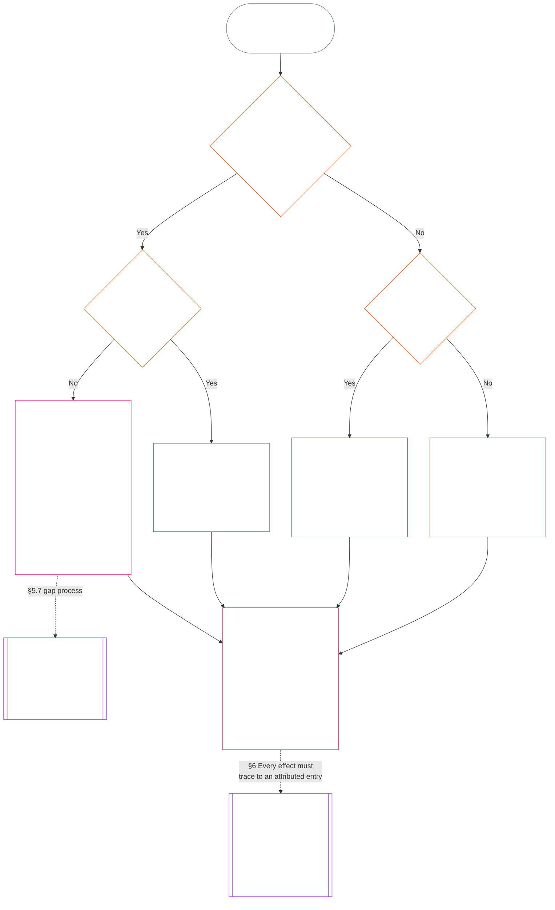

<!-- Rascunho parcial de tradução em português brasileiro. Fonte: commit 9c2c8c10c871d91157bcd27b9f56ad6a1cec90d3. Redigido por IA, não revisado. Escopo: Capítulo Onze, §§5.7–5.9. -->

#### 5.7 Quando a Carta do Sistema ou a Carta Institucional deixa um assento sem nome

O destino de um registro de posição quando a via ordinária nomeada não está disponível depende de três perguntas, que o diagrama abaixo apresenta em ordem. Esta seção trata de uma Carta do Sistema ou Carta Institucional que deixa um assento sem nome; o [§5.8 Regra de contingência quando nenhuma Carta do Sistema ou Institucional alcança o registro de posição](#58-fallback-when-no-system-charter-or-institutional-charter-reaches-the-standing-record) trata do caso em que nenhuma delas alcança o registro.

<strong>Orientação para quem lê (não operativa): como ler o diagrama</strong>

> Em termos simples: os órgãos nomeados pela Carta do Sistema ou pela Carta Institucional tratam do registro de posição. Se a Carta deixa um assento sem nome, ela é inválida até que a lacuna seja corrigida, e o registro segue para a Autoridade de Registro de Contingência e o Custodiante de Registro de Contingência, ou para um fórum — não para o mapa de vias. Se nenhuma Carta do Sistema ou Institucional alcança o registro, prevalece o mapa de vias publicado pela instituição; se não houver mapa, o registro segue para verificação independente ou, no caso de trabalho informal e de pequeno escopo, para o órgão que dele depende.
>
> Todas as vias chegam à mesma caixa: um órgão verifica os fatos e outro, separado, inscreve e guarda o registro de posição; depois, o [§6 Tratamento de um registro de posição](#6-handling-a-standing-record) rege o que os responsáveis pela guarda fazem com ele. As setas contínuas indicam a via principal. As setas pontilhadas indicam encaminhamentos, identificados pela seção que os prevê. As caixas com barras duplas laterais pertencem a outro capítulo, e a última mostra que os efeitos sobre a posição são extraídos do registro sem reescrevê-lo. O diagrama não acrescenta dever, assento ou campo.

 

Uma Carta do Sistema ou Carta Institucional que deixe sem nome um assento obrigatório do registro ou a via independente:

- **Consequência:** A Carta do Sistema ou Carta Institucional é inválida, e não se permite uma alteração que provoque essa invalidade ([Capítulo Sete §4.7.1 Quando existe uma lacuna e como registrá-la](core_07.000_charters.md#471-when-a-gap-exists-and-how-it-is-logged)).
- **O Capítulo Sete rege o processo de lacunas:** O [Capítulo Sete §4.7 Lacunas no mapa para registros de posição do operador](core_07.000_charters.md#47-gaps-in-the-map-for-operator-standing-records) também rege:
  - como registrar uma lacuna;
  - os prazos de resposta e resolução (incluindo substituição emergencial); e
  - quando a custódia retorna aos responsáveis nomeados.

Para registros de posição, esta seção acrescenta:

- **Quem não pode atuar:** Enquanto um assento obrigatório estiver vago e a Carta do Sistema ou Carta Institucional não nomear substituto válido, ninguém poderá exercer a função desse assento, exceto pela via descrita no próximo item.
- **Destino do registro de posição:** Conforme a [§5.4 Proibição de autocustódia](#54-no-self-custody), o registro segue para a Autoridade de Registro de Contingência e o Custodiante de Registro de Contingência, ou para um fórum nos termos da **seção 2.7**; o mapa de vias não os substitui. Cada registro de posição permanece íntegro, sob a guarda de um único custodiante.
- **Registros de posição já mantidos:**
  - No dia em que a notificação da lacuna chegar a um fórum, registrador ou Autoridade de Registro de Contingência, todo registro de posição do operador mantido por um órgão dentro da Linha de Controle Material da Parte Constituída é transferido ao Custodiante de Registro de Contingência, com todo o seu histórico.
  - Até lá, esse órgão o mantém em modo somente leitura, não inscreve nenhuma versão e entrega imediatamente ao Custodiante de Registro de Contingência uma cópia completa com todo o histórico.
  - Um custodiante que esteja fora dessa linha mantém o registro e, durante a lacuna, inscreve cada versão autorizada pela Autoridade de Registro de Contingência ou por um fórum. Se um fórum concluir que o custodiante está dentro da linha, o registro é transferido ao Custodiante de Registro de Contingência com todo o histórico, como no caso de um órgão dentro da linha.
- **Administradores responsáveis:** Um administrador responsável a quem peçam que ocupe um assento não atribuído pela Carta do Sistema ou pela Carta Institucional:
  - **Recusa o assento:** Ter acesso ou capacidade técnica para inscrever o registro não lhe confere autoridade para isso.
  - **Identifica o pedido e a lacuna:** Registra ambos no log.
  - **Encaminha o registro:** Usa a via indicada acima em *Destino do registro de posição*.
  - **Mantém os demais deveres:** Continuam valendo os deveres que já lhe cabem conforme [§5.4 Proibição de autocustódia](#54-no-self-custody) (*Administradores responsáveis que integram o sujeito*): interromper o que controla, registrar o conjunto reconstruível, preservar as evidências sob sua guarda, notificar e encaminhar a instância superior. Nenhum desses atos verifica os fatos ou inscreve o registro de posição. O log e as evidências preservadas acompanham o registro como dados de entrada para a autoridade verificadora; não são uma inscrição e não decidem os fatos.

#### 5.8 Regra de contingência quando nenhuma Carta do Sistema ou Institucional alcança o registro de posição

Quando nenhuma Carta do Sistema ou Carta Institucional abranger o sistema, a instituição ou o empreendimento a que o registro se refere — como ocorre com uma entidade abaixo da linha da Classe L que não publicou nenhuma Carta — aplica-se o mapa de vias publicado pela instituição conforme **CI-8.205 §2** (*Vias de separação funcional*):

- **Autoridade de abertura do registro:** O órgão que o mapa de vias coloca na via de garantia e auditoria para o sistema, instituição ou empreendimento a que o registro se refere. Esse órgão verifica a base factual e autoriza a inscrição ([§5.2 Autoridade nomeada para abertura do registro](#52-named-record-opening-authority)); não inscreve nem guarda o registro de posição.
- **Custodiante:** O órgão que ocupa a via de publicação e evidências.
- **Exclusão da via de execução:** Nenhuma das funções pode ser ocupada pelo órgão que mantém a via de execução do sistema em questão.
- **Também não há mapa de vias:** O registro segue para verificação independente conforme a *Proibição de autocustódia* acima ou, no caso de registros informais e de pequeno escopo, para o órgão dependente conforme *Registros informais e de pequeno escopo* abaixo.
- **Administradores responsáveis:** Um administrador responsável a quem peçam que ocupe um assento não atribuído pelo mapa de vias segue a regra de *Administradores responsáveis* do [§5.7 Quando a Carta do Sistema ou a Carta Institucional deixa um assento sem nome](#57-when-a-system-charter-or-institutional-charter-leaves-a-seat-unnamed): recusa o assento, identifica o pedido e a lacuna no log e mantém os demais deveres. Encaminha o registro de posição ao órgão nomeado no mapa de vias ou, se nenhum estiver nomeado, pela via descrita acima em *Também não há mapa de vias*.

#### 5.9 Registros informais e de pequeno escopo

A separação de funções é dimensionada segundo a aposta material, não segundo o grau de formalidade ([Capítulo Oito §2 Requisito Constitucional de Quatro Assentos](core_08.000_functional_independence_separation_of_duties.md#2-four-seat-constitutional-requirement)).

- **Trabalho abrangido:** As comunidades locais se apoiam em muitos tipos de contribuição, grande parte não remunerada e informal. Isso inclui trabalho não remunerado, organizado entre pares, de ajuda mútua, cuidado, manutenção, reparo, ensino e administração responsável comunitária, cuja contribuição o [Capítulo Treze §6 Consequências da contribuição em segundo lugar](core_13.000_standing_integration.md#6-contribution-consequences-second) exige que seja reconhecida por critérios iguais.
  - **Exemplos locais:** Vizinhos compartilham alimentos e ferramentas (ajuda mútua); cuidam de vizinho doente ou idoso (cuidado); mantêm em bom estado um jardim ou riacho compartilhado (manutenção e administração responsável comunitária); consertam o encanamento de um vizinho (reparo); dão aulas particulares ou ensinam uma habilidade (ensino). Cada uma é uma contribuição própria.
- **Quem ocupa o assento de verificação:** Nesse trabalho, o assento de verificação é preenchido por **qualquer entidade independente com autoridade publicada para se basear no registro de posição**, que então atua como autoridade verificadora.
  - **Quem costuma ser:** Muitas vezes, a entidade que se baseará no registro: um grupo local como um conselho de bacia hidrográfica, uma organização que financia ou mantém o trabalho, a autoridade de reconhecimento de registros **CI-6.255** (*Bens comuns, cooperativas, ajuda mútua e governança comunitária não mercantil*), que reconhece registros desse tipo de trabalho comunitário, ou um fórum conforme a **seção 2.7**.
- **O que não conta:** A formalidade da autoridade verificadora, por si só, não satisfaz o assento de verificação.

Em um registro de posição desse tipo:

- Um senciente que atua sozinho não precisa de grupo, instituição, [Carta do Sistema](core_05.040_band_continuity.md#system-charter) nem [Carta Institucional](core_05.040_band_continuity.md#institutional-charter) para solicitar um registro de sua própria contribuição. Nesse caso:
  - **Quem solicita:** Ocupa o assento de iniciativa em seu próprio pedido, como sujeito e requerente.
  - **Seus próprios materiais:** Seu relato, logs e fotos são dados de entrada, nunca verificação.
  - **Assento de verificação:** Qualquer entidade independente com autoridade publicada para se basear no registro (a autoridade verificadora).
  - **Inscrição e custódia:** Um custodiante separado inscreve e guarda o registro de posição.
  - **Se houver contestação:** A contestação segue para a via de contestação ou para um fórum conforme a **seção 2.7**.
  - **Indisponibilidade de entidade dependente:** Se nenhuma entidade desse tipo estiver disponível, o registro segue para um fórum conforme a **seção 2.7**.
  - **Exemplo, encanador aposentado:** Um encanador aposentado que consertou gratuitamente por anos os encanamentos dos vizinhos, sem integrar um grupo, pode pedir à autoridade de reconhecimento de registros **CI-6.255** (*Bens comuns, cooperativas, ajuda mútua e governança comunitária não mercantil*) que abra um registro de posição:
    - **Solicita e reivindica:** O encanador.
    - **Verifica:** A autoridade, com base nos logs de trabalho e nas declarações dos vizinhos.
    - **Inscreve e guarda:** Um custodiante separado.
    - **Se houver contestação:** Ela segue para um fórum, não retorna à autoridade verificadora.
- Os participantes são sujeitos e, quando buscam reconhecimento, requerentes. Em um registro coletivo conforme a **seção 4.3**:
  - **Coparticipantes:** Cada um é requerente.
  - **Declaração de um membro sobre a parcela de outro:** É dado de entrada, nunca verificação.
- Os materiais de apoio do registro de posição vêm de duas fontes:
  - **Não participantes:** Beneficiários, vizinhos e outros não participantes fornecem declarações como materiais de verificação conforme a **seção 4.1**.
  - **Log do próprio grupo:** O senciente que o manteve é o consignador e uma testemunha nos termos de *Declarações do consignador são dados de entrada* abaixo.
- O custodiante da entidade dependente inscreve e guarda o que uma autoridade verificadora separada verificou:
  - **Quem não pode ocupar nenhum dos assentos:** Nem o custodiante nem a autoridade verificadora podem ser requerentes ou integrar a [Linha de Controle Material](core_05.035_band_accountability.md#material-control-line) de um requerente.
  - **Uma entidade, dois assentos:** A mesma entidade dependente pode ocupar ambos os assentos conforme um mapa de vias publicado com salvaguardas de independência auditáveis e impugnáveis.
  - **Nunca a mesma pessoa:** Nenhuma autoridade, custodiante ou senciente pode exercer as duas funções no mesmo registro de posição.
- A situação do grupo não condiciona a reivindicação de um membro:
  - **Grupos informais:** Um grupo sem [Carta do Sistema](core_05.040_band_continuity.md#system-charter) ou [Carta Institucional](core_05.040_band_continuity.md#institutional-charter), ou que nem sequer seja uma Instituição, não impede seus membros de agir.
  - **Cada participante:** Pode buscar reconhecimento como requerente individual pelo trabalho realizado no grupo ou fora dele.
  - **Objeto do registro de posição:** É a contribuição do participante, não a posição do grupo.
  - **Exemplo, círculo de costura:** Um círculo de costura que doa colchas a refugiados recém-chegados é um exemplo: cada pessoa que costura pode buscar um registro de posição, verificado por uma entidade dependente independente, como a agência que recebe as colchas. O círculo não precisa de Carta do Sistema ou Carta Institucional.
- Um registro de posição de violação também pode surgir nesses contextos informais, e os assentos continuam separados:
  - **Exemplo, incidente em um bar:** Alguém grava outra pessoa senciente em um bar, que fica embriagada, desordeira e violenta, embora ninguém sofra dano físico.
    - **Não é necessário haver ferimento:** Uma ameaça de violência crível e verificada pode fundamentar um registro de posição de violação mesmo sem feridos (**seção 3.2**, perda coerciva da agência).
    - **O vídeo é dado de entrada:** A pessoa senciente que filmou é testemunha. A gravação é dado de entrada e nunca constitui verificação por si só; sua existência não abre registro algum (**seção 2.2**).
    - **A pessoa senciente filmada:** É o sujeito. Deve ser notificada quando o registro de posição for aberto e não pode ocupar nenhum assento ([§5.4 Proibição de autocustódia](#54-no-self-custody)).
    - **Assento de verificação:** Uma entidade independente com autoridade publicada para se basear no registro, como uma autoridade local de licenciamento ou segurança, ou um fórum conforme a **seção 2.7**. A pessoa senciente que filmou e o proprietário do bar são excluídos se qualquer um deles for requerente ou integrar a [Linha de Controle Material](core_05.035_band_accountability.md#material-control-line) de um requerente.
    - **Inscrição, custódia e contestação:** Um custodiante separado inscreve e guarda o registro, e a contestação segue para a via de contestação ou para um fórum conforme a **seção 2.7**, sem retornar à entidade verificadora.
- Uma regra ou processo que exija verificação por uma instituição formal inacessível ao grupo informal, quando houver uma entidade dependente independente disponível, constitui a prática de barreira arbitrária do [Capítulo Treze §6.2 Critérios de competência e autorizações](core_13.000_standing_integration.md#62-competency-bars-and-clearances), e não uma separação de funções.

Nada disso exige que exista um registro de posição. Aplica-se a **seção 2.2**, *O silêncio é o padrão*: o trabalho informal não é registrado apenas porque isso seria possível, e a separação de funções só vincula quando alguém solicita um registro de posição.
