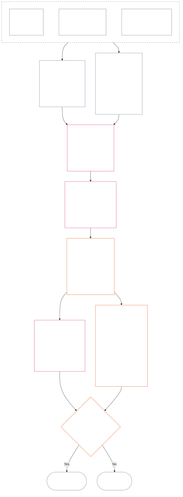

<!-- Rascunho parcial de tradução para português brasileiro. Instantâneo da fonte: commit 9c2c8c10c871d91157bcd27b9f56ad6a1cec90d3. Redigido por IA, não revisado. Escopo: Capítulo Doze, §§4–6 apenas. -->

### 4. Gramática dos slots e escala comum

*Em termos simples: esta seção dá nomes consistentes às nove posições possíveis em cada um dos dois eixos separados e explica como o impacto é escalonado entre elas. Um eixo registra contribuição verificada; o outro registra violações verificadas. Compartilhar um número de slot não combina os eixos nem compensa dano com ajuda. A escala unificada da **seção 6** atribui slots a ambos os eixos conforme o impacto LEQU proporcional.*

A gramática dos slots usa um número `s` de **1** a **9**. Cada eixo tem sua própria posição de slot:

- o **Eixo de Contribuição** registra a natureza positiva da contribuição; e
- o **Eixo de Violação** registra constatações verificadas de violação.

O mesmo número de slot pode aparecer nos dois eixos, mas eles permanecem separados. Um slot de contribuição não é um slot de violação, e vice-versa.

#### 4.1 Tabela 1 — rótulos de exibição dos slots

A **Tabela 1** nomeia os nove slots e apresenta lado a lado os rótulos de exibição dos Eixos de Contribuição e de Violação. Ela fornece somente os termos de exibição; a atribuição dos slots ocorre conforme a escala unificada da **seção 6**.

| `s` | Rótulo de exibição do Eixo de Contribuição | Rótulo de exibição do Eixo de Violação |
| ---: | --- | --- |
| 1 | **Contribuição Baseline Menor** | **Impacto Constitucional Menor** |
| 2 | **Contribuição Baseline Pequena** | **Impacto Constitucional Pequeno** |
| 3 | **Contribuição Positiva Substancial** | **Impacto Constitucional Substancial** |
| 4 | **Contribuição Positiva Significativa** | **Impacto Constitucional Significativo** |
| 5 | **Contribuição Positiva Séria de Administração Responsável** | **Impacto Constitucional Sério** |
| 6 | **Contribuição Positiva Maior de Administração Responsável** | **Impacto Constitucional Maior** |
| 7 | **Campeão Reconhecido** | **Impacto Constitucional Grave** |
| 8 | **Campeão Distinto** | **Impacto Constitucional Gravíssimo** |
| 9 | **Campeão Exemplar** | **Impacto Constitucional Catastrófico** |

O Eixo de Contribuição usa rótulos baseline, positivo, positivo de administração responsável e campeão. O Eixo de Violação usa rótulos neutros de impacto em todos os slots. Os eixos permanecem separados; não criam pontuação líquida nem permitem compensar registros de contribuição e violação. Um slot no Eixo de Violação não classifica, por si só, uma má conduta anticonstitucional; o [Capítulo Quatorze](core_14.000_misconduct_designation.md#chapter-fourteen-anti-constitutional-misconduct) determina de forma independente se a designação de má conduta anticonstitucional (ACMD) se aplica a uma violação verificada `s` = 7–9.

Implementações podem publicar unidades de medição, métodos de evidência e exemplos para ajudar a estimar benefícios ou perdas equivalentes a uma vida completa. Esses materiais são apenas orientações e não podem se sobrepor à **seção 6**, ao **Capítulo Um** nem ao **Piso de Direitos do Capítulo Seis**.

#### 4.2 Regras comuns de escala de impacto

*Em termos simples: o impacto não é medido apenas pela quantidade de pessoas afetadas. Um benefício ou perda profunda para um senciente pode ser mais importante que um efeito superficial para muitos. Quantidade, profundidade, vulnerabilidade, duração, durabilidade, alcance e caráter constitucional devem ser avaliados em conjunto.*

Use as regras a seguir para interpretar os dois eixos na **seção 6**:

| Dimensão de escala | Regra comum | Aplicação específica ao eixo |
| --- | --- | --- |
| **Dimensão do resultado constitucional (LEQU)** | Avalie o benefício ou a perda verificados em conjunto. LEQU é a principal referência de dimensão; quantidade bruta de pessoas, dinheiro, produção ou tamanho institucional não é. | A contribuição contabiliza benefícios compatíveis com direitos; a violação contabiliza perdas constitucionais, danos, desperdícios, fechamento de possibilidades ou perigos verificados. |
| **Escopo senciente** | Considere **quantidade, profundidade e vulnerabilidade em conjunto**. Nenhum slot exige quantidade de pessoas como critério independente. Um impacto suficientemente profundo sobre um senciente pode justificar o mesmo slot que um impacto mais amplo, porém superficial, quando a dimensão integrada e os demais critérios da linha forem iguais; qualquer critério expresso de LEQU agregado ou amplo escopo ainda precisa ser atendido. | Dependência, capacidade reduzida ou vulnerabilidade incomum podem elevar a materialidade. O tamanho do grupo, por si só, não estabelece contribuição ou gravidade. |
| **Escopo temporal** | Considere duração, recorrência, durabilidade e, no caso de perda, irreversibilidade. Um evento breve, mas transformador, pode superar um efeito trivial e prolongado; a duração, por si só, não determina o resultado. | Benefícios duráveis favorecem maior magnitude de contribuição. Perdas persistentes ou irreversíveis favorecem maior gravidade da violação. |
| **Escopo espacial ou institucional** | Um alcance mais amplo pode aumentar a dimensão, mas não se exige alcance entre comunidades ou instituições quando profundidade, duração, vulnerabilidade ou criticidade constitucional sustentarem o slot de modo independente. | Reparação institucional pode aumentar a magnitude da contribuição; dano estrutural ou sistêmico pode aumentar a gravidade da violação. |
| **Qualidade ou caráter constitucional** | Meça separadamente como o resultado foi produzido e até que ponto se espalhou. Não conte o mesmo fato duas vezes. | Dano externalizado, encargo oculto, captura ou dependência podem limitar ou desqualificar uma contribuição reivindicada. Dever, negligência, engano, coerção, violência ou facilitação estrutural permanecem registrados separadamente como caráter da conduta violadora e não alteram o slot de impacto. |
| **Pisos de Direitos e salvaguardas críticas** | O cumprimento do Piso de Direitos não é negociado em troca de benefício ou perda agregados. | Cumprir um piso, por si só, não estabelece contribuição elevada. A derrota material do Piso de Direitos ou a falha de uma salvaguarda crítica pode sustentar maior gravidade da violação, mesmo que poucos sencientes sejam diretamente afetados. |

As dimensões não são uma lista de verificação que exija todas as formas de escala. Explique quais dimensões foram determinantes, quais não foram e por quê.

- **Método comum de atribuição de slots:**
  - Estime o benefício ou a perda verificados integrados em LEQU conforme a Proporcionalidade; depois, atribua o único slot cuja faixa numérica contenha essa dimensão.
  - Os mesmos limiares se aplicam aos dois eixos.
  - Os slots de contribuição mantêm os requisitos aplicáveis de baseline e alinhamento constitucional; atingir um limiar numérico não transforma em contribuição uma produção externalizada ou constitucionalmente derrotada.
- **Separação de caráter:** Empilhe no registro de posição os descritores aplicáveis de via de benefício, via de dano, qualidade da conduta e caráter da conduta. Dever, negligência, engano, agravamento, coerção, violência, intenção ou facilitação estrutural podem afetar atribuição, salvaguardas ou consequências da Questão 3, mas nenhum deles eleva ou reduz o slot de impacto LEQU.
- **Limite da Revisão de Má Conduta Anticonstitucional:** Perdas verificadas no Eixo de Violação podem alcançar `s` = 7–9 pelo impacto, tenha sido ou não comprovada má conduta anticonstitucional. O Capítulo Quatorze não substitui a atribuição do impacto; determina de modo independente se a ACMD correspondente se aplica.

Se um perigo ainda não tiver ocorrido de fato, registre separadamente:

- qual é sua probabilidade;
- por quanto tempo os sencientes ficariam expostos;
- até onde poderia chegar;
- qual é a incerteza da estimativa; e
- qual é o pior resultado ainda crível.

Não contabilize esse pior resultado como dano já ocorrido (perda LEQU), a menos que uma implementação adotada tenha estabelecido uma calibração de risco (método para converter risco em LEQU) que qualquer pessoa possa inspecionar.

### 5. Dados constitucionais para atribuição aos eixos

*Em termos simples: antes de escolher um slot, identifique as fontes constitucionais que definem qual baseline, benefício, dever, dano ou violação está sendo medido. Use os links abaixo para aplicar essas fontes em seus locais canônicos; não transforme esta etapa de encaminhamento em outra pontuação ou definição substituta.*

Antes de atribuir um slot conforme a **seção 6**, o registro de posição deve identificar:

- o baseline constitucional, dever, limite ou interesse protegido aplicável;
- as disposições que estabelecem o benefício verificado, resultado adverso, dano ou violação que está sendo medido;
- as definições, os princípios e os artigos do Piso de Direitos que afetam materialmente a dimensão ou o caráter da conduta; e
- por que cada fonte identificada se aplica e como afeta a atribuição ao eixo.

As tabelas de encaminhamento abaixo não são exaustivas. Toda definição, princípio ou artigo adicional acionado pelos fatos verificados continua aplicável e deve ser identificado no registro de posição. Cada fonte canônica vinculada prevalece; estas tabelas não a repetem nem restringem.

#### 5.1 Dados de definição

| Fonte canônica | Função no Eixo de Contribuição | Função no Eixo de Violação |
| --- | --- | --- |
| [Estado da Posição, Contribuição e Violação](core_05.035_band_accountability.md#defa3-standing-state-contribution-and-violation) | Explica o que conta como contribuição e quais fatos verificados podem ser usados para medi-la. Também garante que um registro de posição de contribuição acompanhe apenas o lado positivo, sem misturá-lo com o negativo. | Explica o que conta como violação e como ela é registrada. Também encaminha os casos mais graves à Revisão de Má Conduta Anticonstitucional, análise separada de condutas que comprometem a própria Constituição. |
| [Prestação de contas](core_05.005_apex_accountability_leg.md#accountability) | Verifica se uma alegação de boa administração responsável ou reparação realmente mantém alguém responsável. Ainda deve mostrar quem fez o quê, quem deve responder e como o fato pode ser revisado, reparado e corrigido em proporção ao impacto. | Identifica casos em que não está claro quem fez algo ou quem deve responder. Inclui situações em que a responsabilidade deixa de funcionar após mudança na organização ou em sua estrutura. |
| [Dano](core_05.035_band_accountability.md#harm) | Dano transferido a terceiros ou ocultado pode limitar ou anular um benefício reivindicado. Reparar dano pode contar como benefício, mas somente se a reparação for verificada e demonstrada de forma independente. | Especifica os tipos de dano considerados na medição da perda e da gravidade: direto, indireto, atrasado, cumulativo, disseminado entre sistemas e dano à mente ou ao bem-estar emocional de um senciente. |
| [Materialidade](core_05.050_band_oversight.md#materiality) e [Unidade Equivalente à Vida (LEQU)](core_05.055_band_participation.md#lifespan-equivalent-unit-lequ) | Definem quanto conta um benefício verificado com base em seu alcance, na vulnerabilidade das pessoas afetadas e em sua duração. O resultado é medido em LEQU, a medida comum para o benefício equivalente a uma vida inteira. | Definem quanto contam uma perda ou perigo verificados com base em seu alcance, na vulnerabilidade das pessoas afetadas, em sua duração e na dificuldade de revertê-los. O resultado é medido em LEQU, a mesma medida para a perda equivalente a uma vida inteira. |
| [Natureza da Contribuição](core_05.035_band_accountability.md#contribution-nature) | Decide se algo conta como contribuição. Deve ser somente positivo, nunca misturado com dano, e respaldado por um registro de contribuição verificado que possa ser demonstrado. Sem ambos, não se pode atribuir um slot no Eixo de Contribuição. | Não tem função aqui. Não decide o que conta como dano e nunca reduz a gravidade de uma violação. |
| [Natureza da Violação](core_05.035_band_accountability.md#violation-nature) | Não tem função aqui. Uma violação nunca é contabilizada como contribuição negativa e não apaga benefício verificado sem relação com ela. | Decide se algo conta como violação. Deve ser classificado como nocivo e respaldado por uma constatação verificada de que a violação ocorreu. Sem ambos, não se pode atribuir um slot no Eixo de Violação. |
| [Limite Constitucional](core_05.045_band_integrative.md#constitutional-constraint), [Hierarquia Interna e Escalonamento de Autoridades](core_05.045_band_integrative.md#authority-stack-and-internal-hierarchy) e [Auditabilidade](core_05.050_band_oversight.md#auditability) | Impedem que um benefício alegado conte quando depende de derrotar a Constituição, contornar suas regras, reduzir o Piso de Direitos (proteções mínimas garantidas pela Constituição) ou cumprir apenas no papel. | Destacam fatores que afetam a gravidade real da violação: romper um limite constitucional relevante, colocar algo acima da autoridade constitucional, contornar regras ou impossibilitar sua aplicação. |
| [Auditabilidade](core_05.050_band_oversight.md#auditability) e [Impugnabilidade](core_05.035_band_accountability.md#contestability) | Exigem que o benefício reivindicado possa ser demonstrado e verificado e que quem discordar tenha um meio funcional de contestá-lo. | Exigem constatações verificáveis e contestáveis. Uma acusação ou etiqueta sem explicação não pode determinar a gravidade da violação. |

#### 5.2 Dados de princípios

| Fonte do princípio | Função na atribuição aos eixos |
| --- | --- |
| [Tétrade Constitucional](core_00.000_preamble.md#constitutional-tetrad), [Dois Fins Constitucionais](core_00.000_preamble.md#two-constitutional-aims) e [aposta material](core_00.000_preamble.md#material-stake) | Definem as quatro disciplinas operacionais (participação, supervisão, prestação de contas e atuação em tempo), os dois resultados almejados pela Constituição (Florescimento e Continuidade) e o enquadramento que dimensiona cada atribuição conforme o que está em jogo. |
| [Bem-estar](core_01.000_values_principles.md#3-foundational-objective-wellbeing-flourishing-aim) e [Reconhecimento, Reforço e Aspiração](core_01.000_values_principles.md#32-recognition-reinforcement-and-aspiration) | Fundamentam no Eixo de Contribuição os benefícios que respeitam direitos e o reconhecimento compatível com eles. Prestígio ou recompensas nunca são tratados como prova de contribuição. |
| [Segurança](core_01.000_values_principles.md#4-safety-harm-constraint) e [Verdade](core_01.000_values_principles.md#5-truth-epistemic-integrity-constraint) | Definem limites vinculantes para ambos os eixos. Benefício obtido por meio de dano ou engano não conta integralmente, e uma falha verificada de segurança ou verdade pode indicar a dimensão ou o tipo da violação. |
| [Administração Responsável em Profundidade](core_01.010_stewardship_capacity_principles.md#16-stewardship-in-depth) e [Governança sob Disciplina de Administração Responsável](core_01.010_stewardship_capacity_principles.md#18-governance-under-stewardship-discipline) | Orientam a avaliação de contribuições duradouras, deveres próprios de uma função, reparação institucional, supervisão e responsabilidade, quando os fatos verificados exigirem. |
| [Princípios Centrais para Resolver Conflitos](core_01.005_interaction_interpretation.md#131-core-tradeoff-principles) e [Pisos Constitucionais, Segurança e Processo Antidegradante](core_01.005_interaction_interpretation.md#1314-constitutional-floors-safety-and-anti-degrading-process) | Aplicam-se quando a conduta medida envolve necessidade, minimização do dano, proporcionalidade, conflito entre direitos ou restrição. Nunca autorizam sozinhos uma consequência. |

#### 5.3 Dados do Piso de Direitos e dos Artigos

| Fonte de Artigo | Função ou limite na atribuição aos eixos |
| --- | --- |
| O [Piso de Direitos do Capítulo Seis](core_06.000_rights_part_a.md#chapter-six-foundational-rights) factualmente aplicável, inclusive todo Artigo materialmente implicado pelo registro de posição verificado | Define as proteções, interesses, deveres, benefícios ou violações fundamentais em questão. Nenhum Artigo é excluído apenas por não estar listado abaixo. |
| [Artigo XIX — Situação de Posição e Participação](core_06.015_rights_part_d.md#article-xix-standing-and-participation-status) | Mantém separados: posição e dignidade do senciente, proteções mínimas do Piso de Direitos, situação de parte afetada, reputação e qualquer alteração posterior da situação de participação. |
| [Artigo XIII-A — Baseline de Confiabilidade e Credibilidade](core_06.010_rights_part_c.md#article-xiii-a-reliability-and-trustworthiness-baseline), [Artigo XIII-B — Direito à Reparação e ao Remédio](core_06.010_rights_part_c.md#article-xiii-b-right-to-redress-and-remedy), [Artigo XV-B — Transparência, Auditabilidade e Impugnabilidade](core_06.010_rights_part_c.md#article-xv-b-transparency-auditability-and-contestability) e [Artigo XVI — Auditoria, Transparência e Verificação Independente](core_06.010_rights_part_c.md#article-xvi-audit-transparency-and-independent-verification) | Aplicam-se quando o benefício ou a violação verificados envolvem manter registros honestos, compartilhar informações, conferir fatos, poder contestar uma decisão ou corrigir erros. |
| [Artigo XXIV — Análise de Causa Raiz e Resposta Adaptativa](core_06.015_rights_part_d.md#article-xxiv-root-cause-analysis-and-adaptive-response) | Aplica-se quando importam a causa da conduta, se foi corrigida, se continua ocorrendo ou se a resposta se adaptou, pois isso indica como a conduta se situa perante a Constituição. |
| [Artigo XX — Justiça após Violação Verificada](core_06.015_rights_part_d.md#article-xx-justice-after-verified-violation) e [Artigo XXVI-C — Resolução em Tempo Oportuno e Piso contra Atrasos](core_06.020_rights_part_e.md#article-xxvi-c-timely-resolution-and-anti-delay-floor) | Aplicam-se aos processos ou atrasos efetivamente envolvidos nos fatos. O **Artigo XX** (*Justiça após Violação Verificada*) limita principalmente o que acontece depois que uma violação é medida (Questão 3). Não pode ser usado para elevar ou reduzir o slot da Questão 2 apenas para justificar uma resposta já preferida. |

**Limites de aplicação.** Esta etapa apenas aponta as fontes pertinentes.

- Ela não:
  - reabre a Questão 1;
  - admite fatos que não foram verificados;
  - acrescenta uma nova medida ou pontuação;
  - conta o mesmo fato duas vezes por meio de fontes diferentes;
  - combina os dois eixos; nem
  - faz com que toda fonte listada se aplique a todos os registros de posição.
- Contribuição e violação continuam sendo medidas separadamente.
- As consequências do **Artigo XX** (*Justiça após Violação Verificada*) ficam fora da Questão 2.
- A revisão de designação do Capítulo Quatorze permanece separada do slot de impacto atribuído aqui.

### 6. Escala LEQU proporcional unificada — Eixos de Contribuição e Violação

<strong>Orientação para quem lê (não operativa): como funciona a progressão de cinco vezes</strong>

> A escala avança em múltiplos de cinco a partir da referência `s` = 7 = um LEQU. Em qualquer eixo, a magnitude mínima do slot `s` é `5^(s−7)` LEQU nos slots 2 a 9; o slot 1 começa em zero. Uma implementação adotada pode publicar os limiares numéricos resultantes e exemplos de calibração. O slot 1 inclui o baseline constitucional verificado no Eixo de Contribuição e a perda verificada abaixo do primeiro limiar positivo no Eixo de Violação; ausência de contribuição ou ausência de violação não constitui, por si só, um registro `s` = 1.
>
> **Referência legível por pessoas.** Usando uma vida humana de 80 anos como exemplo de calibração, leia a coluna central de baixo para cima como benefício equivalente a uma vida completa, tempo utilizável ou recursos e capacidade compatíveis com direitos que foram acrescentados; leia-a de cima para baixo como perda, privação, desperdício ou fechamento de possibilidades equivalentes. A quantidade de recursos não conta por si só — prevalece o resultado constitucional que ela produz ou impede.

 

*Em termos simples: a **Tabela 2** coloca contribuições e violações verificadas na mesma escala proporcional de impacto. Slots mais altos indicam maior benefício ou perda constitucional integrada. Os registros de posição e os eixos permanecem separados: a escala comum compara dimensões, não valor moral, e nunca permite que ajuda compense dano.*

O diagrama acompanha uma atribuição de slot do início ao fim. Ele mostra a ordem em que as etapas são realizadas, que difere da ordem dos tópicos abaixo; os tópicos enunciam cada regra.

Aplique a **Proporcionalidade** para estimar o impacto LEQU integrado com base em profundidade, escopo senciente, vulnerabilidade, duração, durabilidade ou irreversibilidade, alcance e criticidade constitucional. Essas dimensões moldam a estimativa LEQU; não são bônus independentes de slot.

- Use a **Tabela 2** depois que a Questão 1 confirmar o que aconteceu, a Questão 2 medir o benefício ou a perda verificados, as **seções 1–3 e 4.2** forem aplicadas e as fontes constitucionais exigidas pela **seção 5** forem identificadas.
- Atribua um slot com base na estimativa LEQU integrada.
  - Explique como cada dimensão material de escala afetou a estimativa e por que as dimensões omitidas não foram determinantes.
  - Toda atribuição deve satisfazer:
    - rastreabilidade;
    - auditabilidade;
    - impugnabilidade; e
    - o Piso de Direitos aplicável.
  - A contribuição também deve satisfazer a não externalização e o alinhamento constitucional.
- Registre fatos sobre o caráter da conduta como descritores separados e rastreáveis. Eles podem determinar atribuição, intensidade da revisão, salvaguardas, reparação ou designação pelo Capítulo Quatorze; só afetam o slot na medida em que consequências verificadas alterem o impacto LEQU integrado.
- Avalie integralmente as consequências verificadas da ação ou curso de conduta por meio das dimensões materiais de escala, incluindo:
  - lesão física;
  - trauma psicológico;
  - efeitos coercivos;
  - privação ou perigo à liberdade;
  - dano cumulativo; e
  - outro benefício ou perda constitucionalmente reconhecível.
- Não:
  - eleve nem reduza o slot apenas porque um evento ou curso de conduta se caracteriza por:
    - dever;
    - negligência;
    - intenção;
    - ocultação;
    - repetição;
    - agravamento;
    - coerção;
    - violência;
    - perigo à liberdade;
    - possibilidade de correção; ou
    - uma consequência preferida.
  - infira o caráter da conduta a partir da dimensão nem substitua a dimensão verificada pelo caráter da conduta.

A **Tabela 2** lista os nove slots em ordem. Cada linha informa o número `s`, a quantidade de benefício acrescentado ou perda imposta que alcança aquele slot (usando uma vida humana de 80 anos como exemplo de calibração) e o nome do slot em cada eixo. Os limiares são iguais nos dois eixos, mas os nomes continuam separados: um slot no Eixo de Contribuição e outro no Eixo de Violação são registros distintos e nunca se compensam.

| `s` | Calibração de vida humana de 80 anos — benefício acrescentado / perda imposta | Eixo de Contribuição | Eixo de Violação |
| ---: | --- | --- | --- |
| 1 | Menos de aproximadamente **9 dias** | **Contribuição Baseline Menor** — satisfação verificada do baseline constitucional para o escopo avaliado; qualquer melhoria mensurável permanece abaixo de `s` = 2. | **Impacto Constitucional Menor** — perda verificada ou prejuízo operacional abaixo de `s` = 2, inclusive defeito formal sem dano substantivo comprovado. |
| 2 | Aproximadamente **9–47 dias** | **Contribuição Baseline Pequena** — desempenho confiável e delimitado acima do piso mínimo neste nível de impacto. | **Impacto Constitucional Pequeno** — perda delimitada verificada neste nível de impacto. |
| 3 | Aproximadamente **47 dias–8 meses** | **Contribuição Positiva Substancial** — benefício demonstrável além do baseline neste nível de impacto. | **Impacto Constitucional Substancial** — perda substancial verificada neste nível de impacto. |
| 4 | Aproximadamente **8 meses–3,2 anos** | **Contribuição Positiva Significativa** — benefício verificado mais profundo, duradouro, repetido, sensível à vulnerabilidade ou mais amplo. | **Impacto Constitucional Significativo** — perda constitucional significativa verificada. |
| 5 | Aproximadamente **3,2–16 anos** | **Contribuição Positiva Séria de Administração Responsável** — administração responsável, coordenação, manutenção ou reparação duradoura, ou benefício sustentado comparável. | **Impacto Constitucional Sério** — perda constitucional séria verificada. |
| 6 | Aproximadamente **16–80 anos** | **Contribuição Positiva Maior de Administração Responsável** — benefício verificado de grande dimensão, próximo de um LEQU. | **Impacto Constitucional Maior** — perda verificada de grande dimensão, próxima de um LEQU. |
| 7 | Aproximadamente **1–5 vidas** (**80–400 anos**) | **Campeão Reconhecido** — pelo menos um LEQU de benefício verificado e alinhado à Constituição. | **Impacto Constitucional Grave** — pelo menos um LEQU de perda constitucional verificada. |
| 8 | Aproximadamente **5–25 vidas** (**400–2.000 anos**) | **Campeão Distinto** — benefício verificado que excede materialmente `s` = 7. | **Impacto Constitucional Gravíssimo** — perda verificada que excede materialmente `s` = 7. |
| 9 | Pelo menos **25 vidas** (**2.000+ anos**) | **Campeão Exemplar** — benefício verificado que excede materialmente `s` = 8. | **Impacto Constitucional Catastrófico** — perda verificada que excede materialmente `s` = 8. |

<strong>Nota de interoperabilidade da implementação</strong>

> Este componente contém material de interoperabilidade voltado à implementação. Ele apoia as categorias operacionais do capítulo, mas não cria um sistema paralelo de categorias.

Os campos legíveis por máquina para exibição do slot (`sub_tier`, `sub_tier_display` e campos de exibição relacionados) estão definidos em [CH06_NINE_SLOT_STANDING_SCALE.md](implementation/CH06_NINE_SLOT_STANDING_SCALE.md) e [ch06_nine_slot_constants.json](implementation/ch06_nine_slot_constants.json). O mapa de quatro faixas da implementação continua sendo um apoio de interoperabilidade e não acrescenta uma coluna de faixa principal à **Tabela 2** operativa.

Um método de referência e atribuições de slots trabalhadas, inclusive para sencientes com pesos, pontos de verificação de estado salvo e sem mortalidade fixa, constam em [LEQU_CALIBRATION_REFERENCE.md](implementation/LEQU_CALIBRATION_REFERENCE.md). Esses cálculos não podem substituir os limiares comuns e a regra de atribuição proporcional da **seção 6**, atribuir slots a um registro ativo nem decidir quem conta.

Uma implementação adotada pode publicar estimativas LEQU e rótulos de exibição indexados. Esses auxiliares não podem substituir os limiares comuns e a regra de atribuição proporcional da **seção 6** nem as salvaguardas de designação do Capítulo Quatorze, exceto mediante alteração de um **documento conforme**.

