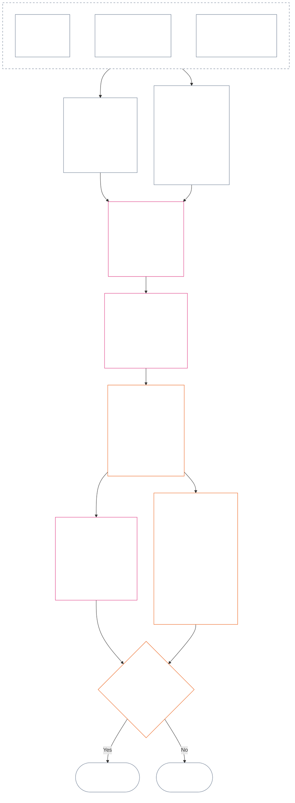

<!-- Rascunho completo de tradução para português brasileiro do Capítulo Doze. Instantâneo da fonte: commit 9c2c8c10c871d91157bcd27b9f56ad6a1cec90d3. Redigido por IA, não revisado, rascunho não vinculante. -->

# CAPÍTULO DOZE: MEDIÇÃO DE POSIÇÃO — QUESTÃO 2, QUÃO BOM OU RUIM FOI?

<strong>Lugar no corpus (não operativo): estrutura do arquivo e regras de leitura</strong>

> Este arquivo **faz parte da Constituição Senciente** e é **vinculante somente em conjunto** com os demais arquivos `core_*` numerados, lidos como um único texto. Ele contém o **Capítulo Doze** — **Questão 2** (*quão bom ou ruim foi?*): a referência LEQU e seus limites, as dimensões de entrada da medição, os catálogos de descritores de via, a gramática dos slots e a escala comum, os dados constitucionais para atribuição aos eixos, a escala LEQU proporcional unificada, as medidas padrão de contribuição, exemplos trabalhados e o encaminhamento à Questão 3 (**§§1–9**). A estrutura das três perguntas e a **Questão 1** (*o que aconteceu?*) — fatos verificados, tipos de eventos, requisitos de registro, custódia e tratamento dos registros — constam no [Capítulo Onze](core_11.000_standing_assessment.md#chapter-eleven-standing-records--question-1-what-happened). A Questão 3 (*o que acontece em consequência disso?*) continua no [Capítulo Treze](core_13.000_standing_integration.md#chapter-thirteen-standing-effects-and-integration); o exame fica limitado à designação de má conduta anticonstitucional no [Capítulo Quatorze](core_14.000_misconduct_designation.md#chapter-fourteen-anti-constitutional-misconduct) para constatações qualificadas de violação do Eixo de Violação `s` = 7–9. A ordem de leitura, a distinção entre conteúdo vinculante e de apoio e os metadados da edição do corpus são mantidos no [README.md](README.md).

<strong>Rastreabilidade</strong>

- Origem:
  - [Capítulo Onze §1](core_11.000_standing_assessment.md#1-the-three-questions) (*estrutura das três perguntas*);
  - do [Capítulo Onze §2](core_11.000_standing_assessment.md#2-question-1--what-happened) ao [Capítulo Onze §6](core_11.000_standing_assessment.md#6-handling-a-standing-record) (*Questão 1 — fatos verificados, registros de posição, custódia e tratamento*);
  - [Tétrade Constitucional](core_00.000_preamble.md#constitutional-tetrad);
  - [Dois Fins Constitucionais](core_00.000_preamble.md#two-constitutional-aims);
  - [Preâmbulo §6 Cadeias práticas de processo-chave](core_00.000_preamble.md#6-key-practical-process-pipelines) (*cadeia dos Capítulos Nove a Quinze*).
- Subseções deste arquivo:
  - [§1](#1-question-2--how-good-or-bad-was-it) (*Questão 2 — referência LEQU, ponte de situação, limites e escopo*);
  - [§2](#2-magnitude-and-severity-input-dimensions) (*dimensões de entrada da medição dos dois eixos*);
  - [§3](#3-route-descriptor-catalogs-and-measurement-roles) (*catálogos de descritores de via*);
  - [§4](#4-slot-grammar-and-shared-scaling) (*gramática dos slots e escala comum*);
  - [§5](#5-constitutional-inputs-to-axis-assignment) (*encaminhamento às fontes constitucionais*);
  - [§6](#6-unified-proportional-lequ-scale--contribution-and-violation-axes) (*escala LEQU proporcional unificada para os dois eixos*);
  - [§7](#7-standard-contribution-measures) (*medidas padrão de contribuição publicadas pelo adotante*);
  - [§8](#8-measurement-illustrations) (*exemplos trabalhados de medição*);
  - [§9](#9-hand-off-to-question-3--cross-question-measurement-hooks) (*encaminhamento à Questão 3*).
- Destino:
  - [Capítulo Treze](core_13.000_standing_integration.md#chapter-thirteen-standing-effects-and-integration) (13.000) (*efeitos e integração da Questão 3*);
  - [Capítulo Quatorze](core_14.000_misconduct_designation.md#chapter-fourteen-anti-constitutional-misconduct) (14.000) (*designação somente — não reabre a medição da Questão 2*).
- Leia também: [Capítulo Cinco *Estado da Posição, Contribuição e Violação*](core_05.035_band_accountability.md#defa3-standing-state-contribution-and-violation) (5.035) (*encaminhamento canônico de definições*).

 

O Capítulo Doze é responsável, perante a Constituição, pela **Questão 2**, que mede os fatos verificados pelo [Capítulo Onze](core_11.000_standing_assessment.md#chapter-eleven-standing-records--question-1-what-happened). Ele começa na [§1 Questão 2 — quão bom ou ruim foi?](#1-question-2--how-good-or-bad-was-it). O [Capítulo Onze](core_11.000_standing_assessment.md#chapter-eleven-standing-records--question-1-what-happened) é responsável pela estrutura das três perguntas, pela Questão 1 e pelo registro de posição, e termina no [Capítulo Onze §6 Tratamento de um registro de posição](core_11.000_standing_assessment.md#6-handling-a-standing-record).

*Em termos simples: o Capítulo Onze estabelece o que aconteceu e quem guarda o registro de posição. Este capítulo mede isso: quão boa foi a contribuição ou quão ruim foi a violação, em duas escalas separadas que nunca são somadas em uma pontuação líquida. O que decorre da medição é tratado no Capítulo Treze.*

### 1. Questão 2 — quão bom ou ruim foi?

<strong>Rastreabilidade</strong>

- Origem: [Capítulo Onze §2](core_11.000_standing_assessment.md#2-question-1--what-happened) (*Questão 1 — registros de posição e fatos verificados*); [Capítulo Onze §2.5](core_11.000_standing_assessment.md#25-verified-input-gate) (*critério de dados verificados*); [Capítulo Onze §4](core_11.000_standing_assessment.md#4-standing-record-operational-requirements) (*requisitos do registro*); [Capítulo Onze §1](core_11.000_standing_assessment.md#1-the-three-questions) (*estrutura das três perguntas*).
- Destino:
  - [§2](#2-magnitude-and-severity-input-dimensions) (*dimensões de entrada da medição para ambos os eixos*);
  - [§3](#3-route-descriptor-catalogs-and-measurement-roles) (*catálogos de descritores de via*);
  - [§4](#4-slot-grammar-and-shared-scaling) (*gramática dos slots e escala comum*);
  - [§5](#5-constitutional-inputs-to-axis-assignment) (*encaminhamento a fontes constitucionais*);
  - [§6](#6-unified-proportional-lequ-scale--contribution-and-violation-axes) (*atribuição aos Eixos de Contribuição e Violação pela escala LEQU proporcional unificada*);
  - [§7](#7-standard-contribution-measures) (*medidas padrão de contribuição publicadas pelo adotante*);
  - [§8](#8-measurement-illustrations) (*exemplos detalhados de medição*);
  - [§9](#9-hand-off-to-question-3--cross-question-measurement-hooks) (*encaminhamento para a Questão 3*);
  - [Capítulo Treze §6.2](core_13.000_standing_integration.md#62-competency-bars-and-clearances) (13.000 §6.2) (*Questão 3 sobre contribuição — delegação segura*);
  - [Capítulo Treze §4.2](core_13.000_standing_integration.md#42-prevention--general-standing-locks) (13.000 §4.2) (*travas preventivas*);
  - [Capítulo Treze §5](core_13.000_standing_integration.md#5-lock-design-and-enforcement) (13.000 §5) (*projeto e aplicação de travas*).
- Leia também: [Capítulo Onze §4.1](core_11.000_standing_assessment.md#41-minimum-record-contents) (*campos do registro de posição verificado; não há efeitos de posição no Capítulo Onze*).

 

*Em termos simples: a Questão 2 mede os fatos verificados pela Questão 1. Ela pergunta **quão boa foi a contribuição?** ou **quão ruim foi a violação?** É aqui que o capítulo introduz pela primeira vez os dois eixos formais de medição: o **Eixo de Contribuição**, para ajuda verificada, e o **Eixo de Violação**, para dano verificado. Os eixos continuam separados; não são dois lados de uma pontuação líquida.*

Para decidir em qual slot se enquadra a contribuição ou violação de alguém, este capítulo mede o impacto usando uma **Unidade Equivalente à Vida (Lifespan Equivalent Unit, LEQU)**. Um LEQU equivale aproximadamente a salvar ou destruir o bem-estar de toda a vida de um senciente. Não se trata de contar corpos ou dinheiro; a pergunta é se uma ação alterou de modo significativo o bem-estar da comunidade constitucional. A mesma unidade funciona para qualquer ser senciente, humano ou não.

#### 1.1 Referência LEQU

Uma **Unidade Equivalente à Vida** (**LEQU**) é a unidade abreviada para o benefício ou perda constitucional equivalente a uma vida completa, quando uma implementação adotada precisa de uma calibração numérica.

- A unidade não depende do substrato.
- Um adotante atual pode usar uma vida humana comum como exemplo de calibração em contextos de seres humanos biológicos, mas a referência vinculante diz respeito a sencientes e à Constituição, não a uma espécie específica.

**Benefício constitucional equivalente a uma vida completa** significa um benefício verificado comparável a preservar, restaurar ou liberar toda a vida de um senciente em condições de bem-estar não trivial e compatível com direitos. **Perda constitucional equivalente a uma vida completa** significa dano, desperdício, destruição, fechamento de possibilidades, privação ou concretização de risco verificados, comparáveis a destruir, consumir indevidamente ou impedir um benefício constitucional equivalente a uma vida completa.

#### 1.2 Limites do uso de LEQU

Os limites a seguir se aplicam sempre que se usa LEQU.

- **Não é uma regra de pontuação líquida:** Não se pode «compensar» violações com contribuições nem o contrário. Cada eixo permanece independente.
- **Não é uma métrica obrigatória de vida humana:** LEQU é genérico para sencientes; aplica-se a qualquer ser consciente, não apenas a seres humanos.
- **Não é uma métrica de acusação:** Alegações, etiquetas de entrada, decisões de encaminhamento, reputação, condição desfavorecida ou desaprovação moral não fornecem benefício para o Eixo de Contribuição nem gravidade para o Eixo de Violação sem dados verificados conforme **Capítulo Onze §2.5** e calibração conforme **§6**.
- **Não é autorização para negociar direitos:** Alegações formuladas como eficiência, capacidade produtiva, inovação, redução de encargos, segurança, retaliação, resposta a emergências ou necessidade institucional devem ser reduzidas ou rejeitadas quando dependerem de:
  - coerção;
  - transferência discriminatória de encargos;
  - esgotamento ecológico;
  - trabalho não remunerado oculto;
  - falta de transparência evitável;
  - redução do Piso de Direitos;
  - captura;
  - indicadores substitutos enganosos;
  - perda de impugnabilidade; ou
  - agregação impossível de revisar.

#### 1.3 Escopo e encaminhamento exclusivos da Questão 2

Esta parte cobre somente a Questão 2, a etapa de medição. Ela recebe fatos que já foram verificados (Questão 1) e pergunta quão boa foi uma contribuição ou quão ruim foi uma violação.

- Comece pelos fatos já verificados conforme **Capítulo Onze §2** e inscritos no registro de posição conforme **Capítulo Onze §4**, e meça-os usando as dimensões da **seção 2**.
- Em seguida, atribua a cada tipo de ajuda ou dano seu nome padrão nos catálogos: o catálogo de **via de benefício** para ajuda (**seção 3.1**) e o catálogo de **via de dano** para dano (**seção 3.2**).
- Cada nome também informa quanto aquele tipo de ajuda ou dano conta para determinar *quão bom* ou *quão ruim* foi.
- As regras sobre o que decorre de um benefício estão no [lado do benefício](core_13.000_standing_integration.md#62-competency-bars-and-clearances), e as regras sobre o que decorre de um dano estão no [lado do dano](core_13.000_standing_integration.md#42-prevention--general-standing-locks).
- A Questão 3 decide o que acontece depois. Comece pelo [Capítulo Treze §3 Integração de descritores e normalização de anexos](core_13.000_standing_integration.md#3-descriptor-integration-and-attachment-normalization).

#### 1.4 Ponte para a situação de senciência

A medição da posição **não** decide se uma entidade é **senciente**.

- Disputas sobre a situação seguem para [Julgamento da Situação de Senciência](core_05.055_band_participation.md#sentience-status-adjudication) e para o [Artigo VI-B](core_06.005_rights_part_b.md#article-vi-b-sentience-status-adjudication-floor) (*Piso de Julgamento da Situação de Senciência*). Não são decididas por pontuações LEQU ou registros de classificação.
- Enquanto uma disputa de situação estiver aberta conforme [Vida Senciente Contestada](core_05.055_band_participation.md#contested-sentient-life), o **Artigo VI-B** (*Piso de Julgamento da Situação de Senciência*) inclui a entidade por padrão: ela ainda pode ser medida e apresentar um registro de posição até que a disputa seja decidida, e os operadores não podem tratar a disputa em aberto, por si só, como motivo para negar sua posição.
- Se a entidade for considerada [Senciente](core_05.055_band_participation.md#sentient), ou se sua situação for restringida ou restaurada após julgamento por uma decisão que também possa ser revisada:
  - o sujeito do registro de posição é atualizado a partir daquele momento; e
  - uma exclusão indevida não pode ser retrodatada para apagar a elegibilidade da entidade à medição nesse intervalo, salvo por meio de [Reparação e Remediação](core_05.035_band_accountability.md#redress-and-remediation).

### 2. Dimensões de entrada de magnitude e gravidade

*Em termos simples: esta seção explica o que a Questão 2 produz (**seção 2.1**) e, em seguida, lista o que deve ser examinado para medir uma contribuição verificada ou uma violação verificada (**seção 2.2**). Cada eixo é medido por conta própria. As regras de escala comum estão na **seção 4.2**, e o slot vem da escala da **seção 6**.*

A escala de slots mede a dimensão de um resultado constitucional e seu tipo. Só conta resultados verificados.

**O que a escala conta e como isso se relaciona aos testes centrais da Constituição:**

- **[Dois Fins Constitucionais](core_00.000_preamble.md#two-constitutional-aims):** ambos os eixos medem os efeitos sobre **Florescimento** e **Continuidade**. O Eixo de Contribuição os promove; o Eixo de Violação os prejudica.
- **[Duas Perguntas Fundamentais](core_00.000_preamble.md#two-fundamental-questions):** cada eixo fornece os fatos verificados para uma pergunta. Responder a uma não responde à outra; portanto, os dois eixos nunca são compensados entre si.
  - **Primeira pergunta:** o Eixo de Contribuição fornece os fatos verificados. O sistema recompensa condutas que ajudam os sencientes a florescer e perdurar, dizem a verdade e reparam danos?
    - **Conta:** benefício constitucional verificado, inclusive redução de risco verificada.
    - **Não conta:** produção bruta, prestígio, riqueza, volume de uso, velocidade ou tamanho da instituição.
  - **Segunda pergunta:** o Eixo de Violação fornece os fatos verificados. O sistema recompensa condutas que causam dano injustificável, enganam, excluem, atrasam, desperdiçam ou transferem custos a terceiros?
    - **Conta:** perda constitucional verificada, dano, desperdício, perda de opções (fechamento de possibilidades), perigo ou aumento de risco.
    - **Não conta, por si só:** situação desfavorecida, alegações ou desaprovação moral.
- **[Tétrade Constitucional](core_00.000_preamble.md#constitutional-tetrad):**
  - **Supervisão e prestação de contas:** «verificado» significa que um ator nomeado responde pela constatação e nenhuma parte verifica a própria alegação.
  - **Atuação em tempo:** atrasos evitáveis são registrados como fato separado, sem serem incorporados à dimensão da perda.

#### 2.1 O que a Questão 2 produz

Para cada eixo, a Questão 2 inscreve os seguintes elementos no registro de posição. São medições, não efeitos de posição (as consequências decididas pela Questão 3):

| **Resultado** | **Eixo de Contribuição** | **Eixo de Violação** |
| --- | --- | --- |
| **Onde é inscrito** | Registro de posição da contribuição. | Registro de posição da violação. |
| **Slot** | O slot mais alto aplicável do **Eixo de Contribuição** (`s` = 1–9). | O slot mais alto aplicável do **Eixo de Violação** (`s` = 1–9). |
| **Descritores de via** | Os **descritores de via de benefício** aplicáveis, empilhados. | Os **descritores de via de dano** aplicáveis, empilhados. |
| **Dados encaminhados à Questão 3** | Dados que definem o ponto de partida para o reconhecimento da contribuição, conforme [Capítulo Treze §6 Consequências da contribuição em segundo lugar](core_13.000_standing_integration.md#6-contribution-consequences-second). | Dados que definem a faixa padrão da trava (ponto de partida para sua intensidade), conforme [Capítulo Treze §5 Projeto e aplicação de travas](core_13.000_standing_integration.md#5-lock-design-and-enforcement). |
| **Total LEQU** | Avalie separadamente cada tipo pertinente de benefício (ecológico, sistêmico ou de recursos) e depois inscreva um total LEQU para toda a contribuição. | Avalie separadamente cada tipo pertinente de dano (ecológico, sistêmico ou perda de recursos) e depois inscreva um total LEQU para toda a violação. |

Lembrete: nada disso compensa um registro de violação em aberto. A regra de não compensação está no [Capítulo Onze §2.4 Registros de posição vinculados e regra de não compensação](core_11.000_standing_assessment.md#24-linked-standing-records-and-no-offset-bridge).

#### 2.2 Dimensões de entrada da magnitude da contribuição e da gravidade da violação

**Questão 2 — quão bom ou ruim foi?** Para decidir onde uma contribuição se enquadra no Eixo de Contribuição, ou onde uma violação se enquadra no Eixo de Violação (seu **slot**, de 1 a 9), e quais descritores de benefício ou dano se aplicam, examine três partes. Vários descritores podem se aplicar ao mesmo tempo e são empilhados. Inscreva os resultados no registro de posição correspondente ao eixo, como indicado na **seção 2.1**. A **seção 6** contém a escala unificada para a parte 2, igual para benefício e dano. Ela explica como estimar o benefício ou perda total em LEQU (Unidade Equivalente à Vida, aproximadamente o bem-estar de uma vida inteira) e em qual slot cada valor se enquadra. No Eixo de Contribuição, os slots estão agrupados em quatro faixas.

**1. Verifique como foi produzido.** Os dois eixos tratam disso de forma diferente:

- **Contribuição (qualidade da conduta):** pode aumentar ou limitar o benefício reconhecido: foi rastreável, evitou transferir custos a terceiros, foi realizada com cuidado e está de acordo com a Constituição? Os cinco critérios estão em [§2.2.1 Efeito da forma de produção do benefício sobre o que conta](#221-how-the-way-a-benefit-was-produced-affects-what-counts).
- **Violação (caráter da conduta):** é registrada separadamente da dimensão do impacto. Dever, negligência, engano, ocultação, obstrução da prestação de contas, coerção, violência, intenção, crueldade e facilitação estrutural determinam quem é responsável, quais salvaguardas são necessárias e como responder, mas não alteram o slot LEQU. As regras de registro de cada uma estão em [§2.2.2 Registro da forma como o dano foi causado](#222-how-the-way-a-harm-was-caused-is-recorded).

**2. Dimensione: qual é o tamanho do benefício ou da perda?** Isso determina o slot.

| **O que observar** | **Efeito** | **Onde consta** |
| --- | --- | --- |
| **Dimensão total (LEQU)** | É a medição principal e determina o slot. Para uma contribuição, é o benefício verificado total realizado, contabilizado em LEQU. Para uma violação, é a perda constitucional verificada total. A designação de má conduta do Capítulo Quatorze é decidida separadamente. | [§6 Escala LEQU proporcional unificada](#6-unified-proportional-lequ-scale--contribution-and-violation-axes) |
| **Quem é alcançado (quantidade, profundidade, vulnerabilidade)** | Ajusta a estimativa LEQU e o grau de importância do benefício ou dano (sua materialidade). | [§4.2 Regras comuns de escala de impacto](#42-shared-impact-scaling-rules); [Materialidade](core_05.050_band_oversight.md#materiality) |
| **Quanto dura (duração; durabilidade do benefício, irreversibilidade do dano)** | Ajusta a estimativa LEQU. Para contribuições, administração responsável duradoura, benefícios entre gerações ou reparação institucional duradoura apontam para os slots superiores. Para violações, traumas duradouros, perdas irreversíveis e danos duradouros à capacidade dos sencientes de agir por conta própria elevam a estimativa da perda total. | [§4.2 Regras comuns de escala de impacto](#42-shared-impact-scaling-rules) |
| **Até onde alcança (entre lugares ou instituições)** | Ajusta a estimativa LEQU. Para contribuições, por exemplo, benefício entre comunidades ou instituições, ou em escala civilizacional. Para violações, danos que se espalhem entre comunidades ou instituições, ou por uma civilização, podem elevar a estimativa da perda total. | [§4.2 Regras comuns de escala de impacto](#42-shared-impact-scaling-rules) |

**3. Nomeie os tipos de benefício ou dano (vias).** Nomeie as formas como o benefício ou dano verificado ocorreu. Mais de uma pode se aplicar e elas se empilham. As listas estão no [**Catálogo de descritores de via de benefício**](#31-contribution-route-descriptor-catalog-and-measurement-roles) e no [**Catálogo de descritores de via de dano**](#32-violation-route-descriptor-catalog-and-measurement-roles).

##### 2.2.1 Efeito da forma de produção do benefício sobre o que conta

Verifique isto antes de escolher um slot do Eixo de Contribuição:

| **O que foi constatado** | **Efeito sobre o benefício** |
| --- | --- |
| Correção rápida e verificada de um problema após a notificação | Pode contar como **diligência** (conduta cuidadosa e responsável) quando produzir benefício real e demonstrável. |
| Dano transferido a terceiros ou encargo ocultado | Limita o benefício atribuído à via contestada (a via específica à qual o benefício foi atribuído) ou o exclui. |
| Risco de captura verificado (o arranjo pode ser tomado por interesses restritos), dependência estrutural (sencientes são levados a depender dele) ou projeto de saída e aprisionamento (é difícil sair) | Limita o crédito por administração responsável. |
| Reparação verificada de uma barreira de acessibilidade ou participação | Pode elevar a importância do benefício (sua materialidade) e fundamentar o descritor de via de benefício **Acesso e Inclusão**, conforme a **seção 3.1**. |
| Recompensa significativa originada por um arranjo de incentivos contrário à Constituição, por conduta anticonstitucional ou por um processo materialmente falho | Por padrão, não conta como benefício. Nesse caso, aplique as [Regras especiais de violação do Capítulo Treze §5.4](core_13.000_standing_integration.md#54-special-violation-rules) e o limite da Transição de Adoção do [Artigo XXVIII-A](core_06.020_rights_part_e.md#incentive-alignment-adoption-transition-carve-out) (*Adoção em Etapas e Continuidade do Piso de Direitos*). |

##### 2.2.2 Registro da forma como o dano foi causado

A dimensão do dano (seu total LEQU, da parte 2 acima) determina o slot. A forma como o dano foi causado não o determina; portanto, cada tipo de conduta abaixo é registrado separadamente:

**Condutas que acrescentam perda, contabilizadas uma vez na dimensão:**

| **O que foi constatado** | **Como registrar** |
| --- | --- |
| Atraso evitável na resposta ou no encaminhamento a instância superior, quando havia dever e capacidade de agir | Registre como fato separado sobre a conduta. Qualquer perda adicional causada pelo atraso é contabilizada uma vez na estimativa LEQU. |
| Dano à integridade de um fórum (à sua imparcialidade) verificado de forma independente | Conte exatamente uma vez na estimativa LEQU. Omissão desonesta, descumprimento deliberado do processo de impedimento, coerção, perigo à liberdade e outros fatos de conduta continuam como descritores separados e não alteram o slot. |
| **Obstrução da prestação de contas** (interferência verificada nos mecanismos que permitem responsabilizar quem deve responder, como integridade das evidências, verificação, processo do fórum, registros de posição, prazos de reparação ou vias de contestação e reparação) | Continua sendo um fato de conduta registrado separadamente. Qualquer perda adicional que causar na via nomeada é contabilizada uma vez na estimativa LEQU, mas a própria etiqueta de obstrução não altera o slot. |

**Fatos de conduta registrados à parte da dimensão do dano:**

| **O que foi constatado** | **Como registrar** |
| --- | --- |
| Engano, ocultação, evasão, repetição da conduta após notificação, desconsideração imprudente, facilitação estrutural (organizar as condições para tornar o dano fácil ou provável) ou abuso de forte desequilíbrio de dependência (explorar alguém que depende muito de você) | Cada elemento permanece como fato de conduta registrado separadamente. |
| Violência, coerção, manipulação ou perigo à liberdade | Permanece registrado separadamente e pode exigir salvaguardas mais fortes, qualquer que seja o slot. |
| [Crueldade](core_05.035_band_accountability.md#cruelty) (sofrimento verificado como fim em si mesmo, ou dano gratuito ou degradante além do necessário e proporcional) | Continua como fato de conduta registrado separadamente. Pode exigir salvaguardas mais fortes e limites a reparações degradantes conforme [Capítulo Treze §4 Violação, correção e prevenção](core_13.000_standing_integration.md#4-violation-correction-and-prevention), mas não altera o slot. |

**Responsabilidade e atribuição:**

| **O que foi constatado** | **Como registrar** |
| --- | --- |
| Difusão (como a responsabilidade é distribuída: quem teve qual papel causal, autoridade ou controle; podia prever o dano; beneficiou-se dele; ocultou-o; ou podia tê-lo evitado) | Não integra o **escopo senciente** e não permite culpar ninguém por pertencer a um grupo. |
| Anuir com o dano ou deixar de resistir a ele | Só pode fundamentar uma constatação de caráter baseado em dever, agravado ou de prestação de contas coletiva quando for verificada a conexão com o ator específico exigida pelo **Capítulo Onze §§4.1 e 4.3**. |

**Recompensas desalinhadas:**

| **O que foi constatado** | **Como registrar** |
| --- | --- |
| Aceitar ou manter conscientemente uma recompensa significativa contrária à Constituição sem fazer uma denúncia protegida em tempo oportuno (denúncia protegida contra retaliação) | Registre conforme as [Regras especiais de violação do Capítulo Treze §5.4](core_13.000_standing_integration.md#54-special-violation-rules), sujeitas ao [Artigo XXVIII-A](core_06.020_rights_part_e.md#incentive-alignment-adoption-transition-carve-out) (*Adoção em Etapas e Continuidade do Piso de Direitos*). Somente a perda constitucional verificada que causar afeta o slot. |

**Limite das recompensas desalinhadas.** Este capítulo mede somente como uma recompensa desalinhada verificada (uma recompensa contrária à Constituição) afeta o Eixo de Contribuição ou o Eixo de Violação. As [Regras especiais de violação do Capítulo Treze §5.4](core_13.000_standing_integration.md#54-special-violation-rules) definem o dever de denunciar, as exclusões, as consequências de abrir mão da recompensa (perdimento), os deveres de correção e as regras de encaminhamento.

### 3. Catálogos de descritores de via e funções de medição

*Em termos simples: os dois catálogos abaixo nomeiam os tipos de ajuda verificada (**seção 3.1**) e dano (**seção 3.2**) que podem constar em um registro de posição. Um descritor informa como o benefício ou dano ocorreu; os descritores podem ser empilhados e são subordinados ao slot.*

**Regra dos descritores.** Os dois catálogos abaixo — [§3.1 Catálogo de descritores de via de contribuição e funções de medição](#31-contribution-route-descriptor-catalog-and-measurement-roles) e [§3.2 Catálogo de descritores de via de violação e funções de medição](#32-violation-route-descriptor-catalog-and-measurement-roles) — são a lista oficial de descritores para ambos os eixos. Um descritor informa **como** ocorreu o benefício ou dano verificado. Aplicam-se estas regras:

- Os descritores são empilhados e nenhum exclui outro: um registro de posição pode conter vários quando os fatos verificados justificarem.
- Eles são subordinados ao slot: o slot indica a dimensão do benefício ou dano; os descritores detalham como ocorreu, mas nunca o substituem.
- Os descritores listados são uma base, não a lista completa; o catálogo não exclui outros tipos de benefício ou dano.
- Implementações podem usar identificadores estáveis (IDs próprios e fixos) mapeados ao catálogo, mas não podem criar uma taxonomia conflitante com categorias mutuamente exclusivas que permita apenas um descritor por registro.
- Antes da verificação dos fatos, um descritor alegado pode apoiar a preservação lícita de evidências, a classificação do caso ou salvaguardas temporárias.
- Somente um descritor verificado pode ser registrado como resultado da Questão 2 ou afetar a posição.

#### 3.1 Catálogo de descritores de via de contribuição e funções de medição

Estes são os descritores de via de benefício e o que cada um mede na Questão 2 (quão bom foi?). Eles se dividem em cinco domínios, com uma tabela para cada um; o catálogo de Violações em [§3.2 Catálogo de descritores de via de violação e funções de medição](#32-violation-route-descriptor-catalog-and-measurement-roles) usa os mesmos cinco domínios, na mesma ordem. A função correspondente à Questão 3, delegação segura, consta no [Capítulo Treze §6.2 Critérios de competência e autorizações](core_13.000_standing_integration.md#62-competency-bars-and-clearances).

**Completude do catálogo.** Se uma implementação mostrar vários descritores em uma linha ou sob uma etiqueta, essa linha ou etiqueta deve corresponder a todos os descritores aplicáveis. Este catálogo define somente os nomes dos descritores e o que cada um mede na Questão 2. As regras da Questão 3 (anexação, reparações, travas, autorizações e outros efeitos de posição) constam somente no Capítulo Treze.

##### 3.1.1 Segurança corporal, relações, cuidado e agência

| **Descritor de via de benefício** | **O que mede na Questão 2** |
| --- | --- |
| **Paz do corpo, da mente e/ou da comunidade** | Benefício decorrente da tranquilidade física, psicológica e comunitária. Ajusta a importância do benefício (sua materialidade). |
| **Relações Confiáveis** | Benefício de relações confiáveis, inclusive as baseadas em um dever de confiança em contextos de desigualdade entre as partes. |
| **Cuidado e Apoio à Dependência** | Cuidado verificado de sencientes que dependem de terceiros. O cuidado informal conta quando pode ser demonstrado. |
| **Acesso e Inclusão** | Benefício de participação efetiva e acessibilidade. Ajusta a importância do benefício em contextos nos quais uma parte depende muito da outra. |

##### 3.1.2 Reparação, propriedade e recursos

| **Descritor de via de benefício** | **O que mede na Questão 2** |
| --- | --- |
| **Benefício reparador e restaurador** | Benefício decorrente de reparação, compensação e redução de danos. |
| **Administração Responsável de Recursos** | Cuidado atento dos recursos materiais e compartilhamento (alocação) confiável deles. |

##### 3.1.3 Conhecimento, educação, registros e descobertas

| **Descritor de via de benefício** | **O que mede na Questão 2** |
| --- | --- |
| **Integridade da Esfera da Informação** | Fortalecimento de registros, transparência e comunicações. |
| **Educação e Desenvolvimento de Capacidades** | Benefício de aprendizagem, alfabetização e ampliação da capacidade dos sencientes de agir por conta própria. O slot segue o benefício LEQU total. |
| **Contribuição para STEM e Descobertas** | Descobertas reproduzíveis por outras pessoas e pesquisas que aumentam a segurança. |

##### 3.1.4 Sistemas e operação constitucional

| **Descritor de via de benefício** | **O que mede na Questão 2** |
| --- | --- |
| **Otimização de Sistemas** | Correção de processos que atravessam instituições e redução de riscos. |
| **Alinhamento Constitucional** | Fortalecimento do Piso de Direitos e facilitação da contestação de decisões. |

##### 3.1.5 Ecologia e diligência

| **Descritor de via de benefício** | **O que mede na Questão 2** |
| --- | --- |
| **Administração Responsável da Ecologia** | Benefício para habitats e biodiversidade e ações responsáveis em relação ao clima. |
| **Diligência** | Prevenção de riscos previsíveis e supervisão competente. |

#### 3.2 Catálogo de descritores de via de violação e funções de medição

Estes são os descritores de via de dano e o que cada um mede na Questão 2 (quão ruim foi?). Eles se dividem em cinco domínios, com uma tabela para cada um, usando os mesmos cinco domínios e a mesma ordem do [§3.1 Catálogo de descritores de via de contribuição e funções de medição](#31-contribution-route-descriptor-catalog-and-measurement-roles). Para a Questão 3, as regras de integração e anexação constam no [Capítulo Treze §3 Integração de descritores e normalização de anexos](core_13.000_standing_integration.md#3-descriptor-integration-and-attachment-normalization); as regras de prevenção e projeto das travas, no [Capítulo Treze §4.2 Prevenção — travas gerais de posição](core_13.000_standing_integration.md#42-prevention--general-standing-locks) e no [Capítulo Treze §5 Projeto e aplicação de travas](core_13.000_standing_integration.md#5-lock-design-and-enforcement).

**Completude do catálogo.** Se uma implementação mostrar vários descritores em uma linha ou sob uma etiqueta, essa linha ou etiqueta deve corresponder a todos os descritores aplicáveis. Este catálogo define somente os nomes dos descritores e o que cada um mede na Questão 2. As regras da Questão 3 (anexação, reparações, travas, autorizações e outros efeitos de posição) constam somente no Capítulo Treze.

##### 3.2.1 Segurança corporal, relações, cuidado e agência

| **Descritor de via de dano** | **O que mede na Questão 2** |
| --- | --- |
| **Má Conduta Violenta** | Violência, coerção ou perigo à liberdade são registrados separadamente do slot de impacto LEQU. Podem exigir salvaguardas reforçadas. |
| **Má Conduta em Relações Interpessoais / Dever de Cuidado** | O dano tem maior importância (maior materialidade) quando uma parte depende muito da outra. |
| **Má Conduta de Acessibilidade e Barreiras à Participação** | O dano tem maior importância (maior materialidade) quando uma parte depende muito da outra, e fatores agravantes podem ser empilhados. |
| **Má Conduta de Privacidade e Autopropriedade** | Aplicam-se fatores agravantes quando ocultação ou exploração for verificada; eles podem ser empilhados. |
| **Má Conduta de Agência e Manipulação** | Coerção, manipulação ou perigo à liberdade são registrados separadamente do slot de impacto. |

##### 3.2.2 Reparação, propriedade e recursos

| **Descritor de via de dano** | **O que mede na Questão 2** |
| --- | --- |
| **Má Conduta Corrigível por Reparação** | Registra o caráter da correção (se e como o dano pode ser reparado). O slot segue a perda LEQU total. |
| **Má Conduta Patrimonial** | Via para perda de propriedade. O slot segue a perda LEQU total. |

##### 3.2.3 Conhecimento, educação, registros e descobertas

| **Descritor de via de dano** | **O que mede na Questão 2** |
| --- | --- |
| **Má Conduta na Esfera da Informação** | Dano à Segurança ou à Verdade. Ocultação e engano permanecem fatos separados sobre como o dano foi causado (seu caráter). |
| **Má Conduta Educacional** | Dano à aprendizagem ou à capacidade dos sencientes de agir por conta própria (suas capacidades). O slot segue a perda LEQU total. |
| **Má Conduta em Pesquisa e Descobertas** | Dano à pesquisa ou às descobertas. O slot segue a perda LEQU total. |

##### 3.2.4 Sistemas e operação constitucional

| **Descritor de via de dano** | **O que mede na Questão 2** |
| --- | --- |
| **Má Conduta Sistêmica** | A difusão (responsabilidade distribuída entre atores) e a facilitação estrutural são registradas separadamente. O slot segue a perda LEQU total. |
| **Má Conduta de Obstrução da Prestação de Contas** | Abrange obstruir a prestação de contas: impedir que alguém responda por um dano. É registrada como forma de ocorrência do dano. O modo como a obstrução foi praticada (por exemplo, ocultação ou negligência) é registrado como fato separado; o slot deriva da perda LEQU total. Quando o slot estiver entre os mais altos (veja [§4.1 Tabela 1 — rótulos de exibição dos slots](#41-table-1--slot-display-labels)), o caso também pode ser registrado como **Má Conduta Anticonstitucional** e encaminhado à [Revisão de Má Conduta Anticonstitucional](core_05.035_band_accountability.md#anti-constitutional-misconduct-review) no Capítulo Quatorze. O encaminhamento não equivale à designação por má conduta anticonstitucional, que o Capítulo Quatorze decide separadamente. |
| **Má Conduta de Saída e Aprisionamento** | Inclui os aspectos da Má Conduta Sistêmica e também a difusão ou captura quando forem estruturais (inerentes ao funcionamento do sistema). |
| **Má Conduta de Ciclo de Vida e Irreversibilidade** | A irreversibilidade afeta a dimensão da perda LEQU. Ocultação ou negligência continua registrada separadamente como caráter. |
| **Má Conduta Anticonstitucional** (descritor) | Encaminha violações nos slots mais altos (veja [§4.1 Tabela 1 — rótulos de exibição dos slots](#41-table-1--slot-display-labels)) à revisão de designação do Capítulo Quatorze, sem alterar o slot de impacto. |

##### 3.2.5 Ecologia e diligência

| **Descritor de via de dano** | **O que mede na Questão 2** |
| --- | --- |
| **Má Conduta Ecológica** | A perda LEQU é ponderada pela perda da [Capacidade de Recuperação Ecológica](core_05.040_band_continuity.md#ecological-recovery-capacity) (capacidade de um ecossistema se regenerar após um dano). Pode ser empilhada com a via violenta (Má Conduta Violenta). |
| **Má Conduta Negligente** | Dever, previsibilidade e possibilidade de prevenção são registrados separadamente do slot de impacto. |

### 4. Gramática dos slots e escala comum

*Em termos simples: esta seção dá nomes consistentes às nove posições possíveis em cada um dos dois eixos separados e explica como o impacto é escalonado entre elas. Um eixo registra contribuição verificada; o outro registra violações verificadas. Compartilhar um número de slot não combina os eixos nem compensa dano com ajuda. A escala unificada da **seção 6** atribui slots a ambos os eixos conforme o impacto LEQU proporcional.*

A gramática dos slots usa um número `s` de **1** a **9**. Cada eixo tem sua própria posição de slot:

- o **Eixo de Contribuição** registra a natureza positiva da contribuição; e
- o **Eixo de Violação** registra constatações verificadas de violação.

O mesmo número de slot pode aparecer nos dois eixos, mas eles permanecem separados. Um slot de contribuição não é um slot de violação, e vice-versa.

#### 4.1 Tabela 1 — rótulos de exibição dos slots

A **Tabela 1** nomeia os nove slots e apresenta lado a lado os rótulos de exibição dos Eixos de Contribuição e de Violação. Ela fornece somente os termos de exibição; a atribuição dos slots ocorre conforme a escala unificada da **seção 6**.

| `s` | Rótulo de exibição do Eixo de Contribuição | Rótulo de exibição do Eixo de Violação |
| ---: | --- | --- |
| 1 | **Contribuição Baseline Menor** | **Impacto Constitucional Menor** |
| 2 | **Contribuição Baseline Pequena** | **Impacto Constitucional Pequeno** |
| 3 | **Contribuição Positiva Substancial** | **Impacto Constitucional Substancial** |
| 4 | **Contribuição Positiva Significativa** | **Impacto Constitucional Significativo** |
| 5 | **Contribuição Positiva Séria de Administração Responsável** | **Impacto Constitucional Sério** |
| 6 | **Contribuição Positiva Maior de Administração Responsável** | **Impacto Constitucional Maior** |
| 7 | **Campeão Reconhecido** | **Impacto Constitucional Grave** |
| 8 | **Campeão Distinto** | **Impacto Constitucional Gravíssimo** |
| 9 | **Campeão Exemplar** | **Impacto Constitucional Catastrófico** |

O Eixo de Contribuição usa rótulos baseline, positivo, positivo de administração responsável e campeão. O Eixo de Violação usa rótulos neutros de impacto em todos os slots. Os eixos permanecem separados; não criam pontuação líquida nem permitem compensar registros de contribuição e violação. Um slot no Eixo de Violação não classifica, por si só, uma má conduta anticonstitucional; o [Capítulo Quatorze](core_14.000_misconduct_designation.md#chapter-fourteen-anti-constitutional-misconduct) determina de forma independente se a designação de má conduta anticonstitucional (ACMD) se aplica a uma violação verificada `s` = 7–9.

Implementações podem publicar unidades de medição, métodos de evidência e exemplos para ajudar a estimar benefícios ou perdas equivalentes a uma vida completa. Esses materiais são apenas orientações e não podem se sobrepor à **seção 6**, ao **Capítulo Um** nem ao **Piso de Direitos do Capítulo Seis**.

#### 4.2 Regras comuns de escala de impacto

*Em termos simples: o impacto não é medido apenas pela quantidade de pessoas afetadas. Um benefício ou perda profunda para um senciente pode ser mais importante que um efeito superficial para muitos. Quantidade, profundidade, vulnerabilidade, duração, durabilidade, alcance e caráter constitucional devem ser avaliados em conjunto.*

Use as regras a seguir para interpretar os dois eixos na **seção 6**:

| Dimensão de escala | Regra comum | Aplicação específica ao eixo |
| --- | --- | --- |
| **Dimensão do resultado constitucional (LEQU)** | Avalie o benefício ou a perda verificados em conjunto. LEQU é a principal referência de dimensão; quantidade bruta de pessoas, dinheiro, produção ou tamanho institucional não é. | A contribuição contabiliza benefícios compatíveis com direitos; a violação contabiliza perdas constitucionais, danos, desperdícios, fechamento de possibilidades ou perigos verificados. |
| **Escopo senciente** | Considere **quantidade, profundidade e vulnerabilidade em conjunto**. Nenhum slot exige quantidade de pessoas como critério independente. Um impacto suficientemente profundo sobre um senciente pode justificar o mesmo slot que um impacto mais amplo, porém superficial, quando a dimensão integrada e os demais critérios da linha forem iguais; qualquer critério expresso de LEQU agregado ou amplo escopo ainda precisa ser atendido. | Dependência, capacidade reduzida ou vulnerabilidade incomum podem elevar a materialidade. O tamanho do grupo, por si só, não estabelece contribuição ou gravidade. |
| **Escopo temporal** | Considere duração, recorrência, durabilidade e, no caso de perda, irreversibilidade. Um evento breve, mas transformador, pode superar um efeito trivial e prolongado; a duração, por si só, não determina o resultado. | Benefícios duráveis favorecem maior magnitude de contribuição. Perdas persistentes ou irreversíveis favorecem maior gravidade da violação. |
| **Escopo espacial ou institucional** | Um alcance mais amplo pode aumentar a dimensão, mas não se exige alcance entre comunidades ou instituições quando profundidade, duração, vulnerabilidade ou criticidade constitucional sustentarem o slot de modo independente. | Reparação institucional pode aumentar a magnitude da contribuição; dano estrutural ou sistêmico pode aumentar a gravidade da violação. |
| **Qualidade ou caráter constitucional** | Meça separadamente como o resultado foi produzido e até que ponto se espalhou. Não conte o mesmo fato duas vezes. | Dano externalizado, encargo oculto, captura ou dependência podem limitar ou desqualificar uma contribuição reivindicada. Dever, negligência, engano, coerção, violência ou facilitação estrutural permanecem registrados separadamente como caráter da conduta violadora e não alteram o slot de impacto. |
| **Pisos de Direitos e salvaguardas críticas** | O cumprimento do Piso de Direitos não é negociado em troca de benefício ou perda agregados. | Cumprir um piso, por si só, não estabelece contribuição elevada. A derrota material do Piso de Direitos ou a falha de uma salvaguarda crítica pode sustentar maior gravidade da violação, mesmo que poucos sencientes sejam diretamente afetados. |

As dimensões não são uma lista de verificação que exija todas as formas de escala. Explique quais dimensões foram determinantes, quais não foram e por quê.

- **Método comum de atribuição de slots:**
  - Estime o benefício ou a perda verificados integrados em LEQU conforme a Proporcionalidade; depois, atribua o único slot cuja faixa numérica contenha essa dimensão.
  - Os mesmos limiares se aplicam aos dois eixos.
  - Os slots de contribuição mantêm os requisitos aplicáveis de baseline e alinhamento constitucional; atingir um limiar numérico não transforma em contribuição uma produção externalizada ou constitucionalmente derrotada.
- **Separação de caráter:** Empilhe no registro de posição os descritores aplicáveis de via de benefício, via de dano, qualidade da conduta e caráter da conduta. Dever, negligência, engano, agravamento, coerção, violência, intenção ou facilitação estrutural podem afetar atribuição, salvaguardas ou consequências da Questão 3, mas nenhum deles eleva ou reduz o slot de impacto LEQU.
- **Limite da Revisão de Má Conduta Anticonstitucional:** Perdas verificadas no Eixo de Violação podem alcançar `s` = 7–9 pelo impacto, tenha sido ou não comprovada má conduta anticonstitucional. O Capítulo Quatorze não substitui a atribuição do impacto; determina de modo independente se a ACMD correspondente se aplica.

Se um perigo ainda não tiver ocorrido de fato, registre separadamente:

- qual é sua probabilidade;
- por quanto tempo os sencientes ficariam expostos;
- até onde poderia chegar;
- qual é a incerteza da estimativa; e
- qual é o pior resultado ainda crível.

Não contabilize esse pior resultado como dano já ocorrido (perda LEQU), a menos que uma implementação adotada tenha estabelecido uma calibração de risco (método para converter risco em LEQU) que qualquer pessoa possa inspecionar.

### 5. Dados constitucionais para atribuição aos eixos

*Em termos simples: antes de escolher um slot, identifique as fontes constitucionais que definem qual baseline, benefício, dever, dano ou violação está sendo medido. Use os links abaixo para aplicar essas fontes em seus locais canônicos; não transforme esta etapa de encaminhamento em outra pontuação ou definição substituta.*

Antes de atribuir um slot conforme a **seção 6**, o registro de posição deve identificar:

- o baseline constitucional, dever, limite ou interesse protegido aplicável;
- as disposições que estabelecem o benefício verificado, resultado adverso, dano ou violação que está sendo medido;
- as definições, os princípios e os artigos do Piso de Direitos que afetam materialmente a dimensão ou o caráter da conduta; e
- por que cada fonte identificada se aplica e como afeta a atribuição ao eixo.

As tabelas de encaminhamento abaixo não são exaustivas. Toda definição, princípio ou artigo adicional acionado pelos fatos verificados continua aplicável e deve ser identificado no registro de posição. Cada fonte canônica vinculada prevalece; estas tabelas não a repetem nem restringem.

#### 5.1 Dados de definição

| Fonte canônica | Função no Eixo de Contribuição | Função no Eixo de Violação |
| --- | --- | --- |
| [Estado da Posição, Contribuição e Violação](core_05.035_band_accountability.md#defa3-standing-state-contribution-and-violation) | Explica o que conta como contribuição e quais fatos verificados podem ser usados para medi-la. Também garante que um registro de posição de contribuição acompanhe apenas o lado positivo, sem misturá-lo com o negativo. | Explica o que conta como violação e como ela é registrada. Também encaminha os casos mais graves à Revisão de Má Conduta Anticonstitucional, análise separada de condutas que comprometem a própria Constituição. |
| [Prestação de contas](core_05.005_apex_accountability_leg.md#accountability) | Verifica se uma alegação de boa administração responsável ou reparação realmente mantém alguém responsável. Ainda deve mostrar quem fez o quê, quem deve responder e como o fato pode ser revisado, reparado e corrigido em proporção ao impacto. | Identifica casos em que não está claro quem fez algo ou quem deve responder. Inclui situações em que a responsabilidade deixa de funcionar após mudança na organização ou em sua estrutura. |
| [Dano](core_05.035_band_accountability.md#harm) | Dano transferido a terceiros ou ocultado pode limitar ou anular um benefício reivindicado. Reparar dano pode contar como benefício, mas somente se a reparação for verificada e demonstrada de forma independente. | Especifica os tipos de dano considerados na medição da perda e da gravidade: direto, indireto, atrasado, cumulativo, disseminado entre sistemas e dano à mente ou ao bem-estar emocional de um senciente. |
| [Materialidade](core_05.050_band_oversight.md#materiality) e [Unidade Equivalente à Vida (LEQU)](core_05.055_band_participation.md#lifespan-equivalent-unit-lequ) | Definem quanto conta um benefício verificado com base em seu alcance, na vulnerabilidade das pessoas afetadas e em sua duração. O resultado é medido em LEQU, a medida comum para o benefício equivalente a uma vida inteira. | Definem quanto contam uma perda ou perigo verificados com base em seu alcance, na vulnerabilidade das pessoas afetadas, em sua duração e na dificuldade de revertê-los. O resultado é medido em LEQU, a mesma medida para a perda equivalente a uma vida inteira. |
| [Natureza da Contribuição](core_05.035_band_accountability.md#contribution-nature) | Decide se algo conta como contribuição. Deve ser somente positivo, nunca misturado com dano, e respaldado por um registro de contribuição verificado que possa ser demonstrado. Sem ambos, não se pode atribuir um slot no Eixo de Contribuição. | Não tem função aqui. Não decide o que conta como dano e nunca reduz a gravidade de uma violação. |
| [Natureza da Violação](core_05.035_band_accountability.md#violation-nature) | Não tem função aqui. Uma violação nunca é contabilizada como contribuição negativa e não apaga benefício verificado sem relação com ela. | Decide se algo conta como violação. Deve ser classificado como nocivo e respaldado por uma constatação verificada de que a violação ocorreu. Sem ambos, não se pode atribuir um slot no Eixo de Violação. |
| [Limite Constitucional](core_05.045_band_integrative.md#constitutional-constraint), [Hierarquia Interna e Escalonamento de Autoridades](core_05.045_band_integrative.md#authority-stack-and-internal-hierarchy) e [Auditabilidade](core_05.050_band_oversight.md#auditability) | Impedem que um benefício alegado conte quando depende de derrotar a Constituição, contornar suas regras, reduzir o Piso de Direitos (proteções mínimas garantidas pela Constituição) ou cumprir apenas no papel. | Destacam fatores que afetam a gravidade real da violação: romper um limite constitucional relevante, colocar algo acima da autoridade constitucional, contornar regras ou impossibilitar sua aplicação. |
| [Auditabilidade](core_05.050_band_oversight.md#auditability) e [Impugnabilidade](core_05.035_band_accountability.md#contestability) | Exigem que o benefício reivindicado possa ser demonstrado e verificado e que quem discordar tenha um meio funcional de contestá-lo. | Exigem constatações verificáveis e contestáveis. Uma acusação ou etiqueta sem explicação não pode determinar a gravidade da violação. |

#### 5.2 Dados de princípios

| Fonte do princípio | Função na atribuição aos eixos |
| --- | --- |
| [Tétrade Constitucional](core_00.000_preamble.md#constitutional-tetrad), [Dois Fins Constitucionais](core_00.000_preamble.md#two-constitutional-aims) e [aposta material](core_00.000_preamble.md#material-stake) | Definem as quatro disciplinas operacionais (participação, supervisão, prestação de contas e atuação em tempo), os dois resultados almejados pela Constituição (Florescimento e Continuidade) e o enquadramento que dimensiona cada atribuição conforme o que está em jogo. |
| [Bem-estar](core_01.000_values_principles.md#3-foundational-objective-wellbeing-flourishing-aim) e [Reconhecimento, Reforço e Aspiração](core_01.000_values_principles.md#32-recognition-reinforcement-and-aspiration) | Fundamentam no Eixo de Contribuição os benefícios que respeitam direitos e o reconhecimento compatível com eles. Prestígio ou recompensas nunca são tratados como prova de contribuição. |
| [Segurança](core_01.000_values_principles.md#4-safety-harm-constraint) e [Verdade](core_01.000_values_principles.md#5-truth-epistemic-integrity-constraint) | Definem limites vinculantes para ambos os eixos. Benefício obtido por meio de dano ou engano não conta integralmente, e uma falha verificada de segurança ou verdade pode indicar a dimensão ou o tipo da violação. |
| [Administração Responsável em Profundidade](core_01.010_stewardship_capacity_principles.md#16-stewardship-in-depth) e [Governança sob Disciplina de Administração Responsável](core_01.010_stewardship_capacity_principles.md#18-governance-under-stewardship-discipline) | Orientam a avaliação de contribuições duradouras, deveres próprios de uma função, reparação institucional, supervisão e responsabilidade, quando os fatos verificados exigirem. |
| [Princípios Centrais para Resolver Conflitos](core_01.005_interaction_interpretation.md#131-core-tradeoff-principles) e [Pisos Constitucionais, Segurança e Processo Antidegradante](core_01.005_interaction_interpretation.md#1314-constitutional-floors-safety-and-anti-degrading-process) | Aplicam-se quando a conduta medida envolve necessidade, minimização do dano, proporcionalidade, conflito entre direitos ou restrição. Nunca autorizam sozinhos uma consequência. |

#### 5.3 Dados do Piso de Direitos e dos Artigos

| Fonte de Artigo | Função ou limite na atribuição aos eixos |
| --- | --- |
| O [Piso de Direitos do Capítulo Seis](core_06.000_rights_part_a.md#chapter-six-foundational-rights) factualmente aplicável, inclusive todo Artigo materialmente implicado pelo registro de posição verificado | Define as proteções, interesses, deveres, benefícios ou violações fundamentais em questão. Nenhum Artigo é excluído apenas por não estar listado abaixo. |
| [Artigo XIX — Situação de Posição e Participação](core_06.015_rights_part_d.md#article-xix-standing-and-participation-status) | Mantém separados: posição e dignidade do senciente, proteções mínimas do Piso de Direitos, situação de parte afetada, reputação e qualquer alteração posterior da situação de participação. |
| [Artigo XIII-A — Baseline de Confiabilidade e Credibilidade](core_06.010_rights_part_c.md#article-xiii-a-reliability-and-trustworthiness-baseline), [Artigo XIII-B — Direito à Reparação e ao Remédio](core_06.010_rights_part_c.md#article-xiii-b-right-to-redress-and-remedy), [Artigo XV-B — Transparência, Auditabilidade e Impugnabilidade](core_06.010_rights_part_c.md#article-xv-b-transparency-auditability-and-contestability) e [Artigo XVI — Auditoria, Transparência e Verificação Independente](core_06.010_rights_part_c.md#article-xvi-audit-transparency-and-independent-verification) | Aplicam-se quando o benefício ou a violação verificados envolvem manter registros honestos, compartilhar informações, conferir fatos, poder contestar uma decisão ou corrigir erros. |
| [Artigo XXIV — Análise de Causa Raiz e Resposta Adaptativa](core_06.015_rights_part_d.md#article-xxiv-root-cause-analysis-and-adaptive-response) | Aplica-se quando importam a causa da conduta, se foi corrigida, se continua ocorrendo ou se a resposta se adaptou, pois isso indica como a conduta se situa perante a Constituição. |
| [Artigo XX — Justiça após Violação Verificada](core_06.015_rights_part_d.md#article-xx-justice-after-verified-violation) e [Artigo XXVI-C — Resolução em Tempo Oportuno e Piso contra Atrasos](core_06.020_rights_part_e.md#article-xxvi-c-timely-resolution-and-anti-delay-floor) | Aplicam-se aos processos ou atrasos efetivamente envolvidos nos fatos. O **Artigo XX** (*Justiça após Violação Verificada*) limita principalmente o que acontece depois que uma violação é medida (Questão 3). Não pode ser usado para elevar ou reduzir o slot da Questão 2 apenas para justificar uma resposta já preferida. |

**Limites de aplicação.** Esta etapa apenas aponta as fontes pertinentes.

- Ela não:
  - reabre a Questão 1;
  - admite fatos que não foram verificados;
  - acrescenta uma nova medida ou pontuação;
  - conta o mesmo fato duas vezes por meio de fontes diferentes;
  - combina os dois eixos; nem
  - faz com que toda fonte listada se aplique a todos os registros de posição.
- Contribuição e violação continuam sendo medidas separadamente.
- As consequências do **Artigo XX** (*Justiça após Violação Verificada*) ficam fora da Questão 2.
- A revisão de designação do Capítulo Quatorze permanece separada do slot de impacto atribuído aqui.

### 6. Escala LEQU proporcional unificada — Eixos de Contribuição e Violação

<strong>Orientação para quem lê (não operativa): como funciona a progressão de cinco vezes</strong>

> A escala avança em múltiplos de cinco a partir da referência `s` = 7 = um LEQU. Em qualquer eixo, a magnitude mínima do slot `s` é `5^(s−7)` LEQU nos slots 2 a 9; o slot 1 começa em zero. Uma implementação adotada pode publicar os limiares numéricos resultantes e exemplos de calibração. O slot 1 inclui o baseline constitucional verificado no Eixo de Contribuição e a perda verificada abaixo do primeiro limiar positivo no Eixo de Violação; ausência de contribuição ou ausência de violação não constitui, por si só, um registro `s` = 1.
>
> **Referência legível por pessoas.** Usando uma vida humana de 80 anos como exemplo de calibração, leia a coluna central de baixo para cima como benefício equivalente a uma vida completa, tempo utilizável ou recursos e capacidade compatíveis com direitos que foram acrescentados; leia-a de cima para baixo como perda, privação, desperdício ou fechamento de possibilidades equivalentes. A quantidade de recursos não conta por si só — prevalece o resultado constitucional que ela produz ou impede.

 

*Em termos simples: a **Tabela 2** coloca contribuições e violações verificadas na mesma escala proporcional de impacto. Slots mais altos indicam maior benefício ou perda constitucional integrada. Os registros de posição e os eixos permanecem separados: a escala comum compara dimensões, não valor moral, e nunca permite que ajuda compense dano.*

O diagrama acompanha uma atribuição de slot do início ao fim. Ele mostra a ordem em que as etapas são realizadas, que difere da ordem dos tópicos abaixo; os tópicos enunciam cada regra.

Aplique a **Proporcionalidade** para estimar o impacto LEQU integrado com base em profundidade, escopo senciente, vulnerabilidade, duração, durabilidade ou irreversibilidade, alcance e criticidade constitucional. Essas dimensões moldam a estimativa LEQU; não são bônus independentes de slot.

- Use a **Tabela 2** depois que a Questão 1 confirmar o que aconteceu, a Questão 2 medir o benefício ou a perda verificados, as **seções 1–3 e 4.2** forem aplicadas e as fontes constitucionais exigidas pela **seção 5** forem identificadas.
- Atribua um slot com base na estimativa LEQU integrada.
  - Explique como cada dimensão material de escala afetou a estimativa e por que as dimensões omitidas não foram determinantes.
  - Toda atribuição deve satisfazer:
    - rastreabilidade;
    - auditabilidade;
    - impugnabilidade; e
    - o Piso de Direitos aplicável.
  - A contribuição também deve satisfazer a não externalização e o alinhamento constitucional.
- Registre fatos sobre o caráter da conduta como descritores separados e rastreáveis. Eles podem determinar atribuição, intensidade da revisão, salvaguardas, reparação ou designação pelo Capítulo Quatorze; só afetam o slot na medida em que consequências verificadas alterem o impacto LEQU integrado.
- Avalie integralmente as consequências verificadas da ação ou curso de conduta por meio das dimensões materiais de escala, incluindo:
  - lesão física;
  - trauma psicológico;
  - efeitos coercivos;
  - privação ou perigo à liberdade;
  - dano cumulativo; e
  - outro benefício ou perda constitucionalmente reconhecível.
- Não:
  - eleve nem reduza o slot apenas porque um evento ou curso de conduta se caracteriza por:
    - dever;
    - negligência;
    - intenção;
    - ocultação;
    - repetição;
    - agravamento;
    - coerção;
    - violência;
    - perigo à liberdade;
    - possibilidade de correção; ou
    - uma consequência preferida.
  - infira o caráter da conduta a partir da dimensão nem substitua a dimensão verificada pelo caráter da conduta.

A **Tabela 2** lista os nove slots em ordem. Cada linha informa o número `s`, a quantidade de benefício acrescentado ou perda imposta que alcança aquele slot (usando uma vida humana de 80 anos como exemplo de calibração) e o nome do slot em cada eixo. Os limiares são iguais nos dois eixos, mas os nomes continuam separados: um slot no Eixo de Contribuição e outro no Eixo de Violação são registros distintos e nunca se compensam.

| `s` | Calibração de vida humana de 80 anos — benefício acrescentado / perda imposta | Eixo de Contribuição | Eixo de Violação |
| ---: | --- | --- | --- |
| 1 | Menos de aproximadamente **9 dias** | **Contribuição Baseline Menor** — satisfação verificada do baseline constitucional para o escopo avaliado; qualquer melhoria mensurável permanece abaixo de `s` = 2. | **Impacto Constitucional Menor** — perda verificada ou prejuízo operacional abaixo de `s` = 2, inclusive defeito formal sem dano substantivo comprovado. |
| 2 | Aproximadamente **9–47 dias** | **Contribuição Baseline Pequena** — desempenho confiável e delimitado acima do piso mínimo neste nível de impacto. | **Impacto Constitucional Pequeno** — perda delimitada verificada neste nível de impacto. |
| 3 | Aproximadamente **47 dias–8 meses** | **Contribuição Positiva Substancial** — benefício demonstrável além do baseline neste nível de impacto. | **Impacto Constitucional Substancial** — perda substancial verificada neste nível de impacto. |
| 4 | Aproximadamente **8 meses–3,2 anos** | **Contribuição Positiva Significativa** — benefício verificado mais profundo, duradouro, repetido, sensível à vulnerabilidade ou mais amplo. | **Impacto Constitucional Significativo** — perda constitucional significativa verificada. |
| 5 | Aproximadamente **3,2–16 anos** | **Contribuição Positiva Séria de Administração Responsável** — administração responsável, coordenação, manutenção ou reparação duradoura, ou benefício sustentado comparável. | **Impacto Constitucional Sério** — perda constitucional séria verificada. |
| 6 | Aproximadamente **16–80 anos** | **Contribuição Positiva Maior de Administração Responsável** — benefício verificado de grande dimensão, próximo de um LEQU. | **Impacto Constitucional Maior** — perda verificada de grande dimensão, próxima de um LEQU. |
| 7 | Aproximadamente **1–5 vidas** (**80–400 anos**) | **Campeão Reconhecido** — pelo menos um LEQU de benefício verificado e alinhado à Constituição. | **Impacto Constitucional Grave** — pelo menos um LEQU de perda constitucional verificada. |
| 8 | Aproximadamente **5–25 vidas** (**400–2.000 anos**) | **Campeão Distinto** — benefício verificado que excede materialmente `s` = 7. | **Impacto Constitucional Gravíssimo** — perda verificada que excede materialmente `s` = 7. |
| 9 | Pelo menos **25 vidas** (**2.000+ anos**) | **Campeão Exemplar** — benefício verificado que excede materialmente `s` = 8. | **Impacto Constitucional Catastrófico** — perda verificada que excede materialmente `s` = 8. |

<strong>Nota de interoperabilidade da implementação</strong>

> Este componente contém material de interoperabilidade voltado à implementação. Ele apoia as categorias operacionais do capítulo, mas não cria um sistema paralelo de categorias.

Os campos legíveis por máquina para exibição do slot (`sub_tier`, `sub_tier_display` e campos de exibição relacionados) estão definidos em [CH06_NINE_SLOT_STANDING_SCALE.md](implementation/CH06_NINE_SLOT_STANDING_SCALE.md) e [ch06_nine_slot_constants.json](implementation/ch06_nine_slot_constants.json). O mapa de quatro faixas da implementação continua sendo um apoio de interoperabilidade e não acrescenta uma coluna de faixa principal à **Tabela 2** operativa.

Um método de referência e atribuições de slots trabalhadas, inclusive para sencientes com pesos, pontos de verificação de estado salvo e sem mortalidade fixa, constam em [LEQU_CALIBRATION_REFERENCE.md](implementation/LEQU_CALIBRATION_REFERENCE.md). Esses cálculos não podem substituir os limiares comuns e a regra de atribuição proporcional da **seção 6**, atribuir slots a um registro ativo nem decidir quem conta.

Uma implementação adotada pode publicar estimativas LEQU e rótulos de exibição indexados. Esses auxiliares não podem substituir os limiares comuns e a regra de atribuição proporcional da **seção 6** nem as salvaguardas de designação do Capítulo Quatorze, exceto mediante alteração de um **documento conforme**.

### 7. Medidas padrão de contribuição

*Em termos simples: para tarefas que os sencientes repetem, como recolher lixo ou realizar uma unidade de trabalho de restauração de um riacho, um adotante pode publicar uma medição padrão da Questão 2 para que cada realização verificada não precise de estimativa própria. O padrão é um piso, não um teto: se o trabalho verificado fizer mais, mede-se o que ele realizou; se ficar aquém, mede-se o que foi verificado. Os padrões são atualizados conforme calendário publicado, podem ser contestados e nunca criam obrigação de realizar a tarefa.*

Uma implementação adotada pode publicar **medidas padrão de contribuição**: uma estimativa padrão da Questão 2 — LEQU, escopo e descritores de via de benefício — para a realização verificada de uma tarefa recorrente definida e em um escopo definido, como recolher lixo ao longo de um trecho especificado, executar uma unidade de trabalho de restauração de curso d’água, recuperar uma parcela de terra ou realizar uma escala de manutenção. As normas tornam a administração responsável rotineira inteligível e digna de repetição conforme o [Capítulo Um §3.2](core_01.000_values_principles.md#32-recognition-reinforcement-and-aspiration) (*Reconhecimento, Reforço e Aspiração*), sem uma estimativa específica para cada realização. Uma norma é um auxiliar de medição conforme **Capítulo Onze §4.5**, e:

- **Como uma norma se aplica**
  - Aplica-se somente ao trabalho verificado pela Questão 1 conforme **Capítulo Onze §5**; a norma nunca substitui a verificação de que a tarefa foi realizada, no escopo declarado, pelo sujeito nomeado.
  - É um **piso para o desempenho padrão, não um teto**:
    - O trabalho cujo impacto verificado exceder o impacto presumido pela norma — método melhor, resultado mais duradouro, menor transferência de encargos a terceiros, benefício mais amplo ou profundo — é medido por seu impacto verificado real conforme **seção 4.2**, mantendo o incentivo para superar a norma.
    - O trabalho que comprovadamente ficar aquém do escopo ou da durabilidade presumidos pela norma é medido pelo que foi verificado, não pelo rótulo.
- **Como uma norma é revisada**
  - É **reexaminada em periodicidade publicada e recalibrada conforme a eficiência melhora**, para acompanhar os custos e resultados atuais da tarefa, em vez de congelar o esforço de ontem como crédito de hoje.
  - A revisão se aplica dali em diante; registros já abertos mantêm sua base de medição conforme **Capítulo Onze §4.4**, a menos que essa base estivesse errada quando o registro foi feito.
  - A revisão deve se basear em evidências, ser publicada e ser impugnável.
  - A revisão não pode suprimir o reconhecimento de uma classe de trabalho, comunidade ou grupo, nem reduzir a norma mais rapidamente que o ganho de eficiência verificado que a fundamenta ([Capítulo Um §19 Alinhamento de Incentivos e Captura do Sistema](core_01.010_stewardship_capacity_principles.md#19-incentive-alignment-and-system-capture)).
- **Salvaguardas contra uso indevido e extrapolação**
  - A norma não cria quota, dever de execução ou critério de competência conforme [Capítulo Treze §6.2 Critérios de competência e autorizações](core_13.000_standing_integration.md#62-competency-bars-and-clearances); prevalece **Capítulo Onze §2.2**, *O silêncio é o padrão*, e um senciente que nunca realizar uma tarefa padrão não terá registro por esse motivo.
  - O órgão que estabelece ou revisa uma norma ocupa o assento de direção e política conforme **Capítulo Onze §5.1**, *Separação de funções*; não é o órgão que verifica o desempenho conforme a norma, nem é uma parte cujo reconhecimento seja medido pela norma.

As normas não podem se sobrepor à **seção 6**, ao **Capítulo Um** ou ao **Piso de Direitos do Capítulo Seis**. Um método de referência e um cronograma trabalhado constam em [LEQU_CALIBRATION_REFERENCE.md](implementation/LEQU_CALIBRATION_REFERENCE.md) (*apoio processual; não pode atribuir slot a um registro ativo*).

### 8. Ilustrações de medição

*Em termos simples: dois exemplos trabalhados, as **vinhetas 8 e 9**, medem uma contribuição verificada e uma violação verificada. Elas acompanham os demais exemplos trabalhados e não acrescentam regras.*

Os exemplos trabalhados estão nas [vinhetas de aplicação dos Capítulos Onze a Quinze](corpus_joint_structure/cjs_11.105_application_vignettes.md#cjs-11105-application-vignettes), que ilustram este capítulo e não estabelecem regras:

- [Vinheta 8: restauração cooperativa de mata ciliar (medição de contribuição)](corpus_joint_structure/cjs_11.105_application_vignettes.md#cjs-11105-8-riparian-cooperative-restoration-contribution-measurement): contribuição verificada, medida desde os fatos da Questão 1 até os resultados da Questão 2.
- [Vinheta 9: negligência de responsável por bacia hidrográfica com ocultação de resultados de testes (medição de violação)](corpus_joint_structure/cjs_11.105_application_vignettes.md#cjs-11105-9-watershed-steward-negligence-with-concealed-test-results-violation-measurement): violação verificada, medida do mesmo modo, com uma contribuição vinculada que não a compensa.

### 9. Encaminhamento à Questão 3 — conexões de medição entre perguntas

**Guia entre perguntas.** Alguns fatos verificados são usados para responder a duas perguntas diferentes.

- **Questão 2: quão bom ou ruim foi?** As **Vinhetas 8 e 9** ([§8 Ilustrações de medição](#8-measurement-illustrations)) mostram como cada fato a afeta. Os registros de Contribuição e de Violação são sempre medidos separadamente, e um nunca compensa o outro ([Capítulo Onze §2.4 Registros de posição vinculados e regra de não compensação](core_11.000_standing_assessment.md#24-linked-standing-records-and-no-offset-bridge)).
- **Questão 3: o que acontece em consequência disso?** A tabela abaixo mostra quais desses mesmos fatos também podem ser relevantes para ela.
- Um fato pode ser relevante para ambas as perguntas ou para apenas um eixo (Contribuição ou Violação).
- Registre separadamente o uso do fato na Questão 2 e na Questão 3.
  - Não some os dois usos.
  - Não conte o mesmo fato duas vezes.

Características verificadas agrupadas conforme o tratamento dado pela Questão 2:

**Fatos que também dizem respeito a uma contribuição:**

| **Característica verificada** | **Responsável pela Questão 2 neste capítulo** | **Responsável pela integração à Questão 3** |
| --- | --- | --- |
| **Dano transferido a terceiros / encargo oculto** | [§2.2.1 Efeito da forma de produção do benefício sobre o que conta](#221-how-the-way-a-benefit-was-produced-affects-what-counts) | [Capítulo Treze §6.2 Critérios de competência e autorizações](core_13.000_standing_integration.md#62-competency-bars-and-clearances) — pode impedir ou restringir a autorização até que haja reparação |
| **Facilitação sistêmica / estrutural** | [§2.2.1 Efeito da forma de produção do benefício sobre o que conta](#221-how-the-way-a-benefit-was-produced-affects-what-counts); [§2.2.2 Registro da forma como o dano foi causado](#222-how-the-way-a-harm-was-caused-is-recorded) e **Má Conduta Sistêmica** no [§3.2 Catálogo de descritores de via de violação e funções de medição](#32-violation-route-descriptor-catalog-and-measurement-roles) | [Capítulo Treze §6.2 Critérios de competência e autorizações](core_13.000_standing_integration.md#62-competency-bars-and-clearances) e [Capítulo Treze §4.2 Prevenção — travas gerais de posição](core_13.000_standing_integration.md#42-prevention--general-standing-locks) — salvaguardas de delegação ou travas da entidade institucional |
| **Risco de saída / aprisionamento ou fechamento de possibilidades** | [§2.2.1 Efeito da forma de produção do benefício sobre o que conta](#221-how-the-way-a-benefit-was-produced-affects-what-counts); **Má Conduta de Saída e Aprisionamento** no [§3.2 Catálogo de descritores de via de violação e funções de medição](#32-violation-route-descriptor-catalog-and-measurement-roles) | [Capítulo Treze §6.2 Critérios de competência e autorizações](core_13.000_standing_integration.md#62-competency-bars-and-clearances) e [Capítulo Treze §4.2 Prevenção — travas gerais de posição](core_13.000_standing_integration.md#42-prevention--general-standing-locks) — salvaguardas de delegação ou bloqueios de vias de saída |
| **Reparação de barreira de acessibilidade / participação** | **Acesso e Inclusão** no [§3.1 Catálogo de descritores de via de contribuição e funções de medição](#31-contribution-route-descriptor-catalog-and-measurement-roles) | [Capítulo Treze §6.2 Critérios de competência e autorizações](core_13.000_standing_integration.md#62-competency-bars-and-clearances) — critério limitado à experiência inclusiva ou a via nomeada |

**Forma como um dano foi causado:**

| **Característica verificada** | **Responsável pela Questão 2 neste capítulo** | **Responsável pela integração à Questão 3** |
| --- | --- | --- |
| **Obstrução da prestação de contas** | [§2.2.2 Registro da forma como o dano foi causado](#222-how-the-way-a-harm-was-caused-is-recorded) e **Má Conduta de Obstrução da Prestação de Contas** no [§3.2 Catálogo de descritores de via de violação e funções de medição](#32-violation-route-descriptor-catalog-and-measurement-roles) | [Capítulo Treze §4.2 Prevenção — travas gerais de posição](core_13.000_standing_integration.md#42-prevention--general-standing-locks) e [§5.4 Regras especiais de violação](core_13.000_standing_integration.md#54-special-violation-rules) — travas limitadas a via nomeada; [Capítulo Treze §10.13 Obstrução da prestação de contas](core_13.000_standing_integration.md#1013-obstruction-of-accountability) (*padrão da Questão 3*); designação pelo Capítulo Quatorze somente pela via de Revisão de Má Conduta Anticonstitucional, conforme [Capítulo Treze §10.8 Alegação de má conduta anticonstitucional](core_13.000_standing_integration.md#108-anti-constitutional-misconduct-allegation) |
| **Dano à integridade do fórum** | [§2.2.2 Registro da forma como o dano foi causado](#222-how-the-way-a-harm-was-caused-is-recorded) | [Capítulo Treze §5.5 Travas especiais](core_13.000_standing_integration.md#55-special-locks) — efeitos das travas de posição relativos à integridade do fórum |
| **Engano / ocultação / evasão** | [§2.2.2 Registro da forma como o dano foi causado](#222-how-the-way-a-harm-was-caused-is-recorded) | [Capítulo Treze §4.2 Prevenção — travas gerais de posição](core_13.000_standing_integration.md#42-prevention--general-standing-locks) — trava reforçada por ocultação / evasão |
| **Persistência / padrão / recorrência após notificação** | [§2.2.2 Registro da forma como o dano foi causado](#222-how-the-way-a-harm-was-caused-is-recorded) | [Capítulo Treze §4.2 Prevenção — travas gerais de posição](core_13.000_standing_integration.md#42-prevention--general-standing-locks) — trava de persistência-recorrência |
| **Violência / coerção / perigo à liberdade** | [§2.2.2 Registro da forma como o dano foi causado](#222-how-the-way-a-harm-was-caused-is-recorded) e **Má Conduta Violenta** no [§3.2 Catálogo de descritores de via de violação e funções de medição](#32-violation-route-descriptor-catalog-and-measurement-roles) | [Capítulo Treze §4.2 Prevenção — travas gerais de posição](core_13.000_standing_integration.md#42-prevention--general-standing-locks) — travas de proteção e salvaguarda |
| **Crueldade** | [§2.2.2 Registro da forma como o dano foi causado](#222-how-the-way-a-harm-was-caused-is-recorded); [Crueldade](core_05.035_band_accountability.md#cruelty) | [Capítulo Treze §4.2 Prevenção — travas gerais de posição](core_13.000_standing_integration.md#42-prevention--general-standing-locks) — travas de proteção e salvaguarda; [Capítulo Treze §4.3 Expressão pública e voluntária de prestação de contas](core_13.000_standing_integration.md#43-voluntary-public-accountability-expression) — expressão restaurativa não degradante, quando usada |
| **Difusão da responsabilidade ou do controle** | [§2.2.2 Registro da forma como o dano foi causado](#222-how-the-way-a-harm-was-caused-is-recorded); vínculo específico do ator conforme [Capítulo Onze §4.1 Conteúdo mínimo do registro](core_11.000_standing_assessment.md#41-minimum-record-contents) e [Capítulo Onze §4.3 Registros coletivos e específicos por ator](core_11.000_standing_assessment.md#43-collective-and-actor-specific-records) | [Capítulo Treze §4.2 Prevenção — travas gerais de posição](core_13.000_standing_integration.md#42-prevention--general-standing-locks) — escopo mais amplo de via nomeada ou consideração da entidade institucional |
| **Participação aquiescente / falta de resistência** | [§2.2.2 Registro da forma como o dano foi causado](#222-how-the-way-a-harm-was-caused-is-recorded) | [Capítulo Treze §4.2 Prevenção — travas gerais de posição](core_13.000_standing_integration.md#42-prevention--general-standing-locks) — escopo de via nomeada e efeitos de persistência-recorrência |

**Tipos de dano com descritor de violação próprio:**

| **Característica verificada** | **Responsável pela Questão 2 neste capítulo** | **Responsável pela integração à Questão 3** |
| --- | --- | --- |
| **Derrota da acessibilidade / dano por barreira à participação** | **Má Conduta de Acessibilidade e Barreiras à Participação** no [§3.2 Catálogo de descritores de via de violação e funções de medição](#32-violation-route-descriptor-catalog-and-measurement-roles) | [Capítulo Treze §4.2 Prevenção — travas gerais de posição](core_13.000_standing_integration.md#42-prevention--general-standing-locks) — bloqueios de vias nomeadas de participação e acessibilidade |
| **Dano à privacidade / autopropriedade** | **Má Conduta de Privacidade e Autopropriedade** no [§3.2 Catálogo de descritores de via de violação e funções de medição](#32-violation-route-descriptor-catalog-and-measurement-roles) | [Capítulo Treze §4.2 Prevenção — travas gerais de posição](core_13.000_standing_integration.md#42-prevention--general-standing-locks) — bloqueios de vias nomeadas relativas a dados, imagem, publicação ou estado interno |
| **Ocultação relativa ao ciclo de vida / irreversibilidade** | **Má Conduta de Ciclo de Vida e Irreversibilidade** no [§3.2 Catálogo de descritores de via de violação e funções de medição](#32-violation-route-descriptor-catalog-and-measurement-roles) | [Capítulo Treze §4.2 Prevenção — travas gerais de posição](core_13.000_standing_integration.md#42-prevention--general-standing-locks) — bloqueios de implantação e autoridade sobre o ciclo de vida |

#### 9.1 Fatos aparentemente semelhantes que devem permanecer separados

Alguns fatos são relacionados, mas respondem a perguntas diferentes. Registre-os separadamente:

| **Primeiro fato** | **Fato distinto** | **Por que permanecem separados** |
| --- | --- | --- |
| **Atraso em responder ao problema original ou encaminhá-lo a instância superior** | **Atraso em iniciar ou executar a reparação** | O primeiro ajuda a medir a Questão 2 conforme [§2.2 Dimensões de entrada da magnitude da contribuição e da gravidade da violação](#22-contribution-magnitude-input-and-violation-severity-input-dimensions). O segundo é um fato posterior da Questão 3 conforme [Capítulo Treze §9.5 Implementação em tempo oportuno](core_13.000_standing_integration.md#95-timely-implementation). |
| **Número de sencientes afetados** | **Como a responsabilidade ou o controle foram distribuídos entre atores ou sistemas** | O primeiro ajuda a medir a dimensão do benefício ou dano conforme [§2.2 Dimensões de entrada da magnitude da contribuição e da gravidade da violação](#22-contribution-magnitude-input-and-violation-severity-input-dimensions). O segundo diz respeito à responsabilidade específica de cada ator, à difusão e ao possível escopo de via nomeada na Questão 3. |

---

**Continuação.** Os efeitos e a integração da posição prosseguem no [Capítulo Treze](core_13.000_standing_integration.md#chapter-thirteen-standing-effects-and-integration), começando pela **seção 1 — Efeitos de Posição**.

---

**Arquivo anterior:** [core_11.000_standing_assessment.md](core_11.000_standing_assessment.md)

**Próximo arquivo:** [core_13.000_standing_integration.md](core_13.000_standing_integration.md)
